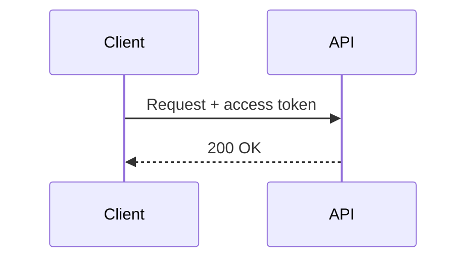

# ACRR — Advanced Computing & Robotics Research

A static, English-language research and technical publishing site. It has six sections: **Home**, **Blog**, **Series**, **Learning**, **Insights** and **About**, plus a **Tags** index (linked from the footer and from every tag). There is no backend and no database. The site is built with Astro, content lives in Markdown/MDX files with validated frontmatter, and the output is a folder of plain files (`dist/`) that any static host can serve.

> **About the content.** The articles, series and insights in this repository are published content: none is marked `example` or `draft`. Series entries that have not been written are listed as "Planned". The `example` flag remains available for sample material (see [Draft versus example](#draft-versus-example)). **No founder biography, credentials, affiliations, publications, contact details or statistics have been supplied, so none appear on the site.** The five research areas are *proposed areas of interest*, not claims of active projects or a staffed laboratory. No Notion pages exist yet, so Learning entries show "Coming soon" and carry no link. See [Content rules](#content-rules).

The full specification is in [idea-plan.md](idea-plan.md).

## Requirements

- **Node.js 22.12 or newer** (this is what Astro 7 requires; `package.json` declares it in `engines`). Older Node versions, including Node 20, will not run this project.
- npm 9.6.5 or newer (bundled with Node 22).
- **Chromium for Playwright**, used at build time to render Mermaid diagrams to SVG. Install it once after `npm install` with `npx playwright install chromium` (on Linux CI, `npx playwright install --with-deps chromium`). Without it, `npm run dev` and `npm run build` fail on any page that contains a Mermaid diagram.

## Install and run

```sh
npm install
npx playwright install chromium   # once; renders Mermaid diagrams during the build
npm run dev
```

`npm run dev` starts the dev server on <http://localhost:4321>. In dev:

- **Draft content is visible** (labelled "Draft") so you can preview unfinished work. It is excluded from every production listing, route, RSS item, sitemap entry and search index.
- **Search does not work.** The search index is created by Pagefind *after* a production build, so the search dialog tells you to build first.

## Commands

| Command | What it does |
| --- | --- |
| `npm run dev` | Dev server with hot reload. Drafts are shown. |
| `npm run build` | `astro check` (type and template checks), then `astro build` (writes `dist/`), then `pagefind --site dist` (writes the search index to `dist/pagefind/`), then `scripts/check-site-url.mjs` (looks for `localhost` URLs in the sitemap and RSS feed, which appear when `SITE_URL` is not set). Fails on any type or content-schema error. Works with no setup for a local build; **set `SITE_URL` for every build you intend to deploy** (see [Site URL](#site-url-seo-sitemap-and-rss)). |
| `npm run build:local` | The same build, but `localhost` URLs in the sitemap and feed only print a warning, even in CI. For smoke tests that are not a deployment; do not deploy the resulting `dist/`. |
| `npm run preview` | Serves the already-built `dist/` locally, so you can test the real output, including search. Run `npm run build` first. |
| `npm run check` | Type and template checks only (`astro check`). |
| `npm run check:links` | Checks every internal `href`, `src` and `srcset` in `dist/` (including `#fragment` targets) against the built files. Exits non-zero on any broken link. Run a build first. |
| `npm run check:site-url` | Runs only the `localhost` guard on an existing `dist/` (`--allow-localhost` turns the failure into a warning). |

Typical release check: `SITE_URL=https://your-domain.example npm run build && npm run check:links`.

A plain `npm run build` with no `SITE_URL` succeeds locally and prints a warning that the sitemap and feed point at `localhost`; that `dist/` is fine for `npm run preview` but must not be deployed.

To stop a preview server that is still running in the background: `npx astro preview stop`.

## Project layout

```
src/
  content/
    blog/        Articles (.md / .mdx), one file per article
    series/      Series definitions (.md), one file per series
    insights/    Short-form pieces (.md)
  data/
    learning.json   Learning resource index (real URLs go here)
  content.config.ts Collection schemas (the source of truth for frontmatter)
  pages/            Routes (index, about, learning, blog/, series/, insights/, tags/, 404, rss.xml)
  layouts/          Base.astro (page shell) and Article.astro (article layout)
  components/       Header, Footer, SEO, Search, cards, badges, home sections
  components/home/research-areas.ts   The five proposed research areas (Home and About)
  lib/content.ts    Shared queries (drafts excluded in production), formatDate, slugify, tagSlug, getTagIndex
  lib/path.ts       publicPath(): the extensionless public route for Astro.url.pathname
  plugins/          remark-reading-time.mjs
  styles/           tokens.css (design tokens), global.css, prose.css
  components/Figure.astro          Captioned figure for diagrams in articles
  components/diagrams/             Inline SVG diagrams (generated, theme-aware)
public/             favicon.svg, robots.txt, CNAME (copied to dist/ unchanged)
scripts/generate-diagrams.py Regenerates src/components/diagrams from the article formulas
scripts/check-links.mjs      Internal link checker for dist/
scripts/check-site-url.mjs   Warns (local) or fails (CI/deploy) when the sitemap/RSS contain localhost URLs
scripts/series-review.mjs    Lists a series' articles and detects series that have just become complete
.claude/skills/series-review/SKILL.md   The series review procedure (criteria, severity, report format)
.claude/settings.json        Claude Code hook that starts the series review when a series is completed
.github/workflows/series-review.yml     The same review in GitHub Actions, reported as an issue
reviews/            Series review reports (reviews/<series-id>.md)
pagefind.yml        Search-indexing options
astro.config.mjs
```

## Writing content

Frontmatter is validated by `src/content.config.ts`. A missing required field, a wrong type, an unknown category or a series id that does not exist fails the build with a message naming the file. The file name (without extension) becomes the URL slug, so `src/content/blog/my-post.mdx` is served at `/blog/my-post`.

### Categories

`category` must be exactly one of: `Research Notes`, `Technical Tutorials`, `Engineering`, `AI and Machine Learning`, `Robotics and Control`, `Computing Systems`, `Mathematical Foundations`. To add a category, edit the `CATEGORIES` list in `src/content.config.ts`. Blog category pages (`/blog/category/<slug>`) are generated automatically for categories that have at least one published article. Tag pages work the same way, see below.

### Blog articles — `src/content/blog/<slug>.md` or `.mdx`

| Field | Required | Notes |
| --- | --- | --- |
| `title` | yes | String. |
| `description` | yes | One or two sentences. Used on cards, in `<meta name="description">` and in RSS. |
| `publishedAt` | yes | Date, e.g. `2026-10-11`. Archive and RSS are sorted newest first. |
| `updatedAt` | no | Date; shown as "Updated …" on the article. |
| `category` | yes | One of the categories above. |
| `tags` | no | List of strings. Default `[]`. Related articles are scored from shared tags and category. Each tag links to a generated page, `/tags/<slug>`, listing every published article and insight with that tag; `/tags` lists them all with counts. The slug drops accents and case (`Kálmán` → `kalman`), writes `+` as `plus` and `#` as `sharp`, so `C++` and `C#` stay distinct. Spelling variants that differ only in case or spacing (`Control Theory`, `control-theory`) share one page. Two tags that are genuinely different but would get the same slug fail the build with a message naming both. A tag used only by drafts has no page in production. |
| `draft` | no | `true` keeps the article out of production. Default `false`. |
| `example` | no | `true` labels the article as sample content (badge and notice). Default `false`. |
| `series` | no | The `id` (file name without `.md`) of a series in `src/content/series`. Must exist. |
| `seriesOrder` | no | Positive integer, the article's position in its series. |

```yaml
---
title: "Feedback and System Behavior"
description: "How closing the loop changes the speed of a first-order system and its sensitivity to disturbances."
publishedAt: 2026-09-20
category: "Robotics and Control"
tags: [control-theory, feedback]
series: foundations-of-control-systems
seriesOrder: 2
---
```

Article bodies support GitHub-flavoured Markdown, MDX, syntax-highlighted code blocks (Shiki, light and dark themes), and LaTeX maths via KaTeX: `$a^2$` inline and `$$ ... $$` as a block. Reading time is calculated automatically from the article text. Every article page also gets a "Contents" list built from its `##` and `###` headings (shown when there are at least two; beside the text on wide screens, and on phones and tablets a bar pinned to the top of the screen that shows the current section and opens the full list), older/newer article links based on publication date, and, for series articles, a series block with previous/next within the series.

**Diagrams.** Diagrams are inline SVG, so they render on the page without images, scripts or external services, and follow light and dark mode. There are two ways to add one.

*Mermaid* (easiest for flowcharts and sequence diagrams). Write a fenced code block with the language `mermaid` in any `.md` or `.mdx` article:

````md

````

At build time `rehype-mermaid` renders it to an inline SVG in headless Chromium (configured in `astro.config.mjs`, with the `neutral` theme and a compact layout). `src/plugins/rehype-mermaid-figure.mjs` wraps it in the diagram frame, and `prose.css` (the `.mermaid-svg` rules) recolours it with the site's tokens, so it follows dark mode. A diagram with a Mermaid syntax error fails the build, naming the file. Long labels wrap; very wide diagrams scroll sideways on narrow screens rather than shrinking below a readable size. Mermaid diagrams have no caption and are excluded from search excerpts, so explain them in the surrounding text.

*Hand-made SVG components* (for plots and engineering drawings). Each one is an Astro component in `src/components/diagrams/` that uses only the CSS classes defined under `.diagram-svg` in `src/styles/prose.css` (`ln`, `box`, `acc`, `mut`, `grid`, `band`, `region`, `dot`; text uses `small` and `var`), never hard-coded colours. Use it in an `.mdx` article inside the `Figure` component, which adds the caption:

```mdx
import Figure from '../../components/Figure.astro';
import ControlLoop from '../../components/diagrams/ControlLoop.astro';

<Figure caption="A closed loop: the controller acts on the error between reference and measurement.">
  <ControlLoop />
</Figure>
```

The existing diagrams are produced by `python3 scripts/generate-diagrams.py src/components/diagrams` (plot curves are computed from the formulas in the articles); edit the script and re-run it rather than editing the generated files. Each SVG has a `<title>` and `<desc>` for screen readers and is excluded from search excerpts; the caption is indexed. On narrow screens a diagram scrolls sideways instead of shrinking its labels.

### Series — `src/content/series/<id>.md`

| Field | Required | Notes |
| --- | --- | --- |
| `title`, `description` | yes | |
| `category` | yes | One of the categories above. |
| `objectives` | no | List of learning objectives. |
| `status` | no | `planned` (default), `in-progress` or `published`. Set this by hand; it is not inferred. |
| `plannedEntries` | no | List of `{ title, description? }` for entries not yet written. Shown as "Planned" with no link. |
| `example` | no | `true` labels the series as illustrative. |

The Markdown body below the frontmatter is shown as an introduction on the series page.

**Adding an entry to a series:**

1. Create the article in `src/content/blog/` with `series: <series-id>` and a `seriesOrder`.
2. If it was listed under `plannedEntries`, remove it from there so it is not shown twice.
3. Update the series `status` when it changes.

When the last planned entry is written, remove `plannedEntries` (or leave it empty) and set `status: "published"`. That is what "complete" means, and it starts the [automated series review](#automated-series-review).

The series page lists published articles in `seriesOrder`, then the remaining planned entries. Progress ("2 of 4 entries published") is computed from the published articles and the planned entries; drafts never count.

### Insights — `src/content/insights/<id>.md`

| Field | Required | Notes |
| --- | --- | --- |
| `title`, `description` | yes | |
| `publishedAt` | yes | Date. |
| `kind` | yes | `Concept explanation`, `Engineering observation`, `Comparison`, `Research question`, `Methodological note` or `Emerging idea`. |
| `tags` | no | List of strings. Same tag pages as for articles (`/tags/<slug>` lists both). |
| `draft`, `example` | no | Same meaning as for articles. |

Each insight should keep three things apart, as three `##` sections: **Established** (facts that are well supported), **Interpretation** (how those facts are read), and **Open questions**.

### Draft versus example

These are different flags and are independent:

- `draft: true` means *unfinished*. The entry exists only under `npm run dev`. It is absent from production pages, the blog archive, tag pages (a tag that only drafts use has no page), series pages, home page, RSS, sitemap and the search index.
- `example: true` means *sample content that is published*. It appears in production with an "Example" badge and a notice that it is not original research. The label is also carried outside the page body so that a sample is not mistaken for real work: `[Example]` in the browser `<title>` and in RSS item titles, an "Example article/insight/series:" prefix on the meta and Open Graph description, and an "Example" badge on search results. Remove the flag (and the "example" wording in the text) only when the content is real.

Do not publish invented material as real. When replacing sample content with real writing, delete the sample file rather than editing it into something that looks like research.

### Learning resources — `src/data/learning.json`

A JSON array. Each object needs a unique `id`:

| Field | Required | Notes |
| --- | --- | --- |
| `id` | yes | Unique string. |
| `title`, `description` | yes | |
| `topic` | yes | Entries are grouped by this on the page. |
| `type` | yes | `Study notes`, `Course`, `Book`, `External reference` or `Learning path`. |
| `status` | no | `planned` (default), `in-progress` or `published`. |
| `url` | no | A real, valid URL. **Leave it out until the resource actually exists.** |

An entry without `url` is shown as **Coming soon** with no link. The Learning page itself contains no editing instructions for visitors; this section is where they live. To publish a real resource (for example a Notion page once it exists), add its genuine `url` to the entry and set `status`; the page picks it up with an "Open resource" link and no redesign. Never put a placeholder or guessed URL here. An invalid URL fails the build.

### Home and About text

The five proposed research areas are defined once in `src/components/home/research-areas.ts` and used on both pages. The wording of the About page is in `src/pages/about.astro`. Personal information (biography, credentials, affiliations, contact details) should be added there only when the site's author supplies it.

## Site URL, SEO, sitemap and RSS

Set `SITE_URL` at build time to the site's public origin, with no trailing slash:

```sh
SITE_URL=https://your-domain.example npm run build        # macOS / Linux / Git Bash
$env:SITE_URL = "https://your-domain.example"; npm run build   # PowerShell
```

`SITE_URL` controls:

- `<link rel="canonical">` and `og:url` on every page (omitted on the 404 page);
- the absolute URLs in `sitemap-index.xml` / `sitemap-0.xml`;
- the absolute links in `rss.xml`.

If `SITE_URL` is not set the build falls back to `http://localhost:4321`, so that no domain is ever invented. In that mode canonical tags are deliberately **omitted**, and the sitemap and RSS contain `localhost` URLs. To make sure such a build cannot be deployed by accident, `npm run build` ends with `scripts/check-site-url.mjs` (after Pagefind, so a failure never leaves a `dist/` without a search index), which looks for a `localhost`, `127.0.0.1` or `*.localhost` URL in `dist/sitemap-*.xml` and `dist/rss.xml`:

- **Local build** (none of the variables below set): prints a warning and the build **succeeds**, so `npm run build` works on a fresh checkout. Use that `dist/` for `npm run preview`, never for deployment.
- **Deploy environment** (`CI`, `GITHUB_ACTIONS`, `NETLIFY`, `CF_PAGES` or `VERCEL` is set to a non-empty value other than `0` or `false`): the build **fails (exit 1)**. Set `SITE_URL` to the public origin.
- **Explicitly allowed** (`npm run build:local`, `ALLOW_LOCALHOST_BUILD=1`, or `--allow-localhost`): warning only, in every environment. For a CI smoke test that is not a deployment.

So **set `SITE_URL` for every production build**.

`public/robots.txt` lists `Sitemap: https://acrr.asia/sitemap-index.xml`; change it if the domain changes. The site assumes it is served from the root of its domain (there is no `base` path configured).

Every page has its own `<title>` and meta description, a skip link, one `<h1>`, and respects the visitor's light/dark preference.

## Search

Press `Ctrl+K` / `Cmd+K`, or use the Search button in the header. Search is Pagefind, which indexes the built HTML in `dist/` and loads on first use. It indexes published content pages only: articles, insights, series pages, About and Learning. The listing pages (home, the blog archive and category pages, the tags index and tag pages, the series and insights indexes) and the 404 page are not indexed, so a search returns each piece once, under its own title, rather than also returning the lists that link to it. Sample content shows an "Example" badge in the results. To keep a new listing page out of the index, pass `searchable={false}` to `Base.astro`; to keep a block inside an indexed page out of the excerpts, add `data-pagefind-ignore` to it. `pagefind.yml` excludes KaTeX's duplicate renderings of formulas so excerpts read correctly. Pagefind silently falls back to shorter prefixes of a word that is not on the site (searching "kalman" would otherwise match any page with a word starting "k"), so the dialog keeps only results whose page text contains every query term as the start of a word, plus simple inflections such as plurals and "-ing" forms. A word that is not on the site shows "No results". Esc closes the dialog on the first press.

## Deploying

`npm run build` produces a fully static site in `dist/`. Deploy that folder to any static host. No server-side runtime is required.

General notes (the details depend on your provider; no account or hosting service is configured in this repository):

- **Build settings.** Build command `npx playwright install --with-deps chromium && npm run build` (Chromium renders Mermaid diagrams), output directory `dist`, Node version 22.12 or newer, and the `SITE_URL` environment variable set to the public origin. On Netlify, Cloudflare Pages, Vercel and CI the build fails if `SITE_URL` is missing, which is intended: it stops a localhost sitemap and feed from being published.
- **Cloudflare Pages / Netlify.** Connect the repository (or upload `dist/`) with the settings above. Both serve a top-level `404.html` as the not-found page and resolve extensionless URLs such as `/blog` to `blog.html`.
- **GitHub Pages (the configured target: https://acrr.asia).** `.github/workflows/deploy.yml` runs on every push to `master` (and manually from the Actions tab): `npm ci`, `npx playwright install --with-deps chromium` (for Mermaid), `npm run build` with `SITE_URL=https://acrr.asia`, `npm run check:links`, then it uploads `dist/` and deploys it. `public/CNAME` (copied to `dist/CNAME`) sets the custom domain. GitHub Pages serves `blog.html` for `/blog` and uses `404.html` as the not-found page. One-time setup, done by the repository owner:
  1. **Settings → Pages → Build and deployment → Source: GitHub Actions.**
  2. **Settings → Pages → Custom domain:** `acrr.asia`, then tick **Enforce HTTPS** once the certificate has been issued (this can take a while after DNS is correct).
  3. **DNS at the registrar for `acrr.asia`:** four `A` records for the apex `@` pointing to `185.199.108.153`, `185.199.109.153`, `185.199.110.153` and `185.199.111.153`; optionally four `AAAA` records to `2606:50c0:8000::153`, `2606:50c0:8001::153`, `2606:50c0:8002::153` and `2606:50c0:8003::153`; and, for `www.acrr.asia`, a `CNAME` record pointing to `<owner>.github.io` (the GitHub account or organisation that owns the repository). Remove any other `A`/`AAAA`/`CNAME` records for those names.
  4. Optional but recommended: verify the domain under the account's or organisation's **Settings → Pages → Verified domains**, which prevents anyone else from claiming it on GitHub Pages.

  The routes assume the domain root, so do not serve the site from a project sub-path (`<owner>.github.io/<repo>`) without configuring `base` in `astro.config.mjs`.
- **Any other static host / your own server.** Serve `dist/` as-is. Routes are *extensionless* (`/blog`, `/blog/<slug>`) and the files are named `blog.html`, `blog/<slug>.html` (Astro `build.format: 'file'`). The host must try `<path>.html` for a request to `<path>`. In nginx that is `try_files $uri $uri.html $uri/ =404;`, and the not-found page is `404.html`.
- Run `npm run check:links` before deploying to catch broken internal links.

## Automated series review

When a series is completed, every article in it is reviewed as a whole for technical accuracy, factual consistency, concept introduction, stated versions and defaults, logical flow, terminology, cross-article references, completeness, writing quality and fit with the series objectives and the [content rules](#content-rules). The review produces a report with findings and recommended corrections; it never edits the articles itself.

**What "complete" means.** The series file has `status: "published"` and no `plannedEntries`. The review is triggered by the *transition* to that state, so it runs once per completion, not on every later edit. To review a series again, run it by hand (below).

### Components

| Piece | Role |
| --- | --- |
| `.claude/skills/series-review/SKILL.md` | The review itself: how to collect the series, the mechanical checks (build, link check, diagram widths, recomputable values), the review dimensions (including whether each concept is introduced before its details and whether examples state the versions and conventions they assume), severity levels, and the report format. Both triggers below run this one procedure. |
| `scripts/series-review.mjs` | Dependency-free helper. `list <id>` prints the series and its articles in reading order, with warnings (gaps in `seriesOrder`, drafts, incomplete series). `detect <base> [head]` prints the ids of series that became complete between two commits. `hook` is the Claude Code hook entry point. |
| `.claude/settings.json` | A Claude Code `PostToolUse` hook on `Edit` and `Write`. When an edit leaves a file in `src/content/series/` complete and the committed version (`HEAD`) was not, the hook adds a note to Claude's context naming the series and the skill, so Claude runs the review before the change is committed. Otherwise it does nothing. |
| `.github/workflows/series-review.yml` | GitHub Actions. On a push to `master` that touches `src/content/series/`, it runs `detect` on the pushed range and, for each series that became complete, runs the skill with the official `anthropics/claude-code-action@v1`, uploads the report as an artifact and opens an issue titled "Series review: <title>". It can also be run by hand for any series. |
| `reviews/<series-id>.md` | The report. Each run overwrites the previous report for that series. Commit it if you want to keep a record. |

The two triggers cover different paths: the hook catches a series completed during a Claude Code session, and the workflow catches every completion that reaches `master`, however it was made (by hand, by Claude without the hook, or by merging a pull request).

### Setup

- **Claude Code (local or cloud sessions):** nothing to install. Claude Code reads `.claude/settings.json` and `.claude/skills/` from the repository. Node is already required by the project. Hooks in project settings may need to be approved once, depending on your Claude Code configuration (`/hooks` shows the active hooks).
- **GitHub Actions:** add a repository secret named `ANTHROPIC_API_KEY` (**Settings → Secrets and variables → Actions → New repository secret**). To use a Claude subscription instead of an API key, create a token with `claude setup-token`, store it as `CLAUDE_CODE_OAUTH_TOKEN`, and in the workflow replace the `anthropic_api_key` line with `claude_code_oauth_token: ${{ secrets.CLAUDE_CODE_OAUTH_TOKEN }}`. The workflow uses the built-in `GITHUB_TOKEN` with `issues: write` to open the issue; no other permission is granted. Without the secret, the detection job still runs, but the review job fails at the Claude step.

### Configuration

- **Review criteria, severity levels and report format:** edit `.claude/skills/series-review/SKILL.md`. It is ordinary Markdown and is versioned with the content it reviews.
- **What Claude may do in CI:** the `--allowedTools` list in `claude_args` in the workflow. It allows reading the repository, writing only under `reviews/`, and running `npm run build:local`, `npm run check:links`, `node scripts/series-review.mjs`, `git rev-parse` and `mkdir -p reviews`. Anything else is refused. In particular, CI cannot recompute hashes or numerical examples, so such values appear in the report's "Not verified" list. Run the review in a Claude Code session to have them checked.
- **Model, turn limit and other CLI options:** add them to `claude_args` (for example `--model <model-id>` or `--max-turns <n>`).
- **Trigger branch and paths:** the `on:` block in the workflow.

### Running it

- **Automatically in Claude Code:** complete a series (set `status: "published"`, remove `plannedEntries`). The hook asks Claude to run the review, and Claude replies with the report path and the blocking findings.
- **Automatically on GitHub:** push or merge a commit that completes a series to `master`. The review runs as the **Series review** workflow and opens an issue.
- **By hand in Claude Code:** `/series-review <series-id>`, or ask Claude to "review the <title> series".
- **By hand on GitHub:** **Actions → Series review → Run workflow**, with the series id.

The review reads every article in full, so it takes several minutes per series. The CI job also installs Chromium and builds the site.

### Validating the setup

1. Detection against history: `node scripts/series-review.mjs detect 5760f52 b45713e` prints `["identity-and-access-control"]` (the commit that completed that series), and `node scripts/series-review.mjs detect b45713e e3abd3f` prints `[]` (a commit that started a series without completing it).
2. Listing: `node scripts/series-review.mjs list identity-and-access-control` prints seven articles in order and no warnings.
3. The hook, without Claude Code: temporarily set an incomplete series to `status: "published"` and delete its `plannedEntries`, then run

   ```sh
   echo '{"tool_name":"Edit","tool_input":{"file_path":"'"$PWD"'/src/content/series/<id>.md"}}' | CLAUDE_PROJECT_DIR=$PWD node scripts/series-review.mjs hook
   ```

   It prints a JSON object whose `additionalContext` names the series and the skill. Restore the file with `git checkout -- src/content/series/<id>.md`. For an unchanged file, an already-complete series or a file outside `src/content/series/`, it prints nothing.
4. The workflow: once the secret is set, run **Series review** by hand for a completed series and check that the run uploads `series-review-<id>` and opens an issue.

### Why these tools

The available review plugins in the Anthropic plugin directory were assessed for this task. The official **code-review** plugin reviews code changes in pull requests, not long-form technical prose. The community **Proofread** plugin is limited to conservative proofreading, so it does not check technical accuracy, cross-article consistency or objectives. Other directory entries either review code, depend on other model providers, or connect to external services. None covers a series-level technical and editorial review, and adding a third-party plugin would add an unpinned dependency to the build path. The workflow is therefore built from first-party Claude Code features (a project skill, a hook, and the official GitHub Action) plus one script in the style of the existing `scripts/`. It adds no npm dependency, and the review criteria live in the repository next to the content rules they enforce.

## Content rules

These are acceptance criteria for this project, not suggestions:

- English only.
- Never fabricate a founder biography, credentials, affiliations, publications, collaborators, contact details, statistics, readership or citation figures, research results, project counts, or external URLs. Missing data stays missing.
- Sample content, if any is added, is labelled (`example: true`); unfinished content is `draft: true`; planned content is labelled "Planned" or "Coming soon".
- Research areas are interests, not active projects. Do not overstate ACRR's size, activity or achievements.
- Any statistic shown on the site must be computed from real content (the home page counts, for example, are computed from the content collections).
- Technical writing must be original and technically correct.
