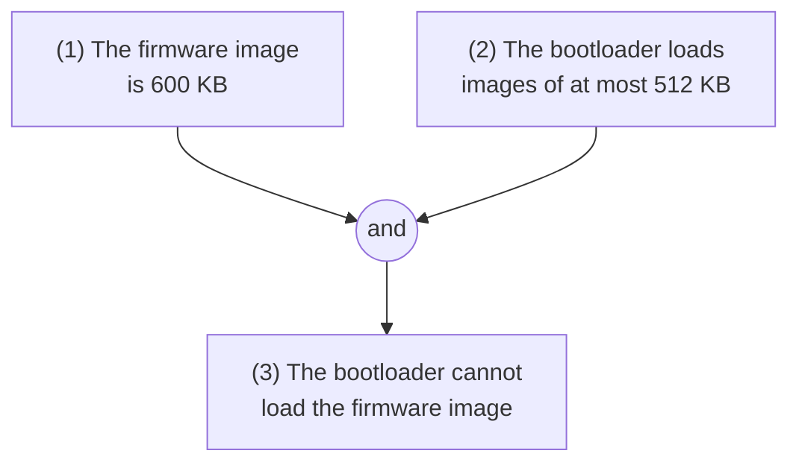
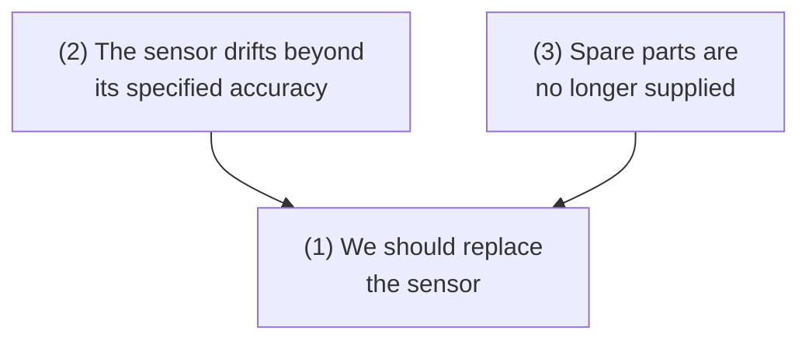
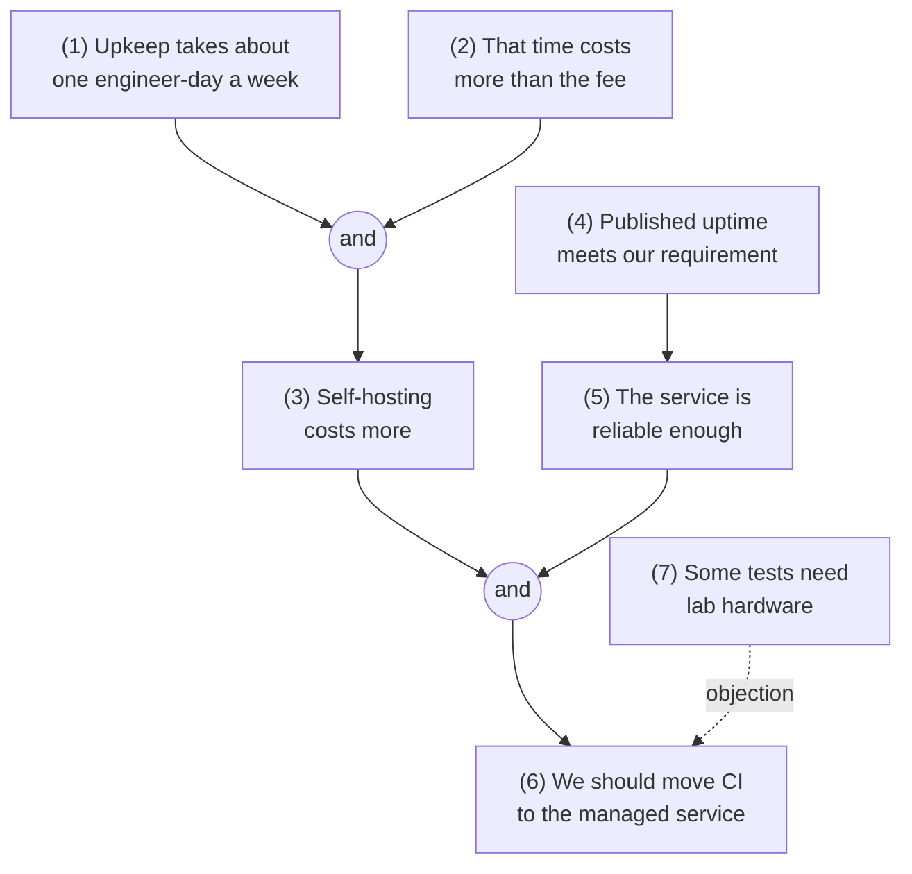

The [first entry](/blog/what-is-critical-thinking) of this series described critical thinking as judging claims by the reasons offered for them, and the [second entry](/blog/meaning-clarity-and-definitions) showed how to make a claim clear enough to judge. This entry turns to the reasons themselves. In ordinary speech, writing and technical documents, reasons are offered in the form of arguments. Most of the work of evaluating a claim consists of finding the argument behind it, setting it out so that its structure is visible and asking whether its parts hold up.

Section 1 says what an argument is and how to recognize one. Section 2 introduces the standard format for writing an argument out, and Section 3 shows how argument maps display the structure of longer reasoning. Sections 4 and 5 define deductive validity and soundness and list a few common valid and invalid patterns. Section 6 deals with hidden assumptions, and Section 7 with inductive and analogical arguments, which aim at probable rather than certain conclusions. Section 8 draws these together into an account of what makes an argument good, and Section 9 applies it to arguing with other people. The logical symbols $\neg$, $\land$, $\lor$ and $\to$ (not, and, or, if ... then) are used informally; the fourth entry introduces them and the sixth gives them precise meanings.

## 1. What an argument is

### 1.1 Premises and conclusion

In logic, an **argument** is a set of statements in which some, the **premises**, are offered as reasons for accepting another, the **conclusion**. The word names a structure, not a quarrel. A design document that recommends one architecture over another is an argument in this sense even if no one has yet disagreed with it, and so is a proof in a textbook.

Here is a short argument:

> The motor driver is rated for at most 2 A of continuous current. The new motor draws 3 A continuously under full load. So the driver cannot run the new motor continuously at full load.

The first two sentences are premises and the third is the conclusion. Each part is a statement, true or false, in the sense of the second entry, Section 1.1. A question or a command is not a statement, so it cannot be a premise or a conclusion as it stands, though a rhetorical question often stands in for one.

### 1.2 Indicator words

There is no mechanical procedure for finding arguments in text, but certain words often signal their parts. **Premise indicators** include "since", "because", "for", "given that", "as shown by" and "after all". **Conclusion indicators** include "therefore", "so", "hence", "thus", "consequently", "it follows that" and "which shows that".

Indicators are clues, not proof. "For" introduces a premise in "restart the job, for the lock has expired" but a purpose in "a script for nightly backups", and "so" means "very" in "the build is so slow". Many arguments use no indicator at all, and the reader must work out from context which statement the others are meant to support. A useful question is: what is the author trying to get me to believe, and what do they offer as grounds for it?

### 1.3 What is not an argument

Many passages contain statements without containing an argument.

- **A report or description** lists facts without offering any of them as grounds for another: a changelog, a test log, a narrative of an incident in time order.
- **A conditional statement** is a single claim, not an argument. "If the cache is cold, the first request is slow" asserts a connection but does not conclude that the first request is slow.
- **An explanation** looks like an argument but has a different job. "The build failed because the disk was full" usually does not try to convince anyone that the build failed; that is already accepted. It says why it failed. In an argument the conclusion is in question and the premises support it; in an explanation the conclusion is accepted and the premises account for it.

The same sentence can do either job depending on context. "The bridge is safe because it was inspected last month" is an argument if someone doubts the bridge's safety and an explanation (a rather weak one) if someone asks why the bridge is safe. Telling which job is intended matters because the two are evaluated differently: an argument is judged by whether it makes its conclusion credible, an explanation by whether it identifies the actual cause.

## 2. The standard format

### 2.1 Writing an argument out

To analyze an argument, write it in the **standard format**: each premise on its own numbered line, followed by the conclusion, marked off by a line or by "therefore".

1. The motor driver is rated for at most 2 A of continuous current.
2. The new motor draws 3 A continuously under full load.
3. A driver cannot run a motor continuously if the motor draws more continuous current than the driver's rating.

Therefore, the driver cannot run the new motor continuously at full load.

The third premise was not stated in the original passage. Writing the argument out exposed it, which is one of the main benefits of the format (Section 6 treats such hidden premises systematically). Rewriting also involves small changes that preserve meaning: turning a rhetorical question into the statement it implies, replacing pronouns with what they refer to, dropping repetition and removing remarks that do not contribute to the reasoning.

### 2.2 The principle of charity

When a passage can be reconstructed in more than one way, the **principle of charity** says to choose the reconstruction that makes the argument as strong as the text allows: the plausible reading of an ambiguous premise, the most reasonable unstated assumption. The reason is not politeness. Refuting a weak version of an argument that its author did not intend, a **straw man**, leaves the real argument standing, and the reasoner who does it learns nothing. Charity has a limit, though: the reconstruction must still be a fair reading of what was said, not a better argument that the reader has invented.

### 2.3 Worked example: a design review comment

A reviewer writes: "Why are we polling the sensor every millisecond? The temperature cannot change meaningfully in less than a second, given the thermal mass of the enclosure, and every poll wakes the processor and costs battery life. We should poll once a second."

In standard format:

1. The temperature inside the enclosure cannot change meaningfully in less than a second (because of its thermal mass).
2. Polling more often than the measured quantity can change gives no useful information.
3. Every poll wakes the processor and consumes battery energy.
4. A design should not spend energy on polls that give no useful information.

Therefore, the sensor should be polled about once a second rather than every millisecond.

The rhetorical question has become part of the conclusion, the parenthetical "given the thermal mass" has become support for premise 1, and premises 2 and 4 make explicit the principles the reviewer relied on. Each premise can now be checked separately. Premise 1 is a physical claim that a quick estimate of the enclosure's thermal time constant could test. Premise 2 is the one most open to challenge: fast polling might be needed for filtering noise, or the sensor might be shared with a faster control loop.

## 3. Argument maps

### 3.1 Linked and independent premises

Longer arguments have internal structure: some premises work only in combination, others support the conclusion separately, and some conclusions serve as premises for further conclusions. Drawing that structure gives an **argument map**: statements in boxes, with arrows running from each reason to whatever it supports.

Premises are **linked**, or **co-premises**, when they support the conclusion only together, so that removing one destroys the support of the others. In the map below, neither premise alone says anything about whether the bootloader can load the image; the two together settle it. The junction node shows that the arrows combine before reaching the conclusion.

Premises are **independent**, or convergent, when each supports the conclusion on its own. If one is removed, the other still gives some support, and the argument is weakened rather than destroyed.

The distinction matters for evaluation. Refuting one independent premise only weakens the case; refuting one linked premise defeats the whole group it belongs to.

### 3.2 Chains and complex arguments

In a **chain**, or multi-layered argument, a conclusion supported by some premises becomes a premise for a further conclusion. The intermediate statements are **intermediate conclusions**, and the statement at the top is the **main conclusion**. A **complex argument** combines linked groups, independent reasons and chains. A map can also show an **objection**, a reason against a statement, with a different kind of arrow.

### 3.3 Worked example: moving continuous integration

A team lead argues: "We should move our continuous-integration (CI) builds to the managed service. Keeping our own build machines running takes about one engineer-day every week, and that time costs us more than the service's fee for our usage, so self-hosting is the more expensive option. The service's published uptime is also above what we need. The one concern is that some tests use the hardware rigs in our lab, which the managed service cannot reach."

The map shows several things the paragraph leaves implicit. Statements (3) and (5) are linked: a cheaper service that is not reliable enough, or a reliable one that costs more, would not support the conclusion. Statement (5) rests on a single premise, (4), which is a weak point: published uptime is a vendor's claim about the past, and the team's requirement may concern things the uptime figure does not measure, such as queue time at peak hours. The objection (7) is not answered by anything in the argument. A complete case would either answer it (for instance by keeping a small self-hosted runner for the hardware tests) or narrow the conclusion to the builds that do not need the lab.

Drawing a map forces decisions that reading does not: what exactly each statement says, which statements work together and where the conclusion lies. That is its main value. The educational researcher Tim van Gelder has argued that practice in argument mapping is an effective way to develop reasoning skill (van Gelder, 2005).

## 4. Deductive validity

### 4.1 The definition

Some arguments aim to make their conclusion certain, given the premises. The standard of success for such an argument is validity. An argument is **deductively valid**, or **valid** for short, if and only if there is no possible situation in which all of its premises are true and its conclusion is false. Equivalently, if the premises are true, the conclusion must be true. An argument that is not valid is **invalid**.

The motor-driver argument of Section 2.1 is valid: no situation makes all three premises true while the driver can run the motor continuously. Compare:

1. If the server is overloaded, response times rise.
2. Response times have risen.

Therefore, the server is overloaded.

This is invalid. A situation in which both premises are true and the conclusion false is easy to describe: response times rose because of network congestion while the server was idle. Describing such a situation, a **counterexample** to the argument, is the standard way to show invalidity. Whether the scenario actually occurred is beside the point; what matters is that nothing in the premises rules it out. Even if the server is in fact overloaded, the argument is invalid, because its premises would be true in the congestion scenario as well.

### 4.2 Validity is not truth

Validity concerns the connection between premises and conclusion, not whether the statements are true. Every combination of truth values is possible for valid arguments except one: true premises with a false conclusion.

| Argument | Premises | Conclusion | Valid? |
|---|---|---|---|
| Every integer divisible by 4 is even. 12 is divisible by 4. So 12 is even. | true | true | valid |
| Every prime number is odd. 7 is prime. So 7 is odd. | one false | true | valid |
| Every prime number is odd. 2 is prime. So 2 is odd. | one false | false | valid |
| Some primes are odd. 9 is odd. So 9 is prime. | true | false | invalid |
| Some primes are odd. 7 is odd. So 7 is prime. | true | true | invalid |

The second and third rows have the same form, which is why they are both valid; the first premise ("every prime is odd") is false because of 2, and the conclusion happens to be true in one case and false in the other. The last two rows also share a form; that form is invalid, as the fourth row shows, so the fifth row is invalid even though everything in it is true. Two consequences are worth memorizing:

- An argument with true premises and a true conclusion may still be invalid.
- A valid argument may have false premises and a false conclusion.

That validity depends on form, the shared pattern of the second and third rows, is the subject of the [next entry](/blog/what-logic-studies).

### 4.3 Soundness

Validity alone does not establish a conclusion, because a valid argument can start from false premises. An argument is **sound** if it is valid and all its premises are true. The conclusion of a sound argument must be true. Soundness can be lost in two ways, which can occur together: the premises fail to support the conclusion, or one of them is false. An argument with either failure is **unsound**. Showing that the conclusion is false proves that one of the two failures is present without saying which.

### 4.4 Some puzzling cases

The definition of validity has consequences that surprise newcomers. An argument whose conclusion repeats a premise ("the build passed, so the build passed") is valid, since its premise cannot be true with its conclusion false. An argument with premises that cannot all be true together is valid whatever its conclusion, since no situation makes all its premises true. An argument whose conclusion cannot be false ("the tests pass; therefore every integer is even or odd") is valid whatever its premises. All three satisfy the definition while giving no reason to believe anything new; Section 8 says what they lack. The definition is kept anyway because it is the one on which the formal methods of entries four to seven are built, and because the odd cases rarely arise in practice. (Relevance logics, which add a requirement that premises and conclusion share content, are one alternative studied by logicians.)

## 5. Common patterns

Certain argument forms occur so often that they have names. In the table, $P$, $Q$ and $R$ stand for any statements, and the line before "therefore" lists the premises.

| Name | Premises | Therefore | Valid? |
|---|---|---|---|
| Modus ponens | $P \to Q$; $P$ | $Q$ | valid |
| Modus tollens | $P \to Q$; $\neg Q$ | $\neg P$ | valid |
| Hypothetical syllogism | $P \to Q$; $Q \to R$ | $P \to R$ | valid |
| Disjunctive syllogism | $P \lor Q$; $\neg P$ | $Q$ | valid |
| Constructive dilemma | $P \lor Q$; $P \to R$; $Q \to R$ | $R$ | valid |
| Affirming the consequent | $P \to Q$; $Q$ | $P$ | invalid |
| Denying the antecedent | $P \to Q$; $\neg P$ | $\neg Q$ | invalid |

Modus tollens is the logic of a failed test: if the design were correct, the test would pass ($P \to Q$); the test failed ($\neg Q$); so the design is not correct ($\neg P$). Affirming the consequent is the logic of a passed test treated as proof: if the design were correct, the test would pass; the test passed; so the design is correct. The second inference is invalid, because a test can pass for an incorrect design. This asymmetry, that failures refute and successes do not prove, is central to the eighth entry's account of scientific testing.

A related method is **reductio ad absurdum**: to show that a statement is false, assume it and derive a contradiction or a statement known to be false. Euclid's proof that there is no largest prime is usually presented in this shape. Assume there is a largest prime; multiply all the primes together and add 1; the result leaves remainder 1 when divided by every prime on the list, so its prime factors are not on the list, contradicting the assumption. The sixth entry, [Sentential Logic](/blog/sentential-logic), shows why these patterns are valid and gives a method for proving others.

## 6. Hidden assumptions

### 6.1 Arguments with missing premises

Arguments in real life are usually incomplete. Speakers leave out premises they consider obvious, and sometimes premises they would rather not defend. An unstated premise that an argument needs is a **hidden assumption**, and an argument with one is sometimes called an **enthymeme**.

To find one, imagine being asked by the speaker to complete the argument. What sentence would you have to add for the conclusion to follow? There is usually more than one candidate, and they differ in strength. For "we should cache this query, since it is slow", the bridge could be "every slow query should be cached" (strong enough to give validity, and false) or "this query is slow, frequent and returns data that changes rarely, and such queries should be cached" (more plausible, but adding premises the speaker has not yet supported). Charity (Section 2.2) points to the candidate the speaker would actually endorse that makes the argument as good as possible; honesty points to stating it plainly, so that it can be checked.

Once stated, the assumption is a premise like any other, and it is often the weakest one. That is frequently why it was left unstated.

### 6.2 Worked examples

**"This library is safe to use: it has more than 10,000 stars on its code-hosting page."** Made valid, the argument needs an assumption such as "any library with more than 10,000 stars is safe to use". Stated plainly, the assumption is false: popularity measures attention rather than security review. Widely used libraries have shipped serious vulnerabilities. A weaker assumption, that popular libraries are more likely to have had their bugs found and fixed, turns the argument into an inductive one with some force but leaves the conclusion far from established.

**"The model is ready for deployment: it scores 97% accuracy on the test set."** The argument has at least three hidden assumptions. The test set must represent the inputs the model will see in deployment. Accuracy must be the right measure for this use, although it can hide poor performance on a rare but important class. And 97% must meet the requirement. Each is a separate question, and the argument is only as good as the weakest of them.

### 6.3 Background conditions behind a named cause

A failure report says: "The weld failed because it was overloaded." The load is named, but a load breaks a weld only in combination with other things: the weld's real strength, which a hidden porosity defect may have reduced, and the temperature of the steel, which affects its toughness. These **background conditions** are taken for granted by the report, and listing them can change the remedy. If a defect is present, limiting the load treats the symptom, and the welding procedure is what should change. The eighth entry develops this idea with causal diagrams.

## 7. Inductive and analogical arguments

### 7.1 Inductive strength

Many good arguments are not valid. Consider:

1. A batch contains 10,000 resistors, of which 10 are out of tolerance.
2. This resistor was drawn at random from the batch.

Therefore, this resistor is within tolerance.

The conclusion could be false with both premises true: the resistor might be one of the 10. But given the premises, the probability that the conclusion is true is $9990/10\,000 = 0.999$. An argument is **inductively strong** if its conclusion is highly probable given its premises, and **inductively weak** otherwise. Arguments that aim at strength rather than validity are called **inductive** arguments in this series. (Some textbooks reserve "induction" for generalizing from samples; here it covers every argument whose premises make the conclusion probable without guaranteeing it.)

### 7.2 How strength differs from validity

Three differences matter.

- **Strength comes in degrees.** Validity is all or nothing; an argument cannot be slightly valid. Strength varies continuously: if the batch had 1,000 bad resistors, the probability would be 0.9 and the argument weaker; with 5,000 it would be 0.5 and the argument worthless.
- **Strength can be destroyed by new information.** Adding any premise to a valid argument leaves it valid. Adding a premise to a strong argument can make it weak. If we learn that the resistor came from the reject bin, the original premises are still true but the conclusion is no longer probable. For this reason an inductive argument should use all the relevant evidence available, a requirement often called the **principle of total evidence**.
- **Strength does not guarantee truth.** A strong argument with true premises can have a false conclusion. Over many such arguments some conclusions will be false, and that is not a sign of bad reasoning.

The main kinds of inductive argument are generalization from a sample, prediction from past regularities, causal inference and inference to the best explanation (the eighth entry, Section 3, treats choosing between explanations). They are the subject of entries eight and nine, which give the methods and the probability theory for judging how strong they are (Skyrms, 2000).

### 7.3 Arguments from analogy

An **argument from analogy** moves from resemblance to resemblance: $A$ and $B$ match in certain respects, $A$ has a further property, so $B$ has it too. Written out, it has this form:

1. $A$ and $B$ share properties $F_1, \ldots, F_n$.
2. $A$ has property $G$.

Therefore, $B$ has property $G$.

Analogies are common in engineering. A team might argue: "Our grasping policy succeeded in 95% of trials in simulation; the simulated robot matches the real one in kinematics, mass and gripper geometry; so the policy will succeed at a similar rate on the real robot." Since any two things resemble each other in some ways, counting resemblances proves nothing. Three questions do the work.

1. **What does $G$ depend on?** Grasp success depends on geometry and mass, but also on friction at the fingertips, contact dynamics, sensor noise and lighting for the camera. Listing these is the step most often skipped.
2. **Is each of those factors shared, and has that been checked?** Matching kinematics is easy to verify; matching friction coefficients usually is not, and a match that was assumed rather than measured adds little.
3. **Which known differences bear on $G$?** Simulators typically model friction, contact and sensing imperfectly, and these are among the factors listed under question 1. Robotics researchers call the resulting drop in performance the sim-to-real gap.

The argument is as strong as the answers allow. Here it supports a weak conclusion (the policy is worth testing on the real robot) much better than the strong one it states. Logic textbooks give longer checklists for analogies, covering for example the number and variety of the cases compared (Copi et al., 2011).

## 8. What makes an argument good

Validity and strength describe only the link between premises and conclusion. To see what else a good argument needs, consider what an argument is for: it is offered to someone who does not yet accept the conclusion, and it succeeds if a reasonable person in that position should come to accept it. Three conditions follow from that purpose. Govier's widely used textbook organizes argument evaluation around a similar three-part scheme of acceptability, relevance and adequate grounds (Govier, 2010).

1. **Credible premises.** The doubter must have better grounds for the premises than for the conclusion; otherwise the argument moves nothing. True premises are the target, but in practice the test is evidence for each premise that is independent of the conclusion. This condition is what an argument that **begs the question** violates: one of its premises can only be accepted by someone who already accepts the conclusion. The extreme case, a conclusion that repeats a premise, is valid (Section 4.4) and can even be sound, yet it cannot persuade. Subtler cases need not be valid at all. "The logging system is accurate, because its own audit log reports no errors" is not valid as stated, but its premise is credible only to someone who already trusts the logging system.
2. **A working connection.** The premises must make the conclusion certain (validity) or probable (strength), and they must do so by being about the conclusion. In two of the puzzling arguments of Section 4.4, validity comes only from a conclusion that cannot be false or premises that cannot all be true; the premises do no work, and these arguments fail this condition. The third, a conclusion that repeats a premise, fails the first condition instead.
3. **No known defeaters.** For an inductive argument, the reasoner must not be ignoring available evidence that would weaken it: the principle of total evidence of Section 7.2.

These conditions also explain four inferences that are easy to make after a postmortem and are all mistakes.

- *"The vendor's case for the fix rested on a flawed benchmark, so the fix does not work."* A bad argument leaves its conclusion unsupported, not refuted. The fix may work; a proper test is needed to find out.
- *"Our reason for blaming the cache was wrong, so the cache was not involved."* The same error applied to a premise: one false premise sinks the argument, not the conclusion.
- *"The fix worked, so the reasoning in the design document was right."* A true conclusion can follow from bad reasoning, as the second row of the table in Section 4.2 shows. Whether the mechanism the document described is the one that operated is a separate question.
- *"Every fact in the report checks out and its recommendation is correct, so its argument is valid."* True premises and a true conclusion say nothing about the connection between them, as the fifth row of the same table shows.

## 9. Arguing with other people

The structure of Sections 1 to 8 doubles as a map of where two people can disagree. Writing a colleague's argument in standard format and marking the one line you reject converts "I disagree" into a specific request: evidence for premise 3, a definition of "reliable" (the second entry, Section 4) or a reason the inference holds. Disagreements located this way are much shorter than disagreements about conclusions.

Locating a disagreement is easier when the other side trusts that it has been understood. Daniel Dennett gives a procedure for this, which he credits to the social psychologist Anatol Rapoport (Dennett, 2013). In paraphrase, there are four steps in a fixed order. Restate the other person's position well enough that they would be happy to adopt your wording. Say where you agree, especially on points that are not obvious. Say what their view has taught you. Only then criticize. The rules apply charity (Section 2.2) to the whole exchange. They also have a practical payoff: a person who sees their view stated fairly is more likely to listen to the objection that follows, and the restatement often reveals that the disagreement is narrower than it seemed.

## 10. Exercises

**Exercise 1.** Does each passage contain an argument? If so, identify the conclusion. (a) "The compiler emitted a warning on line 40 and an error on line 52." (b) "We should not merge this today, since the release is tomorrow and the change has not been tested on the target hardware." (c) "The fan failed because its bearing seized."

*Answer.* (a) No; it is a report. (b) Yes; the conclusion is "we should not merge this today". (c) Usually an explanation, not an argument: it accounts for an accepted fact rather than establishing it.

**Exercise 2.** Write in standard format, adding any hidden premise needed for validity: "The robot cannot have reached the dock: its battery log shows it was below 5% charge at the far end of the warehouse."

*Answer.* (1) The battery log shows the robot below 5% charge at the far end of the warehouse. (2) The battery log is accurate. (3) A robot below 5% charge at the far end cannot travel to the dock. Therefore, the robot did not reach the dock. Premises (2) and (3) were hidden; (3) is the one to check, since it depends on the distance and the robot's energy use.

**Exercise 3.** Valid or invalid? For each invalid argument, describe a counterexample situation. (a) If the patch is applied, the vulnerability is closed. The vulnerability is not closed. So the patch was not applied. (b) If the patch is applied, the vulnerability is closed. The patch was not applied. So the vulnerability is not closed. (c) Either the fuse or the switch is faulty. The fuse is not faulty. So the switch is faulty.

*Answer.* (a) Valid (modus tollens). (b) Invalid (denying the antecedent): the vulnerability could have been closed by a configuration change without the patch. (c) Valid (disjunctive syllogism).

**Exercise 4.** True or false? Explain. (a) Every sound argument has a true conclusion. (b) An argument whose conclusion is true must be sound. (c) An invalid argument can have true premises and a true conclusion. (d) If an argument is valid and its conclusion is false, at least one premise is false.

*Answer.* (a) True: a sound argument is valid with true premises, so its conclusion cannot be false. (b) False: the second row of the table in Section 4.2 has a true conclusion and a false premise. (c) True: the fifth row of that table. (d) True: if all premises were true, validity would make the conclusion true.

**Exercise 5.** Draw an argument map (on paper) for: "We should add a second temperature sensor. A single sensor gives no way to detect its own failure, and a silent sensor failure could let the heater overheat the tank. Besides, the customer's safety standard requires redundant sensing for heaters of this power." Are the premises linked or independent?

*Answer.* Two independent lines support the conclusion. The first is a linked pair: "a single sensor cannot detect its own failure" and "an undetected sensor failure could let the heater overheat the tank" together support an intermediate conclusion such as "a single sensor is unsafe", which supports the main conclusion. The second line is the single premise that the customer's standard requires redundant sensing. Refuting the first line would leave the second intact.

**Exercise 6.** Evaluate the analogy: "Our staging environment runs the same container images as production, so a release that works in staging will work in production."

*Answer.* The similarity (same images) is real and relevant, but there are important disanalogies: production has different data volumes, traffic patterns, configuration values, secrets, network topology and third-party integrations. The argument gives some reason for confidence but is far from strong. Practices such as gradual rollouts exist because the analogy often fails.

## 11. Summary

| Question | Answer |
|---|---|
| What is an argument? | Premises offered as reasons for a conclusion; distinct from a report, a conditional statement or an explanation. |
| How is an argument set out? | In the standard format, premises numbered and conclusion last, reconstructed charitably. |
| What does an argument map show? | Linked and independent premises, chains of intermediate conclusions and objections. |
| When is an argument valid? | When no possible situation makes all premises true and the conclusion false; shown invalid by a counterexample situation. |
| When is it sound? | When it is valid and all its premises are true; its conclusion is then true. |
| What is a hidden assumption? | An unstated premise needed for validity or strength, often the weakest part of the argument. |
| How does inductive strength differ from validity? | It comes in degrees, can be undermined by new evidence and does not guarantee a true conclusion. |
| What makes an argument good? | Premises more credible than the conclusion (so no question begging), a connection that makes the conclusion certain or probable through premises that do real work, and, for induction, no ignored evidence. |

The validity of the arguments in this entry was judged case by case, by imagining situations. That works for short arguments but does not explain why some arguments are valid. The [next entry](/blog/what-logic-studies) answers that question: it explains what logic studies, how validity depends on the form of an argument rather than its subject matter, and how consistency, entailment and equivalence are related.

### References

- I. M. Copi, C. Cohen and K. McMahon, *Introduction to Logic*, 14th ed., Pearson, 2011.
- D. C. Dennett, *Intuition Pumps and Other Tools for Thinking*, W. W. Norton, 2013.
- T. Govier, *A Practical Study of Argument*, 7th ed., Wadsworth, 2010.
- P. J. Hurley, *A Concise Introduction to Logic*, 12th ed., Cengage Learning, 2015.
- J. Y. F. Lau, *An Introduction to Critical Thinking and Creativity: Think More, Think Better*, Wiley, 2011.
- J. Y. F. Lau and J. Chan, *Critical Thinking Web*, Department of Philosophy, The University of Hong Kong, 2004–2026. https://philosophy.hku.hk/think/
- B. Skyrms, *Choice and Chance: An Introduction to Inductive Logic*, 4th ed., Wadsworth, 2000.
- T. van Gelder, "Teaching critical thinking: Some lessons from cognitive science," *College Teaching*, vol. 53, no. 1, pp. 41–46, 2005.
- A. Weston, *A Rulebook for Arguments*, 4th ed., Hackett, 2009.
