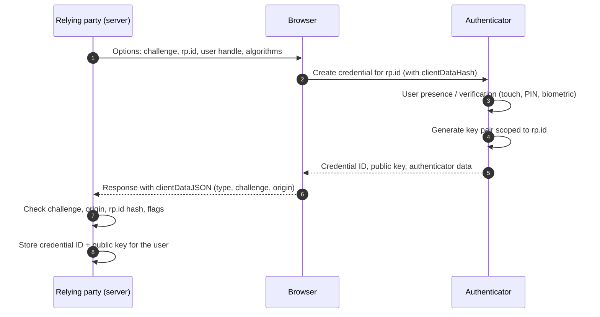

The [first entry](/blog/token-based-authentication) in this series treated authentication as a single box in a larger picture: a claimant proves control of an authenticator to a verifier, and the result is carried forward in a session or token. This entry opens that box. It asks, for each common kind of authenticator, three questions: *what secret exists, and where does it live?* *What exactly does the verifier check?* And *what can an attacker who sits in a particular place do with what they see?*

The answers explain the ordering that practitioners now give to authenticators, from passwords at the weak end to origin-bound public-key credentials at the strong end, and they explain why that ordering is about the structure of each protocol rather than about how long or random its secrets are.

The entry describes the algorithms as standardized in their RFCs, which are cited where they first appear. It also follows the password guidance of the United States digital identity guidelines as revised in 2017 and again in 2025 (Section 2.3), and Web Authentication (WebAuthn) Level 3, a Recommendation of the World Wide Web Consortium (W3C) since 2026.

## 1. A framework for comparing authenticators

### 1.1 Shared secrets and asymmetric keys

Every authenticator rests on a secret. The first and most important distinction is **who else knows it**.

- With a **shared secret**, the claimant and the verifier both hold something that lets them produce the proof. Passwords, personal identification numbers (PINs) checked by a server, and the seeds of one-time-code generators are shared secrets. Whoever steals the verifier's copy, or watches the claimant produce the proof, may be able to produce it too.
- With an **asymmetric key pair**, the claimant holds a private key and the verifier stores only the matching public key. The proof is a signature over a fresh challenge. The verifier's database contains nothing that lets anyone sign, and a recorded signature is useless for any other challenge.

### 1.2 Where attackers sit

An authenticator's strength depends on the attacker's position. Four positions recur:

| Attacker position | Example | What they obtain |
|---|---|---|
| Online guesser | A script submitting login attempts | Only the verifier's yes/no answers, at a rate the verifier controls |
| Database thief | A breach of the verifier's credential store | Every stored verifier record, to attack offline at unlimited speed |
| Phisher / relay | A look-alike site the user is tricked into using | Whatever the user types or approves, in real time |
| Endpoint compromise | Malware on the user's device | Potentially everything the device can do |

No authenticator survives full endpoint compromise; that boundary is set by the device, not the protocol. The interesting differences are in the first three rows.

### 1.3 The properties that matter

From these positions follow the properties used in the rest of the entry:

- **Resistance to online guessing**: does the secret space, combined with rate limiting, make guessing hopeless?
- **Resistance to verifier compromise**: after a breach of the server's store, can the attacker authenticate as users?
- **Replay resistance**: can a captured proof be used again?
- **Phishing resistance**: can a proof obtained by a fake site be used at the real one?

## 2. Passwords

### 2.1 What the verifier stores

A server that stores passwords in clear text hands every account to whoever reads its database. Storing a fast hash of each password is barely better. A **cryptographic hash function** such as SHA-256 maps any input to a short, fixed-size digest: recovering the input from the digest, or finding two inputs with the same digest, is infeasible, but computing the digest is fast. A modern graphics processor computes billions of SHA-256 hashes per second, so an attacker with the hash table tries common passwords against every account.

A verifier should instead store the output of a **password hashing function**, also called a key derivation function (KDF), designed to be slow and, ideally, memory-hard:

```text
salt   = random(16 bytes)                       # unique per account
record = (salt, parameters, KDF(password, salt, parameters))
```

On login the verifier recomputes `KDF(candidate, salt, parameters)` and compares the result in constant time. Three design elements carry the protection:

- The **salt** is random per account, so identical passwords produce different records and precomputed tables are useless; each account must be attacked separately.
- The **work factor** makes each guess cost the attacker the same time and memory that a login costs the server, which is negligible for one login and enormous for billions of guesses.
- **Memory hardness** (in Argon2id and scrypt) forces each guess to use a large amount of memory, which erodes the advantage of graphics processors and custom hardware over ordinary servers.

Argon2id (RFC 9106) is the usual first choice, and scrypt (RFC 7914) and bcrypt are acceptable. PBKDF2 (RFC 8018) is used where a standards-approved primitive is mandated and should then be run with a high iteration count. bcrypt ignores input beyond 72 bytes, which matters if long passphrases are permitted. Some deployments add a **pepper**: a secret key, held outside the database (for example in a hardware security module), mixed into every hash, so that a database stolen without the key cannot be attacked at all.

### 2.2 Guessing: online and offline

Password strength is best expressed as the number of guesses an attacker needs. If a password is drawn uniformly from $N$ possibilities, an attacker who makes $k$ guesses succeeds with probability $k/N$. Human-chosen passwords are not uniform: many users pick from a small set of common choices, so the first few thousand guesses succeed against a meaningful fraction of accounts.

Two regimes follow.

- **Online**, the verifier limits the rate. If it allows at most $k$ failed attempts per account before throttling or locking, a password needs only to lie outside the attacker's first $k$ guesses. Rate limiting is therefore the main defense against online guessing, and it must be applied per account and per source, because attackers also try one common password against many accounts (*password spraying*).
- **Offline**, after a breach, there is no rate limit except the hashing cost. Only passwords far from common choices survive, which is why slow hashing buys time to detect the breach and reset credentials.

**Credential stuffing** is a third case: the attacker does not guess at all but replays username and password pairs leaked from *other* sites. It succeeds because people reuse passwords, and neither hashing nor rate limiting on the victim site addresses that.

### 2.3 Password policy

The digital identity guidelines of the United States National Institute of Standards and Technology (NIST), Special Publication (SP) 800-63B, reversed much traditional advice in their 2017 revision, on the evidence that composition rules and forced periodic changes push users toward predictable patterns. The current revision, SP 800-63B-4 of 2025, keeps this guidance. The guidelines call for:

- allowing long passwords and passphrases, including spaces and any printable characters;
- **not** imposing composition rules such as "one digit, one symbol";
- **not** requiring periodic changes, but forcing a change when there is evidence of compromise;
- checking new passwords against lists of commonly used and previously breached values;
- limiting the number of consecutive failed attempts.

### 2.4 What a password cannot do

Even stored and chosen well, a password is a shared secret that the user types into whatever page asks for it. It offers no replay resistance against anyone who sees it, and no phishing resistance at all: a fake site receives exactly what the real one would. The remaining sections are, in effect, attempts to repair these two failures.

## 3. One-time codes

### 3.1 HOTP: a counter-based code

A one-time password (OTP) generator shares a secret key $K$ with the verifier and derives short codes from it with a **hash-based message authentication code** (HMAC): a hash computed over a message together with the secret key, so that only holders of the key can produce it. The HMAC-based one-time password algorithm (HOTP, RFC 4226) uses a counter $C$ that both sides increment:

$$
\mathrm{HOTP}(K, C) = \mathrm{Truncate}\big(\mathrm{HMAC\text{-}SHA\text{-}1}(K, C)\big) \bmod 10^{d}
$$

`Truncate` selects four bytes of the 20-byte HMAC output at an offset given by its last four bits and clears the top bit, producing a 31-bit integer; reducing it modulo $10^d$ gives a $d$-digit code, typically $d = 6$. Because HMAC is a pseudorandom function, seeing past codes reveals nothing useful about future ones. The verifier accepts a small window of counter values ahead of its own, to tolerate codes generated but never used, and then advances its counter past the accepted value.

### 3.2 TOTP: a time-based code

The time-based one-time password algorithm (TOTP, RFC 6238) replaces the counter with the current time step:

$$
C = \left\lfloor \frac{T - T_0}{X} \right\rfloor
$$

where $T$ is the current Unix time, $T_0$ is usually $0$, and $X$ is the step, usually 30 seconds. The code is $\mathrm{HOTP}(K, C)$. Authenticator apps use TOTP; the shared key is usually provisioned by scanning a QR (Quick Response) code at enrollment. The verifier typically accepts one step either side of the current one to tolerate clock drift, and it should record the last step accepted for each user so that the same code cannot be used twice.

### 3.3 What a one-time code adds, and what it does not

A one-time code is a second factor ("something you have"), and it removes the replay problem: a code seen today is useless tomorrow. With six digits there are $10^6$ possible codes. A verifier that accepts one step either side of the current one has three valid codes at any moment, so an online guesser allowed five attempts per time step succeeds with probability of about $15 / 10^6$ per step. The verifier must therefore rate-limit across steps too, or an attacker can keep trying.

Two weaknesses remain.

- **The seed is a shared secret.** The verifier stores $K$ in a form it can use, so a breach of the seed database lets the attacker generate every user's codes. Seeds should be encrypted with a key held outside the database.
- **The code is typed, so it can be relayed.** A phishing proxy that sits between the user and the real site forwards the password and then the code within the 30-second window, and receives the resulting session. Automated kits for this attack are widely available. One-time codes defeat password reuse and credential stuffing; they do not defeat real-time phishing.

### 3.4 Codes sent by SMS or email

A code sent by text message (SMS, the Short Message Service) or email is not generated from a seed the user holds; the verifier generates it and sends it over another channel. It inherits the weaknesses of that channel. Text messages can be redirected by persuading a mobile carrier to move a number to a new subscriber identity module (SIM) card (*SIM swapping*) or by abusing the signaling network between carriers; email codes are only as strong as the email account. NIST's guidelines, since the 2017 revision and still in revision 4, classify authentication over the public telephone network as *restricted*: usable, but with additional risk that the verifier must assess and disclose. SMS codes remain better than a password alone and worse than any authenticator the user holds directly.

## 4. Out-of-band approval

Push-based authenticators send a prompt to an app on a registered phone ("Approve sign-in?"), and the app answers over its own authenticated channel, often using a key pair held on the phone. Nothing is typed into the browser, so there is no code to phish.

The weakness moves to the human. An attacker who has the password can trigger prompts repeatedly until a tired or confused user approves one (*push fatigue*). A user approving a prompt also cannot tell whether the sign-in it belongs to was started by them or by a phishing proxy. With **number matching**, the browser shows a short number that the user must enter or select in the app. That ties the approval to a specific sign-in screen and stops blind approval, but it still does not prove that the screen the user sees is the genuine site. The prompt can also display the location and application requesting access, which helps a careful user and does not help a hurried one.

## 5. Public-key credentials: WebAuthn and passkeys

### 5.1 The idea

WebAuthn is a W3C standard. Together with the Client to Authenticator Protocol (CTAP) of the FIDO (Fast IDentity Online) Alliance, it lets a website ask the browser to create and use a key pair held by an **authenticator**: a security key, the platform's secure hardware, or a password manager. The pair of standards is known as FIDO2. Three design choices give it its properties:

1. **One key pair per site.** At registration the authenticator creates a fresh key pair scoped to the site's **relying party ID** (a domain such as `example.com`). The site stores only the public key and a credential identifier.
2. **The browser, not the user, names the site.** When signing, the browser includes the **origin** of the page that made the request (its scheme, host and port, such as `https://example.com`; the [third entry](/blog/sessions-and-cookies#31-origin-and-site) defines origins and sites precisely) in the data that is signed. The user cannot be talked into supplying the wrong origin, because the user never supplies it.
3. **A fresh challenge every time.** The site sends a random challenge, and the signature covers it, so no signature is valid twice.

### 5.2 Registration



The server checks that the returned `clientDataJSON` contains its own challenge and an expected origin, and that the authenticator data begins with the SHA-256 hash of its relying party ID. Optionally it can request an **attestation**: a statement, signed by the authenticator's manufacturer key, about what kind of authenticator created the credential. Most consumer sites do not need attestation; organizations that must restrict which hardware their staff use do.

### 5.3 Authentication

At sign-in the server sends a new challenge; the browser asks the authenticator to sign it with the credential for that relying party ID. The authenticator returns:

- **authenticator data**: the relying party ID hash, flags and a signature counter;
- the **signature**, computed over the authenticator data concatenated with the SHA-256 hash of `clientDataJSON`.

The server then verifies, in order:

1. `clientDataJSON.type` is `webauthn.get` and `challenge` equals the challenge it issued for this attempt (single use, short-lived).
2. `clientDataJSON.origin` is an origin the site expects.
3. The relying party ID hash in the authenticator data equals the hash of its own relying party ID.
4. The **user present** flag is set, and the **user verified** flag is set if the policy requires a PIN or biometric.
5. The signature verifies under the stored public key for this credential ID.
6. The signature counter has increased, if the authenticator maintains one (a counter that stays at zero is not used); a counter that fails to increase suggests a cloned authenticator.

### 5.4 Why this resists phishing

Suppose a user is lured to `examp1e.com`, a look-alike of `example.com`. Two independent mechanisms stop the attack:

- The authenticator holds no credential for the relying party ID `examp1e.com`, and the browser will not let that page request a signature for `example.com`, because a page may only use a relying party ID equal to, or a registrable suffix of, its own domain.
- Even if the fake page relays the real site's challenge, the browser writes `https://examp1e.com` into `clientDataJSON.origin`, which the real server rejects.

The defense does not depend on the user noticing anything. That is the meaning of *verifier-name binding*: the authenticator's output is bound to the identity of the site it was produced for.

### 5.5 Verifier compromise

The server stores public keys. A breach of its credential table discloses nothing that lets the attacker sign; there is nothing to crack and nothing to reuse at another site, because each site has its own key pair.

### 5.6 Passkeys

**Passkey** is the common name for a *discoverable* WebAuthn credential, one that the authenticator stores together with the user handle, so that the user can sign in without first typing a username: the site asks for "any credential for `example.com`" and the authenticator offers the ones it holds. With user verification (a device PIN or biometric performed locally), a passkey is itself a multi-factor authenticator: possession of the device plus something known or something one is.

Passkeys come in two forms.

- **Device-bound** passkeys never leave the authenticator, typically a hardware security key. Losing the device loses the credential.
- **Synced** passkeys are backed up and synchronized across a user's devices by the platform or a password manager, end-to-end encrypted. WebAuthn Level 3 adds *backup eligible* and *backed up* flags to the authenticator data, so that the server can tell which kind it has.

Syncing solves the main usability problem of hardware keys, recovery after loss, and changes the threat model: the security of the credential now also depends on the account and the encryption that protect the sync service. For most consumer services that trade is strongly favorable compared with passwords; for high-assurance settings, policy may require device-bound credentials and attestation.

### 5.7 Remaining risks

Public-key credentials remove phishing and verifier-compromise risks; they do not remove everything.

- **Session theft after authentication.** Malware that steals session cookies from the browser bypasses the authenticator entirely. That is the session layer's problem, addressed by short sessions, re-authentication for sensitive actions and binding sessions to device keys.
- **Account recovery.** If a forgotten passkey can be replaced through an email link or a support call, attackers will attack that path instead.
- **Fallbacks.** A site that offers passkeys but still accepts a password and SMS code on the same account is only as phishing-resistant as its weakest accepted method.

## 6. Comparing the authenticators

| Authenticator | Factors | Online guessing | Verifier compromise | Replay | Real-time phishing |
|---|---|---|---|---|---|
| Password (well hashed, rate-limited) | Know | Resists if not common | Offline cracking of weak passwords | Vulnerable | Vulnerable |
| SMS / email code | Have (channel) | Resists with rate limits | Codes are ephemeral | Resists | Vulnerable; channel can be hijacked |
| TOTP / HOTP app | Have | Resists with rate limits | Stolen seeds generate all codes | Resists | Vulnerable to relay |
| Push approval with number matching | Have | Resists | Depends on implementation | Resists | Reduced, not eliminated |
| WebAuthn security key / passkey with user verification | Have + know or are | Resists | Public keys only | Resists | Resists |

The pattern in the last column is structural. Every method that relies on the user transporting a value, by typing it or by approving a prompt, can be relayed by a site the user mistakes for the real one. Only the method in which the browser, rather than the user, tells the authenticator which site is asking resists that relay.

## 7. Recovery is part of authentication

An account is protected by the weakest method that can take control of it, and account recovery is such a method. A design that invests in passkeys and then lets anyone reset them with a code sent to an email address has the security of the email account.

Practical recovery designs layer several measures:

- encourage **more than one strong authenticator** per account (two security keys, or a synced passkey plus a device-bound one), so that losing one is routine rather than an emergency;
- offer **recovery codes**: single-use, high-entropy values shown once at enrollment, stored hashed like passwords;
- apply **delays and notifications** to recovery: a reset that takes effect after a waiting period, with alerts to every registered channel, gives the real owner time to object;
- require **stronger evidence** for recovery than for routine sign-in where the stakes justify it, such as identity verification for high-value accounts.

## 8. Summary

| Question | Answer |
|---|---|
| Why are passwords weak? | They are shared secrets typed by the user: guessable when chosen badly, reusable across sites, and relayed by any convincing fake page. |
| How should passwords be stored? | With a slow, salted, preferably memory-hard function such as Argon2id, plus rate limiting and breached-password checks. |
| What do one-time codes fix? | Replay and credential stuffing. They add a possession factor, but the code can still be relayed in real time and the seed is a shared secret. |
| What does push approval fix? | Typing; with number matching, blind approval. It still relies on the user judging which site is asking. |
| Why do WebAuthn credentials resist phishing? | The browser binds each signature to the requesting origin and the authenticator scopes each key to one relying party, so output produced for a fake site is useless at the real one. |
| What remains? | Endpoint and session theft, weak recovery paths, and weaker fallback methods left enabled on the same account. |

The [next entry](/blog/sessions-and-cookies) turns from proving identity once to keeping that proof alive across requests: session identifiers, cookie attributes, fixation, cross-site request forgery and the browser's same-site rules.

### References

- A. Biryukov, D. Dinu, D. Khovratovich and S. Josefsson, *Argon2 Memory-Hard Function for Password Hashing and Proof-of-Work Applications*, RFC 9106, IETF, 2021.
- T. Cappalli et al., Eds., *Web Authentication: An API for accessing Public Key Credentials - Level 3*, W3C Recommendation, 2026.
- FIDO Alliance, *Client to Authenticator Protocol (CTAP)*, version 2.3, Proposed Standard, 2026.
- P. Grassi et al., *Digital Identity Guidelines: Authentication and Lifecycle Management*, NIST SP 800-63B (revision 3), National Institute of Standards and Technology, 2017 (withdrawn in 2025).
- K. Moriarty, Ed., B. Kaliski and A. Rusch, *PKCS #5: Password-Based Cryptography Specification Version 2.1*, RFC 8018, IETF, 2017.
- D. M'Raihi, M. Bellare, F. Hoornaert, D. Naccache and O. Ranen, *HOTP: An HMAC-Based One-Time Password Algorithm*, RFC 4226, IETF, 2005.
- D. M'Raihi, S. Machani, M. Pei and J. Rydell, *TOTP: Time-Based One-Time Password Algorithm*, RFC 6238, IETF, 2011.
- C. Percival and S. Josefsson, *The scrypt Password-Based Key Derivation Function*, RFC 7914, IETF, 2016.
- D. Temoshok et al., *Digital Identity Guidelines: Authentication and Authenticator Management*, NIST SP 800-63B-4, National Institute of Standards and Technology, 2025.
