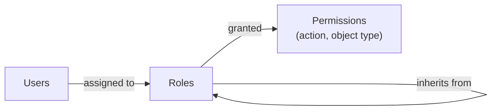
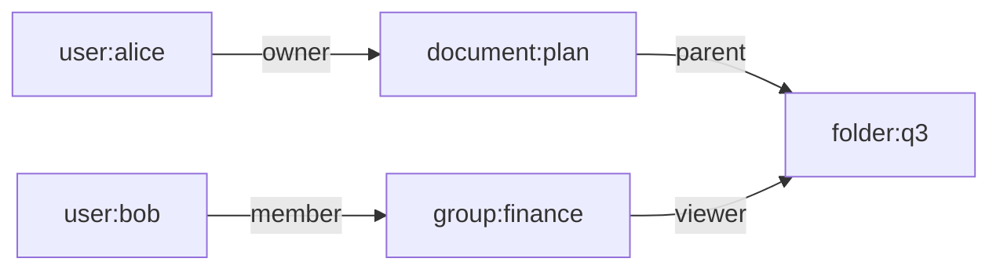

The previous two entries in this series established *who* is making a request: an [authenticator](/blog/authenticators-passwords-otp-passkeys) proved an identity, and a [session](/blog/sessions-and-cookies) carries that proof from request to request. This entry turns to the second question of access control: *what may that subject do?*

The [first entry](/blog/token-based-authentication#42-models) presented authorization models as rows in a table. Here each one is treated as a way of **representing** policy, and the choice of representation has consequences that reach well beyond the code that says yes or no. It decides which questions an auditor can answer, how a list of a thousand documents is filtered to the ones a user may see, what happens when someone changes teams, and how easily a policy mistake is noticed. The entry starts from the abstract model every scheme approximates, then examines role-based, attribute-based and relationship-based access control in turn, and ends with the engineering questions that decide between them.

## 1. The access matrix

### 1.1 Lampson's model

In 1971 Butler Lampson described protection in terms of an **access matrix**. Rows are subjects, columns are objects, and each cell lists the rights the subject holds over the object:

|  | `report.pdf` | `payroll.db` | `printer-3` |
|---|---|---|---|
| alice | read, write | — | print |
| bob | read | read | print |
| billing-job | — | read, write | — |

Every authorization scheme in practice is a way of storing, deriving or approximating this matrix without writing it out. The matrix itself is impractical: it has one row per subject and one column per object, and nearly every cell is empty.

### 1.2 Columns and rows: ACLs and capabilities

The two oldest representations store the matrix by column or by row.

- An **access control list** (ACL) stores each column with its object: `report.pdf` lists alice (read, write) and bob (read). Asking *who can access this object?* is a single lookup. Asking *what can alice access?* requires visiting every object.
- A **capability list** stores each row with its subject: alice holds a capability for `report.pdf` (read, write) and one for `printer-3` (print). A capability is an unforgeable reference that both names an object and grants rights to it, so holding it is sufficient. Delegation is natural, since alice can pass a capability on, but revoking a capability that has been copied is hard, for the same reason that revoking a bearer token is hard.

The OAuth access token from the [first entry](/blog/token-based-authentication#52-oauth-20-delegated-authorization) is a capability in this sense: it names a resource server and a set of scopes, and possession is enough to use it.

### 1.3 Who may change the matrix

A second axis concerns who may change the cells.

- Under **discretionary access control** (DAC), the owner of an object decides who else may access it, as with file permissions and document sharing.
- Under **mandatory access control** (MAC), a system-wide policy decides, and owners cannot override it. The classic examples are the multilevel security models: Bell–LaPadula (1973) protects confidentiality with the rules "no read up, no write down" across clearance levels, and Biba (1977) protects integrity with the reverse.

Most business applications combine the two: an organization-wide policy that users cannot change (finance data stays within finance) with discretionary sharing inside it.

### 1.4 A warning from theory

Harrison, Ruzzo and Ullman showed in 1976 that for a general access-matrix system with commands that create subjects and objects and grant rights, the *safety question* (can this subject ever obtain this right?) is undecidable. Practical models are deliberately restricted so that the questions administrators care about can be answered. That is a useful way to read the models that follow: each gives up some expressiveness to make certain questions easy.

## 2. Role-based access control

### 2.1 Users, roles and permissions

Role-based access control (RBAC) was formalized by Ferraiolo and Kuhn in 1992 and by Sandhu and colleagues in 1996. The InterNational Committee for Information Technology Standards (INCITS) standardized it as INCITS 359, an American National Standards Institute (ANSI) standard first published in 2004 and revised in 2012. RBAC inserts a layer between subjects and permissions:



A **permission** is an action on a kind of object ("approve invoice", "read order"). Permissions are granted to **roles** ("accounts-payable clerk", "support agent"), and users are assigned to roles. A user holds the union of the permissions of their roles.

The standard defines layers of increasing capability:

- **Core RBAC**: users, roles, permissions and the two assignment relations, plus *sessions* in which a user activates a subset of their roles.
- **Hierarchical RBAC**: roles inherit from other roles, so "senior clerk" includes everything "clerk" can do.
- **Constrained RBAC**: separation-of-duty rules. *Static* separation forbids assigning conflicting roles to one user (the person who creates a supplier may not also approve payments to it); *dynamic* separation forbids activating them in the same session.

### 2.2 What RBAC does well

RBAC matches how organizations already describe work, so policies are reviewed by people who understand them. Both audit directions are cheap: *who can approve invoices?* is the set of users in roles that hold that permission; *what can alice do?* is the union over her roles. Joining, moving and leaving become role assignment changes rather than edits to thousands of object-level entries.

### 2.3 Where RBAC strains

RBAC's permissions are about **kinds** of objects, not individual objects. "Support agents may read orders" is easy; "support agents may read orders *for customers in their region*" is not expressible with roles alone. The usual workaround is to create a role per region, then per region and product line, and so on: **role explosion**, where the number of roles approaches the number of users and the roles no longer describe anything an auditor recognizes.

The second common problem is **privilege creep**. People change jobs and acquire new roles, but old ones are rarely removed, because removing a role might break something and adding one never does. Periodic access reviews, in which a manager confirms each role assignment, exist mainly to counter this.

RBAC is therefore at its best for coarse permissions over kinds of resource, combined with something else for the conditions that depend on the particular object.

## 3. Attribute-based access control

### 3.1 Rules over attributes

Attribute-based access control (ABAC), described in NIST Special Publication 800-162, evaluates rules over attributes of four things:

- the **subject**: department, clearance, employment type, the assurance level of the current authentication;
- the **object**: owner, department, classification, status;
- the **action**: read, update, approve;
- the **environment**: time, network location, device posture.

A policy is a set of rules over these attributes. Written as pseudocode:

```text
permit  read  on Order
  when subject.department == "support"
   and  object.region     == subject.region

permit  update on Order
  when subject.id == object.owner_id
   and  object.status in ["draft", "submitted"]

deny    *     on *
  when  environment.network == "untrusted"
   and  subject.auth_assurance < "phishing-resistant"
```

Roles do not disappear in ABAC; a role is one subject attribute among others.

### 3.2 Combining rules

When several rules apply to one request and disagree, a **combining algorithm** decides. The eXtensible Access Control Markup Language (XACML), a standard of the Organization for the Advancement of Structured Information Standards (OASIS), names the common ones:

- **deny-overrides**: any applicable deny wins; the safest default for security policy;
- **permit-overrides**: any applicable permit wins; useful for exceptions layered over a default restriction;
- **first-applicable**: rules are evaluated in order and the first one that applies decides; easy to reason about, fragile to reorder.

Whatever the combination, the result when **no** rule applies must be deny (the fail-safe default from the first entry).

### 3.3 Where decisions are made

ABAC is usually implemented with the separation introduced in the first entry: a **policy enforcement point** in the application gathers the request and calls a **policy decision point**, which evaluates the rules. Attributes the decision point needs but was not given are fetched from **policy information points**, such as the directory, the human resources (HR) system or the order database. This separation lets policy be versioned, tested and reviewed independently of application code, and lets the same policy apply across services.

### 3.4 What ABAC does well, and where it strains

ABAC expresses conditions that RBAC cannot, without role explosion: one rule replaces a role per region. It can also take the authentication context into account, for example by demanding a phishing-resistant authenticator for high-risk actions.

Its costs are the mirror image:

- **Audit is hard.** *Who can read order 123?* requires evaluating the policy against every subject's attributes; *what can alice read?* requires evaluating it against every object. Neither has a cheap answer in general.
- **Attribute quality becomes a security property.** If the HR system is late in updating a department, the policy is wrong for that user, however carefully it was written. Each attribute needs an owner, a source and a freshness guarantee.
- **Rule interactions surprise.** A new permit rule written for one case can apply to others its author did not consider. Policy needs tests, just as code does: concrete requests with expected decisions, run on every change.

## 4. Relationship-based access control

### 4.1 Relationships as data

Many applications grant access because of a **relationship** between the subject and the object: alice can edit the document because she owns it, bob can view it because he is a member of a group it was shared with, carol can view it because it is in a folder shared with her. Relationship-based access control (ReBAC) makes those relationships the primary data.

Policy has two parts:

- **relationship tuples**, stored as data: `document:plan#owner@user:alice`, `document:plan#parent@folder:q3`, `folder:q3#viewer@group:finance#member`, `group:finance#member@user:bob`;
- a **schema** that derives permissions from relations, such as "a document's viewers are its owners, its editors, the users it is shared with, and the viewers of its parent folder".



To decide whether bob may view `document:plan`, the system follows the graph: the document's parent is `folder:q3`; the folder's viewers include members of `group:finance`; bob is a member. Access is permitted.

### 4.2 Evaluation

A check is a bounded graph search from the object, following the relations the schema names, looking for the subject. Two engineering concerns follow:

- **Performance.** Deep folder hierarchies and nested groups make searches long. Systems precompute or cache group membership, limit nesting depth, and evaluate checks in parallel.
- **Consistency.** Relationships change. Suppose bob is removed from a document's viewers and, a moment later, the document is updated with confidential content. If a check against a stale replica still sees the old relationship, bob reads content written after his access was removed. Google's 2019 paper on Zanzibar, its internal authorization system, called this the "new enemy" problem, and addressed it by tagging content versions with consistency tokens so that checks are evaluated at a snapshot at least as recent as the content.

### 4.3 What ReBAC does well, and where it strains

ReBAC fits applications whose sharing model is itself a graph: documents and folders, projects and organizations, repositories and teams. Ownership-based rules, which RBAC cannot express and which ABAC expresses only with an `owner_id` attribute on every object, are its native form. Audit in the *who can access this object?* direction is a graph expansion; the reverse direction needs a reverse index.

Its costs are operational: relationship data must be written whenever the application's own data changes (creating a document must also create its `owner` and `parent` tuples), the two must not drift apart, and the store becomes a dependency on every request.

## 5. Choosing and combining

### 5.1 The models side by side

| Property | ACL | RBAC | ABAC | ReBAC |
|---|---|---|---|---|
| Policy expressed as | Entries on each object | Role assignments and role permissions | Rules over attributes | Relationship tuples and a schema |
| Natural fit | Files, small shared resources | Organizational job functions | Conditions on context and data | Sharing, ownership, hierarchies |
| "Who can access X?" | Direct lookup | Direct (for object types) | Hard in general | Graph expansion |
| "What can S access?" | Scan all objects | Direct (for object types) | Hard in general | Needs a reverse index |
| Main failure mode | Lists drift, nobody reviews them | Role explosion, privilege creep | Stale attributes, rule interactions | Tuples out of step with application data |

### 5.2 Layering

Real systems rarely choose one model. A common and defensible layering is:

1. **RBAC for coarse capability**: which features and kinds of resource a user's job involves ("support agents use the order console").
2. **ReBAC or ownership checks for the particular object**: which orders, documents or projects ("orders of customers assigned to this agent's team").
3. **ABAC conditions for context**: when the decision should change with circumstance ("refunds above a threshold require a recent phishing-resistant authentication").

Each layer answers the question it answers best, and each can be reviewed by the people who understand it.

## 6. Engineering concerns that decide the design

### 6.1 Filtering lists

A check answers "may S do A to object O?". Applications more often need "which objects may S see?", to render a list or answer a search. Checking every candidate object one by one is correct but slow, and filtering *after* paginating produces short or empty pages.

The workable approaches are:

- **Push the policy into the query.** For RBAC and simple ownership rules, the condition becomes a `WHERE` clause (`WHERE organization_id = :subject_org`). Some policy engines support *partial evaluation*: given the subject and action, they reduce the policy to a residual condition over object attributes that can be translated into a query.
- **Ask the authorization system for the set.** ReBAC systems can enumerate the objects a subject can reach through a relation, which the application then intersects with its query.
- **Pre-filter and post-check.** Retrieve candidates with a cheap approximate filter, then check each object before returning it, accepting some wasted work.

Whatever the approach, the same policy must govern both single-object checks and lists. A list that hides an order while the detail page returns it is a broken object-level authorization flaw (described in the first entry) waiting to be found.

### 6.2 Authorization data in tokens

It is tempting to put roles or permissions into access tokens so that resource servers need no lookup. That works for coarse, slowly changing facts. For anything else, the token is a **snapshot**: permissions removed after it was issued remain in it until it expires. Object-level relationships do not fit in a token at all. A useful rule is that tokens carry identity, the client and its scopes, and perhaps coarse roles; the resource server evaluates everything else at the time of the request.

Scopes and permissions are also different things. A scope limits what a *client* may do on the user's behalf; a permission says what the *user* may do. The resource server needs both ([Section 5.2 of the first entry](/blog/token-based-authentication#52-oauth-20-delegated-authorization)).

### 6.3 Change over time

Policies outlive their authors. Designs that age well share some habits:

- **Deny by default**, so that a forgotten rule fails closed.
- **Policy as reviewed, versioned, tested artifact**: every change has an author, a reviewer and test cases with expected decisions.
- **Joiner, mover, leaver processes** tied to the authoritative HR or customer system, so that role and attribute changes happen when people's situations change rather than when someone remembers.
- **Periodic access review**, especially for powerful roles and for discretionary sharing that nobody else sees.
- **Decision logging**: record the subject, action, object, decision and the policy version that produced it. When an incident occurs, "why was this allowed?" must have an answer.

## 7. Summary

| Question | Answer |
|---|---|
| What do all models approximate? | Lampson's access matrix: subjects by objects, with rights in each cell. |
| How do ACLs and capabilities differ? | An ACL stores a column with the object; a capability stores a cell with the subject. Capabilities delegate easily and revoke poorly. |
| What is RBAC good at? | Coarse, reviewable permissions that match job functions; both audit directions are cheap. |
| Where does RBAC fail? | Conditions on individual objects lead to role explosion; unremoved roles lead to privilege creep. |
| What does ABAC add? | Rules over subject, object, action and environment attributes, including authentication context, at the cost of harder audit and dependence on attribute quality. |
| What does ReBAC add? | Permissions derived from a graph of ownership, membership and containment, which suits sharing models, at the cost of keeping the graph consistent with application data. |
| How are they combined? | Roles for coarse capability, relationships or ownership for the particular object, attributes for context. |
| What decides the design in practice? | List filtering, what (not) to put in tokens, and how policy is reviewed, tested and logged as it changes. |

The [next entry](/blog/oauth-grants-and-client-types) returns to OAuth 2.0 and examines its grants and client types in detail: which grant suits which client, and why.

### References

- D. F. Ferraiolo and D. R. Kuhn, "Role-Based Access Controls," in *Proceedings of the 15th National Computer Security Conference*, pp. 554–563, 1992.
- M. A. Harrison, W. L. Ruzzo and J. D. Ullman, "Protection in operating systems," *Communications of the ACM*, vol. 19, no. 8, pp. 461–471, 1976.
- V. C. Hu et al., *Guide to Attribute Based Access Control (ABAC) Definition and Considerations*, NIST SP 800-162, National Institute of Standards and Technology, 2014 (updated 2019).
- INCITS 359-2004, *Information Technology – Role Based Access Control*, American National Standards Institute, 2004.
- INCITS 359-2012, *Information Technology – Role Based Access Control*, American National Standards Institute, 2012.
- B. W. Lampson, "Protection," in *Proceedings of the Fifth Princeton Symposium on Information Sciences and Systems*, pp. 437–443, 1971.
- OASIS, *eXtensible Access Control Markup Language (XACML) Version 3.0*, OASIS Standard, 2013.
- R. Pang et al., "Zanzibar: Google's Consistent, Global Authorization System," in *Proceedings of the 2019 USENIX Annual Technical Conference*, pp. 33–46, 2019.
- R. S. Sandhu, E. J. Coyne, H. L. Feinstein and C. E. Youman, "Role-Based Access Control Models," *IEEE Computer*, vol. 29, no. 2, pp. 38–47, 1996.
