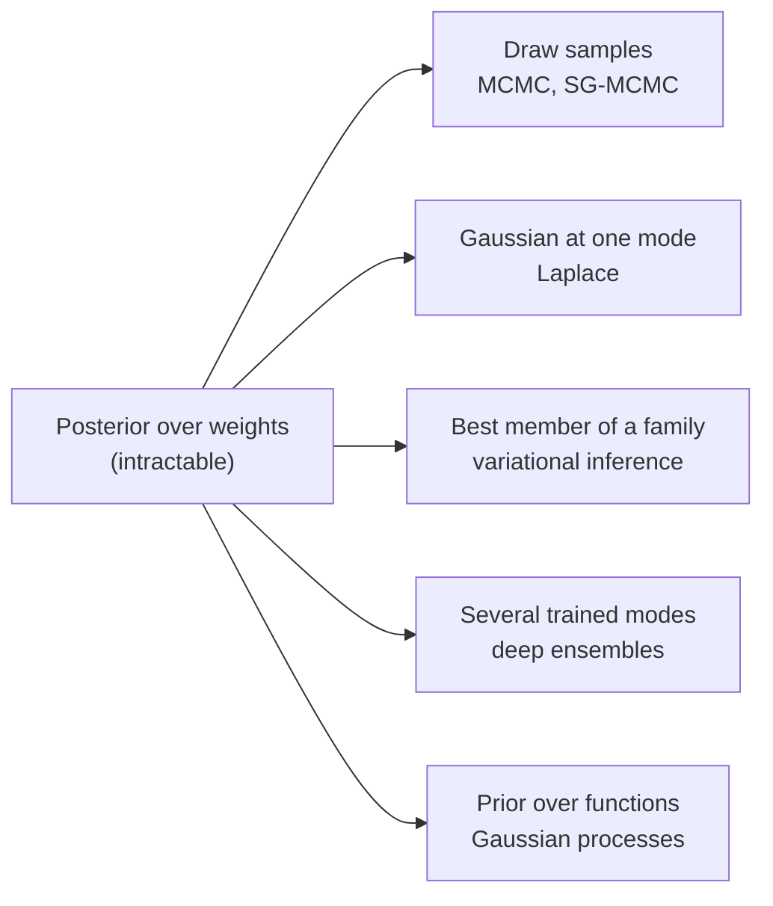

import Figure from '../../components/Figure.astro';
import BdlPredictiveBand from '../../components/diagrams/BdlPredictiveBand.astro';

A trained neural network returns one answer for every input, including inputs unlike anything in its training set. The [Machine Learning Fundamentals](/series/machine-learning-fundamentals) series showed how such a network is fitted, by minimizing an empirical risk with [gradient descent](/blog/gradient-descent-and-its-variants), and how far its training error can drift from its error on new data ([generalization, overfitting and regularization](/blog/generalization-overfitting-and-regularization)). What that series did not ask is how sure the fitted model is of a particular prediction. This entry, the first of the [Bayesian Deep Learning](/series/bayesian-deep-learning) series, sets out the framework that answers that question and the obstacle that the rest of the series works around.

The framework is Bayesian inference. Instead of one parameter vector, it keeps a probability distribution over all parameter vectors that are compatible with the data, and it predicts by averaging over that distribution. The entry defines the posterior, the posterior predictive and the marginal likelihood, separates the two kinds of uncertainty a prediction can carry, and works through a model where every quantity can be computed exactly: Bayesian linear regression. It then explains why the same computation is out of reach for a neural network and gives a map of the approximations that the next entries develop.

The notation is that of the series: $\theta \in \mathbb{R}^P$ are the $P$ parameters, $\mathcal{D} = \{(x_n, y_n)\}_{n=1}^N$ the $N$ training examples, $p(\theta)$ the prior, $p(\mathcal{D} \mid \theta)$ the likelihood, $p(\theta \mid \mathcal{D})$ the posterior, and $x^*$, $y^*$ a test input and its output. Vectors are columns, logarithms are natural, and $\mathcal{N}(\mu, \Sigma)$ is a Gaussian with mean $\mu$ and covariance $\Sigma$. The code uses Python 3.13 and NumPy 2.5.3 with the seeds shown.

## 1. From a point estimate to a distribution

### 1.1 What a single trained network leaves out

Empirical risk minimization picks one parameter vector $\hat{\theta}$, the one with the lowest training loss (plus a penalty, if the training is regularized). Many other parameter vectors fit the training data almost as well. For a model with more parameters than training examples there are typically whole families of them, and they need not agree away from the data. Two networks trained from different random initializations can make the same predictions on every training input and different predictions on an input far from all of them. A point estimate reports one member of that family and hides the disagreement.

The disagreement is information. Where the plausible models agree, a prediction can be trusted as far as the model class can be trusted. Where they disagree, the data do not determine the answer, and a downstream decision should know that. Bayesian inference turns "the set of plausible models" into a probability distribution and uses it.

### 1.2 Bayes' rule for parameters

Bayesian inference treats the parameters as a random variable and assigns them two distributions. The **prior** $p(\theta)$ states which parameter values are considered plausible before the data are seen. The **likelihood** $p(\mathcal{D} \mid \theta)$ states how probable the observed data are under the model with parameters $\theta$. For a supervised model with examples that are independent and identically distributed (i.i.d.), as the [first entry of the fundamentals series](/blog/learning-from-data) assumed, and with the inputs treated as fixed, the likelihood factorizes over examples:

$$
p(\mathcal{D} \mid \theta) = \prod_{n=1}^{N} p(y_n \mid x_n, \theta).
$$

Bayes' rule combines the two into the **posterior**, the distribution of the parameters after the data have been seen:

$$
p(\theta \mid \mathcal{D}) = \frac{p(\mathcal{D} \mid \theta)\, p(\theta)}{p(\mathcal{D})},
\qquad
p(\mathcal{D}) = \int p(\mathcal{D} \mid \theta)\, p(\theta)\, d\theta .
$$

The denominator $p(\mathcal{D})$ is the **marginal likelihood**, also called the **evidence**: the probability of the data averaged over the prior. It does not depend on $\theta$, so it only normalizes the posterior, but it is the hard part. The numerator, the **unnormalized posterior**, can be evaluated at any $\theta$ for the cost of one pass over the data; the evidence is an integral over all of $\mathbb{R}^P$.

### 1.3 Regularized training is a special case

The fundamentals series already used two Bayesian ideas without naming them. Its losses are negative log-likelihoods: the squared loss is, up to constants, $-\log p(y_n \mid x_n, \theta)$ for a Gaussian noise model, and the cross-entropy loss is exactly $-\log p(y_n \mid x_n, \theta)$ for a Bernoulli (or, with several classes, categorical) one. And its penalties are negative log-priors. Taking the logarithm of the posterior,

$$
-\log p(\theta \mid \mathcal{D}) = -\sum_{n=1}^{N} \log p(y_n \mid x_n, \theta) - \log p(\theta) + \log p(\mathcal{D}),
$$

so the parameter vector with the highest posterior density, the **maximum a posteriori (MAP) estimate**, minimizes the training loss plus the term $-\log p(\theta)$. With a Gaussian prior $\theta \sim \mathcal{N}(0, s_0^2 I)$, where $s_0$ is the prior standard deviation of each weight and $I$ the identity matrix, that term is $\lVert\theta\rVert^2/(2 s_0^2)$ plus a constant: ridge regression, or weight decay. MacKay made this connection for neural networks in 1992 and used it to set the penalty from the data (MacKay, 1992).

Section 3 checks the correspondence numerically. The important point here is what MAP training discards. It keeps the location of the highest posterior density and throws away the shape, the width and every other mode. The rest of this entry is about what the shape buys.

## 2. Predicting with a posterior

### 2.1 The posterior predictive

The quantity of interest is rarely $\theta$ itself; it is the output $y^*$ at a new input $x^*$. The **posterior predictive distribution** averages the model's prediction over the posterior:

$$
p(y^* \mid x^*, \mathcal{D}) = \int p(y^* \mid x^*, \theta)\, p(\theta \mid \mathcal{D})\, d\theta
= \mathbb{E}_{\theta \sim p(\theta \mid \mathcal{D})}\big[\, p(y^* \mid x^*, \theta) \,\big].
$$

Each parameter vector votes with its own predictive distribution, weighted by how plausible it is after seeing the data. The procedure is called **Bayesian model averaging**. It is not the same as plugging one estimate into the model: $p(y^* \mid x^*, \hat{\theta}_{\text{MAP}})$ ignores every other plausible $\theta$, and for a nonlinear model the average of the predictions is not the prediction at the average parameters.

Given $M$ samples $\theta^{(1)}, \dots, \theta^{(M)}$ from the posterior, the integral is estimated by the **Monte Carlo average**

$$
p(y^* \mid x^*, \mathcal{D}) \approx \frac{1}{M}\sum_{s=1}^{M} p\big(y^* \mid x^*, \theta^{(s)}\big),
$$

whose error shrinks in proportion to $1/\sqrt{M}$ whatever the dimension $P$. That is the reason so many methods in this series end by producing samples, or something that can be sampled: once samples exist, prediction is easy. Producing them is the subject of the [next entry](/blog/sampling-the-posterior-mcmc).

### 2.2 Epistemic and aleatoric uncertainty

A predictive distribution can be wide for two different reasons, and they call for different responses. **Aleatoric uncertainty** is randomness in the data-generating process itself: measurement noise, or labels that are ambiguous even for a perfect model. It would remain with infinitely many training examples. **Epistemic uncertainty** is uncertainty about the model: the data seen so far do not pin down the parameters. It shrinks as data accumulate where the predictions are needed. The distinction is long established in risk and reliability analysis (Der Kiureghian and Ditlevsen, 2009, discuss it) and was popularized in deep learning by Kendall and Gal (2017).

For a regression model the split is exact. Write $\mu_\theta(x^*)$ and $\sigma^2_\theta(x^*)$ for the mean and variance of $p(y^* \mid x^*, \theta)$. The law of total variance gives

$$
\operatorname{Var}\big[y^* \mid x^*, \mathcal{D}\big]
= \underbrace{\mathbb{E}_{\theta}\big[\sigma^2_\theta(x^*)\big]}_{\text{aleatoric}}
+ \underbrace{\operatorname{Var}_{\theta}\big[\mu_\theta(x^*)\big]}_{\text{epistemic}},
$$

where both expectations are over the posterior. The first term is the noise each plausible model predicts; the second is how much the plausible models disagree about the mean.

For a classifier the usual split uses entropy, $\mathbb{H}[p] = -\sum_c p_c \log p_c$ for a probability vector $p$ over classes $c$. Writing $\bar{p}$ for the averaged predictive probabilities and $p_\theta$ for those of one parameter vector,

$$
\underbrace{\mathbb{H}[\bar{p}]}_{\text{total}}
= \underbrace{\mathbb{E}_{\theta}\big[\mathbb{H}[p_\theta]\big]}_{\text{aleatoric}}
+ \underbrace{\mathbb{H}[\bar{p}] - \mathbb{E}_{\theta}\big[\mathbb{H}[p_\theta]\big]}_{\text{epistemic (mutual information)}} .
$$

The second term is the mutual information between $y^*$ and $\theta$, and it is never negative (Depeweg et al., 2018). Two binary examples show the difference. If two equally probable parameter vectors predict $(0.9, 0.1)$ and $(0.1, 0.9)$, the average is $(0.5, 0.5)$ with entropy $\log 2 = 0.693$; each member has entropy $0.325$, so $0.368$ of the total is epistemic. If both predict $(0.5, 0.5)$, the total is again $0.693$ but all of it is aleatoric. The averaged prediction is the same coin flip in both cases. Only the decomposition shows that in the first case more data would help and in the second it would not.

### 2.3 The marginal likelihood as a model score

The evidence $p(\mathcal{D})$, which normalizes the posterior, has a second use. Written out for a model $\mathcal{M}$ with its own prior, $p(\mathcal{D} \mid \mathcal{M})$ is the probability that this model, with parameters drawn from its prior, would have generated the observed data. A model whose prior spreads its probability over many data sets that were not observed scores lower than one that concentrates on data sets like the observed one. A model too rigid to produce the data at all scores lower still. The evidence therefore penalizes both underfitting and excess flexibility, without a validation set, an effect often called the Bayesian Occam's razor (MacKay, 1992; Bishop, 2006, Section 3.4).

In practice the evidence is used to choose **hyperparameters**, such as the prior scale $s_0$ or the noise level, by maximizing it: the procedure is called **empirical Bayes** or type-II maximum likelihood. Section 3.5 does this for the worked example. The score is only as good as the model class: comparing two misspecified models by their evidence tells which is less wrong about the data seen, not which predicts better on data from elsewhere.

## 3. Worked example: Bayesian linear regression

### 3.1 The model

One model family makes every quantity above available in closed form: a model that is linear in its parameters, with a Gaussian prior and Gaussian noise. The inputs may enter nonlinearly through a fixed **feature map** $\phi(x) \in \mathbb{R}^P$. Here the input is a scalar and the features are $P = 11$ Gaussian bumps of unit width centered at $c_k = -5, -4, \dots, 5$:

$$
\phi_k(x) = \exp\!\big(-(x - c_k)^2\big), \qquad
y = \phi(x)^\top \theta + \varepsilon, \qquad
\varepsilon \sim \mathcal{N}(0, \sigma^2), \qquad
\theta \sim \mathcal{N}(0, s_0^2 I).
$$

The noise standard deviation is $\sigma = 0.25$ and is treated as known; the prior standard deviation is $s_0 = 1$. The data are $N = 20$ noisy observations of $\sin x$, ten with $x$ drawn uniformly from $[-3, -1]$ and ten from $[1, 3]$. The gap between the two clusters and the empty regions beyond $\lvert x \rvert = 3$ are deliberate: they are where the model has to say it does not know.

Collect the features of the training inputs in the $N \times P$ design matrix $\Phi$, whose $n$-th row is $\phi(x_n)^\top$, and the outputs in the vector $\mathbf{y}$. A neural network can be read as the same model with a learned feature map, which is why this example recurs later in the series.

### 3.2 The posterior and the predictive in closed form

The log-posterior is a quadratic function of $\theta$:

$$
\log p(\theta \mid \mathcal{D}) = -\frac{1}{2\sigma^2}\lVert \mathbf{y} - \Phi\theta \rVert^2 - \frac{1}{2 s_0^2}\lVert \theta \rVert^2 + \text{const}.
$$

A quadratic log-density is a Gaussian, and completing the square identifies it. The posterior is $\mathcal{N}(m_N, S_N)$ with

$$
S_N = \Big(\frac{1}{\sigma^2}\Phi^\top\Phi + \frac{1}{s_0^2} I\Big)^{-1}, \qquad
m_N = \frac{1}{\sigma^2} S_N \Phi^\top \mathbf{y}.
$$

A prior and likelihood pair whose posterior stays in the prior's family is called **conjugate**. The matrix $S_N^{-1}$ is the posterior **precision**: the prior precision $I/s_0^2$ plus the information the data add, $\Phi^\top\Phi/\sigma^2$. The mean $m_N$ is also the MAP estimate, and it is the ridge solution of the fundamentals series with penalty strength $\lambda = \sigma^2/(N s_0^2)$, here $0.0625/20 = 0.003125$ (Exercise 1 derives this).

The prediction $f^* = \phi(x^*)^\top\theta$ is a linear function of a Gaussian vector, so it is Gaussian; adding the independent noise gives the posterior predictive

$$
p(y^* \mid x^*, \mathcal{D}) = \mathcal{N}\Big(\phi(x^*)^\top m_N,\;\; \underbrace{\phi(x^*)^\top S_N\, \phi(x^*)}_{\text{epistemic}} + \underbrace{\sigma^2}_{\text{aleatoric}}\Big).
$$

The two terms of Section 2.2 appear separately. The aleatoric term is the same everywhere, because the noise model says so. The epistemic term depends on $x^*$ through the features, and it is small only where the data have constrained the weights that $\phi(x^*)$ selects.

The evidence is also Gaussian. Under the prior, $\mathbf{y} = \Phi\theta + \boldsymbol{\varepsilon}$ is a sum of independent Gaussian vectors with zero mean, so

$$
p(\mathcal{D}) = \mathcal{N}\big(\mathbf{y};\; 0,\; s_0^2\, \Phi\Phi^\top + \sigma^2 I_N\big),
$$

where $I_N$ is the $N \times N$ identity and $\mathcal{N}(\mathbf{y}; \cdot, \cdot)$ denotes the Gaussian density evaluated at $\mathbf{y}$.

### 3.3 The code

The listing builds the data, computes the posterior, prints the predictive at three test inputs, scores five prior scales by their log evidence and checks the closed-form predictive against a Monte Carlo average over posterior samples.

```python
import numpy as np

rng = np.random.default_rng(seed=0)
sigma, s0 = 0.25, 1.0                       # noise std (known), prior std of each weight
centers = np.arange(-5.0, 5.5, 1.0)         # 11 Gaussian bumps, width 1

def features(x):
    return np.exp(-(x[:, None] - centers[None, :]) ** 2)

x = np.concatenate([rng.uniform(-3, -1, 10), rng.uniform(1, 3, 10)])
y = np.sin(x) + rng.normal(0.0, sigma, size=x.size)
Phi = features(x)

# Posterior N(m, S) over the 11 weights
S = np.linalg.inv(Phi.T @ Phi / sigma**2 + np.eye(centers.size) / s0**2)
m = S @ Phi.T @ y / sigma**2

# Posterior predictive at three test inputs
for xs in [-2.0, 0.0, 4.5]:
    phi = features(np.array([xs]))[0]
    epi = phi @ S @ phi                       # epistemic variance
    print(f"x* = {xs:4.1f}: mean {phi @ m:6.3f}  epistemic sd {np.sqrt(epi):.3f}  "
          f"total sd {np.sqrt(epi + sigma**2):.3f}")

# Log marginal likelihood for several prior scales
for s in [0.1, 0.3, 1.0, 3.0, 10.0]:
    K = s**2 * Phi @ Phi.T + sigma**2 * np.eye(x.size)   # covariance of y
    _, logdet = np.linalg.slogdet(K)
    print(f"s0 = {s:4.1f}: log p(D) = "
          f"{-0.5 * (y @ np.linalg.solve(K, y) + logdet + x.size * np.log(2 * np.pi)):7.2f}")

# Monte Carlo check of the predictive at x* = 0 with 4000 posterior draws
theta = rng.multivariate_normal(m, S, size=4000)
f0 = theta @ features(np.array([0.0]))[0]
print(f"Monte Carlo at x* = 0: mean {f0.mean():6.3f}  epistemic sd {f0.std():.3f}")
```

It prints:

```text
x* = -2.0: mean -0.938  epistemic sd 0.138  total sd 0.286
x* =  0.0: mean  0.039  epistemic sd 0.632  total sd 0.680
x* =  4.5: mean -0.110  epistemic sd 1.061  total sd 1.090
s0 =  0.1: log p(D) =  -46.02
s0 =  0.3: log p(D) =   -9.12
s0 =  1.0: log p(D) =   -5.87
s0 =  3.0: log p(D) =  -11.67
s0 = 10.0: log p(D) =  -20.62
Monte Carlo at x* = 0: mean  0.034  epistemic sd 0.632
```

### 3.4 Reading the predictive

The three test inputs fall in the three regimes the data set was built to show.

- **Inside the data**, at $x^* = -2$, the predictive mean is $-0.938$, close to $\sin(-2) = -0.909$. The epistemic standard deviation, $0.138$, is about half the noise level: the ten observations of the left cluster constrain the weights near $x = -2$. The total standard deviation is $\sqrt{0.138^2 + 0.25^2} = 0.286$, dominated by the aleatoric part.
- **In the gap**, at $x^* = 0$, no observation lies within 1 of the input. The mean, $0.039$, happens to be close to $\sin 0 = 0$, but the model does not claim it is: the epistemic standard deviation has grown to $0.632$, now the larger of the two terms.
- **Beyond the data**, at $x^* = 4.5$, the features that are active there carry weights that the data barely constrain, so the posterior over them is close to the prior. The mean returns almost to the prior mean, 0 (it is $-0.110$ because the bumps at $c_k = 3$ and $c_k = 4$ still overlap the data near $x = 3$), and the epistemic standard deviation, $1.061$, is close to its prior value $s_0\lVert\phi(4.5)\rVert = 1.106$.

<Figure caption="Posterior predictive of the worked example. The dark band (±2 epistemic standard deviations) is narrow inside the two clusters of data, widens in the gap and grows to the prior width beyond x = ±3, where the mean returns to 0; the light band adds the constant noise.">
  <BdlPredictiveBand />
</Figure>

The figure shows the same pattern over the whole input range. Two features of it carry over to every Bayesian model. The uncertainty grows away from the data without anyone having to specify where the data are; it follows from the posterior. And far from the data, the model falls back on its prior, not on an extrapolation of its fit. A point estimate gives neither: its mean curve is the same, but nothing tells the reader to distrust it at $x = 0$ or $x = 4.5$.

The data in this example were drawn once with seed 0; other seeds move the curve and the gap prediction (with seed 3, for instance, the mean at $x^* = 0$ is $-0.59$, still within one epistemic standard deviation of 0) but not the shape of the bands.

The last line of the output repeats the gap prediction by Monte Carlo, averaging $\phi(0)^\top\theta^{(s)}$ over 4000 draws from the posterior. The mean differs from the exact one by $0.005$ and the standard deviation agrees to three decimals: the Monte Carlo estimate of Section 2.1 works as advertised once samples are available. Here they are available because the posterior is a known Gaussian. For a neural network, producing them is the whole problem.

### 3.5 Choosing the prior scale by the evidence

The evidence table compares five values of $s_0$ on the same data. A prior scale of $0.1$ makes weights large enough to produce a sine of amplitude 1 improbable, so the data are improbable under it: $\log p(\mathcal{D}) = -46.02$. A scale of 10 can produce the data but spreads its probability over curves with amplitudes in the tens, almost none of which resemble the data, and it scores $-20.62$. The maximum on this grid is at $s_0 = 1$, with $-5.87$, the value used above. A difference of 3.25 in log evidence between $s_0 = 1$ and $s_0 = 0.3$ means the data are $e^{3.25} \approx 26$ times more probable under the first.

No held-out data were used. That is the attraction of the evidence for neural networks, where cross-validating many hyperparameters is expensive. The [third entry](/blog/laplace-approximations) shows how the Laplace approximation estimates the evidence for a network, where it has no closed form.

## 4. Why a neural network is different

### 4.1 No closed form

Replace the fixed features by a network $f_\theta(x)$, for example a multilayer perceptron (MLP) whose hidden layers are part of $\theta$. Everything in Sections 1 and 2 still holds as a definition. Nothing in Section 3 still holds as a computation, because the conjugacy argument needed the log-likelihood to be quadratic in $\theta$, and $f_\theta(x)$ is not linear in the weights of its hidden layers. The posterior is no longer Gaussian or any other named distribution, and the integrals for $p(\mathcal{D})$ and for the predictive have no closed form.

Numerical integration does not rescue the situation. A grid with only ten points per parameter needs $10^P$ evaluations of the likelihood. A small MLP with one input, one hidden layer of 50 units and one output has $50 + 50 + 50 + 1 = 151$ weights and biases, so the grid has $10^{151}$ points. Networks in practice have millions to billions of parameters. Every method that works in this setting avoids touching most of the parameter space.

### 4.2 The shape of the posterior

The posterior of a network is also hard to approximate because of its geometry, not only its dimension.

- **Symmetries.** Permuting the hidden units of a layer, together with their incoming and outgoing weights, leaves the function unchanged. For an odd activation such as $\tanh$, flipping the signs of a unit's incoming and outgoing weights does too. The 50-unit layer above therefore has $50! \cdot 2^{50} \approx 3.4 \times 10^{79}$ parameter vectors for every function it computes, and the posterior has that many identical copies of every mode.
- **Genuinely different modes.** Beyond the copies, different training runs reach parameter vectors that compute different functions with similar training loss. These are the functions whose disagreement Section 1.1 called information.
- **Flat and curved directions together.** Around a mode, some directions change the training loss sharply and others barely at all, so the posterior is narrow in some directions and wide in others, which makes it ill-conditioned in the sense of the [gradient descent entry](/blog/gradient-descent-and-its-variants).

The symmetries matter less than their count suggests, because copies of one mode give identical predictions, and the predictive distribution is what is used. The [seventh entry](/blog/priors-symmetries-and-identifiability) returns to them. The different modes matter a great deal, and the methods of this series differ most in how they treat them.

### 4.3 What can be computed cheaply

Against these difficulties stands one fact: the unnormalized log-posterior and its gradient are cheap. For any $\theta$,

$$
\log p(\theta \mid \mathcal{D}) = \sum_{n=1}^{N} \log p(y_n \mid x_n, \theta) + \log p(\theta) + \text{const},
$$

which is the negative training objective, and backpropagation gives its gradient at the cost of a forward and a backward pass. On a mini-batch of $B$ examples, the sum scaled by $N/B$ is an unbiased estimate, exactly as in stochastic gradient descent (SGD). Every practical method in this series is built from evaluations of this quantity, its gradient and occasionally its curvature; they differ in what they do with them.

## 5. A map of approximate inference

The approximations fall into a few families, distinguished by what they put in place of the exact posterior. The figure groups them, and the table compares them; the entry that treats each one is named in the last column.



| Family | What replaces the posterior | Main cost | Typical weakness | Entry |
|---|---|---|---|---|
| Markov chain Monte Carlo (MCMC), including stochastic-gradient MCMC (SG-MCMC) | A sequence of samples whose distribution approaches the posterior | Many gradient evaluations; storing or regenerating samples | Slow movement between modes; bias with mini-batches | [Second](/blog/sampling-the-posterior-mcmc) |
| Laplace approximation | A Gaussian centered at a trained mode, with covariance from the curvature there | One training run plus a Hessian approximation | Sees one mode only; Gaussian shape | [Third](/blog/laplace-approximations) |
| Variational inference (VI) | The member of a chosen family closest to the posterior in Kullback–Leibler (KL) divergence, found by maximizing the evidence lower bound (ELBO) | Training cost a few times that of the network | Restrictive families underestimate variance | [Fourth](/blog/variational-inference-for-neural-networks) |
| Deep ensembles | A handful of independently trained networks, averaged | One full training run per member | Few members; Bayesian reading is debated | [Fifth](/blog/deep-ensembles) |
| Function-space methods | A Gaussian process (GP) prior over functions, or a network's limit as it becomes infinitely wide | Cubic in $N$ for exact GPs | Kernel choice; scaling to large $N$ | [Sixth](/blog/gaussian-processes-and-kernels) |

The families are not exclusive. A Laplace approximation of the last layer of a regression network with Gaussian noise turns that layer into the Bayesian linear regression of Section 3, with the network's penultimate activations as features. Ensembles of Laplace approximations combine several modes with local widths, and MCMC can be run in a low-dimensional subspace found by optimization. The [eighth entry](/blog/scaling-bayesian-deep-learning) collects the first two combinations when it deals with cost, and the [tenth](/blog/frontiers-of-bayesian-deep-learning) treats subspace inference.

The primary sources for each family are cited in the entry that treats it. For orientation, MCMC for neural networks goes back to Neal (1996), and its stochastic-gradient form to Welling and Teh (2011). Variational inference for network weights was made practical by Blundell et al. (2015) and, in the form of dropout, by Gal and Ghahramani (2016). Deep ensembles were introduced by Lakshminarayanan et al. (2017), and Daxberger et al. (2021) give a modern account of Laplace approximations for networks. Rasmussen and Williams (2006) is the standard reference on Gaussian processes, Blei et al. (2017) review variational inference, and Bishop (2006) and Murphy (2023) treat the whole framework at textbook length.

## 6. Limits of the Bayesian view

Bayesian inference is exact reasoning from stated assumptions, and its output is no better than they are. Four limits apply throughout the series.

- **Misspecification.** If no parameter value describes the data well (the noise is not Gaussian, the classes overlap differently, the test inputs come from a different distribution), the posterior concentrates on the least-bad parameters and its uncertainty describes the wrong question. The predictive band of Section 3 assumed noise with a known standard deviation; with the wrong $\sigma$, the total band is wrong everywhere.
- **The prior over weights is hard to choose.** A Gaussian prior on each weight is convenient, but what it implies about functions depends on the architecture and is not obvious. Section 3.5 showed that the evidence is sensitive to the prior scale even in a linear model.
- **Approximations change the answer.** Every method in this series approximates the posterior, and they can disagree substantially on the same network. A "Bayesian" label does not certify that the uncertainty is right. That is checked empirically, with the tools of the [ninth entry](/blog/evaluating-and-using-uncertainty).
- **Calibration is a separate property.** A predictive distribution is **calibrated** when events it assigns probability 0.8 happen about 80% of the time. Exact Bayesian inference under a correct model is calibrated on average over the prior; an approximate posterior or a misspecified model need not be, and modern networks trained by minimizing a loss are often overconfident (Guo et al., 2017). Wilson and Izmailov (2020) discuss what Bayesian model averaging can and cannot be expected to fix.

None of these is a reason to discard the framework. They are the reasons the series pairs every method with its failure modes and ends with how to evaluate uncertainty.

## 7. Exercises

**Exercise 1.** Show that the posterior mean $m_N$ of Section 3.2 minimizes the ridge objective $J_\lambda(\theta) = \frac{1}{N}\lVert\Phi\theta - \mathbf{y}\rVert^2 + \lambda\lVert\theta\rVert^2$ with $\lambda = \sigma^2/(N s_0^2)$, and compute $\lambda$ for $\sigma = 0.25$, $s_0 = 1$, $N = 20$.

<details>
<summary>Answer</summary>

Setting the gradient of $J_\lambda$ to zero gives $(\Phi^\top\Phi + N\lambda I)\theta = \Phi^\top\mathbf{y}$. Multiplying the defining equation $S_N^{-1} m_N = \Phi^\top\mathbf{y}/\sigma^2$ by $\sigma^2$ gives $(\Phi^\top\Phi + (\sigma^2/s_0^2) I) m_N = \Phi^\top\mathbf{y}$. The two agree when $N\lambda = \sigma^2/s_0^2$. Numerically $\lambda = 0.0625/20 = 0.003125$. Unlike the fundamentals series, this example penalizes every weight, because there is no separate intercept.

</details>

**Exercise 2.** Two equally probable parameter vectors predict class probabilities $(0.8, 0.2)$ and $(0.4, 0.6)$ for a binary input. Compute the total, aleatoric and epistemic parts of the predictive entropy.

<details>
<summary>Answer</summary>

The average is $(0.6, 0.4)$, with entropy $-(0.6\log 0.6 + 0.4\log 0.4) = 0.673$. The members have entropies $0.500$ and $0.673$, mean $0.587$: the aleatoric part. The epistemic part is $0.673 - 0.587 = 0.086$.

</details>

**Exercise 3.** In the worked example, what happens to the epistemic standard deviation at $x^* = -2$ if the number of observations in $[-3, -1]$ is multiplied by 100, with the same noise? What happens to the total standard deviation?

<details>
<summary>Answer</summary>

The data term $\Phi^\top\Phi/\sigma^2$ of the precision grows about 100-fold in the directions those observations constrain, so the epistemic variance at $x^* = -2$ shrinks by about that factor, and the standard deviation by about 10, to roughly $0.015$ (recomputing with 1000 observations in that interval gives $0.0146$). The total standard deviation tends to the noise level $\sigma = 0.25$ and no further: aleatoric uncertainty does not shrink with more data.

</details>

**Exercise 4.** A colleague proposes to estimate the predictive mean of a network by evaluating it at the posterior mean of the weights instead of averaging predictions over posterior samples. Explain why the two coincide for Section 3 and not for a network.

<details>
<summary>Answer</summary>

In Section 3 the mean of $f^*$ is $\phi(x^*)^\top\theta$, linear in $\theta$, and the expectation of a linear function is the function of the expectation. A network output is nonlinear in its weights, so $\mathbb{E}[f_\theta(x^*)] \neq f_{\mathbb{E}[\theta]}(x^*)$ in general. With symmetric modes the posterior mean of the weights may even lie between copies of a mode, where the network computes nothing useful.

</details>

**Exercise 5.** Run the listing with `s0 = 0.3` in the line that sets `sigma, s0` and compare the epistemic standard deviation at $x^* = 4.5$ with that for $s_0 = 1$. Do the same at $x^* = -2$. Why does the prior scale matter far more far from the data than inside it?

<details>
<summary>Answer</summary>

Far from the data the posterior over the active weights is still the prior, so the epistemic standard deviation scales with $s_0$: it falls from $1.061$ to $0.325$, close to $0.3\lVert\phi(4.5)\rVert = 0.332$. At $x^* = -2$ it changes much less, from $0.138$ to $0.112$, because there the data term $\Phi^\top\Phi/\sigma^2$ of the precision dominates the prior term $I/s_0^2$. The prior decides what the model says where it has no data.

</details>

## 8. Summary

| Concept | Definition or result |
|---|---|
| Posterior | $p(\theta \mid \mathcal{D}) \propto p(\mathcal{D} \mid \theta)\,p(\theta)$, normalized by the evidence $p(\mathcal{D})$ |
| MAP estimate | Mode of the posterior; regularized training with penalty $-\log p(\theta)$ (weight decay for a Gaussian prior) |
| Posterior predictive | $p(y^* \mid x^*, \mathcal{D}) = \mathbb{E}_{\theta \mid \mathcal{D}}[p(y^* \mid x^*, \theta)]$, estimated by averaging over posterior samples |
| Aleatoric uncertainty | Noise in the data; expected predictive variance or entropy of individual models; does not shrink with data |
| Epistemic uncertainty | Disagreement between plausible models; variance of the mean or mutual information; shrinks where data accumulate |
| Marginal likelihood | Probability of the data under the prior; scores models and hyperparameters without held-out data |
| Bayesian linear regression | Gaussian posterior $\mathcal{N}(m_N, S_N)$ and Gaussian predictive, all in closed form |
| Neural networks | No closed form, $P$ in the millions, symmetric and multimodal posterior; only the unnormalized log-posterior and its gradient are cheap |
| Approximation families | Sampling, Laplace, variational inference, ensembles, function-space methods |

The worked example produced the predictive at $x^* = 0$ in two ways: from a formula, and from 4000 samples of the posterior. For a network only the second route exists, and only if samples can be produced without knowing the normalizing constant. The next entry builds such samplers, from the Metropolis–Hastings algorithm to Hamiltonian Monte Carlo (HMC) and the stochastic-gradient methods that scale to large data sets: [Sampling the Posterior: From HMC to Stochastic-Gradient MCMC](/blog/sampling-the-posterior-mcmc).

### References

- C. M. Bishop, *Pattern Recognition and Machine Learning*, Springer, 2006.
- D. M. Blei, A. Kucukelbir and J. D. McAuliffe, "Variational inference: A review for statisticians," *Journal of the American Statistical Association*, vol. 112, no. 518, pp. 859–877, 2017.
- C. Blundell, J. Cornebise, K. Kavukcuoglu and D. Wierstra, "Weight uncertainty in neural networks," in *Proceedings of the 32nd International Conference on Machine Learning (ICML)*, 2015.
- E. Daxberger, A. Kristiadi, A. Immer, R. Eschenhagen, M. Bauer and P. Hennig, "Laplace redux – effortless Bayesian deep learning," in *Advances in Neural Information Processing Systems 34*, 2021.
- S. Depeweg, J. M. Hernández-Lobato, F. Doshi-Velez and S. Udluft, "Decomposition of uncertainty in Bayesian deep learning for efficient and risk-sensitive learning," in *Proceedings of the 35th International Conference on Machine Learning (ICML)*, 2018.
- A. Der Kiureghian and O. Ditlevsen, "Aleatory or epistemic? Does it matter?," *Structural Safety*, vol. 31, no. 2, pp. 105–112, 2009.
- Y. Gal and Z. Ghahramani, "Dropout as a Bayesian approximation: Representing model uncertainty in deep learning," in *Proceedings of the 33rd International Conference on Machine Learning (ICML)*, 2016.
- C. Guo, G. Pleiss, Y. Sun and K. Q. Weinberger, "On calibration of modern neural networks," in *Proceedings of the 34th International Conference on Machine Learning (ICML)*, 2017.
- A. Kendall and Y. Gal, "What uncertainties do we need in Bayesian deep learning for computer vision?," in *Advances in Neural Information Processing Systems 30*, 2017.
- B. Lakshminarayanan, A. Pritzel and C. Blundell, "Simple and scalable predictive uncertainty estimation using deep ensembles," in *Advances in Neural Information Processing Systems 30*, 2017.
- D. J. C. MacKay, "A practical Bayesian framework for backpropagation networks," *Neural Computation*, vol. 4, no. 3, pp. 448–472, 1992.
- K. P. Murphy, *Probabilistic Machine Learning: Advanced Topics*, MIT Press, 2023.
- R. M. Neal, *Bayesian Learning for Neural Networks*, Lecture Notes in Statistics, vol. 118, Springer, 1996.
- C. E. Rasmussen and C. K. I. Williams, *Gaussian Processes for Machine Learning*, MIT Press, 2006.
- M. Welling and Y. W. Teh, "Bayesian learning via stochastic gradient Langevin dynamics," in *Proceedings of the 28th International Conference on Machine Learning (ICML)*, 2011.
- A. G. Wilson and P. Izmailov, "Bayesian deep learning and a probabilistic perspective of generalization," in *Advances in Neural Information Processing Systems 33*, 2020.
