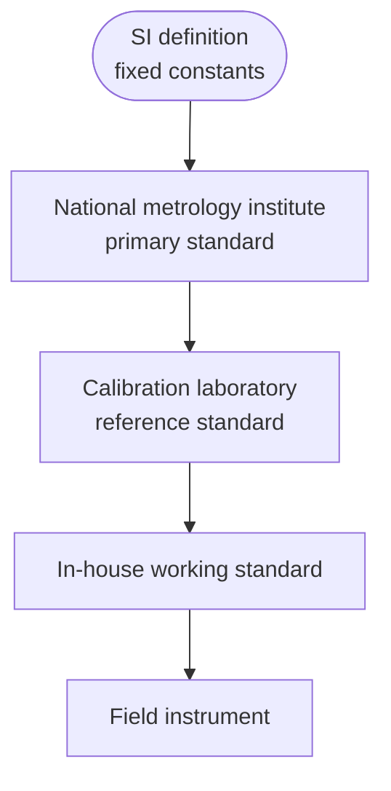
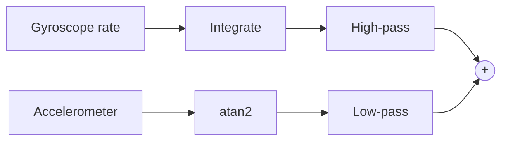

The [first entry](/blog/measurement-systems-and-sensor-characteristics) of this series ended its [section on calibration](/blog/measurement-systems-and-sensor-characteristics#6-calibration) with a two-point correction of offset and gain, a sentence on traceability, and a promise to return to calibration in practice. The entries since then have shown where the errors that calibration must deal with come from: sensor nonlinearity, amplifier and converter offsets and gain errors, drift, and the residuals that factory compensation leaves inside a [smart sensor](/blog/smart-sensors-and-mems). The smart-sensor entry also ended with a second problem: no single sensor measures everything well, so practical systems combine several.

This last entry treats both. Its first half is about **calibration**: what it produces and how it is linked to the International System of Units (SI), how uncertainty propagates through a calibration function, how a calibration curve is fitted by least squares, how sensors are calibrated in the field, and how often. Its second half is about **multisensor fusion**: inverse-variance weighting of several measurements of one quantity, consistency checks, the complementary filter for sensors whose errors lie in different frequency bands, and time alignment.

The entry assumes the uncertainty vocabulary of the first entry ([section 5](/blog/measurement-systems-and-sensor-characteristics#5-errors-and-uncertainty)): standard uncertainty $u$, Type A and Type B evaluation, combined standard uncertainty $u_c$, expanded uncertainty $U = k\,u_c$ with coverage factor $k$, all in the sense of the *Guide to the Expression of Uncertainty in Measurement* (GUM, JCGM 100:2008). It also uses vectors and matrices for the least-squares fit. The code examples are Python 3 with NumPy (run with Python 3.13 and NumPy 2.5); their printed output is quoted as produced. Angles are in degrees in the text and in radians inside the code, where NumPy's trigonometric functions require them.

## 1. Calibration and Traceability

### 1.1 What a calibration produces

The first entry defined calibration as establishing the relation between a sensor's indications and values given by a reference of smaller uncertainty. The *International Vocabulary of Metrology* (VIM, JCGM 200:2012) is more precise: a calibration has two steps. The first establishes, under specified conditions, a relation between the values provided by measurement standards, with their uncertainties, and the corresponding indications of the instrument, with theirs. The second uses that relation to obtain a measurement result from an indication. The output of a calibration is therefore not a corrected instrument but a piece of information: a correction table, a calibration curve or a calibration function, together with its uncertainty and the conditions under which it is valid.

Three related operations are often confused with calibration:

- **Adjustment** changes the instrument so that its indications come closer to the reference values: turning a zero trimmer, writing new coefficients into a smart sensor's memory. An adjustment usually follows a calibration and must be followed by another, because the calibration that preceded it describes an instrument that no longer exists.
- **Verification** checks that an instrument meets specified requirements, such as a maximum permissible error, and gives a pass or fail. It uses calibration data but does not by itself produce a correction.
- **Self-test**, as the [smart-sensor entry](/blog/smart-sensors-and-mems#43-self-test-and-self-calibration) explained, confirms that a device works, not that it is accurate.

A calibration certificate typically reports, at each calibration point, the reference value, the instrument's indication (or the correction to apply), and the expanded uncertainty with its coverage factor; for example "± 0.1 °C with $k = 2$", the figure the first entry's [uncertainty budget](/blog/measurement-systems-and-sensor-characteristics#53-a-worked-uncertainty-budget) turned into a standard uncertainty of 0.050 °C.

### 1.2 The calibration hierarchy

A reference standard is itself an instrument that must be calibrated. The sequence of calibrations from the realisation of an SI unit down to the instrument in use is called the **calibration hierarchy**:



Each level calibrates the one below it, and each calibration adds contributions of its own (the repeatability of the comparison, influence quantities, the resolution of the instrument) to the uncertainty it inherits. Uncertainty can only grow on the way down: a field instrument can never be known better than the working standard it was compared with.

### 1.3 Metrological traceability

**Metrological traceability**, in the VIM's sense, is a property of a measurement result: the result can be related to a stated reference, normally the realisation of an SI unit, through a documented, unbroken chain of calibrations, each of which contributes to the stated uncertainty. Each word carries weight. A reference thermometer bought with a datasheet but no certificate breaks the *documented* chain, however good it is; a certificate for a standard that has since been dropped or adjusted no longer describes it, so the chain is *broken*; and a chain of calibrations without stated uncertainties cannot be used in a budget at all. Calibration laboratories demonstrate their competence through accreditation to ISO/IEC 17025, the international standard for testing and calibration laboratories, and a certificate from an accredited laboratory is the usual way an organisation brings traceability in-house.

How much better must a reference be than the instrument it calibrates? The answer follows from the root-sum-of-squares combination of the first entry. If the reference contributes $u_\text{ref}$ and the instrument's own contributions amount to $u_\text{inst}$, the result has $u_c = \sqrt{u_\text{inst}^2 + u_\text{ref}^2}$. With a ratio $u_\text{inst}/u_\text{ref}$ of 4, the reference raises the combined uncertainty by only $\sqrt{1 + 1/16} - 1 = 3.1\ \%$; with a ratio of 2 by 11.8 %; with a ratio of 10 by 0.5 %. A ratio of about 4 is a common rule of thumb: beyond it the reference hardly matters, and better references quickly become expensive.

## 2. Propagating Uncertainty Through a Function

The first entry combined independent contributions by root sum of squares, which is correct when the result is a sum of the contributing quantities, each with sensitivity 1. A calibration function is usually not a plain sum, and its parameters are usually not independent, so the general rule of the GUM is needed.

Suppose the result $y$ is computed from input quantities $x_1, \dots, x_n$ through a **measurement model** $y = f(x_1, \dots, x_n)$. Each input has a standard uncertainty $u(x_i)$, and pairs of inputs may have a **covariance** $u(x_i, x_j)$, which describes how their errors vary together; dividing it by $u(x_i)\,u(x_j)$ gives the **correlation coefficient** $r(x_i, x_j)$, between −1 and +1. Linearising $f$ around the estimates gives the **law of propagation of uncertainty**:

$$
u_c^2(y) = \sum_{i=1}^{n} c_i^2\, u^2(x_i) + 2\sum_{i=1}^{n-1}\sum_{j=i+1}^{n} c_i\, c_j\, u(x_i, x_j),
\qquad c_i = \frac{\partial f}{\partial x_i}.
$$

The partial derivatives $c_i$ are **sensitivity coefficients**: they convert an uncertainty in an input into an uncertainty in the result, including the change of unit. In matrix form, with the row vector $J = (c_1, \dots, c_n)$ and the **covariance matrix** $V$ of the inputs (variances on the diagonal, covariances off it), the same rule reads $u_c^2(y) = J\,V\,J^{\mathsf T}$, which is how the code below evaluates it. For independent inputs with $c_i = 1$, it reduces to the root sum of squares of the first entry. The covariance terms can increase or decrease the result, and Section 3.3 shows a case where omitting them overstates the uncertainty.

## 3. Calibration Curves by Least Squares

### 3.1 The model

A two-point calibration fixes offset and gain exactly through two measurements, so it has no way to reveal nonlinearity or to average out the noise of either point. A **multi-point calibration** measures the instrument at several reference values spread over its range and fits a **calibration curve** to the results. For a straight line, the instrument's indication $y$ is modelled as a function of the reference value $x$:

$$
y = a + b\,x ,
$$

with offset $a$ and sensitivity $b$. Given $n$ pairs $(x_i, y_i)$, **ordinary least squares** chooses $a$ and $b$ to minimise the sum of squared **residuals** $e_i = y_i - (a + b\,x_i)$. Setting the derivatives of that sum to zero gives

$$
b = \frac{\sum_i (x_i - \bar x)(y_i - \bar y)}{S_{xx}}, \qquad
a = \bar y - b\,\bar x, \qquad
S_{xx} = \sum_i (x_i - \bar x)^2 ,
$$

where $\bar x$ and $\bar y$ are the means. The scatter of the residuals estimates the repeatability of an indication, with $n - 2$ degrees of freedom because two parameters were fitted:

$$
s = \sqrt{\frac{\sum_i e_i^2}{n - 2}} .
$$

The fitted parameters inherit uncertainty from that scatter. Their variances and covariance are

$$
u^2(b) = \frac{s^2}{S_{xx}}, \qquad
u^2(a) = s^2\left(\frac{1}{n} + \frac{\bar x^2}{S_{xx}}\right), \qquad
u(a, b) = -\frac{\bar x\, s^2}{S_{xx}} .
$$

The covariance is negative whenever the reference values lie mostly on one side of zero: a line that is tilted slightly too steeply must cross the axis slightly too low to pass through the cloud of points. These formulas assume that the reference values $x_i$ are exact, that the indications scatter independently with a constant standard deviation, and that the model is right. Section 3.4 checks the last assumption and Section 3.5 relaxes the first.

### 3.2 A worked example: the load cell

The load-cell channel of the [signal-conditioning entry](/blog/signal-conditioning#7-a-complete-channel-load-cell-to-converter), a 10 kg cell rated at 2 mV/V and read ratiometrically, is calibrated with six reference masses from 0 to 10 kg. The uncertainty of the masses is assumed small enough to neglect (Section 3.5 returns to that assumption), and each indication, in millivolts per volt of excitation, is an average over one second:

| Reference mass (kg) | 0 | 2 | 4 | 6 | 8 | 10 |
|---|---|---|---|---|---|---|
| Indication (mV/V) | 0.002115 | 0.401840 | 0.801585 | 1.201330 | 1.601010 | 2.000815 |

The fit and the parameter covariance take a few lines of NumPy. Writing the model as $\mathbf y = X\boldsymbol\beta$, with a design matrix $X$ whose rows are $(1, x_i)$ and $\boldsymbol\beta = (a, b)$, the covariance matrix of the parameters is $s^2 (X^{\mathsf T}X)^{-1}$, which reproduces the three formulas above.

```python
import numpy as np

# Reference masses (kg) and indicated bridge output (mV/V)
m = np.array([0.0, 2.0, 4.0, 6.0, 8.0, 10.0])
y = np.array([0.002115, 0.401840, 0.801585, 1.201330, 1.601010, 2.000815])

X = np.column_stack([np.ones_like(m), m])        # model y = a + b*m
coef, *_ = np.linalg.lstsq(X, y, rcond=None)
a, b = coef
resid = y - X @ coef
n, p = X.shape
s = np.sqrt(resid @ resid / (n - p))              # residual standard deviation
cov = s**2 * np.linalg.inv(X.T @ X)               # covariance of (a, b)
ua, ub = np.sqrt(np.diag(cov))
r_ab = cov[0, 1] / (ua * ub)

print(f"a = {a:.6f} mV/V   u(a) = {ua:.2e} mV/V")
print(f"b = {b:.6f} (mV/V)/kg   u(b) = {ub:.2e} (mV/V)/kg")
print(f"correlation r(a,b) = {r_ab:.3f}")
print(f"s = {s:.2e} mV/V")
print("residuals (1e-6 mV/V):", np.round(resid * 1e6, 1))
```

```text
a = 0.002110 mV/V   u(a) = 1.90e-05 mV/V
b = 0.199868 (mV/V)/kg   u(b) = 3.15e-06 (mV/V)/kg
correlation r(a,b) = -0.826
s = 2.63e-05 mV/V
residuals (1e-6 mV/V): [  5.5  -5.4   3.8  12.9 -43.   26.2]
```

The channel has an offset of 0.002110 mV/V, about 10.6 g, and a sensitivity 0.07 % below the nominal 0.2 (mV/V)/kg. The residual standard deviation, $s = 2.63 \times 10^{-5}$ mV/V, corresponds to $s/b = 0.13$ g, close to the 0.11 g root-mean-square (RMS) noise that the [noise budget](/blog/noise-interference-and-limits-of-detection#61-a-noise-budget-for-the-load-cell-channel) of the noise entry predicted for this channel. The calibration data and the noise analysis agree, which is itself a useful check.

### 3.3 Using the curve, with its uncertainty

In use, the instrument gives an indication $y_0$ and the calibration curve is inverted to obtain the measured mass:

$$
m_0 = \frac{y_0 - a}{b} .
$$

The inputs are $y_0$, $a$ and $b$. The new indication is independent of the calibration, with standard uncertainty $u(y_0) = s$ if it is averaged in the same way, while $a$ and $b$ are correlated. The sensitivity coefficients are $\partial m_0/\partial y_0 = 1/b$, $\partial m_0/\partial a = -1/b$ and $\partial m_0/\partial b = -m_0/b$, so the law of propagation gives

$$
u^2(m_0) = \frac{u^2(y_0) + u^2(a) + m_0^2\,u^2(b) + 2\,m_0\,u(a, b)}{b^2} .
$$

Continuing the script:

```python
# Use the curve: a new reading y0, repeatability u(y0) = s
y0 = 1.000000
m0 = (y0 - a) / b
J = np.array([-1 / b, -(y0 - a) / b**2])          # dm0/da, dm0/db
u_fit = np.sqrt(J @ cov @ J)
u_m0 = np.sqrt(u_fit**2 + (s / b)**2)
u_nocov = np.sqrt((ua / b)**2 + ((y0 - a) / b**2 * ub)**2 + (s / b)**2)
print(f"m0 = {m0:.4f} kg")
print(f"u(m0) from curve = {u_fit*1000:.3f} g, total = {u_m0*1000:.3f} g")
print(f"total ignoring covariance = {u_nocov*1000:.3f} g")
```

```text
m0 = 4.9927 kg
u(m0) from curve = 0.054 g, total = 0.142 g
total ignoring covariance = 0.181 g
```

Three observations follow. First, the calibration curve contributes only 0.054 g, while the repeatability of the single new reading contributes 0.13 g: fitting six points has averaged down the noise of the calibration itself. Near the centre of the calibrated range, $m_0 \approx \bar x = 5$ kg, the curve's contribution reaches its minimum, $s/(b\sqrt n)$; towards the ends it grows, and outside the calibrated range it grows quickly, which is one reason not to extrapolate a calibration. Second, ignoring the negative covariance between $a$ and $b$ would overstate the uncertainty by 27 % (0.181 g instead of 0.142 g). Third, $s$ was estimated from only four degrees of freedom, so a coverage factor of 2 gives noticeably less than 95 % coverage; the GUM (Annex G) replaces it with a factor from Student's $t$ distribution, 2.78 for four degrees of freedom, which gives $U \approx 0.39$ g. Repeating the calibration readings, or recording repeated readings at each point, adds degrees of freedom and brings the factor back towards 2.

This budget covers only the calibration curve and the repeatability of the reading. A complete uncertainty statement for the scale adds the uncertainty of the reference masses, the effects of temperature on the cell's zero and sensitivity, and the drift since calibration, combined as in the first entry.

### 3.4 Residuals and the choice of model

A straight line is a hypothesis, and the residuals test it. Residuals that scatter without pattern, with a standard deviation consistent with the known noise, support it; residuals that follow a smooth curve reveal a model error. The load-cell residuals above alternate in sign with no visible bow, and their size matches the noise budget, so a straight line is adequate.

A platinum resistance thermometer is different. Fitting a straight line by least squares to the PT100 curve of the first entry at 0, 20, … 100 °C leaves residuals of −0.077, +0.015, +0.062, +0.062, +0.015 and −0.077 Ω: a symmetric bow, the signature of the quadratic term $B$ in the Callendar–Van Dusen equation. The remedy is a better model, not more points: the equation $R = R_0 + R_0 A\,T + R_0 B\,T^2$ is linear in its three unknowns $R_0$, $R_0 A$ and $R_0 B$, so the same least-squares machinery, with design-matrix rows $(1, T_i, T_i^2)$, fits a quadratic and determines the individual sensor's coefficients rather than the standard values of IEC 60751.

A few rules for designing a multi-point calibration follow:

- **Cover the range of use**, since nothing is known beyond the outermost points.
- **Use more points than parameters**, and repeat some, so that $s$ can be estimated, model errors become visible, and the degrees of freedom grow.
- **Approach points from both directions** (rising then falling loads) when [hysteresis](/blog/measurement-systems-and-sensor-characteristics#34-resolution-threshold-and-hysteresis) is possible; a calibration that approaches every point from below cannot see it.
- **Calibrate the whole channel**, as the signal-conditioning entry recommended, so that the curve also absorbs the amplifier's and converter's constant errors.
- **Prefer the simplest model that leaves patternless residuals**; a high-order polynomial can pass close to every point and still oscillate between them.

### 3.5 When the reference values are uncertain

Ordinary least squares assumes that all the uncertainty is in the indications. When the indications are more precise at some points than at others, **weighted least squares** weights each residual by the inverse of its variance; when the reference values themselves are uncertain, methods that treat uncertainty in both coordinates are needed. ISO/TS 28037:2010 specifies these cases for straight-line calibration functions. A simpler approach, adequate when the reference uncertainty is small, is to treat it as a separate Type B contribution. An error common to all the reference masses, such as one inherited from the standard they were all calibrated against, passes through the calibration curve into every measured mass with the same relative size, and is added to the budget as such.

## 4. Calibration in the Field

A laboratory calibration describes the instrument as it was in the laboratory. Installation changes it: mounting stresses, cable runs, ambient temperature, and for a smart sensor the soldering stresses mentioned in the [smart-sensor entry](/blog/smart-sensors-and-mems#42-temperature-measurement-and-compensation). **In-field** (in-situ) calibration checks or corrects the instrument where it is used, at the cost of usually having fewer and less precise references available.

### 4.1 Zero and span checks

The simplest in-field calibration is the two-point correction of the first entry, applied with whatever references the installation offers. A weighing scale is **tared** (zeroed) with the empty platform and its span checked with a test weight; a pressure transmitter is zeroed by venting it to the atmosphere; a gas analyser is zeroed with clean air and spanned with a certified test gas. Zero drift is usually the larger part of drift, so frequent zero checks and occasional span checks are a common pattern. Some instruments perform **zero tracking** automatically: when the indication has been steady and close to zero for a while, they treat the small remaining value as drift and remove it. Zero tracking must be limited to a small range, or it will also remove a genuine small load placed slowly.

### 4.2 Natural references: gravity and zero rotation

The smart-sensor entry noted that the only physical references available to most inertial sensors are natural ones. They are good enough for a useful in-field calibration.

**Accelerometer: the six-position test.** An accelerometer at rest measures the reaction to gravity (its **specific force**), so an axis pointing straight up reads $+g$ and the same axis pointing down reads $-g$. If an axis has offset $o$ and scale factor $s_f$ (indication $= o + s_f\,a$), the two readings are $r_\uparrow = o + s_f g$ and $r_\downarrow = o - s_f g$, so

$$
o = \frac{r_\uparrow + r_\downarrow}{2}, \qquad s_f = \frac{r_\uparrow - r_\downarrow}{2g} .
$$

Placing the sensor on each of its six faces calibrates all three axes. If the z axis reads $+9.893$ m/s² pointing up and $-9.744$ m/s² pointing down, its offset is $+0.0745$ m/s² (7.6 mg) and its scale factor $19.637 / (2 \times 9.80665) = 1.0012$. Two cautions apply. The value of $g$ used is part of the reference: local gravity ranges from about 9.78 m/s² at the equator to about 9.83 m/s² at the poles, so using the standard value $g_n = 9.80665$ m/s² everywhere leaves a scale-factor error of up to about 0.27 %; a value for the site, from a gravity model or survey, removes it. And the method relies on each axis being truly vertical: an axis tilted by a small angle $\phi$ reads $g\cos\phi$, a relative error of about $\phi^2/2$, which is small for a careful setup (0.015 % at 1°) but not for a sensor resting on an uneven surface.

**Gyroscope: bias at rest.** A gyroscope that is known to be stationary should read zero, so its average reading over a still period estimates its bias, the slowly wandering offset described in the [gyroscope section](/blog/smart-sensors-and-mems#32-the-gyroscope) of the smart-sensor entry. The averaging follows the [noise entry](/blog/noise-interference-and-limits-of-detection#4-averaging-and-dither): white rate noise of 0.1 °/s per sample, averaged over 1000 samples (10 s at 100 Hz), leaves a bias uncertainty of $0.1/\sqrt{1000} \approx 0.003$ °/s, and the Allan deviation shows how long to average before drift takes over. Strictly, "stationary" means stationary relative to the Earth, which itself rotates at 15.04 °/h, or about 0.0042 °/s. That is negligible against the bias of a consumer microelectromechanical (MEMS) gyroscope but not for navigation-grade instruments, which can measure it (and use it to find north).

### 4.3 Comparison with a transfer standard

When an installed sensor cannot be removed, a calibrated reference, a **transfer standard**, is brought to it: a reference thermometer in a well next to the process sensor, or a calibrated pressure source on a test port. Its uncertainty must include what a laboratory would control but the field does not, chiefly the difference between conditions at the two sensors, such as a temperature gradient between two wells. A **loop calibration** injects the reference at the sensor and reads the result where it is finally used, at the controller or in the database, so that conversion, scaling and software are included too.

## 5. Calibration Intervals

Every calibration ages: the instrument drifts, and the probability that it is outside its tolerance grows with time. The **calibration interval**, the time allowed before the next calibration, balances the cost of calibrating against the cost of using an instrument that has silently gone out of tolerance.

A simple model shows the main trade-off. Suppose an instrument's error must stay within a **maximum permissible error** (MPE) of ±0.10 % of span, its calibration has an expanded uncertainty of 0.02 % of span, and its history shows a drift of about 0.03 % of span per year. If it leaves calibration with negligible error, the drift may use up only what the calibration uncertainty leaves of the tolerance, so the interval should not exceed $(0.10 - 0.02)/0.03 \approx 2.7$ years, and a prudent choice would be shorter, because drift rates scatter between units and are not exactly linear.

Practical methods refine this with the instrument's own history, and are described in ILAC-G24 / OIML D 10, a guideline published jointly by the International Laboratory Accreditation Cooperation (ILAC) and the International Organization of Legal Metrology (OIML). Two are common:

- **The staircase method** (automatic adjustment of the interval): if an instrument is found within tolerance at calibration, the next interval is lengthened; if it is found outside, it is shortened. Over time the interval settles where the instrument rarely fails.
- **Control charts**: the same check points are recorded at every calibration, and the trend of each, its drift rate and scatter, predicts when it will reach the tolerance limit.

Events such as an overload, a repair or a move to a different environment trigger calibration regardless of the interval. **Intermediate checks** with a simple, stable reference (a check weight, an ice point, a test gas) between full calibrations detect problems early and build the record that the control-chart method needs.

## 6. Combining Measurements of One Quantity

The rest of the entry turns from making one sensor trustworthy to combining several. The simplest case is several calibrated sensors measuring the same quantity, such as three thermometers in one tank, each with a stated standard uncertainty.

### 6.1 Inverse-variance weighting

Let the corrected readings be $x_1, \dots, x_n$ with standard uncertainties $u_1, \dots, u_n$, and assume for now that their errors are independent. A linear combination

$$
\hat x = \sum_i w_i\, x_i, \qquad \sum_i w_i = 1,
$$

has no systematic error if the readings have none, because the weights sum to one. By the law of propagation of Section 2, with sensitivity coefficients $c_i = w_i$, its variance is $u^2(\hat x) = \sum_i w_i^2 u_i^2$. The best weights minimise this variance under the constraint. With a Lagrange multiplier $\lambda$, minimise

$$
L = \sum_i w_i^2 u_i^2 - \lambda\left(\sum_i w_i - 1\right).
$$

Setting $\partial L/\partial w_i = 2 w_i u_i^2 - \lambda = 0$ gives $w_i = \lambda / (2u_i^2)$: each weight is proportional to $1/u_i^2$. Normalising so the weights sum to one,

$$
\hat x = \frac{\sum_i x_i / u_i^2}{\sum_i 1/u_i^2}, \qquad
u(\hat x) = \left(\sum_i \frac{1}{u_i^2}\right)^{-1/2} .
$$

This is **inverse-variance weighting**. The fused uncertainty is smaller than the smallest individual one, and adding any sensor, however poor, never makes it worse; a poor sensor simply receives a small weight. For two sensors the result can be rewritten as $\hat x = x_1 + K(x_2 - x_1)$ with $K = u_1^2/(u_1^2 + u_2^2)$, which is exactly the measurement update of the one-dimensional example in the [state-estimation entry](/blog/sensing-and-state-estimation#4-a-worked-example-in-one-dimension) of the robotics series: a Kalman filter update is inverse-variance weighting of a prediction and a measurement.

### 6.2 Correlated errors

Independence is the assumption most often violated. Consider two thermometers, each with the uncertainty budget of the first entry (repeatability 0.016 °C, display resolution 0.003 °C, calibration 0.050 °C), both calibrated against the same reference. Averaging them halves the variance of the independent parts, but the calibration error is the same in both and does not average out. The uncertainty of their mean is

$$
\sqrt{0.050^2 + \frac{0.016^2 + 0.003^2}{2}} \approx 0.051\ ^\circ\text{C},
$$

barely better than the 0.053 °C of one thermometer, and far from the $0.053/\sqrt 2 = 0.037$ °C that an assumption of independence would claim. In general, two measurements with equal uncertainty $u$ and correlation $r$ average to a variance of $u^2(1 + r)/2$, which is no improvement at all when $r = 1$. When correlations are known, the weights generalise to $\mathbf w = V^{-1}\mathbf 1 / (\mathbf 1^{\mathsf T} V^{-1} \mathbf 1)$, with $V$ the covariance matrix of the readings and $\mathbf 1$ a vector of ones, and the fused variance to $1/(\mathbf 1^{\mathsf T} V^{-1}\mathbf 1)$. The practical lesson is simpler: redundancy reduces only the errors that the sensors do not share. Sensors calibrated against different references, built on different principles, or mounted in different places share less.

### 6.3 Consistency checks

Inverse-variance weighting trusts the stated uncertainties completely. If one sensor has failed, or its uncertainty is understated, the fused value is pulled towards the wrong reading and its stated uncertainty becomes too small. Before fusing, the readings should therefore be checked for consistency with each other.

For two readings, the **normalised difference**

$$
z = \frac{x_1 - x_2}{\sqrt{u_1^2 + u_2^2}}
$$

should behave like a standard Gaussian variable if both uncertainties are right and the errors independent: $|z|$ above 2 or 3 is suspicious. Interlaboratory comparisons use the same quantity with expanded uncertainties, as the $E_n$ number, and treat $|E_n| \le 1$ as satisfactory. For $n$ readings, the statistic

$$
\chi^2 = \sum_i \frac{(x_i - \hat x)^2}{u_i^2}
$$

follows a **chi-square** distribution with $n - 1$ degrees of freedom when the readings are consistent (the robotics series used the same distribution to gate Kalman-filter innovations). Its expected value is $n - 1$; for two degrees of freedom, values above 5.99 occur by chance only 5 % of the time, and above 9.21 only 1 %. The square root of $\chi^2/(n-1)$, the **Birge ratio**, summarises the same test: close to 1 for consistent data, well above 1 when the stated uncertainties are too small for the observed scatter.

```python
import numpy as np

def fuse(x, u):
    """Inverse-variance weighted mean, its standard uncertainty, and chi-square."""
    x, u = np.asarray(x, float), np.asarray(u, float)
    w = 1 / u**2
    xw = np.sum(w * x) / np.sum(w)
    uw = 1 / np.sqrt(np.sum(w))
    chi2 = np.sum(((x - xw) / u)**2)
    return xw, uw, chi2, w / np.sum(w)

x = [20.13, 20.21, 20.05]          # degC
u = [0.053, 0.100, 0.080]          # degC, standard uncertainties
xw, uw, chi2, wn = fuse(x, u)
print("weights:", np.round(wn, 3))
print(f"fused = {xw:.3f} degC, u = {uw:.3f} degC")
print(f"chi2 = {chi2:.2f} with {len(x)-1} degrees of freedom")

x_bad = [20.13, 20.21, 20.55]
xw, uw, chi2, wn = fuse(x_bad, u)
print(f"with a faulty third sensor: fused = {xw:.3f}, chi2 = {chi2:.1f}")
for i in range(3):
    others = [j for j in range(3) if j != i]
    xo, uo, _, _ = fuse([x_bad[j] for j in others], [u[j] for j in others])
    z = (x_bad[i] - xo) / np.sqrt(u[i]**2 + uo**2)
    print(f"sensor {i+1}: z = {z:+.2f}")
```

```text
weights: [0.581 0.163 0.255]
fused = 20.123 degC, u = 0.040 degC
chi2 = 1.61 with 2 degrees of freedom
with a faulty third sensor: fused = 20.250, chi2 = 19.3
sensor 1: z = -3.51
sensor 2: z = -0.44
sensor 3: z = +4.34
```

The three consistent readings fuse to 20.123 °C with a standard uncertainty of 0.040 °C, and $\chi^2 = 1.61$ is unremarkable. When the third sensor fails high, the fused value moves by 0.13 °C, more than three times its own stated uncertainty, and $\chi^2 = 19.3$ flags the inconsistency clearly. Comparing each sensor with the fusion of the others points to sensor 3 as the most discrepant. Sensor 1 also appears inconsistent, because the fusion it is compared with contains the faulty reading; once sensor 3 is excluded, sensors 1 and 2 agree, with $z = (20.13 - 20.21)/\sqrt{0.053^2 + 0.100^2} = -0.71$. With only two sensors, a disagreement shows that something is wrong but not which sensor; that takes at least three, which is why safety systems often use **two-out-of-three** voting, or the median of three readings, which ignores a single wild value without needing any uncertainties at all.

## 7. Complementary Sensors: Tilt from Accelerometer and Gyroscope

Sensors measuring the same quantity with similar errors can only be averaged. A more powerful kind of fusion combines sensors whose errors lie in **different frequency bands**. The standard example, already outlined in the [robotics series](/blog/sensing-and-state-estimation#71-fusing-complementary-sensors), is the tilt of a body measured with the MEMS accelerometer and gyroscope of the smart-sensor entry. This section works it out quantitatively for one axis.

### 7.1 What each sensor offers

Take a sensor that rotates about its y axis by a tilt angle $\theta$, with its z axis pointing up when $\theta = 0$, and positive $\theta$ tipping the x axis upwards. At rest, the accelerometer measures the reaction to gravity, with components $a_x = g\sin\theta$ and $a_z = g\cos\theta$, so

$$
\theta_a = \operatorname{atan2}(a_x,\ a_z),
$$

where atan2 is the two-argument arctangent that returns the angle in the correct quadrant. This estimate is **absolute**: it has no memory, so its errors do not accumulate. But it assumes that the only acceleration is gravity. Any linear acceleration of the body (vibration, starting and stopping, the centripetal acceleration of a sensor mounted away from the axis of rotation) adds to $a_x$ and $a_z$ and is read as tilt. Its errors are therefore large at the frequencies where the body moves.

The gyroscope measures the rotation rate $\omega = \dot\theta$, and integrating it gives the change of angle. Its estimate is smooth and responsive and unaffected by linear acceleration, but integration accumulates every error: a bias $b_\omega$ produces an angle error $b_\omega t$ that grows without limit (0.5 °/s becomes 30° after one minute), and white rate noise produces an angle error that grows as $\sqrt t$. Its errors are therefore large at low frequencies.

### 7.2 The complementary filter

A **complementary filter** passes the gyroscope's angle through a high-pass filter and the accelerometer's through a low-pass filter with the same time constant $\tau$, and adds the results. With $s$ the Laplace variable (not the residual standard deviation of Section 3),

$$
\hat\theta(s) = \frac{\tau s}{\tau s + 1}\,\frac{\omega(s)}{s} + \frac{1}{\tau s + 1}\,\theta_a(s).
$$

The two filters are complementary: their transfer functions sum to exactly one. If both sensors were perfect ($\omega(s)/s = \theta_a(s) = \theta(s)$), the output would be $\theta$ at every frequency, with no lag and no distortion. Each sensor's errors, on the other hand, are filtered: accelerometer errors are attenuated above the crossover frequency $1/(2\pi\tau)$, and gyroscope errors below it. A constant gyroscope bias $b_\omega$, whose integral is a ramp $b_\omega/s^2$, emerges from the high-pass filter as a constant tilt error of

$$
\lim_{s \to 0} s \cdot \frac{\tau s}{\tau s + 1}\,\frac{b_\omega}{s^2} = b_\omega \tau .
$$

The time constant therefore sets the trade-off: a short $\tau$ lets more accelerometer disturbance through, a long $\tau$ more gyroscope drift.

Multiplying through by $\tau s + 1$ turns the filter into the differential equation $\tau\,\dot{\hat\theta} = \tau\,\omega + \theta_a - \hat\theta$. Approximating the derivative at sample $k$ by $(\hat\theta_k - \hat\theta_{k-1})/\Delta t$ and solving for $\hat\theta_k$ gives the familiar discrete form, run once per sample interval $\Delta t$:

$$
\hat\theta_k = \alpha\left(\hat\theta_{k-1} + \omega_k\,\Delta t\right) + (1 - \alpha)\,\theta_{a,k},
\qquad \alpha = \frac{\tau}{\tau + \Delta t}.
$$

Each step propagates the previous estimate with the gyroscope and then nudges it slightly towards the accelerometer. At 100 Hz ($\Delta t = 0.01$ s) a time constant of 1 s gives $\alpha = 0.990$.



### 7.3 A simulation

The script below simulates one minute of a body rocking by ±20° at 0.2 Hz, sampled at 100 Hz. The gyroscope has a bias of 0.5 °/s and white noise of 0.1 °/s per sample; the accelerometer has white noise of 0.02 g per axis and a linear-acceleration disturbance of 1 m/s² at 2 Hz along x. It compares the tilt errors of each sensor alone and of the complementary filter for several time constants, ignoring the first 10 s while the filters settle.

```python
import numpy as np

rng = np.random.default_rng(1)
g = 9.80665                      # m/s^2
dt = 0.01                        # s (100 Hz)
t = np.arange(0, 60, dt)
theta = np.radians(20) * np.sin(2 * np.pi * 0.2 * t)        # true tilt, rad
omega = np.gradient(theta, dt)                               # true rate, rad/s

# Gyroscope: true rate + bias 0.5 deg/s + white noise 0.1 deg/s per sample
gyro = omega + np.radians(0.5) + np.radians(0.1) * rng.standard_normal(t.size)
# Accelerometer: gravity components + noise 0.02 g + 1 m/s^2 linear-acceleration disturbance at 2 Hz on x
ax = g * np.sin(theta) + 1.0 * np.sin(2 * np.pi * 2.0 * t) + 0.02 * g * rng.standard_normal(t.size)
az = g * np.cos(theta) + 0.02 * g * rng.standard_normal(t.size)
theta_acc = np.arctan2(ax, az)

def complementary(gyro, theta_acc, tau, dt):
    alpha = tau / (tau + dt)
    est = np.empty_like(theta_acc)
    est[0] = theta_acc[0]
    for k in range(1, est.size):
        est[k] = alpha * (est[k - 1] + gyro[k] * dt) + (1 - alpha) * theta_acc[k]
    return est

def rms_deg(err):
    return np.degrees(np.sqrt(np.mean(err**2)))

theta_gyro = theta[0] + np.cumsum(gyro) * dt
late = t >= 10                   # ignore the first 10 s (start-up transient)
print(f"gyro only:          RMS error {rms_deg((theta_gyro - theta)[late]):6.2f} deg")
print(f"accelerometer only: RMS error {rms_deg((theta_acc - theta)[late]):6.2f} deg")
for tau in (0.1, 0.5, 1.0, 2.0, 5.0):
    est = complementary(gyro, theta_acc, tau, dt)
    err = (est - theta)[late]
    print(f"complementary tau = {tau:3.1f} s: RMS error {rms_deg(err):5.2f} deg,"
          f" mean error {np.degrees(err.mean()):+5.2f} deg")

# Bias estimated at rest beforehand (Section 4.2) and subtracted, leaving 0.02 deg/s
gyro_corr = gyro - np.radians(0.48)
for tau in (1.0, 5.0):
    err = (complementary(gyro_corr, theta_acc, tau, dt) - theta)[late]
    print(f"bias-corrected, tau = {tau:3.1f} s: RMS error {rms_deg(err):5.2f} deg,"
          f" mean error {np.degrees(err.mean()):+5.2f} deg")
```

```text
gyro only:          RMS error  19.01 deg
accelerometer only: RMS error   4.19 deg
complementary tau = 0.1 s: RMS error  2.45 deg, mean error +0.02 deg
complementary tau = 0.5 s: RMS error  0.68 deg, mean error +0.22 deg
complementary tau = 1.0 s: RMS error  0.58 deg, mean error +0.47 deg
complementary tau = 2.0 s: RMS error  0.99 deg, mean error +0.97 deg
complementary tau = 5.0 s: RMS error  2.43 deg, mean error +2.42 deg
bias-corrected, tau = 1.0 s: RMS error  0.34 deg, mean error -0.01 deg
bias-corrected, tau = 5.0 s: RMS error  0.14 deg, mean error +0.05 deg
```

The integrated gyroscope drifts away (19° RMS) and the accelerometer alone is disturbed by the vibration (4.2° RMS). The complementary filter beats both by a wide margin, and its mean error follows the prediction $b_\omega \tau$: 0.47° for $\tau = 1$ s, 0.97° for 2 s and 2.42° for 5 s, against 0.5°, 1.0° and 2.5° predicted (the finite record and the starting transient account for the small differences). With short time constants the 2 Hz disturbance leaks through; with long ones the bias dominates; around 1 s the two balance. The last two lines show the value of calibration before fusion: once the bias has been estimated at rest and subtracted, the residual 0.02 °/s barely matters, a longer time constant can be used to suppress the accelerometer disturbance further, and the error falls to 0.14° RMS. Calibration and fusion are not alternatives; each makes the other work better.

### 7.4 From the complementary filter to the Kalman filter

The complementary filter fixes its crossover frequency in advance and cannot learn the gyroscope's bias as it changes. A **Kalman filter**, introduced in the [state-estimation entry](/blog/sensing-and-state-estimation#5-the-kalman-filter) of the robotics series, does both: its state can include the bias as well as the angle, it computes its gain at each step from the stated noise of the sensors and the model, and it reports the uncertainty of its estimate. A Kalman filter whose state is the angle alone, with the gyroscope rate as its input and the accelerometer tilt as its measurement, settles to a fixed gain when the noise levels are constant, and its update then has exactly the form of the discrete complementary filter, with $1 - \alpha$ as the gain. The complementary filter is, in this sense, a Kalman filter whose gain has been chosen by hand. It remains popular because it is simple and robust; the Kalman filter is preferred when biases must be tracked, when sensor rates or reliabilities vary, or when an honest uncertainty is needed downstream. Both depend on the calibration of Sections 3 and 4: neither can tell an uncalibrated scale-factor error from a real change of tilt.

## 8. Time Alignment

Fusion compares readings, and a comparison is only meaningful if the readings refer to the same instant. The smart-sensor entry warned that each integrated sensor samples on its own clock and delays its output through internal filters; this section shows why that matters.

### 8.1 How large the error is

If one of two readings refers to a time $\delta$ earlier than the other, the difference between them contains a false component of about $\dot x\,\delta$, where $\dot x$ is the rate of change of the measured quantity. In the simulation above, the tilt changes at up to $20^\circ \times 2\pi \times 0.2\ \text{Hz} = 25.1$ °/s, so an offset of only 10 ms between gyroscope and accelerometer creates disagreements of up to 0.25°, a large part of the error budget of the best filter. For slowly changing quantities, such as the temperature of a tank, the same offset is irrelevant; time alignment matters in proportion to how fast the measurand moves.

Offsets arise from several sources:

- **Filter and converter delay.** The digital filter of a smart sensor and the decimation filter of a [delta-sigma converter](/blog/sampling-quantization-and-data-conversion#52-delta-sigma) delay the output by a time that depends on the configured bandwidth and output rate.
- **Transport and buffering.** Readings wait in a sensor's first-in, first-out (FIFO) buffer, cross a bus, and are handled by software whose timing varies.
- **Clock differences.** Two crystal oscillators that differ by 50 parts per million drift apart by 0.18 s per hour, so sample counts from two free-running sensors cannot be matched by index for long.

### 8.2 Remedies

The best remedy is to avoid the problem in hardware: drive several sensors from one clock or trigger them together, so that their samples are simultaneous by construction. Where that is not possible:

- **Timestamp each sample when it is taken,** not when it arrives, for instance from the sensor's data-ready interrupt, and correct for the sensor's documented filter delay.
- **Resample onto a common time base** by interpolating each stream to the instants at which fusion runs.
- **Estimate the remaining offset from the data.** Two sensors that observe the same motion produce correlated signals, and the lag at which their cross-correlation peaks estimates the offset between them.
- **Process late measurements at their own time** in a Kalman filter, as described in the robotics series' [engineering details](/blog/sensing-and-state-estimation#8-engineering-details-that-decide-success).

The script below illustrates the third remedy. Two sensors, resampled to 1 kHz, observe the same random motion with independent noise, and the second lags by 30 ms.

```python
import numpy as np

rng = np.random.default_rng(2)
fs = 1000.0                                  # common time base after resampling, Hz
t = np.arange(0, 20, 1 / fs)
# A smooth, random test motion: white noise low-pass filtered by a moving average
x = np.convolve(rng.standard_normal(t.size), np.ones(200) / 200, mode="same")

true_delay = 0.030                           # s, sensor B lags sensor A
a = x + 0.05 * x.std() * rng.standard_normal(t.size)
b = np.interp(t - true_delay, t, x) + 0.05 * x.std() * rng.standard_normal(t.size)

# Cross-correlate the zero-mean signals and find the lag of the peak
a0, b0 = a - a.mean(), b - b.mean()
lags = np.arange(-200, 201)                  # search +/- 0.2 s
xc = [np.dot(a0[200:-200], np.roll(b0, -k)[200:-200]) for k in lags]
k_best = lags[int(np.argmax(xc))]
print(f"estimated delay of B behind A: {k_best / fs * 1000:.0f} ms")

# Align B and compare the RMS difference before and after
b_aligned = np.interp(t + k_best / fs, t, b)
inner = slice(500, -500)
print(f"RMS difference before alignment: {np.std((a - b)[inner]) / x.std():.3f} (relative)")
print(f"RMS difference after alignment:  {np.std((a - b_aligned)[inner]) / x.std():.3f} (relative)")
```

```text
estimated delay of B behind A: 30 ms
RMS difference before alignment: 0.536 (relative)
RMS difference after alignment:  0.070 (relative)
```

The cross-correlation recovers the 30 ms delay. Before alignment, the two sensors disagree by more than half the signal's standard deviation, a disagreement that a consistency check would attribute to a faulty sensor. After alignment, what remains is $0.070 \approx \sqrt 2 \times 0.05$, the combined noise of the two sensors, as it should be. The method needs motion to work, since a still signal has no features to correlate, and it estimates a relative offset; an absolute delay still needs a reference.

## 9. Exercises

**1.** A straight line is fitted by least squares to the PT100 curve of the first entry ($R_0 = 100\ \Omega$, $A = 3.9083 \times 10^{-3}\ ^\circ\text{C}^{-1}$, $B = -5.775 \times 10^{-7}\ ^\circ\text{C}^{-2}$) at 0, 20, 40, 60, 80 and 100 °C. What is its largest residual, in ohms and in degrees Celsius, and how does it compare with the end-point nonlinearity of the first entry?

<details>
<summary>Answer</summary>

The fitted slope is 0.38506 Ω/°C, and the residuals are −0.077, +0.015, +0.062, +0.062, +0.015 and −0.077 Ω. The largest, 0.077 Ω, corresponds to $0.077/0.385 \approx 0.20$ °C, about half of the 0.375 °C found against the end-point line, because the least-squares line splits the bow between positive and negative errors. The systematic pattern shows that a quadratic model is needed; fitted with rows $(1, T, T^2)$, it reproduces the curve exactly.

</details>

**2.** Two sensors measure the same distance: 10.0 m with $u = 0.3$ m and 10.7 m with $u = 0.4$ m, with independent errors. Find the fused value, its standard uncertainty and the weight of the first sensor, and check whether the two readings are consistent.

<details>
<summary>Answer</summary>

The weights are proportional to $1/0.09$ and $1/0.16$, giving 0.64 for the first sensor and 0.36 for the second. The fused value is $0.64 \times 10.0 + 0.36 \times 10.7 = 10.25$ m, with $u = (1/0.09 + 1/0.16)^{-1/2} = 0.24$ m. The normalised difference is $0.7/\sqrt{0.09 + 0.16} = 1.4$, which is unremarkable for a standard Gaussian variable, so the readings are consistent.

</details>

**3.** An accelerometer's x axis reads $+9.893$ m/s² pointing up and $-9.744$ m/s² pointing down at a site where local gravity is 9.780 m/s². What offset and scale factor does a six-position calibration give with the local value, and how large an error would using $g_n = 9.80665$ m/s² introduce?

<details>
<summary>Answer</summary>

The offset does not depend on $g$: $(9.893 - 9.744)/2 = 0.0745$ m/s². The scale factor with local gravity is $19.637/(2 \times 9.780) = 1.0039$; with $g_n$ it is 1.0012. Using $g_n$ therefore understates the scale factor by $9.80665/9.780 - 1 \approx 0.27\ \%$.

</details>

**4.** A complementary filter runs at 200 Hz with $\tau = 0.5$ s, and the gyroscope has an uncorrected bias of 0.2 °/s. What is $\alpha$, and what steady tilt error does the bias cause?

<details>
<summary>Answer</summary>

With $\Delta t = 0.005$ s, $\alpha = 0.5/(0.5 + 0.005) = 0.990$. The steady error is $b_\omega \tau = 0.2 \times 0.5 = 0.1$°. Halving $\tau$ would halve it, at the cost of letting more accelerometer disturbance through.

</details>

**5.** Two thermometers are calibrated against the same reference, which contributes 0.050 °C to each; all their other contributions are independent and total 0.030 °C each. What is the standard uncertainty of their mean, and what would it be if they had been calibrated against independent references of the same quality?

<details>
<summary>Answer</summary>

With a shared reference, the calibration term does not average: $\sqrt{0.050^2 + 0.030^2/2} = 0.054$ °C, against $\sqrt{0.050^2 + 0.030^2} = 0.058$ °C for one thermometer. With independent references, all contributions average: $0.058/\sqrt 2 = 0.041$ °C.

</details>

## 10. Summary

| Question | Answer |
|---|---|
| What does a calibration produce? | A relation between reference values and indications, with its uncertainty, used to obtain results from indications; adjustment and verification are separate operations. |
| What is metrological traceability? | A property of a result: it relates to a stated reference, normally the SI, through a documented, unbroken chain of calibrations, each contributing to the uncertainty. |
| How does uncertainty propagate through a function? | $u_c^2 = J V J^{\mathsf T}$: sensitivity coefficients times the covariance matrix of the inputs, including correlations. |
| How is a calibration curve fitted? | By least squares, which gives the parameters, their covariance $s^2(X^{\mathsf T}X)^{-1}$ and the residual standard deviation $s$; residuals test the model. |
| What is the uncertainty of a value read from the curve? | Repeatability of the new reading plus the curve's contribution, which is smallest at the centre of the calibrated range and must include the parameters' covariance. |
| How are sensors calibrated in the field? | With zero and span checks, natural references (gravity for accelerometers, rest for gyroscopes), and transfer standards brought to the installed sensor. |
| How is a calibration interval chosen? | From the tolerance, the calibration uncertainty and the observed drift, refined by the instrument's own history (staircase or control-chart methods). |
| How are measurements of one quantity combined? | By inverse-variance weighting, $w_i \propto 1/u_i^2$; the fused uncertainty is $(\sum 1/u_i^2)^{-1/2}$ if the errors are independent. |
| What limits the benefit of redundancy? | Shared (correlated) errors, such as a common calibration reference, which do not average out. |
| How is consistency checked? | With the normalised difference for two readings and chi-square (or the Birge ratio) for several; at least three sensors are needed to identify a faulty one. |
| What does a complementary filter do? | Combines a gyroscope's angle (high-passed) and an accelerometer's tilt (low-passed) with one time constant $\tau$; a gyroscope bias $b_\omega$ leaves an error $b_\omega \tau$. |
| Why does time alignment matter? | An offset $\delta$ creates a false difference of about $\dot x\,\delta$; timestamps, common clocks, resampling and delay estimation remove it. |

## 11. The Series as a Whole

This entry completes the series, which has followed a measurement from the physical world to a number that can be trusted.

- The [first entry](/blog/measurement-systems-and-sensor-characteristics) defined measurement, the measurement chain, the static and dynamic characteristics of a sensor, and the language of error and uncertainty.
- The [second](/blog/sensing-principles) opened the sensing element: the resistive, capacitive, inductive, piezoelectric, thermoelectric, optical and electrochemical effects that turn a measurand into an electrical quantity.
- The [third](/blog/signal-conditioning) built the analog front end: excitation, bridges, amplifiers and filters.
- The [fourth](/blog/sampling-quantization-and-data-conversion) crossed into the digital domain: sampling, aliasing, quantization and converter architectures.
- The [fifth](/blog/noise-interference-and-limits-of-detection) found the limits: noise, interference and the smallest detectable change.
- The [sixth](/blog/smart-sensors-and-mems) put the chain on a chip: MEMS structures and smart sensors with their own compensation.
- This **seventh** entry made the result trustworthy and combined sensors: calibration with traceability and uncertainty, and fusion that is weighted, checked and aligned in time.

The common thread is that every number a sensor system produces carries an uncertainty that can be estimated, reduced at its source, and stated honestly. The [robotics series](/blog/sensing-and-state-estimation) shows the same ideas at work when the quantity to be measured is the state of a moving machine.

### References

- JCGM 200:2012, *International Vocabulary of Metrology: Basic and General Concepts and Associated Terms* (VIM), Joint Committee for Guides in Metrology.
- JCGM 100:2008, *Evaluation of Measurement Data: Guide to the Expression of Uncertainty in Measurement* (GUM), Joint Committee for Guides in Metrology.
- ISO/IEC 17025:2017, *General Requirements for the Competence of Testing and Calibration Laboratories*, International Organization for Standardization and International Electrotechnical Commission.
- ISO/TS 28037:2010, *Determination and Use of Straight-Line Calibration Functions*, International Organization for Standardization.
- ILAC-G24:2007 / OIML D 10:2007, *Guidelines for the Determination of Calibration Intervals of Measuring Instruments*, International Laboratory Accreditation Cooperation and International Organization of Legal Metrology.
- J. R. Taylor, *An Introduction to Error Analysis: The Study of Uncertainties in Physical Measurements*, 2nd edition, University Science Books, 1997.
- S. Thrun, W. Burgard and D. Fox, *Probabilistic Robotics*, MIT Press, 2005.
- J. Fraden, *Handbook of Modern Sensors: Physics, Designs, and Applications*, 5th edition, Springer, 2016.
