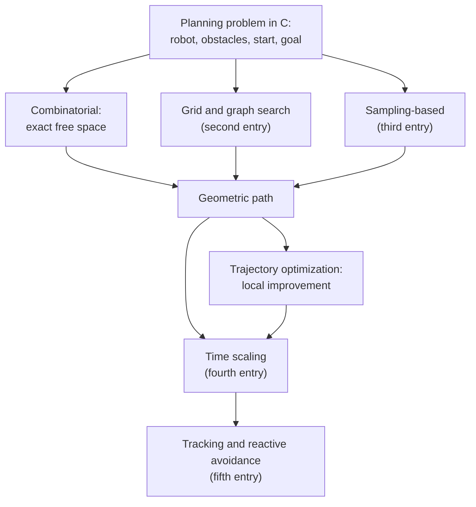

A robot arm that must move a part from one fixture to another, or a mobile robot that must cross a cluttered room, faces the same question before any motor turns. Which motion takes it from where it is to where it should be without touching anything? Answering that question is **motion planning**. This first entry of [Motion Planning for Robots](/series/motion-planning) states the problem precisely, in the setting that the rest of the series uses. That setting is the configuration space, in which a robot of any shape becomes a single point and its obstacles become regions that the point must avoid.

The entry builds on the [Introduction to Robotics](/series/introduction-to-robotics) series: the degrees of freedom of [What Is a Robot?](/blog/what-is-a-robot), the frames of [Coordinate Frames and Rigid-Body Transformations](/blog/coordinate-frames-and-transformations) and above all the two-link arm and its workspace from [Forward and Inverse Kinematics of a Planar Arm](/blog/planar-arm-kinematics). It builds the configuration space and its obstacles, defines what a planner can guarantee, shows how collisions are checked and places the methods of the later entries on one map.

**Conventions.** These hold for the whole series. A configuration is written $q$, the configuration space $\mathcal{C}$, the obstacle region $\mathcal{C}_{\mathrm{obs}}$ and the free space $\mathcal{C}_{\mathrm{free}} = \mathcal{C} \setminus \mathcal{C}_{\mathrm{obs}}$; the dimension of $\mathcal{C}$ is $d$. The workspace $\mathcal{W}$ is the plane $\mathbb{R}^2$ in the examples. The start and goal configurations are $q_{\mathrm{start}}$ and $q_{\mathrm{goal}}$. A path is a continuous map $\sigma : [0, 1] \to \mathcal{C}_{\mathrm{free}}$ with $\sigma(0) = q_{\mathrm{start}}$ and $\sigma(1) = q_{\mathrm{goal}}$; a trajectory $q(t)$, $t \in [0, T]$, adds timing, and the fourth entry writes it as $q(t) = \sigma(s(t))$ with a time scaling $s(t)$. The two-link arm has joint angles $\theta_1$ and $\theta_2$, with $\theta_2$ measured relative to the first link, and link lengths $l_1 = 1.0$ m and $l_2 = 0.7$ m, as in the Introduction to Robotics series. Units are SI, coordinate frames are right-handed and angles are in radians in every computation; degrees appear only in printed tables and in the text, for readability. The code is Python 3.13 with NumPy 2.5. The programs are deterministic, so no random seed is needed, and every quoted output comes from running them.

## 1. What a motion planner does

### 1.1 The planner in the robot

The first entry of the Introduction to Robotics series organized a robot's software around sensing, planning and acting. It placed motion planning between the task level and the joint controllers ([Section 4](/blog/what-is-a-robot#4-loops-within-loops) and [Section 5](/blog/what-is-a-robot#5-organizing-the-software) of that entry). The task level decides what to do next: pick up the part, go to the charging station. The joint controllers make the joints follow a reference. The **motion planner** connects the two: given a goal and a model of the robot and its surroundings, it computes a motion that reaches the goal and avoids collisions, and it hands that motion down as a reference.

A planner therefore needs a geometric model of the robot (link shapes, joint types and limits), a model of the obstacles (from a map, a computer-aided design model of a work cell or perception) and the start and goal. It returns a path of collision-free configurations from the start to the goal, or a report that it found none. It cannot avoid an obstacle missing from its model; the fifth entry returns to that problem.

### 1.2 The piano movers' problem

The geometric core of the task is named after moving furniture. A grand piano carried through the doors of a house can turn as well as slide, and a sequence of small rotations is often the only way through. Schwartz and Sharir called the general version the **piano movers' problem** in a series of papers in the early 1980s and gave a general algorithm for it (Schwartz and Sharir, 1983).

**The problem.** A robot of known shape moves with $d$ degrees of freedom among obstacles of known shape and position. Given a start configuration and a goal configuration, find a continuous collision-free motion from the start to the goal, or report correctly that none exists.

The statement is deliberately narrow: it assumes exact, static models and a robot that can move in any direction its joints allow, at any speed. Later layers add what it leaves out. The fourth entry times a path so that it respects velocity and acceleration limits, and the fifth follows a path on a wheeled robot whose motion is constrained and avoids obstacles that the map did not contain. Each layer starts from a collision-free geometric path.

### 1.3 Questions a planner answers

A planner can be asked three questions, which lead to different algorithms:

- **Feasibility**: is there any collision-free path from $q_{\mathrm{start}}$ to $q_{\mathrm{goal}}$, and if so, what is one?
- **Optimality**: among all collision-free paths, which one minimizes a stated cost, such as length or time?
- **Many queries**: for a fixed environment, how can many start and goal pairs be answered quickly, for example by building a reusable map of the free space once?

A welding cell whose fixtures never move asks the third question; a robot in a changing environment asks the first, often many times per second.

## 2. Configuration space

### 2.1 Configurations and degrees of freedom

A **configuration** of a robot is a complete specification of the position of every point of the robot. For a rigid body, a position and an orientation are enough; for an arm, the joint angles are enough, because forward kinematics then fixes every link. The set of all configurations is the **configuration space** $\mathcal{C}$, and the minimum number of real numbers needed to specify a configuration is its dimension $d$, the robot's number of **degrees of freedom**, as [Section 2.2 of What Is a Robot?](/blog/what-is-a-robot#22-degrees-of-freedom-and-mobility) counted them.

Lozano-Pérez formulated spatial planning as a search in the space of configurations and gave algorithms for computing its obstacle regions for polygons and polyhedra (Lozano-Pérez, 1983). The gain is a change of viewpoint: in the workspace the planner reasons about an extended shape that turns and bends, while in the configuration space the whole robot is one point $q$ that must move from $q_{\mathrm{start}}$ to $q_{\mathrm{goal}}$ without leaving the free space. A method that finds paths for a point in $d$ dimensions can plan for any robot with $d$ degrees of freedom.

Some examples fix the idea:

- A **point robot** in the plane has configuration $q = (x, y)$, so $d = 2$.
- A **disk robot** of radius $r$ in the plane also has $q = (x, y)$: turning a disk changes nothing, so orientation is not part of the configuration.
- A **rigid polygon** that can translate and rotate in the plane has $q = (x, y, \theta)$, so $d = 3$; a wheeled mobile base has the same configuration space, although, as the fifth entry shows, it cannot move in every direction of it.
- A **rigid body in space**, such as a free-flying drone, has three coordinates of position and three of orientation, so $d = 6$.
- The **two-link arm** has $q = (\theta_1, \theta_2)$, so $d = 2$; a six-joint industrial arm has $d = 6$, and the same arm on a mobile base has $d = 9$.

### 2.2 The shape of the configuration space

The dimension does not say everything about $\mathcal{C}$. Its **topology**, the way its points connect to each other, matters as much: a planner that ignores it finds paths that are too long or misses paths that exist.

For a point robot, $\mathcal{C}$ is the plane $\mathbb{R}^2$. A revolute joint without limits is different: $\theta$ and $\theta + 2\pi$ describe the same configuration, so its configurations form a **circle**, written $S^1$. An angle of $175^\circ$ and one of $-175^\circ$ are $10^\circ$ apart, not $350^\circ$, and differences between angles are wrapped into $(-\pi, \pi]$, for example with $\operatorname{atan2}(\sin\Delta, \cos\Delta)$, as the Introduction to Robotics series did.

The two-link arm without joint limits has two such angles, and its configuration space is the product $S^1 \times S^1$, a **torus**. A square with $\theta_1$ and $\theta_2$ in $[-\pi, \pi)$ is a faithful map of the torus once its left edge is glued to its right edge and its bottom edge to its top edge. A path that leaves the square on the right re-enters on the left, which is the shoulder turning through $\pm 180^\circ$.

Joint limits change the topology again. A joint limited to $\pm 170^\circ$ has an interval of configurations, not a circle, so most industrial arms have a box in $\mathbb{R}^d$ as configuration space, while continuous-rotation wrists and the heading of a mobile robot are circles. The orientations of a rigid body in space form the rotation group, which no set of three angles covers without singularities. Chapter 2 of Lynch and Park (2017), Chapter 4 of LaValle (2006) and Choset et al. (2005) treat these spaces in detail.

A planner also needs a **distance** on $\mathcal{C}$, to decide which configurations are close and to measure the length of a path. For the arm, a common choice wraps each angle difference and weights it:

$$
\rho(q, q') = \sqrt{w_1\,\Delta_1^2 + w_2\,\Delta_2^2}, \qquad \Delta_i = \operatorname{atan2}\!\big(\sin(\theta_i - \theta_i'), \cos(\theta_i - \theta_i')\big),
$$

where the weights $w_i$ (dimensionless here) say how much a radian of each joint matters; a shoulder radian moves the gripper farther than an elbow radian, so $w_1 > w_2$ is reasonable. For a configuration that mixes meters and radians, such as $(x, y, \theta)$, the weight on $\theta$ carries a length, and no choice is right in general. The distance is a modeling decision, and the paths a planner returns depend on it.

### 2.3 Workspace and configuration space

The **workspace** $\mathcal{W}$ is the space in which the robot and the obstacles physically exist: the plane here, three-dimensional space for most real robots. It is a different space from $\mathcal{C}$, even when the two have the same dimension, as they do for the two-link arm.

The connection between them is forward kinematics. Each configuration $q$ determines the set $\mathcal{A}(q) \subset \mathcal{W}$ of workspace points occupied by the robot. For the two-link arm, the elbow is at $(l_1 \cos\theta_1,\ l_1 \sin\theta_1)$ and the gripper at

$$
x = l_1 \cos\theta_1 + l_2 \cos(\theta_1 + \theta_2), \qquad y = l_1 \sin\theta_1 + l_2 \sin(\theta_1 + \theta_2),
$$

as derived in [Section 2 of the kinematics entry](/blog/planar-arm-kinematics#2-forward-kinematics-of-a-two-link-arm), and $\mathcal{A}(q)$ is the pair of links from the base through the elbow to the gripper. The gripper reaches the ring $0.3 \le \sqrt{x^2 + y^2} \le 1.7$ m, almost every point of it with two configurations. A gripper position is therefore not a configuration, and a collision-free path of the gripper says nothing about whether the elbow or the first link collides on the way.

## 3. Obstacles in configuration space

An obstacle $\mathcal{O} \subset \mathcal{W}$ forbids every configuration in which the robot touches it. Collecting those configurations for all obstacles defines the **configuration-space obstacle region**, or C-obstacle region,

$$
\mathcal{C}_{\mathrm{obs}} = \{\, q \in \mathcal{C} \;:\; \mathcal{A}(q) \cap \mathcal{O} \neq \emptyset \,\},
$$

and the free space $\mathcal{C}_{\mathrm{free}}$ is what remains. Whether contact counts as collision is a convention; this entry treats touching as collision, so $\mathcal{C}_{\mathrm{free}}$ is an open set. The definition is short, but $\mathcal{C}_{\mathrm{obs}}$ can look nothing like $\mathcal{O}$, as the three examples below show.

### 3.1 A disk robot: grow the obstacles

For a robot that only translates, the C-obstacle has a closed form. Place the robot's reference point at the origin of its own frame, so that the robot at configuration $q$ occupies $\mathcal{A}(q) = \{\, q + a : a \in \mathcal{A} \,\}$. It touches the obstacle when $q + a = o$ for some robot point $a$ and obstacle point $o$, that is, when $q = o - a$. The C-obstacle is therefore

$$
\mathcal{C}_{\mathrm{obs}} = \mathcal{O} \oplus (-\mathcal{A}) = \{\, o - a \;:\; o \in \mathcal{O},\ a \in \mathcal{A} \,\},
$$

the **Minkowski sum** of the obstacle and the robot reflected through its reference point. For a disk of radius $r$ with its reference point at the center, $-\mathcal{A} = \mathcal{A}$, and the Minkowski sum is the obstacle **inflated** by $r$: every point within distance $r$ of the obstacle. A rectangle of width $w$ and height $h$ grows into a rounded rectangle whose area is

$$
w h + 2 r (w + h) + \pi r^2,
$$

the original rectangle, four strips of width $r$ along its sides and four quarter disks at its corners. Mobile-robot software relies on this result when it inflates the obstacles of its map by the robot's radius and plans for the robot's center as a point.

The following program does this on a 6 m by 4 m room of 0.2 m cells. Two squares of side 1.6 m leave a corridor 0.8 m wide between $y = 1.6$ m and $y = 2.4$ m, and a cell belongs to $\mathcal{C}_{\mathrm{obs}}$ when its center lies within $r$ of an obstacle. The listing omits the printing code.

```python
import numpy as np

W, H, CELL = 6.0, 4.0, 0.2                      # world size and cell size, m
RECTS = [(2.0, 3.6, 0.0, 1.6), (2.0, 3.6, 2.4, 4.0)]  # (xmin, xmax, ymin, ymax), m

def dist_to_rect(px, py, rect):
    """Euclidean distance from point(s) to an axis-aligned rectangle (0 inside)."""
    xmin, xmax, ymin, ymax = rect
    dx = np.maximum(np.maximum(xmin - px, 0.0), px - xmax)
    dy = np.maximum(np.maximum(ymin - py, 0.0), py - ymax)
    return np.hypot(dx, dy)

def in_c_obstacle(px, py, r):
    """A disk of radius r centered at (px, py) collides iff the center lies
    within distance r of some obstacle: the obstacle grown by r (Minkowski sum)."""
    return np.any([dist_to_rect(px, py, R) <= r for R in RECTS], axis=0)
```

With $r = 0$ the robot is a point, and the grid shows the workspace itself (left). The right grid is the configuration space of a disk of radius 0.25 m:

```text
r = 0.0  m: 128 cells            r = 0.25 m: 180 cells
..........########............   .........##########...........
..........########............   .........##########...........
..........########............   .........##########...........
..........########............   .........##########...........
..........########............   .........##########...........
..........########............   .........##########...........
..........########............   .........##########...........
..........########............   .........##########...........
..............................   .........##########...........
..............................   ..............................
..............................   ..............................
..............................   .........##########...........
..........########............   .........##########...........
..........########............   .........##########...........
..........########............   .........##########...........
..........########............   .........##########...........
..........########............   .........##########...........
..........########............   .........##########...........
..........########............   .........##########...........
..........########............   .........##########...........
```

The obstacles have grown by one cell on each side, and the corridor has narrowed from four rows of cells to two. Exactly, the center of a disk of radius 0.25 m can pass anywhere between $y = 1.85$ m and $y = 2.15$ m, a free strip 0.3 m wide. For a disk of radius 0.45 m, whose diameter of 0.9 m exceeds the corridor's width, the strip vanishes:

```text
r = 0.45 m: 240 cells
........############..........
........############..........
........############..........
...
........############..........
........############..........
grown 1.6 m x 1.6 m rectangle, r = 0.45 m: exact 6.0762 m^2, grid 6.0762 m^2
```

All 20 rows of this grid are identical (five are shown): the two C-obstacles have merged into one wall, and no path leads across the room. The last line checks the area formula, $2.56 + 2.88 + 0.6362 = 6.0762$ m², against a count of 1 mm cells.

The example also previews a problem of resolution. The grid represents the 0.3 m strip with two rows of cells whose centers happen to fall inside it; a slightly larger robot or a shifted grid would leave a strip narrower than a cell, which the grid could miss. The [sixth section of the second entry](/blog/graph-search-dijkstra-and-a-star#6-the-limits-of-grids) treats this limit of grids.

For a robot that also rotates, the construction applies to each orientation separately: each value of $\theta$ gives a slice of $\mathcal{C}_{\mathrm{obs}}$ in the $(x, y)$ plane, and the slices stack into a region that twists with $\theta$ (Lozano-Pérez, 1983). A long robot that cannot pass a doorway sideways can pass end-on, which in $\mathcal{C}$ is a free tunnel through the stack at the right range of $\theta$.

### 3.2 The two-link arm and one obstacle

For an arm, no closed form exists, but the definition can be evaluated directly: place the arm at a configuration, test whether either link meets an obstacle and repeat over a grid of configurations. The program below models each link as a line segment and each obstacle as a disk, and computes the **clearance**, the smallest distance between the links and any obstacle minus the obstacle's radius. A configuration collides when the clearance is zero or negative.

```python
import numpy as np

L1, L2 = 1.0, 0.7

def seg_dist(px, py, ax, ay, bx, by):
    """Distance from point P to segment AB (works on arrays)."""
    abx, aby = bx - ax, by - ay
    s = np.clip(((px - ax) * abx + (py - ay) * aby) / (abx**2 + aby**2), 0.0, 1.0)
    return np.hypot(px - (ax + s * abx), py - (ay + s * aby))

def clearance(t1, t2, obstacles):
    """Smallest gap in m between the links (thin segments) and any disk obstacle."""
    ex, ey = L1 * np.cos(t1), L1 * np.sin(t1)                   # elbow
    gx, gy = ex + L2 * np.cos(t1 + t2), ey + L2 * np.sin(t1 + t2)  # gripper
    c = np.inf
    for (ox, oy, rad) in obstacles:
        d = np.minimum(seg_dist(ox, oy, 0.0, 0.0, ex, ey),
                       seg_dist(ox, oy, ex, ey, gx, gy))
        c = np.minimum(c, d - rad)
    return c

def collides(t1, t2, obstacles):
    return clearance(t1, t2, obstacles) <= 0.0
```

The grid has 36 by 36 cells of $10^\circ$, and each cell is tested at its center. The obstacle is a disk of radius 0.2 m centered at $(1.2, 0)$ m, inside the arm's reachable ring. In the printed grid, $\theta_1$ increases from left to right and $\theta_2$ from bottom to top, and `#` marks a cell in $\mathcal{C}_{\mathrm{obs}}$:

```text
obstacles [(1.2, 0.0, 0.2)]
60 of 1296 cells in C_obs (4.6%), 1 free component(s) of sizes [1236]
theta2 (deg)   theta1 from -180 (left) to +180 (right) deg
   175        ....................................
   ...
   115        ....................................
   105        .............##.....................
    95        .............####...................
    85        ..............####..................
    75        ..............####..................
    65        ...............###..................
    55        ................##..................
    45        ................##..................
    35        ................###.................
    25        .................##.................
    15        .................##.................
     5        .................##.................
    -5        .................##.................
   -15        .................##.................
   -25        .................##.................
   -35        .................###................
   -45        ..................##................
   -55        ..................##................
   -65        ..................###...............
   -75        ..................####..............
   -85        ..................####..............
   -95        ...................####.............
  -105        .....................##.............
  -115        ....................................
   ...
  -175        ....................................
```

A round obstacle has become a thin, curved band. With $\theta_2$ near zero the arm is straight and hits the disk when it points at it, so the band sits near $\theta_1 = 0$. As the elbow bends upward ($\theta_2 > 0$), the second link swings counterclockwise, and the shoulder must turn the other way ($\theta_1 < 0$) for it to sweep over the disk again; bending downward mirrors this. Beyond about $|\theta_2| = 110^\circ$, the second link folds back toward the base and misses the disk for every $\theta_1$. The first link ends 1.0 m from the base, where the disk begins, so it can at most touch it.

The obstacle occupies 60 of the 1296 cells, 4.6% of the configuration space, and the free space is one connected region.

### 3.3 Free space can come apart

Moving the obstacles closer to the base changes the picture. Two small disks of radius 0.1 m centered at $(0.5, 0)$ m and $(-0.5, 0)$ m lie within reach of the first link, which hits the first disk whenever $|\theta_1| \le \arcsin(0.1/0.5) = 11.54^\circ$, whatever the elbow does, and the second disk whenever $\theta_1$ is within the same angle of $\pm 180^\circ$. The program labels each connected region of free cells with a letter, and its labeling wraps around both edges of the grid, because the configuration space is a torus:

```text
obstacles [(0.5, 0.0, 0.1), (-0.5, 0.0, 0.1)]
172 of 1296 cells in C_obs (13.3%), 2 free component(s) of sizes [562, 562]
theta2 (deg)   theta1 from -180 (left) to +180 (right) deg
   175        #aaaaaaaaaaaaaaa###bbbbbbbbbbbbbbb##
   165        #aaaaaaaaaaaaaa####bbbbbbbbbbbbbb###
   155        #aaaaaaaaaaaa###a##bbbbbbbbbbbb###b#
   145        #aaaaaaaaaaaa#aaa##bbbbbbbbbbbb#bbb#
   135        #aaaaaaaaaaaaaaaa##bbbbbbbbbbbbbbbb#
   ...
  -135        #aaaaaaaaaaaaaaaa##bbbbbbbbbbbbbbbb#
  -145        #aaa#aaaaaaaaaaaa##bbb#bbbbbbbbbbbb#
  -155        #a###aaaaaaaaaaaa##b###bbbbbbbbbbbb#
  -165        ###aaaaaaaaaaaaaa####bbbbbbbbbbbbbb#
  -175        ##aaaaaaaaaaaaaaa###bbbbbbbbbbbbbbb#
IK solution theta = ( -22.9,   80.1) deg: component a
IK solution theta = (  40.4,  -80.1) deg: component b
```

The two vertical walls are the first link meeting the two disks; the small regions near $\theta_2 = \pm 150^\circ$ are the folded second link swinging back over the disk beside the first link, the same disk that makes the nearer wall. The walls cut the torus into two regions of 562 cells: `a`, with the first link below the $x$ axis, and `b`, with it above. No collision-free motion connects them.

The last two lines show why this matters. The target $(1.3, 0.2)$ m lies in the reachable ring, and the closed-form inverse kinematics (IK) of [Section 4 of the kinematics entry](/blog/planar-arm-kinematics#4-closed-form-inverse-kinematics) gives two solutions in different components. An arm resting with its first link pointing up, in region `b`, can reach the target only with $(40.4^\circ, -80.1^\circ)$. The other solution is a collision-free configuration, but no path leads to it, and a planner given it as the goal would face an unsolvable problem.

The labeling also depends on the wrap-around; Exercise 6 asks what a single disk at $(0.5, 0)$ m does to the free space when the edges of the grid are not glued.

### 3.4 Why planners rarely build the obstacle region

The grids above cost 1296 collision tests each. The same $10^\circ$ resolution needs $36^6 \approx 2.18 \times 10^9$ cells in six dimensions and $36^7 \approx 7.84 \times 10^{10}$ in seven. Explicit construction of $\mathcal{C}_{\mathrm{obs}}$ works for translating polygons (the Minkowski sum of two convex polygons has at most as many edges as the two together) and for small grids, but not for arms with six or seven joints.

Most practical planners therefore use an **implicit** representation: a function that places the robot model at one configuration and answers whether it collides. The planner still searches $\mathcal{C}$, but knows its obstacles only through such queries, which Section 5 describes.

## 4. Paths, cost and what a planner guarantees

### 4.1 Feasibility, cost and optimality

A path $\sigma$ is **feasible** when it is continuous, starts at $q_{\mathrm{start}}$, ends at $q_{\mathrm{goal}}$ and stays in $\mathcal{C}_{\mathrm{free}}$; the **feasibility problem** asks for any feasible path. A **cost functional** $J(\sigma)$ assigns a number to each path, and the **optimal planning problem** asks for a feasible path that minimizes it, with optimal cost $C^*$.

The most common cost is the length of the path in the distance $\rho$ of Section 2.2,

$$
J(\sigma) = \int_0^1 \left\lVert \frac{d\sigma}{ds} \right\rVert_w \, ds,
$$

where $\lVert \cdot \rVert_w$ is the weighted norm of $\rho$. For the arm with unit weights, this is the Euclidean length of the path in joint space, in radians, not the distance traveled by the gripper. Other costs penalize small clearance or measure execution time, which depends on the limits of the fourth entry.

When obstacles block the straight segment from start to goal, a shortest path touches them: for a point among polygons in the plane, it runs straight to a vertex and straight on. Because touching counts as collision here, no shortest path then exists in the open set $\mathcal{C}_{\mathrm{free}}$, only paths whose cost comes arbitrarily close to $C^*$. In practice obstacles are inflated by a safety margin (Section 5.5) and the optimal path grazes the inflated obstacles: shortness and safety pull in opposite directions, and the cost functional says how they trade.

### 4.2 Completeness

Completeness is a property of an algorithm, not of a run, and comes in three strengths:

- A planner is **complete** if, for every problem, it returns a feasible path in finite time when one exists and reports in finite time that none exists otherwise.
- A planner is **resolution complete** if it is complete with respect to a discretization, such as a grid: it finds a path whenever one exists in the discretized space and reports failure only when none exists at that resolution.
- A planner is **probabilistically complete** if, whenever a path exists, the probability that it has found one tends to 1 as the number of random samples it has drawn tends to infinity.

The guarantees differ in what a failure means. Only a complete planner can prove that no solution exists. A resolution-complete planner says so only for its grid; a path through a gap narrower than a cell may still exist. A probabilistically complete planner can never report failure with certainty, and its guarantee assumes a path with positive clearance, so that a sample has a positive probability of landing near it (LaValle, 2006). The [third entry](/blog/sampling-based-planning-prm-and-rrt#5-narrow-passages-and-other-failure-modes) shows how narrow passages slow these planners.

### 4.3 Optimality guarantees

Optimality has the same three strengths. A planner is **optimal** if every path it returns has cost $C^*$, or arbitrarily close to it when the infimum is not attained. It is **resolution optimal** if it returns the cheapest path in its discretization, as Dijkstra's algorithm and A* with an admissible heuristic do on a graph. That cost approaches $C^*$ under refinement only if the discretization can represent near-optimal paths, which an 8-connected grid cannot do for most straight lines (Section 2.2 of the [second entry](/blog/graph-search-dijkstra-and-a-star#22-connectivity-and-edge-costs)).

A planner is **asymptotically optimal** if the cost of its path converges to $C^*$ with probability one as the number of samples grows. Karaman and Frazzoli showed that the rapidly-exploring random tree (RRT) and the probabilistic roadmap (PRM) that connects each sample to a fixed number of neighbors are not asymptotically optimal. A PRM that joins every pair within a fixed radius is asymptotically optimal but expensive. The same paper introduced variants that are asymptotically optimal at lower cost (Karaman and Frazzoli, 2011); [Section 4 of the third entry](/blog/sampling-based-planning-prm-and-rrt#4-asymptotic-optimality-prm-and-rrt) describes them, including a later correction to the proof for RRT*.

None of these properties promises speed on a given problem. They rule out planners that fail systematically, and they say what a failure report means.

### 4.4 How hard the problem is

The general problem is hard in a precise sense. The complexity class **polynomial space** (PSPACE) contains the decision problems that can be solved with memory polynomial in the size of the input, including every problem solvable in polynomial time. A problem is **PSPACE-hard** when every problem in PSPACE translates into it in polynomial time, so a polynomial-time algorithm for it would give one for all of PSPACE, which is widely believed, though not proved, to be impossible.

Reif proved that the generalized mover's problem, in which the robot is a collection of linked polyhedra whose number of degrees of freedom grows with the input, is PSPACE-hard (Reif, 1979). Canny later showed, in his 1988 paper on algebraic and geometric computations in PSPACE, that it can be decided in polynomial space, so it is PSPACE-complete. The result concerns growing $d$; it does not make every instance hard.

For fixed $d$, complete algorithms run in time polynomial in the number of obstacle features. The cell decomposition of Schwartz and Sharir is doubly exponential in $d$ (Schwartz and Sharir, 1983); Canny's **roadmap** algorithm, which reduces the free space to a network of curves with the same connectivity, is singly exponential in $d$ (Canny, *The Complexity of Robot Motion Planning*, 1988). These algorithms are rarely implemented for real robots. The planners of the later entries trade completeness for resolution or probabilistic completeness and running times that depend on the free space more than on the worst case.

## 5. Collision checking

### 5.1 The collision checker as an oracle

A planner that represents $\mathcal{C}_{\mathrm{obs}}$ implicitly needs two queries, and almost all of its geometric work goes into them:

- a **configuration check**: does the robot at $q$ intersect an obstacle?
- an **edge check**: does the straight segment from $q$ to $q'$ in $\mathcal{C}$ stay in $\mathcal{C}_{\mathrm{free}}$?

A **collision checker** answers both. It places the links with forward kinematics and the homogeneous transformations of the Introduction to Robotics series and tests them against the obstacle model. For sampling-based planners it is the only access to the geometry and usually dominates the running time.

### 5.2 Checking an edge by sampling

The edge check is the harder one, because a segment contains infinitely many configurations. The simplest approach tests configurations at a fixed spacing, the **collision-checking resolution**, and declares the edge free if all of them are free. A thin obstacle can slip between two consecutive samples.

The following experiment moves the straight arm ($\theta_2 = 0$) from $\theta_1 = -60^\circ$ to $\theta_1 = 60^\circ$, a segment of length $2\pi/3 = 2.0944$ rad in $\mathcal{C}$. A small disk of radius 0.03 m sits at 1.65 m from the base in the direction $10^\circ$, in the path of the outer part of the second link. The arm touches it for $\theta_1$ between $8.958^\circ$ and $11.042^\circ$, a window of $2.084^\circ$, or 0.0364 rad. Each fixed-step check divides the segment into equal steps no longer than the stated value and stops at the first collision it finds:

```text
edge length 2.0944 rad; obstacle radius 0.03 m
obstacle center at 10 deg, 1.65 m from the base
  fixed step 0.20 rad:   12 checks, collision found: False
  fixed step 0.10 rad:   22 checks, collision found: False
  fixed step 0.05 rad:   43 checks, collision found: False
  fixed step 0.02 rad:   62 checks, collision found: True
  fixed step 0.01 rad:  122 checks, collision found: True
  clearance-based:         4 checks, collision found: True (theta1 = 8.93 deg)
```

Steps of 0.2, 0.1 and 0.05 rad are wider than the 0.0364 rad window and report the edge as free; at 0.05 rad the samples fall at $8.57^\circ$ and $11.43^\circ$, on either side of the obstacle. A step of 0.02 rad finds the collision after 62 checks. No fixed step is safe for every obstacle: a thinner obstacle, or one closer to the base, gives a narrower window. A planner that uses a fixed step returns paths that are collision-free only at that resolution.

### 5.3 A check that cannot miss

Clearance makes a guaranteed edge check possible. If the clearance at a configuration is $c$, a motion during which every point of the robot travels less than $c$ cannot cause a collision; at exactly $c$ it can at most reach contact, which the next check detects.

For the two-link arm, that travel can be bounded by the joint motion. A point at distance $u \in [0, l_2]$ along the second link is at $p = l_1\,e(\theta_1) + u\,e(\theta_1 + \theta_2)$, where $e(\phi) = (\cos\phi, \sin\phi)$. We differentiate with respect to time and use $\lVert de(\phi)/dt \rVert = |\dot\phi|$:

$$
\lVert \dot p \rVert \le l_1\,|\dot\theta_1| + u\,|\dot\theta_1 + \dot\theta_2| \le (l_1 + l_2)\,|\dot\theta_1| + l_2\,|\dot\theta_2| .
$$

Points on the first link move more slowly, at most $l_1 |\dot\theta_1|$, so the right-hand side bounds every point of the arm. Along the edge $q(s) = q_a + s\,(q_b - q_a)$, $s \in [0, 1]$, with joint changes $\Delta\theta_1$ and $\Delta\theta_2$, no point of the arm moves faster than

$$
D = (l_1 + l_2)\,|\Delta\theta_1| + l_2\,|\Delta\theta_2|
$$

meters per unit of $s$. From a configuration with clearance $c$, the edge parameter can safely advance by $c / D$, which gives long steps far from obstacles and short ones near them:

```python
def certified(qa, qb, obstacles, tol=1e-3):
    """Walk from qa to qb in steps that no arm point can cover faster than
    the clearance: D = (l1 + l2)|dtheta1| + l2|dtheta2| per unit of s."""
    dq = qb - qa
    D = (L1 + L2) * abs(dq[0]) + L2 * abs(dq[1])
    s, checks = 0.0, 0
    while True:
        q = qa + s * dq
        c = clearance(q[0], q[1], obstacles)
        checks += 1
        if c <= tol:
            return True, checks, s       # collision, or closer than tol
        if s >= 1.0:
            return False, checks, s      # the whole edge is free
        s = min(1.0, s + c / D)
```

For the edge above, $D = 1.7 \times 2.0944 = 3.5605$ m per unit of $s$. The method stopped after 4 checks at $\theta_1 = 8.93^\circ$, where the clearance fell below the 1 mm tolerance, just before the contact at $8.958^\circ$. No step can jump past an obstacle, because each is no longer than the clearance allows; the steps shrink on approach and the tolerance ends the walk, so an edge that comes within 1 mm counts as colliding, a conservative error. Moving the disk out to 1.75 m from the base leaves a gap of 0.02 m at the tip of the stretched arm:

```text
obstacle center at 10 deg, 1.75 m from the base
  fixed step 0.20 rad:   12 checks, collision found: False
  fixed step 0.10 rad:   22 checks, collision found: False
  fixed step 0.05 rad:   43 checks, collision found: False
  fixed step 0.02 rad:  106 checks, collision found: False
  fixed step 0.01 rad:  211 checks, collision found: False
  clearance-based:        12 checks, collision found: False
```

All methods now report the edge as free, which is correct, but only the clearance-based result is a proof: the coarse fixed steps gave the same answer for the colliding edge. The clearance-based check needed 12 checks to pass the 0.02 m gap. Its cost grows as the clearance shrinks, and it needs two things a fixed-step check does not: a distance query, which costs more than a yes-or-no test, and a velocity bound such as $D$ for the robot at hand.

### 5.4 Bounding volumes and distance queries

Real models are meshes with thousands of triangles, and testing every pair of triangles would be far too slow for planning. Collision checkers enclose each part in a **bounding volume**, such as a sphere, a box or a capsule (a cylinder with hemispherical ends), and test those first: if two bounding volumes do not intersect, the parts inside cannot. Arranged as a tree whose nodes bound their children, the volumes form a **bounding volume hierarchy** (BVH), and a query descends only into overlapping branches. A **broad phase** uses bounding volumes to find the pairs that might collide, and a **narrow phase** tests those pairs exactly.

For convex shapes the exact test can be a distance computation, such as the Gilbert–Johnson–Keerthi (GJK) algorithm, which computes the distance between two convex sets from their support functions (Gilbert et al., 1988); nonconvex parts are split into convex pieces. A distance also provides the clearance that Section 5.3 needs.

Bounding volumes are conservative: what they report as free is free, but coarse volumes shrink the free space and can close a passage that the real robot fits through, as growing the disk of Section 3.1 from 0.25 m to 0.45 m closed the corridor.

### 5.5 Clearance and safety margins

The models a planner uses are never exact: maps have errors of centimeters, work cells differ from their design models, arms bend under load and controllers track with some error. Planners therefore inflate obstacles by a **safety margin** $\delta$, which removes from $\mathcal{C}_{\mathrm{free}}$ every configuration with clearance below $\delta$.

The margin is a trade-off: a larger one covers larger errors but closes narrow passages. A common compromise is a small hard margin in the collision checker and a cost term that penalizes clearance below a larger soft margin. The margin should come from the errors it covers, and once a path is timed it is checked again, as the [sixth section of the fourth entry](/blog/trajectories-and-time-scaling#6-checking-a-trajectory) describes.

## 6. A map of planning methods

The methods of this series fall into five families, distinguished by how they represent the free space and what they guarantee. The diagram shows how a problem passes through them on its way to motion, and the table compares them.



| Family | Represents the free space by | Guarantee | Suited to | In this series |
|---|---|---|---|---|
| Combinatorial | An exact decomposition or roadmap of $\mathcal{C}_{\mathrm{free}}$ | Complete; some variants optimal | Low $d$ and polygonal or algebraic models | Here (Section 4.4); visibility graphs in the second entry |
| Grid and graph search | A graph of cells or lattice points | Resolution complete and resolution optimal | $d$ up to about 3 or 4 | Second entry |
| Sampling-based | A graph or tree of random collision-free samples | Probabilistically complete; some variants asymptotically optimal | High $d$, such as arms | Third entry |
| Trajectory optimization | A path or trajectory improved by numerical optimization | Local optimum, no completeness | Smoothing and refining a path | Mentioned here; the third entry smooths paths |
| Reactive | The current sensor readings and a local cost | None globally | Fast response to unmapped obstacles | Fifth entry |

**Combinatorial planners** compute an exact representation of $\mathcal{C}_{\mathrm{free}}$. For a point among polygons, the shortest path lies on the **visibility graph**, whose edges join the mutually visible pairs among the start, the goal and the obstacle vertices; Lozano-Pérez and Wesley applied it to grown polyhedral obstacles (Lozano-Pérez and Wesley, 1979). Cell decompositions and roadmaps (Section 4.4) extend exact planning to general robots.

**Grid and graph search** discretizes $\mathcal{C}$ and searches the resulting graph with Dijkstra's algorithm (Dijkstra, 1959) or A* (Hart et al., 1968). Its cell count grows as the resolution to the power $d$ (Section 3.4), which limits it to spaces such as the $(x, y)$ or $(x, y, \theta)$ space of a mobile robot.

**Sampling-based planners** draw random configurations, keep the collision-free ones and connect them with edges that pass the edge check. The PRM builds a reusable graph for many queries (Kavraki et al., 1996); the RRT grows a tree from the start (LaValle and Kuffner, 2001). Their asymptotically optimal variants PRM* and RRT* (Karaman and Frazzoli, 2011) are part of the third entry.

**Trajectory optimization** improves an initial path by minimizing a cost that combines smoothness with a penalty for nearness to obstacles. Covariant Hamiltonian optimization for motion planning (CHOMP) does so with gradient steps of the kind described in [Gradient Descent and Its Variants](/blog/gradient-descent-and-its-variants) (Ratliff et al., 2009). It is fast but finds only a local optimum and can stay in collision when the initial path lies on the wrong side of an obstacle. The series does not treat it in depth.

**Reactive methods** choose the next motion from current sensor readings and a local cost, so they respond within one control cycle to an obstacle no map contained. Potential fields (Khatib, 1986) and the dynamic window approach (Fox et al., 1997) are treated in the fifth entry, with the local minima that make a global planner necessary above them.

## 7. Exercises

**Exercise 1.** Give the dimension and the topology of the configuration space of each robot. (a) A car in a parking lot, treated as a rigid body in the plane. (b) A six-joint arm on a fixed base whose joints all rotate without limits. (c) The same arm with joint limits of $\pm 170^\circ$ on every joint. (d) The arm of (c) on a mobile base that moves in the plane.

<details>
<summary>Answer</summary>

(a) $q = (x, y, \theta)$: $d = 3$, $\mathbb{R}^2 \times S^1$. The car's inability to move sideways restricts its velocities, not its configurations. (b) $d = 6$, the six-dimensional torus $S^1 \times \dots \times S^1$. (c) $d = 6$, a box in $\mathbb{R}^6$: each joint has an interval of angles, so nothing wraps. (d) $d = 9$: the base contributes $\mathbb{R}^2 \times S^1$ and the arm a box in $\mathbb{R}^6$.

</details>

**Exercise 2.** A disk robot of radius 0.3 m moves among square obstacles of side 1.0 m. What is the area of each C-obstacle? Two of the squares stand side by side with a gap of 0.5 m between them. Can the robot pass through the gap, and how wide is the free strip in the configuration space?

<details>
<summary>Answer</summary>

$w h + 2 r (w + h) + \pi r^2 = 1.0 + 1.2 + 0.2827 = 2.4827$ m². The robot's diameter, 0.6 m, exceeds the gap, so it cannot pass: each square grows by 0.3 m and the grown squares overlap by $0.6 - 0.5 = 0.1$ m, leaving no free strip. A robot of radius 0.2 m would leave a strip $0.5 - 0.4 = 0.1$ m wide.

</details>

**Exercise 3.** In Section 3.3, the disk of radius 0.1 m at $(0.5, 0)$ m blocks the first link for $|\theta_1| \le 11.54^\circ$, whatever $\theta_2$ is. Explain why. Would the same disk produce a wall across all values of $\theta_2$ if it were centered at $(1.2, 0)$ m?

<details>
<summary>Answer</summary>

The disk lies within reach of the first link, whose position depends only on $\theta_1$. The link's distance from the disk's center is $0.5\,|\sin\theta_1|$ for $|\theta_1| < 90^\circ$, which is at most 0.1 m for $|\theta_1| \le \arcsin(0.2) = 11.54^\circ$, whatever $\theta_2$ is. At $(1.2, 0)$ m the disk's nearest point is 1.1 m from the base, beyond the first link, so only the second link can meet it, and the C-obstacle becomes a band of limited extent in $\theta_2$, as in Section 3.2.

</details>

**Exercise 4.** The two-link arm moves along an edge with $\Delta\theta_1 = 0.5$ rad and $\Delta\theta_2 = -0.4$ rad, and the clearance at its start is 0.05 m. How far along the edge may the clearance-based check of Section 5.3 advance before its next test, in terms of $s$ and of each joint angle?

<details>
<summary>Answer</summary>

$D = 1.7 \times 0.5 + 0.7 \times 0.4 = 0.85 + 0.28 = 1.13$ m per unit of $s$, so the step is $0.05 / 1.13 = 0.0442$. The joints move by $0.0442 \times 0.5 = 0.0221$ rad and $0.0442 \times (-0.4) = -0.0177$ rad, about $1.27^\circ$ and $-1.01^\circ$.

</details>

**Exercise 5.** Three planners are run on the same problem and each reports "no path found": a complete planner, a grid planner with cells of $5^\circ$ that is resolution complete and a probabilistically complete planner stopped after $10^5$ samples. What can be concluded from each report?

<details>
<summary>Answer</summary>

From the complete planner: no collision-free path exists. From the grid planner: no path exists through the cells of that grid; a path through a passage narrower than about a cell may still exist, and a finer grid could find it. From the sampling-based planner: almost nothing; a path may exist in a region that $10^5$ samples did not reach, typically a narrow passage. Only the first report proves that the problem has no solution.

</details>

**Exercise 6.** The configuration space of Section 3.3 is labeled again with a single disk of radius 0.1 m at $(0.5, 0)$ m. How many free components does the grid have on the torus, and how many if the grid is treated as a square whose edges are not glued together? Which answer is right for the arm, and what would a planner that used the other one do?

<details>
<summary>Answer</summary>

The program gives:

```text
near base: torus 1 component(s), square without wrap 2
```

The wall at $\theta_1 \approx 0$ cuts the square in two, but on the torus the parts join across $\theta_1 = \pm 180^\circ$. The torus is right for a shoulder without limits; a planner using the square would call a goal beyond the wall unreachable although the arm can turn the other way. For a shoulder limited short of $\pm 180^\circ$, $\theta_1$ no longer wraps (the space is a cylinder, or the square if the elbow is limited too), and the parts are disconnected.

</details>

## 8. Summary

| Concept | Result | Main limit |
|---|---|---|
| Motion planning problem | Find a continuous collision-free path from $q_{\mathrm{start}}$ to $q_{\mathrm{goal}}$, or report that none exists | Assumes exact, static models and ignores dynamics |
| Configuration space | One point $q$ per placement of the robot; dimension $d$ = degrees of freedom | Topology matters: $S^1$ for a revolute joint, the torus $S^1 \times S^1$ for the two-link arm |
| C-obstacle of a translating robot | $\mathcal{O} \oplus (-\mathcal{A})$; for a disk, the obstacle inflated by $r$ | Rotation turns it into a stack of slices |
| C-obstacle of the arm | Computed point by point; a disk becomes a curved band, and walls can split $\mathcal{C}_{\mathrm{free}}$ into components | Explicit grids need about $36^d$ cells at $10^\circ$ |
| Feasibility and optimality | A feasible path stays in $\mathcal{C}_{\mathrm{free}}$; an optimal one minimizes $J(\sigma)$, often length | Shortest paths that bend around obstacles touch them; margins trade length for safety |
| Completeness | Complete, resolution complete, probabilistically complete | Only a complete planner can prove that no path exists |
| Complexity | Generalized problem PSPACE-hard (Reif) and in PSPACE (Canny) | Complete algorithms are exponential in $d$ |
| Edge checking | Fixed-step sampling misses obstacles thinner than the step; clearance over the bound $D$ gives a check that cannot miss | Needs distance queries and a velocity bound |
| Families of methods | Combinatorial, grid search, sampling, trajectory optimization, reactive | Each trades guarantees for speed in a different way |

The configuration space turns a question about a moving shape into a question about a moving point. The price is a space with its own shape: obstacles that look nothing like their workspace counterparts, angles that wrap around and free regions that can split into pieces that no motion connects. Apart from the combinatorial methods, planners see that space only through collision queries, and what a planner guarantees depends on where and how finely it makes them. The next entry, [Planning on Graphs: Dijkstra's Algorithm and A*](/blog/graph-search-dijkstra-and-a-star), takes the most direct approach: it divides the configuration space into cells, turns the cells into a graph, searches the graph for the cheapest path and shows where that approach stops scaling.

### References

- J. Canny, *The Complexity of Robot Motion Planning*, MIT Press, 1988.
- J. Canny, "Some algebraic and geometric computations in PSPACE," in *Proceedings of the Twentieth Annual ACM Symposium on Theory of Computing (STOC)*, pp. 460–467, 1988.
- H. Choset, K. M. Lynch, S. Hutchinson, G. Kantor, W. Burgard, L. E. Kavraki and S. Thrun, *Principles of Robot Motion: Theory, Algorithms, and Implementations*, MIT Press, 2005.
- E. W. Dijkstra, "A note on two problems in connexion with graphs," *Numerische Mathematik*, vol. 1, pp. 269–271, 1959.
- D. Fox, W. Burgard and S. Thrun, "The dynamic window approach to collision avoidance," *IEEE Robotics & Automation Magazine*, vol. 4, no. 1, pp. 23–33, 1997.
- E. G. Gilbert, D. W. Johnson and S. S. Keerthi, "A fast procedure for computing the distance between complex objects in three-dimensional space," *IEEE Journal of Robotics and Automation*, vol. 4, no. 2, pp. 193–203, 1988.
- P. E. Hart, N. J. Nilsson and B. Raphael, "A formal basis for the heuristic determination of minimum cost paths," *IEEE Transactions on Systems Science and Cybernetics*, vol. 4, no. 2, pp. 100–107, 1968.
- S. Karaman and E. Frazzoli, "Sampling-based algorithms for optimal motion planning," *International Journal of Robotics Research*, vol. 30, no. 7, pp. 846–894, 2011.
- L. E. Kavraki, P. Švestka, J.-C. Latombe and M. H. Overmars, "Probabilistic roadmaps for path planning in high-dimensional configuration spaces," *IEEE Transactions on Robotics and Automation*, vol. 12, no. 4, pp. 566–580, 1996.
- O. Khatib, "Real-time obstacle avoidance for manipulators and mobile robots," *International Journal of Robotics Research*, vol. 5, no. 1, pp. 90–98, 1986.
- S. M. LaValle, *Planning Algorithms*, Cambridge University Press, 2006.
- S. M. LaValle and J. J. Kuffner, "Randomized kinodynamic planning," *International Journal of Robotics Research*, vol. 20, no. 5, pp. 378–400, 2001.
- T. Lozano-Pérez, "Spatial planning: A configuration space approach," *IEEE Transactions on Computers*, vol. C-32, no. 2, pp. 108–120, 1983.
- T. Lozano-Pérez and M. A. Wesley, "An algorithm for planning collision-free paths among polyhedral obstacles," *Communications of the ACM*, vol. 22, no. 10, pp. 560–570, 1979.
- K. M. Lynch and F. C. Park, *Modern Robotics: Mechanics, Planning, and Control*, Cambridge University Press, 2017.
- N. Ratliff, M. Zucker, J. A. Bagnell and S. Srinivasa, "CHOMP: Gradient optimization techniques for efficient motion planning," in *Proceedings of the IEEE International Conference on Robotics and Automation (ICRA)*, pp. 489–494, 2009.
- J. H. Reif, "Complexity of the mover's problem and generalizations," in *Proceedings of the 20th Annual Symposium on Foundations of Computer Science (FOCS)*, pp. 421–427, 1979.
- J. T. Schwartz and M. Sharir, "On the 'piano movers' problem. II. General techniques for computing topological properties of real algebraic manifolds," *Advances in Applied Mathematics*, vol. 4, no. 3, pp. 298–351, 1983.
