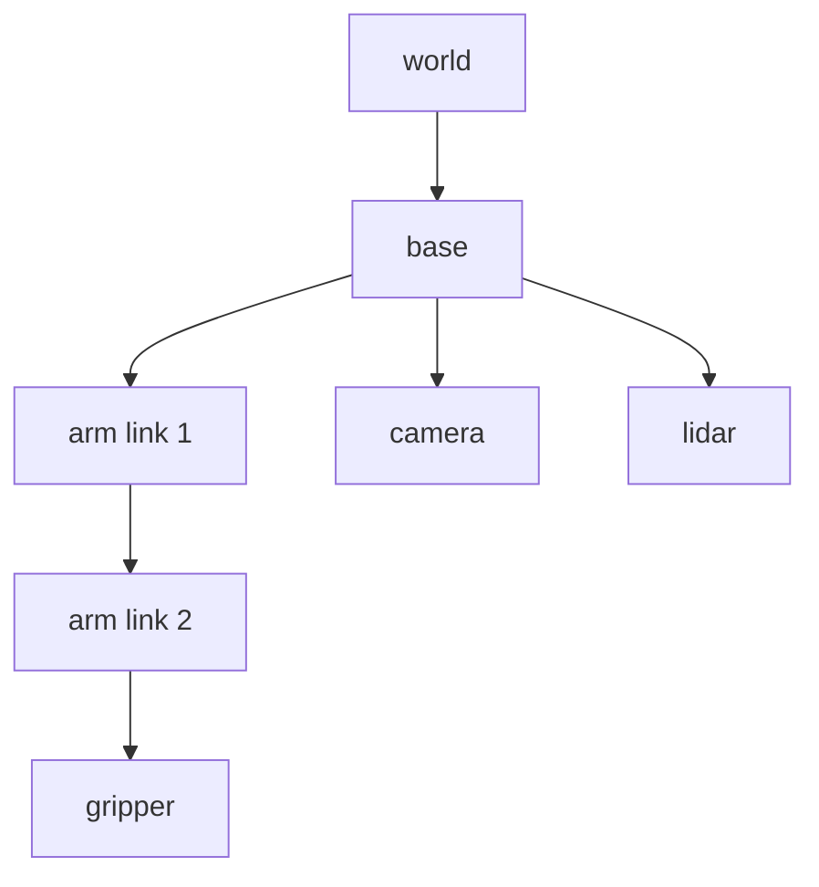

The first entry of this series listed geometry among the reasons robotics is hard: positions and orientations live in spaces where ordinary intuition misleads. This entry supplies the tools for that geometry. Every later topic, from kinematics to state estimation, rests on them.

The problem is simple to state. A robot has many parts and sensors, and each one naturally describes the world from its own point of view. A lidar reports an obstacle 3 metres ahead *of the lidar*. A gripper must close around an object at a position given *in the camera's view*. A map stores walls *in the world*. Before any of these facts can be combined, they must be expressed in a common frame, and that requires a precise, mechanical way of converting between frames. The entry builds that machinery from the general to the specific: frames and notation first, then rotations, then the combination of rotation and translation, and finally the practical structure that robot software uses to manage many frames at once.

## 1. Frames and Notation

### 1.1 What a frame is

A **coordinate frame** is an origin together with a set of mutually perpendicular unit axes: $x$, $y$ and, in space, $z$. Throughout this series frames are **right-handed**: with the fingers of the right hand curling from $x$ towards $y$, the thumb points along $z$.

A robot typically defines frames for:

- the **world** (or map), fixed in the environment;
- the robot's **base**, moving with the robot;
- each **link** of an arm, moving with that link;
- the **tool** or end effector;
- each **sensor**, such as a camera or lidar, at its mounting point and with its own axis convention.

None of these frames is privileged. Choosing where to express a quantity is a matter of convenience; the essential requirement is to know, at every moment, which frame each number is expressed in.

### 1.2 Notation

The notation used here makes the frames explicit, so that mistakes become visible on the page.

- ${}^{A}\mathbf{p}$ is the position of a point $\mathbf{p}$ expressed in frame $A$.
- ${}^{A}R_{B}$ is the rotation matrix that converts directions expressed in frame $B$ into frame $A$. Its columns are the axes of $B$ written in the coordinates of $A$.
- ${}^{A}\mathbf{t}_{B}$ is the position of the origin of $B$, expressed in $A$.
- ${}^{A}T_{B}$ is the full transformation (rotation and translation) from $B$ coordinates to $A$ coordinates.

The useful property of this notation is that subscripts and superscripts **cancel** in a valid product: in ${}^{A}T_{B}\,{}^{B}T_{C}$ the inner $B$s meet and the result is ${}^{A}T_{C}$. A product in which the inner labels do not match, such as ${}^{A}T_{B}\,{}^{C}T_{D}$, is almost certainly a bug.

### 1.3 Points and vectors

Two kinds of geometric quantity need to be distinguished.

- A **point** is a location: the tip of a gripper, an obstacle. Its coordinates change under both rotation and translation of the frame.
- A **free vector** is a direction with a magnitude: a velocity, a force, a displacement between two points. It has no location, so its coordinates change under rotation of the frame but not under translation.

The difference matters as soon as translations enter (Section 4), and the homogeneous coordinates introduced there encode it directly.

## 2. Rotations in the Plane

### 2.1 The rotation matrix

Consider frame $B$ rotated by angle $\theta$ (counter-clockwise) relative to frame $A$, with the same origin. The $x$ axis of $B$, written in $A$ coordinates, is $(\cos\theta, \sin\theta)$, and its $y$ axis is $(-\sin\theta, \cos\theta)$. Placing these as columns gives

$$
{}^{A}R_{B} = R(\theta) = \begin{bmatrix} \cos\theta & -\sin\theta \\ \sin\theta & \cos\theta \end{bmatrix},
\qquad
{}^{A}\mathbf{p} = {}^{A}R_{B}\,{}^{B}\mathbf{p} .
$$

The second equation says that a point known in $B$ is converted to $A$ by weighting $B$'s axes (as seen from $A$) by the point's $B$ coordinates. That is the whole content of a rotation matrix.

### 2.2 Properties

The columns of $R(\theta)$ are unit length and perpendicular, so $R$ is **orthogonal**: $R^{\mathsf T} R = I$. Its inverse is its transpose, ${}^{B}R_{A} = ({}^{A}R_{B})^{\mathsf T} = R(-\theta)$, which is cheap to compute and exact. Its determinant is $+1$; a determinant of $-1$ would be a reflection, which no physical rotation can produce.

In the plane, rotations **commute**: $R(\alpha)R(\beta) = R(\beta)R(\alpha) = R(\alpha + \beta)$. A planar orientation is fully described by a single angle, and composing rotations is adding angles. The next section shows how much of this simplicity is lost in three dimensions.

## 3. Rotations in Space

### 3.1 Rotation matrices

In three dimensions the definition is unchanged: ${}^{A}R_{B}$ is the $3 \times 3$ matrix whose columns are the $x$, $y$ and $z$ axes of $B$ expressed in $A$. The set of all such matrices (orthogonal, with determinant $+1$) is called the **special orthogonal group** $SO(3)$. A rotation matrix has nine entries but only **three** degrees of freedom, matching the three orientation freedoms of a rigid body counted in the first entry; the six constraints of orthonormality remove the rest.

The rotations about the coordinate axes are the building blocks:

$$
R_x(\theta) = \begin{bmatrix} 1 & 0 & 0 \\ 0 & \cos\theta & -\sin\theta \\ 0 & \sin\theta & \cos\theta \end{bmatrix},\quad
R_y(\theta) = \begin{bmatrix} \cos\theta & 0 & \sin\theta \\ 0 & 1 & 0 \\ -\sin\theta & 0 & \cos\theta \end{bmatrix},\quad
R_z(\theta) = \begin{bmatrix} \cos\theta & -\sin\theta & 0 \\ \sin\theta & \cos\theta & 0 \\ 0 & 0 & 1 \end{bmatrix}.
$$

### 3.2 Rotations do not commute

In space, the order of rotations matters. Take two quarter turns, $R_x(90^\circ)$ and $R_z(90^\circ)$:

$$
R_x(90^\circ)\,R_z(90^\circ) = \begin{bmatrix} 0 & -1 & 0 \\ 0 & 0 & -1 \\ 1 & 0 & 0 \end{bmatrix},
\qquad
R_z(90^\circ)\,R_x(90^\circ) = \begin{bmatrix} 0 & 0 & 1 \\ 1 & 0 & 0 \\ 0 & 1 & 0 \end{bmatrix}.
$$

Applied to the unit vector along $x$, the first product gives $(0, 0, 1)$ and the second gives $(0, 1, 0)$: the same two turns in a different order leave the vector pointing along different axes. A book on a table, turned a quarter turn about one edge and then about another, ends in a different orientation from the one reached by the same turns in the reverse order. This single fact is behind most of the difficulty in representing orientation.

### 3.3 Four representations of orientation

Because a rotation matrix uses nine numbers for three degrees of freedom, other representations are common. Each trades something for compactness.

| Representation | Numbers | Strengths | Weaknesses |
|---|---|---|---|
| Rotation matrix | 9 | Composition is matrix multiplication; applying it to a vector is direct; no singularities | Redundant; numerical drift makes it non-orthogonal unless it is re-orthonormalised |
| Euler angles (for example roll, pitch, yaw) | 3 | Minimal; intuitive for small motions of vehicles | Twelve possible axis conventions; singular configurations (gimbal lock); angles do not compose by addition |
| Axis–angle | 3 (or 4) | Geometrically clear: a unit axis $\hat{\mathbf u}$ and an angle $\theta$ | Composition requires conversion; the axis is undefined at $\theta = 0$ |
| Unit quaternion | 4 | Compact; no singularities; cheap composition; smooth interpolation | Less intuitive; $q$ and $-q$ represent the same rotation |

**Euler angles.** A common convention for vehicles writes orientation as yaw $\psi$ about $z$, then pitch $\theta$ about the new $y$, then roll $\phi$ about the new $x$, giving $R = R_z(\psi)\,R_y(\theta)\,R_x(\phi)$. At pitch $\theta = \pm 90^\circ$ the first and last rotation axes line up, and only the difference $\psi - \phi$ (or the sum, at $-90^\circ$) affects the result: for example, $\psi = 30^\circ, \phi = 10^\circ$ and $\psi = 50^\circ, \phi = 30^\circ$ give the same matrix at $\theta = 90^\circ$. One degree of freedom has been lost in the representation, although nothing has happened to the physical body. This is **gimbal lock**. Near it, small changes of orientation require large, rapid changes of the angles, which is why estimators and controllers for vehicles that can point straight up avoid Euler angles internally.

**Axis–angle.** Every rotation can be described as a single turn by angle $\theta$ about some unit axis $\hat{\mathbf u}$ (Euler's rotation theorem). The matrix follows from **Rodrigues' formula**,

$$
R = I + \sin\theta\,K + (1 - \cos\theta)\,K^2,
\qquad
K = \begin{bmatrix} 0 & -u_z & u_y \\ u_z & 0 & -u_x \\ -u_y & u_x & 0 \end{bmatrix},
$$

where $K$ is the matrix that computes the cross product $\hat{\mathbf u} \times \mathbf v$. As a check, with $\hat{\mathbf u}$ along $z$ the formula reproduces $R_z(\theta)$.

**Unit quaternions.** The same rotation is encoded as the four numbers

$$
q = \left(\cos\tfrac{\theta}{2},\ \hat{\mathbf u}\,\sin\tfrac{\theta}{2}\right),
$$

with unit norm. A quarter turn about $z$, for instance, is $q = (0.7071, 0, 0, 0.7071)$. Quaternions compose by quaternion multiplication, need only a cheap renormalisation to stay valid, have no singular configurations, and interpolate smoothly between orientations, which makes them the usual internal representation in estimation and animation. The half angle has a consequence worth remembering: $q$ and $-q$ describe the same rotation, so two quaternions should be compared up to sign.

## 4. Rigid-Body Transformations

### 4.1 Rotation plus translation

When frame $B$ is both rotated and displaced relative to $A$, a point converts as

$$
{}^{A}\mathbf{p} = {}^{A}R_{B}\,{}^{B}\mathbf{p} + {}^{A}\mathbf{t}_{B} .
$$

Rotate the point's coordinates into $A$'s orientation, then add the position of $B$'s origin in $A$. A free vector converts with the rotation alone, as Section 1.3 anticipated.

### 4.2 Homogeneous coordinates

Writing rotation and translation as one matrix makes composition a single product. Append a 1 to the coordinates of a point, and form the $4 \times 4$ (in space) or $3 \times 3$ (in the plane) **homogeneous transformation**:

$$
{}^{A}T_{B} = \begin{bmatrix} {}^{A}R_{B} & {}^{A}\mathbf{t}_{B} \\ \mathbf{0}^{\mathsf T} & 1 \end{bmatrix},
\qquad
\begin{bmatrix} {}^{A}\mathbf{p} \\ 1 \end{bmatrix} = {}^{A}T_{B} \begin{bmatrix} {}^{B}\mathbf{p} \\ 1 \end{bmatrix}.
$$

Free vectors take a 0 instead of a 1 in the last coordinate, so the translation column multiplies zero and drops out. Points and vectors are thereby distinguished by the data itself.

The set of all such transformations is the **special Euclidean group** $SE(3)$ (in the plane, $SE(2)$). A transformation has six degrees of freedom in space and three in the plane, the counts given in the first entry for a rigid body.

### 4.3 Composition and inversion

Transformations compose by multiplication, with the labels cancelling:

$$
{}^{A}T_{C} = {}^{A}T_{B}\;{}^{B}T_{C} .
$$

The inverse is not computed by general matrix inversion, which is slower and less accurate, but from the structure:

$$
{}^{B}T_{A} = \left({}^{A}T_{B}\right)^{-1} = \begin{bmatrix} {}^{A}R_{B}^{\mathsf T} & -\,{}^{A}R_{B}^{\mathsf T}\,{}^{A}\mathbf{t}_{B} \\ \mathbf{0}^{\mathsf T} & 1 \end{bmatrix}.
$$

The rotation reverses by transposition; the translation becomes the old origin's position seen from the new frame, which is why it picks up the transposed rotation as well as a sign.

## 5. A Worked Example in the Plane

A mobile robot is at position $(2, 1)$ in the world, heading $90^\circ$ (its $x$ axis points along the world's $y$ axis). Its lidar reports an obstacle at ${}^{R}\mathbf{p} = (3, 0)$: 3 metres straight ahead *of the robot*. Where is the obstacle in the world?

$$
{}^{W}T_{R} = \begin{bmatrix} 0 & -1 & 2 \\ 1 & 0 & 1 \\ 0 & 0 & 1 \end{bmatrix},
\qquad
{}^{W}\mathbf{p} = {}^{W}T_{R} \begin{bmatrix} 3 \\ 0 \\ 1 \end{bmatrix} = \begin{bmatrix} 2 \\ 4 \\ 1 \end{bmatrix}.
$$

The obstacle is at $(2, 4)$: the robot faces along the world's $y$ axis, so "3 metres ahead" adds 3 to its $y$ coordinate. The inverse goes the other way:

$$
{}^{R}T_{W} = \begin{bmatrix} 0 & 1 & -1 \\ -1 & 0 & 2 \\ 0 & 0 & 1 \end{bmatrix},
\qquad
{}^{R}T_{W} \begin{bmatrix} 2 \\ 4 \\ 1 \end{bmatrix} = \begin{bmatrix} 3 \\ 0 \\ 1 \end{bmatrix},
$$

which recovers the lidar's measurement, as it must.

Now suppose a camera is mounted $0.5$ m ahead of the robot's base frame, facing the same way, and sees a marker at ${}^{C}\mathbf{p} = (1, 0.2)$. The chain of frames is world, robot, camera:

$$
{}^{W}\mathbf{p} = {}^{W}T_{R}\;{}^{R}T_{C}\;{}^{C}\mathbf{p},
\qquad
{}^{R}T_{C} = \begin{bmatrix} 1 & 0 & 0.5 \\ 0 & 1 & 0 \\ 0 & 0 & 1 \end{bmatrix},
$$

which gives ${}^{W}\mathbf{p} = (1.8, 2.5)$. The labels cancel from left to right ($W$–$R$, $R$–$C$, $C$), and the computation never requires anyone to reason about which way the camera is pointing; the transforms carry that knowledge.

## 6. Two Readings of the Same Matrix

A transformation can be read in two ways, and confusing them is a common source of error.

- **Passive (change of coordinates).** The point stays where it is; we describe it in a different frame. ${}^{A}T_{B}$ converts $B$ coordinates into $A$ coordinates. This is the reading used throughout this entry.
- **Active (motion).** The frame stays fixed, and the point (or a body) is moved. The same matrix moves a point from one location to another, both expressed in a single frame.

The matrices are identical; the interpretation differs. A closely related subtlety concerns composition. A product $R_1 R_2$ can be read as "rotate by $R_2$ about the fixed frame's axes, then by $R_1$ about the fixed frame's axes", or equivalently as "rotate by $R_1$, then by $R_2$ about the *new*, already rotated axes". The roll–pitch–yaw convention of Section 3.3 is written in the second reading. Libraries document which reading they use, and code that mixes two libraries must check.

## 7. Managing Many Frames

### 7.1 The frame tree

A real robot has dozens of frames, and most transforms between them are not stored directly. Instead, robot software keeps a **tree** of frames, in which each frame stores only its transform relative to its parent:

To find the transform between any two frames, the software walks up from each to their common ancestor and composes the transforms along the path, inverting where the path goes against an edge. The gripper's position in the camera frame, for instance, is ${}^{C}T_{G} = ({}^{B}T_{C})^{-1}\;{}^{B}T_{L_1}\;{}^{L_1}T_{L_2}\;{}^{L_2}T_{G}$.

The edges change at different rates. The camera's mounting transform is fixed and measured once, by calibration. The arm links' transforms change whenever the joints move, and are computed from joint angles (the subject of the next entry). The base's transform in the world changes as the robot moves and is estimated from sensors (the subject of the last entry).

### 7.2 Time

Because frames move, a transform is only valid at a particular instant. A camera image taken at time $t_1$ must be combined with the robot's pose at $t_1$, not with its pose at the moment the image is processed. Frame-tree implementations therefore store a short history of each transform with time stamps and interpolate between them. Interpolating rotations correctly requires a method that stays on the set of valid rotations, such as spherical linear interpolation of quaternions; averaging matrix entries does not.

## 8. Common Mistakes

| Mistake | Symptom | Remedy |
|---|---|---|
| Multiplying transforms in the wrong order | Results that are right for some poses and wrong for others | Keep frame labels in the notation; check that inner labels cancel |
| Using ${}^{A}T_{B}$ where ${}^{B}T_{A}$ was needed | Points reflected through the frame's origin or rotated the wrong way | Name variables after the convention, for example `T_world_robot` |
| Mixing degrees and radians | Small angles almost right, large ones wildly wrong | Use radians internally; convert only at input and output |
| Inconsistent quaternion ordering | Orientation scrambled when data passes between libraries | Some libraries store $(w, x, y, z)$, others $(x, y, z, w)$; convert explicitly |
| Subtracting angles without wrapping | A turn from $350^\circ$ to $10^\circ$ computed as $-340^\circ$ instead of $+20^\circ$ | Wrap differences into $(-180^\circ, 180^\circ]$, for example with $\operatorname{atan2}(\sin\Delta, \cos\Delta)$ |
| Accumulated rounding in rotation matrices | Lengths and angles slowly distorted after many compositions | Re-orthonormalise periodically, or store orientation as a normalised quaternion |
| Different axis conventions for sensors | A camera's optical frame (often $z$ forward, $x$ right, $y$ down) treated as a body frame ($x$ forward, $z$ up) | Represent the convention change as its own fixed transform in the tree |

## 9. Summary

| Question | Answer |
|---|---|
| What is a coordinate frame? | An origin with right-handed, mutually perpendicular unit axes. |
| What are the columns of ${}^{A}R_{B}$? | The axes of frame $B$ written in frame $A$ coordinates. |
| How is a rotation inverted? | By transposing it. |
| Do rotations commute? | In the plane, yes; in space, no. |
| Why avoid Euler angles internally? | They have singular configurations (gimbal lock) and do not compose by addition. |
| What does a homogeneous transform contain? | A rotation and a translation, in one matrix that composes by multiplication; points carry a final 1 and free vectors a 0. |
| How is ${}^{A}T_{B}$ inverted? | Transpose the rotation; the new translation is $-R^{\mathsf T}\mathbf t$. |
| How does software handle many frames? | As a time-stamped tree of parent-relative transforms, composed along paths on request. |

The next entry applies these tools to a robot arm: computing where the gripper is from the joint angles, and the much harder problem of choosing joint angles that put the gripper where it is wanted.

### References

- K. M. Lynch and F. C. Park, *Modern Robotics: Mechanics, Planning, and Control*, Cambridge University Press, 2017.
- B. Siciliano, L. Sciavicco, L. Villani and G. Oriolo, *Robotics: Modelling, Planning and Control*, Springer, 2009.
- J. J. Craig, *Introduction to Robotics: Mechanics and Control*, 3rd edition, Pearson Prentice Hall, 2005.
