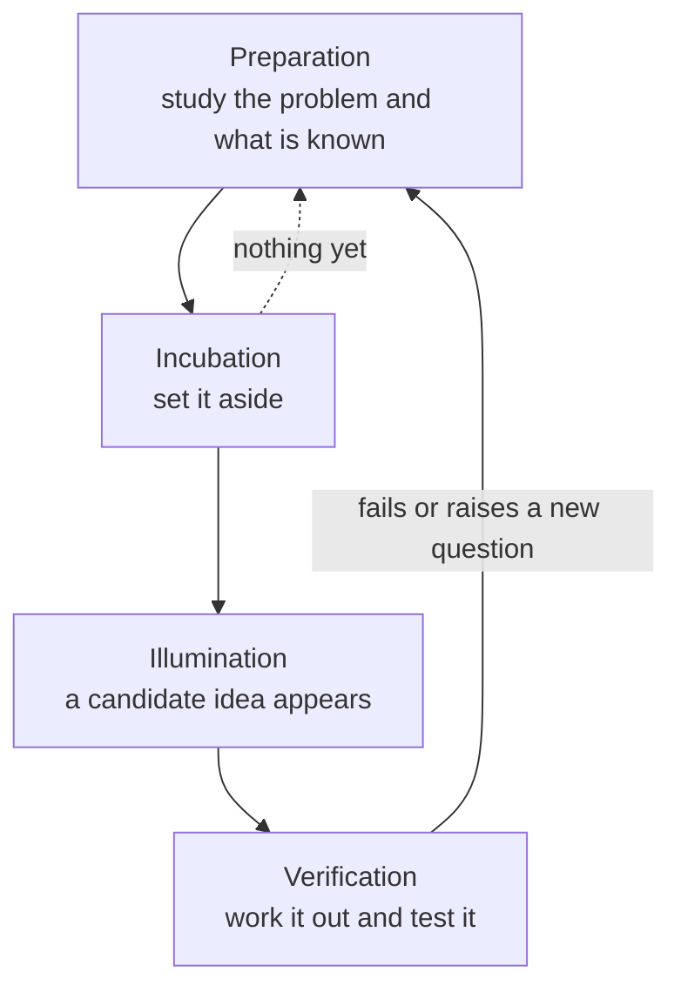

import Figure from '../../components/Figure.astro';
import CtDivergeConverge from '../../components/diagrams/CtDivergeConverge.astro';

The twelve entries before this one were about evaluating ideas: clarifying what a claim means, testing whether an argument is valid, weighing evidence, comparing options and spotting the errors in all of these. The [previous entry](/blog/fallacies-and-cognitive-biases) collected those errors in one place. Evaluation needs something to evaluate, though. A design review cannot choose a better architecture than the ones proposed, and an experiment cannot test a hypothesis nobody has thought of. This last entry turns to the other half of good thinking: producing the candidates in the first place.

The entry starts from a definition of creativity and a model that ties generation to evaluation. It then describes three ways in which new ideas are made, the alternation between divergent and convergent thinking, the stages of the creative process and what research says about incubation and fixation, and the evidence on creativity in groups. It ends with limits, exercises and a return to the objectives of the whole series. The topic plan follows the creativity module of the *Critical Thinking Web* (Lau and Chan, 2004–2026), and Lau (2011) treats critical thinking and creativity together in one textbook; the structure, examples and sources here are this entry's own. No code is used; the few counts are simple products and logarithms.

## 1. What creativity is

### 1.1 Original and effective

Researchers who study creativity mostly agree on a two-part definition: a creative idea or product is both **original** and **effective**, that is, new and also useful or fitting for some purpose (Runco and Jaeger, 2012). Each part rules something out. A random string of characters is original and useless. A correct copy of a known algorithm is useful and not original. A new sorting routine that is faster on the data a particular system receives satisfies both.

Effectiveness is judged against a purpose, so the same idea can be creative in one setting and not in another. A clever cache that removes a bottleneck is creative in a latency-bound service and pointless in a batch job that runs overnight.

### 1.2 New to whom?

Boden (2004) separates two senses of "new". An idea is **psychologically creative** (P-creative) if it is new to the person who had it, whatever others have thought before, and **historically creative** (H-creative) if nobody has had it before. Most engineering creativity is P-creative: an engineer who independently works out a technique already in the literature has still solved the problem creatively. The distinction matters for two reasons. It shows that creativity is an everyday activity rather than the property of a few historic discoveries. It also explains why a search of the literature (Section 4.2) is part of creative work. The search turns a P-creative idea into a known one before effort is wasted rebuilding it, or confirms that it may be H-creative.

### 1.3 Variation and selection

Campbell (1960) proposed that creative thought works like other processes that gain knowledge, including biological evolution. It needs a source of **variation**, many candidates produced without knowing in advance which will work. It also needs a process of **selective retention** that tests the candidates and keeps the few that pass. The model is a simplification, but it gives a clear picture of how creative and critical thinking fit together. Generation supplies the variation; the evaluation methods of the earlier entries do the selecting. Neither is useful alone. Selection without variation can only choose among what already exists, and variation without selection produces noise.

The model also explains a practical rule. If candidates are judged as they appear, the selective step starts to suppress the variation: unusual candidates are dropped before they can be developed or combined. Section 3 shows how deliberate separation of the two steps avoids this, and Section 5 gives the evidence from group work.

## 2. Three ways to make something new

Boden (2004) distinguishes three ways of producing new ideas. They are not exclusive, but each suggests a different technique.

### 2.1 Combination and analogy

**Combinational creativity** joins familiar ideas in an unfamiliar way. A style checker for prose, which flags banned words and unexpanded abbreviations in articles, joins the idea of a static code analyzer to the idea of a house style manual. Version control for data sets joins the version-control model of source code to the problem of tracking large changing data. Neither needed a new element; each needed someone to see that two existing elements fit together.

**Analogy** is the most productive kind of combination, because it carries a whole structure from one domain into another. Gentner's (1983) structure-mapping account holds that a good analogy maps *relations* between objects rather than their surface attributes. Two examples from computing show the pattern:

- **Simulated annealing** maps the slow cooling of a metal, in which atoms settle into a low-energy arrangement, onto optimization. Kirkpatrick, Gelatt and Vecchi (1983) turned this into a search method that sometimes accepts a worse solution, with a probability that falls as a "temperature" parameter is lowered, so that it can escape local minima that trap a purely greedy search.
- **Genetic algorithms** map biological evolution onto search: a population of candidate solutions is improved by selection, recombination and mutation (Holland, 1975).

Neither analogy delivered a finished method. Each suggested a structure whose details had to be worked out and tested. A useful discipline is to write the analogy down as a list of corresponding relations and then mark where it fails, because the points of failure are where the borrowed structure must be modified.

### 2.2 Exploring a space

**Exploratory creativity** works within an established space of possibilities and finds points in it that nobody has visited. In design, the space can be made explicit. **Morphological analysis**, developed by the astrophysicist Fritz Zwicky (1969), lists the independent attributes of a design and the possible values of each; every combination of values is a candidate. A robot gripper might have three actuation methods (electric, pneumatic, hydraulic), four contact types (two-finger, three-finger, suction cup, soft fingers), three levels of sensing (none, force sensing, vision) and two surface types (rigid, compliant). That gives $3 \times 4 \times 3 \times 2 = 72$ candidates. Constraints prune the table: if hydraulic actuation is ruled out for a food-handling cell, $4 \times 3 \times 2 = 24$ candidates go and 48 remain. Most of the rest will be uninteresting, but the table brings to attention combinations that nobody would have proposed unprompted.

When the space is large and has an order, exploring it well means searching it efficiently. The `git bisect` command finds the commit that introduced a fault by testing the midpoint of the suspect range and discarding the half that is clear; 1000 suspect commits need at most $\lceil \log_2 1000 \rceil = 10$ tests. Screening experiments in engineering do the analogous thing for the factors that might affect a process: many factors are tested at two levels each in a small designed experiment, and only those with large effects are studied in detail.

### 2.3 Transforming the space

**Transformational creativity** changes the space itself by dropping or altering one of the rules that defined it, so that ideas that were impossible before become possible. In problem solving, the rules are usually the unexamined parts of how the problem was stated. Three moves change them:

- **Restate the goal.** "Make the nightly test run faster" invites optimizing individual tests. "Tell developers about integration failures sooner" also admits running the tests most likely to fail first, testing each commit in parallel, or moving some checks before merge.
- **Remove a constraint temporarily.** "What would we build if latency did not matter?" shows how much of the current design is shaped by that one requirement, and whether the requirement is as fixed as assumed.
- **Add a constraint.** "What if it had to run on a microcontroller with 32 kilobytes of memory?" forces the search away from the familiar solution and can reveal a simpler one.

The [eleventh entry](/blog/strategic-thinking-and-decisions) (Section 2.1) used the four phases of Pólya's *How to Solve It* (1945) as a problem-solving cycle. For the planning phase Pólya adds heuristics of the same kind: solve an auxiliary or more special problem first, generalize the problem so that its structure shows, or work backward from what is wanted.

## 3. Divergent and convergent thinking

### 3.1 Two kinds of production

Guilford (1967), in his model of the structure of the intellect, distinguished **divergent production**, generating many different answers to an open question, from **convergent production**, finding the one answer that a well-defined question requires. "In how many ways could this service fail?" calls for the first; "which of these three designs meets the requirements at the lowest cost?" calls for the second. Guilford had argued earlier, in his address on creativity, that psychology had neglected the subject and that intelligence tests, which reward convergent answers, could not measure it (Guilford, 1950).

Guilford's work also gave the usual measures of divergent output: *fluency* (the number of ideas), *flexibility* (the number of different kinds), *originality* (how uncommon the ideas are) and *elaboration* (how far they are developed). Flexibility is the measure most worth watching in engineering. Twenty failure modes that are all variants of "the disk fills up" are fluent; a list that also covers the network, clocks, configuration and operators is more useful at the same length.

### 3.2 Alternating between the modes

In Campbell's terms, divergent production is variation and convergent production is selection. Design methods make the alternation explicit, and they usually apply it twice: once to decide what the problem is and once to solve it.

<Figure caption="Two diverge-converge phases. In each, the left half widens as options are generated with judgment deferred, and the right half narrows as they are evaluated and selected. The first phase settles what the problem is; the second settles how to solve it. Testing the chosen solution often reveals a new problem, which starts the cycle again."><CtDivergeConverge /></Figure>

Two failures are common. One is to converge too early: the first plausible idea is adopted and the remaining time is spent elaborating it. The other is never to converge, because choosing means giving up options. The first phase in the figure guards against a third failure that the earlier entries met in other forms: solving the problem as first stated, when the stated problem was not the one that mattered.

## 4. The creative process

### 4.1 Wallas's four stages

Graham Wallas's *The Art of Thought* (1926) gave an account of the creative process that later writers have renamed and subdivided but seldom replaced. It has four stages:

- **Preparation**: deliberate, conscious work on the problem.
- **Incubation**: a period in which the problem is not consciously worked on.
- **Illumination**: the moment a promising idea appears, often unexpectedly.
- **Verification**: the conscious work of checking the idea and developing it into a usable form.

The stages are drawn as a loop because real work goes round them repeatedly. Verification often shows that an idea fails or only partly works, and the failure becomes new material for preparation. Illumination and verification correspond to the variation and selection of Section 1.3; preparation and incubation are what make useful variation likely.

### 4.2 Preparation

Wallas's preparation is deliberate study, and it is the stage that the popular picture of creativity leaves out. Its main tasks in technical work are to state the problem precisely, to collect the observations that any solution must explain (the failure logs, the measurements, the cases that work), and to find out what is already known. The last task is where the P-creative and H-creative distinction of Section 1.2 becomes practical. A short search of the literature, the issue tracker or the standard references either finds an existing solution or shows how the known approaches fail on this case, and that failure specifies what a new idea must do.

### 4.3 Incubation and fixation

Many people report that a solution came to them in the shower, on a walk or after a night's sleep. Whether stepping away helps, or whether people only remember the occasions when it seemed to, is an empirical question. Sio and Ormerod (2009) combined the results of many incubation experiments in a meta-analysis. They reported a positive effect of incubation overall, larger for tasks with many possible answers than for tasks with a single answer, and larger when the incubation period followed a longer period of preparation. The evidence supports taking breaks during hard problems after serious work on them; it does not support waiting for inspiration instead of working.

One proposed explanation for incubation is release from **fixation**, the tendency to keep returning to an approach that has already failed. Duncker (1945) described **functional fixedness**, the difficulty of seeing a new use for an object once it has been presented in its usual role. In his best-known problem, people asked to fix a candle to a wall struggled to see that the box holding the tacks could serve as a shelf, especially when the box was presented full of tacks. Jansson and Smith (1991) found a design version of the effect: engineers shown an example solution before a design task tended to reproduce its features, including its flaws. Fixation is the reason that Section 2.3's moves work: restating a goal or removing a constraint breaks the pattern that keeps the search in the same place.

### 4.4 Worked example: a robot that keeps missing its charger

A mobile robot in a warehouse fails to dock with its charging station about one attempt in ten.

**Preparation.** The engineer states the problem as a measurable failure rate, collects the logs of failed attempts and reads the docking controller's design notes. The logs show that most failures occur when the robot arrives at an angle. A survey of existing designs turns up infrared beacons, visual markers, mechanical guides that funnel a robot into position and contact designs that tolerate misalignment.

**Divergent production.** With judgment deferred, the engineer lists candidates. The list includes tuning the controller, adding a camera and a visual marker, adding a second beacon to measure the angle, reshaping the station so that it funnels the robot in, widening the contacts, approaching from a fixed waypoint and retrying automatically after a failure.

**Incubation and a transformation.** Returning the next day, the engineer notices that almost every candidate assumes the *robot* must become more precise. Restated as "make docking tolerate the precision the robot already has", the problem favors the mechanical candidates, which need no new sensing.

**Convergent selection and verification.** The candidates are scored against weighted criteria as in Section 5 of the eleventh entry. A mechanical guide plus an automatic retry is chosen and tested over several hundred docking attempts before it is adopted. If the failure rate does not fall, the logs of the new failures start the next round of preparation.

## 5. Ideas in groups

### 5.1 Brainstorming and what the evidence shows

The advertising executive Alex Osborn popularized **brainstorming** in *Applied Imagination* (1953). Its rules put Section 1.3 into practice for a group: suspend criticism, aim for many ideas, welcome unusual ones and build on the ideas of others. Osborn expected groups following these rules to outperform individuals.

Experiments, reviewed by Diehl and Stroebe (1987), have repeatedly found the opposite. A group that brainstorms together usually produces fewer ideas than a **nominal group**: the same number of people working separately, whose lists are pooled afterward. Diehl and Stroebe then tested three explanations: **production blocking** (only one person can speak at a time, so others wait and lose or withhold ideas), **evaluation apprehension** (fear of how others will judge an idea, even when criticism is forbidden) and free riding (letting others do the work). In their experiments production blocking accounted for most of the loss.

### 5.2 Groupthink

A different failure concerns convergence rather than generation. Janis (1972), studying policy decisions that went badly wrong, described **groupthink**: a cohesive group that values agreement stops examining alternatives, discounts warnings and becomes overconfident in its chosen course. Among the remedies he proposed were a leader who withholds a preferred option at the start, a member assigned to challenge the majority view, and outside experts invited to criticize the group's plans. Groupthink is the group form of the confirmation bias and overconfidence described in Section 6 of the previous entry.

### 5.3 Methods that follow from the evidence

Each finding suggests a change of procedure:

- **Against production blocking**, generate in parallel. Each person writes ideas alone for a fixed time before any discussion, and the lists are then merged; written variants of this are often called brainwriting. Collecting the lists before anyone speaks also prevents the first idea voiced from anchoring the rest.
- **Against evaluation apprehension**, make generation anonymous where status differences are large, for example by collecting ideas in a shared document without names.
- **Against groupthink**, design the convergent phase to admit dissent: the senior member speaks last, one member is assigned to argue against the leading option, and someone outside the team reviews the choice.
- **For variation**, draw members from different specialties. Combination and analogy (Section 2.1) can only use elements that someone in the room knows.

## 6. Limits

### 6.1 No method guarantees good ideas

None of these methods is an algorithm that produces good ideas on demand. They increase the number and range of candidates and so make good ones more likely, but they cannot say which candidate is right. In Campbell's terms they act on variation; selection still depends on the methods of the earlier entries: logic to check consistency, the experiments of the [eighth entry](/blog/scientific-reasoning-and-causation) to test, statistics to measure and decision analysis to choose.

### 6.2 Novelty is not value

Because originality is easy to see and effectiveness takes work to establish, it is tempting to prize the new idea over the good one. A novel architecture that nobody on the team can maintain fails the second half of the definition in Section 1.1. The two-part definition is the standard to hold to, and a P-creative idea that turns out to be well known is not a failure but a saving of effort.

### 6.3 Expertise cuts both ways

Knowledge supplies the elements for combination and the map for exploration, but Section 4.3 showed that familiarity also fixes attention on the usual solutions. The defenses are the ones already described: transformation moves that change the problem statement, incubation after a period of hard work, and colleagues from other specialties who do not share the same fixations.

## 7. Exercises

1. **Morphological count.** A sensor node design has these attributes: power source (battery, mains, energy harvesting), radio (none, Bluetooth Low Energy, LoRa, Wi-Fi) and enclosure rating (indoor, outdoor). How many candidate designs are there? If energy harvesting cannot power Wi-Fi in this application, how many remain?
2. **Fluency and flexibility.** In five minutes, list as many ways as you can that a web service could become unavailable. Then group the list by kind of cause. How many groups are there, and which kinds of cause are missing?
3. **Transforming the problem.** A team states its problem as "our nightly integration test run takes nine hours". Write three restatements of the goal, each of which admits solutions the original statement does not.
4. **Analogy.** Find an analogy from outside computing for a cache. List two relations that carry over and one point where the analogy fails.
5. **Diagnosing a meeting.** In a design meeting the most senior engineer proposes a solution first, two others ask questions about it and the other five say nothing. The meeting adopts the proposal. Using Section 5, name three likely causes of the narrow outcome and one change of procedure for each.
6. **Search.** A performance regression appeared somewhere in the last 3000 commits. What is the largest number of builds needed to find the first bad commit by bisection, assuming each build gives a clear good or bad result?

**Answers.**

1. $3 \times 4 \times 2 = 24$. Excluding energy harvesting with Wi-Fi removes $1 \times 1 \times 2 = 2$ candidates, leaving 22.
2. Answers vary. Typical groups are hardware, network, software defects, configuration, capacity and load, dependencies on other services, security incidents and human operations. Lists written quickly tend to be fluent within one or two groups and to miss configuration, dependencies and operator error; counting the groups measures flexibility.
3. Possible restatements: "developers learn of integration failures within an hour" (admits running a fast, high-risk subset first); "we can tell which commit broke integration" (admits testing each commit in parallel); "integration problems are caught before merge" (admits moving checks earlier). Each removes an assumption hidden in the original, namely that the full suite must run, all at once, every night.
4. One analogy: a cache is like a desk beside a library's shelves. Relations that carry over: items used often are kept within reach, and the desk is small, so an item must be returned when a new one arrives (eviction). Where it fails: a book on the desk is the same object as the one that belongs on the shelf, whereas a cached value is a copy that becomes stale when the original changes, so the analogy hides the invalidation problem.
5. Likely causes: anchoring on the first proposal and production blocking (change: everyone writes ideas alone before anyone presents); evaluation apprehension in front of a senior colleague (change: collect ideas anonymously, or have the senior engineer speak last); groupthink in the convergent phase (change: assign one member to argue against the leading option).
6. $\lceil \log_2 3000 \rceil = 12$, since $2^{11} = 2048 < 3000 \le 4096 = 2^{12}$.

## 8. Summary

| Topic | Main point |
|---|---|
| Definition | A creative idea is both original and effective; novelty alone is not enough. |
| New to whom | P-creative ideas are new to the thinker, H-creative ideas new to history; most engineering creativity is P-creative. |
| Variation and selection | Generation supplies candidates and evaluation selects; they interfere when done at the same moment. |
| Three ways to make ideas | Combination and analogy, exploration of a space (morphological analysis, systematic search), transformation of the space (restating goals, changing constraints). |
| Divergent and convergent thinking | Widen with judgment deferred, then narrow with judgment applied, for the problem as well as the solution. |
| Process | Preparation, incubation, illumination and verification, repeated; incubation helps after real preparation, partly by releasing fixation. |
| Groups | Interactive brainstorming loses to pooled individual work, mainly through production blocking; generate in parallel and design convergence to admit dissent. |
| Limits | Methods raise the odds of good ideas but do not choose among them; evaluation decides. |

This entry completes the series, so it ends where the [series overview](/series/critical-thinking) began, with its five objectives. The first, explaining what critical thinking is and analyzing a claim into its meaning, premises, conclusion and hidden assumptions, was the work of the first three entries. The second, evaluating arguments for validity, soundness and inductive strength with Venn diagrams, truth tables, natural deduction and quantifier logic, was the short course in formal logic of entries four to seven. The third, assessing causal, scientific and statistical claims, was taken up by the eighth and ninth entries. The fourth, analyzing value judgments and decisions, was the subject of the tenth and eleventh. The fifth has two halves: identifying fallacies and biases was the task of the twelfth entry, and generating and developing new ideas the task of this one.

Together the entries describe one practice. Produce more candidates than come to mind first, then hold each of them to the standards of meaning, logic and evidence that the series has set out. A reader who can do both, on technical and everyday questions alike, has met the aims the series set itself.

### References

- M. A. Boden, *The Creative Mind: Myths and Mechanisms*, 2nd ed., Routledge, 2004.
- D. T. Campbell, "Blind variation and selective retention in creative thought as in other knowledge processes," *Psychological Review*, vol. 67, no. 6, pp. 380–400, 1960.
- M. Diehl and W. Stroebe, "Productivity loss in brainstorming groups: Toward the solution of a riddle," *Journal of Personality and Social Psychology*, vol. 53, no. 3, pp. 497–509, 1987.
- K. Duncker, "On problem-solving," *Psychological Monographs*, vol. 58, no. 5, 1945.
- D. Gentner, "Structure-mapping: A theoretical framework for analogy," *Cognitive Science*, vol. 7, no. 2, pp. 155–170, 1983.
- J. P. Guilford, "Creativity," *American Psychologist*, vol. 5, no. 9, pp. 444–454, 1950.
- J. P. Guilford, *The Nature of Human Intelligence*, McGraw-Hill, 1967.
- J. H. Holland, *Adaptation in Natural and Artificial Systems*, University of Michigan Press, 1975.
- D. G. Jansson and S. M. Smith, "Design fixation," *Design Studies*, vol. 12, no. 1, pp. 3–11, 1991.
- I. L. Janis, *Victims of Groupthink*, Houghton Mifflin, 1972.
- S. Kirkpatrick, C. D. Gelatt and M. P. Vecchi, "Optimization by simulated annealing," *Science*, vol. 220, no. 4598, pp. 671–680, 1983.
- J. Y. F. Lau, *An Introduction to Critical Thinking and Creativity: Think More, Think Better*, Wiley, 2011.
- J. Y. F. Lau and J. Chan, *Critical Thinking Web*, Department of Philosophy, The University of Hong Kong, 2004–2026. https://philosophy.hku.hk/think/
- A. F. Osborn, *Applied Imagination: Principles and Procedures of Creative Thinking*, Charles Scribner's Sons, 1953.
- G. Pólya, *How to Solve It*, Princeton University Press, 1945.
- M. A. Runco and G. J. Jaeger, "The standard definition of creativity," *Creativity Research Journal*, vol. 24, no. 1, pp. 92–96, 2012.
- U. N. Sio and T. C. Ormerod, "Does incubation enhance problem solving? A meta-analytic review," *Psychological Bulletin*, vol. 135, no. 1, pp. 94–120, 2009.
- G. Wallas, *The Art of Thought*, Jonathan Cape, 1926.
- F. Zwicky, *Discovery, Invention, Research Through the Morphological Approach*, Macmillan, 1969.
