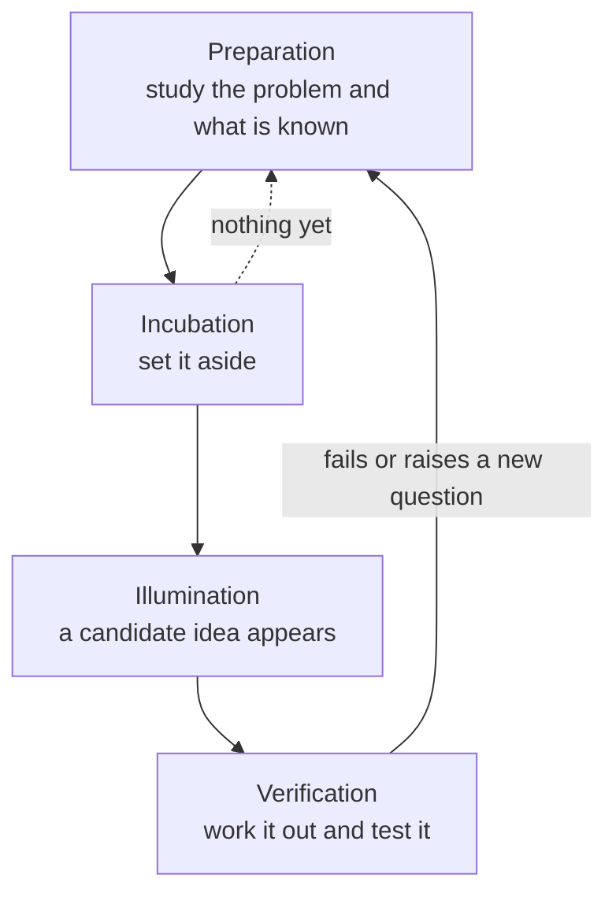

import Figure from '../../components/Figure.astro';
import CtDivergeConverge from '../../components/diagrams/CtDivergeConverge.astro';

The twelve entries before this one were about evaluating ideas: clarifying what a claim means, testing whether an argument is valid, weighing evidence, comparing options and spotting the errors in all of these. The [previous entry](/blog/fallacies-and-cognitive-biases) collected those errors in one place. Evaluation needs something to evaluate, though. A design review cannot choose a better architecture than the ones proposed, and a scientist cannot test a hypothesis nobody has thought of. This last entry turns to the other half of good thinking: producing the ideas in the first place.

The entry first says what creativity is and why it is a partner of critical thinking rather than its opposite. It then explains where new ideas come from, distinguishes divergent from convergent thinking, describes the creative cycle and a set of heuristics for generating ideas, and examines how groups help and hinder. It ends with the limits of these methods, exercises and a return to the objectives of the whole series. No code or special notation is used.

## 1. What creativity is

### 1.1 New and useful

In everyday speech "creative" often means artistic. Researchers use the word more broadly. The definition that most psychologists of creativity accept has two parts: a creative product is both **original** (new, at least to the person or community concerned) and **effective** (useful, appropriate or valuable for some purpose) (Runco and Jaeger, 2012). Both parts matter. A random string of characters is new but useless; a correct copy of a known solution is useful but not new.

This entry is concerned mainly with what might be called **cognitive creativity**: producing new and useful solutions to practical or theoretical problems. Examples are a new algorithm, a test that isolates a fault, a hypothesis that explains an anomaly or a product that meets an unserved need. Artistic creativity follows partly different rules, and nothing here claims to cover it.

### 1.2 Creative and critical thinking as partners

It is sometimes said that critical thinking stifles creativity because it is too quick to find fault. The two-part definition shows why this is a misunderstanding. Originality without evaluation produces noise, and evaluation without new options can only choose among what already exists. Solving a hard problem needs both: generating candidates and judging them.

What is true is that the two activities interfere when they run *at the same time*. Judging each idea as it appears makes people propose fewer ideas and safer ones. The remedy is not to abandon judgment but to schedule it: generate first, with criticism deliberately suspended, then evaluate. Deciding to defer judgment because experience shows that it produces better options is itself a critical-thinking decision, in the sense of the [first entry](/blog/what-is-critical-thinking): a choice of method made for good reasons.

### 1.3 Two misconceptions

Two beliefs discourage people from trying to be more creative. The first is that creativity belongs to a gifted few and cannot be learned. People do differ, but much creative work rests on habits and methods that can be practiced, which is the subject of Sections 4 to 6. The second is that ideas arrive by inspiration, so one can only wait. Sudden insights do happen, but, as Section 4 shows, they tend to come to people who have prepared the ground thoroughly.

## 2. Where new ideas come from

### 2.1 Recombination

Most new ideas are new combinations of existing elements. An idea can be broken into parts, and new ideas arise by joining parts from different sources, deleting a part, replacing one part with another or changing how the parts are arranged. A linter for prose, such as a style checker that flags banned words and unexpanded abbreviations, combines the idea of a static code analyzer with the idea of a house style manual. Version control for data sets combines the version-control model of source code with the problem of tracking large changing data. Neither combination required a new element; each required seeing that two existing ones could be joined.

The practical consequence is that the raw material of creativity is knowledge. A person can only recombine the elements they have. Someone who knows one field deeply and several others moderately has many more possible combinations available than a narrow specialist, and far more than a beginner. This is why reading outside one's field, talking to people with different expertise and studying the history of a problem are not distractions from creative work but preparation for it.

### 2.2 Seeing connections across domains

The most valuable combinations often join elements from fields that seem unrelated, because nobody inside either field was likely to think of them. Computing offers clear examples:

- **Simulated annealing** borrows from metallurgy, where a metal is cooled slowly so that its atoms settle into a low-energy arrangement. Kirkpatrick, Gelatt and Vecchi (1983) turned this into an optimization method: a search that sometimes accepts worse solutions, with a probability that falls as a "temperature" parameter is lowered, can escape local minima that trap a purely greedy search.
- **Genetic algorithms** borrow from biological evolution. Holland (1975) developed a framework in which a population of candidate solutions is improved by selection, recombination and mutation.

In both cases the analogy did not deliver the method ready-made. It suggested a structure, and the details had to be worked out and tested. Section 5.2 returns to analogy as a deliberate technique.

### 2.3 Depth and breadth

Connections between ideas are easier to see when knowledge is organized around concepts and relations rather than stored as isolated facts. A student who understands *why* a feedback loop stabilizes a system can recognize the same structure in a thermostat, a TCP congestion-control algorithm and a market. A student who has memorized each case separately cannot. Deep understanding of a few things, together with broad acquaintance with many, is the combination that makes cross-domain connections likely.

## 3. Divergent and convergent thinking

### 3.1 Two modes

Guilford (1967), in his model of the structure of the intellect, distinguished two kinds of productive thinking. **Divergent thinking** produces many possible answers to an open question. In how many ways could this service fail? **Convergent thinking** narrows down to the single best answer to a well-defined question. Which of these designs meets the requirements at the lowest cost? Guilford had argued earlier that psychology had neglected creativity and that tests of intelligence, which mostly reward convergent answers, missed it (Guilford, 1950).

Divergent output is often described along a few dimensions: *fluency* (how many ideas), *flexibility* (how many different kinds of idea), *originality* (how unusual) and *elaboration* (how developed). The distinction is practical. A list of twenty failure modes that are all variations on "the disk fills up" is fluent but not flexible; a list that includes disk, network, clock, configuration and human error is more useful for the same length.

### 3.2 Alternating between the modes

Creative problem solving alternates between the two modes, and many design methods make the alternation explicit. A common pattern runs through two phases, one to understand the problem and one to solve it, each widening before it narrows.

<Figure caption="Two diverge-converge phases. In each, the left half widens as options are generated with judgment deferred, and the right half narrows as they are evaluated and selected. The first phase settles what the problem is; the second settles how to solve it. Testing the chosen solution often reveals a new problem, which starts the cycle again."><CtDivergeConverge /></Figure>

Two failures are common. One is to converge too early: the first plausible idea is adopted and the rest of the time is spent elaborating it. The other is never to converge: a team keeps generating options because choosing among them is uncomfortable. The figure also shows why the problem deserves its own phase. Much wasted effort comes from solving the problem as first stated rather than the problem that needed solving.

### 3.3 Why deferring judgment helps

Criticism during generation has two costs. It removes ideas that are weak in their first form but could be improved or combined into something good, and it makes people reluctant to propose anything unusual. Deferring judgment is not the same as abandoning it. Every idea generated in the divergent phase will be judged in the convergent phase, by the standards of the earlier entries: does it work, is the evidence for it good and is it better than the alternatives?

## 4. The creative cycle

### 4.1 Four stages

An influential description of the creative process comes from Graham Wallas's *The Art of Thought* (1926), which distinguished four stages. Later writers have renamed and subdivided them, and the topic plan of the *Critical Thinking Web* uses a similar four-step cycle of research, exploring connections, relaxing and reviewing (Lau and Chan). In Wallas's terms:

- **Preparation**: the problem is studied consciously and thoroughly. What is known about it? What has been tried, and why did it fail? What similar problems have been solved?
- **Incubation**: the problem is set aside, and conscious work on it stops for a while.
- **Illumination**: a promising idea appears, often suddenly and at an unexpected moment.
- **Verification**: the idea is worked out in detail, checked and tested.

The stages form a cycle rather than a line. Verification often shows that the idea does not fully work, which sends the thinker back to preparation with a better understanding. An incubation period that produces nothing suggests that more preparation is needed. Real projects pass through the cycle many times, at many scales, from a single bug to a research program.

### 4.2 Preparation does most of the work

The stage most often skipped is preparation, because it looks like the opposite of creativity. Yet a person who has not studied the problem has nothing to recombine. Useful preparation includes reading the literature and the history of the problem, finding out what solutions exist and why they fall short, looking for analogous problems in other fields and talking to the people who face the problem. If a good solution already exists, preparation saves the effort of reinventing it; if none does, preparation shows where the existing approaches break, which is where a new idea is needed.

### 4.3 What is known about incubation

Many people report that a solution came to them in the shower, on a walk or after a night's sleep. Whether stepping away genuinely helps, or whether people only remember the occasions when it seemed to, is an empirical question. Sio and Ormerod (2009) pooled the results of over a hundred experiments in a meta-analysis and reported a positive incubation effect overall, larger for tasks with many possible answers (divergent tasks) than for tasks with one answer, and larger after longer periods of preparation. The evidence therefore supports taking breaks during hard problems, especially after a serious period of work, but it does not support waiting for inspiration in place of preparation. Why incubation works is less settled; proposed explanations include unconscious processing, forgetting of misleading early approaches and returning with a fresh framing.

### 4.4 Worked example: a robot that keeps missing its charger

A mobile robot in a warehouse fails to dock with its charging station about one attempt in ten. The cycle might run as follows.

**Preparation.** The engineer collects the logs of failed attempts, reads the docking controller's code and its design notes, and finds how other robots solve docking: infrared beacons, visual markers, mechanical funnels that guide the robot into place, and contact designs that tolerate misalignment. The failure logs show that most failures occur when the robot arrives at an angle.

**Divergent generation.** With judgment deferred, the engineer lists options: tuning the controller, adding a camera and a visual marker, adding a second beacon to measure the angle, reshaping the station so that it funnels the robot in, widening the contacts, approaching from a fixed waypoint and retrying automatically after a failed attempt.

**Incubation and a reframing.** Returning to the problem the next day, the engineer notices that every option so far assumes the *robot* must become more precise. Reframed as "make docking tolerant of the precision the robot already has", the problem favors the mechanical options, which need no new sensing.

**Convergent evaluation and verification.** The options are compared on cost, risk and expected effect, with explicit criteria as in the [eleventh entry](/blog/strategic-thinking-and-decisions). A mechanical guide plus an automatic retry is chosen and tested over several hundred docking attempts before it is adopted. If the failure rate does not fall, the logs of the new failures start the next round of preparation.

The example is simple, but it shows the elements of the cycle working together: preparation supplied the options, deferral of judgment kept the list wide, a break led to a reframing, and evaluation chose and tested.

## 5. Heuristics for generating ideas

A **heuristic** in this sense is a rule of thumb that tends to produce useful ideas without guaranteeing them. The following are general enough to apply in most fields.

### 5.1 Feature lists and morphological analysis

Make a list of the main features of the thing to be improved, then vary each one in turn. A conventional laboratory power supply has a fixed bench enclosure, front-panel knobs, a numeric display and a single output. Varying the features one at a time suggests a supply with no panel at all, controlled entirely over a network; one with several isolated outputs; one that logs its output for later analysis; or one small enough to sit on a breadboard.

**Morphological analysis**, developed by the astrophysicist Fritz Zwicky (Zwicky, 1969), makes this systematic. List the independent attributes of a design and the possible values of each; every combination of values is a candidate design. For a robot gripper with three actuation methods (electric, pneumatic, hydraulic), four contact types (two-finger, three-finger, suction cup, soft fingers), three levels of sensing (none, force sensing, vision) and two surface types (rigid, compliant), there are $3 \times 4 \times 3 \times 2 = 72$ combinations. Most are uninteresting or infeasible, but the table forces attention onto combinations nobody would have listed spontaneously. Constraints then prune it: if hydraulic actuation is ruled out for a food-handling cell, $4 \times 3 \times 2 = 24$ combinations go and 48 remain.

### 5.2 Analogy

Ask what the problem is like, then see whether solutions from the analogous domain transfer. Section 2.2 gave two examples from computing. Analogies work best when the similarity is in *structure* (the relations between parts) rather than in surface appearance. A load balancer that distributes requests across servers is structurally like a supermarket deciding which checkout lane a customer should join; queueing results from one setting apply to the other. A good habit is to state the analogy explicitly and then list where it breaks down, because the points of difference are where the borrowed solution must be modified.

### 5.3 Systematic search

Some problems are solved by finding the right candidate in a large space: the right material, parameter, configuration or commit. Creativity here lies in organizing the search. Divide the space into regions, test representative candidates from each and eliminate whole regions at a time. The `git bisect` command applies this to finding the commit that introduced a bug: each test halves the range of suspect commits, so 1000 commits need at most $\lceil \log_2 1000 \rceil = 10$ tests instead of up to 1000. Screening experiments in engineering apply the same idea to factors that might affect a process, testing many factors at a few levels each before studying the important ones in detail.

### 5.4 Reframing and perspective shift

How a problem is stated constrains the answers one looks for. Restating it is one of the most productive heuristics:

- **Change the goal.** "Make the test suite faster" invites optimization of individual tests. "Make developers get test feedback sooner" also invites running the tests most likely to fail first, or running them in parallel.
- **Take another stakeholder's view.** A deployment process looks different to the developer who wants to ship, the operator paged at night and the customer whose session is interrupted. Each view exposes difficulties and opportunities the others miss.
- **Turn a cost into a resource.** The heat a data center rejects is a disposal problem; seen as low-grade heat, it is a resource for warming nearby buildings.
- **Work backward, specialize or generalize.** Pólya's *How to Solve It* (1945) recommends, among other heuristics, working backward from the goal, solving a special case or a simpler related problem first and generalizing the problem so that its structure becomes visible.

### 5.5 Changing the constraints

Constraints both limit and direct. Removing one temporarily ("what would we build if latency did not matter?") reveals which constraint is shaping the design most. Adding one ("what if it had to run on a microcontroller with 32 kilobytes of memory?") forces a search away from the familiar solution. In both cases the point is to escape **fixation**, the tendency to keep returning to the first approach that came to mind.

## 6. Creativity in groups

### 6.1 Brainstorming

Most technical work is done by teams, and the best-known group method is **brainstorming**, popularized by the advertising executive Alex Osborn in *Applied Imagination* (1953). Its rules apply the principle of Section 3.3 to a group: defer criticism, aim for quantity, welcome unusual ideas and build on the ideas of others.

### 6.2 Why groups often underperform

Brainstorming groups have repeatedly been found to produce fewer ideas than the same number of people working alone whose ideas are pooled afterward. Diehl and Stroebe (1987) examined why and identified **production blocking** as the main cause: only one person can speak at a time, so others wait, forget their ideas or decide not to mention them. Other contributing causes are evaluation apprehension (fear of how others will judge an idea, even when criticism is forbidden), free riding on the effort of others, dominance by the most talkative members and fixation of the whole group on the first plausible idea.

A related danger is **groupthink**, which Janis (1972) described in his study of policy decisions: a cohesive group that values agreement suppresses doubts, stops considering alternatives and becomes overconfident in its chosen course. Groupthink is a convergent failure, the group version of the biases in Section 6 of the previous entry.

### 6.3 Better group methods

The findings suggest how to get the benefits of a group without the costs:

- **Generate individually first.** Give everyone time to write ideas down alone (often called brainwriting) before any discussion, then pool the lists. This removes production blocking and reduces the anchoring effect of the first idea spoken.
- **Collect ideas anonymously** where evaluation apprehension is likely, for example when junior and senior staff are in the same session.
- **Separate the phases explicitly.** Announce when the group is generating and when it is evaluating, and in the evaluation phase ask first how each idea could be made to work before asking what is wrong with it.
- **Seek diversity of knowledge.** Since ideas are recombinations (Section 2.1), a group whose members know different things has more elements to combine. Rotating members or inviting outsiders also counters groupthink.
- **Assign a critic.** In the convergent phase, ask one member to argue against the leading option, so that dissent is expected rather than awkward.

## 7. Limits and costs

### 7.1 No method guarantees ideas

None of the methods in this entry is an algorithm that produces good ideas on demand. They raise the number and variety of candidates and make good ideas more likely; they do not replace knowledge of the domain, and they cannot tell which candidate is right. That last step belongs to the evaluation methods of the earlier entries: logic to check consistency, the scientific method of the [eighth entry](/blog/scientific-reasoning-and-causation) to test, statistics to measure and decision analysis to choose.

### 7.2 Novelty is not value

Because originality is easy to notice and usefulness takes work to establish, there is a constant temptation to prize the new idea over the good one. A novel architecture that nobody on the team can maintain is not a creative success. The two-part definition of Section 1.1 is the standard to hold to.

### 7.3 Fixation and expertise

Expertise is the raw material of creativity, but it also creates fixation. Duncker (1945) described **functional fixedness**, the difficulty of seeing a new use for an object once it has been seen in its usual role. Experts can be fixated on the solutions their field has always used. The heuristics of Section 5, outsiders in the group and deliberate reframing are the main defenses.

### 7.4 The personal side

Creative achievement usually requires sustained, focused work over long periods, tolerance of repeated failure and willingness to depart from accepted practice. These have costs in time and attention, and the same readiness to break conventions can be turned to harmful ends; an inventive fraud is still a fraud. Psychologists continue to study how creativity relates to personality and motivation, and this entry makes no claim about those relations beyond noting that methods alone do not make someone creative.

## 8. Exercises

1. **Morphological count.** A sensor node design has these attributes: power source (battery, mains, energy harvesting), radio (none, Bluetooth Low Energy, LoRa, Wi-Fi) and enclosure rating (indoor, outdoor). How many combinations are there? If energy harvesting cannot power Wi-Fi in this application, how many remain?
2. **Fluency and flexibility.** List as many ways as you can in five minutes that a web service could become unavailable. Then group your list by kind of cause. How many groups are there, and which kinds of cause did you not think of?
3. **Reframing.** A team states its problem as "our nightly integration test run takes nine hours". Write three different restatements of the goal, each of which suggests different solutions.
4. **Analogy.** Find an analogy from outside computing for a cache. State two features that transfer and one point where the analogy breaks down.
5. **Diagnosing a meeting.** In a design meeting, the senior engineer proposes a solution first, two others ask questions about it, and the remaining five say nothing. The meeting adopts the proposal. Using Section 6, name three likely causes of the narrow outcome and one change to the procedure for each.
6. **Search.** A performance regression appeared somewhere in the last 3000 commits. What is the largest number of builds needed to find the first bad commit by bisection, assuming each build gives a clear good or bad result?

**Answers.**

1. $3 \times 4 \times 2 = 24$. Removing energy harvesting with Wi-Fi removes $1 \times 1 \times 2 = 2$ combinations, leaving 22.
2. Answers vary. Typical groups are hardware, network, software defects, configuration, capacity and load, dependencies on other services, security incidents and human operations. Lists written quickly tend to be fluent within one or two groups (often software and network) and to miss configuration, dependencies and human error; the grouping step measures flexibility.
3. Possible restatements: "developers need feedback on integration failures within an hour" (suggests running a fast, high-risk subset first); "we need to know which commit broke integration" (suggests running per-commit, in parallel); "most integration failures are caught by the same few tests" (suggests reordering and test selection). Each changes which solutions look natural.
4. One analogy: a cache is like a desk next to a library. Transfers: items used often are kept close at hand, and the desk is small, so something must be returned when a new item arrives (eviction). Breakdown: a book on the desk is the same object as the one that belongs on the shelf, whereas a cached value is a copy that can become stale when the original changes, so the analogy hides the invalidation problem.
5. Likely causes: anchoring and fixation on the first proposal (change: everyone writes ideas individually before anyone presents); evaluation apprehension in front of a senior colleague (change: collect ideas anonymously or have the senior engineer speak last); production blocking and dominance (change: give each person a turn or pool written ideas). Groupthink may also be present if dissent is unwelcome; assigning a critic addresses it.
6. Each build halves the range, so $\lceil \log_2 3000 \rceil = 12$ builds suffice, since $2^{11} = 2048 < 3000 \le 4096 = 2^{12}$.

## 9. Summary

| Topic | Main point |
|---|---|
| Definition | A creative product is both original and effective; novelty alone is not enough. |
| Relation to critical thinking | Partners: generation supplies options, evaluation chooses among them; they conflict only when run at the same time. |
| Source of ideas | Recombination of existing elements, so knowledge in depth and breadth is the raw material. |
| Divergent and convergent thinking | Widen with judgment deferred, then narrow with judgment applied; do this for the problem as well as the solution. |
| Creative cycle | Preparation, incubation, illumination and verification, repeated; preparation does most of the work. |
| Heuristics | Feature lists and morphological analysis, analogy, systematic search, reframing, changing constraints. |
| Groups | Generate individually before discussing, separate the phases, seek diverse knowledge, guard against groupthink. |
| Limits | No method guarantees good ideas; evaluation decides, and expertise can fix thinking in old patterns. |

This entry completes the series, so it ends where the [series overview](/series/critical-thinking) began, with its five objectives. The first, analyzing a claim into its meaning, premises, conclusion and hidden assumptions, was the work of the first three entries. The second, evaluating arguments for validity, soundness and strength with Venn diagrams, truth tables, natural deduction and quantifier logic, was the short course in formal logic of entries four to seven. The third, assessing causal, scientific and statistical claims, was taken up by the eighth and ninth entries. The fourth, analyzing value judgments and decisions, was the subject of the tenth and eleventh. The fifth has two halves: identifying fallacies and biases was the task of the twelfth entry, and generating and developing new ideas the task of this one.

Together the entries describe one practice: think of more possibilities than come to mind first, and then hold each of them to the standards of evidence and reasoning that the series has set out. A reader who can do both, on technical and everyday questions alike, has met the aims the series set itself.

### References

- M. Diehl and W. Stroebe, "Productivity loss in brainstorming groups: Toward the solution of a riddle," *Journal of Personality and Social Psychology*, vol. 53, no. 3, pp. 497–509, 1987.
- K. Duncker, "On problem-solving," *Psychological Monographs*, vol. 58, no. 5, 1945.
- J. P. Guilford, "Creativity," *American Psychologist*, vol. 5, no. 9, pp. 444–454, 1950.
- J. P. Guilford, *The Nature of Human Intelligence*, McGraw-Hill, 1967.
- J. H. Holland, *Adaptation in Natural and Artificial Systems*, University of Michigan Press, 1975.
- I. L. Janis, *Victims of Groupthink*, Houghton Mifflin, 1972.
- S. Kirkpatrick, C. D. Gelatt and M. P. Vecchi, "Optimization by simulated annealing," *Science*, vol. 220, no. 4598, pp. 671–680, 1983.
- J. Lau, *An Introduction to Critical Thinking and Creativity: Think More, Think Better*, Wiley, 2011.
- J. Lau and J. Chan, *Critical Thinking Web*, Department of Philosophy, The University of Hong Kong, 2004–2026. https://philosophy.hku.hk/think/
- A. F. Osborn, *Applied Imagination: Principles and Procedures of Creative Thinking*, Charles Scribner's Sons, 1953.
- G. Pólya, *How to Solve It: A New Aspect of Mathematical Method*, Princeton University Press, 1945.
- M. A. Runco and G. J. Jaeger, "The standard definition of creativity," *Creativity Research Journal*, vol. 24, no. 1, pp. 92–96, 2012.
- U. N. Sio and T. C. Ormerod, "Does incubation enhance problem solving? A meta-analytic review," *Psychological Bulletin*, vol. 135, no. 1, pp. 94–120, 2009.
- G. Wallas, *The Art of Thought*, Jonathan Cape, 1926.
- F. Zwicky, *Discovery, Invention, Research Through the Morphological Approach*, Macmillan, 1969.
