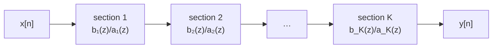

The earlier entries supplied every ingredient of filter design. The [first entry](/blog/signals-and-systems-in-discrete-time) introduced difference equations, finite and infinite impulse response (FIR and IIR) systems, and the frequency response. The [second](/blog/z-transform-poles-and-stability) showed how poles and zeros shape that response and decide stability, and how the phase response defines a group delay. The [third](/blog/dft-and-fft) showed what multiplying a sequence by a window does to its spectrum. This entry puts them together to answer the practical question: given a statement of which frequencies to pass and which to remove, what coefficients should the filter have, and how should they be computed with the limited precision of real hardware?

The entry follows one specification throughout, designs it first as an FIR filter and then as an IIR filter, compares the two, and ends with what happens when the coefficients and the arithmetic are given a finite number of bits. Conventions are those of the [first entry](/blog/signals-and-systems-in-discrete-time#conventions-used-throughout-the-series): $\omega$ in radians per sample, difference equations with coefficient arrays $b$ and $a$ and $a_0 = 1$, and code in Python 3 with NumPy. Gains in decibels are $20\log_{10}$ of the magnitude.

## 1. Specifying a Filter

### 1.1 Ideal filters cannot be built

The **ideal low-pass filter** passes every frequency below a cut-off $\omega_c$ with gain 1 and no delay, and removes everything above it. Its impulse response follows from the inverse of the discrete-time Fourier transform (DTFT):

$$
h_d[n] = \frac{1}{2\pi}\int_{-\omega_c}^{\omega_c} e^{j\omega n}\,d\omega = \frac{\sin(\omega_c n)}{\pi n},
$$

with $h_d[0] = \omega_c/\pi$. This impulse response extends to $n = -\infty$ and $n = +\infty$, so the filter is not causal, and it decays only as $1/n$, so it is not even absolutely summable: by the test of the first entry, the ideal filter is not bounded-input bounded-output (BIBO) stable. Ideal high-pass, band-pass and band-stop filters have the same problems. Every real filter is an approximation, and design means choosing how close an approximation is good enough.

### 1.2 The tolerance scheme

A specification replaces the ideal brick wall with tolerances:

- the **passband**, $0 \le \omega \le \omega_p$, in which the gain must stay within $1 \pm \delta_p$, often stated as a peak-to-peak **passband ripple** in decibels;
- the **stopband**, $\omega_s \le \omega \le \pi$, in which the gain must stay below $\delta_s$, stated as a **stopband attenuation** $A_s = -20\log_{10}\delta_s$ dB;
- the **transition band**, $\omega_p < \omega < \omega_s$, where the gain is free.

The cost of a filter is driven mostly by the width of the transition band and by the attenuation required: narrower and deeper both mean more coefficients.

The running example is a low-pass filter for a signal sampled at $f_s = 1$ kHz:

| Item | Value | In rad/sample |
|---|---|---|
| Passband | 0 to 100 Hz, within ±0.1 dB | $\omega_p = 0.2\pi$ |
| Stopband | 150 Hz to 500 Hz, at least 50 dB down | $\omega_s = 0.3\pi$ |
| Transition width | 50 Hz | $\Delta\omega = 0.1\pi$ |

## 2. FIR Filters and Linear Phase

### 2.1 Why FIR

An FIR filter of **order** $M$ has $M + 1$ coefficients, which are also its impulse response, and transfer function $H(z) = \sum_{k=0}^{M} h[k]z^{-k}$. All its poles are at the origin, so it is always stable, whatever its coefficients and however they are rounded. Its output involves no feedback, so rounding errors do not recirculate. And it can have exactly linear phase, which no causal IIR filter can.

### 2.2 Symmetric coefficients give linear phase

Suppose the coefficients are symmetric about the middle, $h[k] = h[M - k]$, and take $M$ even. Pairing each term with its mirror image and factoring out the delay to the centre gives

$$
H(e^{j\omega}) = e^{-j\omega M/2}\left(h[M/2] + 2\sum_{k=0}^{M/2 - 1} h[k]\cos\!\bigl(\omega(M/2 - k)\bigr)\right) = e^{-j\omega M/2} A(\omega),
$$

where the **amplitude response** $A(\omega)$ is real. The phase is therefore $-\omega M/2$ (plus a jump of $\pi$ wherever $A(\omega)$ changes sign, which happens only in the stopband), and the group delay defined in the second entry is the constant $M/2$ samples. Every frequency is delayed by the same amount, so the shape of a waveform within the passband is preserved: a pulse comes out as a delayed, smoothed pulse, not a smeared one. That matters for waveforms whose shape carries information, such as a step in a load-cell signal, an electrocardiogram, or a data pulse.

The delay is the price. The example filter in Section 3 has $M = 66$, a delay of 33 samples, or 33 ms at 1 kHz. For a recording that is irrelevant; inside a control loop, as the next entry shows, it can be decisive.

Symmetric filters with even $M$ are called type I. Odd $M$ (type II) gives a delay of a half-integer number of samples and forces a zero at $z = -1$, so it cannot make a high-pass filter; antisymmetric coefficients, $h[k] = -h[M - k]$ (types III and IV), give a phase of $-\omega M/2 + \pi/2$ and are used for differentiators. This entry uses type I throughout.

## 3. FIR Design by the Window Method

### 3.1 Truncating the ideal response

The ideal impulse response is infinitely long and non-causal. The **window method** fixes both problems directly: delay it by $M/2$ samples so that its centre sits at $n = M/2$, and keep only $0 \le n \le M$:

$$
h[n] = h_d[n - M/2]\;w[n], \qquad n = 0, 1, \dots, M,
$$

where $w[n]$ is a window of length $M + 1$. The delayed ideal response is symmetric about $M/2$, so with a symmetric window the result has exactly linear phase.

The third entry explained what multiplying by a window does in frequency: the response becomes the ideal response convolved with the window's transform. Each edge of the ideal brick wall is smeared by the window's main lobe, which sets the transition width, and the side lobes leave ripples in both bands, which set the attenuation. With the rectangular window (plain truncation), the ripple next to the edge never falls below about 9 % of the step, however long the filter: the **Gibbs phenomenon**. Lengthening the filter narrows the transition band but does not reduce the peak ripple. Only a different window does that.

Windows for filter design are used in their **symmetric** form, with $M$ in the denominator, so that $w[n] = w[M - n]$; for example the Hamming window is $w[n] = 0.54 - 0.46\cos(2\pi n/M)$. The third entry used the periodic form, with the record length in the denominator, which is correct for spectral analysis but would spoil the symmetry here.

### 3.2 Choosing the window

Each window gives a characteristic peak ripple, almost independent of the filter length, and a transition width inversely proportional to the order $M$. The values below were measured for this entry on a low-pass filter with $\omega_c = \pi/2$ and order $M = 200$, with the peak error $\delta$ taken as the largest stopband ripple and the transition width measured from the last passband frequency with gain $1 - \delta$ to the first stopband frequency with gain $\delta$:

| Window | Peak error $\delta$ | Attenuation $-20\log_{10}\delta$ | Transition width $\Delta\omega$ |
|---|---|---|---|
| Rectangular | 0.0895 | 21.0 dB | $1.84\pi/M$ |
| Hann | 0.0064 | 43.9 dB | $6.25\pi/M$ |
| Hamming | 0.0020 | 54.2 dB | $6.66\pi/M$ |
| Blackman | 0.0002 | 75.3 dB | $11.17\pi/M$ |

The ripple is about the same in the passband as in the stopband, since both come from the same side lobes. The design procedure is then: choose the window with the least transition width among those that reach the required attenuation, and choose $M$ from its transition-width formula.

### 3.3 Worked design

For the example, 50 dB rules out the rectangular and Hann windows, and Hamming is the cheapest that remains. Its transition-width formula gives $M \approx 6.66\pi/\Delta\omega = 6.66\pi/(0.1\pi) = 67$. The cut-off of the ideal response is placed in the middle of the transition band, $\omega_c = 0.25\pi$ (125 Hz). The script designs the filter, checks it against the specification on a fine frequency grid, and also tries the next smaller even order.

```python
import numpy as np

fs, fp, fst = 1000.0, 100.0, 150.0         # sampling rate and band edges, Hz
wc = np.pi * (fp + fst) / fs               # cut-off in the middle of the transition band, rad/sample

def window_lowpass(M, w):
    """Order-M (length M + 1) linear-phase low-pass FIR: ideal response, delayed by M/2, times window w."""
    m = np.arange(M + 1) - M / 2
    return (wc / np.pi) * np.sinc(wc * m / np.pi) * w   # np.sinc(x) = sin(pi x)/(pi x)

def check(h):
    """Worst passband deviation (dB, 0-100 Hz) and worst stopband gain (dB, 150-500 Hz)."""
    f = np.linspace(0, fs / 2, 20001)
    H = np.abs(np.exp(-2j * np.pi * np.outer(f / fs, np.arange(len(h)))) @ h)
    dB = 20 * np.log10(H)
    return np.abs(dB[f <= fp]).max(), dB[f >= fst].max()

M = 66
hamming = 0.54 - 0.46 * np.cos(2 * np.pi * np.arange(M + 1) / M)   # symmetric form
h = window_lowpass(M, hamming)
print("Hamming, M = 66: ripple %.3f dB, stopband %.1f dB" % check(h))
print("symmetric:", np.allclose(h, h[::-1]), " centre tap:", round(h[M // 2], 6))
print("Hamming, M = 64: ripple %.3f dB, stopband %.1f dB" % check(
    window_lowpass(64, 0.54 - 0.46 * np.cos(2 * np.pi * np.arange(65) / 64))))

A, dw = 50.0, 2 * np.pi * (fst - fp) / fs
beta = 0.5842 * (A - 21) ** 0.4 + 0.07886 * (A - 21)  # Kaiser's formula for 21 <= A <= 50
print(f"Kaiser: beta = {beta:.3f}, order estimate {(A - 8) / (2.285 * dw):.1f}")
print("Kaiser, M = 60: ripple %.3f dB, stopband %.1f dB" % check(window_lowpass(60, np.kaiser(61, beta))))
```

Output:

```text
Hamming, M = 66: ripple 0.020 dB, stopband -51.6 dB
symmetric: True  centre tap: 0.25
Hamming, M = 64: ripple 0.038 dB, stopband -47.7 dB
Kaiser: beta = 4.534, order estimate 58.5
Kaiser, M = 60: ripple 0.027 dB, stopband -51.4 dB
```

The order-66 Hamming design meets the specification with margin in the passband (0.020 dB against 0.1 dB) and a little in the stopband (51.6 dB against 50 dB); order 64 fails the stopband. The passband is far better than required, which is the weakness of fixed windows: they cannot trade an unnecessarily small passband ripple for a shorter filter. The centre coefficient is $h_d[0] = \omega_c/\pi = 0.25$, as the formula of Section 1.1 predicts. The last two lines of the script anticipate the next section.

### 3.4 The Kaiser window and optimal designs

The **Kaiser window** has an adjustable shape parameter $\beta$, which moves it continuously from the rectangular window ($\beta = 0$) towards ever lower side lobes and wider main lobes. Kaiser gave empirical formulas that turn a specification directly into $\beta$ and an order, for an attenuation $A$ in decibels and a transition width $\Delta\omega$ in rad/sample:

$$
\beta = \begin{cases}
0.1102\,(A - 8.7), & A > 50, \\
0.5842\,(A - 21)^{0.4} + 0.07886\,(A - 21), & 21 \le A \le 50, \\
0, & A < 21,
\end{cases}
\qquad
M = \frac{A - 8}{2.285\,\Delta\omega}.
$$

For the example, $A = 50$ dB and $\Delta\omega = 0.1\pi$ give $\beta = 4.534$ and $M = 58.5$; rounding up to the even order 60 meets the specification, 51.4 dB in the stopband, with six fewer coefficients than the Hamming design. Like every window design, it uses the same $\delta$ in both bands.

Window designs are simple and predictable, but not optimal. The **Parks–McClellan algorithm** finds the linear-phase FIR filter of a given order that minimises the largest weighted error in the passband and stopband, which can be weighted separately. Its error ripples with equal height across each band (an **equiripple** design), and it typically meets a specification with fewer coefficients than any window design. Most signal-processing libraries implement it; the principle, not the algorithm, is what matters here.

### 3.5 Filtering before decimation

The [sampling entry](/blog/sampling-quantization-and-data-conversion#21-oversampling) of the sensor series described a common division of labour: sample fast behind a gentle analog anti-aliasing filter, remove the unwanted band with a sharp digital filter, then keep only every $D$-th sample, **decimation** by $D$. The digital filter must do for the lower rate what the analog filter did for the original one: after decimation the new sampling rate is $f_s/D$, and components at frequencies within $f_p$ of a multiple of $f_s/D$ fold into the band of interest. So the stopband must begin no higher than $f_s/D - f_p$.

The example filter qualifies for $D = 4$: the new rate is 250 Hz, and $250 - 100 = 150$ Hz is exactly the stopband edge. Everything that could alias into 0 to 100 Hz has been attenuated by at least 50 dB before the samples are thrown away. Because three outputs out of four are discarded, they need never be computed: the FIR filter is evaluated only at the retained instants, which costs $67/4 \approx 17$ multiplications per input sample instead of 67. This saving is available only to FIR filters, whose outputs do not depend on previous outputs; an IIR filter must compute every output to keep its recursion going.

## 4. IIR Design by the Bilinear Transform

### 4.1 Why IIR, and where to start

Feedback lets a few coefficients produce a long impulse response, so an IIR filter can meet a magnitude specification with far fewer coefficients than an FIR filter, particularly when the transition band is narrow relative to the sampling rate. The prices are nonlinear phase, the need to check stability, and greater sensitivity to finite word length (Section 6).

The classical route to an IIR design reuses a century of analog filter theory: design an **analog prototype** $H_a(s)$ that meets the specification, then map it into the $z$-plane. The simplest prototype is the **Butterworth** low-pass filter of order $N$, whose magnitude response is

$$
|H_a(j\Omega)|^2 = \frac{1}{1 + (\Omega/\Omega_c)^{2N}},
$$

with $\Omega$ in rad/s and $\Omega_c$ the $-3$ dB cut-off. It is **maximally flat**: as many derivatives as possible vanish at $\Omega = 0$, so the passband has no ripple, and the gain falls monotonically, by $20N$ dB per decade well above the cut-off. Its $N$ poles lie evenly spaced on a semicircle of radius $\Omega_c$ in the left half-plane,

$$
s_k = \Omega_c\,e^{\,j\pi(2k + N - 1)/(2N)}, \qquad k = 1, \dots, N.
$$

Chebyshev and elliptic prototypes allow ripple in the passband (and, for elliptic filters, in the stopband) in exchange for a steeper transition, and reach a given specification with a lower order; the design procedure below applies to them unchanged.

### 4.2 The bilinear transform

The mapping from $s$ to $z$ must turn a stable analog filter into a stable digital one and preserve the shape of the frequency response. The **bilinear transform** does both. It comes from approximating an integrator, $1/s$, by the trapezoidal rule, $y[n] = y[n-1] + \tfrac{T_s}{2}(x[n] + x[n-1])$, whose transfer function is $\tfrac{T_s}{2}(1 + z^{-1})/(1 - z^{-1})$. Replacing every $s$ in $H_a(s)$ by the inverse of that expression,

$$
s = \frac{2}{T_s}\,\frac{1 - z^{-1}}{1 + z^{-1}}, \qquad\text{equivalently}\qquad z = \frac{1 + sT_s/2}{1 - sT_s/2},
$$

maps the left half of the $s$-plane exactly onto the inside of the unit circle (so stability is preserved) and the imaginary axis exactly onto the unit circle (so the frequency response is preserved in shape). Setting $s = j\Omega$ and $z = e^{j\omega}$ gives the relation between analog and digital frequency:

$$
\Omega = \frac{2}{T_s}\tan\frac{\omega}{2}.
$$

The whole analog frequency axis, $0 \le \Omega < \infty$, is squeezed onto $0 \le \omega < \pi$. Near zero frequency $\Omega \approx \omega/T_s$, the ordinary relation; towards half the sampling rate the axis is compressed more and more, an effect called **frequency warping**. There is no aliasing, because every analog frequency has its own digital frequency, but the critical frequencies of the digital filter land in the wrong places unless the design compensates. It does so by **prewarping**: each critical digital frequency $\omega$ is converted to the analog frequency $\Omega = (2/T_s)\tan(\omega/2)$, the prototype is designed for those analog frequencies, and the transform then puts them back exactly where they belong.

### 4.3 Worked design: a second-order section

Take a second-order Butterworth filter with its $-3$ dB point at 100 Hz, $f_s = 1$ kHz. The digital cut-off is $\omega_c = 0.2\pi$, and the prewarped analog cut-off is $\Omega_c = (2/T_s)\tan(0.1\pi)$. The second-order prototype is

$$
H_a(s) = \frac{\Omega_c^2}{s^2 + \sqrt2\,\Omega_c s + \Omega_c^2}.
$$

Substituting the bilinear transform and collecting powers of $z^{-1}$, with $K = \Omega_c T_s/2 = \tan(\omega_c/2) = \tan(0.1\pi) = 0.32492$ and $d = 1 + \sqrt2 K + K^2$, gives

$$
b = \frac{K^2}{d}\,[1, 2, 1], \qquad a = \left[1,\ \frac{2(K^2 - 1)}{d},\ \frac{1 - \sqrt2 K + K^2}{d}\right],
$$

which evaluates to

$$
b = [0.067455,\ 0.134911,\ 0.067455], \qquad a = [1,\ -1.142981,\ 0.412802].
$$

The two zeros are at $z = -1$ (the image of $s = \infty$, where the analog prototype's response vanishes), and the poles are a conjugate pair of radius 0.6425. The stability triangle of the second entry confirms stability: $|a_2| = 0.41 < 1$ and $|a_1| = 1.14 < 1.41$. The gain is 0 dB at zero frequency, exactly $-3.01$ dB at 100 Hz (prewarping put the cut-off where it was asked for), $-14.15$ dB at 200 Hz and $-39.06$ dB at 400 Hz. An analog second-order Butterworth filter would be only $10\log_{10}(1 + 2^4) = 12.3$ dB down at twice its cut-off; the digital version falls faster near half the sampling rate because the warping compresses the upper frequencies towards the zeros at $z = -1$. These numbers were computed with the script in the next section.

### 4.4 Meeting the specification

The order a Butterworth filter needs follows from its magnitude formula: requiring at most $A_p$ dB loss at $\Omega_p$ and at least $A_s$ dB at $\Omega_s$ (both prewarped) gives

$$
N \ge \frac{\log_{10}\!\left[(10^{A_s/10} - 1)/(10^{A_p/10} - 1)\right]}{2\log_{10}(\Omega_s/\Omega_p)}.
$$

The script below evaluates this for the running specification (taking $A_p = 0.1$ dB as the allowed loss at the passband edge, which is how a Butterworth filter, whose gain never exceeds 1, uses the ±0.1 dB tolerance), designs the filter by mapping each analog pole with the bilinear transform, and checks it.

```python
import numpy as np

fs = 1000.0
T = 1 / fs

def butter_lowpass_bilinear(N, fc):
    """Butterworth low-pass of order N, -3 dB at fc (Hz), by the bilinear transform with prewarping.
    Returns the z-plane poles and the gain that makes the DC gain 1; all N zeros are at z = -1."""
    Wc = (2 / T) * np.tan(np.pi * fc / fs)                    # prewarped analog cut-off, rad/s
    k = np.arange(1, N + 1)
    s = Wc * np.exp(1j * np.pi * (2 * k + N - 1) / (2 * N))   # analog poles, left half-plane
    p = (1 + s * T / 2) / (1 - s * T / 2)                     # bilinear map s -> z
    g = np.real(np.prod(1 - p) / 2**N)                        # DC gain 1: H(1) = g 2^N / prod(1 - p)
    return p, g

def gain_db(p, g, f):
    z = np.exp(2j * np.pi * np.asarray(f) / fs)
    H = g * np.prod([(z + 1) / (z - pk) for pk in p], axis=0)
    return 20 * np.log10(np.abs(H))

# second-order section at 100 Hz
p, g = butter_lowpass_bilinear(2, 100.0)
a = np.real(np.poly(p)); b = g * np.array([1.0, 2.0, 1.0])
print("biquad b =", np.round(b, 6), " a =", np.round(a, 6), " |p| =", np.round(np.abs(p), 4))
print("gain at 0, 100, 200, 400 Hz (dB):", np.round(gain_db(p, g, [0, 100, 200, 400]), 2))

# order needed for 0.1 dB at 100 Hz and 50 dB at 150 Hz
Wp, Ws = (2 / T) * np.tan(np.pi * 100 / fs), (2 / T) * np.tan(np.pi * 150 / fs)
Ap, As = 0.1, 50.0
Nmin = np.log10((10**(As / 10) - 1) / (10**(Ap / 10) - 1)) / (2 * np.log10(Ws / Wp))
N = int(np.ceil(Nmin))
fc = fs / np.pi * np.arctan(Wp / (10**(Ap / 10) - 1) ** (1 / (2 * N)) * T / 2)  # meet passband exactly
p, g = butter_lowpass_bilinear(N, fc)
print(f"order needed {Nmin:.2f} -> N = {N}, fc = {fc:.2f} Hz")
print("gain at 100 and 150 Hz (dB):", np.round(gain_db(p, g, [100, 150]), 2), " max |p| =", round(np.abs(p).max(), 4))
```

Output:

```text
biquad b = [0.067455 0.134911 0.067455]  a = [ 1.       -1.142981  0.412802]  |p| = [0.6425 0.6425]
gain at 0, 100, 200, 400 Hz (dB): [ -0.    -3.01 -14.15 -39.06]
order needed 16.97 -> N = 17, fc = 110.81 Hz
gain at 100 and 150 Hz (dB): [ -0.1 -50.1]  max |p| = 0.9425
```

(`np.poly` builds a polynomial from its roots, highest power first, which for a denominator normalised to $a_0 = 1$ is the same array as $a$. The "−0." is a rounding of a tiny negative number.) A 17th-order Butterworth filter, with its $-3$ dB point moved up to 110.81 Hz so that the loss at 100 Hz is exactly 0.1 dB, meets the specification: 50.1 dB at 150 Hz. Its outermost poles have radius 0.9425, close to the unit circle, which is typical of sharp IIR filters and is the source of the word-length problems of Section 6.

### 4.5 FIR or IIR?

For this specification the comparison is closer than the textbook slogan "IIR is cheaper" suggests:

| Property | FIR, Hamming, order 66 | IIR, Butterworth, order 17 |
|---|---|---|
| Multiplications per output | 67, or 34 using the coefficient symmetry | about 43 as eight second-order sections and one first-order section |
| Phase | Exactly linear, delay 33 samples | Nonlinear; delay varies across the passband |
| Stability | Guaranteed | Must be checked, and preserved under rounding |
| Rounding errors | Do not recirculate | Recirculate through the feedback |
| Decimation saving | Yes, compute only kept outputs | No |

A narrow transition band with a tight passband tolerance is the case where Butterworth filters are least efficient; an elliptic prototype would need far fewer sections. Conversely, for a specification with a wide transition band or loose passband, a low-order IIR filter is often much cheaper than any FIR filter. The choice is driven as much by phase and implementation as by the coefficient count: linear phase, guaranteed stability and decimation favour FIR; low cost, low delay and a close match to an analog response favour IIR.

## 5. Implementation Structures

A transfer function can be computed in many algebraically equivalent ways, which behave very differently once arithmetic is rounded.

- **Direct form I** computes the difference equation literally: a delay line for past inputs, another for past outputs, and one sum of products. It needs $M + N$ delays.
- **Direct form II** reorders the two halves (the feedback part first, then the feedforward part, which is allowed because linear time-invariant (LTI) systems in cascade commute), so that one delay line serves both; it needs only $\max(M, N)$ delays, but its internal signals can be much larger than the input or output.
- The **transposed** forms reverse every signal path; transposed direct form II is popular in floating-point implementations because its state variables hold partial sums of moderate size.
- The **cascade of second-order sections** (SOS, or **biquads**) factors $H(z)$ into a product of second-order factors, each with one conjugate pair of poles and a pair of zeros, and runs them one after another:



Each section's coefficients are bounded ($|a_2| < 1$ and $|a_1| < 2$ for a stable section), and each pair of poles is set by its own two coefficients rather than by all of them together. Almost every practical IIR filter above second order is implemented this way. The usual practice is to pair each pole pair with the nearest zeros and to order the sections by how close their poles are to the unit circle, which keeps the internal signal levels under control.

## 6. Finite Word Length

### 6.1 Number formats

The design above assumed exact arithmetic. Hardware offers two kinds of approximation.

- **Fixed-point** numbers are integers with an implied binary point. In the common **Q15** format, a 16-bit two's-complement word represents values from $-1$ to $1 - 2^{-15}$ in steps of $2^{-15} \approx 3.05 \times 10^{-5}$: 1 sign bit and 15 fractional bits. Coefficients of magnitude up to 2, such as $a_1$ of a second-order section, need a format with an extra integer bit (Q14), or must be scaled. Fixed point is cheap in silicon and still dominant in small microcontrollers and in hardware filters.
- **Floating-point** numbers carry an exponent, so their relative precision is constant over a huge range. IEEE 754 single precision has a 24-bit significand (about 7 decimal digits) and double precision a 53-bit significand (about 16 digits). Floating point removes most overflow problems, but not rounding, and it is not immune to the coefficient sensitivity described next.

### 6.2 Coefficient quantization

Rounding the coefficients changes the filter. For an FIR filter the effect is benign: the zeros move slightly, the stopband floor rises somewhat, and the filter stays stable and linear phase if the rounding preserves the symmetry. For an IIR filter it moves the poles, and the sensitivity of a pole to a coefficient rises steeply when poles are clustered, because each root of a high-order polynomial depends on all its coefficients together. The script takes the 17 poles of the Section 4.4 design, forms the denominator either as one 17th-order polynomial (direct form) or as nine separate factors (second-order sections), rounds every coefficient to a fixed number of fractional bits, and reports the largest pole radius that results.

```python
import numpy as np

fs, T, N, fc = 1000.0, 1e-3, 17, 110.81
Wc = (2 / T) * np.tan(np.pi * fc / fs)
k = np.arange(1, N + 1)
s = Wc * np.exp(1j * np.pi * (2 * k + N - 1) / (2 * N))
p = (1 + s * T / 2) / (1 - s * T / 2)                 # the 17 poles of the design above

def quantize(c, bits):
    """Round coefficients to a multiple of 2**-bits (fixed point with `bits` fractional bits)."""
    return np.round(np.asarray(c) * 2.0**bits) / 2.0**bits

a_direct = np.real(np.poly(p))                        # one 17th-order denominator
upper = p[np.imag(p) > 1e-9]                          # one pole of each conjugate pair
sections = [np.real(np.poly([q, np.conj(q)])) for q in upper]
sections.append(np.real(np.poly(p[np.abs(np.imag(p)) <= 1e-9])))   # the real pole

print("largest |a_k| in direct form:", round(np.abs(a_direct).max(), 1))
for bits in (12, 16, 24):
    r_direct = np.abs(np.roots(quantize(a_direct, bits))).max()
    r_sos = max(np.abs(np.roots(quantize(a, bits))).max() for a in sections)
    print(f"{bits} fractional bits: largest pole radius, direct form {r_direct:.4f}, second-order sections {r_sos:.4f}")
```

Output:

```text
largest |a_k| in direct form: 507.2
12 fractional bits: largest pole radius, direct form 1.0995, second-order sections 0.9424
16 fractional bits: largest pole radius, direct form 0.9574, second-order sections 0.9425
24 fractional bits: largest pole radius, direct form 0.9422, second-order sections 0.9425
```

The exact design has its largest pole radius at 0.9425. With 12 fractional bits, the direct form has a pole outside the unit circle, so the filter is unstable; with 16 bits it is stable but its poles have moved enough to change the response; only at 24 bits is it close. The second-order sections are within 0.0001 of the exact radius at every word length. The direct form also needs coefficients as large as 507, which costs 10 integer bits on top of the fractional ones, while every section coefficient is below 2. This is the practical reason for the cascade structure of Section 5.

### 6.3 Round-off noise

Every multiplication in fixed point produces a result with more bits than the word can hold, and rounding it back adds an error. When the signal is busy, that error behaves like the quantization noise of an analog-to-digital converter: uniformly distributed over one step $q$, with variance $q^2/12$ (the [sampling entry](/blog/sampling-quantization-and-data-conversion#32-quantization-error-as-uncertainty) derives this). In an FIR filter the errors simply add at the output. In an IIR filter, an error injected at the output of a section passes through that section's feedback, $1/A(z)$, and its variance is multiplied by the **noise gain** $\sum_n g[n]^2$, where $g[n]$ is the impulse response of $1/A(z)$.

The noise gain depends strongly on how close the poles are to the unit circle. For the second-order Butterworth section of Section 4.3 (cut-off 100 Hz at 1 kHz, poles at radius 0.6425) it is 3.5, or 5.4 dB. For the same design with its cut-off at 5 Hz, which gives $a = [1, -1.955578, 0.956544]$ and poles at radius 0.9780, it is 11 921, or 40.8 dB: the section amplifies its own rounding noise by a factor of about $\sqrt{11\,921} \approx 109$ in amplitude, which costs nearly 7 bits of a 16-bit word ($40.8/6.02 \approx 6.8$). These values were computed by summing $g[n]^2$ over 20 000 samples of the recursion. Low cut-off frequencies relative to the sampling rate always put poles near $z = 1$, so a sharp low-frequency filter at a high sampling rate is the hard case for fixed point; it is one more reason to decimate before filtering narrowly.

### 6.4 Overflow, scaling and limit cycles

**Overflow.** A fixed-point word has a hard range. If an intermediate result exceeds it, two's-complement arithmetic wraps around, turning a large positive value into a large negative one, which in a recursive filter can start a large oscillation. Two defences are used together: **scaling**, which reduces the signal entering each section so that its internal nodes cannot exceed the range for any input that matters (at the cost of signal-to-noise ratio), and **saturation arithmetic**, which clips an overflowing result to the largest representable value instead of wrapping it. Most signal-processing hardware offers saturation as an option, and it should be used.

**Limit cycles.** Rounding inside a feedback loop can keep a filter from ever settling. The first-order recursion $y[n] = 0.9\,y[n-1]$ should decay to zero; computed in integers with rounding, it does not:

```python
y, seq = 10, [10]
for _ in range(8):
    y = round(0.9 * y)          # Python's round(): halves go to the even integer
    seq.append(y)
print(seq)
```

Output:

```text
[10, 9, 8, 7, 6, 5, 4, 4, 4]
```

Once $|y| \le 0.5/(1 - 0.9) = 5$, the decay per step, $0.1|y|$, is no larger than half a step, so rounding can undo it, and the output sticks at 4. This **dead band** is the simplest **limit cycle**; in second-order sections the stuck state can be a small oscillation instead. Limit cycles are usually a few least significant bits in size, but in audio they can be audible as tones, and in a control loop they appear as a small persistent oscillation. Remedies include more bits in the state variables, rounding towards zero (magnitude truncation), and structures designed to be free of them.

## 7. Exercises

**Exercise 1.** A low-pass FIR filter is needed at $f_s = 48$ kHz with a passband to 4 kHz, a stopband from 5 kHz and 70 dB attenuation. Which window from the table of Section 3.2 is needed, and roughly what order?

<details>
<summary>Answer</summary>

70 dB requires the Blackman window (Hamming reaches about 54 dB). The transition width is $\Delta\omega = 2\pi \times 1000/48\,000 = 0.0417\pi$, so $M \approx 11.17\pi/\Delta\omega = 268$. The Kaiser formulas give $\beta = 0.1102 \times (70 - 8.7) = 6.76$ and $M = 62/(2.285 \times 0.1309) = 207$, about a quarter fewer coefficients.

</details>

**Exercise 2.** What is the group delay, in milliseconds, of the order-60 Kaiser design of Section 3.4, and how does it compare with the Hamming design?

<details>
<summary>Answer</summary>

$M/2 = 30$ samples, 30 ms at 1 kHz, against 33 ms for the order-66 Hamming design.

</details>

**Exercise 3.** Without prewarping, a designer maps an analog Butterworth prototype with $\Omega_c = 2\pi \times 200$ rad/s to $f_s = 1$ kHz by the bilinear transform. At what frequency is the digital filter's $-3$ dB point?

<details>
<summary>Answer</summary>

The digital frequency is $\omega = 2\arctan(\Omega_c T_s/2) = 2\arctan(0.6283) = 1.1220$ rad/sample, which is $1.1220 \times 1000/(2\pi) = 178.6$ Hz, about 11 % below the intended 200 Hz.

</details>

**Exercise 4.** Check the second-order section of Section 4.3 against the stability triangle after rounding its coefficients to Q14 (14 fractional bits).

<details>
<summary>Answer</summary>

$a_1 = -1.142981$ becomes $-18727/16384 = -1.1430054$ and $a_2 = 0.412802$ becomes $6763/16384 = 0.4127808$. Then $|a_2| < 1$ and $|a_1| = 1.143 < 1.413$, so it remains stable; the pole radius $\sqrt{a_2}$ changes from 0.64250 to 0.64248.

</details>

**Exercise 5.** A first-order recursion $y[n] = a\,y[n-1] + x[n]$ is computed in integers with rounding. How large is the dead band for $a = 0.99$, and what does that suggest about filters with poles close to $z = 1$?

<details>
<summary>Answer</summary>

$|y| \le 0.5/(1 - 0.99) = 50$ least significant bits: the closer the pole is to the unit circle, the wider the dead band. Filters with poles near $z = 1$ (long time constants, low cut-offs) need extra bits in their state variables.

</details>

## 8. Summary

| Question | Answer |
|---|---|
| Why can't an ideal filter be built? | Its impulse response $\sin(\omega_c n)/(\pi n)$ is infinitely long, non-causal and not absolutely summable. |
| What does a specification state? | Passband edge and ripple, stopband edge and attenuation; the transition width between them drives the cost. |
| How does an FIR filter get linear phase? | Symmetric coefficients, $h[k] = h[M-k]$, give phase $-\omega M/2$: a constant delay of $M/2$ samples. |
| How does the window method work? | Delay and truncate the ideal impulse response and multiply by a window; the window sets the attenuation, the order sets the transition width. |
| What did the example need? | Hamming, order 66 (51.6 dB); Kaiser, order 60 (51.4 dB); Butterworth IIR, order 17 (50.1 dB). |
| What does the bilinear transform do? | Maps $s = \tfrac{2}{T_s}\tfrac{1 - z^{-1}}{1 + z^{-1}}$: stable to stable, $j\Omega$ axis to unit circle, with warping $\Omega = \tfrac{2}{T_s}\tan(\omega/2)$ corrected by prewarping. |
| Why second-order sections? | Each pole pair depends on two bounded coefficients, so rounding moves poles far less than in a high-order direct form. |
| What else does finite word length cause? | Round-off noise amplified by poles near the unit circle, overflow (use scaling and saturation), and limit cycles. |

Every filter in this entry processed a signal and passed it on. The final entry, [From Signal Processing to Digital Control](/blog/from-signal-processing-to-digital-control), closes the loop: the output of a digital filter drives an actuator, the plant's response returns through a sensor and a converter, and the delays, discretisation methods and sampling rates of this series decide whether that loop is stable.

### References

- A. V. Oppenheim and R. W. Schafer, *Discrete-Time Signal Processing*, 3rd edition, Pearson, 2010.
- J. G. Proakis and D. G. Manolakis, *Digital Signal Processing: Principles, Algorithms, and Applications*, 4th edition, Pearson Prentice Hall, 2007.
- T. W. Parks and J. H. McClellan, "Chebyshev approximation for nonrecursive digital filters with linear phase", *IEEE Transactions on Circuit Theory*, vol. 19, no. 2, pp. 189–194, 1972.
- IEEE Std 754-2019, *IEEE Standard for Floating-Point Arithmetic*.
