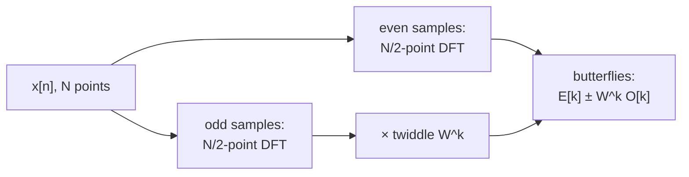

The first two entries looked at systems. The [first entry](/blog/signals-and-systems-in-discrete-time) showed that a linear time-invariant (LTI) system scales and shifts each sinusoid by its frequency response, and the [second](/blog/z-transform-poles-and-stability) computed that response from poles and zeros, as the z-transform evaluated on the unit circle. Both assumed that the frequencies in the signal were known. Often they are not: the first question about a vibration, a noisy sensor or an interference problem is *which frequencies are present, and how strong are they?*

This entry answers that question for a finite record of samples. It defines the **discrete Fourier transform** (DFT), which turns $N$ samples into $N$ frequency components, and relates its output to physical frequency. It then explains the **fast Fourier transform** (FFT), the algorithm that makes the DFT cheap, and the two effects that every measured spectrum shows: **leakage**, caused by observing a signal for a finite time, and the trade-offs of the **windows** used to control it.

Notation follows the [conventions of the first entry](/blog/signals-and-systems-in-discrete-time#conventions-used-throughout-the-series): $\omega$ in radians per sample, $f_s$ the sampling frequency in hertz, $j^2 = -1$. Code uses Python 3 and NumPy, whose `numpy.fft` module uses exactly the sign and scaling conventions defined in Section 1.2.

## 1. The Discrete Fourier Transform

### 1.1 From the DTFT to a computable transform

The second entry defined the **discrete-time Fourier transform** (DTFT) of a sequence as its z-transform on the unit circle:

$$
X(e^{j\omega}) = \sum_{n=-\infty}^{\infty} x[n]\,e^{-j\omega n}.
$$

It describes the frequency content of $x[n]$ completely, but it cannot be computed as it stands: the sum runs over all $n$, and the result is a function of a continuous variable $\omega$. A computer has a finite record, $x[0], \dots, x[N-1]$, and can produce only finitely many numbers. If the record is treated as the whole sequence (zero outside it), the sum becomes finite, and evaluating it at $N$ equally spaced frequencies around the unit circle,

$$
\omega_k = \frac{2\pi k}{N}, \qquad k = 0, 1, \dots, N-1,
$$

gives $N$ numbers from $N$ numbers. That is the DFT.

### 1.2 Definition and conventions

The **DFT** of the $N$-point sequence $x[n]$ is

$$
X[k] = \sum_{n=0}^{N-1} x[n]\,e^{-j2\pi kn/N}, \qquad k = 0, 1, \dots, N-1,
$$

and the **inverse DFT** recovers the samples exactly:

$$
x[n] = \frac{1}{N}\sum_{k=0}^{N-1} X[k]\,e^{\,j2\pi kn/N}, \qquad n = 0, 1, \dots, N-1.
$$

Conventions differ between texts in two places: the sign of the exponent in the forward transform, and where the factor $1/N$ goes (some put it in the forward transform, some split it as $1/\sqrt N$ in both). This series uses the convention above, which is also NumPy's (`numpy.fft.fft` and `numpy.fft.ifft`). The choice changes the scaling of $X[k]$, so any amplitude read from a spectrum must be interpreted with the convention in use (Section 5.3).

The inverse formula has a useful reading: any $N$ samples are a sum of $N$ complex exponentials at the frequencies $\omega_k$, with complex amplitudes $X[k]/N$. In linear-algebra terms, the DFT is multiplication by the $N \times N$ matrix with entries $W_{kn} = e^{-j2\pi kn/N}$, whose columns are orthogonal ($W^{\mathsf H}W = N I$, where $^{\mathsf H}$ denotes the conjugate transpose). The DFT is simply a change of basis from samples to complex exponentials.

A four-point example done by hand: for $x = \{1, 2, 3, 4\}$, $e^{-j2\pi kn/4} = (-j)^{kn}$, so

$$
\begin{aligned}
X[0] &= 1 + 2 + 3 + 4 = 10, \\
X[1] &= 1 - 2j - 3 + 4j = -2 + 2j, \\
X[2] &= 1 - 2 + 3 - 4 = -2, \\
X[3] &= 1 + 2j - 3 - 4j = -2 - 2j.
\end{aligned}
$$

`np.fft.fft([1, 2, 3, 4])` returns `[10.+0.j, -2.+2.j, -2.+0.j, -2.-2.j]`, the same values. $X[0]$ is always the sum of the samples, $N$ times their mean.

### 1.3 Bins and physical frequency

Each index $k$ is a **frequency bin**. With samples taken at $f_s$, bin $k$ corresponds to

$$
f_k = k\,\frac{f_s}{N} \quad \text{Hz}, \qquad \Delta f = \frac{f_s}{N} = \frac{1}{N T_s}.
$$

The bin spacing $\Delta f$ is the reciprocal of the record duration $NT_s$. This is the most important number in practical spectral analysis: a one-second record gives bins 1 Hz apart, whatever the sampling rate. Sampling faster widens the range of frequencies covered (up to $f_s/2$) but does not make the bins finer; only a longer record does that.

Since the DFT samples the unit circle all the way round, bins with $k > N/2$ lie at angles beyond $\pi$, which by the periodicity of the first entry are the same as negative frequencies: bin $k$ also represents $(k - N) f_s/N$. For a **real** signal, the bins are related by conjugate symmetry,

$$
X[N - k] = X[k]^{*},
$$

so the upper half of the DFT repeats the lower half and carries no new information. A real record of $N$ samples (with $N$ even) is fully described by bins $0$ to $N/2$: zero frequency, $N/2 - 1$ positive frequencies, and the Nyquist bin at $f_s/2$. Plots of real signals usually show only this **one-sided spectrum**.

### 1.4 The DFT samples the DTFT

Comparing the definitions shows that $X[k] = X(e^{j\omega})$ at $\omega = 2\pi k/N$ for the finite record. The DFT is therefore a set of samples of a continuous curve, and between the samples the curve still exists. Appending zeros to the record (**zero padding**) before the DFT computes more samples of the same curve: it interpolates the spectrum and makes plots smoother, but it adds no information and does not separate two frequencies the original record could not. Resolution is set by the length of the *data*, not of the transform.

## 2. What the DFT Assumes: Periodicity

### 2.1 The implicit periodic extension

Evaluate the inverse DFT formula at $n = N$: since $e^{j2\pi kN/N} = 1$, it gives $x[N] = x[0]$. In general the inverse formula is periodic in $n$ with period $N$. The DFT therefore treats the record as one period of a periodic sequence, as if the last sample were followed by the first again. Whenever the record's end does not join smoothly to its start, the DFT sees a jump that is not in the signal. This is the root of the leakage of Section 4.

### 2.2 Circular convolution

The same periodicity governs products of DFTs. Multiplying two $N$-point DFTs and inverting gives the **circular convolution** of the two sequences: the convolution sum of the first entry with all indices taken modulo $N$, so that the output wraps around instead of growing to length $L + M - 1$. Using the example of the first entry, $x = \{1, 2, 3\}$ and $h = \{1, 0.5, 0.25\}$, whose linear convolution is $\{1, 2.5, 4.25, 2, 0.75\}$:

- With 3-point DFTs, the last two output samples wrap onto the first two: $\{1 + 2,\ 2.5 + 0.75,\ 4.25\} = \{3, 3.25, 4.25\}$.
- With both sequences zero-padded to 5 points, there is room for the full result and the circular convolution equals the linear one.

So DFT-based filtering is correct only if the transforms are at least $L + M - 1$ points long. With that precaution, convolution by FFT, transforming, multiplying and transforming back, is much faster than the direct sum for long filters, and it is how long finite impulse response (FIR) filters are applied to recorded data, in blocks (the overlap-add and overlap-save methods).

## 3. The Fast Fourier Transform

### 3.1 The cost of the direct sum

Computed from the definition, each of the $N$ outputs needs $N$ complex multiplications, $N^2$ in total. For $N = 1024$ that is 1 048 576 complex multiplications per transform, which made spectral analysis of long records impractical on the computers of the 1960s. The **fast Fourier transform** (FFT) is not a different transform: it is a family of algorithms that compute exactly the DFT with far fewer operations, by exploiting the structure of the matrix $W$. The version described here, the radix-2 decimation-in-time algorithm, was published by Cooley and Tukey in 1965; the underlying idea was later traced back to work by Gauss that was not published in his lifetime.

### 3.2 Divide and conquer

Let $N$ be a power of 2 and split the record into its even-indexed samples $x[2m]$ and odd-indexed samples $x[2m+1]$, each of length $N/2$. Writing $W_N = e^{-j2\pi/N}$, the DFT becomes

$$
X[k] = \sum_{m=0}^{N/2-1} x[2m]\,W_{N/2}^{mk} + W_N^{k}\sum_{m=0}^{N/2-1} x[2m+1]\,W_{N/2}^{mk} = E[k] + W_N^{k}\,O[k],
$$

where $E[k]$ and $O[k]$ are the $N/2$-point DFTs of the even and odd samples (using $W_N^{2mk} = W_{N/2}^{mk}$). Both are periodic with period $N/2$, and $W_N^{k + N/2} = -W_N^{k}$, so the upper half of the output costs nothing extra:

$$
X[k] = E[k] + W_N^{k}\,O[k], \qquad X[k + N/2] = E[k] - W_N^{k}\,O[k], \qquad k = 0, \dots, N/2 - 1.
$$

This pair of equations is the **butterfly**: one complex multiplication by the **twiddle factor** $W_N^k$, one addition and one subtraction, producing two outputs.



Applied recursively, the split halves the transform size at each stage until the transforms have length 1 (where the DFT of one sample is the sample itself). There are $\log_2 N$ stages, each with $N/2$ butterflies, so the total is

$$
\frac{N}{2}\log_2 N \ \text{complex multiplications}
$$

instead of $N^2$. For $N = 1024$ that is 5120 instead of 1 048 576, a factor of 204.8; the advantage grows with $N$. (Some of the twiddle factors are $1$ or $-j$ and need no real multiplication, so optimised implementations do better still; the count above is the standard figure for comparison.)

### 3.3 An FFT in a dozen lines

The recursion translates directly into code. The script below checks a direct DFT and a recursive radix-2 FFT against NumPy's FFT on 1024 random samples, prints the operation counts, and reproduces the circular-convolution example of Section 2.2.

```python
import numpy as np

def dft(x):
    """Direct DFT: N^2 complex multiply-adds."""
    N = len(x)
    n = np.arange(N)
    W = np.exp(-2j * np.pi * np.outer(n, n) / N)   # DFT matrix
    return W @ x

def fft_radix2(x):
    """Recursive radix-2 decimation-in-time FFT; len(x) must be a power of 2."""
    N = len(x)
    if N == 1:
        return np.array(x, dtype=complex)
    E = fft_radix2(x[0::2])                          # DFT of even-indexed samples
    O = fft_radix2(x[1::2])                          # DFT of odd-indexed samples
    t = np.exp(-2j * np.pi * np.arange(N // 2) / N) * O   # twiddle factors
    return np.concatenate([E + t, E - t])            # butterflies

rng = np.random.default_rng(1)
x = rng.standard_normal(1024)
print(np.allclose(dft(x), np.fft.fft(x)), np.allclose(fft_radix2(x), np.fft.fft(x)))

N = 1024
print("direct:", N**2, " radix-2:", N // 2 * int(np.log2(N)), " ratio:", N**2 / (N // 2 * np.log2(N)))

# product of DFTs = circular convolution; zero-pad for linear convolution
x3, h3 = np.array([1.0, 2.0, 3.0]), np.array([1.0, 0.5, 0.25])
print(np.real(np.fft.ifft(np.fft.fft(x3) * np.fft.fft(h3))))
print(np.real(np.fft.ifft(np.fft.fft(x3, 5) * np.fft.fft(h3, 5))))
```

Output:

```text
True True
direct: 1048576  radix-2: 5120  ratio: 204.8
[3.   3.25 4.25]
[1.   2.5  4.25 2.   0.75]
```

(`np.fft.fft(x, 5)` zero-pads its argument to 5 points.) Library FFTs are not limited to powers of 2: they factor $N$ into small primes and use mixed-radix butterflies, and they handle large prime lengths with other algorithms. Powers of 2 remain the fastest case and the usual choice when the record length is free.

## 4. Leakage

### 4.1 A sinusoid on a bin and between bins

Take $f_s = 1000$ Hz and $N = 100$ samples, so the bins are $\Delta f = 10$ Hz apart, and analyse a unit-amplitude cosine. For a real sinusoid of amplitude $A$ that falls exactly on bin $k$ (with $0 < k < N/2$), $|X[k]| = AN/2$, so the amplitude is read as $2|X[k]|/N$.

```python
import numpy as np

fs, N = 1000.0, 100                 # 100 samples at 1 kHz: bins 10 Hz apart
n = np.arange(N)
for f in (50.0, 55.0):
    x = np.cos(2 * np.pi * f / fs * n)
    A = 2 * np.abs(np.fft.fft(x)) / N   # amplitude scaling for a real sinusoid
    print(f"{f:.0f} Hz:", np.round(A[2:9], 3), " (bins 2..8 = 20..80 Hz)")
```

Output:

```text
50 Hz: [0. 0. 0. 1. 0. 0. 0.]  (bins 2..8 = 20..80 Hz)
55 Hz: [0.053 0.093 0.181 0.608 0.663 0.237 0.151]  (bins 2..8 = 20..80 Hz)
```

At 50 Hz the record holds exactly five cycles, its end joins its start smoothly, and the spectrum is a single line of the correct amplitude at bin 5. At 55 Hz the record holds five and a half cycles. Now no bin matches the frequency, the two nearest bins read only about 0.6 and 0.66, and the energy is spread over every bin, falling off slowly with distance. That spreading is **leakage**: energy at one frequency appearing in bins at other frequencies. The drop in peak height when a frequency lies between bins is the **scalloping loss**; for a single complex exponential exactly halfway between two bins the reading falls to $2/\pi = 0.637$ of the true value, a loss of 3.92 dB. (The two readings here, 0.608 and 0.663, differ from 0.637 and from each other because the leakage of the cosine's negative-frequency component, at $-55$ Hz, adds to them.)

### 4.2 Why it happens: the rectangular window

Taking $N$ samples of a longer signal is the same as multiplying it by a **window** $w[n]$ that is 1 for $0 \le n \le N-1$ and 0 elsewhere, the **rectangular window**. Multiplication in time corresponds to convolution in frequency (the dual of the convolution property of the second entry), so the DTFT of the record is the true spectrum convolved (periodically, over one $2\pi$ interval) with the window's transform:

$$
W_R(e^{j\omega}) = \sum_{n=0}^{N-1} e^{-j\omega n} = e^{-j\omega (N-1)/2}\,\frac{\sin(\omega N/2)}{\sin(\omega/2)}.
$$

A sinusoid's single spectral line is replaced by a copy of this function centred on its frequency. Its magnitude has a **main lobe** that reaches its first zeros at $\pm 2\pi/N$, one bin either side of the centre, and **side lobes** that decay slowly: the highest is only 13.3 dB below the peak, and they fall by about 6 dB per doubling of the distance. The DFT samples this pattern at the bin frequencies. When the sinusoid lies on a bin, every other sample falls on a zero of the pattern, and leakage is invisible. When it does not, the samples land on the side lobes, and every bin picks some of it up.

Leakage is therefore not an error in the FFT. It is the exact spectrum of a finite record, and it occurs whenever a component does not complete a whole number of cycles in the record, which for a real measurement is almost always.

## 5. Windows

### 5.1 Tapering the record

Leakage comes from the abrupt start and end of the rectangular window. Multiplying the record by a window that tapers smoothly to zero at both ends removes the jump at the joint of the periodic extension, and the side lobes fall much faster. The price is a wider main lobe, because the tapered window effectively uses less of the record. The most widely used taper is the **Hann window**,

$$
w[n] = 0.5 - 0.5\cos\!\left(\frac{2\pi n}{N}\right), \qquad n = 0, \dots, N-1,
$$

a single raised-cosine period. Written with $N$ in the denominator, as here, it is the *periodic* form, which is the appropriate one for spectral analysis with the DFT; filter design (in the next entry) uses the *symmetric* form with $N - 1$ in the denominator. The **Hamming window**, $0.54 - 0.46\cos(2\pi n/N)$, adjusts the coefficients to cancel the first side lobe, and the **Blackman window**, $0.42 - 0.5\cos(2\pi n/N) + 0.08\cos(4\pi n/N)$, adds a second cosine term to push the side lobes lower still.

The properties that matter, computed numerically for $N = 1024$ from the periodic forms above (by zero-padding each window heavily and measuring its transform), are:

| Window | First zero of main lobe (bins) | Highest side lobe | Scalloping loss | Coherent gain | Equivalent noise bandwidth (bins) |
|---|---|---|---|---|---|
| Rectangular | 1 | −13.3 dB | 3.92 dB | 1.00 | 1.00 |
| Hann | 2 | −31.5 dB | 1.42 dB | 0.50 | 1.50 |
| Hamming | 2 | −42.7 dB | 1.75 dB | 0.54 | 1.36 |
| Blackman | 3 | −58.1 dB | 1.10 dB | 0.42 | 1.73 |

The columns mean:

- **First zero of the main lobe**: half the main-lobe width. Two sinusoids closer than about this distance merge into one peak.
- **Highest side lobe**: the worst leakage close to a strong component. The Hann and Blackman windows' side lobes also fall off much faster with distance (about 18 dB per doubling of distance) than those of the rectangular and Hamming windows (about 6 dB), so far from a strong component the Hann window leaks less than the Hamming window despite its higher first side lobe.
- **Scalloping loss**: the worst-case drop in a sinusoid's reading when it lies halfway between bins.
- **Coherent gain**: the mean of the window, $\frac1N\sum_n w[n]$. A windowed sinusoid's peak is reduced by this factor, which must be divided out to read amplitudes.
- **Equivalent noise bandwidth** (ENBW): how much broadband noise each bin collects, relative to the rectangular window, $N\sum w^2/(\sum w)^2$. A wider main lobe collects more noise.

No window is best for everything. The rectangular window has the narrowest main lobe and is the right choice when all components are known to lie on bins, or for transients that fit within the record. Hann is a good general-purpose choice. Windows with very low side lobes suit measurements of weak components near strong ones.

### 5.2 Worked example: a weak tone near a strong one

A vibration signal sampled at $f_s = 1000$ Hz contains a strong component of amplitude 1 at 101.3 Hz and a weak one of amplitude 0.001 (−60 dB) at 160 Hz. A 256-point record gives bins $1000/256 = 3.906$ Hz apart, so the weak tone is about 15 bins from the strong one, and neither falls on a bin. The script computes the spectrum in decibels relative to amplitude 1 with both windows, dividing by $\sum_n w[n]$ to correct for the coherent gain.

```python
import numpy as np

fs, N = 1000.0, 256                  # bin spacing fs/N = 3.906 Hz
n = np.arange(N)
x = np.cos(2 * np.pi * 101.3 / fs * n) + 1e-3 * np.cos(2 * np.pi * 160.0 / fs * n)

windows = {"rectangular": np.ones(N),
           "Hann": 0.5 - 0.5 * np.cos(2 * np.pi * n / N)}
f = np.arange(N) * fs / N
for name, w in windows.items():
    X = np.fft.fft(x * w)
    level = 20 * np.log10(2 * np.abs(X) / np.sum(w))  # dB relative to amplitude 1
    k = np.argmin(np.abs(f - 160.0))                   # bin nearest 160 Hz
    print(f"{name:12s} peak {level.max():6.1f} dB at {f[np.argmax(level)]:.1f} Hz;"
          f" {f[k]:.1f} Hz bin {level[k]:6.1f} dB; 200-300 Hz floor {level[(f > 200) & (f < 300)].max():6.1f} dB")
```

Output:

```text
rectangular  peak   -0.1 dB at 101.6 Hz; 160.2 Hz bin  -46.0 dB; 200-300 Hz floor  -52.8 dB
Hann         peak   -0.0 dB at 101.6 Hz; 160.2 Hz bin  -60.2 dB; 200-300 Hz floor -108.7 dB
```

With the rectangular window, the bin at 160.2 Hz reads −46.0 dB, but that is not the weak tone: leakage from the strong one alone puts −47.9 dB into that bin (a value obtained by rerunning the script without the weak tone), and the side lobes are still at −52.8 dB 100 Hz or more away. The weak tone is buried. With the Hann window, the leakage at 160 Hz falls to about −94 dB (again with the weak tone removed), the bin reads −60.2 dB, the weak tone's true level, and the background between 200 and 300 Hz is below −100 dB. The strong component's reading, −0.1 dB with the rectangular window and −0.0 dB with Hann, shows the smaller scalloping loss of the Hann window too; 101.3 Hz is only 0.07 bins from the bin at 101.56 Hz, so both losses are small here.

### 5.3 Reading amplitudes and noise from a spectrum

Three practical rules follow from the conventions above.

- **Amplitude of a sinusoid.** For a real sinusoid well away from zero frequency and $f_s/2$, its amplitude is $2|X[k]|/\sum_n w[n]$ at its peak bin (which reduces to $2|X[k]|/N$ for the rectangular window), subject to up to the scalloping loss if it lies between bins. The zero-frequency bin and the Nyquist bin have no mirror image, so they are scaled by $1/\sum_n w[n]$ without the factor 2.
- **Remove the mean first.** A large constant offset puts a large component in bin 0 whose main lobe and side lobes can hide nearby low-frequency content. Subtracting the record's mean before windowing avoids that.
- **Noise needs averaging.** For a random signal, the squared magnitude of each bin of a single DFT is itself a random variable whose standard deviation is as large as its mean, however long the record. Averaging the squared magnitudes of the DFTs of several (often overlapping, windowed) segments reduces that scatter, at the cost of the resolution of each shorter segment. This is Welch's method, the standard way to estimate a noise spectrum. A power spectrum scaled so that a sinusoid reads its mean-square value becomes a density per hertz when divided by the ENBW expressed in hertz (the ENBW in bins times $\Delta f$).

### 5.4 A recipe

| Step | Choice | Rule |
|---|---|---|
| 1 | Sampling rate $f_s$ | Above twice the highest frequency present, with an anti-aliasing filter before the converter. |
| 2 | Record length $N$ | $N \ge f_s/\Delta f$ for the bin spacing $\Delta f$ needed; to separate two components $\delta f$ apart, $\Delta f$ must be a fraction of $\delta f$ that depends on the main-lobe width of the window. |
| 3 | Preprocessing | Subtract the mean (and a linear trend, if there is drift). |
| 4 | Window | Rectangular only for components known to be on bins or for transients; Hann by default; lower side lobes for large dynamic range. |
| 5 | Transform | FFT, zero-padded if a smoother plot is wanted. |
| 6 | Scaling | Amplitude $2\lvert X[k] \rvert/\sum w$; density with the ENBW; average segments for noise. |

## 6. Exercises

**Exercise 1.** A signal is sampled at 48 kHz. How many samples are needed for bins 1 Hz apart, and what is the nearest power of 2?

<details>
<summary>Answer</summary>

$N = f_s/\Delta f = 48\,000$ samples, a one-second record. The nearest power of 2 above is $2^{16} = 65\,536$, which gives bins $48\,000/65\,536 = 0.732$ Hz apart (the longer record, not the power of 2, is what makes them finer).

</details>

**Exercise 2.** Using the four-point example of Section 1.2, check the conjugate symmetry $X[N-k] = X[k]^*$ and recover $x[1]$ from the inverse DFT.

<details>
<summary>Answer</summary>

$X[3] = -2 - 2j = (-2 + 2j)^* = X[1]^*$, and $X[2] = -2$ is real, as the Nyquist bin of a real signal must be. With $e^{j2\pi k/4} = j^k$, $x[1] = \tfrac14\bigl(10 + (-2 + 2j)j + (-2)(-1) + (-2 - 2j)(-j)\bigr) = \tfrac14(10 - 2j - 2 + 2 + 2j - 2) = \tfrac14 \times 8 = 2$.

</details>

**Exercise 3.** How many complex multiplications does a radix-2 FFT of $N = 65\,536$ points need, and how much faster is it than the direct DFT by that count?

<details>
<summary>Answer</summary>

$(N/2)\log_2 N = 32\,768 \times 16 = 524\,288$, against $N^2 = 4\,294\,967\,296$: a factor of $2N/\log_2 N = 8192$.

</details>

**Exercise 4.** Two sinusoids at 100 Hz and 103 Hz, of similar amplitude, are sampled at 1 kHz. Roughly how long must the record be to see them as two peaks with a rectangular window, and with a Hann window?

<details>
<summary>Answer</summary>

A sinusoid's main lobe extends to its first zeros at one bin (rectangular) or two bins (Hann) either side. For two separate peaks, the 3 Hz spacing should be at least about that half-width, so roughly $\Delta f \le 3$ Hz for the rectangular window and $\Delta f \le 1.5$ Hz for Hann: records of at least about 0.33 s (334 samples) and 0.67 s (667 samples). These are rules of thumb; how clearly the peaks separate also depends on where the frequencies fall relative to the bins.

</details>

**Exercise 5.** A sinusoid of amplitude 2 V lies exactly on bin 40 of a 1024-point Hann-windowed DFT. What is $|X[40]|$?

<details>
<summary>Answer</summary>

$|X[40]| = A\sum_n w[n]/2 = 2 \times (0.5 \times 1024)/2 = 512$, since the coherent gain of the Hann window is 0.5. Dividing $2|X[40]|$ by $\sum w = 512$ returns the amplitude, 2 V.

</details>

## 7. Summary

| Question | Answer |
|---|---|
| What does the DFT compute? | $N$ samples of the DTFT of an $N$-point record, at $\omega_k = 2\pi k/N$: $X[k] = \sum_n x[n]e^{-j2\pi kn/N}$. |
| What frequency does bin $k$ represent? | $k f_s/N$ Hz; bins above $N/2$ are negative frequencies, and real signals need only bins 0 to $N/2$. |
| What sets the frequency resolution? | The record duration: bins are $\Delta f = 1/(NT_s)$ apart. Zero padding interpolates but does not resolve. |
| What does the DFT assume? | That the record is one period of a periodic signal; products of DFTs give circular convolution. |
| Why is the FFT fast? | Recursive even/odd splitting with butterflies: $(N/2)\log_2 N$ complex multiplications instead of $N^2$. |
| What is leakage? | Spreading of a component's energy into other bins, because a finite record multiplies the signal by a window. |
| What does a window trade? | Lower side lobes (less leakage) against a wider main lobe (less resolution) and more noise per bin. |
| How is an amplitude read from a windowed spectrum? | $2\lvert X[k] \rvert/\sum_n w[n]$ at the peak, within the scalloping loss. |

The DFT measures a spectrum; the natural next step is to change one. The next entry, [Designing FIR and IIR Filters](/blog/designing-fir-and-iir-filters), turns a specification of which frequencies to pass and which to stop into filter coefficients, using windows again (this time to shape an impulse response) and the pole-zero picture of the second entry, and then asks what happens when those coefficients are stored with a finite number of bits.

### References

- A. V. Oppenheim and R. W. Schafer, *Discrete-Time Signal Processing*, 3rd edition, Pearson, 2010.
- J. W. Cooley and J. W. Tukey, "An algorithm for the machine calculation of complex Fourier series", *Mathematics of Computation*, vol. 19, no. 90, pp. 297–301, 1965.
- M. T. Heideman, D. H. Johnson and C. S. Burrus, "Gauss and the history of the fast Fourier transform", *IEEE ASSP Magazine*, vol. 1, no. 4, pp. 14–21, 1984.
- F. J. Harris, "On the use of windows for harmonic analysis with the discrete Fourier transform", *Proceedings of the IEEE*, vol. 66, no. 1, pp. 51–83, 1978.
- P. D. Welch, "The use of fast Fourier transform for the estimation of power spectra: a method based on time averaging over short, modified periodograms", *IEEE Transactions on Audio and Electroacoustics*, vol. 15, no. 2, pp. 70–73, 1967.
