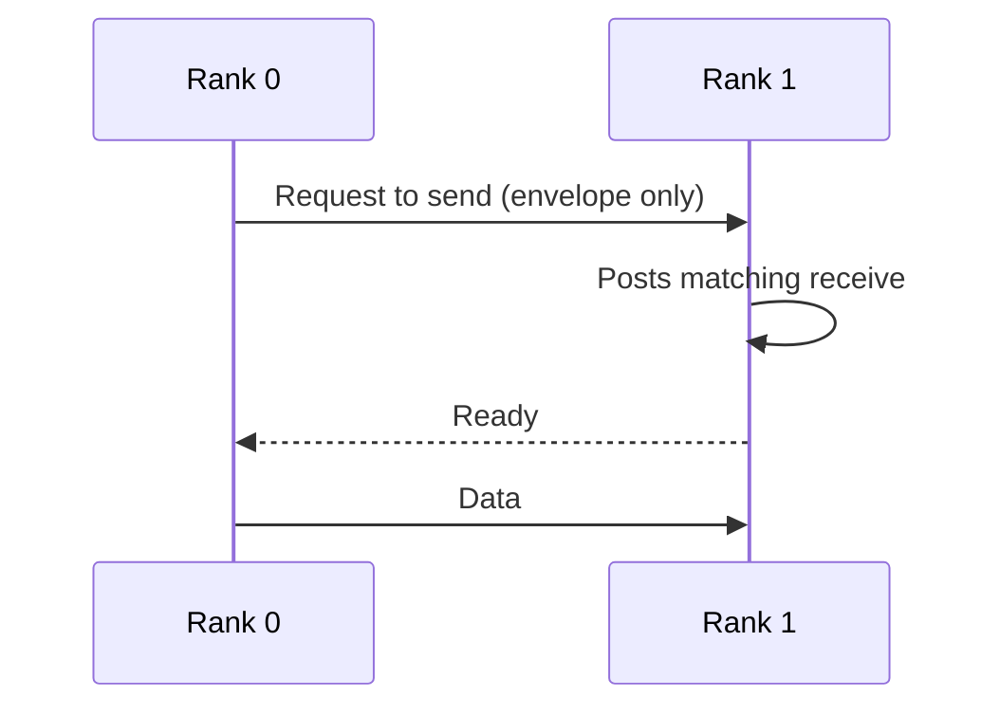
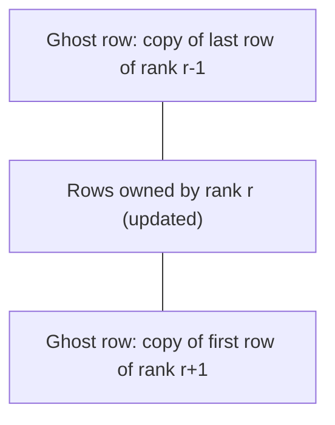

The first four entries of this series kept the computation inside one machine. [The third entry](/blog/threads-and-shared-memory-parallelism) let threads read and write the same arrays. Much of its length went to what goes wrong when they do so carelessly, from [data races](/blog/threads-and-shared-memory-parallelism#3-data-races-and-how-to-remove-them) to false sharing. [The fourth entry](/blog/data-parallelism-vector-units-and-gpus) moved data to a graphics processor and back, and found that the transfer decides whether offloading pays. This final entry removes shared memory altogether: processes on separate computers cooperate only by sending messages, and the cost of those messages adds a new term to the speedup laws of [the first entry](/blog/performance-models-and-scaling-laws).

The entry introduces the message-passing model and its standard interface, the Message Passing Interface (MPI), and then builds a cost model for it. Blocking and nonblocking point-to-point messages come first, including a deadlock that appears only above a certain message size. A measured and fitted cost per message then gives the cost of collective operations and of distributing the grid of a stencil computation of the kind treated in [Finite Differences for Heat and Waves](/blog/finite-differences-for-heat-and-waves). The same model finally predicts how that stencil scales on an assumed cluster, which is the last objective of the series.

**Conventions.** As in the earlier entries, $T_1$ is the run time of the best sequential program, $T_p$ the run time on $p$ processes, $S(p) = T_1/T_p$ the speedup and $E(p) = S(p)/p$ the efficiency. The code is C11 compiled with the GNU Compiler Collection (GCC) 13.3 through the `mpicc` wrapper of Open MPI 4.1.6, and the models are Python 3.13 with NumPy 2.5. Every program was run on the reference machine: a Kernel-based Virtual Machine (KVM) guest with four cores of an Intel Xeon processor at 2.1 GHz, 2 MiB of L2 cache per core, 16 GiB of memory and Linux. All processes of a run share this one machine, so their messages travel through shared memory, not a network. The machine is shared with other work and its timings are noisy: each quoted time is the median of several repetitions and describes this machine only. Figures for cluster networks are labeled as assumed. Message sizes $m$ are in bytes; bandwidths are in gigabytes per second (GB/s), $10^9$ bytes per second.

## 1. Distributed memory and the message-passing model

### 1.1 Why clusters

A single shared-memory machine has a ceiling. Its core count, memory capacity and memory bandwidth are fixed by its sockets and memory channels. Problems that need more memory or more arithmetic than one machine offers are run on a **cluster**: many **nodes**, each a complete computer with its own processors and memory, connected by a network. Adding nodes adds memory capacity and bandwidth in proportion.

The price is that a node cannot load or store another node's memory with ordinary instructions. This is **distributed memory**: each process has a **private address space**, and an address in one process means nothing in another. Data that one process holds and another needs must be copied explicitly across the network.

### 1.2 Processes, ranks and communicators

The dominant programming model for distributed memory is **message passing**. A parallel program is a set of processes that each work on their own data: one process calls a send operation naming a buffer and a destination, and the destination calls a receive operation naming where the data should go. Nothing is shared, so there are no data races in the sense of the third entry; the corresponding errors are messages that are never sent, never received or matched wrongly.

Almost all message-passing programs are written in the **single program, multiple data** (SPMD) style: one executable is started as $p$ processes, and each process decides what to do from its identity. That identity is its **rank**, an integer from $0$ to $p - 1$ within a **communicator**, an object that names a group of processes and gives their messages a private context. Every process belongs to the predefined communicator `MPI_COMM_WORLD`, which contains all the processes started together.

### 1.3 The MPI standard

The **Message Passing Interface** (MPI) is the standard library interface for this model. It is defined by the MPI Forum; the version cited here is Version 4.1 (Message Passing Interface Forum, 2023), and a Version 5.0 followed in 2025. MPI specifies functions and their semantics for C and Fortran, not an implementation, so the same source compiles against Open MPI, MPICH or a vendor's library. Open MPI 4.1.6 implements MPI 3.1. Every function used in this entry except `MPI_Init_thread` (added in MPI 2.0) has been part of the standard since its first version, and all of them are unchanged in Version 4.1. A textbook treatment of the interface is given by Gropp, Lusk and Skjellum (2014).

The smallest MPI program starts the library, asks for its rank and the size of `MPI_COMM_WORLD`, and shuts the library down:

```c
#include <mpi.h>
#include <stdio.h>

int main(int argc, char **argv)
{
    MPI_Init(&argc, &argv);
    int rank, size;
    MPI_Comm_rank(MPI_COMM_WORLD, &rank);   /* who am I? 0 .. size-1 */
    MPI_Comm_size(MPI_COMM_WORLD, &size);   /* how many processes?   */
    printf("rank %d of %d\n", rank, size);
    MPI_Finalize();
    return 0;
}
```

Compiled with `mpicc -O2 -Wall -o hello hello.c` and started with `mpirun --allow-run-as-root --oversubscribe -np 4 ./hello` (the first flag is needed because the reference machine runs as root, the second allows more processes than detected slots), it prints:

```text
rank 0 of 4
rank 3 of 4
rank 1 of 4
rank 2 of 4
```

The line order changes from run to run, because nothing orders the output of concurrent processes. On a cluster, `mpirun` would place the copies on different nodes.

### 1.4 Hybrid programs

Many programs run one MPI process per node or socket with several threads inside it, using OpenMP as in the third entry or a graphics processor as in the fourth. This **hybrid** model uses shared memory within a node and messages between nodes, which reduces the number of processes that exchange messages. It starts MPI with `MPI_Init_thread`, declaring how threads will call MPI; with `MPI_THREAD_FUNNELED`, only the main thread does. This entry uses one single-threaded process per core.

## 2. Point-to-point communication with MPI

### 2.1 Send and receive

The basic operations are `MPI_Send` and `MPI_Recv`. A send names a buffer (address, element count and **datatype**, such as `MPI_DOUBLE`), a destination rank, an integer **tag** and a communicator. A receive names a buffer, a source rank, a tag and a communicator, and it matches the first message from that source with that tag in that communicator; `MPI_ANY_SOURCE` and `MPI_ANY_TAG` match any. Tags separate messages of different meaning from the same sender. MPI guarantees that two messages from one sender to one receiver in the same communicator that both match a receive are received in the order they were sent.

Both calls are **blocking**, which in MPI has a precise and limited meaning: the call returns when its buffer may be reused. For a receive, that is when the message has arrived in the buffer. For a send in the standard mode used by `MPI_Send`, the standard allows two behaviors: the library may copy the message into an internal buffer and return at once, or it may wait until the matching receive has started and the data has been transferred. The choice is left to the implementation. A program whose progress depends on the first behavior is called **unsafe** by the standard.

### 2.2 Eager and rendezvous protocols

Implementations make this choice with two protocols. Under an **eager protocol**, the sender transmits the message immediately, together with its envelope (source, tag, communicator), and the receiver stores it in a library buffer until a matching receive is posted; the send returns as soon as the data has left the user buffer. Eager sending has the lowest latency but needs receiver buffer space for unrequested messages, so it is used only for short ones. Under a **rendezvous protocol**, the sender first sends only the envelope, waits until the receiver has posted a matching receive and answered, and then transfers the data directly into the receive buffer. The send cannot complete until the receiver participates.



*Rendezvous protocol for a large message: rank 0 cannot finish its send until rank 1 has posted the matching receive. If rank 1 is itself blocked in a send to rank 0, neither ever posts a receive.*

The size at which an implementation switches from eager to rendezvous is its **eager limit**. In Open MPI 4.1.6, with the `ob1` point-to-point layer and its shared-memory transport `vader` selected on the reference machine, the parameter `btl_vader_eager_limit` reports 4,096 bytes, including a protocol header.

### 2.3 A deadlock that depends on message size

The following program pairs ranks 0 with 1 and 2 with 3. In the default mode, each rank first sends $n$ doubles to its partner and then receives $n$ doubles from it.

```c
/* Two ranks swap a buffer of n doubles.
   default:    both call MPI_Send, then MPI_Recv   (unsafe)
   "sendrecv": MPI_Sendrecv                        (safe)
   "isend":    MPI_Irecv + MPI_Isend + MPI_Waitall (safe) */
#include <mpi.h>
#include <stdio.h>
#include <stdlib.h>
#include <string.h>

int main(int argc, char **argv)
{
    MPI_Init(&argc, &argv);
    int rank;
    MPI_Comm_rank(MPI_COMM_WORLD, &rank);
    int n = atoi(argv[1]);
    const char *mode = argc > 2 ? argv[2] : "send-first";
    int other = rank ^ 1;          /* partners: 0-1, 2-3, ... (even size) */
    double *out = malloc(n * sizeof *out), *in = malloc(n * sizeof *in);
    for (int i = 0; i < n; i++) out[i] = rank;

    if (strcmp(mode, "sendrecv") == 0) {
        MPI_Sendrecv(out, n, MPI_DOUBLE, other, 0,
                     in,  n, MPI_DOUBLE, other, 0,
                     MPI_COMM_WORLD, MPI_STATUS_IGNORE);
    } else if (strcmp(mode, "isend") == 0) {
        MPI_Request req[2];
        MPI_Irecv(in,  n, MPI_DOUBLE, other, 0, MPI_COMM_WORLD, &req[0]);
        MPI_Isend(out, n, MPI_DOUBLE, other, 0, MPI_COMM_WORLD, &req[1]);
        MPI_Waitall(2, req, MPI_STATUSES_IGNORE);  /* buffers reusable now */
    } else {
        MPI_Send(out, n, MPI_DOUBLE, other, 0, MPI_COMM_WORLD);
        MPI_Recv(in,  n, MPI_DOUBLE, other, 0, MPI_COMM_WORLD,
                 MPI_STATUS_IGNORE);
    }
    if (rank == 0)
        printf("%s, %d doubles (%zu bytes): received %.0f\n",
               mode, n, n * sizeof(double), in[n - 1]);
    free(out); free(in);
    MPI_Finalize();
    return 0;
}
```

It was run with four processes for four argument sets, each run limited to 10 s by the `timeout` command, which prints a note when it has to stop a run:

```sh
for a in "505" "506" "506 sendrecv" "1000000 isend"; do
  timeout 10 mpirun --allow-run-as-root --oversubscribe -np 4 ./exchange $a ||
    echo "($a: no output after 10 s, killed by timeout)"
done
```

```text
send-first, 505 doubles (4040 bytes): received 1
(506: no output after 10 s, killed by timeout)
sendrecv, 506 doubles (4048 bytes): received 1
isend, 1000000 doubles (8000000 bytes): received 1
```

With 4,040 bytes of data, the message and its header fit under the eager limit, both sends return at once and both receives find their messages waiting. With 4,048 bytes, both sends use the rendezvous protocol, and each waits for a receive that its partner posts only after its own send returns. The program hangs in a **deadlock**, a state in which every process waits for an event that only another waiting process could cause. The threshold would differ with another library, transport or setting, so a test with small messages proves nothing about such a program.

### 2.4 Safe exchanges

There are three standard repairs. The first is to order the calls so that every send meets a receive: even ranks send first and odd ranks receive first. The second is `MPI_Sendrecv`, a single call that performs a send and a receive and lets the library schedule them so that a pairwise exchange cannot deadlock. The third is **nonblocking communication**. `MPI_Isend` and `MPI_Irecv` start an operation and return at once with a **request** handle; the operation completes later, and `MPI_Wait` or `MPI_Waitall` blocks until it has. Until completion, the program must not modify a send buffer or read a receive buffer. Both safe versions worked at every size tried, up to 8,000,000 bytes. Nonblocking operations have a second use, taken up in Section 5.4: computing on other data while a transfer is in flight.

## 3. The latency-bandwidth model

### 3.1 Latency and inverse bandwidth

The simplest useful model of the time to send one message, used by Hockney (1994) to characterize the communication of parallel machines, is affine in the message size $m$:

$$
t(m) = \alpha + \beta\,m .
$$

Here $\alpha$ is the **latency** in seconds, the time to send an empty message, which covers software overhead, transfer setup and time of flight. The coefficient $\beta$ is the transfer time per byte in s/byte, the inverse of the asymptotic **bandwidth** $1/\beta$. Hockney's characterization writes the same model with the asymptotic rate $r_\infty = 1/\beta$ and the **half-performance message size** $n_{1/2}$, the message size at which the achieved bandwidth $m/t(m)$ reaches half of $1/\beta$. Setting $m/(\alpha + \beta m) = 1/(2\beta)$ gives $\beta m = \alpha$, so

$$
n_{1/2} = \frac{\alpha}{\beta} .
$$

Messages much shorter than $n_{1/2}$ cost about $\alpha$ whatever their length, and are latency-bound; messages much longer cost about $\beta m$ and are bandwidth-bound. Two messages of size $m$ cost $\alpha$ more than one of size $2m$, so small messages should be combined where the algorithm allows.

### 3.2 A ping-pong measurement

The standard measurement of $\alpha$ and $\beta$ is a **ping-pong**: rank 0 sends a message to rank 1, rank 1 sends it back, and half the round-trip time is the one-way time. The program below repeats this for message sizes from 0 bytes to 8 MiB. For each size it runs one warm-up batch and 11 timed batches of many round trips and reports the median batch time per one-way message (only the timing loop is shown).

```c
    for (int s = 0; s < nsizes; s++) {
        long m = sizes[s];
        int reps = m <= 32768 ? 2000 : (m <= 262144 ? 400 : 40);
        double t[BATCHES];
        for (int b = -1; b < BATCHES; b++) {          /* b = -1: warm-up */
            MPI_Barrier(MPI_COMM_WORLD);
            double t0 = MPI_Wtime();
            for (int r = 0; r < reps; r++) {
                if (rank == 0) {
                    MPI_Send(buf, (int)m, MPI_BYTE, 1, 0, MPI_COMM_WORLD);
                    MPI_Recv(buf, (int)m, MPI_BYTE, 1, 0, MPI_COMM_WORLD,
                             MPI_STATUS_IGNORE);
                } else if (rank == 1) {
                    MPI_Recv(buf, (int)m, MPI_BYTE, 0, 0, MPI_COMM_WORLD,
                             MPI_STATUS_IGNORE);
                    MPI_Send(buf, (int)m, MPI_BYTE, 0, 0, MPI_COMM_WORLD);
                }
            }
            if (b >= 0) t[b] = (MPI_Wtime() - t0) / (2.0 * reps);
        }
        qsort(t, BATCHES, sizeof t[0], cmp);
        if (rank == 0) printf("%10ld %14.3f\n", m, t[BATCHES / 2] * 1e6);
    }
```

Run with two processes (`mpirun --allow-run-as-root --oversubscribe -np 2 ./pingpong`):

```text
     bytes   one-way (us)
         0          0.315
         8          0.365
        64          0.447
       256          0.525
      1024          1.019
      2048          1.622
      4000          1.859
      8192          3.725
     32768          8.566
    131072         21.535
    524288         61.161
   2097152        240.503
   8388608       1016.844
```

These are memory-to-memory copies between two cores of one machine, not network transfers. Repeated runs differed by up to about 15% for the largest messages, so only the first two significant digits of the large-message times are meaningful.

### 3.3 Fitting the model

An ordinary least-squares fit would be dominated by the large messages and say little about $\alpha$, so the fit below minimizes the sum of squared *relative* errors: each row of the linear system $[1,\ m_i]\,[\alpha,\ \beta]^{\mathsf T} = t_i$ is divided by $t_i$. It fits all sizes, then the sizes under the eager limit and the sizes above it separately.

```python
def fit(m, t):
    A = np.column_stack([np.ones_like(m), m]) / t[:, None]
    (alpha, beta), *_ = np.linalg.lstsq(A, np.ones_like(t), rcond=None)
    return alpha, beta
```

```text
all sizes          alpha =  0.423 us, 1/beta =  6.99 GB/s, n_1/2 =   2957 B, measured/model in [0.74, 2.33]
m <= 4000 (eager)  alpha =  0.366 us, 1/beta =  2.13 GB/s, n_1/2 =    779 B, measured/model in [0.83, 1.22]
m >= 8192          alpha =  3.086 us, 1/beta =  8.30 GB/s, n_1/2 =  25620 B, measured/model in [0.91, 1.22]
```

One straight line does not describe this machine: at some sizes the measured time is 2.33 times the model's. Two lines, one per protocol, fit every point to within a factor of 1.22. The eager protocol has a latency of about 0.37 µs and a low bandwidth, consistent with each message being copied into a shared buffer and out again. The large-message protocol pays about 3.1 µs to set up the transfer and then moves data at about 8.3 GB/s. The affine model holds over a range of sizes in which the implementation behaves the same way; a library with several protocols needs one $(\alpha, \beta)$ pair per protocol. The half-performance size can be checked against the large-message fit. A 25,620-byte message achieves $25620/(3.086 \times 10^{-6} + 25620/8.30 \times 10^{9}) \approx 4.15 \times 10^9$ bytes per second, half of 8.30 GB/s.

For the cluster examples in the rest of this entry, the network is **assumed** to have $\alpha = 2$ µs and $1/\beta = 10$ GB/s, so $\beta = 0.1$ ns per byte and $n_{1/2} = 20{,}000$ bytes. These values are illustrative, not measurements of any particular network.

### 3.4 What the model leaves out, and LogP

The affine model describes one message between two idle processes. It says nothing about how long the processor is busy during a send, how many messages can be in flight or what happens when many processes share a link. The **LogP model** of Culler et al. (1993) separates these effects with four parameters: the network latency $L$, the processor overhead $o$ of sending or receiving a message, the gap $g$ (the minimum time between consecutive messages from one processor, whose inverse is the per-processor message rate) and the processor count $P$. An algorithm analyzed under LogP is charged for overhead it cannot overlap and for the gap it must respect. The affine model folds both into $\alpha$. This entry uses the simpler model, which is enough for the estimates of Section 6.

## 4. Collective operations

### 4.1 What a collective does

Many communication patterns involve every process of a communicator at once. MPI provides them as **collective operations**, called by all processes of the communicator with matching arguments:

- `MPI_Bcast` (**broadcast**): one root process sends the same buffer to all others;
- `MPI_Reduce` (**reduce**): every process contributes a buffer, and the root receives the element-wise combination under an operation such as `MPI_SUM` or `MPI_MAX`;
- `MPI_Allreduce` (**allreduce**): a reduction whose result is delivered to every process;
- `MPI_Gather` and `MPI_Gatherv`: the root receives one block from every process, in rank order (the `v` form allows blocks of different sizes);
- `MPI_Barrier` (**barrier**): no process leaves the call until every process has entered it.

A collective states what is computed, not how; the library chooses an algorithm by message size and process count. Thakur, Rabenseifner and Gropp (2005) describe the algorithms used in the MPICH implementation and their costs in the latency-bandwidth model; the costs below follow that analysis but leave out its term for the reduction arithmetic, which is proportional to $m$.

### 4.2 Costs of the basic algorithms

**Binomial-tree broadcast.** In the first round the root sends to one process; in each later round every process that already has the data sends it to one that does not. The number of processes holding the data doubles every round, so $\lceil \log_2 p \rceil$ rounds suffice, each costing one message:

$$
T_{\mathrm{bcast}} = \lceil \log_2 p \rceil\,(\alpha + \beta m).
$$

The same tree traversed toward the root gives a reduction with the same cost plus the arithmetic.

**Recursive doubling allreduce.** In round $k$ ($k = 0, 1, \dots$), each process exchanges its current partial result with the process whose rank differs in bit $k$ and combines the two. After $\log_2 p$ rounds (for $p$ a power of two) every process holds the full result:

$$
T_{\mathrm{rd}} = \log_2 p\,(\alpha + \beta m).
$$

Its latency term is minimal, which suits short messages such as the single number of a convergence test.

**Ring allreduce.** For long messages, the buffer is divided into $p$ chunks of $m/p$ bytes and the processes are arranged in a ring. In $p-1$ steps of a **reduce-scatter**, each process sends one chunk to its right neighbor and adds the chunk received from its left neighbor, so that at the end each process holds one fully reduced chunk. In $p-1$ steps of an **allgather**, the reduced chunks travel around the ring until every process has all of them. Each of the $2(p-1)$ steps sends $m/p$ bytes:

$$
T_{\mathrm{ring}} = 2(p-1)\,\alpha + 2\,\frac{p-1}{p}\,\beta m.
$$

The bandwidth term is below $2\beta m$ for every $p$, and Patarasuk and Yuan (2009) proved a lower bound on the data an allreduce must communicate that this volume meets. The latency term, however, grows linearly in $p$. Rabenseifner's algorithm, described by Thakur and colleagues, obtains the same bandwidth term with only $2\log_2 p$ latency terms by doing the reduce-scatter by recursive halving and the allgather by recursive doubling.

**Barrier.** A barrier carries no data, so only latency counts. Any barrier needs at least $\lceil \log_2 p \rceil$ rounds of messages if each process receives at most one message per round: a process may leave only after learning that all $p$ processes have arrived, and after $k$ rounds it can have learned of the arrival of at most $2^k$ of them.

### 4.3 Which algorithm when

The following program evaluates these formulas on the assumed cluster ($\alpha = 2$ µs, $1/\beta = 10$ GB/s) for a message of one double and a message of 8 MiB:

```python
def binomial_bcast(p, m):
    return math.ceil(math.log2(p)) * (ALPHA + BETA * m)


def recursive_doubling_allreduce(p, m):
    return math.ceil(math.log2(p)) * (ALPHA + BETA * m)


def ring_allreduce(p, m):
    return 2 * (p - 1) * ALPHA + 2 * (p - 1) / p * BETA * m
```

```text
    p  m (bytes)  bcast tree  allr. rec.dbl  allr. ring   (microseconds)
    8          8         6.0            6.0        28.0
    8    8388608      2522.6         2522.6      1496.0
   64          8        12.0           12.0       252.0
   64    8388608      5045.2         5045.2      1903.5
 1024          8        20.0           20.0      4092.0
 1024    8388608      8408.6         8408.6      5768.1
```

For one double on 1,024 processes, recursive doubling takes 20 µs and the ring about 4.1 ms; for 8 MiB on 64 processes, the ring takes 1.9 ms and recursive doubling 5.0 ms. No single algorithm is best, which is why libraries switch by size, and why a call to `MPI_Allreduce` usually beats a hand-written reduction.

### 4.4 An allreduce on the reference machine

The program below computes $\sum_{k=1}^{N} 1/k^2$ for $N = 10^8$. Rank $r$ takes the terms $k = r + 1, r + 1 + p, r + 1 + 2p, \dots$ (a cyclic distribution), and `MPI_Allreduce` adds the four partial sums and gives the total to every rank. The program then times 20,000 allreduces of one double in each of 11 batches and reports the median time per call.

```c
    const long N = 100000000;
    double part = 0.0, total;
    for (long k = rank + 1; k <= N; k += p)
        part += 1.0 / ((double)k * (double)k);
    MPI_Allreduce(&part, &total, 1, MPI_DOUBLE, MPI_SUM, MPI_COMM_WORLD);
    printf("rank %d: partial %.15f  total %.15f\n", rank, part, total);
    ...
    for (int b = -1; b < BATCHES; b++) {
        MPI_Barrier(MPI_COMM_WORLD);
        double t0 = MPI_Wtime();
        for (int r = 0; r < REPS; r++)
            MPI_Allreduce(&x, &y, 1, MPI_DOUBLE, MPI_SUM, MPI_COMM_WORLD);
        if (b >= 0) t[b] = (MPI_Wtime() - t0) / REPS;
    }
```

```text
rank 3: partial 0.102808376677488  total 1.644934057091932
rank 0: partial 1.074833069903280  total 1.644934057091932
rank 1: partial 0.308425135027883  total 1.644934057091932
rank 2: partial 0.158867475483280  total 1.644934057091932
pi^2/6 - total = 9.756e-09 (tail of the series: about 1/N = 1e-08)
MPI_Allreduce of one double on 4 ranks: 1.11 us (median)
```

Every rank receives the same total, and the total differs from the limit $\pi^2/6$ by $9.8 \times 10^{-9}$, close to the tail $\sum_{k \gt N} 1/k^2 \approx 1/N$ that the finite sum omits. The total depends on the order in which the partial sums are added, because floating-point addition is not associative, so another process count or library may change its last digits.

The measured 1.11 µs can be compared with the model. With the eager-protocol fit of Section 3.3, recursive doubling on four processes costs $2\,(0.366 + 8/2130)$ µs $\approx 0.74$ µs. The measurement is about 50% higher: the model omits the arithmetic, the unequal arrival times of the processes and library bookkeeping, and Open MPI may use another algorithm. The order of magnitude is right.

## 5. Domain decomposition and halo exchange

### 5.1 Distributing a grid

The stencil computations of the [Numerical Simulation](/series/numerical-simulation) series update every point of a grid from its neighbors. A model case is the **Jacobi iteration** for Laplace's equation on a square grid of $N \times N$ interior points: each new value is the average of the four neighboring old values,

$$
u_{i,j}^{\mathrm{new}} = \tfrac14\left(u_{i-1,j} + u_{i+1,j} + u_{i,j-1} + u_{i,j+1}\right),
$$

with fixed boundary values. It is the Jacobi method of [Solving Large Linear Systems](/blog/solving-large-linear-systems#42-jacobi-gaussseidel-and-successive-over-relaxation) applied to the five-point matrix, and it is also the two-dimensional form of the explicit [forward-time, centered-space scheme](/blog/finite-differences-for-heat-and-waves#21-forward-in-time-centered-in-space) for the heat equation with mesh ratio $\mu = 1/4$, the largest ratio that is stable in two dimensions. (The Fourier analysis of [Section 2.2 of that entry](/blog/finite-differences-for-heat-and-waves#22-stability-by-fourier-modes), repeated with a mode in each direction, gives the amplification factor $1 - 4\mu\,(\sin^2(\theta_x/2) + \sin^2(\theta_y/2))$. It stays in $[-1, 1]$ for all angles exactly when $\mu \le 1/4$.) Every point update depends only on the previous sweep, so all points of a sweep can be updated in parallel.

On distributed memory, the grid itself must be divided. **Domain decomposition** gives each process one contiguous piece of the grid, its **subdomain**, which it stores and updates. The simplest division cuts the grid into **strips** of whole rows: with $p$ processes, process $r$ owns about $N/p$ consecutive rows.

### 5.2 Ghost cells and the halo exchange

A process can update the interior of its strip from its own data, but the first and last rows of the strip need the neighboring rows, which belong to the processes above and below. Each process therefore stores one extra row on each side, its **ghost cells** (or ghost rows), which hold copies of the neighbors' edge rows. Before each sweep, every process sends its first row to the process above and its last row to the process below, and receives the neighbors' rows into its ghost rows. This step is the **halo exchange**, and the ghost region it fills is the **halo**.



*The local array of one process in a strip decomposition. The ghost rows are read during the sweep but never updated; the halo exchange refills them before each sweep.*

In the program below, process $r$ stores its $n$ rows as local rows $1$ to $n$, with ghost rows $0$ and $n+1$, each of width $W = N + 2$ including the boundary columns. The top and bottom processes have no neighbor on one side; MPI provides the null rank `MPI_PROC_NULL`, a destination or source for which a send or receive completes at once and does nothing, so the code needs no special case. After the sweep, an `MPI_Allreduce` sums the squared changes of all points, the quantity a convergence test would use.

```c
    for (int it = 0; it < ITER; it++) {
        double s;
        if (!overlap) {
            MPI_Sendrecv(&u[1 * W], W, MPI_DOUBLE, up, 0,          /* first row up   */
                         &u[(n + 1) * W], W, MPI_DOUBLE, down, 0,  /* ghost below    */
                         MPI_COMM_WORLD, MPI_STATUS_IGNORE);
            MPI_Sendrecv(&u[n * W], W, MPI_DOUBLE, down, 1,        /* last row down  */
                         &u[0], W, MPI_DOUBLE, up, 1,              /* ghost above    */
                         MPI_COMM_WORLD, MPI_STATUS_IGNORE);
            s = update_rows(u, v, W, 1, n);
        } else {
            MPI_Request req[4];
            MPI_Irecv(&u[0], W, MPI_DOUBLE, up, 1, MPI_COMM_WORLD, &req[0]);
            MPI_Irecv(&u[(n + 1) * W], W, MPI_DOUBLE, down, 0, MPI_COMM_WORLD, &req[1]);
            MPI_Isend(&u[1 * W], W, MPI_DOUBLE, up, 0, MPI_COMM_WORLD, &req[2]);
            MPI_Isend(&u[n * W], W, MPI_DOUBLE, down, 1, MPI_COMM_WORLD, &req[3]);
            s = update_rows(u, v, W, 2, n - 1);       /* interior: no ghost needed */
            MPI_Waitall(4, req, MPI_STATUSES_IGNORE);
            s += update_rows(u, v, W, 1, 1);
            if (n > 1) s += update_rows(u, v, W, n, n);
        }
        double stot;
        MPI_Allreduce(&s, &stot, 1, MPI_DOUBLE, MPI_SUM, MPI_COMM_WORLD);
        change = sqrt(stot);
        double *tmp = u; u = v; v = tmp;
    }
```

The function `update_rows` applies the stencil to a range of local rows, writes the new values into `v` and returns the sum of squared changes. The first `MPI_Sendrecv` shifts data upward and the second downward; neither can deadlock. The `overlap` branch is discussed in Section 5.4.

### 5.3 Checking against a serial run

A separate serial program (`jacobi_serial.c`, the same loop without MPI) and the MPI program both run $N = 1000$ with the top boundary at $u = 1$, the other three boundaries at $u = 0$, an initial guess of $u = 0.5$ in the interior and 2,000 sweeps. The MPI program gathers the interior rows to rank 0 with `MPI_Gatherv` and writes the full grid to a file, and a short NumPy script compares it value by value with the serial grid. Each configuration was run three times; the comparison line follows the three runs:

```text
serial: N = 1000, 2000 iterations, last change 2.276740971204042e-02, 2.417 s
serial: N = 1000, 2000 iterations, last change 2.276740971204042e-02, 2.298 s
serial: N = 1000, 2000 iterations, last change 2.276740971204042e-02, 2.129 s
mpi blocking, p = 1: N = 1000, 2000 iterations, last change 2.276740971204042e-02, 2.254 s
...
max |u_mpi - u_serial| = 0.0e+00 over 1004004 values; bitwise identical: True
mpi blocking, p = 2: N = 1000, 2000 iterations, last change 2.276740971204580e-02, 1.224 s
mpi blocking, p = 2: N = 1000, 2000 iterations, last change 2.276740971204580e-02, 1.353 s
mpi blocking, p = 2: N = 1000, 2000 iterations, last change 2.276740971204580e-02, 1.311 s
max |u_mpi - u_serial| = 0.0e+00 over 1004004 values; bitwise identical: True
mpi blocking, p = 4: N = 1000, 2000 iterations, last change 2.276740971204639e-02, 0.883 s
mpi blocking, p = 4: N = 1000, 2000 iterations, last change 2.276740971204639e-02, 0.721 s
mpi blocking, p = 4: N = 1000, 2000 iterations, last change 2.276740971204639e-02, 0.771 s
max |u_mpi - u_serial| = 0.0e+00 over 1004004 values; bitwise identical: True
mpi overlap, p = 4: N = 1000, 2000 iterations, last change 2.276740971204644e-02, 0.691 s
mpi overlap, p = 4: N = 1000, 2000 iterations, last change 2.276740971204644e-02, 0.653 s
mpi overlap, p = 4: N = 1000, 2000 iterations, last change 2.276740971204644e-02, 0.645 s
max |u_mpi - u_serial| = 0.0e+00 over 1004004 values; bitwise identical: True
```

The grids are bitwise identical for every process count: each point is computed by the same operations in the same order from the same inputs, wherever it is stored. The scalar change norm agrees only to a relative difference of $2.6 \times 10^{-13}$, because it is a sum over all points, and the parallel program adds the per-process sums in a different order. A discrepancy in the grid would point to a halo bug, such as a stale ghost row.

The median times give $S(2) = 2.298/1.311 = 1.75$ and $S(4) = 2.298/0.771 = 2.98$ with blocking exchanges, and $S(4) = 2.298/0.653 = 3.52$ with the overlapping version. On a noisy shared virtual machine these figures are approximate; in an earlier session an instrumented copy of the blocking version also ran in 0.65 s on four processes, so the difference between the two versions here is within the spread between sessions.

A first version of this experiment started from $u = 0$ in the interior. Its four-process run took 1.95 s, and timing each process showed that ranks 2 and 3, which own the lower half of the grid, spent about 2.5 times longer computing than rank 0. The cause lay in the arithmetic itself. At the front of the values spreading from the hot boundary, a band of up to about 21,000 points (2% of the grid) held **subnormal numbers**, floating-point values below the smallest normal double ($2.2 \times 10^{-308}$), which this processor handles much more slowly than normal ones. With the initial guess of 0.5, no subnormal values occur and the four processes compute for similar times.

Every process waits for the slowest one at each exchange, so any imbalance in the work per process becomes idle time on all the others.

### 5.4 Overlapping communication with computation

Only the first and last rows of a strip need the ghost rows. The `overlap` branch of the listing starts the four transfers with `MPI_Irecv` and `MPI_Isend`, updates rows $2$ to $n-1$ while the messages are in flight, waits for the transfers with `MPI_Waitall` and then updates the two edge rows. If the transfers proceed while the process computes, the halo cost is hidden, and the time per sweep becomes the larger of computation and communication instead of their sum.

Whether they proceed depends on the library and the hardware. A network adapter that can move data by **remote direct memory access** (RDMA), writing into the memory of another node without its processor's involvement, can complete a transfer in the background. A library that advances its protocols only inside MPI calls may leave a rendezvous transfer waiting until `MPI_Waitall` is reached, and then no overlap occurs. Overlap is an opportunity that the code makes possible and only measurement on the target system confirms; the reordering is correct in every case.

### 5.5 Strips, blocks and the surface-to-volume ratio

The halo cost of a decomposition depends on the boundary of a subdomain, and its computation on the area. With strips, each process updates $N^2/p$ points and exchanges $2N$ values per sweep. With **blocks**, the grid is cut into a $\sqrt{p} \times \sqrt{p}$ array of squares of side $N/\sqrt{p}$, and each process exchanges four edges of $N/\sqrt{p}$ values, $4N/\sqrt{p}$ in total. The ratio of communicated values to computed points, the **surface-to-volume ratio** (in two dimensions, perimeter to area), is

$$
\text{strips: } \frac{2N}{N^2/p} = \frac{2p}{N}, \qquad
\text{blocks: } \frac{4N/\sqrt{p}}{N^2/p} = \frac{4\sqrt{p}}{N}.
$$

For $p \gt 4$ blocks communicate less data per point, and the advantage grows as $\sqrt{p}/2$. For $p = 4$ the volumes are equal, but blocks need four messages instead of two and so pay twice the latency. Blocks also have two practical costs. A column edge is not contiguous in a row-major array, so it must be packed into a buffer or described by a derived datatype such as `MPI_Type_vector`. And the process grid is best set up with `MPI_Cart_create`, which numbers processes by grid position and supplies neighbor ranks.

## 6. Predicting scaling

### 6.1 A model of one sweep

The pieces now combine into a model of the time of one Jacobi sweep on $p$ processes:

$$
T_p = \frac{N^2\,t_c}{p} + T_{\mathrm{halo}}(p) + T_{\mathrm{allreduce}}(p),
$$

where $t_c$ is the time to update one grid point. With strips, the halo exchange is two pairwise phases of one row each, $T_{\mathrm{halo}} = 2\,(\alpha + 8\beta(N+2))$, assuming each process can send and receive at the same time. With blocks, it is four phases of one edge, $T_{\mathrm{halo}} = 4\,(\alpha + 8\beta N/\sqrt{p})$. The allreduce of one double by recursive doubling costs $\lceil \log_2 p \rceil\,(\alpha + 8\beta)$. The point-update time is measured: the median serial run of Section 5.3 gives $t_c = 2.298\ \text{s}/(2000 \times 10^6) = 1.149$ ns.

First the model is checked against the reference machine, using the two fits of Section 3.3 (the 8,016-byte rows use the large-message fit, the allreduce the eager fit):

```text
t_c = 1.149 ns per point (measured, serial N = 1000)

1. This machine, N = 1000, 2000 iterations, strips
   p = 2: compute 1.149 s + halo 0.0162 s + allreduce 0.0007 s = 1.166 s
   p = 4: compute 0.575 s + halo 0.0162 s + allreduce 0.0015 s = 0.592 s
```

The predicted 1.17 s and 0.59 s compare with measured medians of 1.31 s and 0.77 s (0.65 s for the overlapping version), so the model is 10% to 30% optimistic. Communication accounts for only about 3% of the predicted time at $p = 4$, so the gap is not in the halo exchange; it lies in what the model assumes away. The four processes share one machine's memory system and are disturbed by its other tenants, and they do not arrive at each exchange at the same moment. Nor is $t_c$ one number. In a separately timed four-process run, the sweeps of the four processes took 0.56 s to 0.65 s against the predicted 0.575 s. The processes compete for the shared memory system and a smaller subdomain uses the caches differently (the subject of [the second entry](/blog/memory-hierarchy-and-locality)). Such a model gives the shape of a scaling curve, not a run time to a few percent.

### 6.2 Strong scaling on an assumed cluster

For **strong scaling**, the problem is fixed and $p$ grows. The model is evaluated for $N = 8192$ (about 67 million points) on the assumed cluster ($\alpha = 2$ µs, $1/\beta = 10$ GB/s), keeping $t_c = 1.149$ ns and assuming one process per node so that every halo message crosses the network. The last column is the experimentally determined serial fraction $e = (1/S - 1/p)/(1 - 1/p)$ of Karp and Flatt (1990), the value of Amdahl's $f$ that would give the same speedup, introduced in [Section 2.3 of the first entry](/blog/performance-models-and-scaling-laws#23-estimating-the-serial-fraction-from-measurements).

```text
Assumed cluster: alpha = 2 us, 1/beta = 10 GB/s

2. Strong scaling, N = 8192 (fixed problem)
    p  layout  T_p (ms)  comm %     S(p)   E(p)  e (Karp-Flatt)
    4  strips   19.2981     0.1      4.0   1.00         0.00037
    4  blocks   19.3021     0.1      4.0   1.00         0.00043
   16  strips    4.8444     0.5     15.9   0.99         0.00035
   16  blocks    4.8418     0.5     15.9   1.00         0.00031
   64  strips    1.2339     2.4     62.5   0.98         0.00038
   64  blocks    1.2281     1.9     62.8   0.98         0.00031
  256  strips    0.3343     9.9    230.6   0.90         0.00043
  256  blocks    0.3268     7.8    235.9   0.92         0.00033
 1024  strips    0.1124    33.0    685.9   0.67         0.00048
 1024  blocks    0.1041    27.7    740.5   0.72         0.00037
 4096  strips    0.0599    68.6   1286.3   0.31         0.00053
 4096  blocks    0.0512    63.3   1504.7   0.37         0.00042
```

Up to 64 processes the efficiency stays at 0.98 or above. Beyond that, the computation per process shrinks as $1/p$ while the communication does not: the strip halo stays at $2N$ values whatever $p$ is, the block halo shrinks only as $1/\sqrt{p}$, and the allreduce grows as $\log_2 p$. At 4,096 processes, communication is two thirds of the time and the efficiency is about one third. Blocks beat strips from $p = 16$ on, as Section 5.5 predicts, but at $p = 4$ they are slightly slower because their two extra messages cost $2\alpha$.

Compared with [Amdahl's law](/blog/performance-models-and-scaling-laws#2-amdahls-law-and-strong-scaling), this program has no serial part at all, yet its speedup flattens as if it had one of about 0.04%. The equivalent serial fraction $e$ is not constant: for strips it rises from 0.00035 to 0.00053 as $p$ grows, because communication is an overhead that grows with $p$ rather than a fixed fraction of the work, the case of [Section 2.2 of the first entry](/blog/performance-models-and-scaling-laws#22-overheads-that-grow-with-the-number-of-processors). Unlike Amdahl's bound, the model's speedup eventually falls as $p$ grows further, since the $\log_2 p$ allreduce term keeps increasing while the compute term goes to zero.

### 6.3 Weak scaling on an assumed cluster

For **weak scaling**, each process keeps a fixed amount of work as $p$ grows, here $1000 \times 1000$ points, so the global grid has side $N = 1000\sqrt{p}$. The scaled speedup is $S_s(p) = p\,T_1^{\mathrm{local}}/T_p$, where $T_1^{\mathrm{local}}$ is the time one process needs for its own share alone, and $f_s$ is the fraction of $T_p$ spent communicating.

```text
3. Weak scaling, 1000 x 1000 points per process
    p  layout  T_p (ms)     f_s    S_s(p)      E
    4  strips    1.1602  0.0097       4.0  0.990
    4  blocks    1.1642  0.0131       3.9  0.987
   16  strips    1.1674  0.0158      15.7  0.984
   16  blocks    1.1682  0.0164      15.7  0.984
   64  strips    1.1778  0.0245      62.4  0.976
   64  blocks    1.1722  0.0198      62.7  0.980
  256  strips    1.1946  0.0382     246.2  0.962
  256  blocks    1.1762  0.0231     250.1  0.977
 1024  strips    1.2242  0.0614     961.1  0.939
 1024  blocks    1.1802  0.0264     996.9  0.974
 4096  strips    1.2794  0.1019    3678.5  0.898
 4096  blocks    1.1842  0.0297    3974.2  0.970
```

Weak scaling is far more favorable. With blocks, every message keeps the same length (1,000 values) as $p$ grows, and the only growing term is the allreduce, so the efficiency is still 0.97 at 4,096 processes. With strips, each row has $1000\sqrt{p}$ values, so the halo grows with $\sqrt{p}$ while the work per process stays fixed, and the efficiency falls to 0.90. This is the situation [Gustafson's law](/blog/performance-models-and-scaling-laws#3-gustafsons-law-and-weak-scaling) describes: with $f_s$ the communicating fraction measured on the parallel run, $f_s + (1 - f_s)\,p$ gives $0.0297 + 0.9703 \times 4096 = 3974.4$ for blocks at $p = 4096$, against 3974.2 from the model. They differ only by $f_s$, because communication, unlike a serial part, takes no time on one process. The law fits as long as $f_s$ stays small and nearly constant, which blocks achieve and strips do not.

### 6.4 What the model leaves out

The model treats the network as independent links with fixed $\alpha$ and $\beta$, and every process as identical. Real systems depart from that in ways that make scaling worse than predicted:

- **Contention.** When many processes send at once, messages share links and switches, and the effective $\beta$ rises.
- **Topology.** The cost of a message depends on how many switches lie between the two nodes, and on whether the processes that exchange halos are placed on nearby nodes; a process grid mapped carelessly onto the machine sends neighbor messages across the whole network.
- **Noise.** Operating-system activity, other jobs and power management delay individual processes at random moments. Because every sweep ends in a synchronizing allreduce, it takes as long as its slowest process, and the chance that some process is delayed grows with $p$.
- **Imbalance and node structure.** Unequal work per process (the subnormal numbers of Section 5.3, a grid that does not divide evenly, irregular meshes) adds idle time; and with many processes per node, the processes share one network adapter and one memory system, so neither $t_c$ nor $\beta$ is constant.

The model also assumes no overlap; where the overlap of Section 5.4 works, it improves on the prediction. Its useful outputs are trends: where communication starts to matter, which decomposition scales and which term limits it. For a real cluster, its parameters must be measured there with the ping-pong of Section 3 and its predictions checked against a few real runs.

## 7. Exercises

**Exercise 1.** On the assumed cluster ($\alpha = 2$ µs, $1/\beta = 10$ GB/s), how long does a 1 MB ($10^6$-byte) message take, and what bandwidth does a 1,000-byte message achieve?

<details>
<summary>Answer</summary>

$t = 2\ \mu\text{s} + 10^6 \times 0.1\ \text{ns} = 102$ µs. For 1,000 bytes, $t = 2.1$ µs, so the achieved bandwidth is $1000/(2.1 \times 10^{-6}) \approx 0.48$ GB/s, under 5% of the asymptotic 10 GB/s. The message is far below $n_{1/2} = 20{,}000$ bytes and is latency-bound.

</details>

**Exercise 2.** The exchange program of Section 2.3 completes with 505 doubles and hangs with 506. Explain why, and give a fix that keeps `MPI_Send` and `MPI_Recv`. Would the program hang with 506 doubles under every MPI implementation?

<details>
<summary>Answer</summary>

Up to 4,040 bytes the messages go eagerly, so each `MPI_Send` returns before its partner posts a receive. From 4,048 bytes they use the rendezvous protocol, and each send waits for a receive that its partner posts only after its own send returns: a deadlock. Keeping the two calls, even ranks can send first and then receive while odd ranks receive first and then send. Another implementation, transport or eager-limit setting would move the threshold, so the program might not hang at 506 doubles elsewhere; but it is unsafe under the MPI standard at every size, since the standard never guarantees that `MPI_Send` buffers.

</details>

**Exercise 3.** On the assumed cluster with $p = 16$, compare a binomial-tree broadcast, a recursive doubling allreduce and a ring allreduce of $m = 10^6$ bytes, ignoring the reduction arithmetic.

<details>
<summary>Answer</summary>

$\log_2 16 = 4$ and $\beta m = 100$ µs. Broadcast: $4\,(2 + 100) = 408$ µs. Recursive doubling allreduce: also $408$ µs. Ring allreduce: $2 \times 15 \times 2 + 2 \times (15/16) \times 100 = 60 + 187.5 = 247.5$ µs. For this size the ring allreduce is cheaper than the broadcast, because each process sends only $2(p-1)/p$ times the message instead of $\log_2 p$ times.

</details>

**Exercise 4.** In the strong-scaling case with blocks at $p = 4096$, suppose the overlap of Section 5.4 hid the halo exchange completely behind the computation, so that a sweep costs the larger of the two plus the allreduce. Compute the speedup and efficiency. Which term limits the program now, and what change to the algorithm would reduce it?

<details>
<summary>Answer</summary>

Per sweep: computation $8192^2/4096 \times 1.149$ ns $= 18.8$ µs, halo $4\,(2 + 8 \times 128 \times 0.1 \times 10^{-3}) = 8.4$ µs, allreduce $12\,(2 + 0.0008) = 24.0$ µs. Without overlap $T_p = 51.2$ µs, as in the table. With perfect overlap $T_p = \max(18.8, 8.4) + 24.0 = 42.8$ µs; with $T_1 = 8192^2 \times 1.149$ ns $= 77.1$ ms, $S = 1800$ and $E = 0.44$. The allreduce of the convergence test now costs more than the computation. Testing convergence only every 10 sweeps cuts its average cost to 2.4 µs per sweep, giving $T_p = 21.2$ µs, $S \approx 3630$ and $E \approx 0.89$, at the price of up to nine sweeps more than necessary.

</details>

## 8. Summary

| Question | Answer |
|---|---|
| What is distributed memory? | Each process has a private address space; data moves between processes only as explicit messages. |
| How is an MPI program organized? | SPMD: one program started as $p$ processes, each identified by its rank in a communicator such as `MPI_COMM_WORLD`. |
| What does a blocking send guarantee? | Only that its buffer may be reused; it may or may not wait for the receiver, depending on protocol and size. |
| Why can an exchange deadlock above a certain size? | Above the eager limit the rendezvous protocol makes each send wait for a matching receive; use `MPI_Sendrecv` or nonblocking calls. |
| What does a message cost? | $t(m) = \alpha + \beta m$; on the reference machine about 0.37 µs and 2.1 GB/s below the eager limit, 3.1 µs and 8.3 GB/s above it. |
| What is $n_{1/2}$? | $\alpha/\beta$, the message size that reaches half the asymptotic bandwidth. |
| What do collectives cost? | Binomial broadcast $\lceil \log_2 p \rceil(\alpha + \beta m)$; recursive doubling allreduce $\log_2 p\,(\alpha + \beta m)$; ring allreduce $2(p-1)\alpha + 2\frac{p-1}{p}\beta m$. |
| How is a stencil parallelized? | Domain decomposition with ghost cells refilled by a halo exchange each sweep; blocks have a lower surface-to-volume ratio than strips for $p \gt 4$. |
| How is it checked? | The grid must match a serial run exactly; global sums to a small multiple of rounding error. |
| How does it scale? | $T_p = N^2 t_c/p + T_{\mathrm{halo}} + T_{\mathrm{allreduce}}$: weak scaling stays efficient with blocks, strong scaling ends when communication rivals the shrinking computation. |

This entry completes the series by meeting its last objective: Sections 3 and 4 predict the cost of messages and collectives with the latency-bandwidth model, and Section 6 uses that model to estimate strong and weak scaling. The scaling estimates measure their results with the speedup, efficiency and laws of Amdahl and Gustafson from [the first entry](/blog/performance-models-and-scaling-laws). The point-update time $t_c$ at their center depends on where the data lives, the subject of [the second entry](/blog/memory-hierarchy-and-locality), and it varied between the processes here for that reason. The [third entry](/blog/threads-and-shared-memory-parallelism) made threads share one memory safely; within a node, a hybrid program (Section 1.4) can use those threads in place of extra processes. The [fourth entry](/blog/data-parallelism-vector-units-and-gpus) found that the transfer cost decides whether offloading pays, and the same comparison of moving data against computing on it decided the scaling of the stencil here.

Messages repeat, one level up, the pattern of the earlier entries. The latency-bandwidth model plays for messages the role that the roofline plays for memory, and the ratio of communication to computation, here the surface-to-volume ratio, decides how far a program scales. Across the five entries, a parallel program is fast when it does little besides arithmetic on data that is already close at hand. A simple, stated model of the cost of moving data shows which design can achieve that before the program is tuned, and measurements on the target machine then confirm it.

### References

- D. Culler, R. Karp, D. Patterson, A. Sahay, K. E. Schauser, E. Santos, R. Subramonian and T. von Eicken, "LogP: Towards a realistic model of parallel computation," in *Proceedings of the Fourth ACM SIGPLAN Symposium on Principles and Practice of Parallel Programming (PPoPP)*, pp. 1–12, 1993.
- W. Gropp, E. Lusk and A. Skjellum, *Using MPI: Portable Parallel Programming with the Message-Passing Interface*, 3rd ed., MIT Press, 2014.
- R. W. Hockney, "The communication challenge for MPP: Intel Paragon and Meiko CS-2," *Parallel Computing*, vol. 20, no. 3, pp. 389–398, 1994.
- A. H. Karp and H. P. Flatt, "Measuring parallel processor performance," *Communications of the ACM*, vol. 33, no. 5, pp. 539–543, 1990.
- Message Passing Interface Forum, *MPI: A Message-Passing Interface Standard*, Version 4.1, 2023.
- P. Patarasuk and X. Yuan, "Bandwidth optimal all-reduce algorithms for clusters of workstations," *Journal of Parallel and Distributed Computing*, vol. 69, pp. 117–124, 2009.
- R. Thakur, R. Rabenseifner and W. Gropp, "Optimization of collective communication operations in MPICH," *International Journal of High Performance Computing Applications*, vol. 19, no. 1, pp. 49–66, 2005.
