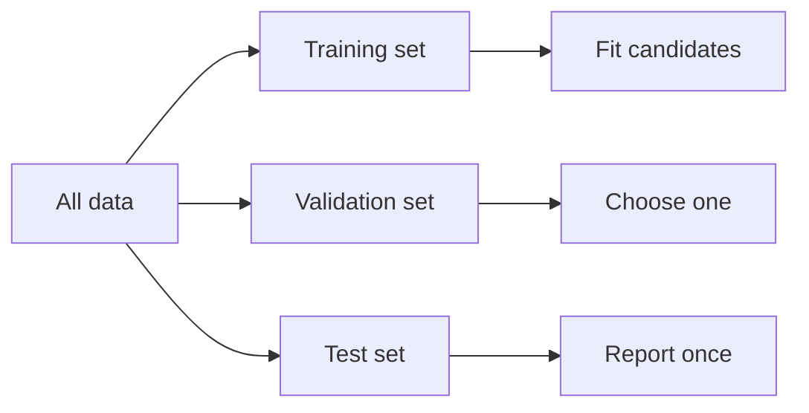

The [first entry](/blog/learning-from-data) ended with a rule: an error measured on data that influenced any choice about a model is an optimistic estimate of its error on new data. The [third entry](/blog/generalization-overfitting-and-regularization) showed how large that optimism can become, and chose its regularization strength by peeking at 100 000 fresh examples from a known distribution, something real data never allow. This final entry treats the practical question that remains: with a finite data set and an unknown distribution, how does one estimate the performance of a model honestly, and what are the common ways of getting it wrong?

The entry assumes the vocabulary of the earlier entries: risk (generalization error), empirical risk, training error, test error, the i.i.d. assumption, hyperparameters, ridge regression and its strength $\lambda$, and the bias–variance decomposition. It uses one new tool from probability, a concentration inequality, which is stated where it is needed. Code uses Python 3.13 and NumPy 2.5.3 with the seeds given beside it; classification examples use **accuracy**, the fraction of correct predictions (one minus the average zero-one loss of the first entry).

## 1. What an evaluation estimates

### 1.1 The target

An evaluation tries to estimate one number: the risk of the model that will be deployed, on the cases it will meet in use. Both halves matter. "The model that will be deployed" means the final fitted model with all its choices made, not a family of models or a training procedure in general. "The cases it will meet in use" means the distribution of future inputs, which the i.i.d. assumption of the first entry equates with the distribution of the available data. Section 5 deals with what happens when that equation fails.

### 1.2 Two ways to be wrong

Any reported error is computed from a finite sample, so it is a random variable, and like any estimator it can fail in two ways:

- **Variance:** the estimate fluctuates from one sample to another. A test set of 20 examples can, by chance, contain unusually easy or hard cases. This is cured by more evaluation data and is quantified by a confidence interval (Section 6).
- **Bias:** the estimate is systematically off, usually too optimistic. Using the training set, reusing the test set to make choices, leaking information from the evaluation data into the model, and evaluating on data unlike the deployment data all cause bias. More data of the same kind does not cure it.

This **evaluation bias** is a property of the measurement procedure. It is distinct from the bias of the bias–variance decomposition in the third entry, which is a property of the model's predictions, and from the intercept of a linear model. The objective of this entry is to recognize and avoid evaluation bias, and to quantify the variance that remains.

## 2. Held-out data

### 2.1 The test set

The simplest honest procedure splits the available examples at random into a **training set**, used to fit the model, and a **test set**, used only to evaluate it. If the test examples are i.i.d. draws from the deployment distribution and played no role in fitting, the fitted model is fixed with respect to them. The test error is then an unbiased estimate of its risk, by the argument of [Section 3.3 of the first entry](/blog/learning-from-data#33-empirical-risk).

How large should the test set be? For a loss bounded between 0 and 1 (the zero-one loss, for example), **Hoeffding's inequality** gives a guarantee that does not depend on the distribution. For a fixed model and $m$ i.i.d. test examples,

$$
P\left(\big\lvert \hat{R}_m - R \big\rvert \ge \varepsilon\right) \le 2\,e^{-2m\varepsilon^2},
$$

where $\hat{R}_m$ is the test error and $R$ the risk. Setting the right-hand side to a tolerated failure probability $\delta$ and solving gives $\varepsilon = \sqrt{\ln(2/\delta)/(2m)}$, or the test-set size needed for a given accuracy, $m \ge \ln(2/\delta)/(2\varepsilon^2)$. To be 95% sure ($\delta = 0.05$) that the error rate is within 0.05 of the risk takes $m \ge \ln(40)/0.005 = 738$ examples. The bound is conservative; Section 6 gives the tighter approximate intervals used in practice.

### 2.2 Why a test set is used only once

The guarantee above holds for one model fixed before the test set is looked at. Suppose instead that 50 candidate models are evaluated on the same held-out set and the best is kept. The reported score of the winner is now the best of 50 noisy estimates, and the best of noisy estimates is biased in the winner's favor even when every candidate is equally good. The code below simulates exactly that situation: 50 candidates of identical quality, each represented by a "model" that ignores the inputs and guesses every label by a fair coin flip, so that every one of them has a true accuracy of exactly 0.5. Real candidates are usually better than chance and differ from one another, but the selection effect works the same way.

```python
import numpy as np

rng = np.random.default_rng(seed=5)
n_val, n_test, n_models = 100, 100, 50

# Every "model" guesses each label at random, so every true accuracy is 0.5.
y_val = rng.integers(0, 2, size=n_val)
y_test = rng.integers(0, 2, size=n_test)
val_acc = [np.mean(rng.integers(0, 2, size=n_val) == y_val) for _ in range(n_models)]
best = int(np.argmax(val_acc))
test_acc = np.mean(rng.integers(0, 2, size=n_test) == y_test)   # the winner, on fresh data

print(f"best validation accuracy of {n_models} coin-flip models: {val_acc[best]:.2f}")
print(f"the same model on the test set: {test_acc:.2f}")
```

```text
best validation accuracy of 50 coin-flip models: 0.62
the same model on the test set: 0.45
```

(A coin-flip model has no parameters, so "the same model on the test set" is another round of coin flips on the 100 test labels.) The selected model looks 12 points better than chance on the data used to select it. On data that played no part in the selection it scores 0.45, which is consistent with its true accuracy of 0.5: an accuracy measured on 100 examples has a standard deviation of $\sqrt{0.5 \times 0.5/100} = 0.05$. Seed 5 is not special: over seeds 0 to 199, the best validation accuracy of the 50 candidates averages 0.61.

Nothing about this depends on the models being useless: whenever several candidates are compared on one set, the score of the winner on that set is optimistic, by an amount that grows with the number of candidates and shrinks with the size of the set. Hoeffding's inequality combined with the **union bound** (the probability that at least one of $M$ events happens is at most the sum of their probabilities) quantifies it: with $M$ candidates, the deviation that holds simultaneously for all of them with probability $1 - \delta$ grows to $\sqrt{\ln(2M/\delta)/(2m)}$. For $M = 50$, $m = 100$ and $\delta = 0.05$ that is 0.195, compared with 0.136 for a single model.

The same mechanism operates, more slowly, when a person looks at test results, adjusts the model, and tests again. Each round is a selection. A test set that has informed decisions has become a validation set, and its score is no longer an unbiased estimate.

### 2.3 Training, validation and test sets

The standard arrangement therefore uses three disjoint parts:



- The **training set** fits the parameters of each candidate (each degree, each $\lambda$, each architecture).
- The **validation set** compares the candidates and chooses the hyperparameters. Its score for the winner is optimistic, as Section 2.2 showed, and is not reported as the expected performance.
- The **test set** is evaluated once, on the single final model, and its score is the reported estimate.

After the choice is made, the chosen configuration is usually refitted on the training and validation sets together, since more data gives a better model; the test set still stays out. There is no universal rule for the proportions. The test set must be large enough for the precision needed in the report (Sections 2.1 and 6), the validation set large enough to tell the candidates apart, and the rest goes to training.

## 3. Cross-validation

### 3.1 The procedure

With a few hundred examples, setting aside a validation set wastes data that the model needs, and the validation score of one small split is itself noisy. **Cross-validation** (CV), in its usual $k$-fold form, uses every example for both purposes, in turn:

1. Split the development data (everything except the test set) at random into $k$ parts of roughly equal size, called **folds**.
2. For each fold $j$, fit the model on the other $k - 1$ folds and compute its error on fold $j$.
3. Average the $k$ errors. This is the **cross-validation estimate** for that configuration.

Each example is used for validation exactly once and for training $k - 1$ times. Common choices are $k = 5$ or $k = 10$; $k = n$ is **leave-one-out** CV. A larger $k$ trains each fold's model on more data, so the estimate is less pessimistic about the final model fitted on all the data, at the cost of more fits. For classification, folds are often **stratified**, constructed so that each fold has the same class proportions as the whole.

Cross-validation estimates the performance of the *procedure* (fit this configuration on about $n(k-1)/k$ examples), not of one particular fitted model, since each fold produces a different one. After the configuration is chosen, the final model is refitted on all the development data.

### 3.2 Worked example: choosing the ridge strength

The third entry fitted a degree-12 polynomial with ridge regression and chose $\lambda$ by looking at the fresh-data mean squared error (MSE), a near-exact estimate of the true risk. The code below does it properly. It draws 100 examples from the same distribution ($y = \sin(2\pi x) + \varepsilon$, noise standard deviation 0.3, irreducible error 0.09), keeps 60 aside as a test set, chooses $\lambda$ by 5-fold CV on the other 40, refits on all 40, and evaluates once on the test set. Because the data are synthetic, it also computes the fresh-data MSE on 100 000 new examples, to show what the test set was trying to estimate.

```python
import numpy as np

rng = np.random.default_rng(seed=4)
sigma, degree = 0.3, 12

def draw(m):
    x = rng.uniform(0.0, 1.0, size=m)
    return x, np.sin(2 * np.pi * x) + rng.normal(0.0, sigma, size=m)

def features(x):
    return np.vander(2 * x - 1, degree + 1, increasing=True)

def fit_ridge(x, y, lam):
    X = features(x)
    D = np.eye(degree + 1)
    D[0, 0] = 0.0
    return np.linalg.solve(X.T @ X + len(y) * lam * D, X.T @ y)

def mse(w, x, y):
    return np.mean((features(x) @ w - y) ** 2)

x, y = draw(100)                                # all the data available
x_dev, y_dev, x_test, y_test = x[:40], y[:40], x[40:], y[40:]   # 40 development, 60 test

k, lams = 5, [1e-6, 1e-5, 1e-4, 1e-3, 1e-2, 1e-1]
folds = np.array_split(rng.permutation(40), k)
cv = []
for lam in lams:
    errs = []
    for j in range(k):
        val = folds[j]
        trn = np.concatenate([folds[i] for i in range(k) if i != j])
        errs.append(mse(fit_ridge(x_dev[trn], y_dev[trn], lam), x_dev[val], y_dev[val]))
    cv.append(np.mean(errs))
    print(f"lambda {lam:.0e}: 5-fold CV MSE {cv[-1]:.4f}")

best = lams[int(np.argmin(cv))]
w = fit_ridge(x_dev, y_dev, best)               # refit on all 40 development examples
x_new, y_new = draw(100_000)
print(f"chosen lambda {best:.0e}; test MSE {mse(w, x_test, y_test):.4f}; "
      f"fresh-data MSE {mse(w, x_new, y_new):.4f}")
```

```text
lambda 1e-06: 5-fold CV MSE 0.1236
lambda 1e-05: 5-fold CV MSE 0.0956
lambda 1e-04: 5-fold CV MSE 0.0948
lambda 1e-03: 5-fold CV MSE 0.0886
lambda 1e-02: 5-fold CV MSE 0.1217
lambda 1e-01: 5-fold CV MSE 0.2343
chosen lambda 1e-03; test MSE 0.1154; fresh-data MSE 0.1226
```

Three observations:

- The CV curve has the same U-shape as the fresh-data curve of the third entry and picks a sensible $\lambda$, without any knowledge of the true distribution.
- The CV score of the chosen setting, 0.0886, is below the irreducible error of 0.09, which no predictor can genuinely achieve. It is the minimum over six noisy estimates, optimistic for the reason given in Section 2.2, and it would be wrong to report it. This seed shows the effect starkly: among seeds 0 to 20 the CV minimum falls below 0.09 only for seeds 4, 5, 8 and 14. For the other seeds it lies above the floor, but the selection effect of Section 2.2 is present whatever the seed.
- The test MSE, 0.1154, computed once on 60 untouched examples, is close to the fresh-data MSE of 0.1226 that it estimates. With 60 test examples it is still noisy: rerunning the same code with other seeds gives test errors that sometimes fall above and sometimes below the corresponding fresh-data value, and occasionally a data set on which the whole procedure does markedly worse. Seed 2, for example, makes CV choose $\lambda = 10^{-5}$, with a test MSE of 1.31 and a fresh-data MSE of 0.65, whereas $\lambda = 10^{-2}$ would have given a fresh-data MSE of 0.14: one unlucky draw of 40 development examples is enough to mislead the choice. The test set at least reported the failure instead of hiding it.

### 3.3 Nested cross-validation

When there is too little data to set aside a test set, the choice of hyperparameters and the estimate of performance can both be made by CV, but they must not use the same folds. **Nested cross-validation** runs an inner CV, on the training part of each outer fold only, to choose the hyperparameters, and evaluates that choice on the outer fold's held-out part. The average outer score estimates the performance of the whole procedure, hyperparameter search included. Reporting the best inner score instead is the same mistake as reporting the best validation score. Cawley and Talbot (2010) show that the resulting optimism can be as large as the differences between the learning methods being compared.

## 4. Data leakage

### 4.1 What leakage is

**Data leakage** is any path by which information from the evaluation data, or information that would not be available at prediction time, reaches the model during training or selection. It makes the evaluation optimistic, often dramatically, and the model then fails in use. Leakage rarely looks like cheating; it usually comes from an innocent-seeming preprocessing step or a property of how the data were collected.

The guiding rule is: **every step that learns anything from data is part of the model, and must be fitted on the training portion only, inside every fold.** That includes steps that are not usually thought of as learning.

### 4.2 Preprocessing fitted on all the data

Standardizing features (subtracting the mean and dividing by the standard deviation, as recommended in the second entry), filling in missing values with a column average, or choosing a vocabulary of words all compute statistics from data. If those statistics are computed on the whole data set before splitting, the training process has seen a summary of the test set. For simple steps such as standardization with plenty of data the effect is usually small, but it is not zero, and the habit is dangerous because the same mistake with a more powerful step is not small. The correct procedure computes the means and standard deviations on the training portion and applies those same numbers to the validation and test portions.

### 4.3 Feature selection outside the cross-validation

Selecting features by their relation to the label is a powerful step, and doing it before cross-validation is one of the best-documented forms of leakage; Ambroise and McLachlan (2002) describe it in the selection of genes from microarray data. The code below generates 50 examples with 1000 features of pure noise and labels unrelated to them, so that no classifier can genuinely beat 50% accuracy. It selects the 20 features most correlated with the label and classifies with a **nearest-centroid** rule (predict the class whose mean feature vector, computed on the training examples, is closer). The selection is done either once on all 50 examples before 5-fold CV, or separately inside each fold.

```python
import numpy as np

rng = np.random.default_rng(seed=6)
n, d, keep, k = 50, 1000, 20, 5
X = rng.normal(size=(n, d))                     # pure noise features
y = np.repeat([0, 1], n // 2)                   # labels unrelated to X

def select(X, y):                               # the `keep` features most correlated with y
    Xc, yc = X - X.mean(axis=0), y - y.mean()
    score = np.abs(Xc.T @ yc) / np.sqrt((Xc ** 2).sum(axis=0))
    return np.argsort(score)[-keep:]

def nearest_centroid(Xtr, ytr, Xte):            # predict the class with the closer mean
    c0, c1 = Xtr[ytr == 0].mean(axis=0), Xtr[ytr == 1].mean(axis=0)
    return (((Xte - c1) ** 2).sum(axis=1) < ((Xte - c0) ** 2).sum(axis=1)).astype(int)

folds = np.array_split(rng.permutation(n), k)
leaky_feats = select(X, y)                      # WRONG: chosen using all 50 labels
acc_wrong, acc_right = [], []
for j in range(k):
    te = folds[j]
    tr = np.concatenate([folds[i] for i in range(k) if i != j])
    f = leaky_feats
    acc_wrong.append(np.mean(nearest_centroid(X[tr][:, f], y[tr], X[te][:, f]) == y[te]))
    f = select(X[tr], y[tr])                    # RIGHT: chosen inside the fold
    acc_right.append(np.mean(nearest_centroid(X[tr][:, f], y[tr], X[te][:, f]) == y[te]))

print(f"selection outside CV: accuracy {np.mean(acc_wrong):.2f}")
print(f"selection inside CV:  accuracy {np.mean(acc_right):.2f}")
```

```text
selection outside CV: accuracy 0.94
selection inside CV:  accuracy 0.44
```

With 1000 noise features and only 50 examples, some features are correlated with the labels by chance, including with the labels of the examples that will later serve as validation folds. Selecting them on all the data bakes those chance correlations into the model, and CV then reports 94% accuracy on a problem where nothing can be predicted. Done inside each fold, the selection sees only the training labels, and the estimate falls to chance (0.44 is within the sampling variation of 50 examples around 0.5). Any step that looks at labels (feature selection, choosing interaction terms, encoding a category by its average label) carries the same risk.

### 4.4 Duplicates and groups

Random splitting assumes the examples are independent. Often they are not: several images of the same object, several visits by the same patient, several sentences from the same document, or exact duplicates created when data sets are merged. If related examples land on both sides of a split, the model can score well by recognizing the individual rather than by learning anything that transfers to new individuals.

The code below simulates this. There are 200 subjects, each with 5 examples that are noisy copies of the subject's own feature vector, and each subject has a label that is unrelated to its features, so that a new subject's label cannot be predicted. The classifier is **1-nearest-neighbor**: predict the label of the closest training example. Each evaluation holds out a quarter of the data, chosen either as random examples or as whole subjects.

```python
import numpy as np

rng = np.random.default_rng(seed=7)
subjects, per_subject, d = 200, 5, 10
center = rng.normal(size=(subjects, d))                 # each subject's own typical features
label = rng.integers(0, 2, size=subjects)               # one label per subject, unrelated to center
group = np.repeat(np.arange(subjects), per_subject)     # which subject each example belongs to
X = center[group] + 0.3 * rng.normal(size=(group.size, d))   # 5 similar examples per subject
y = label[group]

def one_nn(Xtr, ytr, Xte):                              # label of the nearest training example
    dist = ((Xte[:, None, :] - Xtr[None, :, :]) ** 2).sum(axis=2)
    return ytr[dist.argmin(axis=1)]

def accuracy(test_mask):
    pred = one_nn(X[~test_mask], y[~test_mask], X[test_mask])
    return np.mean(pred == y[test_mask])

by_row = rng.permutation(group.size) < group.size // 4           # random 25 % of rows
by_subject = np.isin(group, rng.permutation(subjects)[:subjects // 4])  # 25 % of subjects
print(f"random split of examples: accuracy {accuracy(by_row):.2f}")
print(f"split by subject:         accuracy {accuracy(by_subject):.2f}")
```

```text
random split of examples: accuracy 0.99
split by subject:         accuracy 0.55
```

The random split reports near-perfect accuracy because almost every test example has a sibling from the same subject in the training set. The **group split**, which keeps all examples of a subject on the same side, reports chance-level accuracy, the truth for new subjects. (With 50 test subjects, chance-level results vary noticeably: seeds 8 and 9 give 0.40 and 0.49.) The remedy is to split by the unit the model will meet anew in use: by patient, by user, by document, by site. Exact and near duplicates should be removed or grouped before any split.

### 4.5 Time

When data are ordered in time and the model will predict the future, a random split lets the model train on examples from after the ones it is tested on. Patterns that are only visible in hindsight (a trend, a later event that changed behavior) then leak backwards. The honest split is **temporal**: train on the past, validate and test on later periods, and, for repeated evaluation, roll the cut-off forward. The same applies to features: a feature computed with a moving average or a normalization over the whole series includes future values.

### 4.6 Target leakage

A feature that is a consequence of the label, or that is recorded only after the label is known, gives the label away. A model predicting whether a customer will cancel a subscription, trained with a field that is filled in during the cancellation process, will look excellent and be useless, because at prediction time that field is always empty. The test is to ask, for each feature: would this value be available, with this meaning, at the moment the prediction has to be made? Suspiciously high performance, or a single feature that dominates the model, is a reason to ask it.

### 4.7 Summary of leakage sources

| Source | Typical symptom | Remedy |
|---|---|---|
| Preprocessing fitted on all data | Small optimism, larger with powerful steps | Fit every step on the training portion only |
| Label-based feature selection before CV | Large optimism with many features and few examples | Select inside each fold (or use nested CV) |
| Duplicates or related examples across the split | Near-perfect scores that collapse on new individuals | Deduplicate; split by group |
| Random split of time-ordered data | Good backtest, poor live performance | Split by time; compute features from the past only |
| Features recorded after the outcome | One dominant feature, implausibly good score | Check availability at prediction time |
| Reusing the test set for decisions | Test score drifts upward over many rounds | Use validation or CV for decisions; test once |

## 5. Bias in the evaluation setup

Leakage makes an estimate optimistic about the distribution the data came from. A second family of problems makes an estimate wrong about the distribution the model will meet, or hides what matters inside an average.

### 5.1 Unrepresentative data and distribution shift

The evaluation is only as relevant as the evaluation data are representative. **Sampling bias** (or selection bias) occurs when the way examples were collected makes them systematically different from the deployment population. Typical cases are data from one hospital, from volunteers, from the users who chose to give feedback, or from the period before a product changed. **Distribution shift** is the general term for a difference between training and deployment distributions (Quiñonero-Candela et al., 2009, collect the main forms). Common special cases are **covariate shift**, where the distribution of the inputs changes but the relation $P(y \mid \mathbf{x})$ does not, and **label shift**, where the class proportions change. Under shift, the i.i.d. assumption fails, and a held-out test set drawn from the same source as the training data measures the wrong thing, however carefully it was kept apart. The defenses are to collect evaluation data from the deployment setting where possible, to describe the population the data came from in any report, and to monitor performance after deployment.

### 5.2 Class imbalance and baselines

When one class is rare, accuracy can be high for a useless model. If 95% of examples are negative, the classifier that always says "negative" has 95% accuracy, as the first entry's third exercise showed with a 2% disease. Every reported score should therefore be compared with a **baseline**: the majority-class predictor for classification, the training-set mean for regression, and the simplest reasonable model for the task. For imbalanced problems it also helps to report errors on each class separately, for example the fraction of positives detected and the fraction of positive predictions that are correct (in the usual terminology, recall and precision), rather than accuracy alone.

### 5.3 Averages hide subgroups

An overall error is an average over the test population. A model can have a low average error while performing much worse for a subgroup that is small in the data: a rare product category, an under-represented demographic group, a sensor operating at the edge of its range. When subgroups matter, which is often, the evaluation should report the error separately for each, with each subgroup's own (wider) confidence interval, since a small subgroup gives a noisy estimate.

### 5.4 Label quality

Test labels are assumed to be correct. When they come from human annotators, automated rules or later records, they contain errors of their own, and those errors may be systematic (an annotator who consistently mislabels one class). Measured error then mixes the model's mistakes with the labels' mistakes. Checking a sample of test labels, and stating how labels were obtained, is part of an honest evaluation.

## 6. Reporting results

### 6.1 Uncertainty of a test score

A test accuracy $\hat{p}$ measured on $m$ independent examples is an average of $m$ zero-one values, so its standard error is approximately $\sqrt{\hat{p}(1 - \hat{p})/m}$, and for large $m$ an approximate 95% confidence interval is $\hat{p} \pm 1.96\sqrt{\hat{p}(1 - \hat{p})/m}$ (the normal approximation). For $\hat{p} = 0.85$ on $m = 200$ examples the standard error is 0.025 and the interval is $0.85 \pm 0.049$, roughly 0.80 to 0.90. Hoeffding's bound of Section 2.1 gives $\pm 0.096$ for the same $m$; it is wider because it holds for any distribution, while the normal approximation assumes $m$ is large enough and $\hat{p}$ not too close to 0 or 1. Either way, a single test score of "85%" on 200 examples does not distinguish a model of true accuracy 0.82 from one of 0.88.

When two models are compared on the same test set, their errors are correlated (they tend to fail on the same hard examples), so the right comparison is **paired**. It counts the examples on which the two models disagree and tests whether one wins those more often than chance, for instance with McNemar's test, which Dietterich (1998) recommends when each model can be trained only once. Treating the two accuracies as independent overstates the uncertainty of the difference; ignoring uncertainty altogether overstates the difference.

Uncertainty also comes from the training process: a different random split, initialization or shuffling order gives a different model; the second entry showed how much a single run of stochastic gradient descent (SGD) can vary. Where it is affordable, repeating the whole procedure with several seeds and reporting the spread shows how much of a difference between methods is noise.

### 6.2 What a report should contain

| Item | Why |
|---|---|
| The data: source, population, time period, size, how labels were obtained | Defines the distribution the estimate refers to (Section 5) |
| How the data were split, and by what unit (random, group, time) | Lets readers judge leakage (Section 4) |
| Which data chose the hyperparameters, and which data produced the reported number | Shows the reported number is not a selected minimum (Sections 2 and 3) |
| The metric, the score, and its uncertainty | A score without an interval cannot be compared (Section 6.1) |
| A baseline on the same split | Shows whether the model learned anything (Section 5.2) |
| Results per relevant subgroup or class | Reveals what the average hides (Section 5.3) |
| Software versions, random seeds, number of repeated runs | Makes the result reproducible |
| Known limitations: populations not covered, possible shift, label noise | Tells the reader where the number stops applying |

The last row is not a formality. Every estimate in this series rested on the assumption that future cases resemble the evaluation data. A report that says where that assumption is weak is more useful, and more honest, than a single impressive number.

## 7. Exercises

**Exercise 1.** How many test examples does Hoeffding's inequality require to be 99% sure that a measured error rate is within 0.02 of the true error rate?

<details>
<summary>Answer</summary>

$m \ge \ln(2/0.01)/(2 \times 0.02^2) = \ln(200)/0.0008 = 5.298/0.0008 \approx 6623$ examples.

</details>

**Exercise 2.** A team tries 200 model configurations, picks the one with the best validation accuracy (0.91 on 500 examples), and reports 0.91 as its expected accuracy. What is wrong, and what should they report instead?

<details>
<summary>Answer</summary>

The 0.91 is the maximum of 200 noisy estimates on the same set, so it is optimistic (Section 2.2). They should evaluate the chosen configuration once on a test set that played no part in the search, or use nested cross-validation, and report that score with its confidence interval.

</details>

**Exercise 3.** A data set contains several photographs of each of 300 plants, and the task is to identify disease in plants the model has never seen. Why is a random split of photographs wrong, and what split should be used?

<details>
<summary>Answer</summary>

Photographs of the same plant would appear in both training and test sets, so the model could score well by recognizing individual plants (Section 4.4). The split should be by plant: all photographs of a given plant go to the same side.

</details>

**Exercise 4.** Two classifiers score 0.85 and 0.83 on the same 200 test examples. Does this show that the first is better?

<details>
<summary>Answer</summary>

Not on this evidence. Each score has a standard error of about 0.025 to 0.027, so the 0.02 difference is within the noise of either score alone. A paired test on the examples where the classifiers disagree (Section 6.1) is the proper check, and with 200 examples it will rarely establish a difference this small.

</details>

**Exercise 5.** In the cross-validation example of Section 3.2, the best CV score (0.0886) is below the irreducible error (0.09). Explain how this can happen without any error in the code.

<details>
<summary>Answer</summary>

Each CV score is an average over only 40 examples, so it is a noisy estimate. The reported value is the minimum of six such estimates, which tends to pick one that happened to be low. The noise in the 40 labels can also be, by chance, slightly smaller than average. Neither means the model beats the irreducible error; the test and fresh-data MSEs show that it does not.

</details>

## 8. Summary

| Question | Answer |
|---|---|
| What does an evaluation estimate? | The risk of the final model on the distribution it will meet in use. |
| What makes an estimate wrong? | Variance (too few evaluation examples) and evaluation bias (systematic optimism or a mismatch with the deployment data). |
| Why is a test set used only once? | Choosing among models by their test score makes the winner's score optimistic, even when all candidates are equally good. |
| What are the three data sets for? | Training fits parameters, validation chooses hyperparameters, the test set gives the reported estimate. |
| What does k-fold cross-validation do? | Fits on $k - 1$ folds and validates on the remaining one, $k$ times, so every example is used for validation once. |
| What is data leakage? | Information from the evaluation data, or from the future, reaching the model; every data-dependent step must be fitted on training data only. |
| What evaluation biases remain without leakage? | Unrepresentative data and distribution shift, class imbalance without baselines, averages that hide subgroups, and label errors. |
| How should a result be reported? | With its uncertainty, a baseline, the splitting procedure, per-group results, reproducibility details and its limitations. |

This entry completes the series. The [first entry](/blog/learning-from-data) framed learning as minimizing a loss over examples and separated the training error from the risk. The [second](/blog/gradient-descent-and-its-variants) showed how the minimization is carried out and why the learning rate decides whether it converges. The [third](/blog/generalization-overfitting-and-regularization) showed how flexibility opens a gap between the two errors and how regularization narrows it. This entry showed how to estimate the risk without deceiving oneself, which forms of leakage and evaluation bias to look for, and what a report must contain. Together the four entries meet the objectives set out for the series: formulating a supervised learning problem, minimizing its objective by gradient methods, telling training error from generalization error, and recognizing leakage and bias in an evaluation. Models more flexible than the linear and polynomial ones used here change the model family and make the optimization harder, but they are trained and judged with the same four ingredients: a loss, an optimizer, a control on capacity and an honest evaluation.

### References

- C. Ambroise and G. J. McLachlan, "Selection bias in gene extraction on the basis of microarray gene-expression data," *Proceedings of the National Academy of Sciences*, vol. 99, no. 10, pp. 6562–6566, 2002.
- G. C. Cawley and N. L. C. Talbot, "On Over-fitting in Model Selection and Subsequent Selection Bias in Performance Evaluation," *Journal of Machine Learning Research*, vol. 11, pp. 2079–2107, 2010.
- T. G. Dietterich, "Approximate Statistical Tests for Comparing Supervised Classification Learning Algorithms," *Neural Computation*, vol. 10, no. 7, pp. 1895–1923, 1998.
- T. Hastie, R. Tibshirani and J. Friedman, *The Elements of Statistical Learning: Data Mining, Inference, and Prediction*, 2nd ed., Springer, 2009.
- W. Hoeffding, "Probability Inequalities for Sums of Bounded Random Variables," *Journal of the American Statistical Association*, vol. 58, no. 301, pp. 13–30, 1963.
- S. Kaufman, S. Rosset, C. Perlich and O. Stitelman, "Leakage in data mining: Formulation, detection, and avoidance," *ACM Transactions on Knowledge Discovery from Data*, vol. 6, no. 4, art. 15, 2012.
- J. Quiñonero-Candela, M. Sugiyama, A. Schwaighofer and N. D. Lawrence, Eds., *Dataset Shift in Machine Learning*, MIT Press, 2009.
- M. Stone, "Cross-Validatory Choice and Assessment of Statistical Predictions," *Journal of the Royal Statistical Society, Series B*, vol. 36, no. 2, pp. 111–147, 1974.
