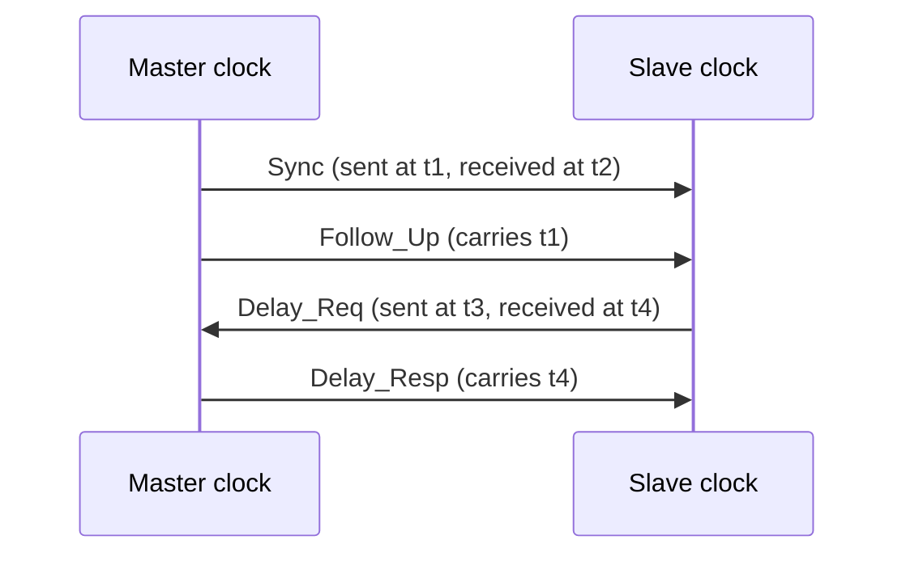

The [second entry](/blog/programmable-logic-controllers) followed a signal from a sensor terminal through the input image, one scan of the program and the output image to an actuator, and found a response time that varies by one scan. That analysis assumed each field device had its own pair of wires to the controller's cabinet. In a plant with hundreds of sensors and actuators spread over a building, that wiring becomes expensive, slow to install and hard to change. The alternative is to connect devices through a shared network: a **fieldbus**, or its modern successor, **industrial Ethernet**. A network adds its own delay to the response time, and the central requirement of a control network is that this delay is bounded and predictable.

This entry defines the timing vocabulary, then the ways a shared medium can be divided among devices, and works through two classic fieldbuses with numbers: Modbus RTU (the remote terminal unit mode of Modbus) and the Controller Area Network (CAN). It then surveys the process fieldbuses and IO-Link, explains why ordinary Ethernet is not deterministic, and describes how industrial Ethernet systems, clock synchronization and Time-Sensitive Networking address that. Bit rates, frame formats and standard numbers are given only where they are fixed by the cited specifications; protocol-specific parameters that depend on a product are labeled as such. Python examples use Python 3 and its standard library.

## 1. What a control network must guarantee

### 1.1 Timing vocabulary

Four terms describe network timing:

- **Latency**: the time from when a sender has data ready until the receiver has it.
- **Jitter**: the variation of latency, or of the interval between successive deliveries, around its nominal value.
- **Cycle time** (or update time): the interval at which a cyclically exchanged value is refreshed, such as the inputs of every remote input/output (I/O) station.
- **Determinism**: the property that latency and jitter have known upper bounds under all permitted operating conditions, not just on average.

Office networks are optimized for throughput: moving as much data as possible, with occasional delays of many milliseconds being acceptable. Control networks are optimized for determinism. A position loop that expects a new measurement every millisecond is disturbed by a measurement that arrives 3 ms late even if the average is excellent, and a safety-relevant stop command must arrive within a guaranteed time. The worst case is the design figure.

### 1.2 Cyclic and acyclic traffic

Control networks carry two kinds of traffic. **Cyclic** (or **process data**) traffic is the continuous refresh of inputs and outputs: small, frequent, time-critical. **Acyclic** traffic carries parameters, diagnostics, configuration and alarms: occasional, larger, and tolerant of delay. Most industrial protocols treat the two separately, giving cyclic data a guaranteed share of each cycle and fitting acyclic data into the remaining time.

### 1.3 Layers

Network protocols are described with the layer model of the Open Systems Interconnection (OSI) reference model. Fieldbuses usually implement only three of its seven layers, because the extra functions are not needed on a single local network and cost time:

| Layer | Function | Examples in this entry |
|---|---|---|
| Physical (1) | Signals on the medium: voltage levels, bit rate, cable, connectors | RS-485, the CAN physical layer, Ethernet 100BASE-TX |
| Data link (2) | Frames, addressing, error detection, **media access**: who may transmit when | Modbus RTU framing and cyclic redundancy check (CRC), CAN arbitration, Ethernet medium access control (MAC) |
| Application (7) | Meaning of the data: read a register, write an output, report a diagnostic | Modbus function codes, CANopen objects |

## 2. Sharing a medium

### 2.1 Media access methods

When several devices share one medium, a **media access** method decides which may transmit. The main methods used in automation are:

| Method | How it works | Determinism |
|---|---|---|
| Master–slave polling | One master sends a request to each slave in turn; a slave transmits only in reply | Deterministic: cycle time is the sum of all request–response exchanges |
| Token passing | A token (permission to transmit) circulates among masters; the holder may transmit for a bounded time | Deterministic if the token holding time is bounded |
| Priority arbitration | Any node may start when the bus is idle; simultaneous starts are resolved bit by bit, highest priority winning without loss | Deterministic for the highest-priority messages; lower priorities wait |
| Carrier sense with collision detection | Transmit when idle; on collision, stop and retry after a random delay | Not deterministic: retries are random |
| Time division | Each device transmits in a pre-assigned time slot of a common schedule | Deterministic, given synchronized clocks |
| Summation frame | One frame passes through every device, each reading its outputs and inserting its inputs on the fly | Deterministic: the frame's travel time is fixed |

The modern term for master and slave in some protocols is **client** and **server** (current Modbus documents use these) or **controller** and **device**; the older terms remain common in standards and in the literature, and this entry uses whichever the protocol in question uses.

### 2.2 Topologies

A **line** or **bus** topology connects devices along one cable; a **star** connects each device to a central switch or hub; a **ring** closes the line back on itself, so that one cable break does not cut off any device. Line and ring topologies suit machines and conveyors, where devices are physically in a row. Redundancy protocols for industrial Ethernet rings are standardized in the IEC 62439 series.

### 2.3 The RS-485 physical layer

Many serial fieldbuses, including Modbus RTU and PROFIBUS DP, use the physical layer standardized as **TIA/EIA-485** (RS-485). It transmits each bit as the voltage *difference* between two twisted wires, so interference that affects both wires equally (common-mode noise) cancels. A segment of shielded twisted pair, terminated at both ends with a resistor matching the cable's characteristic impedance (typically 120 Ω), connects up to 32 standard unit loads (devices) and can be over a kilometer long at low bit rates. Higher bit rates shorten the permitted length: for PROFIBUS DP, the PROFIBUS specifications allow 1200 m per segment at 93.75 kbit/s and below, and 100 m at its maximum of 12 Mbit/s.

## 3. Modbus RTU: polling on a serial line

### 3.1 The protocol

Modbus, originally published by Modicon in 1979, is one of the simplest and most widely supported industrial protocols. Its data model is four tables: **coils** (read–write bits), **discrete inputs** (read-only bits), **holding registers** (read–write 16-bit words) and **input registers** (read-only words). A **function code** says what to do: 01 reads coils, 03 reads holding registers, 06 writes one register, 16 writes several. Modbus RTU carries these requests over a serial line, usually RS-485, with one client polling up to 247 server addresses.

An RTU frame, the **application data unit**, is:

| Field | Size | Example: read 10 holding registers from address 0 of server 1 |
|---|---|---|
| Server address | 1 byte | `01` |
| Function code | 1 byte | `03` |
| Data | 0–252 bytes | `00 00` (start address), `00 0A` (quantity 10) |
| CRC | 2 bytes | `C5 CD` |

Frames have no start or end markers. Instead, a frame ends when the line has been silent for at least 3.5 character times, and the next frame may begin only after such a gap. Each character is sent as 11 bits: a start bit, 8 data bits, a parity bit and a stop bit (or two stop bits if parity is not used).

### 3.2 The CRC

The **cyclic redundancy check** detects transmission errors. The sender treats the frame as a long binary number, divides it by a fixed generator polynomial in modulo-2 arithmetic and appends the 16-bit remainder; the receiver repeats the calculation and discards the frame if the remainders differ. Modbus uses the CRC-16 polynomial $x^{16} + x^{15} + x^2 + 1$ (hexadecimal 8005), processed least significant bit first, which in the bit-reversed form used by the algorithm below is A001; the register starts at FFFF, and the CRC is sent low byte first. The program also computes the time one poll takes at 19 200 bit/s, with an assumed 5 ms for the server to prepare its response:

```python
def crc16_modbus(frame: bytes) -> int:
    crc = 0xFFFF
    for byte in frame:
        crc ^= byte
        for _ in range(8):
            crc = (crc >> 1) ^ 0xA001 if crc & 1 else crc >> 1
    return crc

request = bytes([0x01, 0x03, 0x00, 0x00, 0x00, 0x0A])   # read 10 registers from 0
crc = crc16_modbus(request)
adu = request + bytes([crc & 0xFF, crc >> 8])            # CRC sent low byte first
print("request:", adu.hex(" ").upper())

BAUD, BITS_PER_CHAR = 19_200, 11
t_char = BITS_PER_CHAR / BAUD * 1000                     # ms per character
gap = 3.5 * t_char                                       # silent interval after a frame
t_req = len(adu) * t_char
t_resp = (1 + 1 + 1 + 2 * 10 + 2) * t_char               # addr, fc, count, data, CRC
t_proc = 5.0                                             # assumed server processing, ms
per_device = t_req + gap + t_proc + t_resp + gap
print(f"char {t_char:.3f} ms, request {t_req:.2f} ms, response {t_resp:.2f} ms")
print(f"per device {per_device:.1f} ms, 10 devices {10 * per_device:.0f} ms")
```

```text
request: 01 03 00 00 00 0A C5 CD
char 0.573 ms, request 4.58 ms, response 14.32 ms
per device 27.9 ms, 10 devices 279 ms
```

### 3.3 What the numbers say

Polling ten devices for ten registers each takes about 0.28 s, so each value is refreshed roughly three or four times a second. That is enough for tank levels and temperatures, and far too slow for a machine axis. The calculation also shows where the time goes: the response, 25 bytes carrying 20 bytes of data, is about half of each exchange, and the rest is the request, two silent gaps and the processing time. Raising the bit rate shortens the transmission terms but not the processing time. Polling is deterministic, since the cycle time follows from the arithmetic above, but its efficiency is modest, and a value can be up to a full poll cycle old before it is refreshed.

**Modbus TCP** carries the same function codes over Ethernet using the Transmission Control Protocol and Internet Protocol (TCP/IP), on TCP port 502. The address and CRC are replaced by a 7-byte header (transaction identifier, protocol identifier, length and unit identifier), since TCP and Ethernet provide their own addressing and error checking. It inherits Ethernet's speed, and also its timing behavior, discussed in Section 6.

## 4. CAN: priority arbitration

### 4.1 Dominant and recessive bits

The **Controller Area Network** (CAN), developed for vehicles and standardized in ISO 11898, takes a different approach: any node may transmit when the bus is idle, and collisions are resolved without losing a frame. The physical layer makes this possible. A logical 0 is **dominant**: a node transmitting 0 drives the bus actively, while a 1 is **recessive** and merely lets the bus float to its idle state. If any node sends 0, the bus reads 0. The bus therefore behaves as a wired AND of all transmitters.

Every frame begins with an **identifier**, 11 bits in the base format (29 bits in the extended format), which names the message's content and doubles as its priority. Each transmitter compares the bus level with its own bit as it sends its identifier. A node that sends a recessive 1 but reads a dominant 0 knows a higher-priority frame is on the bus, stops transmitting and becomes a receiver. The node with the lowest identifier wins, and its frame continues undamaged:

```python
def arbitrate(ids, bits=11):
    """Bitwise arbitration on a wired-AND bus: 0 (dominant) overwrites 1."""
    contenders = set(ids)
    for k in range(bits - 1, -1, -1):           # most significant bit first
        bus = min((i >> k) & 1 for i in contenders)
        contenders = {i for i in contenders if (i >> k) & 1 == bus}
    return contenders.pop()

print("winner:", hex(arbitrate([0x65A, 0x123, 0x124, 0x7FF])))
```

It prints `winner: 0x123`. The identifiers 0x123 (001 0010 0011) and 0x124 (001 0010 0100) agree until their last three bits, and 0x123 wins because at the first of those bits it has a dominant 0 where 0x124 has a 1. The losers retry when the bus is next idle.

Arbitration requires that every node sees each bit at the same time, within a fraction of a bit time, so the signal must travel to the farthest node and back within that fraction. The bit rate therefore limits the bus length. Classical CAN runs at up to 1 Mbit/s, at which the commonly quoted maximum length is about 40 m; lower rates allow longer buses.

### 4.2 Frame length and timing

A classical CAN data frame with an 11-bit identifier carries 0 to 8 data bytes. Besides its $n$ data bytes it has 44 bits of fixed fields (start of frame, identifier, control bits, a 15-bit CRC, acknowledgment and end of frame), and frames are separated by a 3-bit interframe space, giving $8n + 47$ bits. In addition, after five identical consecutive bits the transmitter inserts one opposite **stuff bit**, so that receivers can keep their clocks synchronized to the signal edges. Stuffing applies to the first $34 + 8n$ bits of the frame, and in the worst case adds $\lfloor (34 + 8n - 1)/4 \rfloor$ bits, a bound derived in the schedulability analysis of Davis and colleagues (see References):

$$
C_\text{max} = 8n + 47 + \left\lfloor \frac{34 + 8n - 1}{4} \right\rfloor \ \text{bit times}.
$$

```python
def frame_bits(n_bytes, worst_case_stuffing):
    """Standard (11-bit identifier) classical CAN data frame, incl. 3-bit interframe space."""
    bits = 8 * n_bytes + 47
    if worst_case_stuffing:
        bits += (34 + 8 * n_bytes - 1) // 4
    return bits

for rate in (125_000, 500_000, 1_000_000):
    nominal, worst = frame_bits(8, False), frame_bits(8, True)
    print(f"{rate // 1000:5d} kbit/s: {nominal} bits = {nominal / rate * 1e6:6.1f} us, "
          f"worst case {worst} bits = {worst / rate * 1e6:6.1f} us")

load = 20 * frame_bits(8, True) / 500_000 / 0.010
print(f"bus load, 20 frames per 10 ms at 500 kbit/s: {load:.0%}")
```

```text
  125 kbit/s: 111 bits =  888.0 us, worst case 135 bits = 1080.0 us
  500 kbit/s: 111 bits =  222.0 us, worst case 135 bits =  270.0 us
 1000 kbit/s: 111 bits =  111.0 us, worst case 135 bits =  135.0 us
bus load, 20 frames per 10 ms at 500 kbit/s: 54%
```

Only 64 of the 135 worst-case bits are data, an efficiency below 50 %, which is the price of arbitration, the strong CRC and stuffing. In return, the highest-priority message's latency is bounded: it waits at most for one frame already in progress (up to 270 µs at 500 kbit/s) and then wins arbitration. A lower-priority message can also be delayed by every higher-priority message queued before it; bounding that delay is the subject of CAN schedulability analysis, and it depends on keeping the bus load well below 100 %.

**CAN FD** (flexible data rate), also standardized in ISO 11898-1, raises the payload to 64 bytes and allows the data phase of a frame to be sent at a higher bit rate than the arbitration phase. Higher-layer protocols built on CAN, such as **CANopen** (maintained by CAN in Automation as CiA 301), define how devices describe their data and how process data are mapped into frames.

## 5. Process fieldbuses and device-level links

### 5.1 PROFIBUS

**PROFIBUS DP** (decentralized periphery) connects controllers to remote I/O, drives and other devices over RS-485 at bit rates from 9.6 kbit/s to 12 Mbit/s. It combines two access methods: masters pass a token among themselves, and the master holding the token polls its slaves cyclically. It is specified, like most fieldbuses, within the international fieldbus standard **IEC 61158**, which collects many fieldbus technologies as numbered "types", while **IEC 61784-1** groups them into communication profile families.

### 5.2 Fieldbuses for process instruments

Process plants have particular needs: instruments are spread over large areas, are powered over their signal wires, and are often installed where flammable gases may be present, which calls for **intrinsically safe** circuits whose energy is too low to ignite them. Three technologies address this:

- **HART** (Highway Addressable Remote Transducer) keeps the 4–20 mA signal of the second entry and superimposes a digital signal on it by frequency-shift keying at 1200 bit/s (1200 Hz for a 1 and 2200 Hz for a 0). The average of the superimposed signal is zero, so the analog value is undisturbed, and the digital channel carries configuration, diagnostics and additional measured values.
- **FOUNDATION Fieldbus H1** and **PROFIBUS PA** (process automation) use the physical layer defined in IEC 61158-2 for this purpose: Manchester-coded (every bit contains a transition, so the signal carries its own clock and has no direct-current component), bus-powered transmission at 31.25 kbit/s over twisted pair, able to supply many instruments on one pair of wires.

The low bit rates are deliberate: they tolerate long cables and the electrical constraints of intrinsic safety, and process variables such as temperature and level change slowly compared with machine signals.

### 5.3 IO-Link

At the other end of the scale, **IO-Link** (IEC 61131-9) is not a bus but a point-to-point serial link between one sensor or actuator and an IO-Link master port, over the standard unshielded three-wire sensor cable of up to 20 m. It runs at 4.8, 38.4 or 230.4 kbit/s. Its purpose is to give simple devices a digital channel for measured values, parameters and diagnostics, so that a replaced sensor can receive its parameters automatically from the master. The master in turn connects to the controller over a fieldbus or industrial Ethernet.

## 6. Why standard Ethernet is not deterministic

### 6.1 Frames and switches

Ethernet (IEEE 802.3) dominates office and data-center networking, and it is cheap, fast and well understood, so it is the obvious candidate for automation. An Ethernet frame consists of a 14-byte header, a payload of 46 to 1500 bytes and a 4-byte frame check sequence. The header holds the destination and source addresses and an **EtherType** that identifies the protocol carried. Frames are therefore 64 to 1518 bytes long, or 1522 bytes with an IEEE 802.1Q virtual local area network (VLAN) tag. On the wire each frame is preceded by an 8-byte preamble and start delimiter and followed by a minimum 12-byte interframe gap, so it occupies 20 bytes more.

At 100 Mbit/s each byte takes 80 ns. A minimum frame therefore occupies the wire for $(64 + 20) \times 80\ \text{ns} = 6.72\ \mu\text{s}$ and a maximum frame for $(1518 + 20) \times 80\ \text{ns} = 123.04\ \mu\text{s}$.

Early Ethernet shared one cable among all stations and resolved collisions with random back-off, which is not deterministic. Modern Ethernet is **switched** and **full duplex**: every device has its own link to a switch port, and there are no collisions. Nondeterminism remains, however, because of **queuing** inside switches.

### 6.2 Queuing in switches

A switch that receives several frames for the same output port must send them one after another, so frames wait in an output queue. Most switches also work **store-and-forward**: a frame is received completely, and its check sequence verified, before it is forwarded, which adds one frame's transmission time per switch.

Priorities help but do not remove the problem. With IEEE 802.1Q, the VLAN tag carries a 3-bit priority, and a switch can serve its highest-priority queue first. But a frame already being transmitted cannot be interrupted. A control frame that reaches an output port just after a maximum-size frame has started waits for that frame to finish, up to 123 µs at 100 Mbit/s, at every switch on its path. Over five switches that is up to about 0.6 ms of jitter from this cause alone, before any queuing behind other control frames. For a 1 ms motion cycle that is unacceptable; for a 100 ms process loop it is irrelevant. The industrial Ethernet systems of the next section differ mainly in how they deal with this.

## 7. Industrial Ethernet

Industrial Ethernet systems are standardized as profiles in **IEC 61784-2**, with their protocols in IEC 61158. They fall into three broad approaches.

### 7.1 Standard TCP/IP and UDP/IP

The simplest approach runs an automation protocol over ordinary TCP or the User Datagram Protocol (UDP) on standard switches. **Modbus TCP** (Section 3.3) is one example. **EtherNet/IP**, which carries the Common Industrial Protocol (CIP) and is managed by ODVA, is another. It uses TCP (port 44818) for explicit, request–response messages and UDP (port 2222) for **implicit** cyclic I/O data, which producers send at a configured requested packet interval. Timing depends on the network's load and design. With switches, priorities and a network kept free of heavy office traffic, cycle times of a few milliseconds are achievable, but the bound comes from network engineering rather than from the protocol.

### 7.2 Prioritized real-time on standard hardware

**PROFINET**, managed by PROFIBUS and PROFINET International, uses TCP/IP for configuration and acyclic data but sends cyclic real-time (RT) data directly in Ethernet frames with its own EtherType (8892 in hexadecimal), skipping the IP and UDP layers and their processing time in the devices. RT frames carry a VLAN priority so that switches forward them ahead of ordinary traffic, but the switch-queuing effect of Section 6.2 remains.

### 7.3 Modified scheduling and hardware

For motion control and other cycles at or below a millisecond with tight jitter, systems modify how the network itself operates:

- **PROFINET IRT** (isochronous real-time) divides each cycle into a reserved phase for scheduled real-time frames and an open phase for other traffic. Switches with IRT hardware know the schedule and keep the reserved phase free, so the queuing conflict cannot occur.
- **EtherCAT** (managed by the EtherCAT Technology Group, EtherType 88A4) uses the summation-frame method. The controller sends one Ethernet frame down a line of devices; each device's hardware reads the output data addressed to it and inserts its input data while the frame passes through, delaying it only by a small, fixed amount; the last device sends the frame back. One frame thus serves the whole line. With 400 bytes of process data in one datagram, the frame is $14 + 2 + 10 + 400 + 2 + 4 = 432$ bytes (Ethernet header, EtherCAT header, datagram header, data, working counter, frame check sequence), which occupies the wire for $(432 + 20) \times 80\ \text{ns} = 36.16\ \mu\text{s}$ at 100 Mbit/s, plus the per-device forwarding delays given in the device datasheets.
- **Ethernet POWERLINK** (managed by the Ethernet POWERLINK Standardization Group) uses a polling scheme on Ethernet: a managing node polls each controlled node in an isochronous phase, followed by an asynchronous phase for other traffic, so that only one device transmits at a time.

### 7.4 Comparing the approaches

| System | Access method | Deterministic timing comes from | Typical use |
|---|---|---|---|
| Modbus RTU | Client–server polling on RS-485 | The polling arithmetic | Simple devices, slow process data |
| CAN / CANopen | Priority arbitration | Identifier priorities and bounded bus load | Machines, vehicles, embedded systems |
| PROFIBUS DP | Token passing plus polling | Bounded token rotation and poll cycle | Remote I/O and drives (installed base) |
| Modbus TCP, EtherNet/IP | Standard switched Ethernet | Network design and load | Plant-wide I/O and messaging |
| PROFINET RT | Prioritized Ethernet frames | VLAN priority and lean device stacks | Factory I/O |
| PROFINET IRT, EtherCAT, POWERLINK | Scheduled or summation-frame Ethernet | Reserved phases, on-the-fly processing or polling | Motion control, fast synchronized I/O |

The choice in practice is often set by the controller and drive manufacturers already in a plant, since most controllers support one or two of these systems natively.

## 8. Synchronized time

### 8.1 Why clocks matter

A network that delivers data within a bounded time still leaves each device with its own clock. Coordinated motion of several axes, time-stamping of events across a plant, and scheduled transmission (Section 9) all need devices to agree on the time. The **Precision Time Protocol** (PTP), IEEE 1588, synchronizes clocks over a network to well below a microsecond when the network hardware supports it.

### 8.2 Offset and delay

A **master** clock (a grandmaster for the whole network) exchanges time-stamped messages with each **slave** clock:



The slave now knows four time stamps: $t_1$ and $t_4$ read on the master's clock, $t_2$ and $t_3$ on its own. If the slave's clock is ahead of the master's by an offset $\theta$ and the one-way path delay $d$ is the same in both directions,

$$
t_2 - t_1 = d + \theta, \qquad t_4 - t_3 = d - \theta,
$$

so

$$
\theta = \frac{(t_2 - t_1) - (t_4 - t_3)}{2}, \qquad d = \frac{(t_2 - t_1) + (t_4 - t_3)}{2}.
$$

For example, with $t_1 = 0$, $t_2 = 0.850\ \mu\text{s}$, $t_3 = 10.000\ \mu\text{s}$ and $t_4 = 10.150\ \mu\text{s}$, the offset is $(0.850 - 0.150)/2 = 0.350\ \mu\text{s}$ and the path delay $(0.850 + 0.150)/2 = 0.500\ \mu\text{s}$; the slave sets its clock back by 0.350 µs. The calculation assumes a symmetric path: any difference between the two directions appears directly as an offset error of half that difference. Accuracy also needs time stamps taken in hardware, at the moment a frame passes the network interface, and switches that correct for their own queuing delay (**transparent clocks**) or synchronize themselves (**boundary clocks**). The profile of PTP used in Time-Sensitive Networking is specified in IEEE 802.1AS.

## 9. Time-Sensitive Networking

**Time-Sensitive Networking** (TSN) is a set of IEEE 802.1 standards that add deterministic services to standard Ethernet, so that real-time control traffic and ordinary traffic can share one network built from standard-conformant switches. The main mechanisms are:

- **Time synchronization** (IEEE 802.1AS), as in Section 8.
- **Scheduled traffic** (the time-aware shaper, originally IEEE 802.1Qbv, now part of IEEE 802.1Q): each switch output port opens and closes its priority queues' gates according to a cyclic schedule synchronized across the network. Closing the other queues' gates shortly before a control frame's window, a **guard band** at least as long as the longest interfering frame, removes the blocking delay calculated in Section 6.2.
- **Frame preemption** (IEEE 802.1Qbu with IEEE 802.3br): a time-critical frame may interrupt a long frame in transmission, which is later resumed, shortening the guard band needed.
- **Redundancy** (IEEE 802.1CB): frames are duplicated over disjoint paths and duplicates eliminated at the receiver, so a single link failure loses nothing.

TSN is a set of tools rather than a complete automation protocol. Protocols such as PROFINET and EtherNet/IP, and the publish–subscribe mode of the OPC Unified Architecture (OPC UA) discussed in the [fifth entry](/blog/networked-automation-and-digital-twins), are being adapted to run over it. The joint IEC/IEEE 60802 project defines a TSN profile for industrial automation that selects among the options.

## 10. Exercises

**Exercise 1.** Repeat the Modbus RTU calculation of Section 3.2 at 115 200 bit/s, keeping 11 bits per character and 5 ms of server processing. How much faster is the 10-device poll cycle, and why not six times faster? (At bit rates above 19 200 bit/s the Modbus serial-line specification recommends a fixed silent interval of 1.75 ms instead of 3.5 characters.)

<details>
<summary>Answer</summary>

One character takes $11/115\,200 = 0.0955$ ms, so the request (8 bytes) takes 0.76 ms and the response (25 bytes) 2.39 ms. Each exchange is $0.76 + 1.75 + 5 + 2.39 + 1.75 = 11.65$ ms, and ten devices take about 117 ms, compared with 279 ms: 2.4 times faster rather than 6, because the processing time and the fixed silent intervals do not shrink with the bit rate.

</details>

**Exercise 2.** Three CAN nodes start transmitting at the same instant with identifiers 0x2A0, 0x2A8 and 0x1FF. Which wins arbitration, and at which identifier bit does each loser drop out?

<details>
<summary>Answer</summary>

In 11-bit binary, 0x1FF is 001 1111 1111, 0x2A0 is 010 1010 0000 and 0x2A8 is 010 1010 1000. At bit 9 (the second bit sent), 0x1FF sends a dominant 0 while the others send 1, so both lose there, and 0x1FF, the lowest identifier, wins. Had 0x1FF not been present, 0x2A0 and 0x2A8 would agree up to bit 3, where 0x2A0 sends 0 and wins.

</details>

**Exercise 3.** A CAN bus at 250 kbit/s carries 8-byte frames. How many such frames per 10 ms can it carry if the worst-case bus load must stay below 60 %?

<details>
<summary>Answer</summary>

A worst-case frame is 135 bits, or $135/250\,000 = 540\ \mu\text{s}$. Sixty percent of 10 ms is 6 ms, and $6/0.54 = 11.1$, so at most 11 frames per 10 ms.

</details>

**Exercise 4.** A control frame crosses three store-and-forward switches at 1 Gbit/s, where each byte takes 8 ns. What is the worst-case blocking delay caused by maximum-size untagged frames already in transmission on the output ports, and how does it compare with the 100 Mbit/s figure in Section 6.2?

<details>
<summary>Answer</summary>

A maximum frame occupies $(1518 + 20) \times 8\ \text{ns} = 12.3\ \mu\text{s}$ at 1 Gbit/s, so three switches add up to about 36.9 µs: ten times less per switch than at 100 Mbit/s, but still a delay that depends on other traffic, which is why scheduling (TSN) rather than speed alone gives a hard bound.

</details>

**Exercise 5.** In a PTP exchange, $t_2 - t_1 = 1.30\ \mu\text{s}$ and $t_4 - t_3 = 0.70\ \mu\text{s}$. Compute the offset and delay. If the true delays were 1.10 µs from master to slave and 0.90 µs back, what is the error in the computed offset?

<details>
<summary>Answer</summary>

$\theta = (1.30 - 0.70)/2 = 0.30\ \mu\text{s}$, $d = (1.30 + 0.70)/2 = 1.00\ \mu\text{s}$. With the asymmetric delays, $t_2 - t_1 = 1.10 + \theta_\text{true}$ gives $\theta_\text{true} = 0.20\ \mu\text{s}$ (and $t_4 - t_3 = 0.90 - 0.20 = 0.70$ agrees). The computed offset is 0.10 µs too large: half of the 0.20 µs asymmetry.

</details>

## 11. Summary

| Question | Answer |
|---|---|
| What must a control network guarantee? | Bounded latency and jitter (determinism), with cyclic process data delivered at a known cycle time. |
| Which access methods are deterministic? | Polling, token passing with bounded holding time, priority arbitration (for the highest priorities), time division and summation frames. |
| How long does a Modbus RTU poll take? | The sum of request, response, silent gaps and processing; about 28 ms per device for 10 registers at 19 200 bit/s with 5 ms processing. |
| How does CAN avoid losing frames on collision? | Dominant 0s overwrite recessive 1s, so the lowest identifier wins arbitration bit by bit and continues undamaged. |
| How long is a CAN frame? | $8n + 47$ bits plus up to $\lfloor(34 + 8n - 1)/4\rfloor$ stuff bits: 135 bits worst case with 8 data bytes. |
| Why is switched Ethernet not deterministic by itself? | Frames queue at switch outputs, and a frame in transmission cannot be interrupted: up to 123 µs per switch at 100 Mbit/s. |
| How do industrial Ethernet systems differ? | Standard TCP/UDP (Modbus TCP, EtherNet/IP), prioritized frames (PROFINET RT), or scheduled and on-the-fly hardware (PROFINET IRT, EtherCAT, POWERLINK). |
| How does PTP compute clock offset? | $\theta = [(t_2 - t_1) - (t_4 - t_3)]/2$, assuming a symmetric path. |
| What does TSN add? | Synchronized time, scheduled gates, frame preemption and redundancy on standard Ethernet. |

With timing understood, the networks can carry the measurements and actuator commands of continuous control loops. The next entry, [PID Control of Process Variables](/blog/pid-control-of-process-variables), turns to those loops: how a controller computes a valve position from a measured temperature, level, flow or pressure, and how it is tuned.

### References

- R. I. Davis, A. Burns, R. J. Bril and J. J. Lukkien, "Controller Area Network (CAN) schedulability analysis: Refuted, revisited and revised," *Real-Time Systems*, vol. 35, no. 3, pp. 239–272, 2007.
- IEC 61131-9, *Programmable controllers – Part 9: Single-drop digital communication interface for small sensors and actuators (SDCI)*, International Electrotechnical Commission.
- IEC 61158 (series), *Industrial communication networks – Fieldbus specifications*, International Electrotechnical Commission.
- IEC 61784-1, *Industrial communication networks – Profiles – Part 1: Fieldbus profiles*, International Electrotechnical Commission.
- IEC 61784-2, *Industrial communication networks – Profiles – Part 2: Additional fieldbus profiles for real-time networks based on ISO/IEC/IEEE 8802-3*, International Electrotechnical Commission.
- IEEE 1588, *IEEE Standard for a Precision Clock Synchronization Protocol for Networked Measurement and Control Systems*, IEEE.
- IEEE 802.1AS, *IEEE Standard for Local and Metropolitan Area Networks – Timing and Synchronization for Time-Sensitive Applications*, IEEE.
- IEEE 802.1Q, *IEEE Standard for Local and Metropolitan Area Networks – Bridges and Bridged Networks*, IEEE.
- IEEE 802.3, *IEEE Standard for Ethernet*, IEEE.
- ISO 11898-1:2024, *Road vehicles – Controller area network (CAN) – Part 1: Data link layer and physical coding sublayer*, International Organization for Standardization, 2024.
- Modbus Organization, *MODBUS Application Protocol Specification*, V1.1b3, 2012.
- Modbus Organization, *MODBUS over Serial Line Specification and Implementation Guide*, V1.02, 2006.
