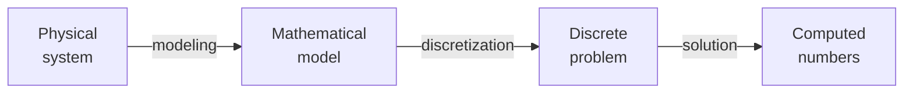

A temperature field in a heated plate, the vibration of a string, the electric potential around a conductor and the stress in a loaded bracket are all described by **partial differential equations** (PDEs). A PDE relates a quantity to its rates of change in space and time. Exact solutions exist only for simple shapes and coefficients. For almost everything else engineers compute an approximate answer, and that computation is what this series calls a **numerical simulation**.

Every such simulation rests on one step, **discretization**. It replaces a problem with infinitely many unknowns (a function defined at every point of a region) by a problem with finitely many unknowns that a computer can solve: numbers at a finite set of points, or coefficients of a finite set of functions. This entry sets up what the rest of the series builds on: the model equations and their conditions, discretization by finite differences on a first complete example, and the terms used to say how far a discrete answer is from the true one.

**What this series assumes.** Calculus, including partial derivatives and Taylor series; basic linear algebra (matrices, solving $A\mathbf{U} = \mathbf{b}$, eigenvalues); and ordinary differential equations (ODEs) at the level of the control systems series, whose [state-space primer](/blog/state-space-models-primer) writes a linear system as $\dot{\mathbf{x}} = A\mathbf{x}$. The [notes on numerical integration of ODEs](/blog/numerical-integration-notes) are useful background for the time-stepping in the second entry. The code examples use Python 3 with NumPy (they were run with Python 3.13 and NumPy 2.5, but use only long-standing NumPy functions), and all numbers are in double-precision (IEEE 754 binary64) floating-point arithmetic.

## 1. Why simulations discretize

### 1.1 From a physical system to numbers

A simulation passes through several representations (the mathematical model being a PDE with its conditions, the discrete problem a finite set of algebraic equations), and each step can introduce an error of its own:



- The **mathematical model** is a set of equations, with their coefficients and conditions, chosen to describe the physical system. The difference between the model's exact solution and reality is **model error** (or model-form error): heat conduction treated as one-dimensional, a material property taken as constant, a boundary treated as perfectly insulated.
- The **discrete problem** replaces the model by finitely many algebraic equations. The difference between its exact solution and the model's exact solution is **discretization error**. It is the main subject of the first four entries.
- The **computed numbers** are the solution of the discrete problem as actually obtained: rounded to finite precision (**round-off error**), and often produced by an iterative solver that is stopped early (**iteration error**, the subject of [the third entry](/blog/solving-large-linear-systems)).

The final entry, [Verifying and Validating a Simulation](/blog/verifying-and-validating-a-simulation), returns to this chain and shows how each error is estimated. The distinction behind it is worth stating now, because it shapes everything else: **verification** asks whether the model's equations are solved correctly, and **validation** asks whether they are the right equations for the purpose. The insight [What Makes a Simulation Trustworthy?](/insights/what-makes-a-simulation-trustworthy) gives a short overview.

### 1.2 Why a computer cannot solve the PDE directly

A function $u(x)$ on an interval has a value at every one of infinitely many points. A computer stores finitely many numbers and performs finitely many operations. Discretization therefore chooses a finite set of numbers to represent $u$, and a finite set of equations to determine them. The way those choices are made is what distinguishes the families of methods:

| Method | Unknowns | Equations | Entry |
|---|---|---|---|
| Finite differences | Values $U_j \approx u(x_j)$ at grid points | Derivatives replaced by difference quotients at each grid point | This entry and [the second](/blog/finite-differences-for-heat-and-waves) |
| Finite elements | Coefficients of simple functions defined on small pieces (elements) of the domain | An integral (weak) form of the equation, required to hold for a finite set of test functions | [The fourth entry](/blog/finite-element-method) |
| Finite volumes | Averages of $u$ over small cells | A conservation law (inflow minus outflow) on each cell | Not covered in this series |

All three end in the same place: a system of algebraic equations, usually linear, usually large and usually **sparse** (each equation involves only a few unknowns). Solving such systems efficiently is the subject of [the third entry](/blog/solving-large-linear-systems).

## 2. Three model equations

Three equations recur throughout engineering, and each represents a whole class of problems. In this series the unknown is written $u$; $x$ (and $y$) are space coordinates in meters and $t$ is time in seconds.

### 2.1 The heat equation

Consider a thin rod along the $x$ axis, insulated on its sides, with temperature $u(x,t)$ in kelvin. Two physical statements give its governing equation.

- **Conservation of energy.** In a short piece of rod of length $\Delta x$ and cross-section $S$, the rate of change of stored heat, $\rho c_p S \Delta x\, \partial u/\partial t$, equals the heat flowing in at one end minus the heat flowing out at the other. Here $\rho$ is the density (kg/m³) and $c_p$ the specific heat capacity (J/(kg·K)).
- **Fourier's law of conduction.** The heat flux (W/m²) is proportional to the temperature gradient and flows from hot to cold: $q = -k\, \partial u/\partial x$, with $k$ the thermal conductivity (W/(m·K)).

Letting $\Delta x \to 0$ and combining the two, for constant properties, gives the **heat equation** (or diffusion equation):

$$
\frac{\partial u}{\partial t} = \alpha \frac{\partial^2 u}{\partial x^2},
\qquad \alpha = \frac{k}{\rho c_p}.
$$

The **thermal diffusivity** $\alpha$ has units of m²/s. Its meaning is visible from the units alone: heat spreads a distance $L$ in a time of order $L^2/\alpha$. For a material with $\alpha = 10^{-5}$ m²/s (of the order found for steels), a slab 0.1 m thick takes of the order of $0.1^2/10^{-5} = 1000$ s to equalize its temperature. The same equation describes the diffusion of a dissolved substance and, with different symbols, many smoothing processes.

### 2.2 The wave equation

A string under tension $T_s$ (N), with mass per unit length $\rho_\ell$ (kg/m), has a small transverse displacement $u(x,t)$. Newton's second law applied to a short piece of string, with the restoring force coming from the curvature of the string, gives the **wave equation**:

$$
\frac{\partial^2 u}{\partial t^2} = c^2 \frac{\partial^2 u}{\partial x^2},
\qquad c = \sqrt{T_s/\rho_\ell}.
$$

The constant $c$ (m/s) is the speed at which disturbances travel. The same equation describes sound in a pipe, electrical signals on a lossless transmission line and, in two and three dimensions, acoustic and electromagnetic waves. Its solutions behave differently in kind from those of the heat equation: they do not smooth out, they travel, and information moves at a finite speed $c$.

### 2.3 The Poisson equation

If the temperature in the rod (or a plate) has stopped changing, $\partial u/\partial t = 0$. With a heat source of $Q$ watts per cubic meter, the steady temperature satisfies $-k\,\nabla^2 u = Q$, where $\nabla^2 u = \partial^2 u/\partial x^2 + \partial^2 u/\partial y^2$ is the **Laplacian**. Dividing by $k$ gives the **Poisson equation**

$$
-\nabla^2 u = f,
$$

with $f = Q/k$ in this case. The minus sign is a convention adopted throughout this series: with it, a positive source produces a positive $u$, and the matrices that appear after discretization have positive eigenvalues. With $f = 0$ it is the **Laplace equation**. The same equation governs the electrostatic potential (with $f$ the charge density divided by the permittivity), the deflection of a membrane under pressure, and steady groundwater flow. It describes **fields** in equilibrium: the value at each point depends on the sources everywhere and on the boundary, all at once.

### 2.4 Elliptic, parabolic and hyperbolic

These three equations are representatives of the three types of linear second-order PDE in two variables. Writing a general equation in the variables $(x, y)$ as

$$
a\,u_{xx} + b\,u_{xy} + c_0\,u_{yy} + (\text{lower-order terms}) = 0,
$$

where subscripts denote partial derivatives, the sign of the **discriminant** $b^2 - 4ac_0$ classifies it:

| Type | Discriminant | Example (variables) | Typical behavior | Needs |
|---|---|---|---|---|
| Elliptic | $b^2 - 4ac_0 \lt 0$ | Poisson, $(x, y)$: $a = c_0 = 1$ | Equilibrium; every point influences every other | Boundary conditions on the whole boundary |
| Parabolic | $b^2 - 4ac_0 = 0$ | Heat, $(x, t)$: $a = \alpha$, $c_0 = 0$ | Diffusion; smooths out, forgets detail | Initial condition plus boundary conditions |
| Hyperbolic | $b^2 - 4ac_0 \gt 0$ | Wave, $(x, t)$: $a = -c^2$, $c_0 = 1$ | Propagation at finite speed | Initial value and velocity plus boundary conditions |

The type matters numerically. Elliptic problems lead to one large system of equations solved once. Parabolic and hyperbolic problems are marched forward in time, and the way the time step and the grid spacing interact decides whether the march is stable, as [the second entry](/blog/finite-differences-for-heat-and-waves) shows.

## 3. Boundary and initial conditions

### 3.1 Boundary conditions

A PDE alone does not determine a solution: $u = 0$, $u = x$ and $u = 3x + 2$ all satisfy $-u'' = 0$. The **domain** (the region where the equation holds, written $\Omega$) and conditions on its **boundary** ($\partial\Omega$) single one out. Three kinds of boundary condition cover most engineering cases. For the heat problem:

- A **Dirichlet condition** prescribes the value: $u = g$ on the boundary. A surface held at a fixed temperature.
- A **Neumann condition** prescribes the normal derivative: $\partial u/\partial n = g$, where $n$ is the outward normal. Since $-k\,\partial u/\partial n$ is the heat flux leaving the body, this prescribes the flux; $g = 0$ is an insulated surface.
- A **Robin condition** prescribes a combination: $-k\,\partial u/\partial n = h_c\,(u - u_\infty)$, convective cooling to surroundings at temperature $u_\infty$ with a heat transfer coefficient $h_c$ (W/(m²·K)).

Different parts of the boundary may carry different conditions. A pure Neumann problem for the Poisson equation determines $u$ only up to an added constant (and has a solution only if the prescribed fluxes balance the sources), which shows up later as a singular matrix.

### 3.2 Initial conditions

Time-dependent problems also need a starting state. The heat equation is first order in time and needs one **initial condition**, $u(x, 0) = u_0(x)$. The wave equation is second order in time and needs two, the initial displacement $u(x,0)$ and the initial velocity $\partial u/\partial t\,(x, 0)$, just as a mass-spring system needs an initial position and velocity. A problem with both initial and boundary conditions is an **initial-boundary value problem**; one with boundary conditions only (elliptic) is a **boundary value problem**.

### 3.3 Well-posed problems

A mathematical problem is **well-posed** (in the sense of Hadamard) when a solution exists, it is unique, and it depends continuously on the data: small changes in the coefficients, sources and boundary or initial values produce small changes in the solution. The three model problems with the conditions above are well-posed. The heat equation run backward in time is the classic counterexample: recovering an earlier temperature distribution from a later one amplifies tiny errors without bound, because diffusion has erased the detail. No discretization can repair an ill-posed problem, so checking that the model is well-posed comes first.

## 4. The idea of discretization

### 4.1 Grids, meshes and unknowns

The simplest discretization of an interval $0 \le x \le L$ is a uniform **grid** of $N+1$ points

$$
x_j = j\,\Delta x, \qquad j = 0, 1, \dots, N, \qquad \Delta x = L/N .
$$

The unknowns are numbers $U_j$ intended to approximate $u(x_j)$. Capital $U$ for the discrete approximation and lowercase $u$ for the exact solution is the notation used throughout this series. For time-dependent problems the time axis is discretized too, $t^n = n\,\Delta t$, and $U_j^n \approx u(x_j, t^n)$ (the superscript $n$ is an index, not a power). The **time step** $\Delta t$ is the quantity called $h$ in the [numerical integration notes](/blog/numerical-integration-notes).

In two dimensions the grid becomes a lattice of points, or more generally a **mesh**: a subdivision of the domain into simple cells such as triangles or quadrilaterals, which can follow curved boundaries and be refined where the solution varies quickly. Its points are **nodes**. When a single number is needed to describe how fine a grid or mesh is, it is written $h$: on a uniform grid $h = \Delta x$, and on a general mesh $h$ is a representative cell size. The number of unknowns is the number of **degrees of freedom**.

### 4.2 Refinement and the limit

A discretization is only useful if its answer approaches the exact solution as the grid is refined, that is as $h \to 0$. How fast it approaches is what makes one method better than another: if the error behaves like $C h^p$ for some constant $C$, the method has **order of accuracy** $p$. Halving $h$ then divides the error by $2^p$: by 2 for a first-order method, by 4 for a second-order one. This is the same notion of order as for the ODE methods in the [numerical integration notes](/blog/numerical-integration-notes), and measuring it is the most important single check on a simulation code (the fifth entry).

### 4.3 The method of lines

A time-dependent PDE can be discretized in two stages. Discretizing only in space turns the heat equation into a system of ODEs, one per grid point, with time still continuous:

$$
\frac{dU_j}{dt} = \alpha\,\frac{U_{j+1} - 2U_j + U_{j-1}}{\Delta x^2}, \qquad j = 1, \dots, N-1 ,
$$

using the difference quotient for $u_{xx}$ derived in the next section. In vector form this is $d\mathbf{U}/dt = -\alpha A\mathbf{U}$ (plus boundary terms), where $A$ is the second-difference matrix written out in Section 6.1 (with $h = \Delta x$): a linear system of exactly the form treated in the [state-space primer](/blog/state-space-models-primer), with system matrix $-\alpha A$. Any ODE integrator can then advance it in time. This **method of lines** connects PDE simulation to ODE integration, and [the second entry](/blog/finite-differences-for-heat-and-waves) uses it to explain why some time-stepping schemes are stable only for steps far smaller than accuracy requires.

## 5. Finite-difference approximations

### 5.1 Difference quotients from Taylor series

The derivative is defined as a limit of difference quotients; finite differences stop before the limit. Taylor's theorem says exactly how large the error is. Expanding a smooth function about $x$:

$$
u(x \pm h) = u(x) \pm h\,u'(x) + \frac{h^2}{2}u''(x) \pm \frac{h^3}{6}u'''(x) + \frac{h^4}{24}u''''(x) \pm \cdots
$$

Rearranging the "+" expansion gives the **forward difference**, and subtracting the two expansions gives the **central difference**:

$$
\frac{u(x+h) - u(x)}{h} = u'(x) + \frac{h}{2}u''(x) + O(h^2),
\qquad
\frac{u(x+h) - u(x-h)}{2h} = u'(x) + \frac{h^2}{6}u'''(x) + O(h^4).
$$

Here $O(h^2)$ means "a term bounded by a constant times $h^2$ for small $h$". Adding the two expansions gives the standard **second difference** for the second derivative:

$$
\frac{u(x+h) - 2u(x) + u(x-h)}{h^2} = u''(x) + \frac{h^2}{12}u''''(x) + O(h^4).
$$

The terms after the exact derivative are the **truncation error** of each formula: what is left over when the exact function is put into the difference formula. The forward difference is first-order accurate, the central and second differences are second-order accurate. The pattern of grid points a formula uses is its **stencil**: two points for the forward difference, three for the second difference.

### 5.2 Checking the orders, and where rounding takes over

The following script differentiates $\sin x$ at $x = 1$, where the exact derivative is $\cos 1$.

```python
import numpy as np

x = 1.0
exact = np.cos(x)                      # derivative of sin at x = 1
print(f"{'h':>8} {'forward error':>14} {'central error':>14}")
for k in (1, 2, 3, 4, 5, 6, 8, 10, 12):
    h = 10.0**-k
    fwd = (np.sin(x + h) - np.sin(x)) / h
    ctr = (np.sin(x + h) - np.sin(x - h)) / (2 * h)
    print(f"{h:8.0e} {abs(fwd - exact):14.3e} {abs(ctr - exact):14.3e}")
```

```text
       h  forward error  central error
   1e-01      4.294e-02      9.001e-04
   1e-02      4.216e-03      9.005e-06
   1e-03      4.208e-04      9.005e-08
   1e-04      4.207e-05      9.004e-10
   1e-05      4.207e-06      1.114e-11
   1e-06      4.207e-07      2.772e-11
   1e-08      2.970e-09      2.581e-09
   1e-10      5.848e-08      5.848e-08
   1e-12      4.324e-05      1.227e-05
```

For moderate $h$, each tenfold reduction of $h$ divides the forward-difference error by 10 and the central-difference error by 100, as first- and second-order accuracy predict. The constants agree with Section 5.1 too: $\tfrac{h}{2}|u''(1)| = 0.4207\,h$ and $\tfrac{h^2}{6}|u'''(1)| = 0.09005\,h^2$, which match the table to four digits.

Below about $h = 10^{-5}$ (central) and $10^{-8}$ (forward) the errors stop falling and then grow. The difference $u(x+h) - u(x)$ subtracts two nearly equal numbers, each carrying a rounding error of relative size up to the unit roundoff $u_r = 2^{-53} \approx 1.1\times10^{-16}$ (written $u$ in the floating-point note cited below; here $u_r$, because $u$ is the solution), and dividing by a small $h$ magnifies that error roughly in proportion to $1/h$. The total error is a sum of a truncation part that falls with $h$ and a rounding part that grows as $h$ falls, so it has a minimum: near $h \approx \sqrt{u_r} \approx 10^{-8}$ for the forward difference and near $u_r^{1/3} \approx 5\times10^{-6}$ for the central one. The insight on [floating-point rounding in long simulations](/insights/floating-point-in-long-simulations) discusses the same arithmetic in another setting. Practical grids are far coarser than these limits, so in PDE simulations rounding usually stays well below the discretization error; [the third entry](/blog/solving-large-linear-systems) shows a case where it does not.

## 6. A first complete discrete problem

### 6.1 Poisson in one dimension

Take the one-dimensional Poisson problem

$$
-u''(x) = f(x), \quad 0 \lt x \lt 1, \qquad u(0) = 0,\; u(1) = 0,
$$

with $f(x) = \pi^2 \sin(\pi x)$, chosen so that the exact solution is $u(x) = \sin(\pi x)$. (Choosing the solution first and computing the matching source is a deliberate testing technique; the fifth entry calls it the method of manufactured solutions.) On the grid $x_j = j h$, $h = 1/N$, replacing $u''$ by the second difference at each interior point gives one equation per unknown:

$$
\frac{-U_{j-1} + 2U_j - U_{j+1}}{h^2} = f(x_j), \qquad j = 1, \dots, N-1,
$$

with $U_0 = U_N = 0$ from the boundary conditions. In matrix form, $A\mathbf{U} = \mathbf{b}$ with

$$
A = \frac{1}{h^2}\begin{bmatrix}
2 & -1 & & \\
-1 & 2 & \ddots & \\
& \ddots & \ddots & -1 \\
& & -1 & 2
\end{bmatrix},
\qquad
\mathbf{b} = \begin{bmatrix} f(x_1) \\ \vdots \\ f(x_{N-1}) \end{bmatrix}.
$$

The matrix is **tridiagonal** (nonzero only on three diagonals), **symmetric**, and **positive definite** (all its eigenvalues are positive, thanks to the sign convention of Section 2.3). These three properties recur in larger problems and decide which solvers apply.

```python
import numpy as np

def solve_poisson_1d(N):
    """Solve -u'' = pi^2 sin(pi x) on (0, 1) with u(0) = u(1) = 0."""
    h = 1.0 / N
    x = np.linspace(0.0, 1.0, N + 1)
    n = N - 1                                   # interior unknowns
    A = (np.diag(2.0 * np.ones(n)) - np.diag(np.ones(n - 1), 1)
         - np.diag(np.ones(n - 1), -1)) / h**2
    b = np.pi**2 * np.sin(np.pi * x[1:-1])
    U = np.zeros(N + 1)                         # boundary values stay 0
    U[1:-1] = np.linalg.solve(A, b)
    return x, U

previous = None
for N in (10, 20, 40, 80):
    x, U = solve_poisson_1d(N)
    err = np.max(np.abs(U - np.sin(np.pi * x)))
    ratio = "" if previous is None else f"ratio {previous / err:.2f}"
    print(f"N = {N:3d}  h = {1/N:.4f}  max error = {err:.3e}  {ratio}")
    previous = err
```

```text
N =  10  h = 0.1000  max error = 8.265e-03  
N =  20  h = 0.0500  max error = 2.059e-03  ratio 4.01
N =  40  h = 0.0250  max error = 5.142e-04  ratio 4.00
N =  80  h = 0.0125  max error = 1.285e-04  ratio 4.00
```

The error is measured in the **maximum norm**, $\|\mathbf{e}\|_\infty = \max_j |U_j - u(x_j)|$. Each halving of $h$ divides it by 4: the discrete solution converges with order 2, the order of the second difference. The size is predictable as well. Substituting the exact solution into the discrete equations leaves the truncation error $\tau_j = -\tfrac{h^2}{12}u''''(x_j) + O(h^4)$, and the error $e_j = u(x_j) - U_j$ satisfies the same discrete equations with $\tau$ as the source. For $u = \sin \pi x$ this gives $|e_j| \approx \tfrac{h^2\pi^2}{12}\sin(\pi x_j)$, whose maximum at $h = 0.1$ is $0.00822$, against the measured $0.00827$.

### 6.2 Boundary conditions in the discrete problem

A Dirichlet condition is easy: the boundary value is known and moves to the right-hand side. A derivative condition needs care, because a careless approximation can spoil the order of the whole solution. Consider

$$
-u'' = f \text{ on } (0,1), \qquad u(0) = 0, \qquad u'(1) = g,
$$

with $f = -e^x$ and $g = e$, so that the exact solution is $u = e^x - 1$. Now $U_N$ is unknown too, and the condition at $x = 1$ supplies its equation. Two common choices are:

- **One-sided difference:** $(U_N - U_{N-1})/h = g$. Its truncation error is $\tfrac{h}{2}u''(1)$, first order.
- **Ghost point:** introduce a fictitious value $U_{N+1}$ beyond the boundary, impose the central difference $(U_{N+1} - U_{N-1})/(2h) = g$ (second order), and use it to eliminate $U_{N+1}$ from the ordinary second-difference equation at $j = N$.

```python
import numpy as np

# -u'' = f on (0, 1), u(0) = 0, u'(1) = g, with exact solution u = exp(x) - 1.
f = lambda x: -np.exp(x)
g = np.e

def solve(N, ghost):
    h = 1.0 / N
    x = np.linspace(0.0, 1.0, N + 1)
    n = N                                       # unknowns U_1 .. U_N
    A = np.zeros((n, n))
    b = f(x[1:]).copy()
    for i in range(n):
        A[i, i] = 2.0 / h**2
        if i > 0:
            A[i, i - 1] = -1.0 / h**2
        if i < n - 1:
            A[i, i + 1] = -1.0 / h**2
    if ghost:
        # ghost value U_{N+1} = U_{N-1} + 2 h g, substituted into the last equation
        A[-1, -2] = -2.0 / h**2
        b[-1] += 2.0 * g / h
    else:
        # one-sided: (U_N - U_{N-1}) / h = g
        A[-1, :] = 0.0
        A[-1, -1], A[-1, -2] = 1.0 / h, -1.0 / h
        b[-1] = g
    U = np.concatenate(([0.0], np.linalg.solve(A, b)))
    return np.max(np.abs(U - (np.exp(x) - 1.0)))

for ghost in (False, True):
    label = "ghost point " if ghost else "one-sided   "
    errs = [solve(N, ghost) for N in (10, 20, 40, 80)]
    rates = [np.log2(errs[i] / errs[i + 1]) for i in range(3)]
    print(label, " ".join(f"{e:.2e}" for e in errs),
          " observed order:", " ".join(f"{p:.2f}" for p in rates))
```

```text
one-sided    1.32e-01 6.70e-02 3.37e-02 1.69e-02  observed order: 0.98 0.99 1.00
ghost point  3.70e-03 9.24e-04 2.31e-04 5.78e-05  observed order: 2.00 2.00 2.00
```

The **observed order** printed here is $\log_2$ of the ratio of successive errors, that is the $p$ in $e \approx C h^p$ inferred from two grids. One first-order equation at a single boundary point makes the whole solution first-order accurate, and at $N = 80$ its error is about 300 times larger than with the ghost point. The lesson generalizes: the order of a discretization is that of its least accurate part, and boundary treatment is a frequent culprit. Measuring the observed order, as here, is how such defects are found.

## 7. The vocabulary of discretization error

The ideas met so far have standard names, used in the rest of the series with the meanings given here.

- The **local truncation error** $\tau$ is the residual left when the exact solution of the PDE is substituted into the discrete equations (Sections 5.1 and 6.1). It measures how well the discrete equations imitate the PDE at a single point.
- A scheme is **consistent** when $\tau \to 0$ as $h \to 0$ (and $\Delta t \to 0$). If $\tau = O(h^p)$, the scheme is consistent of order $p$.
- The **global discretization error** $e_j = u(x_j) - U_j$ (or $u(x_j, t^n) - U_j^n$) is the quantity of practical interest: how far the discrete answer is from the exact one.
- A scheme is **convergent** when the global error tends to zero as the grid is refined, and convergent of order $p$ when it behaves like $C h^p$.
- A scheme is **stable** when errors introduced at some stage, by truncation or rounding, are not amplified without bound by the rest of the computation. For the steady problem of Section 6.1 this means the inverse of $A$ stays bounded as $h \to 0$; for time-stepping it means the computed solution stays bounded as the number of steps grows.

Consistency alone does not give convergence. A consistent scheme can still blow up if each step amplifies the errors of the previous ones, which is the time-stepping failure shown in the [numerical integration notes](/blog/numerical-integration-notes). For linear problems the relation is exact, **consistency plus stability gives convergence**, a result made precise for time-dependent problems by the Lax equivalence theorem in [the second entry](/blog/finite-differences-for-heat-and-waves). Schematically, $\text{global error} \le (\text{stability constant}) \times (\text{truncation error})$: the truncation error is produced locally, and stability limits how much the rest of the computation can magnify it.

Three other error sources complete the picture of Section 1.1:

| Error | Source | How it is controlled | Treated in |
|---|---|---|---|
| Discretization | Finite $h$ and $\Delta t$ | Refinement; higher-order schemes | Entries 2 and 4; measured in entry 5 |
| Iteration | Solver stopped at a tolerance | Tighter tolerance | Entry 3 |
| Round-off | Finite-precision arithmetic | Stable algorithms; checks in higher precision | Section 5.2; entry 3 |
| Model | The equations and data themselves | Validation against measurements | Entry 5 |

## 8. Where the series goes

The five entries follow the chain of Section 1.1 from model to trusted result.

1. **This entry**: the model equations, their conditions, discretization by finite differences, and the vocabulary of error.
2. [**Finite Differences for Heat and Waves**](/blog/finite-differences-for-heat-and-waves): time stepping for the heat and wave equations with explicit, implicit and Crank–Nicolson schemes; truncation error and order in space and time; stability analysis by Fourier (von Neumann) modes and the Courant–Friedrichs–Lewy condition.
3. [**Solving Large Linear Systems**](/blog/solving-large-linear-systems): the sparse systems that discretization produces; Gaussian elimination, Cholesky factorization and fill-in; conditioning; the iterative methods of Jacobi, Gauss–Seidel and successive over-relaxation; conjugate gradients and preconditioning; and how to choose between direct and iterative solvers.
4. [**The Finite Element Method**](/blog/finite-element-method): the weak (variational) form of a boundary value problem, Galerkin's method, elements, meshes and assembly, in one and two dimensions, with convergence rates.
5. [**Verifying and Validating a Simulation**](/blog/verifying-and-validating-a-simulation): code verification with manufactured solutions, solution verification with grid-convergence studies and Richardson extrapolation, validation against experiments with uncertainties, and how to report the limits of a model.

## 9. Exercises

**Exercise 1.** Use Taylor series to show that $\dfrac{-3u(x) + 4u(x+h) - u(x+2h)}{2h}$ approximates $u'(x)$ with second-order accuracy, and find the leading term of its truncation error. Where would such a formula be useful?

<details>
<summary>Answer</summary>

Substituting the expansions of $u(x+h)$ and $u(x+2h)$, the $u$ terms cancel ($-3 + 4 - 1 = 0$), the $u'$ terms give $(4h - 2h)u'/(2h) = u'$, and the $u''$ terms cancel ($4\cdot\tfrac{h^2}{2} - \tfrac{4h^2}{2} = 0$). The $u'''$ terms leave $\bigl(4\cdot\tfrac{h^3}{6} - \tfrac{8h^3}{6}\bigr)u'''/(2h) = -\tfrac{h^2}{3}u'''$. The formula uses points on one side only, so it suits a Neumann boundary condition at the left end of a grid, as an alternative to the ghost point of Section 6.2 that keeps second order.

</details>

**Exercise 2.** Classify $u_{xx} + 4u_{xy} + u_{yy} = 0$ and $u_t = u_{xx} - u$.

<details>
<summary>Answer</summary>

For the first, $a = 1$, $b = 4$, $c_0 = 1$, so $b^2 - 4ac_0 = 12 \gt 0$: hyperbolic. For the second, in the variables $(x, t)$ the second-order part is $u_{xx}$ alone, so $a = 1$, $b = c_0 = 0$ and the discriminant is 0: parabolic (a heat equation with a loss term; lower-order terms do not change the type).

</details>

**Exercise 3.** For the problem of Section 6.1 with $N = 40$, the measured maximum error is $5.142\times10^{-4}$. Predict the error for $N = 160$ and for $N = 1000$.

<details>
<summary>Answer</summary>

With second order the error scales as $h^2$. For $N = 160$: $5.142\times10^{-4}/16 = 3.21\times10^{-5}$. For $N = 1000$: $5.142\times10^{-4}\times(40/1000)^2 = 8.2\times10^{-7}$, which agrees with the estimate $\tfrac{h^2\pi^2}{12} = 8.22\times10^{-7}$ from Section 6.1. (The third entry solves this problem on grids up to $N = 10^6$ and finds where rounding stops the trend.)

</details>

**Exercise 4.** A slab with $\alpha = 10^{-5}$ m²/s and thickness 0.2 m is modeled by the heat equation. Roughly how long does it take to reach a nearly uniform temperature after its surfaces are suddenly heated, compared with the 0.1 m slab of Section 2.1?

<details>
<summary>Answer</summary>

The diffusion time scales as $L^2/\alpha$: $0.2^2/10^{-5} = 4000$ s, four times the 1000 s of the 0.1 m slab. Doubling the thickness quadruples the time. The scale is an order of magnitude, not a precise settling time; the second entry computes the decay rate exactly for one mode.

</details>

**Exercise 5.** Why does replacing the Dirichlet condition $u(0) = 0$ in Section 6.2 by a second Neumann condition $u'(0) = g_0$ make the discrete problem unsolvable or non-unique?

<details>
<summary>Answer</summary>

With derivative conditions at both ends, adding any constant to a solution gives another solution, so the exact problem has no unique solution (and has a solution only if $g - g_0 = -\int_0^1 f\,dx$, the flux balance). The discrete matrix inherits this: the vector of all ones satisfies $A\mathbf{1} = \mathbf{0}$, so $A$ is singular. One value must be fixed, or a constraint such as zero mean added.

</details>

## 10. Summary

| Question | Answer |
|---|---|
| What does discretization do? | Replaces a function, with infinitely many values, by finitely many unknowns determined by finitely many algebraic equations. |
| What are the three model equations? | Heat $u_t = \alpha u_{xx}$ (parabolic), wave $u_{tt} = c^2 u_{xx}$ (hyperbolic), Poisson $-\nabla^2 u = f$ (elliptic). |
| What completes a PDE? | A domain, boundary conditions (Dirichlet, Neumann or Robin) and, for time-dependent problems, initial conditions; together they should form a well-posed problem. |
| How is a derivative approximated on a grid? | By a difference quotient whose truncation error follows from Taylor series: forward difference first order, central and second differences second order. |
| What limits how small $h$ can usefully be? | Rounding: the error of a difference quotient grows roughly like $u_r/h$, so it has a minimum (near $10^{-8}$ for a forward difference in double precision). |
| What does order of accuracy mean? | The error behaves like $C h^p$; halving $h$ divides it by $2^p$, which a refinement study can measure. |
| How do boundary conditions affect order? | A first-order boundary approximation makes the whole solution first order; a ghost point keeps second order. |
| How are consistency, stability and convergence related? | Consistency (truncation error tends to zero) plus stability (errors are not amplified) gives convergence for linear problems. |

The next entry, [Finite Differences for Heat and Waves](/blog/finite-differences-for-heat-and-waves), puts these ideas to work on time-dependent problems. It discretizes the heat and wave equations in space and time. The choice between an explicit and an implicit time step then becomes a choice between cheap steps that must be tiny and expensive steps that can be large, and stability, not accuracy, decides it.

### References

- N. J. Higham, *Accuracy and Stability of Numerical Algorithms*, 2nd ed., SIAM, 2002.
- IEEE 754-2019, *IEEE Standard for Floating-Point Arithmetic*, IEEE, 2019.
- R. J. LeVeque, *Finite Difference Methods for Ordinary and Partial Differential Equations: Steady-State and Time-Dependent Problems*, SIAM, 2007.
- K. W. Morton and D. F. Mayers, *Numerical Solution of Partial Differential Equations: An Introduction*, 2nd ed., Cambridge University Press, 2005.
- W. A. Strauss, *Partial Differential Equations: An Introduction*, 2nd ed., Wiley, 2008.
- J. C. Strikwerda, *Finite Difference Schemes and Partial Differential Equations*, 2nd ed., SIAM, 2004.
