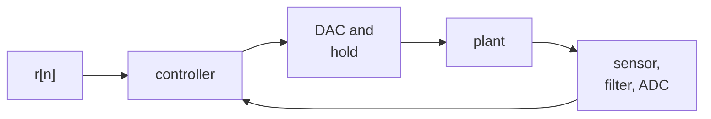
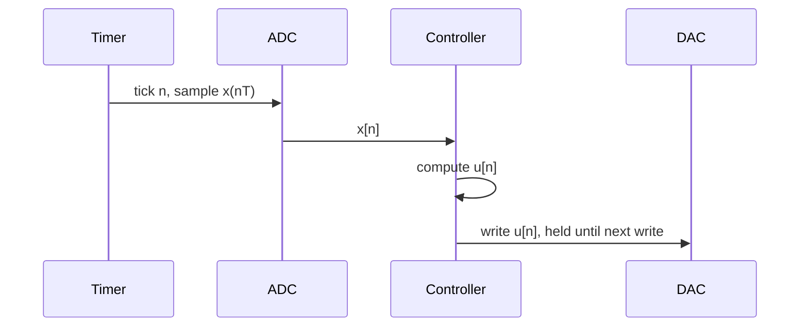

The first four entries of this series treated signals that flow in one direction: samples enter, a difference equation processes them, results leave. The [first entry](/blog/signals-and-systems-in-discrete-time) defined linear time-invariant (LTI) systems and difference equations, the [second](/blog/z-transform-poles-and-stability) read stability from pole positions and mapped continuous poles to discrete ones by $z = e^{sT_s}$, the [third](/blog/dft-and-fft) measured spectra, and the [fourth](/blog/designing-fir-and-iir-filters) designed filters, introduced the bilinear transform and showed what finite word length does. This last entry closes the loop. In a digital control system the output of a difference equation drives an actuator, the physical process responds, and a sensor and converter bring the response back as the next input sample. The loop is still made of the same parts, but now delays and pole positions decide not just the quality of a signal but whether the system is stable at all.

The entry assumes the basic vocabulary of feedback (plant, controller, reference, error, actuator, sensor) from [Introduction to Control Systems](/blog/introduction-to-control-systems), and reuses the first-order plant of [Feedback and System Behavior](/blog/feedback-and-system-behavior), $\dot{x} = -a\,x + b\,u$ with $a = b = 1$, so that every discrete result can be compared with the continuous one found there. Conventions are those of the [first entry](/blog/signals-and-systems-in-discrete-time#conventions-used-throughout-the-series): $T_s$ is the sampling interval (written $T$ in the formulas of this entry, to keep them short), $\Omega$ is angular frequency in rad/s, phase lags are given in degrees where marked, and code is Python 3 with NumPy. Time is in seconds.

## 1. The sampled-data loop

### 1.1 The parts of a digital loop

A **sampled-data system** is a feedback loop in which a continuous-time plant is controlled by a computer that sees it only at sampling instants, through an analog-to-digital converter (ADC), and acts on it through a digital-to-analog converter (DAC). The computer compares each measured sample with the reference $r[n]$:



- The **ADC** samples the measured output every $T$ seconds, after an analog **anti-aliasing filter** that removes components above half the sampling rate, as the [sampling entry](/blog/sampling-quantization-and-data-conversion) of the sensor series explains.
- The **controller** is an algorithm that computes the command $u[n]$ from the reference and the measured samples. For a linear controller, that algorithm is a difference equation: a digital filter in the sense of the fourth entry.
- The **DAC** turns $u[n]$ into a voltage and holds it constant until the next sample, a **zero-order hold** (ZOH). The plant therefore receives a staircase.
- The **plant** responds continuously, between samples as well as at them.

### 1.2 Timing within one period

The order of events in each sampling period matters, because any time spent between reading the sensor and writing the actuator is a delay inside the loop:



If the computation is short compared with $T$ and the command is written as soon as it is ready, the delay is a small fraction of a period, and the analysis below, which treats $u[n]$ as applied at $t = nT$, is accurate. Many implementations instead write $u[n]$ at the next timer tick, so that the output timing is exact whatever the computation time; that adds a deliberate delay of one full sample, which [Section 4.2](#42-phase-lag-at-the-crossover-frequency) accounts for.

### 1.3 The controller is a filter

Any linear controller with a transfer function $C(z)$ is a digital filter, and everything in the earlier entries applies to it. A proportional–integral (PI) controller, for instance, contains an accumulator, a pole at $z = 1$. On its own that makes it marginally stable, as the second entry showed for the accumulator; inside the loop, with suitable gains, the feedback moves the closed-loop poles inside the unit circle, and the pole at $z = 1$ is exactly what forces the steady-state error to zero. The analysis of the whole loop is the analysis of an interconnection of LTI systems, provided the plant can be described in the same discrete-time terms. The next section does that.

## 2. The plant seen by the computer

### 2.1 The zero-order-hold equivalent

Between two samples the DAC holds $u$ constant at $u[n]$, so for $nT \le t < (n+1)T$ the plant obeys $\dot{x} = -a\,x + b\,u[n]$ with a constant input. That linear equation has an exact solution over one interval:

$$
x[n+1] = e^{-aT}\,x[n] + \frac{b}{a}\left(1 - e^{-aT}\right)u[n] = \varphi\,x[n] + \gamma\,u[n],
$$

with $\varphi = e^{-aT}$ and $\gamma = (b/a)(1 - e^{-aT})$. No approximation is involved: at the sampling instants, the discrete model gives exactly the continuous plant's output, because the input is constant between them. This is the **zero-order-hold equivalent** of the plant. Its transfer function from $u[n]$ to $x[n]$ is

$$
G(z) = \frac{\gamma z^{-1}}{1 - \varphi z^{-1}},
$$

with a pole at $\varphi = e^{-aT}$, the image of the continuous pole $s = -a$ under the mapping $z = e^{sT}$ of the second entry, and a factor $z^{-1}$: a change in $u[n]$ cannot affect $x$ until the next sample. For a plant of higher order, the same calculation done with the matrix exponential of the state-space model ([state-space primer](/blog/state-space-models-primer)) gives the equivalent, $x[n+1] = A_d\,x[n] + B_d\,u[n]$ with $A_d = e^{AT}$, which [Stability and Eigenvalues](/blog/stability-and-eigenvalues#7-stability-in-discrete-time) derives (with $k$ as its sample index). The poles always map as $z = e^{sT}$, while the zeros do not follow a simple rule.

### 2.2 Proportional control in discrete time

Close the loop with proportional control, $u[n] = k\,(r - x[n])$, as in the continuous case. Substituting gives

$$
x[n+1] = (\varphi - k\gamma)\,x[n] + k\gamma\,r,
$$

a first-order recursion with closed-loop pole

$$
z_{cl} = \varphi - k\gamma.
$$

The same result follows from the transfer functions: the closed-loop poles are the roots of $1 + kG(z) = 0$, that is $1 - \varphi z^{-1} + k\gamma z^{-1} = 0$. The steady state, from the final-value theorem of the second entry or by setting $x[n+1] = x[n]$, is $x_{ss} = k\gamma r/(1 - \varphi + k\gamma)$, which for $a = b = 1$ reduces to $k r/(1 + k)$: the same offset as the continuous loop, 0.8 for $k = 4$.

Stability is a different matter. The pole must satisfy $|\varphi - k\gamma| < 1$, which for positive $k$ means

$$
k < \frac{1 + \varphi}{\gamma} = \frac{a}{b}\,\frac{1 + e^{-aT}}{1 - e^{-aT}} = \frac{a}{b}\coth\frac{aT}{2}.
$$

In the continuous loop, any positive gain was stable; [Feedback and System Behavior](/blog/feedback-and-system-behavior) warned that this was an artifact of a model with no delay. Sampling and holding introduce exactly such a delay, and with it a maximum gain:

| Sampling interval $T$ (s) | 0.01 | 0.1 | 0.2 | 0.5 | 1.0 |
|---|---|---|---|---|---|
| Largest stable $k$ ($a = b = 1$) | 200.0 | 20.02 | 10.03 | 4.08 | 2.16 |

The gain $k = 4$ used in the feedback entry is comfortably stable at $T = 0.1$ s and on the edge of instability at $T = 0.5$ s. The script iterates the loop for both.

```python
import numpy as np

a, b, k, r = 1.0, 1.0, 4.0, 1.0            # plant dx/dt = -a x + b u, gain k, reference r

for T in (0.1, 0.5):
    phi = np.exp(-a * T)                    # zero-order-hold equivalent: x[n+1] = phi x[n] + gam u[n]
    gam = (b / a) * (1 - phi)
    pole = phi - k * gam                    # closed-loop pole with u[n] = k (r - x[n])
    x, xs = 0.0, []
    for n in range(12):
        xs.append(x)
        x = phi * x + gam * k * (r - x)
    print(f"T = {T}: pole {pole:+.4f}, k_max = {(1 + phi) / gam:.3f}")
    print("  x[n] =", np.round(xs, 3))
```

Output:

```text
T = 0.1: pole +0.5242, k_max = 20.017
  x[n] = [0.    0.381 0.58  0.685 0.74  0.768 0.783 0.791 0.795 0.798 0.799 0.799]
T = 0.5: pole -0.9673, k_max = 4.083
  x[n] = [0.    1.574 0.051 1.524 0.099 1.478 0.144 1.434 0.187 1.393 0.226 1.355]
```

At $T = 0.1$ s the response settles smoothly to 0.8, as the continuous loop does. At $T = 0.5$ s the closed-loop pole is $-0.967$, close to $-1$, and the output alternates between about 0 and 1.5 at every sample, decaying only slowly toward 0.8. The controller sees an error, applies a large command, holds it for half a second while the plant overshoots, then sees the opposite error. A negative real pole near $-1$ is the signature of a loop sampled too slowly for its gain. The continuous model could not predict this, and the discrete model predicts it exactly.

## 3. Discretizing a controller

### 3.1 Design by emulation

Controllers are often designed in continuous time, with the tools of the [Foundations of Control Systems](/series/foundations-of-control-systems) series, and then converted into a difference equation. This **emulation** approach needs a rule for replacing $s$ in the controller's transfer function $C(s)$ with a function of $z$. Since $1/s$ is an integrator, each rule corresponds to a way of integrating numerically over one sampling interval:

| Method | Integration rule | Substitution for $s$ | Image of a stable continuous pole |
|---|---|---|---|
| Forward Euler | Rectangle at the start of the interval | $\dfrac{z - 1}{T}$ | $z = 1 + sT$: can lie outside the unit circle |
| Backward Euler | Rectangle at the end of the interval | $\dfrac{z - 1}{zT}$ | $z = 1/(1 - sT)$: always inside the unit circle |
| Tustin (bilinear) | Trapezoid | $\dfrac{2}{T}\,\dfrac{z - 1}{z + 1}$ | $z = (1 + sT/2)/(1 - sT/2)$: inside, exactly when stable |

Tustin's method is the bilinear transform of the fourth entry, under the name control engineers use for it. It maps the stable half-plane exactly onto the inside of the unit circle and the frequency axis onto the unit circle, with the same frequency warping, $\Omega = (2/T)\tan(\omega/2)$; where one frequency matters most (a notch, or the crossover frequency of the loop), it can be prewarped in the same way. Forward Euler is the explicit Euler method of the [notes on numerical integration](/blog/numerical-integration-notes), with the same stability limit: a continuous pole at $s = -50$ with $T = 0.05$ s maps to $1 - 2.5 = -1.5$, outside the unit circle, so a perfectly stable continuous controller becomes an unstable digital one. For the same pole, backward Euler gives $0.286$, Tustin $-0.111$, and the exact mapping $e^{-2.5} = 0.082$. All three methods approach the exact result as $sT \to 0$, which is why emulation works well only when the sampling rate is high compared with the controller's own dynamics.

### 3.2 A digital PI controller

The proportional loop above leaves an offset; [Feedback and System Behavior](/blog/feedback-and-system-behavior) noted that removing it takes an integrator. A **PI controller** adds one:

$$
C(s) = K_p + \frac{K_i}{s}.
$$

With the plant $1/(s + 1)$, the continuous closed loop has characteristic polynomial $s^2 + (1 + K_p)s + K_i$; the gains $K_p = 4$ and $K_i = 10$ give $s^2 + 5s + 10$, a damping ratio of $5/(2\sqrt{10}) = 0.79$. Replacing $1/s$ with Tustin's trapezoidal integrator, $\frac{T}{2}\frac{1 + z^{-1}}{1 - z^{-1}}$, and writing the integral as a state $I[n]$ gives the algorithm

$$
\begin{aligned}
e[n] &= r[n] - x[n], \\
I[n] &= I[n-1] + K_i\,\frac{T}{2}\bigl(e[n] + e[n-1]\bigr), \\
u[n] &= K_p\,e[n] + I[n].
\end{aligned}
$$

This is a first-order infinite impulse response (IIR) filter from $e$ to $u$, with a pole at $z = 1$ and a zero at $z = (1 - K_iT/(2K_p))/(1 + K_iT/(2K_p))$, close to 1.

### 3.3 Actuator limits and integrator windup

Real actuators saturate: a motor drive has a maximum current, a valve is fully open. While the actuator is saturated the loop is effectively open, but the integrator does not know it and keeps accumulating the error. When the output finally reaches the reference, the integral holds a large stored value that must be unwound, and the output overshoots. This is **integrator windup**. The simplest remedy, **clamping** (or conditional integration), stops updating the integral while the command is saturated.

The script runs the PI controller above at $T = 0.05$ s on the plant's exact zero-order-hold model, for a unit step in the reference, three ways: with an unlimited actuator, with the command limited to $|u| \le 2$, and with the same limit plus clamping. It reports the peak, the time after which the output stays within 2% of the reference, and the final value.

```python
import numpy as np

a, b = 1.0, 1.0                       # plant dx/dt = -a x + b u
Kp, Ki, T = 4.0, 10.0, 0.05           # PI gains and sampling interval, s
phi, gam = np.exp(-a * T), (b / a) * (1 - np.exp(-a * T))   # exact zero-order-hold step

def run(u_max, anti_windup, steps=120, r=1.0):
    x, I, e_prev, xs = 0.0, 0.0, 0.0, []
    for n in range(steps):
        e = r - x                                  # sample the output, form the error
        I_new = I + Ki * T / 2 * (e + e_prev)      # Tustin (trapezoidal) integral
        u = np.clip(Kp * e + I_new, -u_max, u_max) # actuator limit
        if not (anti_windup and u != Kp * e + I_new):
            I = I_new                              # clamping: freeze the integral while saturated
        e_prev = e
        xs.append(x)
        x = phi * x + gam * u                      # plant over one interval, u held constant
    xs = np.array(xs)
    settle = T * np.max(np.nonzero(np.abs(xs - r) > 0.02)[0] + 1)
    return xs.max(), settle, xs[-1]

for label, u_max, aw in [("no limit", np.inf, False), ("|u| <= 2", 2.0, False), ("|u| <= 2, clamping", 2.0, True)]:
    peak, ts, final = run(u_max, aw)
    print(f"{label:20s} peak {peak:.3f}, 2% settling {ts:.2f} s, final x {final:.4f}")
```

Output:

```text
no limit             peak 1.117, 2% settling 1.55 s, final x 1.0000
|u| <= 2             peak 1.310, 2% settling 2.15 s, final x 1.0000
|u| <= 2, clamping   peak 1.020, 2% settling 1.40 s, final x 1.0000
```

All three remove the steady-state offset (1.0000 at the end of the 6 s run), which the proportional loop could not. The actuator limit alone raises the overshoot from 11.7% to 31.0% and lengthens the settling time. With clamping, the overshoot falls to 2.0% and the settling time to 1.40 s, better even than the unlimited case, because the integral no longer builds up during the initial rise. (Peaks and settling times are read at the sampling instants; between samples the continuous output can differ slightly.)

### 3.4 Derivative action needs a filter

A derivative term, $K_d s$, has a gain that grows without limit with frequency, so it amplifies sensor noise and the quantization steps of the converter. In practice it is always combined with a low-pass filter, $K_d s/(1 + sT_f)$, with $T_f$ a filter time constant. The discretization method then matters for a reason the last column of the table already hints at: a fast pole, with $|s|T$ large, lands near $z = 0$ under backward Euler but near $z = -1$ under Tustin. With backward Euler the filter's pole lands at $z = T_f/(T_f + T)$, between 0 and 1, so the derivative response decays smoothly. With Tustin it lands at $z = (2T_f - T)/(2T_f + T)$, which is negative whenever $T_f < T/2$: the derivative term then alternates in sign at every sample, a ringing that is entirely an artifact of the discretization. Backward Euler is therefore the usual choice for the derivative term, even when Tustin is used for the rest of the controller.

## 4. The delays in the loop

### 4.1 The hold behaves like half a sample of delay

Section 2 handled the hold exactly for one plant. A more general picture explains why sampling destabilizes loops. The zero-order hold turns each sample into a rectangular pulse of width $T$; its frequency response, normalized to unit gain at zero frequency, is

$$
H_{\text{ZOH}}(j\Omega) = e^{-j\Omega T/2}\,\frac{\sin(\Omega T/2)}{\Omega T/2}.
$$

At frequencies well below the sampling rate the magnitude is close to 1 and the phase is $-\Omega T/2$: the hold acts like a pure delay of half a sampling interval. Intuitively, the staircase lags the smooth signal it approximates by half a step on average.

### 4.2 Phase lag at the crossover frequency

The stability of a feedback loop is governed by its phase at the **crossover frequency** $\Omega_c$, where the loop gain falls through 1; the **phase margin** is how far that phase is from $-180°$, and every delay in the loop eats into it. A delay $\tau_d$ costs a phase lag of $\Omega_c\tau_d$ radians at crossover. For the hold, $\tau_d = T/2$, so with $f_c = \Omega_c/(2\pi)$,

$$
\Delta\phi_{\text{ZOH}} = \Omega_c\,\frac{T}{2} = \pi\,\frac{f_c}{f_s}\ \text{rad} = 180°\,\frac{f_c}{f_s}.
$$

| Ratio $f_s/f_c$ | 5 | 10 | 20 | 40 |
|---|---|---|---|---|
| Phase lag of the hold | 36° | 18° | 9° | 4.5° |
| With one extra sample of computation delay | 108° | 54° | 27° | 13.5° |

The last row assumes the command is written at the next tick (Section 1.2), which adds $T$ to the hold's $T/2$ and so triples the lag. A loop designed in continuous time for a phase margin of 45° to 60°, a common design target, survives the delay only if the sampling rate is many times the crossover frequency. The table makes the trade explicit, and the numbers follow from the one formula above.

### 4.3 Filters inside the loop

Every filter between the sensor and the controller adds its own delay, and the earlier entries supply the numbers. The analog anti-aliasing filter has a phase lag at $f_c$ that grows as its cut-off is brought down toward $f_c$. A digital filter adds its group delay: the order-66 linear-phase finite impulse response (FIR) filter of the fourth entry delays every frequency by 33 ms at 1 kHz, which at a crossover of 2 Hz costs $360° \times 2 \times 0.033 = 23.8°$ of phase margin. A filter that is excellent for measurement can therefore be a poor choice inside a loop. In a control path, filtering is usually done with low-order IIR filters, which have less delay at low frequencies for the same smoothing, or avoided by sampling fast enough that the anti-aliasing filter can be placed well above the crossover frequency. The second entry's notch filter is a common exception: it removes a narrow band, such as a mechanical resonance or mains interference, with little phase lag far from the notch.

## 5. Choosing the Sampling Rate

The sampling rate of a control loop is bounded from both sides.

**Reasons to sample faster:**

- The phase lag of the hold and of the computation delay, $180° f_c/f_s$ and $360° f_c/f_s$, shrinks in proportion to $T$ (Section 4.2).
- The maximum stable gain of a sampled loop rises as $T$ falls; in the proportional example, $k_{\max} = \coth(T/2)$ goes from 2.16 at $T = 1$ s to 200 at $T = 0.01$ s.
- Emulation methods converge to the continuous design only when $\Omega T$ is small for every frequency the controller acts on (Section 3.1).
- Disturbances must be reacted to within a fraction of the time they take to act, and the anti-aliasing filter must sit well above the crossover frequency, so $f_s/2$ must be well above both.

**Reasons not to sample faster than necessary:**

- The computation must finish within one period, on hardware that may be running other loops.
- Poles crowd toward $z = 1$ as $T$ falls ($z = e^{sT} \to 1$), and the fourth entry showed what that does in fixed point: coefficients become sensitive and round-off noise gains large.
- A derivative or a difference of successive samples divides by $T$, so measurement noise and the converter's quantization step are amplified in proportion to the sampling rate.
- The steps of a position sensor or encoder become relatively coarser: between two closely spaced samples the measured position may not change at all, and then the computed velocity jumps between zero and one step per sample.

The phase-lag formula gives a defensible starting point. If the hold may cost at most about 10° of phase margin, then $180° f_c/f_s \le 10°$, so $f_s \ge 18 f_c$, about twenty times the crossover frequency; with a one-sample computation delay the same budget needs $f_s \ge 54 f_c$. A slower rate is possible when the controller is designed directly in discrete time, on the zero-order-hold model of the plant. That design accounts for the hold exactly instead of treating it as a disturbance. The proportional example shows the difference: its behavior at $T = 0.5$ s was predicted exactly, even though it was poor. The entry [Designing a State-Feedback Controller](/blog/state-feedback-controller-design#64-the-controller-runs-in-continuous-time) gives the same advice for pole placement: when the sampling period is not small compared with the fastest closed-loop time constant, place the poles on the discrete-time model, with targets inside the unit circle.

## 6. A control loop is a signal-processing system

With the plant replaced by its zero-order-hold equivalent $G(z)$ and the controller written as $C(z)$, the whole loop is an interconnection of discrete-time LTI systems, and the tools of the series apply to it directly:

- **Difference equations and convolution** (first entry): the controller is a difference equation, and the response of the loop to any reference or disturbance sequence is a convolution with the corresponding closed-loop impulse response.
- **The z-transform and poles** (second entry): the closed-loop transfer function from reference to output is $C(z)G(z)/\bigl(1 + C(z)G(z)\bigr)$, and the loop is stable exactly when the roots of $1 + C(z)G(z) = 0$ lie inside the unit circle. The proportional example was this test for a first-order loop.
- **Spectra** (third entry): measuring the spectrum of the error signal is the standard way to find what a loop fails to reject, such as a resonance, a periodic load or mains pickup, and the record-length and windowing rules apply unchanged.
- **Filter design and word length** (fourth entry): the measurement chain needs anti-aliasing and often notch filtering, and the controller itself is a filter whose structure, coefficient precision and limit cycles matter on fixed-point hardware.

What feedback adds is that the output of the processing returns as its input. A delay or a phase lag that would merely postpone a measurement can, inside a loop, turn a decaying response into a growing one. That is why the sampling rate, the hold, the computation delay and every filter in the path must be accounted for together.

## 7. Exercises

**Exercise 1.** For the plant $\dot{x} = -2x + u$ sampled with a zero-order hold at $T = 0.1$ s, find $\varphi$, $\gamma$ and the largest stable proportional gain.

<details>
<summary>Answer</summary>

$\varphi = e^{-0.2} = 0.8187$ and $\gamma = \tfrac12(1 - 0.8187) = 0.0906$. The limit is $k < (1 + \varphi)/\gamma = 1.8187/0.0906 = 20.07$, which agrees with $(a/b)\coth(aT/2) = 2\coth(0.1) = 20.07$.

</details>

**Exercise 2.** In the proportional example with $a = b = 1$ and $T = 0.1$ s, which gain $k$ places the closed-loop pole at $z = 0$, and what does the response look like?

<details>
<summary>Answer</summary>

$\varphi - k\gamma = 0$ gives $k = \varphi/\gamma = 0.9048/0.0952 = 9.51$. The closed-loop recursion becomes $x[n+1] = k\gamma\,r$, so the output reaches its final value, $k/(1 + k) = 0.905$, in a single sample and stays there (at the sampling instants): a **deadbeat** response, which has no continuous-time counterpart.

</details>

**Exercise 3.** A loop is to have a crossover frequency of 50 Hz, and the hold may cost at most 5° of phase margin. What sampling rate is needed, with and without a one-sample computation delay?

<details>
<summary>Answer</summary>

Without the extra delay, $180° \times 50/f_s \le 5°$ gives $f_s \ge 1.8$ kHz. With it, $540° \times 50/f_s \le 5°$ gives $f_s \ge 5.4$ kHz.

</details>

**Exercise 4.** A derivative filter with $T_f = 2$ ms is discretized at $T = 5$ ms. Where is its pole with backward Euler, and with Tustin?

<details>
<summary>Answer</summary>

Backward Euler: $z = T_f/(T_f + T) = 2/7 = 0.286$. Tustin: $z = (2T_f - T)/(2T_f + T) = (4 - 5)/(4 + 5) = -0.111$, negative because $T_f < T/2$, so the Tustin version rings.

</details>

**Exercise 5.** Why does the closed-loop pole of the proportional example, $\varphi - k\gamma$, tend to the continuous closed-loop pole $e^{-(a + bk)T}$ as $T \to 0$?

<details>
<summary>Answer</summary>

To first order in $T$, $\varphi \approx 1 - aT$ and $\gamma \approx bT$, so $\varphi - k\gamma \approx 1 - (a + bk)T$, which is also the first-order expansion of $e^{-(a + bk)T}$. The two differ only in terms of order $T^2$, which is why a fast-sampled loop behaves like the continuous design and a slow one does not.

</details>

## 8. Summary

| Question | Answer |
|---|---|
| What is a sampled-data loop? | A continuous plant controlled through an ADC, a difference equation and a DAC with zero-order hold. |
| How is the plant described in discrete time? | By its zero-order-hold equivalent; for $\dot x = -ax + bu$, $x[n+1] = e^{-aT}x[n] + \tfrac{b}{a}(1 - e^{-aT})u[n]$, exact at the samples. |
| What does sampling do to a proportional loop? | Adds a stability limit, $k < \tfrac{a}{b}\coth(aT/2)$, absent from the continuous model. |
| How is a continuous controller discretized? | Forward Euler (can destabilize), backward Euler (always stable), or Tustin (exact stability mapping, frequency warping). |
| What is windup, and how is it prevented? | Integral build-up while the actuator saturates; clamping the integral cut the overshoot in the example from 31.0% to 2.0%. |
| How much phase does sampling cost? | The hold behaves like a delay of $T/2$: $180° f_c/f_s$ at crossover, plus $360° f_c/f_s$ for a one-sample computation delay. |
| How fast should a loop be sampled? | About 20 times the crossover frequency for a 10° hold lag, more with computation delay; limited above by computation, coefficient sensitivity and noise. |
| Why is a control loop a signal-processing system? | Every block is an LTI system in $z$; stability is the location of the roots of $1 + C(z)G(z)$. |

This entry completes the series. Its five entries have followed one idea from a sequence of numbers to a working feedback loop. LTI systems were described by difference equations and analyzed through their poles and frequency responses, signals were measured with the discrete Fourier transform, filters were designed to a specification, and finally a filter was placed inside a loop where its delays decide stability. The [Foundations of Control Systems](/series/foundations-of-control-systems) series treats the continuous-time side of that loop.

### References

- K. J. Åström and R. M. Murray, *Feedback Systems: An Introduction for Scientists and Engineers*, Princeton University Press, 2008.
- K. J. Åström and B. Wittenmark, *Computer-Controlled Systems: Theory and Design*, 3rd ed., Prentice Hall, 1997.
- G. F. Franklin, J. D. Powell and M. L. Workman, *Digital Control of Dynamic Systems*, 3rd ed., Addison-Wesley, 1998.
- A. V. Oppenheim and R. W. Schafer, *Discrete-Time Signal Processing*, 3rd ed., Pearson, 2010.
