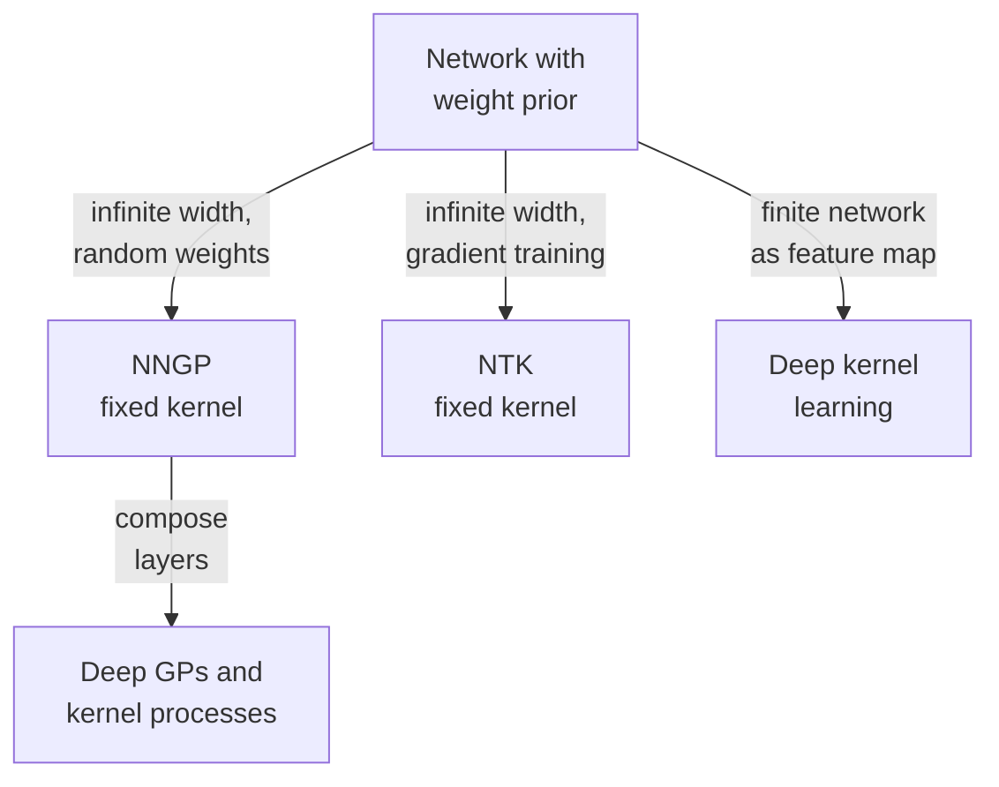

import Figure from '../../components/Figure.astro';
import BdlGpPriorPosterior from '../../components/diagrams/BdlGpPriorPosterior.astro';

The earlier overviews placed a prior on the parameters $\theta$ of a network and tried to approximate the posterior $p(\theta \mid \mathcal{D})$, by [sampling](/blog/sampling-the-posterior-mcmc), by a [Laplace approximation](/blog/laplace-approximations), by [variational inference](/blog/variational-inference-for-neural-networks) or with an [ensemble](/blog/deep-ensembles). In every case the object of interest was not $\theta$ itself but the functions it produces: predictions depend on $\theta$ only through $f_\theta(x^*)$.

This entry changes the point of view from weights to functions. It shows how a prior over weights induces a prior over functions described by a **kernel**, defines Gaussian processes (GPs), and derives exact GP regression, including the marginal likelihood that sets the kernel's hyperparameters. It then explains a classical result of Neal (1996): a randomly initialized network with one hidden layer becomes a GP as the layer grows infinitely wide, the **neural network Gaussian process (NNGP)** limit. A shorter section surveys the neural tangent kernel (NTK), which describes how networks train as their width grows without bound, and the last sections show how deep kernel learning, deep GPs and deep kernel processes bring back what the infinite-width limit removes: learned features.

The entry assumes the Bayesian linear regression of the [opening overview](/blog/bayesian-inference-for-neural-networks), whose posterior is Gaussian in closed form. The examples use Python 3.13 and NumPy 2.5.3 with the seeds given in the code. Rasmussen and Williams (2006) is the standard reference for Sections 1 and 2.

## 1. From weights to functions

### 1.1 A prior over weights is a prior over functions

Consider a linear model $f(x) = \phi(x)^\top \theta$ with a fixed feature map $\phi$ from inputs to $\mathbb{R}^P$ and a Gaussian prior $\theta \sim \mathcal{N}(0, \Sigma_p)$ on the weights, with prior covariance matrix $\Sigma_p$. For any input $x$ the value $f(x)$ is a linear function of a Gaussian vector, so it is Gaussian with mean zero. For two inputs $x$ and $x'$ the covariance of the function values is

$$
\operatorname{Cov}\big(f(x), f(x')\big) = \mathbb{E}\big[\phi(x)^\top \theta\, \theta^\top \phi(x')\big] = \phi(x)^\top \Sigma_p\, \phi(x') =: k(x, x') .
$$

Any finite set of function values $f(x_1), \dots, f(x_n)$ is then jointly Gaussian with covariance matrix $K_{ij} = k(x_i, x_j)$. The prior over $\theta$ has been replaced by a statement about functions that never mentions $\theta$: only the function $k$ remains. For the worked example of the opening overview, with $\Sigma_p = s_0^2 I$, the kernel is $s_0^2\,\phi(x)^\top\phi(x')$, and the evidence computed there, $\mathcal{N}(\mathbf{y}; 0, s_0^2\Phi\Phi^\top + \sigma^2 I)$, has exactly this Gram matrix plus noise as its covariance.

### 1.2 Kernels

A **kernel** is a function $k(x, x')$ that is symmetric and **positive semi-definite**: for every finite set of inputs, the **Gram matrix** $K$ with entries $k(x_i, x_j)$ satisfies $a^\top K a \ge 0$ for every vector $a$. Every kernel of the form $\phi(x)^\top \Sigma_p \phi(x')$ is one, because $a^\top K a = \operatorname{Var}\big(\sum_i a_i f(x_i)\big) \ge 0$. Conversely, Mercer's theorem and its relatives show that any positive semi-definite kernel can be written as $\phi(x)^\top\phi(x')$ for a suitable feature map $\phi$, whose output may have infinitely many components (Schölkopf and Smola, 2002).

That converse is the **kernel trick**: an algorithm that touches the features only through inner products can work with $k$ directly and never compute $\phi$, even when $\phi$ is infinite-dimensional. The most used example is the **squared-exponential kernel** for scalar inputs, also called the radial basis function (RBF) or Gaussian kernel,

$$
k(x, x') = \sigma_f^2 \exp\!\Big(-\frac{(x - x')^2}{2\ell^2}\Big),
$$

with **signal standard deviation** $\sigma_f$, which sets the typical size of the function, and **lengthscale** $\ell$, the distance over which function values stay strongly correlated. It corresponds to infinitely many Gaussian-bump features. Other common kernels are the linear kernel $x^\top x'$, the periodic kernel, and the Matérn family, whose sample functions are less smooth than those of the squared exponential. Sums and products of kernels are kernels, so kernels can be built for a problem from simple parts, for example a periodic kernel times a squared exponential for a seasonal pattern that drifts.

## 2. Gaussian processes

### 2.1 Definition

A **Gaussian process** is a collection of random variables, indexed by inputs $x$, of which any finite number have a joint Gaussian distribution. It is specified by a mean function $m(x) = \mathbb{E}[f(x)]$ and a covariance function $k(x, x')$, and written $f \sim \mathcal{GP}(m, k)$. This entry takes $m = 0$, a common choice after subtracting the mean of the targets. Section 1.1 showed that Bayesian linear regression is a GP with kernel $\phi(x)^\top\Sigma_p\phi(x')$; a GP with a squared-exponential kernel is the same idea with infinitely many features.

Sampling from a GP prior needs only a grid: evaluate $K$ on the grid inputs, factor it as $K = LL^\top$ by the Cholesky decomposition, and multiply $L$ by a vector of independent standard normal values. The left panel of the figure in Section 2.4 shows three such draws.

### 2.2 The posterior by Gaussian conditioning

GP regression rests on one fact about Gaussian vectors. If

$$
\begin{bmatrix} a \\ b \end{bmatrix} \sim \mathcal{N}\!\left(0, \begin{bmatrix} A & R \\ R^\top & B \end{bmatrix}\right),
$$

then the conditional distribution of $a$ given an observed $b$ is $\mathcal{N}\big(R B^{-1} b,\; A - R B^{-1} R^\top\big)$, where $R$ is the cross-covariance of $a$ and $b$. The proof completes the square in the exponent of the joint density; the covariance $A - RB^{-1}R^\top$ is the Schur complement of $B$.

Now let the training targets be noisy function values, $y_n = f(x_n) + \varepsilon_n$ with independent noise $\varepsilon_n \sim \mathcal{N}(0, \sigma^2)$. Write $X$ for the $N$ training inputs, $K = k(X, X)$ for their $N \times N$ Gram matrix, $k_* = k(X, x^*)$ for the vector of covariances between the training inputs and a test input, and $k_{**} = k(x^*, x^*)$. Under the prior, the targets $y$ and the test value $f_* = f(x^*)$ are jointly Gaussian:

$$
\begin{bmatrix} y \\ f_* \end{bmatrix} \sim \mathcal{N}\!\left(0, \begin{bmatrix} K + \sigma^2 I & k_* \\ k_*^\top & k_{**} \end{bmatrix}\right).
$$

Conditioning on $y$ with the fact above, with $a = f_*$ and $b = y$, gives the posterior predictive distribution of the function value:

$$
\mathbb{E}[f_* \mid \mathcal{D}] = k_*^\top (K + \sigma^2 I)^{-1} y, \qquad
\operatorname{Var}[f_* \mid \mathcal{D}] = k_{**} - k_*^\top (K + \sigma^2 I)^{-1} k_* .
$$

For a new noisy observation $y^*$ the variance gains $\sigma^2$. Three properties are worth reading off. The mean is a weighted sum of kernel functions centered at the training inputs, $\sum_n \alpha_n k(x_n, x^*)$ with $\alpha = (K + \sigma^2 I)^{-1} y$. The variance is the prior variance minus a non-negative term that is large when $x^*$ is strongly correlated with training inputs; far from all of them, $k_*$ tends to zero and the variance returns to the prior value $k_{**}$. And the variance does not depend on the targets $y$, only on where the inputs are. Unlike the ensemble of the [Part IV overview](/blog/deep-ensembles), this posterior is exact: no approximation has been made beyond the choice of prior and likelihood.

### 2.3 The marginal likelihood

The kernel has **hyperparameters**, here $\sigma_f$, $\ell$ and the noise $\sigma$. The Bayesian way to set them uses the probability of the targets with $f$ integrated out, the **marginal likelihood** or evidence. Since $y \sim \mathcal{N}(0, K_y)$ with $K_y = K + \sigma^2 I$,

$$
\log p(y \mid X) = -\tfrac{1}{2}\, y^\top K_y^{-1} y \;-\; \tfrac{1}{2}\log\lvert K_y\rvert \;-\; \tfrac{N}{2}\log 2\pi .
$$

The first term rewards fitting the data; the second penalizes a covariance that spreads its probability over many possible data sets, which is what a flexible kernel (a short lengthscale) does. Maximizing it over the hyperparameters trades the two automatically, an instance of the Occam factor that MacKay (1992) described for neural networks. This is the same evidence the [opening overview](/blog/bayesian-inference-for-neural-networks) used for model comparison, here available in closed form.

### 2.4 A worked example

The listing fits a GP with a squared-exponential kernel ($\sigma_f = 1$) to seven noisy observations of $\sin x$ with noise standard deviation $\sigma = 0.1$, chooses the lengthscale on a grid by the log marginal likelihood, and predicts at five test inputs. It uses the Cholesky factor $L$ of $K_y$ to solve linear systems and to compute $\log\lvert K_y\rvert = 2\sum_i \log L_{ii}$, which is more stable than forming $K_y^{-1}$.

```python
import numpy as np

rng = np.random.default_rng(4)
x = np.array([-4.0, -3.2, -2.5, -1.0, 0.5, 1.2, 3.5])     # training inputs
sigma = 0.1                                               # noise sd
y = np.sin(x) + sigma * rng.normal(size=x.size)

def k_se(a, b, ell=1.0, sf=1.0):                            # squared-exponential kernel
    return sf ** 2 * np.exp(-0.5 * (a[:, None] - b[None, :]) ** 2 / ell ** 2)

def gp_fit(x, y, ell):
    K = k_se(x, x, ell) + sigma ** 2 * np.eye(x.size)
    L = np.linalg.cholesky(K)                               # K = L L^T
    alpha = np.linalg.solve(L.T, np.linalg.solve(L, y))     # alpha = K^-1 y
    lml = (-0.5 * y @ alpha - np.log(np.diag(L)).sum()
           - 0.5 * x.size * np.log(2 * np.pi))              # log marginal likelihood
    return L, alpha, lml

def gp_predict(x, L, alpha, xs, ell):
    Ks = k_se(x, xs, ell)                                   # n x m cross-covariances
    mean = Ks.T @ alpha
    V = np.linalg.solve(L, Ks)
    var_f = k_se(xs, xs, ell).diagonal() - (V ** 2).sum(0)  # latent-function variance
    return mean, np.sqrt(var_f), np.sqrt(var_f + sigma ** 2)

for ell in [0.3, 1.0, 3.0]:
    print(f"lengthscale {ell}: log marginal likelihood {gp_fit(x, y, ell)[2]:.2f}")

grid = np.arange(0.2, 4.01, 0.05)
ell = grid[np.argmax([gp_fit(x, y, e)[2] for e in grid])]
print(f"best lengthscale on the grid: {ell:.2f} "
      f"(log marginal likelihood {gp_fit(x, y, ell)[2]:.2f})")
L, alpha, _ = gp_fit(x, y, ell)
xs = np.array([-3.2, -0.25, 2.3, 5.0, 8.0])
mean, sd_f, sd_y = gp_predict(x, L, alpha, xs, ell)
print("    x*   sin(x*)   mean   sd of f*   sd of y*")
for row in zip(xs, np.sin(xs), mean, sd_f, sd_y):
    print("{:6.2f} {:8.3f} {:7.3f} {:9.3f} {:10.3f}".format(*row))
```

It prints:

```text
lengthscale 0.3: log marginal likelihood -7.64
lengthscale 1.0: log marginal likelihood -6.18
lengthscale 3.0: log marginal likelihood -16.80
best lengthscale on the grid: 1.60 (log marginal likelihood -5.13)
    x*   sin(x*)   mean   sd of f*   sd of y*
 -3.20    0.058   0.072     0.079      0.128
 -0.25   -0.247  -0.352     0.111      0.149
  2.30    0.746   0.700     0.248      0.268
  5.00   -0.959  -0.724     0.720      0.727
  8.00    0.989  -0.027     1.000      1.005
```

The marginal likelihood prefers a lengthscale of 1.6, with a log marginal likelihood of $-5.13$. It rejects both the wiggly $\ell = 0.3$ (2.5 nats lower) and the over-smooth $\ell = 3$ (11.7 nats lower). At the training input $x^* = -3.2$ the standard deviation of the function value, 0.079, is below the noise level: several nearby observations average out part of the noise. In the gap at $x^* = 2.3$ it grows to 0.248, at $x^* = 5$ beyond the last observation to 0.720, and at $x^* = 8$ the mean has nearly returned to the prior mean 0 (it is $-0.027$) and the standard deviation to the prior value 1. In every row the true value lies within two standard deviations of the mean, which is the behavior the toy ensemble of the Part IV overview did not achieve far from its data.

<Figure caption="Left: three draws from the GP prior (lengthscale 1.6) with the band of two prior standard deviations. Right: the posterior after seven observations, with its mean, band and three posterior draws. Look at how the band pinches at each observation and widens back to the prior width away from the data.">
  <BdlGpPriorPosterior />
</Figure>

### 2.5 Cost

Fitting requires the Cholesky factorization of an $N \times N$ matrix, which takes $O(N^3)$ operations and $O(N^2)$ memory; each prediction then costs $O(N)$ for the mean and $O(N^2)$ for the variance. Exact GPs are therefore practical up to roughly tens of thousands of points on one machine. Larger problems use **inducing points**, a set of $N_u \ll N$ pseudo-inputs that summarize the data, with variational training (Titsias, 2009) that can use mini-batches (Hensman, Fusi and Lawrence, 2013). The [Part VIII overview](/blog/scaling-bayesian-deep-learning) returns to these methods.

## 3. Infinitely wide networks are Gaussian processes

### 3.1 Neal's argument

Consider a network with one hidden layer of $H$ units:

$$
f(x) = \frac{1}{\sqrt{H}} \sum_{h=1}^{H} v_h\, \varphi\big(u_h(x)\big), \qquad u_h(x) = w_h^\top x + b_h ,
$$

where $\varphi$ is the activation function ($\varphi$, not the feature map $\phi$ of Section 1), $w_h$ and $b_h$ are the input weights and bias of unit $h$, and $v_h$ its output weight. Give all weights independent zero-mean priors, with $\operatorname{Var}(v_h) = s_v^2$, and note the factor $1/\sqrt{H}$, which keeps the prior variance of $f$ fixed as $H$ grows. Each unit contributes a term $v_h \varphi(u_h(x))$, and these terms are independent and identically distributed across $h$, with mean zero and covariance

$$
\operatorname{Cov}\big(v_h\varphi(u_h(x)),\, v_h\varphi(u_h(x'))\big) = s_v^2\, \mathbb{E}\big[\varphi(u(x))\,\varphi(u(x'))\big] ,
$$

the same for every unit. The function values at any finite set of inputs are $1/\sqrt{H}$ times a sum of $H$ such independent vectors, so by the multivariate central limit theorem they become jointly Gaussian as $H \to \infty$. Gaussian finite-dimensional distributions at every set of inputs define a GP, with kernel

$$
K(x, x') = s_v^2\, \mathbb{E}_{w, b}\big[\varphi(w^\top x + b)\, \varphi(w^\top x' + b)\big].
$$

This is Neal's (1996) result. The prior over weights, pushed through an infinitely wide layer, is a GP prior over functions, and Bayesian inference in the infinitely wide network is GP regression with this kernel. Williams (1997) computed the kernel in closed form for the error-function and Gaussian activations.

### 3.2 The kernel for ReLU units

For the rectified linear unit (ReLU), $\varphi(u) = \max(u, 0)$, the expectation has a closed form. Fold the bias into the input by writing $\tilde x = (x, 1)$ and $\tilde w = (w, b)$, so that $w^\top x + b = \tilde w^\top \tilde x$, and take $\tilde w \sim \mathcal{N}(0, I)$. The arc-cosine kernel of Cho and Saul (2009), applied to $\tilde x$, gives

$$
\mathbb{E}\big[\varphi(\tilde w^\top \tilde x)\,\varphi(\tilde w^\top \tilde x')\big] = \frac{\lVert\tilde x\rVert\,\lVert\tilde x'\rVert}{2\pi}\big(\sin t + (\pi - t)\cos t\big),
$$

where $t$ is the angle between $\tilde x$ and $\tilde x'$. For $x = x'$ the angle is zero and the value is $\lVert\tilde x\rVert^2/2$, since half of the Gaussian pre-activations are positive.

Two facts are worth checking numerically. The covariance of $f$ equals $K$ at every width, because each unit contributes the same covariance and the $1/\sqrt{H}$ scaling averages them; only the shape of the distribution changes with $H$. And that shape approaches a Gaussian at a computable rate. Given the hidden activations $a_h = \varphi(u_h(x))$, $f(x)$ is Gaussian with variance $V = \frac{1}{H}\sum_h a_h^2$ (taking $v_h \sim \mathcal{N}(0, 1)$), so $f(x)$ is a scale mixture of Gaussians. Its excess kurtosis, the standardized fourth moment minus the Gaussian value 3, is $3\operatorname{Var}(V)/\mathbb{E}[V]^2 = 3\operatorname{Var}(a^2)/\big(H\,\mathbb{E}[a^2]^2\big)$. At $x = 0$ the pre-activation is the bias $b \sim \mathcal{N}(0,1)$, so $\mathbb{E}[a^2] = 1/2$, $\mathbb{E}[a^4] = 3/2$, $\operatorname{Var}(a^2) = 5/4$, and the excess kurtosis is $15/H$.

```python
import numpy as np

rng = np.random.default_rng(5)
X = np.array([[0.0, 1.0], [1.0, 1.0], [-2.0, 1.0]])    # three scalar inputs 0, 1, -2 with a constant 1

def relu_kernel(a, b):                                   # E[relu(w.a) relu(w.b)], w ~ N(0, I)
    na, nb = np.linalg.norm(a), np.linalg.norm(b)
    t = np.arccos(np.clip(a @ b / (na * nb), -1, 1))
    return na * nb * (np.sin(t) + (np.pi - t) * np.cos(t)) / (2 * np.pi)

K = np.array([[relu_kernel(a, b) for b in X] for a in X])

def sample_outputs(H, nets=10_000, chunk=500):
    out = []
    for _ in range(nets // chunk):
        W = rng.normal(size=(chunk, H, 2))               # hidden weights and biases
        V = rng.normal(size=(chunk, H))                  # output weights
        A = np.maximum(W @ X.T, 0)                       # chunk x H x 3 hidden activations
        out.append(np.einsum('ch,chi->ci', V, A) / np.sqrt(H))
    return np.concatenate(out)                           # nets x 3 network outputs

print("NNGP kernel:\n", np.round(K, 3))
for H in [1, 10, 100, 1000]:
    F = sample_outputs(H)
    cov = np.cov(F.T)
    z = F[:, 0] / F[:, 0].std()
    print(f"H={H:5d}  max|cov - K| = {np.abs(cov - K).max():.3f}   "
          f"excess kurtosis of f(0) = {np.mean(z ** 4) - 3:6.2f}")
```

It runs in about a second and prints:

```text
NNGP kernel:
 [[0.5   0.534 0.642]
 [0.534 1.    0.279]
 [0.642 0.279 2.5  ]]
H=    1  max|cov - K| = 0.072   excess kurtosis of f(0) =  15.28
H=   10  max|cov - K| = 0.073   excess kurtosis of f(0) =   1.27
H=  100  max|cov - K| = 0.028   excess kurtosis of f(0) =   0.07
H= 1000  max|cov - K| = 0.063   excess kurtosis of f(0) =  -0.05
```

The diagonal of $K$ matches the formula $\lVert\tilde x\rVert^2/2$: 0.5, 1 and 2.5 for $x = 0, 1, -2$. The covariance error stays at the Monte Carlo level for 10 000 networks at every width, including $H = 1$, as predicted. The excess kurtosis follows $15/H$ (15, 1.5, 0.15, 0.015) within sampling error: a single ReLU unit gives a strongly heavy-tailed prior on $f(0)$, and 100 units already give a nearly Gaussian one.

### 3.3 Deep networks

The argument extends layer by layer. Lee et al. (2018) and Matthews et al. (2018) showed that when the widths of all hidden layers grow to infinity, a deep fully connected network with Gaussian weight priors converges to a GP whose kernel follows a recursion. With weight variance $s_w^2$ divided by the fan-in and bias variance $s_b^2$, the pre-activation kernel of layer $l + 1$ is

$$
K^{(l+1)}(x, x') = s_b^2 + s_w^2\, \mathbb{E}_{(u, u') \sim \mathcal{N}(0, \Sigma^{(l)})}\big[\varphi(u)\,\varphi(u')\big],
$$

where $\Sigma^{(l)}$ is the $2 \times 2$ covariance matrix of the layer-$l$ pre-activations at $x$ and $x'$, built from $K^{(l)}(x, x)$, $K^{(l)}(x, x')$ and $K^{(l)}(x', x')$. For ReLU the expectation is the arc-cosine formula again. Lee et al. (2018) reported that GP regression with these kernels was competitive with finite fully connected networks trained by stochastic gradient descent (SGD) on the image benchmarks they tested.

### 3.4 What the limit loses

The NNGP limit gives an exact Bayesian network at the price of a fixed kernel. Each hidden unit has a vanishing influence on the output, so conditioning on data cannot change the hidden representation; the posterior moves only the readout. In other words, an infinitely wide network in this limit does not learn features, which is the property that makes finite deep networks effective on images, text and speech. The limit is a reference point for what a prior over weights means (the [Parts VI–VII overview](/blog/priors-symmetries-and-identifiability) uses it), not a recipe for accurate models of images or text.

## 4. The neural tangent kernel

The NNGP describes a network at initialization and its exact Bayesian posterior. A different limit describes what gradient descent does to a network of large width. Linearize the network around its initial parameters $\theta_0$:

$$
f_\theta(x) \approx f_{\theta_0}(x) + J(x)\,(\theta - \theta_0), \qquad J(x) = \frac{\partial f_\theta(x)}{\partial \theta}\Big|_{\theta_0},
$$

where $J(x)$ is the row vector of derivatives of the output with respect to all parameters. The **neural tangent kernel** is $\Theta(x, x') = J(x)\,J(x')^\top$, the inner product of these gradient features. Under gradient flow on the squared loss, the training outputs then evolve as $\frac{d}{dt} f(X) = -\eta\, \Theta(X, X)\,(f(X) - y)$, with learning rate $\eta$.

Jacot, Gabriel and Hongler (2018) showed that, with a particular scaling of the weights (the NTK parameterization), $\Theta$ converges as the width grows to a deterministic kernel that stays constant during training. The trained network is then kernel regression with $\Theta$: after training to convergence, its prediction is $f_{\theta_0}(x^*) + \Theta(x^*, X)\,\Theta(X, X)^{-1}\big(y - f_{\theta_0}(X)\big)$. Lee et al. (2019) showed that wide networks of any depth evolve as their linearizations under gradient descent, and derived the resulting distribution of predictions over random initializations. That distribution is a GP, but in general not the NNGP posterior: training a network by gradient descent from a random start is not Bayesian inference, even in the limit.

Three cautions keep this result in proportion. First, the constant-kernel regime, which Chizat, Oyallon and Bach (2019) called **lazy training**, is a consequence of the scaling. The weights move so little that the features do not change, which again gives a model without feature learning. Yang and Hu (2021) showed that a different scaling of the initialization and learning rates gives an infinite-width limit in which features are learned. Second, Arora et al. (2019) computed the NTK of convolutional networks exactly for the CIFAR-10 image classification benchmark and found it stronger than earlier kernel methods but weaker than the corresponding trained networks. Third, the Jacobian features $J(x)$ are the same ones that appear in the linearized Laplace approximation of the [Part II overview](/blog/laplace-approximations), whose generalized Gauss–Newton (GGN) covariance turns a trained network into a GP with a kernel built from $J$. There the Jacobian is taken at the trained parameters rather than at initialization, so the features are learned ones.

The limits and models of this entry can be laid out by what they keep fixed and what they learn.



## 5. Bringing feature learning back

### 5.1 Deep kernel learning

**Deep kernel learning** (Wilson, Hu, Salakhutdinov and Xing, 2016) keeps a finite network $g_\psi$ with parameters $\psi$ as a feature extractor and places a GP on its output: the kernel is $k\big(g_\psi(x), g_\psi(x')\big)$ for a base kernel $k$ such as the squared exponential. The network weights are treated as kernel hyperparameters and trained jointly with $\sigma_f$, $\ell$ and $\sigma$ by maximizing the log marginal likelihood of Section 2.3. For a test input $x^*$, the trained network is run once to obtain $g_\psi(x^*)$, and the predictive mean and variance are those of an ordinary GP whose inputs are network outputs, given by the formulas of Section 2.2. A stochastic variational version with inducing points scales to large data sets and handles classification likelihoods; it appeared in a companion paper by the same authors in the same year.

The method has a known failure mode. The marginal likelihood protects against overfitting only when the hyperparameters are few; with millions of them it can be driven up by correlating all training points, so the model fits the training data almost perfectly and reports little uncertainty. Ober, Rasmussen and van der Wilk (2021) analyzed this behavior and found that deep kernel learning can then overfit worse than an ordinary network, and that treating the feature extractor in a Bayesian way, rather than optimizing it, can avoid the problem. A related risk is that the feature map sends inputs far from the training data close to training features, so the GP sees no distance and reports low uncertainty; the [Part VIII overview](/blog/scaling-bayesian-deep-learning) describes distance-preserving feature extractors that address this.

### 5.2 Deep Gaussian processes

A **deep Gaussian process** (Damianou and Lawrence, 2013) composes GPs: $f = f_L \circ \dots \circ f_1$, where each layer $f_l$ is a GP-distributed function of the previous layer's output. Each layer's conditional distribution is Gaussian, but the composition is not, so a deep GP can represent non-stationary functions, sharp transitions and heavy-tailed or multimodal predictive distributions that a single GP with a stationary kernel cannot. The cost is that the posterior is no longer available in closed form. Salimbeni and Deisenroth (2017) trained deep GPs by doubly stochastic variational inference, sampling through the layers with inducing points in each one. Depth also has a pathology of its own: Duvenaud et al. (2014) showed that with some priors, as the number of layers grows, the sample functions become flat almost everywhere with sudden jumps, so the prior has to be designed with depth in mind.

### 5.3 Deep kernel processes

A deep GP with finite-width layers can be rewritten so that the only random objects are Gram matrices. Given the Gram matrix of layer $l$ on the inputs, the Gram matrix of layer $l + 1$ is a random matrix whose distribution depends on the previous layer only through that Gram matrix; for suitable kernels it is a Wishart distribution. Aitchison, Yang and Ober (2021) called such models **deep kernel processes** and did inference directly over the Gram matrices, which avoids the symmetries of the feature representation (any rotation of a layer's features leaves its Gram matrix unchanged). Yang et al. (2023) then took an infinite-width limit of this family that, unlike the NNGP limit, keeps representation learning, which they named deep kernel machines. These models are recent and less tested than the rest of this entry; they matter here because they show that the kernel view and feature learning are not incompatible.

### 5.4 Meta-learning deep kernels

When many related tasks each have few examples, a deep kernel can be shared across them. In deep kernel transfer (Patacchiola et al., 2020), the feature extractor and kernel hyperparameters are learned by maximizing the sum of the marginal likelihoods of many training tasks. A new task is then solved by GP inference on its few labeled examples, with uncertainty that reflects how few they are. The approach inherits the overfitting risk of Section 5.1, now spread over many tasks, which makes it smaller when the tasks are numerous and genuinely related.

## 6. Limits and failure modes

- **Cubic cost.** Exact GPs scale as $O(N^3)$; beyond tens of thousands of points they need the approximations of Section 2.5, each with its own error.
- **The kernel is the model.** A GP's predictions and uncertainty are only as good as its kernel. A squared-exponential kernel on raw image pixels measures pixel distance, which says little about content; that is the motivation for deep kernels.
- **Hyperparameter fitting.** Maximizing the marginal likelihood can land in poor local optima (a lengthscale far below the spacing of the data, which explains everything as signal, or one far above the input range, which explains everything as noise), and with many hyperparameters it can overfit (Section 5.1).
- **Infinite-width limits are idealizations.** The NNGP and NTK describe networks without feature learning. They explain priors and training dynamics, but their accuracy on hard perception tasks has generally been below that of trained finite networks in published comparisons.
- **Gaussian likelihood only for exact results.** Classification and other non-Gaussian likelihoods make the posterior non-Gaussian, so GP classification needs the Laplace, variational or sampling approximations of the earlier overviews.

## 7. Exercises

**Exercise 1.** A GP with a squared-exponential kernel ($\sigma_f = 1$, $\ell = 1$) and noise standard deviation $\sigma = 0.1$ observes a single point, $y = 1$ at $x = 0$. Compute the posterior mean and standard deviation of $f$ at $x^* = 1$.

<details>
<summary>Answer</summary>

$k_* = e^{-1/2} \approx 0.6065$ and $K + \sigma^2 = 1.01$. The mean is $0.6065/1.01 \approx 0.600$. The variance is $1 - 0.6065^2/1.01 = 1 - 0.3679/1.01 \approx 0.636$, so the standard deviation is about 0.797.

</details>

**Exercise 2.** Show that the sum of two kernels is a kernel.

<details>
<summary>Answer</summary>

Symmetry is preserved. For any inputs and vector $a$, the Gram matrix of $k_1 + k_2$ is $K_1 + K_2$, and $a^\top (K_1 + K_2) a = a^\top K_1 a + a^\top K_2 a \ge 0$. In function terms: the sum of two independent GPs is a GP whose covariance is the sum.

</details>

**Exercise 3.** Using the result $15/H$, how many ReLU units are needed for the excess kurtosis of $f(0)$ in Section 3.2 to fall below 0.1? Does the covariance of $f$ depend on that choice?

<details>
<summary>Answer</summary>

$15/H < 0.1$ requires $H > 150$. The covariance does not depend on $H$: it equals the NNGP kernel at every width in this model; only higher moments approach their Gaussian values as $H$ grows.

</details>

**Exercise 4.** Verify the entry 0.279 of the NNGP kernel for the inputs $x = 1$ and $x' = -2$.

<details>
<summary>Answer</summary>

$\tilde x = (1, 1)$ and $\tilde x' = (-2, 1)$ have norms $\sqrt 2$ and $\sqrt 5$ and inner product $-1$, so $\cos t = -1/\sqrt{10} \approx -0.316$ and $t \approx 1.893$. Then $\sin t \approx 0.949$ and $(\pi - t)\cos t \approx 1.249 \times (-0.316) \approx -0.395$, so the kernel is $\sqrt{10}\,(0.949 - 0.395)/(2\pi) \approx 0.279$.

</details>

**Exercise 5.** Why does the GP posterior variance in Section 2.2 not depend on the observed targets, and when is that a weakness?

<details>
<summary>Answer</summary>

Conditioning a jointly Gaussian vector changes the covariance by $RB^{-1}R^\top$, which involves only covariances, not the observed values. It is a weakness when the hyperparameters are fixed in advance: surprising targets (large residuals) do not widen the band. Fitting the hyperparameters by the marginal likelihood, which does depend on $y$, restores some sensitivity.

</details>

## 8. Summary

| Question | Answer |
|---|---|
| What does a Gaussian weight prior induce on functions? | A Gaussian process whose kernel is $\phi(x)^\top\Sigma_p\phi(x')$. |
| What is a kernel? | A symmetric positive semi-definite function; an inner product of possibly infinite-dimensional features. |
| What is the GP regression posterior? | Mean $k_*^\top(K + \sigma^2 I)^{-1}y$, variance $k_{**} - k_*^\top(K + \sigma^2 I)^{-1}k_*$; exact for Gaussian noise. |
| How are hyperparameters set? | By maximizing the log marginal likelihood, which trades data fit against complexity. |
| What is the NNGP limit? | A network with one (or more) infinitely wide hidden layers and random weights is a GP (Neal, 1996; Lee et al., 2018; Matthews et al., 2018). |
| What is the NTK? | The kernel of gradient features; infinitely wide networks trained by gradient descent in the NTK scaling perform kernel regression with it. |
| What do both limits lose? | Feature learning. |
| How is it recovered? | Deep kernel learning, deep GPs, deep kernel processes and machines, and deep kernels shared across tasks. |
| Main failure modes? | Cubic cost, dependence on the kernel, hyperparameter overfitting, idealized limits. |

GPs make the meaning of a prior visible: a kernel says which functions are likely before any data are seen, and the NNGP limit shows what a Gaussian prior on weights says about the functions of a wide network. The next overview, [Priors, Symmetries and Identifiability](/blog/priors-symmetries-and-identifiability) (Parts VI and VII), asks that question for finite networks: what priors over weights and functions express, and how the symmetries of a network make its parameters unidentifiable. Before it, the full chapters of Part V of the series follow this overview, one entry per chapter.

### References

- L. Aitchison, A. X. Yang and S. W. Ober, "Deep kernel processes," in *Proceedings of the 38th International Conference on Machine Learning (ICML)*, 2021.
- S. Arora, S. S. Du, W. Hu, Z. Li, R. Salakhutdinov and R. Wang, "On exact computation with an infinitely wide neural net," in *Advances in Neural Information Processing Systems 32*, 2019.
- L. Chizat, E. Oyallon and F. Bach, "On lazy training in differentiable programming," in *Advances in Neural Information Processing Systems 32*, 2019.
- Y. Cho and L. K. Saul, "Kernel methods for deep learning," in *Advances in Neural Information Processing Systems 22*, 2009.
- A. Damianou and N. D. Lawrence, "Deep Gaussian processes," in *Proceedings of the 16th International Conference on Artificial Intelligence and Statistics (AISTATS)*, 2013.
- D. Duvenaud, O. Rippel, R. P. Adams and Z. Ghahramani, "Avoiding pathologies in very deep networks," in *Proceedings of the 17th International Conference on Artificial Intelligence and Statistics (AISTATS)*, 2014.
- J. Hensman, N. Fusi and N. D. Lawrence, "Gaussian processes for big data," in *Proceedings of the 29th Conference on Uncertainty in Artificial Intelligence (UAI)*, 2013.
- A. Jacot, F. Gabriel and C. Hongler, "Neural tangent kernel: Convergence and generalization in neural networks," in *Advances in Neural Information Processing Systems 31*, 2018.
- J. Lee, Y. Bahri, R. Novak, S. S. Schoenholz, J. Pennington and J. Sohl-Dickstein, "Deep neural networks as Gaussian processes," in *Proceedings of the International Conference on Learning Representations (ICLR)*, 2018.
- J. Lee et al., "Wide neural networks of any depth evolve as linear models under gradient descent," in *Advances in Neural Information Processing Systems 32*, 2019.
- D. J. C. MacKay, "A practical Bayesian framework for backpropagation networks," *Neural Computation*, vol. 4, no. 3, pp. 448–472, 1992.
- A. G. de G. Matthews, J. Hron, M. Rowland, R. E. Turner and Z. Ghahramani, "Gaussian process behaviour in wide deep neural networks," in *Proceedings of the International Conference on Learning Representations (ICLR)*, 2018.
- R. M. Neal, *Bayesian Learning for Neural Networks*, Lecture Notes in Statistics, vol. 118, Springer, 1996.
- S. W. Ober, C. E. Rasmussen and M. van der Wilk, "The promises and pitfalls of deep kernel learning," in *Proceedings of the 37th Conference on Uncertainty in Artificial Intelligence (UAI)*, 2021.
- M. Patacchiola, J. Turner, E. J. Crowley, M. O'Boyle and A. Storkey, "Bayesian meta-learning for the few-shot setting via deep kernels," in *Advances in Neural Information Processing Systems 33*, 2020.
- C. E. Rasmussen and C. K. I. Williams, *Gaussian Processes for Machine Learning*, MIT Press, 2006.
- H. Salimbeni and M. Deisenroth, "Doubly stochastic variational inference for deep Gaussian processes," in *Advances in Neural Information Processing Systems 30*, 2017.
- B. Schölkopf and A. J. Smola, *Learning with Kernels*, MIT Press, 2002.
- M. Titsias, "Variational learning of inducing variables in sparse Gaussian processes," in *Proceedings of the 12th International Conference on Artificial Intelligence and Statistics (AISTATS)*, 2009.
- C. K. I. Williams, "Computing with infinite networks," in *Advances in Neural Information Processing Systems 9*, 1997.
- A. G. Wilson, Z. Hu, R. Salakhutdinov and E. P. Xing, "Deep kernel learning," in *Proceedings of the 19th International Conference on Artificial Intelligence and Statistics (AISTATS)*, 2016.
- A. G. Wilson, Z. Hu, R. Salakhutdinov and E. P. Xing, "Stochastic variational deep kernel learning," in *Advances in Neural Information Processing Systems 29*, 2016.
- A. X. Yang, M. Robeyns, E. Milsom, B. Anson, N. Schoots and L. Aitchison, "A theory of representation learning gives a deep generalisation of kernel methods," in *Proceedings of the 40th International Conference on Machine Learning (ICML)*, 2023.
- G. Yang and E. J. Hu, "Tensor programs IV: Feature learning in infinite-width neural networks," in *Proceedings of the 38th International Conference on Machine Learning (ICML)*, 2021.
