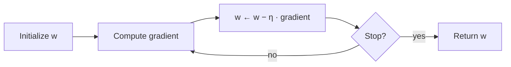

The [first entry](/blog/learning-from-data) framed supervised learning as **empirical risk minimization**: choose the parameters $\mathbf{w}$ of a model so that the average loss over the training set is as small as possible. For the linear model with squared loss the minimizer had a closed form, the normal equations. That is the exception. Logistic regression, neural networks and most other models have no closed-form minimizer, and even least squares becomes expensive to solve directly when there are millions of features. The general tool is iterative: start from a guess and repeatedly move the parameters a small step in the direction that reduces the loss.

This entry develops that tool, **gradient descent**, from the update rule to the variants used in practice. It assumes the vocabulary of the first entry (features, labels, model, loss, empirical risk, training set, design matrix) and the same mathematical background: partial derivatives, vectors and matrices. One further idea from linear algebra is used and briefly recalled where it appears: the eigenvalues of a symmetric matrix. The worked examples reuse the synthetic data set of [Section 5 of the first entry](/blog/learning-from-data#5-worked-example-least-squares-on-synthetic-data) (20 examples, NumPy seed 0, Python 3.13, NumPy 2.5.3), so their answers can be checked against the exact least-squares solution found there.

## 1. The optimization problem

### 1.1 The objective

Throughout this entry the function being minimized is the **objective** $J(\mathbf{w})$, here the empirical risk of the first entry:

$$
J(\mathbf{w}) = \hat{R}_n(\mathbf{w}) = \frac{1}{n}\sum_{i=1}^{n} \ell\big(f(\mathbf{x}_i; \mathbf{w}), y_i\big).
$$

Two objectives serve as examples:

- **Least squares** (linear model, squared loss): $J(\mathbf{w}) = \frac{1}{n}\lVert X\mathbf{w} - \mathbf{y}\rVert^2$, with gradient $\nabla J(\mathbf{w}) = \frac{2}{n} X^\top (X\mathbf{w} - \mathbf{y})$.
- **Logistic regression** (binary labels $y_i \in \{0, 1\}$, cross-entropy loss): the predicted probability is $p_i = \sigma(\mathbf{x}_i^\top \mathbf{w})$, where $\sigma(s) = 1/(1 + e^{-s})$ is the logistic function and $\mathbf{x}_i$ includes the constant 1 for the intercept.

For logistic regression the gradient takes the same form as for least squares, with the residual $X\mathbf{w} - \mathbf{y}$ replaced by $\mathbf{p} - \mathbf{y}$ and no factor 2. The derivative of the logistic function is $\sigma'(s) = \sigma(s)\,(1 - \sigma(s))$, and with it the derivative of the cross-entropy loss with respect to the score $s_i$ simplifies to $p_i - y_i$. By the chain rule,

$$
\nabla J(\mathbf{w}) = \frac{1}{n} X^\top \big(\mathbf{p} - \mathbf{y}\big),
$$

where $\mathbf{p}$ is the vector of predicted probabilities. Setting this to zero gives equations that are nonlinear in $\mathbf{w}$ (because $\mathbf{p}$ depends on $\mathbf{w}$ through $\sigma$) and have no closed-form solution. They must be solved iteratively.

### 1.2 What "solving" means here

An iterative method produces a sequence $\mathbf{w}_0, \mathbf{w}_1, \mathbf{w}_2, \dots$, numbered by the **iteration** (or step) $t$. A good method makes $J(\mathbf{w}_t)$ approach the smallest attainable value $J^* = \min_{\mathbf{w}} J(\mathbf{w})$, and ideally makes $\mathbf{w}_t$ approach a minimizer $\mathbf{w}^*$.

In machine learning, the optimization does not need to be solved to many decimal places. The objective is the training error, which is itself only a noisy stand-in for the risk; once the optimization error is much smaller than the gap between training error and risk, further digits buy nothing. This is one reason why crude but cheap methods, especially the stochastic methods of Section 4, dominate in practice.

## 2. Gradient descent

### 2.1 The gradient points uphill

The **gradient** $\nabla J(\mathbf{w})$ is the vector of partial derivatives $\partial J / \partial w_j$. Near a point $\mathbf{w}$, a smooth function is approximated by its first-order Taylor expansion:

$$
J(\mathbf{w} + \Delta) \approx J(\mathbf{w}) + \nabla J(\mathbf{w})^\top \Delta .
$$

Among all small steps $\Delta$ of a given length, the change $\nabla J^\top \Delta$ is most negative when $\Delta$ points opposite to the gradient (the dot product of two vectors of fixed lengths is smallest when they point in opposite directions). So $-\nabla J(\mathbf{w})$ is the direction of steepest descent, and the gradient is zero exactly at the stationary points, where no direction gives a first-order decrease.

### 2.2 The update rule

**Gradient descent** repeats one step:

$$
\mathbf{w}_{t+1} = \mathbf{w}_t - \eta\,\nabla J(\mathbf{w}_t).
$$

The positive number $\eta$ (eta) is the **learning rate**, or step size. It is a hyperparameter: chosen by the user, not learned. The procedure is a loop:



Each step needs one gradient evaluation. For least squares that is the product $X^\top (X\mathbf{w} - \mathbf{y})$, which costs a number of operations proportional to $n \times (d+1)$, the size of the design matrix. Solving the normal equations directly costs of the order of $n(d+1)^2$ operations to form $X^\top X$ and $(d+1)^3$ to factorize it, which is what makes iteration attractive when the number of features is large.

### 2.3 When to stop

Common stopping rules, often combined, are:

- a fixed budget of iterations;
- the gradient norm $\lVert \nabla J(\mathbf{w}_t) \rVert$ falls below a tolerance;
- the objective improves by less than a tolerance over some number of steps;
- the error on held-out data stops improving. This last rule, **early stopping**, is a form of regularization rather than an optimization criterion, and the third entry treats it as such.

## 3. The learning rate

### 3.1 One dimension

The effect of $\eta$ can be seen exactly on a one-dimensional quadratic. Take $J(w) = (w - 3)^2$, whose minimum is at $w^* = 3$ and whose second derivative is $a = 2$. The gradient is $2(w - 3)$, so one step gives

$$
w_{t+1} - 3 = (w_t - 3) - 2\eta\,(w_t - 3) = (1 - 2\eta)\,(w_t - 3).
$$

The error is multiplied by the same factor $1 - \eta a$ at every step. Starting from $w_0 = 0$:

| $\eta$ | Factor $1 - 2\eta$ | $w_1$ | $w_2$ | $w_3$ | Behavior |
|---|---|---|---|---|---|
| 0.1 | 0.8 | 0.600 | 1.080 | 1.464 | Slow, monotone convergence |
| 0.5 | 0 | 3.000 | 3.000 | 3.000 | Exact in one step |
| 0.75 | −0.5 | 4.500 | 2.250 | 3.375 | Oscillating convergence |
| 1.1 | −1.2 | 6.600 | −1.320 | 8.184 | Oscillating divergence |

The rule for a quadratic with curvature $a > 0$ follows at once: gradient descent converges if and only if $\lvert 1 - \eta a \rvert < 1$, that is, $0 < \eta < 2/a$. The fastest choice is $\eta = 1/a$, which jumps straight to the minimum. Too small a learning rate wastes iterations; too large a one overshoots, and beyond $2/a$ each overshoot is larger than the last.

### 3.2 Many dimensions: curvature and conditioning

For the least-squares objective with several parameters the same analysis holds along special directions. The matrix of second derivatives, the **Hessian**, is

$$
H = \nabla^2 J = \frac{2}{n} X^\top X ,
$$

and it does not depend on $\mathbf{w}$, because $J$ is quadratic. Using $\nabla J(\mathbf{w}) = H(\mathbf{w} - \mathbf{w}^*)$, which holds because $\nabla J(\mathbf{w}^*) = 0$, one step of gradient descent gives

$$
\mathbf{w}_{t+1} - \mathbf{w}^* = (I - \eta H)\,(\mathbf{w}_t - \mathbf{w}^*).
$$

$H$ is symmetric, so it has real **eigenvalues** $\lambda_1 \le \dots \le \lambda_p$, where $p = d + 1$ is the number of parameters, with orthogonal **eigenvectors**: directions $\mathbf{v}$ along which $H$ acts as a scaling, $H\mathbf{v} = \lambda\mathbf{v}$. Here the eigenvalues are non-negative, since $\mathbf{v}^\top X^\top X \mathbf{v} = \lVert X\mathbf{v}\rVert^2 \ge 0$, and they are positive when the columns of $X$ are linearly independent. Along each eigenvector the error is multiplied by $1 - \eta\lambda_i$ per step, exactly as in one dimension. Hence:

- Gradient descent on least squares converges for every starting point if and only if $0 < \eta < 2/\lambda_{\max}$. The steepest direction sets the limit.
- Once $\eta$ is limited in this way, the flattest direction sets the speed: its error shrinks by $1 - \eta\lambda_{\min}$ per step, which is close to 1 when $\lambda_{\min}$ is small.

The ratio $\kappa = \lambda_{\max}/\lambda_{\min}$ is the **condition number** of $H$. The best fixed learning rate, $\eta = 2/(\lambda_{\min} + \lambda_{\max})$, balances the two extreme directions and shrinks the error by $(\kappa - 1)/(\kappa + 1)$ per step. A well-conditioned problem ($\kappa$ near 1) converges in a few steps; an ill-conditioned one zig-zags across a long narrow valley and converges slowly whatever the learning rate.

### 3.3 Worked example: four learning rates

For the data set of the first entry, the Hessian and its eigenvalues are

$$
H = \begin{pmatrix} 2.000 & 1.025 \\ 1.025 & 0.732 \end{pmatrix}, \qquad \lambda_{\min} = 0.161, \quad \lambda_{\max} = 2.571,
$$

so the learning rate must stay below $2/2.571 = 0.778$, the condition number is $\kappa = 16.0$, and the best fixed rate $2/(0.161 + 2.571) = 0.732$ reduces the error by a factor of $0.882$ per step. The code below runs 100 steps of gradient descent from $\mathbf{w}_0 = (0, 0)$ with four learning rates and compares the result with the exact minimizer $\mathbf{w}^* = (1.181, 1.707)$ from the first entry.

```python
import numpy as np

rng = np.random.default_rng(seed=0)                   # same data as the first entry
n, sigma = 20, 0.5
x = rng.uniform(0.0, 1.0, size=n)
y = 1.0 + 2.0 * x + rng.normal(0.0, sigma, size=n)
X = np.column_stack([np.ones(n), x])
w_star = np.linalg.solve(X.T @ X, X.T @ y)            # exact minimizer, for reference

def gradient_descent(eta, steps):
    w = np.zeros(2)                                   # start at w = (0, 0)
    for _ in range(steps):
        grad = 2.0 / n * X.T @ (X @ w - y)            # gradient of the training MSE
        w = w - eta * grad
    return w

for eta in [0.05, 0.5, 0.75, 0.8]:
    w = gradient_descent(eta, steps=100)
    mse = np.mean((X @ w - y) ** 2)
    print(f"eta={eta:<5} w={np.round(w, 3)}  MSE={mse:.4g}  "
          f"distance={np.linalg.norm(w - w_star):.2e}")
```

It prints:

```text
eta=0.05  w=[1.38 1.35]  MSE=0.1258  distance=4.09e-01
eta=0.5   w=[1.181 1.707]  MSE=0.1124  distance=2.10e-04
eta=0.75  w=[1.18  1.707]  MSE=0.1124  distance=1.08e-03
eta=0.8   w=[-403.997 -224.035]  MSE=2.765e+05  distance=4.64e+02
```

Each line matches the analysis of Section 3.2:

- With $\eta = 0.05$ the flat direction shrinks by only $1 - 0.05 \times 0.161 = 0.992$ per step, and after 100 steps the parameters are still visibly wrong. The training MSE (0.1258) is close to the minimum (0.1124) all the same: a flat direction is one along which the objective hardly changes, so a large parameter error there costs little loss.
- With $\eta = 0.5$ the slowest factor is $1 - 0.5 \times 0.161 = 0.920$, and the parameters agree with the exact solution to three decimals.
- With $\eta = 0.75$, close to the limit, the steep direction now oscillates with factor $\lvert 1 - 0.75 \times 2.571 \rvert = 0.928$, slightly worse than at $\eta = 0.5$. A larger learning rate is not always faster.
- With $\eta = 0.8$, just above $0.778$, the steep direction is multiplied by $\lvert 1 - 0.8 \times 2.571 \rvert = 1.06$ at every step and the iteration diverges.

The divergence at $\eta = 0.8$ is the typical symptom of a learning rate that is too large: a loss that grows from step to step while the parameters swing back and forth with increasing amplitude, until the numbers overflow. The usual practical response is to reduce $\eta$ by a factor of about 2 to 10 and try again.

### 3.4 Feature scaling

The Hessian depends on the units of the features, so the same data can be easy or hard to optimize depending on how they are expressed. The code below computes the eigenvalues for the original feature $x \in [0, 1]$, for the same feature multiplied by 10 (as if it had been recorded in different units), and for the **standardized** feature $z = (x - \bar{x})/s_x$, which has mean 0 and standard deviation 1 on the training set when $s_x$ is the standard deviation computed with divisor $n$ (NumPy's default for `x.std()`).

```python
import numpy as np

rng = np.random.default_rng(seed=0)
n, sigma = 20, 0.5
x = rng.uniform(0.0, 1.0, size=n)
y = 1.0 + 2.0 * x + rng.normal(0.0, sigma, size=n)

def hessian_eigs(feature):
    X = np.column_stack([np.ones(n), feature])
    return np.linalg.eigvalsh(2.0 / n * X.T @ X)      # ascending order

z = (x - x.mean()) / x.std()                          # standardized feature
for name, f in [("x in [0, 1]", x), ("10 x", 10 * x), ("standardized", z)]:
    lo, hi = hessian_eigs(f)
    print(f"{name:13s} eigenvalues {lo:.4f} {hi:.4f}  "
          f"condition number {hi / lo:.1f}  eta limit {2 / hi:.4f}")
```

```text
x in [0, 1]   eigenvalues 0.1608 2.5709  condition number 16.0  eta limit 0.7779
10 x          eigenvalues 0.5540 74.6155  condition number 134.7  eta limit 0.0268
standardized  eigenvalues 2.0000 2.0000  condition number 1.0  eta limit 1.0000
```

Rescaling the feature by 10 raises the condition number from 16 to 135, and at the best fixed learning rate the error then shrinks by only $(134.7 - 1)/(134.7 + 1) = 0.985$ per step: reducing it by a factor of $10^6$ takes about 930 steps instead of about 110. Standardizing does the opposite. With a centered feature whose mean square is 1 (the divisor-$n$ convention), $\frac{1}{n}X^\top X$ is the identity matrix, so $H = 2I$, both eigenvalues equal 2, and $\eta = 0.5$ reaches the minimum in a single step.

Real problems are rarely this tidy, but the lesson carries over: features on scales that differ by orders of magnitude make gradient descent slow. Standardizing them, by subtracting the mean and dividing by the standard deviation (both computed on the training set only, for reasons the fourth entry explains), is a cheap and standard remedy. It changes the parametrization, not the set of predictors the linear model can express, so predictions from the fitted model are the same once the optimization has converged.

### 3.5 Beyond quadratics

Most objectives are not quadratic, but the quadratic picture remains a good local guide: near a minimum, a smooth function looks like a quadratic whose Hessian is the local curvature. Two general facts frame what can be guaranteed.

A function is **convex** if the line segment between any two points on its graph lies on or above the graph; for a twice-differentiable function this means the Hessian has no negative eigenvalues anywhere. Least squares and logistic regression are convex. For a convex function every stationary point is a global minimum, so gradient descent cannot be trapped. If, in addition, the gradient is **$L$-smooth** (it changes by at most $L\lVert \mathbf{u} - \mathbf{v} \rVert$ between any two points $\mathbf{u}$ and $\mathbf{v}$; for a quadratic, $L = \lambda_{\max}$), then gradient descent with $\eta = 1/L$ decreases the objective at every step and satisfies

$$
J(\mathbf{w}_t) - J^* \le \frac{L\,\lVert \mathbf{w}_0 - \mathbf{w}^* \rVert^2}{2t}.
$$

The bound guarantees convergence but falls only as $1/t$. When the curvature is also bounded below ($\lambda_{\min} > 0$, a property called **strong convexity**), the error shrinks geometrically, as Section 3.2 showed for least squares.

The objectives of neural networks are **non-convex**. They can have many local minima and **saddle points**, stationary points that are a minimum along some directions and a maximum along others. Gradient descent then finds a point of small gradient, not necessarily the global minimum, and the result can depend on the initialization. In that setting the learning rate is usually found by trial on a short run, watching the training loss.

## 4. Stochastic gradient descent

### 4.1 The gradient is an average

Every objective in Section 1 is an average of per-example losses, so its gradient is an average of per-example gradients:

$$
\nabla J(\mathbf{w}) = \frac{1}{n}\sum_{i=1}^{n} \nabla \ell_i(\mathbf{w}), \qquad \ell_i(\mathbf{w}) = \ell\big(f(\mathbf{x}_i; \mathbf{w}), y_i\big).
$$

Computing it exactly means touching all $n$ examples for every step. When $n$ is in the millions this is wasteful, because the average of a random subset is already a good estimate of the average of the whole.

**Stochastic gradient descent** (SGD) replaces the full gradient with the average over a small random subset $B_t$ of the examples, called a **mini-batch**, drawn afresh at every step:

$$
\mathbf{w}_{t+1} = \mathbf{w}_t - \eta_t\,\frac{1}{\lvert B_t \rvert}\sum_{i \in B_t} \nabla \ell_i(\mathbf{w}_t).
$$

Because $B_t$ is drawn uniformly at random, the mini-batch gradient is an unbiased estimate of the full gradient: right on average, noisy at each step. The **batch size** $\lvert B_t \rvert$ ranges from 1 (the original form of SGD) to $n$ (ordinary, or "full-batch", gradient descent). In practice the examples are usually shuffled once per pass and then taken in consecutive groups; one pass over the training set is an **epoch**.

### 4.2 The noise floor and learning-rate schedules

The noise changes how the learning rate behaves. Near the minimum the full gradient goes to zero, but the per-example gradients do not, since each example is fitted imperfectly. With a constant learning rate, SGD therefore never settles: it keeps jittering in a region around $\mathbf{w}^*$ whose size grows with $\eta$ and with the variance of the per-example gradients, and shrinks with the batch size.

The standard remedies are:

- **A larger batch**, which reduces the variance of the gradient estimate in proportion to $1/\lvert B \rvert$ for sampling with replacement, at a proportionally higher cost per step.
- **A decreasing learning rate** (a **schedule**), which shrinks the jitter over time. The classical sufficient conditions for convergence, due to Robbins and Monro, are that the steps are large enough in total to reach the minimum from anywhere and small enough that the noise averages out: $\sum_t \eta_t = \infty$ and $\sum_t \eta_t^2 < \infty$. The schedule $\eta_t = \eta_0/(1 + t/\tau)$ satisfies both. Step decay (cutting $\eta$ by a fixed factor every few epochs) and cosine decay are common practical alternatives.

### 4.3 Worked example: batch size and schedule

The code below runs SGD on the same 20 examples for 50 epochs with $\eta_0 = 0.1$, in three configurations: batch size 1 with constant learning rate, batch size 5 with constant learning rate, and batch size 1 with the schedule $\eta_t = 0.1/(1 + t/100)$. The shuffling uses its own generator (seed 1) so that the data stay identical to the earlier examples. The quantity reported is the **excess training MSE**, the training MSE minus its exact minimum 0.1124.

```python
import numpy as np

rng = np.random.default_rng(seed=0)                   # same data as before
n, sigma = 20, 0.5
x = rng.uniform(0.0, 1.0, size=n)
y = 1.0 + 2.0 * x + rng.normal(0.0, sigma, size=n)
X = np.column_stack([np.ones(n), x])
w_star = np.linalg.solve(X.T @ X, X.T @ y)

def sgd(eta0, batch, epochs, decay, seed=1):
    order_rng = np.random.default_rng(seed)           # separate stream for shuffling
    w, t = np.zeros(2), 0
    for _ in range(epochs):
        idx = order_rng.permutation(n)                # reshuffle every epoch
        for start in range(0, n, batch):
            b = idx[start:start + batch]
            grad = 2.0 / len(b) * X[b].T @ (X[b] @ w - y[b])
            eta = eta0 / (1.0 + t / decay) if decay else eta0
            w = w - eta * grad
            t += 1
    return w

for batch, decay in [(1, None), (5, None), (1, 100)]:
    w = sgd(eta0=0.1, batch=batch, epochs=50, decay=decay)
    gap = np.mean((X @ w - y) ** 2) - np.mean((X @ w_star - y) ** 2)
    print(f"batch={batch} decay={decay}: w={np.round(w, 3)}  excess MSE={gap:.1e}")
```

```text
batch=1 decay=None: w=[1.102 1.648]  excess MSE=1.2e-02
batch=5 decay=None: w=[1.189 1.676]  excess MSE=1.6e-04
batch=1 decay=100: w=[1.188 1.688]  excess MSE=5.1e-05
```

With one example per step and a constant learning rate, the final parameters are wherever the last few noisy steps left them. Averaging five examples per step reduces the jitter considerably, and a decaying learning rate (which has fallen to $0.1/(1 + 999/100) = 0.009$ by the last of the 1000 steps) reduces it further. These are single runs, and the excess MSE of an individual run depends on the shuffle. Repeating each configuration with shuffle seeds 1 to 20 gives median excess MSEs of $4.1 \times 10^{-3}$, $1.9 \times 10^{-4}$ and $4.4 \times 10^{-5}$ respectively, the same ordering, but the constant-rate, batch-size-1 runs range from $2.5 \times 10^{-5}$ to $3.1 \times 10^{-2}$. Judging an optimizer from one run is as unreliable as judging a model from one split, a point the fourth entry makes about evaluation.

On 20 examples SGD has no advantage over full-batch gradient descent. Its advantage appears when $n$ is large. An epoch of SGD with small batches then makes thousands of parameter updates for the cost of one full gradient, and early in training, when the parameters are far from the minimum, the noisy steps make progress almost as well as exact ones.

## 5. Momentum and adaptive methods

Two refinements of the basic update are in wide use. Both keep the cost per step close to that of one gradient evaluation.

**Momentum** (the heavy-ball method of Polyak) adds a fraction of the previous step to the current one:

$$
\mathbf{v}_{t+1} = \beta\,\mathbf{v}_t - \eta\,\nabla J(\mathbf{w}_t), \qquad \mathbf{w}_{t+1} = \mathbf{w}_t + \mathbf{v}_{t+1},
$$

with $0 \le \beta < 1$ (0.9 is a common choice) and $\mathbf{v}_0 = \mathbf{0}$. In a long narrow valley the gradient components across the valley alternate in sign and partly cancel in $\mathbf{v}$, while the components along the valley point the same way at every step and accumulate. The effect is to speed up exactly the slow, flat directions that limit plain gradient descent on an ill-conditioned problem. With $\beta = 0$ the method reduces to gradient descent.

**Adaptive methods** give each parameter its own effective learning rate, scaled down where the gradients have been large and up where they have been small, which partly compensates for poor scaling of the kind seen in Section 3.4. A widely used one is **Adam** (Kingma and Ba), which keeps exponential moving averages of the gradient $\mathbf{g}_t$ and of its elementwise square:

$$
\mathbf{m}_t = \beta_1 \mathbf{m}_{t-1} + (1 - \beta_1)\,\mathbf{g}_t, \qquad
\mathbf{s}_t = \beta_2 \mathbf{s}_{t-1} + (1 - \beta_2)\,\mathbf{g}_t^2,
$$

corrects them for their initialization at zero ($\hat{\mathbf{m}}_t = \mathbf{m}_t/(1 - \beta_1^t)$, $\hat{\mathbf{s}}_t = \mathbf{s}_t/(1 - \beta_2^t)$), and updates each parameter by $-\eta\,\hat{m}_t / (\sqrt{\hat{s}_t} + \epsilon)$, elementwise, starting from $\mathbf{m}_0 = \mathbf{s}_0 = \mathbf{0}$. The defaults proposed in the original paper are $\beta_1 = 0.9$, $\beta_2 = 0.999$ and $\epsilon = 10^{-8}$. Library defaults do not always match: PyTorch's `torch.optim.Adam` uses the same three values, while Keras 3's `Adam` uses $\epsilon = 10^{-7}$ (applied in a slightly different place in the update), so check the documentation of the library and version in use. Adam still has a learning rate, and it still matters.

None of these methods changes what is being minimized, only how quickly and reliably the minimum is approached. Whether the minimizer of the training error is a good predictor is a separate question, and it is the subject of the next entry.

## 6. Exercises

**Exercise 1.** For $J(w) = 4(w - 1)^2$, what range of learning rates makes gradient descent converge, and which learning rate reaches the minimum in one step?

<details>
<summary>Answer</summary>

The second derivative is $a = 8$, so convergence requires $0 < \eta < 2/8 = 0.25$, and $\eta = 1/8 = 0.125$ reaches $w = 1$ in one step from any starting point.

</details>

**Exercise 2.** A least-squares Hessian has eigenvalues 0.5 and 50. What is the largest learning rate for which gradient descent converges, and what factor does the error shrink by per step at the best fixed learning rate?

<details>
<summary>Answer</summary>

$\eta < 2/50 = 0.04$. The condition number is $\kappa = 100$; the best rate $2/(0.5 + 50) = 0.0396$ shrinks the error by $(\kappa - 1)/(\kappa + 1) = 99/101 = 0.980$ per step, so reducing it by a factor of $10^6$ takes about $\ln(10^{-6})/\ln(99/101) \approx 691$ steps.

</details>

**Exercise 3.** Show that, for logistic regression, the derivative of the cross-entropy loss $-[y \ln p + (1 - y)\ln(1 - p)]$ with respect to the score $s$ (where $p = \sigma(s)$) is $p - y$.

<details>
<summary>Answer</summary>

$\partial \ell/\partial p = -y/p + (1 - y)/(1 - p)$ and $dp/ds = p(1 - p)$. Multiplying, $-y(1 - p) + (1 - y)p = p - y$.

</details>

**Exercise 4.** Why does SGD with a constant learning rate fail to converge exactly to the minimizer of a least-squares problem whose residuals at the minimum are not all zero, while full-batch gradient descent with a suitable constant learning rate does?

<details>
<summary>Answer</summary>

At the minimizer the full gradient is zero, so full-batch steps vanish. The per-example gradients there are $2(\mathbf{x}_i^\top \mathbf{w}^* - y_i)\,\mathbf{x}_i$, which are not zero when the residuals are not, so each SGD step keeps moving the parameters by an amount proportional to $\eta$. Only a decreasing learning rate (or a growing batch) makes those moves shrink to zero.

</details>

## 7. Summary

| Question | Answer |
|---|---|
| What does gradient descent do? | Repeats $\mathbf{w} \leftarrow \mathbf{w} - \eta\nabla J(\mathbf{w})$, moving the parameters against the gradient, the direction of steepest local increase. |
| What is the learning rate? | The step size $\eta$, a hyperparameter; it decides between slow progress, fast convergence, oscillation and divergence. |
| When does gradient descent converge on least squares? | If and only if $0 < \eta < 2/\lambda_{\max}$, where $\lambda_{\max}$ is the largest eigenvalue of the Hessian $\frac{2}{n}X^\top X$. |
| What sets the speed? | The condition number $\lambda_{\max}/\lambda_{\min}$; at the best fixed rate the error shrinks by $(\kappa - 1)/(\kappa + 1)$ per step. |
| Why standardize features? | It improves conditioning, so a larger learning rate is stable and fewer steps are needed. |
| What is SGD? | Gradient descent with the gradient estimated from a random mini-batch: much cheaper steps, but noisy, so it needs a decreasing learning rate or larger batches to settle. |
| What do momentum and Adam add? | Momentum accumulates consistent gradient directions; Adam scales each parameter's step by running gradient statistics. Neither changes the objective. |

The optimizer's task ends at the minimum of the training error, and the first entry showed that the training error is an optimistic guide to performance on new data. The next entry, [Generalization, Overfitting, and Regularization](/blog/generalization-overfitting-and-regularization), measures how optimistic it becomes as models grow more flexible, and shows how penalties and early stopping trade a slightly higher training error for a lower risk.

### References

- L. Bottou, F. E. Curtis and J. Nocedal, "Optimization Methods for Large-Scale Machine Learning," *SIAM Review*, vol. 60, no. 2, pp. 223–311, 2018.
- S. Boyd and L. Vandenberghe, *Convex Optimization*, Cambridge University Press, 2004.
- I. Goodfellow, Y. Bengio and A. Courville, *Deep Learning*, MIT Press, 2016.
- D. P. Kingma and J. Ba, "Adam: A Method for Stochastic Optimization," in *3rd International Conference on Learning Representations (ICLR)*, 2015.
- J. Nocedal and S. J. Wright, *Numerical Optimization*, 2nd ed., Springer, 2006.
- B. T. Polyak, "Some methods of speeding up the convergence of iteration methods," *USSR Computational Mathematics and Mathematical Physics*, vol. 4, no. 5, pp. 1–17, 1964.
- H. Robbins and S. Monro, "A Stochastic Approximation Method," *The Annals of Mathematical Statistics*, vol. 22, no. 3, pp. 400–407, 1951.
