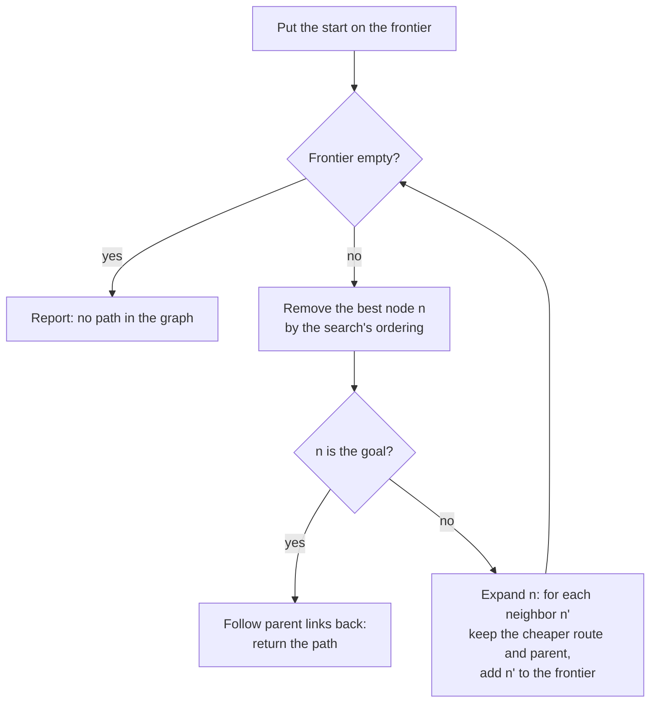
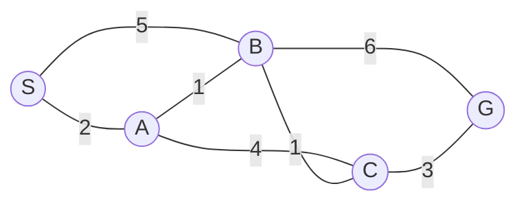

The [first entry](/blog/configuration-space-and-the-planning-problem) of [Motion Planning for Robots](/series/motion-planning) stated the planning problem in configuration space: the robot becomes a point $q$, the obstacles become the region $\mathcal{C}_{\mathrm{obs}}$, and a solution is a path through the free space $\mathcal{C}_{\mathrm{free}}$ from $q_{\mathrm{start}}$ to $q_{\mathrm{goal}}$. This entry treats the grid and graph search family from that entry's map of methods: discretize the free space into a graph, then search the graph. Dijkstra's algorithm and A* return optimal paths on such a graph, and the arguments that prove it also say when a heuristic is safe and how much work a bounded loss of optimality saves. These guarantees hold only on the graph, and a grid grows exponentially with the dimension of the configuration space, which is why the next entry turns to sampling.

The entry builds on the definitions of path cost, completeness and optimality in [Section 4 of the first entry](/blog/configuration-space-and-the-planning-problem#4-paths-cost-and-what-a-planner-guarantees) and on its treatment of obstacles. It assumes the reader knows what a graph and a queue are and can read Python.

**Conventions.** A graph has a set of nodes (vertices) and a set of edges, and the cost of the edge from node $n$ to node $n'$ is $c(n, n') \ge 0$. During a search, $g(n)$ is the cost of the best path from the start found so far, $h(n)$ is a heuristic estimate of the cost from $n$ to the goal, and $f(n) = g(n) + h(n)$. The cost of an optimal path from the start to the goal is $C^*$, and $h^*(n)$ is the true cost of an optimal path from $n$ to the goal.

Grid cells are indexed (row, column) from 0, with row 0 at the top of each printed map; grid costs are in units of the cell size, so that a straight step costs 1 and a diagonal step $\sqrt{2}$. The two-link arm of Section 6.3 has $l_1 = 1.0$ m and $l_2 = 0.7$ m, as in [Forward and Inverse Kinematics of a Planar Arm](/blog/planar-arm-kinematics), and its joint angles $\theta_1, \theta_2$ are in radians. The code is Python 3.13 with its standard library, and NumPy 2.5 where a random map or the arm needs it; every search is deterministic, and the one random map states its seed. The listings show the core of each algorithm; the map definitions and printing code are omitted.

## 1. Planning as graph search

A **graph search** answers a discrete version of the planning question: given a finite set of states, the moves allowed between them and the cost of each move, find a sequence of moves from a start state to a goal state, the cheapest if possible. LaValle's *Planning Algorithms* treats this discrete planning problem before any continuous method. A motion planner first builds a graph whose nodes are configurations in $\mathcal{C}_{\mathrm{free}}$ and whose edges are short motions that a collision checker has verified, then searches it. The search finds the best path *in the graph*; the graph decides how close that is to the best path in $\mathcal{C}_{\mathrm{free}}$.

Every algorithm in this entry is an instance of one loop. The search keeps a **frontier** (also called the open list), the set of nodes it has reached but not yet processed, and a **closed set** of nodes it has finished. At each step it removes one node from the frontier and **expands** it: it examines each neighbor, records a cheaper way to reach it when one is found, and adds it to the frontier. The search stops when it removes the goal, or reports failure when the frontier is empty.



The methods differ only in the meaning of "best". A first-in, first-out queue gives **breadth-first search**, which finds a path with the fewest edges, optimal when all edges cost the same. A priority queue ordered by $g(n)$ gives Dijkstra's algorithm (Section 3), and one ordered by $f(n) = g(n) + h(n)$ gives A* (Section 4). On a finite graph, a search that never discards a reachable node is complete *on the graph*: it returns a path if the graph contains one. Whether a failure means that no path exists in $\mathcal{C}_{\mathrm{free}}$ is the question of Section 6.

This entry compares searches by the number of **node expansions**, which does not depend on the speed of the machine and tracks the number of collision checks, often a larger cost on a robot than the search itself.

## 2. From a map to a graph

### 2.1 Occupancy grids

A common map for a mobile robot is an **occupancy grid**: the plane is divided into square cells of equal size, and each cell holds the probability that it is occupied. Moravec and Elfes introduced the representation for sonar-based mapping, and Elfes developed it into a probabilistic framework. The [state estimation entry of the Introduction to Robotics series](/blog/sensing-and-state-estimation#72-localization-and-mapping) describes how such a grid is built while the robot localizes itself. For planning, the probabilities are thresholded into free, occupied and unknown cells. Treating unknown cells as free is optimistic, and the robot discovers the truth when it gets there; treating them as occupied is safe but may report that no path exists. Section 5.4 returns to the optimistic choice.

A grid of cells describes the workspace $\mathcal{W}$, not the configuration space. For a disk robot of radius $\rho$ that can move in any direction, the first entry showed that the configuration-space obstacles are the workspace obstacles grown by $\rho$ (the Minkowski sum of [Section 3 of the first entry](/blog/configuration-space-and-the-planning-problem#3-obstacles-in-configuration-space)). On a grid this **inflation** marks every cell within $\rho$ of an occupied cell as blocked, after which the robot is planned as a point moving between free cells. The grid then is a discretized $\mathcal{C}_{\mathrm{free}}$ of dimension $d = 2$, and the cell size is its **resolution**.

### 2.2 Connectivity and edge costs

Each free cell becomes a node, and edges join neighboring free cells. Two neighborhoods are common. With **4-connectivity** a cell connects to the four cells that share a side with it, at cost 1. With **8-connectivity** it also connects to the four diagonal cells, at cost $\sqrt{2}$, the distance between the centers. A diagonal move passes between the two cells that share a side with both of its endpoints, so the implementation used here allows it only when both of those cells are free; otherwise the path would cut the corner of an obstacle.

The neighborhood bounds how well a grid path can approximate a straight line. In open space, a move by $\Delta x$ columns and $\Delta y$ rows, with $\Delta x \ge \Delta y \ge 0$, has the straight-line length $\sqrt{\Delta x^2 + \Delta y^2}$. On a 4-connected grid the shortest path costs $\Delta x + \Delta y$. Writing the direction of the line as an angle $\phi$ from the $x$ axis, the ratio of the two is $\cos\phi + \sin\phi$, which reaches $\sqrt{2} \approx 1.414$ at $\phi = 45°$: a 4-connected path can be 41.4% longer than the straight line. On an 8-connected grid the shortest path takes $\Delta y$ diagonal steps and $\Delta x - \Delta y$ straight ones, for a cost of

$$
\Delta x + (\sqrt{2} - 1)\,\Delta y,
$$

and the ratio $\cos\phi + (\sqrt{2} - 1)\sin\phi$ has its maximum $\sqrt{1 + (\sqrt{2} - 1)^2} = \sqrt{4 - 2\sqrt{2}} \approx 1.0824$ at $\tan\phi = \sqrt{2} - 1$, that is $\phi = 22.5°$. Larger neighborhoods (16 or more neighbors) shrink the excess further at the price of more edges per node and longer edges to check for collision.

The examples of Sections 3 to 5 use the following map of 15 rows and 26 columns, with two walls one cell thick. The start `S` is cell (7, 2) and the goal `G` is cell (7, 24); 370 of the 390 cells are free.

```text
..........................
..........................
..........#...............
..........#.......#.......
..........#.......#.......
..........#.......#.......
..........#.......#.......
..S.......#.......#.....G.
..........#.......#.......
..........#.......#.......
..........#.......#.......
..................#.......
..................#.......
..................#.......
..........................
```

### 2.3 Visibility graphs

A grid is not the only graph a map can give. Among polygonal obstacles in the plane, the shortest path for a point is a polygonal line that bends only at obstacle vertices, since a bend in open space could be shortened. Lozano-Pérez and Wesley used this property in the **visibility graph**, whose nodes are the start, the goal and the obstacle vertices, with an edge between every pair of nodes whose connecting segment does not enter the interior of an obstacle. A search on it returns the exact shortest path.

For the map above, each wall is a rectangle, so the visibility graph has 10 nodes (the start, the goal and eight corners) and, as the program `anyangle.py` finds, 18 edges. Dijkstra's algorithm on it returns a path of length 25.4691 cell sizes, through the two upper corners of the first wall and the upper right corner of the second:

```text
visibility graph         cost 25.4691  graph 10 vertices, 18 edges  path [(2.0, 7.0), (9.5, 1.5), (10.5, 1.5), (18.5, 2.5), (24.0, 7.0)]
```

The coordinates are $(x, y) = $ (column, row), with each cell a unit square centered on its indices. The path has zero **clearance**, the distance between the robot and the nearest obstacle, so in practice the obstacles are inflated by the robot's radius plus a margin before the graph is built. Testing every pair of $n$ vertices against every obstacle edge builds the graph in $O(n^3)$ time; Choset et al. describe a rotational plane sweep that takes $O(n^2 \log n)$. The method does not carry over to three dimensions, where a shortest path among polyhedra can pass along obstacle edges rather than through vertices. Visibility graphs suit maps made of a few polygons; occupancy grids suit maps built from sensor data, and the rest of this entry uses them.

## 3. Dijkstra's algorithm

### 3.1 The algorithm

**Dijkstra's algorithm** finds the cheapest path from a start node to every other node of a graph whose edge costs are nonnegative. Dijkstra published it in 1959, in a three-page note that also gave an algorithm for minimum spanning trees. The idea is to settle nodes in order of their distance from the start. The frontier is a priority queue ordered by $g(n)$; the node removed is always one with the smallest $g$, and when it is removed its $g$ is final. Expanding a node $n$ **relaxes** each edge to a neighbor $n'$: if $g(n) + c(n, n') < g(n')$, the route through $n$ is cheaper, so $g(n')$ is lowered and $n$ is recorded as the parent of $n'$.

In the five-node graph below, the edge labels are costs:



The program `dijkstra_trace.py` prints each expansion:

```text
expand S (g=0): g(A)=2, g(B)=5
expand A (g=2): g(B)=3, g(C)=6
expand B (g=3): g(C)=4, g(G)=9
expand C (g=4): g(G)=7
expand G (g=7): no change
path S-A-B-C-G cost 7
```

The tentative values fall as cheaper routes appear: $B$ drops from 5 to 3 and $G$ from 9 to 7. A node, once expanded, keeps its value.

### 3.2 Why it is correct

The claim is that when a node $u$ is removed from the frontier, $g(u)$ equals the cost $d(u)$ of the cheapest path from the start to $u$. The proof is by contradiction on the first node for which the claim fails. Suppose $u$ is that node, so $g(u) > d(u)$ while every node expanded before $u$ has its correct cost. Consider a cheapest path from the start to $u$. The start is expanded and $u$ is not yet, so the path has a first node $y$ that is not yet expanded; its predecessor $x$ on the path has been expanded with $g(x) = d(x)$, and expanding $x$ relaxed the edge to $y$, so $g(y) \le d(x) + c(x, y) = d(y)$. Because edge costs are nonnegative, the part of the path from $y$ to $u$ costs at least zero, so $d(y) \le d(u)$. Together,

$$
g(y) \le d(y) \le d(u) < g(u),
$$

so $y$ has a smaller key than $u$ and would have been removed first. The contradiction proves the claim. The step $d(y) \le d(u)$ is where nonnegative costs are needed: with a negative edge, a node expanded early can later be reached more cheaply (Exercise 3).

### 3.3 Cost of the search

Each node is expanded at most once and each edge relaxed at most once in each direction, so the running time is set by the priority queue. The implementation here uses a binary heap with **lazy deletion**: when $g(n')$ decreases, it pushes a new entry instead of updating the old one, and it discards an entry whose node is already closed when that entry reaches the top. The heap then holds at most one entry per relaxation, and on a graph with $V$ nodes and $E$ edges the running time is $O((V + E)\log V)$. Fredman and Tarjan's Fibonacci heap reduces the bound to $O(E + V \log V)$. A grid has at most four edges per cell with 8-connectivity (each edge is shared by two cells), so $E = O(V)$ and the search takes $O(V \log V)$.

If it is not stopped at the goal, Dijkstra's algorithm computes the cheapest cost from the start to every reachable node. Run backward from the goal, it gives the cost-to-go $h^*(n)$ of every node. Section 4.4 uses such a table to measure heuristics.

### 3.4 Dijkstra's algorithm on the grid

A single function implements the grid searches of Sections 3, 4 and 5.1. With the heuristic $h = 0$ it is Dijkstra's algorithm; with a heuristic it is A*, and the weight `w` gives weighted A* (Section 5.1). Ties in the priority are broken in favor of the larger $g$, then in insertion order. The function also counts straight and diagonal moves, so that each path cost can be stated exactly as $a + b\sqrt{2}$.

```python
# Python 3.13. The grid search of Sections 3, 4 and 5.1 (from gridsearch.py).
import heapq, math
SQRT2 = math.sqrt(2.0)

def neighbors(cell, conn):
    """Yield (neighbor, cost, is_diagonal). 8-connectivity forbids cutting a corner."""
    r, c = cell
    for dr, dc in ((-1, 0), (1, 0), (0, -1), (0, 1)):
        nr, nc = r + dr, c + dc
        if 0 <= nr < ROWS and 0 <= nc < COLS and FREE[nr][nc]:
            yield (nr, nc), 1.0, False
    if conn == 8:
        for dr, dc in ((-1, -1), (-1, 1), (1, -1), (1, 1)):
            nr, nc = r + dr, c + dc
            if (0 <= nr < ROWS and 0 <= nc < COLS and FREE[nr][nc]
                    and FREE[r][nc] and FREE[nr][c]):
                yield (nr, nc), SQRT2, True

def zero(a, b): return 0.0
def manhattan(a, b): return abs(a[0] - b[0]) + abs(a[1] - b[1])
def euclidean(a, b): return math.hypot(a[0] - b[0], a[1] - b[1])
def octile(a, b):
    dx, dy = abs(a[0] - b[0]), abs(a[1] - b[1])
    return max(dx, dy) + (SQRT2 - 1.0) * min(dx, dy)

def astar(start, goal, conn, h, w=1.0):
    """Best-first search on f = g + w*h. Ties in f go to the larger g, then FIFO.
    Returns (path, cost, expansions, straight moves, diagonal moves)."""
    g = {start: 0.0}
    parent = {start: None}
    diag = {start: (0, 0)}          # (straight, diagonal) move counts on the best path
    closed = set()
    counter = 0
    frontier = [(w * h(start, goal), 0.0, counter, start)]
    expansions = 0
    while frontier:
        f, neg_g, _, n = heapq.heappop(frontier)
        if n in closed:
            continue                 # stale entry: n was already expanded
        closed.add(n)
        expansions += 1
        if n == goal:
            path = []
            while n is not None:
                path.append(n); n = parent[n]
            s, d = diag[goal]
            return path[::-1], g[goal], expansions, s, d
        for m, cost, is_diag in neighbors(n, conn):
            if m in closed:
                continue
            gm = g[n] + cost
            if gm < g.get(m, math.inf) - 1e-12:
                g[m], parent[m] = gm, n
                s, d = diag[n]
                diag[m] = (s, d + 1) if is_diag else (s + 1, d)
                counter += 1
                heapq.heappush(frontier, (gm + w * h(m, goal), -gm, counter, m))
    return None, math.inf, expansions, 0, 0
```

On the map of Section 2.2, Dijkstra's algorithm gives these two lines of the table printed by `gridsearch.py` (the full table is in Section 4.5):

```text
search                         conn  expanded  moves  cost
Dijkstra                          4       363     34  34.0000 = 34
Dijkstra                          8       359     22  26.9706 = 10 + 12*sqrt(2)
```

Both searches expand almost the whole map, 363 and 359 of the 370 free cells, before they remove the goal. Dijkstra's algorithm grows a wavefront of equal cost around the start with no information about where the goal lies, so it explores the cells behind the start as thoroughly as those in front of it. The 8-connected path is 20.7% cheaper than the 4-connected one (26.9706 against 34) and still 5.9% longer than the exact shortest path of Section 2.3 (25.4691).

## 4. A* and admissible heuristics

### 4.1 Guiding the search with an estimate

**A*** orders the frontier by $f(n) = g(n) + h(n)$ instead of $g(n)$. The value $f(n)$ estimates the cost of the cheapest path from the start to the goal *through* $n$: the cost already paid plus an estimate of the cost that remains. The function $h$ is the **heuristic**, through which knowledge about the problem enters the search. Hart, Nilsson and Raphael introduced the algorithm in 1968, proved that it returns an optimal path whenever $h$ never overestimates, and introduced the consistency condition of Section 4.3. With $h = 0$ the algorithm is Dijkstra's; with $h = h^*$ every node on an optimal path has $f = C^*$, and the search can walk straight to the goal (Exercise 6). Useful heuristics lie between: cheap to compute and as close to $h^*$ as possible without exceeding it.

### 4.2 Admissibility and optimality

A heuristic is **admissible** if it never overestimates: $h(n) \le h^*(n)$ for every node $n$, and in particular $h(\text{goal}) = 0$. The claim is that A* with an admissible heuristic returns a path of cost $C^*$, provided it reopens a closed node when a cheaper path to it is found (Section 4.3 shows that a consistent heuristic makes reopening unnecessary). The proof sketch rests on one fact: while the goal has not been expanded, the frontier contains a node $n'$ that lies on an optimal path and has been reached along it, so $g(n') = g^*(n')$, the true cost from the start. This holds initially for the start, and when such a node is expanded its successor on the optimal path takes its place. For that node,

$$
f(n') = g^*(n') + h(n') \le g^*(n') + h^*(n') = C^*.
$$

Suppose the search removed the goal with $g(\text{goal}) > C^*$. Since $h(\text{goal}) = 0$, its key would be $f(\text{goal}) > C^* \ge f(n')$, so $n'$ would have been removed first. The goal therefore leaves the frontier only with $g = C^*$.

### 4.3 Consistency

A heuristic is **consistent** (or monotone) if it satisfies a triangle inequality along every edge:

$$
h(n) \le c(n, n') + h(n') \quad \text{for every edge } (n, n'), \qquad h(\text{goal}) = 0.
$$

Consistency implies admissibility: summing the inequality along an optimal path from $n$ to the goal gives $h(n) \le h^*(n)$.

Consistency is easiest to understand through a change of edge costs. Define the **reduced cost** $c'(n, n') = c(n, n') - h(n) + h(n')$. Consistency says exactly that $c'(n, n') \ge 0$. Along any path from the start $s$ to a node $n$, the reduced costs telescope:

$$
\sum c' = \sum c - h(s) + h(n) = g(n) + h(n) - h(s) = f(n) - h(s).
$$

The quantity $h(s)$ is the same constant for every node, so ordering the frontier by $f$ is the same as ordering it by path cost in the reduced graph. A* with a consistent heuristic is therefore Dijkstra's algorithm on a graph with nonnegative edge costs $c'$, and the proof of Section 3.2 applies unchanged: when a node is expanded its $g$ is final, no node is reopened and the path is optimal. The values of $f$ of the expanded nodes never decrease, so every node with $f(n) < C^*$ is expanded before the goal, and a node with $f(n) = C^*$ may or may not be, depending on how ties are broken. A better heuristic raises $f$ and so removes nodes from the region below $C^*$; that is the source of A*'s savings.

An admissible heuristic that is not consistent still gives an optimal path when closed nodes are reopened, but a node may then be expanded several times. The implementation of Section 3.4 never reopens a node, which is correct only for a consistent heuristic.

### 4.4 Heuristics for grids

On a grid, the cost of the cheapest path in an obstacle-free grid is a natural heuristic: obstacles can only lengthen a path, so it never overestimates. On a 4-connected grid that cost is the **Manhattan distance** $|\Delta x| + |\Delta y|$. On an 8-connected grid it is the **octile distance** derived in Section 2.2,

$$
h_{\mathrm{oct}}(n) = \max(|\Delta x|, |\Delta y|) + (\sqrt{2} - 1)\min(|\Delta x|, |\Delta y|),
$$

where $\Delta x$ and $\Delta y$ are the column and row offsets from $n$ to the goal. The **Euclidean distance** $\sqrt{\Delta x^2 + \Delta y^2}$ is admissible on both grids, since no path is shorter than a straight line, but it is weaker, because it ignores that the grid forbids most directions. Each of these heuristics is consistent: each satisfies the triangle inequality, and the cost of an edge is at least the heuristic's distance between its endpoints (Exercise 2). The Manhattan distance on an 8-connected grid is not admissible: one diagonal step costs $\sqrt{2}$, but the Manhattan distance across it is 2.

The program `heuristics.py` checks these statements on the map. It computes $h^*$ for every free cell by running Dijkstra's algorithm backward from the goal, then tests admissibility and consistency over every cell and edge and reports the ratio $h/h^*$, which measures how much of the true cost each heuristic captures:

```text
heuristic   conn  max h/h*  mean h/h*  admissible  consistent
manhattan      4     1.000      0.855        True        True
euclidean      4     1.000      0.700        True        True
manhattan      8     1.414      1.039       False       False
euclidean      8     1.000      0.848        True        True
octile         8     1.000      0.893        True        True
```

On the 8-connected grid the octile distance is the most informed admissible choice, at 89.3% of the true cost on average; the Euclidean distance captures 84.8%. The Manhattan distance overestimates by up to the factor $\sqrt{2}$, the ratio of 2 to $\sqrt{2}$ on a pure diagonal.

### 4.5 Node expansions compared

The table below, printed by `gridsearch.py`, runs every search on the map of Section 2.2. The column "moves" is the number of edges in the path.

```text
grid 15 x 26, free cells 370, start (7, 2), goal (7, 24)
search                         conn  expanded  moves  cost
Dijkstra                          4       363     34  34.0000 = 34
A*, Manhattan                     4       206     34  34.0000 = 34
Dijkstra                          8       359     22  26.9706 = 10 + 12*sqrt(2)
A*, Euclidean                     8       208     22  26.9706 = 10 + 12*sqrt(2)
A*, octile                        8       174     22  26.9706 = 10 + 12*sqrt(2)
A*, Manhattan (inadmissible)      8       187     22  26.9706 = 10 + 12*sqrt(2)
weighted A*, octile, w=1.5        8       103     24  28.9706 = 12 + 12*sqrt(2)
weighted A*, octile, w=2          8        82     24  29.7990 = 10 + 14*sqrt(2)
weighted A*, octile, w=5          8        59     29  33.5563 = 18 + 11*sqrt(2)

8-connected A*, octile heuristic:
..........................
.........***..............
........*.#.********......
.......*..#.......#.*.....
......*...#.......#..*....
.....*....#.......#...*...
....*.....#.......#....*..
..S*......#.......#.....G.
..........#.......#.......
..........#.......#.......
..........#.......#.......
..................#.......
..................#.......
..................#.......
..........................
```

Every admissible search returns the same cost, as Section 4.2 requires: 34 on the 4-connected grid and $10 + 12\sqrt{2} = 26.9706$ on the 8-connected one. They differ in work. On the 8-connected grid, A* with the octile heuristic expands 174 cells against Dijkstra's 359, a reduction of 52%, and the less informed Euclidean heuristic needs 208. Without the walls the savings are far larger (see below); the walls cut them because they mislead every heuristic. All of them point straight at the goal, through the first wall, and the search must fill the pocket in front of the wall until the values of $f$ there exceed the cost of going around it. The path passes above both walls. The gap below the first wall is nearer the start row, but the second wall reaches down to row 13, so the route above both is cheaper; it runs straight along row 2 past the top of the second wall.

The last lines that `gridsearch.py` prints repeat the 8-connected searches on the same grid, start and goal with every cell free:

```text
same grid with no walls:
Dijkstra                          8       345     22  22.0000
A*, Euclidean                     8        23     22  22.0000
A*, octile                        8        23     22  22.0000
```

Without the walls, A* with the octile heuristic expands only the 23 cells of its path against Dijkstra's 345, a reduction of 93%, and the Euclidean heuristic does as well; the walls bring the reduction down to 52%.

The counts depend on tie-breaking. The 8-connected grid contains many paths of equal cost, and preferring the larger $g$ among equal $f$ pushes the search toward the goal. Values of $f$ that are equal in exact arithmetic can also differ in the last bit of a floating-point number, which changes the order of expansion (Exercise 6). The counts are exact for this program; another correct implementation can give different counts on the same map.

### 4.6 When the heuristic overestimates

The Manhattan distance on the 8-connected grid found an optimal path above, but nothing guaranteed it. An overestimating heuristic can make a node on an optimal path look worse than a node on a costlier route, and the search then commits to the costlier route. The program `inadmissible.py` shows a case on a random map of 10 by 14 cells, each blocked with probability 0.25 (`numpy.random.default_rng(7)`), from the upper left to the lower right corner:

```text
octile    expanded  24  cost 17.3137 = 6 + 8*sqrt(2)
*..#..#.......
.*....##.##...
..*###.#.#.#..
..*.#.....#..#
...***.#.#.#.#
....#.**.##..#
.....##.*...#.
##.......*....
#.#..#..#.**.#
#.#.........**
manhattan expanded  19  cost 19.6569 = 14 + 4*sqrt(2)
*..#..#.......
.*....##.##...
..*###.#.#.#..
..*.#.....#..#
...*...#.#.#.#
...*#....##..#
...*.##.....#.
##..*.........
#.#.*#..#....#
#.#.**********
```

The Manhattan search expands fewer cells (19 against 24) and returns a path 13.5% more expensive. Charging 2 for a diagonal step that costs $\sqrt{2}$ makes routes that need diagonal moves look worse than they are, so the search heads down the left side and finishes with nine straight moves along the bottom row. Weighted A* makes the same trade deliberately, with a known bound.

## 5. Faster, any-angle and incremental search

### 5.1 Weighted A*

**Weighted A*** multiplies the heuristic by a factor $w \ge 1$ and orders the frontier by $f_w(n) = g(n) + w\,h(n)$. Pohl studied such weightings of path cost against heuristic estimate in 1970. A larger $w$ makes the search greedier: it trusts the estimate more and spends less effort on nodes near the start. The price is optimality, but with a bound. If $h$ is admissible, the returned path costs at most $w$ times the optimum:

$$
C \le w\,C^*.
$$

The proof follows Section 4.2. While the goal is not expanded, some node $n'$ on an optimal path is on the frontier with $g(n') = g^*(n')$. When the goal is removed with cost $C$,

$$
C = f_w(\text{goal}) \le f_w(n') = g^*(n') + w\,h(n') \le w\,\bigl(g^*(n') + h^*(n')\bigr) = w\,C^*.
$$

The existence of $n'$ is immediate when closed nodes are reopened. The implementation here does not reopen them; Likhachev, Gordon and Thrun proved, for their anytime algorithm Anytime Repairing A* (ARA*), that with a consistent $h$ the bound holds without reopening as well, which covers the octile heuristic.

The last three rows of the table in Section 4.5 show the trade. The ratios $C/C^*$ are 1.074 for $w = 1.5$, 1.105 for $w = 2$ and 1.244 for $w = 5$, far inside the bounds, while the expansions fall from 174 to 103, 82 and 59. The bound is a worst case, and the expansions need not fall monotonically with $w$ on every map. ARA* builds on the bound: it runs weighted A* with a large $w$ to get a path quickly, then lowers $w$ and reuses earlier search effort to improve the path while time remains.

### 5.2 Exploiting the symmetry of grids

An 8-connected grid with uniform costs contains many optimal paths between two cells that differ only in the order of their moves, and A* spends much of its effort on all of them. **Jump point search**, by Harabor and Grastien, prunes this symmetry. From each expanded cell it scans along straight and diagonal lines, skipping cells that an optimal path in a canonical order already reaches, and adds to the frontier only the jump points, where a path may need to turn. It returns optimal paths with no preprocessing and no extra memory, and its authors report speedups of A* by an order of magnitude or more on their benchmark maps. It relies on uniform costs: on cost maps that penalize closeness to obstacles, the symmetry no longer exists.

### 5.3 Any-angle paths: Theta*

A grid path can turn only in multiples of 45°, so it zigzags where a straight line would do. Smoothing the path after the search shortens it but cannot change which side of an obstacle it passes. **Theta***, by Nash, Daniel, Koenig and Felner, moves this step into the search. It is A* on the 8-connected grid with one change: when it expands $n$ and examines a neighbor $n'$, it tests whether the parent of $n$ sees $n'$, that is, whether the segment between them stays out of blocked cells (in the implementation here, nodes are cell centers). If so, $n'$ takes the parent of $n$ as its own parent, with $g(n') = g(\mathrm{parent}(n)) + \lVert \mathrm{parent}(n) - n' \rVert$; otherwise the grid edge from $n$ is used. The path's segments can then take any angle, and the heuristic is the Euclidean distance, since octile distances can exceed the cost of such paths.

The program `anyangle.py` compares the three kinds of path on the map:

```text
8-connected A* (octile)  cost 26.9706  expanded 174
Theta* (Euclidean)       cost 26.1265  expanded 191  vertices [(2.0, 7.0), (10.0, 1.0), (19.0, 2.0), (24.0, 7.0)]
visibility graph         cost 25.4691  graph 10 vertices, 18 edges  path [(2.0, 7.0), (9.5, 1.5), (10.5, 1.5), (18.5, 2.5), (24.0, 7.0)]
grid path / shortest = 1.0590   Theta* / shortest = 1.0258
```

The Theta* path has three straight segments instead of 22 grid moves, and its cost is within 2.6% of the true shortest path, against 5.9% for the grid path. It is not the shortest path. This implementation turns only at cell centers, while the shortest path turns at obstacle corners. More generally, Theta* considers as the parent of a node only the expanded node or that node's parent, and Nash et al. state that Theta* is not guaranteed to find shortest paths. The price is in the search: Theta* expanded 191 cells, slightly more than A*, and each expansion runs line-of-sight tests, which cost far more than adding an edge cost.

### 5.4 Incremental replanning: D* Lite

A robot that plans on a map built from its own sensors finds the map wrong as it moves: a door is closed, a person stands in the corridor. Planning again from scratch after every change repeats almost all of the earlier work. **Incremental search** reuses the previous search and repairs only the part that a change invalidates. Stentz's D* is an early algorithm of this kind for robot navigation; **D* Lite**, by Koenig and Likhachev, produces the same paths with a simpler algorithm, and its authors show that it is at least as efficient as D*.

D* Lite rests on three ideas, described here without their bookkeeping. First, it searches backward, from the goal to the robot, so that the values it computes are costs to the goal, which stay valid as the robot moves. Second, each node keeps two estimates: $g$, its current cost to the goal, and a one-step lookahead value, the minimum over its successors of the edge cost plus the successor's $g$. A node whose two values differ is **locally inconsistent**, and only such nodes are queued. When an edge cost changes, the nodes at its ends are updated and, if inconsistent, queued. The search then repairs values outward from them until the robot's node is consistent and no queued node could lower its cost.

Third, the robot's motion changes the heuristic of every queued node, since the heuristic estimates the distance to the robot; instead of reordering the queue, D* Lite adds the distance moved to an offset in the priority keys. The method trades memory and complexity for speed. Changes near the robot, which are the ones its sensors see, invalidate little of a backward search, while a change near the goal can invalidate much of it. Like A*, it returns paths that are optimal for the map as currently known, with unknown cells treated as free. The [fifth entry](/blog/path-tracking-and-reactive-avoidance#6-replanning-and-layered-navigation) returns to replanning as part of a layered navigation system.

### 5.5 What each method trades

| Method | Guarantee on the graph | Gains | Pays with |
|---|---|---|---|
| Dijkstra's algorithm | Optimal | Costs to every node; no heuristic needed | Expands every node cheaper than the goal |
| A*, consistent $h$ | Optimal; no node expanded twice | Fewer expansions, more with a better $h$ | Needs a heuristic; savings shrink when obstacles mislead it |
| Weighted A* | Cost at most $w\,C^*$ | Fewer expansions as $w$ grows | Path quality, within the bound |
| Jump point search | Optimal on uniform-cost grids | Skips symmetric paths | Restricted to uniform costs |
| Theta* | None on path length | Any-angle paths close to the shortest | Line-of-sight tests at every expansion |
| D* Lite | Optimal for the current map | Repairs instead of replanning | Memory for the search state; complexity |

## 6. The limits of grids

### 6.1 Resolution and resolution completeness

A grid planner answers a question about the grid, not about $\mathcal{C}_{\mathrm{free}}$: if it reports failure, the free space may still contain a path that the grid cannot represent. [Section 4 of the first entry](/blog/configuration-space-and-the-planning-problem#4-paths-cost-and-what-a-planner-guarantees) defined the guarantee that applies. A planner is **resolution complete** if it finds a path whenever one exists at the chosen resolution, and reports failure otherwise. For a grid this means, roughly, that a passage wider than a few cells is found, while a passage narrower than a cell may vanish.

The marking rule decides which error a planner makes. Marking a cell blocked if any part of it is occupied is conservative: paths are safe, but narrow passages close. Marking a cell by its center alone is optimistic: passages stay open, but a path may graze an obstacle between cell centers. A finer resolution reduces both errors, at a cost that Section 6.4 makes concrete.

### 6.2 Grid artifacts

Even a correct grid path has artifacts. Its headings are limited to the grid directions, so it zigzags across open areas and can exceed the straight line by 8.24% on an 8-connected grid (Section 2.2). Which of several optimal paths is returned depends on tie-breaking, and the one returned may hug an obstacle where another of equal cost would keep to the middle of a corridor; a cost that grows near obstacles, as in cost maps, is the usual remedy. Its turns are instantaneous, which a robot with mass cannot execute; the [fourth entry](/blog/trajectories-and-time-scaling) adds velocity and acceleration profiles. Finally, a grid over $(x, y)$ ignores the heading of a differential-drive robot, which cannot move sideways; the fifth entry treats tracking under that constraint.

### 6.3 A grid over the arm's configuration space

A grid can discretize any low-dimensional configuration space. The program `arm_grid.py` plans for the two-link arm with a disk obstacle of radius 0.25 m centered at (1.0, 0.6) m in the arm's base frame. Each joint angle is divided into $N$ equal steps, giving $N^2$ cells on the torus of the first entry: leaving the grid at one edge in $\theta_1$ or $\theta_2$ re-enters it at the opposite edge. A cell is blocked when either link, as a segment, comes within 0.25 m of the obstacle's center at the cell's center configuration, the optimistic rule of Section 6.1; [Section 5 of the first entry](/blog/configuration-space-and-the-planning-problem#5-collision-checking) discusses the risks of such checks.

The search follows the rules of Section 3.4, reimplemented with wraparound and with the octile heuristic computed from wrapped offsets; the cost is the length of the path in joint space, in radians. The arm moves from $(\theta_1, \theta_2) = (-0.2, 0.3)$ rad to $(1.4, -0.3)$ rad, each rounded to the nearest cell center.

```text
start (-0.2, 0.3)  goal (1.4, -0.3)  obstacle center (1.0, 0.6) m, radius 0.25 m
   N   cells  blocked  Dijkstra exp   A* exp  path length (rad)
  36    1296      121           994      231             5.0016
  72    5184      478          3893      845             4.9293
 180   32400     3004         24475     5600             4.9377
 360  129600    11847         97680    20593             4.9407
theta1 blocked for every theta2 (N = 360): 0.3840 to 0.6981 rad
straight line in joint space: 1.7088 rad
```

The straight line between the two configurations in joint space is 1.7088 rad long, but every path found is between 4.93 and 5.00 rad long. The obstacle's center lies 1.166 m from the base, less than its radius beyond the 1.0 m reach of the first link. The first link alone therefore touches the disk for every $\theta_1$ between about 0.367 and 0.714 rad, whatever $\theta_2$ is; the grid at $N = 360$ marks 0.3840 to 0.6981 rad. [Section 3.3 of the first entry](/blog/configuration-space-and-the-planning-problem#33-free-space-can-come-apart) shows the same kind of wall. The band blocks the direct route, and folding the elbow cannot help, so the planner goes the other way around the torus: $\theta_1$ decreases through $-\pi$ and comes back to 1.4 rad. A grid that treated $\theta_1 = -\pi$ and $\theta_1 = \pi$ as separate edges would report failure.

The cells and the expansions grow as $N^2$. A* expands about a fifth of the cells that Dijkstra's algorithm does, but its heuristic points through the blocked band, and the search must exhaust the near side before it finds the long way round. The path length does not converge monotonically with $N$, because the start and goal round to different cell centers at each resolution.

### 6.4 The curse of dimensionality

A grid with $N$ cells along each of $d$ axes has $N^d$ cells. The number of cells grows exponentially with the dimension of the configuration space, which is the **curse of dimensionality** for grids. The program `scaling.py` tabulates the count and the memory needed to store one bit per cell, a lower bound on the size of the map alone:

```text
 d  N = 100 cells   1 bit/cell  N = 360 cells   1 bit/cell
 2      1.000e+04      1.25 kB      1.296e+05      16.2 kB
 3      1.000e+06       125 kB      4.666e+07      5.83 MB
 6      1.000e+12       125 GB      2.177e+15       272 TB
 7      1.000e+14      12.5 TB      7.836e+17   9.8e+04 TB
```

A planar mobile robot with heading ($d = 3$) is comfortable at any of these resolutions. An arm with six revolute joints at 1° per cell ($N = 360$) has $2.18 \times 10^{15}$ cells, which would need 272 terabytes (TB) only to record which are blocked, and each cell needs a collision check of the arm's full geometry. Coarsening does not rescue it: at 100 cells per joint, a step of 3.6°, the arm still has $10^{12}$ cells, and that step at the shoulder moves a point 1 m away by about 6 cm, enough to step over a thin obstacle. A* reduces the fraction of cells expanded, not the exponential growth of the space, and Section 6.3 showed that the fraction can be large. Multiresolution grids, with fine cells only near obstacles, reduce the count on sparse maps but do not change its growth with $d$.

## 7. Exercises

**Exercise 1.** On an obstacle-free grid, a robot moves from cell (0, 0) to cell (3, 7), that is 7 columns and 3 rows. Compute the cost of the shortest 4-connected path, the shortest 8-connected path and the straight line, and compare the excess of each grid path with the bounds of Section 2.2.

<details>
<summary>Answer</summary>

With $\Delta x = 7$ and $\Delta y = 3$: the 4-connected cost is 10, the 8-connected cost $7 + (\sqrt{2} - 1) \times 3 = 4 + 3\sqrt{2} = 8.2426$ and the straight line $\sqrt{58} = 7.6158$. The grid paths are 31.3% and 8.23% longer. The direction $\phi = \arctan(3/7) = 23.2°$ is close to the 22.5° at which the 8-connected excess peaks at 8.24%; the 4-connected excess peaks at 41.4% only at 45°.

</details>

**Exercise 2.** Prove that the octile distance is a consistent heuristic on an 8-connected grid with obstacles, and explain why the Euclidean distance is consistent there too.

<details>
<summary>Answer</summary>

The octile distance $h_{\mathrm{oct}}(a, b)$ is the cost of the cheapest path from $a$ to $b$ on the obstacle-free 8-connected grid, so it obeys the triangle inequality $h_{\mathrm{oct}}(n, \text{goal}) \le h_{\mathrm{oct}}(n, n') + h_{\mathrm{oct}}(n', \text{goal})$. For a grid edge from $n$ to a neighbor $n'$, $h_{\mathrm{oct}}(n, n')$ is 1 for a straight neighbor and $\sqrt{2}$ for a diagonal one, exactly the edge cost $c(n, n')$; obstacles remove edges but do not change the cost of those that remain. Substituting gives $h(n) \le c(n, n') + h(n')$, and $h(\text{goal}) = 0$. The Euclidean distance also obeys the triangle inequality, and the Euclidean length of each edge (1 or $\sqrt{2}$) equals its cost, so the same argument applies.

</details>

**Exercise 3.** A directed graph has edges $S \to A$ with cost 2, $S \to B$ with cost 3 and $B \to A$ with cost $-2$. Run Dijkstra's algorithm from $S$ and find the step of the proof in Section 3.2 that fails.

<details>
<summary>Answer</summary>

Expanding $S$ sets $g(A) = 2$ and $g(B) = 3$. The algorithm removes $A$ next, with $g(A) = 2$, and declares it final. Expanding $B$ then finds the route $S \to B \to A$ of cost $3 - 2 = 1$, but $A$ is already closed. The failing step is $d(y) \le d(u)$: with $u = A$ and $y = B$ on the cheapest path to $A$, the remaining part of the path, the edge $B \to A$, has negative cost, so $d(B) = 3 > d(A) = 1$. Graphs with negative edges need an algorithm such as Bellman–Ford.

</details>

**Exercise 4.** Weighted A* with $w = 3$ and an admissible heuristic returns a path of cost 48 on a problem whose optimal cost is unknown. What can be said about $C^*$? What can be said about the number of expansions compared with A*?

<details>
<summary>Answer</summary>

The bound $C \le w\,C^*$ gives $C^* \ge 48/3 = 16$, and $C^* \le 48$ because a path of cost 48 exists. Nothing is guaranteed about expansions: a larger $w$ usually expands fewer nodes, as in Section 4.5, but a greedier search can be misled into expanding more.

</details>

**Exercise 5.** A planar arm with three revolute joints is planned on a grid with a step of 2° per joint. How many cells does the grid have, and how much memory does one bit per cell take? Repeat for a six-joint arm.

<details>
<summary>Answer</summary>

Each joint has $360/2 = 180$ steps. Three joints give $180^3 = 5{,}832{,}000$ cells, 729 kB at one bit each. Six joints give $180^6 = 3.40 \times 10^{13}$ cells, about 4.25 TB, before a single collision check. A step of 4° divides that by $2^6 = 64$ and still leaves about 66 gigabytes (GB).

</details>

**Exercise 6.** The program `perfect_h.py` runs A* on the 8-connected map of Section 4.5 with $h = 0$ and with the perfect heuristic $h = h^*$, computed by a backward Dijkstra search. Explain how many expansions the perfect heuristic should need, and why the run with $h = h^*$ below expands more.

```text
h = 0                  expanded 359  path cells 23  cost 26.9706
h = h*                 expanded  33  path cells 23  cost 26.9706
h = h*, rounded keys   expanded  23  cost 26.9706
```

<details>
<summary>Answer</summary>

With $h = h^*$, every node on an optimal path has $f = C^*$ and every other node has $f > C^*$. With ties broken toward the larger $g$, the search always continues from the deepest node with $f = C^*$, so it expands only the 23 cells of one optimal path (22 moves plus the start). The run with $h = h^*$ expands 33 because values of $f$ that are equal in exact arithmetic are sums of 1 and $\sqrt{2}$ taken in different orders, and they differ in the last bits of their floating-point representation. The tie-breaking rule then never sees a tie, and the search wanders onto other optimal paths. Rounding the keys to nine decimals restores the ties, and the search expands exactly 23 cells.

</details>

## 8. Summary

| Concept | Result | Main limit |
|---|---|---|
| Graph from a map | Occupancy grid with inflated obstacles; 4- or 8-connectivity; grid paths exceed the straight line by up to 41.4% or 8.24% | Resolution decides what the graph can represent |
| Visibility graph | Exact shortest path among polygons through obstacle vertices; $O(n^2 \log n)$ construction | Zero clearance; does not extend to three dimensions |
| Dijkstra's algorithm | Optimal for $c \ge 0$; $O((V + E)\log V)$ with a binary heap; costs to every node | Expands every node cheaper than the goal (359 of 370 cells here) |
| A* | Optimal with admissible $h$; with consistent $h$ equal to Dijkstra on reduced costs, no reopening | Expansion savings shrink when obstacles mislead $h$ (174 cells here) |
| Grid heuristics | Manhattan for 4-connectivity, octile for 8-connectivity, Euclidean for both | Manhattan overestimates by up to $\sqrt{2}$ on 8-connected grids |
| Weighted A* | Cost at most $w\,C^*$; here 1.074 to 1.244 times optimal for $w$ from 1.5 to 5 | Fewer expansions, not always monotonically |
| Theta* and D* Lite | Any-angle paths within 2.6% of the shortest here; incremental repair after map changes | Line-of-sight cost; memory and complexity |
| Curse of dimensionality | A grid has $N^d$ cells: $2.18 \times 10^{15}$ for six joints at 1° | Grids are practical only for a few dimensions |

Dijkstra's algorithm and A* return optimal paths on the graph, and A* with a consistent heuristic does so while expanding only nodes with $f(n) \le C^*$. The guarantees hold only on the graph, and a grid over configuration space grows exponentially with its dimension: the two-link arm fits in 129,600 cells, but a six-joint arm does not fit in any grid fine enough to be useful. Probabilistic roadmaps and rapidly-exploring random trees (RRT) abandon the grid. The next entry, [Sampling-Based Planning: Probabilistic Roadmaps and RRT](/blog/sampling-based-planning-prm-and-rrt), shows how they build the graph from random samples of $\mathcal{C}_{\mathrm{free}}$, use the collision checker as their only access to the geometry and replace resolution completeness by a probabilistic guarantee.

### References

- H. Choset, K. M. Lynch, S. Hutchinson, G. Kantor, W. Burgard, L. E. Kavraki and S. Thrun, *Principles of Robot Motion: Theory, Algorithms, and Implementations*, MIT Press, 2005.
- E. W. Dijkstra, "A note on two problems in connexion with graphs," *Numerische Mathematik*, vol. 1, pp. 269–271, 1959.
- A. Elfes, "Using occupancy grids for mobile robot perception and navigation," *Computer*, vol. 22, no. 6, pp. 46–57, 1989.
- M. L. Fredman and R. E. Tarjan, "Fibonacci heaps and their uses in improved network optimization algorithms," *Journal of the ACM*, vol. 34, no. 3, pp. 596–615, 1987.
- D. Harabor and A. Grastien, "Online graph pruning for pathfinding on grid maps," in *Proceedings of the Twenty-Fifth AAAI Conference on Artificial Intelligence*, pp. 1114–1119, 2011.
- P. E. Hart, N. J. Nilsson and B. Raphael, "A formal basis for the heuristic determination of minimum cost paths," *IEEE Transactions on Systems Science and Cybernetics*, vol. 4, no. 2, pp. 100–107, 1968.
- S. Koenig and M. Likhachev, "Fast replanning for navigation in unknown terrain," *IEEE Transactions on Robotics*, vol. 21, no. 3, pp. 354–363, 2005.
- S. M. LaValle, *Planning Algorithms*, Cambridge University Press, 2006.
- M. Likhachev, G. Gordon and S. Thrun, "ARA*: Anytime A* with provable bounds on sub-optimality," in *Advances in Neural Information Processing Systems 16*, pp. 767–774, 2004.
- T. Lozano-Pérez and M. A. Wesley, "An algorithm for planning collision-free paths among polyhedral obstacles," *Communications of the ACM*, vol. 22, no. 10, pp. 560–570, 1979.
- H. Moravec and A. Elfes, "High resolution maps from wide angle sonar," in *Proceedings of the IEEE International Conference on Robotics and Automation*, pp. 116–121, 1985.
- A. Nash, K. Daniel, S. Koenig and A. Felner, "Theta*: Any-angle path planning on grids," in *Proceedings of the Twenty-Second AAAI Conference on Artificial Intelligence*, pp. 1177–1183, 2007.
- I. Pohl, "Heuristic search viewed as path finding in a graph," *Artificial Intelligence*, vol. 1, no. 3–4, pp. 193–204, 1970.
- A. Stentz, "Optimal and efficient path planning for partially-known environments," in *Proceedings of the IEEE International Conference on Robotics and Automation*, vol. 4, pp. 3310–3317, 1994.
