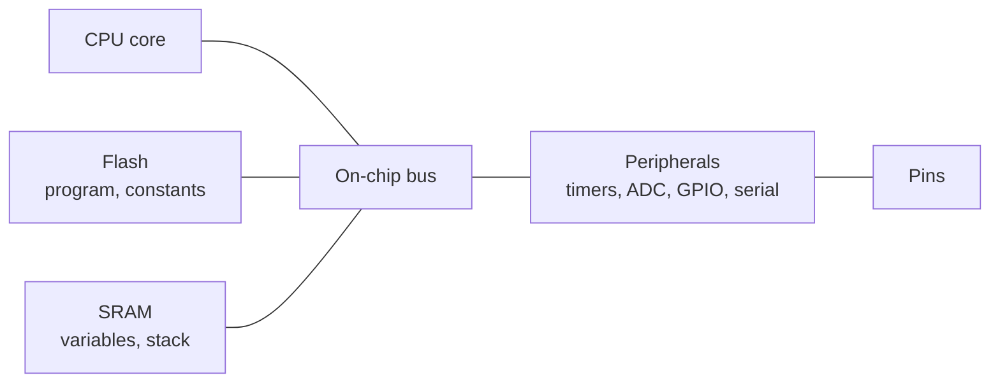

A washing machine, a car's brake controller, a drone's flight controller and a digital thermometer each contain a small computer that nobody thinks of as a computer. It has no keyboard or screen of its own, runs a single program for its whole life, and is judged less by how fast it is on average than by whether it does the right thing at the right time. This series is about those computers: what is inside them, how they exchange data with sensors and with each other, how their software is organized so that it meets its deadlines, and how to check by measurement that it does.

This first entry sets the foundation: the timing vocabulary the whole series uses, the inside of a microcontroller and how software reaches it, and the simplest way of organizing firmware, whose limits motivate the rest of the series.

**Prerequisites.** The series assumes basic C programming (types, pointers, structures, bitwise operators) and basic digital logic: binary and hexadecimal numbers, logic gates, flip-flops and registers, and the idea of a clock signal. It does not assume prior embedded experience.

**Conventions.** Code is C11 (ISO/IEC 9899:2011). Examples assume a generic 32-bit Arm Cortex-M class microcontroller with a 48 MHz core clock and a 3.3 V supply; where an example depends on the Arm architecture, it says so. Peripheral register names and layouts in the code are invented for illustration and do not belong to any vendor's part, because every manufacturer lays out its peripherals differently; the reference manual of the chip in hand is always the authority. Time is in seconds with SI prefixes (1 µs = $10^{-6}$ s), frequency in hertz, and memory sizes use binary prefixes (1 KiB = 1024 bytes). Host-side code was compiled with the GNU Compiler Collection (GCC) version 13 using `-std=c11`, and Python examples use Python 3 with the standard library only.

## 1. Embedded and real-time systems

### 1.1 What an embedded system is

An **embedded system** is a computer built into a larger device to perform a fixed set of functions for that device, as opposed to a general-purpose computer on which users install and run programs of their choosing. Its software is called **firmware**: it is stored in nonvolatile memory in the device, starts when the device is powered, and is changed only by a deliberate update.

Three things set embedded work apart from writing software for a desktop or a server:

- **The environment is physical.** Inputs come from sensors and outputs drive actuators: motors, valves, heaters, displays. The program's job is to keep up with a process that does not wait for it.
- **Resources are fixed and small.** A typical microcontroller has tens to hundreds of kibibytes of memory, not gigabytes, and no operating system unless the designer adds one. Every byte and every processor cycle is accounted for.
- **Timing is part of correctness.** A brake controller that computes the right command 50 ms too late has failed, even though its arithmetic was correct.

### 1.2 Real time: events, deadlines, latency and jitter

The last point is what **real-time** means. A real-time system is one whose correctness depends not only on the values it computes but also on when it produces them. "Real-time" does not mean "fast": a system that must respond within one second, every time, is a real-time system; a system that responds in a microsecond on average but occasionally takes a second is not.

The series uses the following terms throughout:

- An **event** is something the system must respond to: a sensor sample becoming ready, a byte arriving, a timer expiring, a button being pressed.
- A **job** is one piece of work done in response to an event, such as reading a sample and updating a control output. The instant at which a job becomes ready to run is its **release**.
- The **deadline** is the latest instant by which the job must finish. It is usually given relative to the release, as a **relative deadline** $D$.
- The **response time** is the time from release to completion of a job. A job meets its deadline when its response time does not exceed $D$.
- **Latency** is the delay from an event to the start of the system's reaction to it, for example from a signal edge on a pin to the first instruction of the code that handles it.
- **Jitter** is the variation of a timing quantity that should be constant: of the latency, of the response time, or of the interval between the outputs of a periodic job. In this series it is quoted as the peak-to-peak spread, the largest observed value minus the smallest.

Real-time requirements are classified by what a missed deadline costs:

| Class | A missed deadline means | Example |
|---|---|---|
| Hard | Failure of the system, possibly with harm to people or equipment | Airbag deployment, motor current control |
| Firm | The late result is worthless and is discarded, but nothing else fails | A video frame decoded too late to display |
| Soft | The late result is still useful, with less value the later it is | Updating a temperature display |

The classes call for different evidence. A soft requirement can be judged by statistics over a long run. A hard requirement needs an argument about the **worst case**, which is the subject of the scheduling theory in the fourth entry and of the measurements in the fifth.

### 1.3 The series at a glance

The five entries follow the path of data through an embedded system and then the question of time:

| Entry | Covers |
|---|---|
| Inside a Microcontroller (this entry) | Vocabulary; processor core, memory, memory map, startup, clocks, timers, general-purpose I/O, analog-to-digital converter |
| [Interrupts, Polling and DMA](/blog/interrupts-polling-and-dma) | Three ways to move data between peripherals and memory, their latency and processor cost, and safe sharing of data with interrupt handlers |
| [Serial Buses: UART, SPI, I2C and CAN](/blog/serial-buses-uart-spi-i2c-and-can) | How chips and boards exchange data: framing, addressing, timing and error handling of four common buses |
| [Real-Time Operating Systems and Scheduling](/blog/real-time-operating-systems-and-scheduling) | Tasks, priorities and synchronization, and the analysis that shows whether every deadline can be met |
| [Measuring Timing, Latency and Resource Use](/blog/measuring-timing-latency-and-resource-use) | Instrumenting firmware to measure execution time, latency, jitter, processor load and memory use, and checking the results against the analysis |

## 2. The microcontroller as a system on a chip

### 2.1 Microcontroller and microprocessor

A **microprocessor** is a processor on a chip; it needs external memory and external peripheral chips to form a computer. A **microcontroller** (MCU) puts a processor (its **central processing unit**, CPU), its program and data memories, and a set of **peripherals** (hardware blocks that perform input, output, timing or communication on their own) on one chip. It needs little more than a power supply and, often, a crystal to run. That integration is why microcontrollers dominate embedded systems: they are cheap, small, and draw little power.



The processor, the memories and the peripherals all hang off an on-chip bus (in practice a small network of buses and a switch matrix, so that the CPU and other bus users can reach different memories at the same time). The peripherals connect to the outside world through the chip's **pins**, and most pins can be assigned to one of several peripherals.

### 2.2 The CPU core

The **CPU core** fetches instructions from memory, decodes them and executes them. Its programmer-visible state is a small set of **registers**. An Arm Cortex-M core has sixteen 32-bit registers plus a status register holding condition flags. Three of the sixteen have fixed roles: R13 is the **stack pointer** (SP), R14 the **link register** (LR, holding the return address of a function call) and R15 the **program counter** (PC, the address of the next instruction).

Cortex-M is Arm's family of cores for microcontrollers, defined by the Armv6-M, Armv7-M and Armv8-M architecture profiles (the newest cores implement Armv8.1-M, an extension of Armv8-M). These are **load-store** architectures: arithmetic works only on registers, and separate load and store instructions move data between registers and memory. They are 32-bit machines, meaning registers, the natural integer size and addresses are 32 bits wide, so a core can address $2^{32}$ bytes (4 GiB). They execute the compact **Thumb** instruction set (16- and 32-bit instructions), which keeps programs small. Many microcontrollers use other cores (8-bit and 16-bit families remain common, as do RISC-V cores), but the ideas in this series apply to all of them.

At a 48 MHz clock, one clock cycle lasts $1/(48\times10^6\ \text{Hz}) = 20.83$ ns. Simple instructions take one cycle; loads, stores, branches and divisions take more. Cycle counts therefore translate directly into time, which is why embedded engineers count them.

### 2.3 Flash and SRAM

A microcontroller has two kinds of on-chip memory with different jobs:

- **Flash memory** is nonvolatile: it keeps its contents without power. It holds the firmware and constant data. It is written in blocks (pages or sectors that must be erased before they are rewritten), slowly and a limited number of times, so the program treats it as read-only while running.
- **Static RAM** (SRAM) is volatile: its contents are lost when power is removed and are undefined at power-up. It holds variables, the stack and any buffers. It can be read and written in single bytes at full speed.

Flash is denser and cheaper per bit, so a microcontroller typically has several times more flash than SRAM; 256 KiB of flash with 64 KiB of SRAM is a representative combination. Flash is also slower than a fast core: above a certain clock frequency, a read from flash needs one or more extra cycles called **wait states**, which the chip hides partly with prefetch buffers or a small cache. The exact threshold is in the datasheet, and it is one reason why the same code can take different times on the same chip at different clock settings.

## 3. The memory map and memory-mapped I/O

### 3.1 One address space

Every memory and every peripheral register in a microcontroller has an address in a single address space. The assignment of address ranges to memories and peripherals is the **memory map**. On Cortex-M devices the architecture fixes the coarse layout and the vendor fills it in. The Armv7-M profile divides the 4 GiB space as follows:

| Address range | Region | Typical contents |
|---|---|---|
| `0x0000_0000`–`0x1FFF_FFFF` | Code | Flash (program and constants), vector table |
| `0x2000_0000`–`0x3FFF_FFFF` | SRAM | On-chip RAM |
| `0x4000_0000`–`0x5FFF_FFFF` | Peripheral | On-chip peripheral registers |
| `0x6000_0000`–`0x9FFF_FFFF` | External RAM | Memory on an external bus, if any |
| `0xA000_0000`–`0xDFFF_FFFF` | External device | Devices on an external bus, if any |
| `0xE000_0000`–`0xFFFF_FFFF` | System | Core peripherals: interrupt controller, system timer, debug |

(The underscores only make the hexadecimal digits easier to read.) A vendor's datasheet then says, for example, that flash starts at `0x0800_0000` and a particular general-purpose input/output (GPIO) port's registers at some address in the peripheral region.

### 3.2 Peripheral registers

A peripheral is controlled through its **registers**: words at fixed addresses whose bits configure the peripheral, report its status or carry data. Reading or writing such an address does not touch memory; it talks to the peripheral's hardware. This scheme is **memory-mapped I/O**, and it means that firmware drives hardware with ordinary loads and stores, which C expresses as reads and writes through pointers.

Two details of C matter here:

- The pointer must be to a `volatile` object. The `volatile` qualifier tells the compiler that every access in the source is a side effect it must perform, in order, exactly as written. Without it, a compiler may keep a register's value in a CPU register and never read the hardware again, or merge two writes into one, which is correct for ordinary memory and wrong for a status bit that hardware changes.
- Registers are manipulated bit by bit with masks: `x |= mask` sets bits, `x &= ~mask` clears them, and `(x & mask) != 0` tests them.

The program below models a small GPIO peripheral (Section 6.1) as a structure of `volatile uint32_t` registers. The layout is invented for illustration; on a real part the macro would cast the peripheral's documented base address to a pointer, as the comment shows. On the host, the macro points at an ordinary variable, and a small function stands in for what the hardware does when the set and clear registers are written.

```c
/* C11. Illustrative GPIO peripheral: the layout and names are invented for
   this example and do not belong to any vendor. On a microcontroller the
   block would sit at a fixed address in the peripheral region, e.g.
   #define GPIOA ((gpio_regs_t *)0x40020000u). On a host we point the same
   macro at an ordinary variable so the code can run. */
#include <stdint.h>
#include <stdio.h>

typedef struct {
    volatile uint32_t DIR;  /* offset 0x00: 1 = output, 0 = input        */
    volatile uint32_t OUT;  /* offset 0x04: output latch                  */
    volatile uint32_t IN;   /* offset 0x08: pin levels (read-only on HW)  */
    volatile uint32_t SET;  /* offset 0x0C: write 1 to set OUT bits       */
    volatile uint32_t CLR;  /* offset 0x10: write 1 to clear OUT bits     */
} gpio_regs_t;

static gpio_regs_t fake_port;          /* host stand-in for the hardware */
#define GPIOA (&fake_port)

#define LED_PIN    5u
#define BUTTON_PIN 13u
#define BIT(n)     (1u << (n))

/* What the hardware does with SET/CLR writes, simulated on the host. */
static void simulate_hw(gpio_regs_t *p) {
    p->OUT |= p->SET;  p->SET = 0;
    p->OUT &= ~p->CLR; p->CLR = 0;
}

int main(void) {
    GPIOA->DIR |= BIT(LED_PIN);           /* read-modify-write: LED output */
    GPIOA->DIR &= ~BIT(BUTTON_PIN);       /* button stays an input          */
    printf("DIR = 0x%08X\n", (unsigned)GPIOA->DIR);

    GPIOA->SET = BIT(LED_PIN);            /* single write, no read needed   */
    simulate_hw(GPIOA);
    printf("OUT after SET = 0x%08X\n", (unsigned)GPIOA->OUT);

    GPIOA->IN = BIT(BUTTON_PIN);          /* host: pretend button is high   */
    int pressed = (GPIOA->IN & BIT(BUTTON_PIN)) != 0;
    printf("button bit = %d\n", pressed);

    GPIOA->CLR = BIT(LED_PIN);
    simulate_hw(GPIOA);
    printf("OUT after CLR = 0x%08X\n", (unsigned)GPIOA->OUT);
    printf("offset of CLR = %zu bytes\n",
           (size_t)((char *)&GPIOA->CLR - (char *)GPIOA));
    return 0;
}
```

Compiled with `gcc -std=c11 -Wall -Wextra -pedantic` and run, it prints:

```text
DIR = 0x00000020
OUT after SET = 0x00000020
button bit = 1
OUT after CLR = 0x00000000
offset of CLR = 16 bytes
```

Bit 5 is `0x20`, so the LED pin is an output and is driven high, then low; the structure places each register four bytes after the previous one, matching the documented offsets.

### 3.3 Read-modify-write and its hazard

The statement `GPIOA->DIR |= BIT(LED_PIN)` compiles to three steps: load the register, set the bit with a bitwise OR, store it back. If something else changes the register between the load and the store, that change is overwritten. On a single-core microcontroller the "something else" is usually an **interrupt handler**, code that the hardware runs between two instructions of the main program when an event occurs (the second entry treats interrupts in full). If the main program has loaded `OUT`, and an interrupt handler then sets a different bit in `OUT`, the main program's store puts back the old value and silently clears the handler's bit.

This is why many peripherals provide separate **set** and **clear** registers, as the example does: a write of a 1 bit to `SET` changes only that bit in hardware, in a single store, so there is no window in which another update can be lost. Where the hardware offers no such register, the read-modify-write must be protected, a technique the second entry describes.

### 3.4 Where the program's data lives

A C program for a microcontroller is linked into a few standard **sections**, and the linker places each in a memory region according to a **linker script**:

| Section | Contents | Stored in | Lives at run time in |
|---|---|---|---|
| `.text` | Machine code | Flash | Flash |
| `.rodata` | `const` data, string literals | Flash | Flash |
| `.data` | Initialized global and `static` variables | Flash (initial values) | SRAM |
| `.bss` | Global and `static` variables without an initializer, or initialized to zero | Nothing (only its size) | SRAM |
| Stack | Local variables, return addresses, saved registers | – | SRAM |
| Heap | Memory from `malloc` | – | SRAM |

The stack grows and shrinks as functions are called and return, and its peak size is hard to know in advance; the fifth entry measures it. Many embedded projects avoid the heap altogether, or allocate from it only at startup, because allocation and freeing at run time can fragment a small heap and their timing is not bounded.

A worked memory budget shows how quickly SRAM goes. A data logger records two channels of the analog-to-digital converter (ADC, Section 6.2) with 1000 samples each, stored as 16-bit values: $2 \times 1000 \times 2 = 4000$ bytes. Doubling that buffer so that one half can be written while the other is processed (a scheme the second entry uses with direct memory access, DMA) needs 8000 bytes, about 12% of a 64 KiB SRAM, before any stack, communication buffers or operating-system structures are counted.

## 4. Reset, startup and clocks

### 4.1 From reset to main

At power-up, or when a reset pin is pulled or a watchdog fires (Section 5.4), the core enters a defined **reset** state and starts executing from a fixed place. On Cortex-M cores, that place is described by the **vector table**, a table of 32-bit words at the start of the code region. (A chip whose flash sits at a higher address, such as the `0x0800_0000` of Section 3.1, either maps it to address 0 at reset or tells the core where the table is.) The first word is the initial value of the stack pointer, and the second is the address of the **reset handler**, the function that runs first. The following words are the addresses of the handlers for faults and interrupts, which the second entry uses.

The reset handler belongs to the **startup code**, usually supplied with the toolchain or vendor package, and it does what the C language assumes has already happened before `main` is called:

1. Copy the initial values of `.data` from flash into SRAM.
2. Fill `.bss` with zeros, since C requires variables with static storage duration and no initializer to start at zero.
3. Configure the clocks (Section 4.2) and, on cores that have one, enable the floating-point unit.
4. Call `main`. In an embedded system, `main` is not expected to return.

The order varies: many startup files configure the clocks first, so that the copying runs at full speed.

### 4.2 Clock sources

Every synchronous circuit on the chip advances on edges of a **clock**, and the microcontroller can choose among several sources:

- An **internal resistor-capacitor (RC) oscillator** needs no external parts and starts quickly, but its frequency depends on temperature and supply voltage, and its factory trim leaves a tolerance that the datasheet states.
- A **crystal oscillator** uses an external quartz crystal. Its frequency is far more accurate and stable, with tolerances specified in parts per million (ppm).
- A **phase-locked loop** (PLL) multiplies a reference frequency up to the core frequency. An 8 MHz crystal and a PLL that multiplies by 6 give the 48 MHz used in this series.

**Prescalers** (frequency dividers) then derive the clocks of the buses and peripherals from the core clock. The set of sources, multipliers and dividers is the **clock tree**, and every timing calculation in firmware starts from it: a timer, a serial port or an ADC is only as accurate as the clock it divides.

Clock accuracy matters even when nothing seems to depend on it. A crystal with a tolerance of ±20 ppm used to keep time of day can be wrong by up to $20\times10^{-6} \times 86\,400\ \text{s} = 1.73$ s per day. A serial link between two devices with independent clocks works only if their frequencies agree to within a few percent, as the third entry shows, and that is a tolerance an untrimmed RC oscillator may not meet.

### 4.3 Clock gating and low-power modes

Each peripheral's clock can be switched on and off individually by **clock gating**. After reset most peripheral clocks are off, to save power, so the first step in using any peripheral is to enable its clock in the clock controller. Writes to a peripheral whose clock is off are commonly ignored, a frequent cause of "the register will not change" when starting with a new chip.

Power consumption in CMOS (complementary metal-oxide-semiconductor) logic rises roughly in proportion to clock frequency, so microcontrollers also offer **low-power modes**: the core stops while peripherals keep running (sleep), or most clocks stop and only a few wake-up sources remain (deep sleep or stop modes). On Cortex-M cores the `WFI` (wait for interrupt) instruction puts the core to sleep until an interrupt arrives. A battery-powered sensor node can spend nearly all of its time asleep, waking on a timer to take a reading, which is only possible because the timers keep counting while the core sleeps.

## 5. Timers

A **timer** is a hardware counter clocked from the clock tree. Because it counts independently of the software, it can measure and generate time far more precisely than any software loop. Timers are among the most used peripherals in real-time firmware.

### 5.1 Counter, prescaler and reload

A basic timer has three parts:

- a **prescaler**, which divides the input clock $f_\text{clk}$ by an integer $P$;
- a **counter**, which counts the prescaled clock pulses up from zero;
- a **reload** (or period) value: when the counter has counted $N$ pulses it wraps to zero and raises an **update event**, which can set a flag, request an interrupt or start an ADC conversion.

The period and frequency of the update events are then

$$
T_\text{update} = \frac{P\,N}{f_\text{clk}}, \qquad f_\text{update} = \frac{f_\text{clk}}{P\,N}.
$$

In many parts the registers hold $P - 1$ and $N - 1$ rather than $P$ and $N$, because a counter that runs from 0 to $N - 1$ has $N$ states; the reference manual says which convention applies. In this series, $P$ and $N$ are always the actual division ratio and count.

The counter's width limits $N$. A 16-bit counter has $N \le 65\,536$, so at 48 MHz without prescaling its longest period is $65\,536 / 48\ \text{MHz} = 1.365$ ms. A 1 ms periodic **tick**, the heartbeat of many schedulers, can be made with $P = 48$ (giving 1 MHz) and $N = 1000$, or with $P = 1$ and $N = 48\,000$. A 32-bit counter at 48 MHz overflows only after $2^{32} / 48\ \text{MHz} = 89.5$ s.

Not every frequency divides exactly. A short Python function finds the best combination for a 16-bit prescaler and counter:

```python
def timer_settings(f_clk, f_target, max_count=65536):
    """Return (prescale, period_counts, actual_hz, error_ppm) for the most
    accurate setting, preferring the smallest prescaler among equals."""
    best = None
    for prescale in range(1, max_count + 1):
        counts = round(f_clk / (prescale * f_target))
        if 1 <= counts <= max_count:
            actual = f_clk / (prescale * counts)
            err_ppm = (actual - f_target) / f_target * 1e6
            if best is None or abs(err_ppm) < abs(best[3]) - 1e-9:
                best = (prescale, counts, actual, err_ppm)
            if err_ppm == 0:
                break
    return best

for target in (1000.0, 50.0, 44100.0):
    p, n, a, e = timer_settings(48e6, target)
    print(f"{target:>8.1f} Hz: prescale {p:>3}, counts {n:>5}, "
          f"actual {a:.3f} Hz, error {e:+.1f} ppm")
```

```text
  1000.0 Hz: prescale   1, counts 48000, actual 1000.000 Hz, error +0.0 ppm
    50.0 Hz: prescale  15, counts 64000, actual 50.000 Hz, error +0.0 ppm
 44100.0 Hz: prescale   1, counts  1088, actual 44117.647 Hz, error +400.2 ppm
```

The audio rate of 44.1 kHz cannot be derived exactly from 48 MHz: the best integer division leaves an error of 400 ppm, which is why audio equipment uses clocks that are multiples of the sample rate.

### 5.2 Output compare and pulse-width modulation

A timer channel in **output-compare** mode compares the counter with a second register and changes a pin when they match. Combined with the reload, this produces **pulse-width modulation** (PWM): the pin goes high when the counter wraps and low when it reaches the compare value $C$, so it is high for $C$ out of every $N$ counts. The **duty cycle** is $C/N$.

PWM is how a microcontroller controls power without a digital-to-analog converter: the average voltage seen by a motor winding, a heater or an LED is the supply voltage times the duty cycle, provided the load (or a filter) averages over the PWM period. The trade-off is between frequency and resolution. A motor drive at 20 kHz (above the range of human hearing) from a 48 MHz timer has $N = 48\,000\,000 / 20\,000 = 2400$ counts per period, so the duty cycle can be set in steps of $1/2400$, a resolution of $\log_2 2400 = 11.2$ bits. Doubling the PWM frequency halves the number of steps.

A hobby servo, by contrast, expects a 50 Hz pulse train whose high time of about 1 to 2 ms sets the position. With the timer prescaled to 1 MHz, $N = 20\,000$ and a 1.5 ms pulse is $C = 1500$.

### 5.3 Input capture

In **input-capture** mode, a signal edge on a pin copies the counter's current value into a register. The difference between two captures is the time between the edges, measured by hardware to one timer count: 20.83 ns at 48 MHz without prescaling, independent of what the software was doing when the edges arrived. A 1 kHz signal gives 48 000 counts per period, so a single period is measured with a resolution of 1 part in 48 000. Input capture measures pulse widths, the speed of a motor from its encoder, or the arrival time of an event for the latency measurements of the fifth entry.

### 5.4 The watchdog timer

A **watchdog timer** counts down independently of the program and resets the chip when it reaches zero. The firmware must restart ("kick" or "feed") it periodically. If the program hangs, crashes into an endless loop or stops reaching the point where it feeds the watchdog, the reset returns the device to a known state. A watchdog only helps if it is fed from a place that proves the whole system is working, for example only after every periodic job has reported that it ran; feeding it from a timer interrupt would keep a hung main program alive indefinitely.

## 6. General-purpose I/O and the on-chip ADC

### 6.1 General-purpose I/O

A **general-purpose input/output** (GPIO) pin is a pin that software reads or drives directly as a logic level. Each pin is configured by register bits like those of Section 3.2:

- **Direction.** As an input, the pin's level is sampled into an input register. As an output, the value in an output register drives the pin.
- **Output type.** A **push-pull** output actively drives both high and low. An **open-drain** output can only pull the line low and lets it float otherwise, so several open-drain outputs can share one line with a pull-up resistor; this is the basis of the Inter-Integrated Circuit (I2C) bus in the third entry.
- **Pull-up or pull-down.** A weak internal resistor holds an input at a defined level when nothing drives it. An unconnected input without one floats, picks up noise and can toggle unpredictably.
- **Alternate function.** Most pins can be handed to a peripheral (a timer channel, a serial port, the ADC) instead of being controlled by software. This **pin multiplexing** is why a microcontroller with many peripherals can still fit in a small package, and why choosing pins is part of hardware design.

Mechanical switches do not switch cleanly: their contacts bounce for some milliseconds, producing several edges for one press. Firmware **debounces** them, typically by accepting a new level only after it has been stable for a chosen time, sampled from a periodic timer.

### 6.2 The on-chip analog-to-digital converter

Most microcontrollers contain an ADC, usually of the successive-approximation type, with a multiplexer that selects one of several input pins. How sampling and quantization work, including aliasing and the anti-aliasing filter, is treated in [Sampling, Quantization and Data Conversion](/blog/sampling-quantization-and-data-conversion); here what matters is how firmware uses the converter.

A 12-bit converter with a 3.3 V reference resolves steps of one **least significant bit** (LSB), $3.3\ \text{V} / 2^{12} = 0.806$ mV, so a reading of 2048 corresponds to 1.650 V. A conversion takes a sampling phase plus about one ADC clock cycle per bit; for illustration, a converter that needs 15 cycles in total at a 12 MHz ADC clock converts in $15 / 12\ \text{MHz} = 1.25$ µs and could deliver up to 800 000 samples per second on one channel.

How a conversion is started matters as much as its resolution:

- **Software trigger.** The program writes a start bit, waits for an end-of-conversion flag and reads the result. The sampling instant then depends on when the software got round to it, so it inherits all the timing variation of the software.
- **Hardware trigger.** A timer's update event (Section 5.1) starts each conversion. The samples are then evenly spaced to the accuracy of the timer, no matter what the CPU is doing, and the software only has to collect the results before the next one arrives.

Hardware triggering is the general pattern for real-time input: let hardware decide **when** things happen, and leave software to decide **what** to do with them. Collecting the results, by polling a flag, by interrupt or by DMA, is the topic of the next entry.

## 7. How firmware drives the hardware

### 7.1 Layers of firmware

Writing raw register accesses everywhere makes code unreadable and impossible to move to another chip. Firmware is therefore usually layered:

- **Register definitions**: the structures and bit masks of Section 3.2, normally generated from the vendor's description of the chip.
- **Drivers**, which together form a hardware abstraction layer (HAL): functions such as `adc_start()` or `uart_write()` that hide register sequences behind an interface.
- **Application**: the logic of the product, written against the driver interfaces.

### 7.2 The superloop

The simplest firmware structure has no operating system at all. After initialization, `main` runs an endless loop that checks for work and does it:

```c
int main(void) {
    clocks_init();
    gpio_init();
    adc_init();            /* timer-triggered, see Section 6.2 */
    for (;;) {             /* the "superloop" */
        if (adc_result_ready()) {
            process_sample(adc_read());
        }
        if (button_changed()) {
            update_mode();
        }
        update_display();
        watchdog_feed();
    }
}
```

(The functions are placeholders for drivers and application code; the fragment shows structure, not a complete program.) This **superloop** is easy to understand and is the right design for many small devices. Its weakness is timing: each check waits for everything else in the loop. If `update_display()` takes 20 ms, a sample that becomes ready just after the loop has checked for it waits more than 20 ms, a whole pass of the loop, to be processed. The latency of every event therefore depends on the execution time of every other piece of code. Adding a feature can break the timing of an unrelated one.

The rest of the series removes that coupling step by step. Interrupts and DMA let hardware events be handled when they happen rather than when the loop comes round to them (second entry). A real-time operating system splits the program into prioritized tasks whose worst-case response times can be predicted (fourth entry) and checked by measurement (fifth entry).

## 8. Exercises

**Exercise 1.** A timer is clocked at 48 MHz and has a 16-bit prescaler and a 16-bit counter. Choose a division ratio $P$ and count $N$ for a 10 Hz update event, and state the timer's resolution with your choice.

<details>
<summary>Answer</summary>

We need $P N = 48\,000\,000 / 10 = 4\,800\,000$ with both at most 65 536. One choice is $P = 100$, $N = 48\,000$ (another is $P = 80$, $N = 60\,000$). With $P = 100$ the counter advances at 480 kHz, so one count is $1/480\ \text{kHz} = 2.08$ µs; that is the resolution of any compare or capture made with this timer.

</details>

**Exercise 2.** A 12-bit ADC with a 3.3 V reference reads 3000. What voltage is that, and what is the size of one LSB?

<details>
<summary>Answer</summary>

One LSB is $3.3 / 4096 = 0.806$ mV, and the reading corresponds to $3000 \times 0.806\ \text{mV} = 2.417$ V (to within the converter's errors and the quantization of ±0.5 LSB for a rounding converter).

</details>

**Exercise 3.** Why does the following loop, intended to wait for a hardware flag, hang forever when compiled with optimization, and how is it fixed?

```c
uint32_t *status = (uint32_t *)0x40001000u;   /* illustrative address */
while ((*status & 1u) == 0) { }
```

<details>
<summary>Answer</summary>

The pointer is not to a `volatile` object, so the compiler may assume nothing else changes `*status`, read it once and turn the loop into an endless loop. Declaring `volatile uint32_t *status` makes every read in the source a real read of the register.

</details>

**Exercise 4.** A motor PWM must run at 25 kHz from a 48 MHz timer clock. How many duty-cycle steps are available, and what resolution is that in bits?

<details>
<summary>Answer</summary>

$N = 48\,000\,000 / 25\,000 = 1920$ counts, so 1920 steps, a resolution of $\log_2 1920 = 10.9$ bits.

</details>

**Exercise 5.** A program has 1.2 KiB of initialized global variables and 6 KiB of zero-initialized ones. How much flash and how much SRAM do these occupy, and what does the startup code do with each?

<details>
<summary>Answer</summary>

The initialized variables (`.data`) take 1.2 KiB of flash for their initial values and 1.2 KiB of SRAM at run time; the startup code copies them from flash to SRAM. The zero-initialized ones (`.bss`) take 6 KiB of SRAM and no flash beyond the code that clears them; the startup code fills them with zeros. In total 7.2 KiB of SRAM and 1.2 KiB of flash.

</details>

## 9. Summary

| Question | Answer |
|---|---|
| What is an embedded system? | A computer built into a device to perform fixed functions, running firmware from nonvolatile memory. |
| What makes a system real-time? | Its correctness depends on when results are produced, not only on their values. |
| How do hard, firm and soft deadlines differ? | A missed hard deadline is a failure; a firm one makes the result worthless; a soft one only reduces its value. |
| What are latency and jitter? | Latency is the delay from an event to the start of the reaction; jitter is the peak-to-peak variation of a timing quantity. |
| What is in a microcontroller? | A CPU core, flash and SRAM, and peripherals such as timers, GPIO, an ADC and serial ports, on one chip. |
| How does software reach a peripheral? | Through memory-mapped registers, accessed through `volatile` pointers. |
| What happens before `main`? | The core loads the stack pointer and reset handler from the vector table; startup code copies `.data`, zeroes `.bss` and sets up clocks. |
| How is a timer's period set? | $T = P N / f_\text{clk}$, with prescaler division $P$ and count $N$. |
| How should periodic sampling be triggered? | By a timer in hardware, so that sample instants do not depend on software timing. |
| Why is a superloop not enough for demanding timing? | Every event waits for all other code in the loop, so latencies are coupled. |

The next entry, [Interrupts, Polling and DMA](/blog/interrupts-polling-and-dma), takes up the question this one leaves open: once a peripheral has data, how does it get to memory and to the code that needs it, and what does each method cost in latency and processor time?

### References

- Arm Limited, *Armv7-M Architecture Reference Manual*, document ARM DDI 0403.
- ISO/IEC 9899:2011, *Information technology – Programming languages – C*, International Organization for Standardization, 2011.
- H. Kopetz, *Real-Time Systems: Design Principles for Distributed Embedded Applications*, 2nd ed., Springer, 2011.
- E. A. Lee and S. A. Seshia, *Introduction to Embedded Systems: A Cyber-Physical Systems Approach*, 2nd ed., MIT Press, 2017.
- E. White, *Making Embedded Systems: Design Patterns for Great Software*, O'Reilly Media, 2011.
- J. Yiu, *The Definitive Guide to ARM Cortex-M3 and Cortex-M4 Processors*, 3rd ed., Newnes, 2014.
