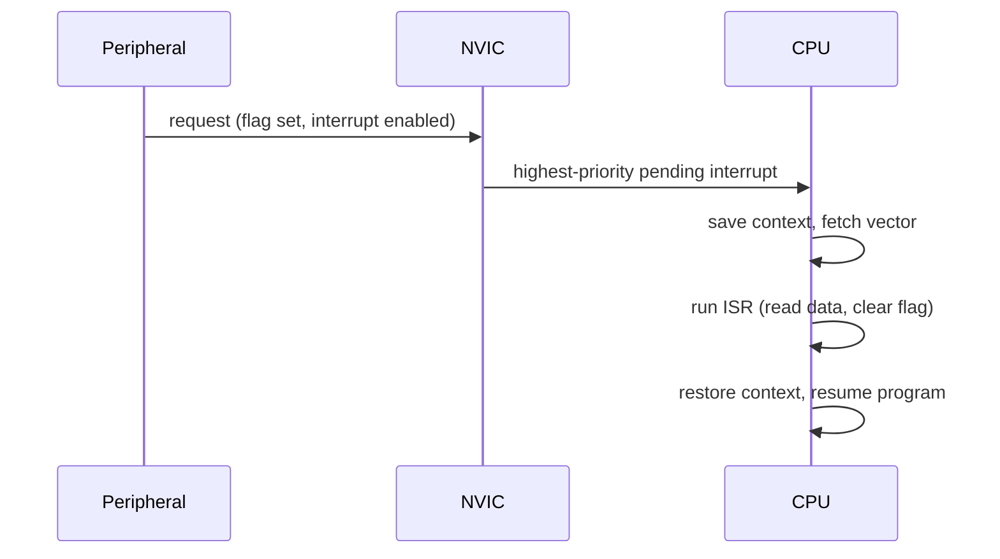
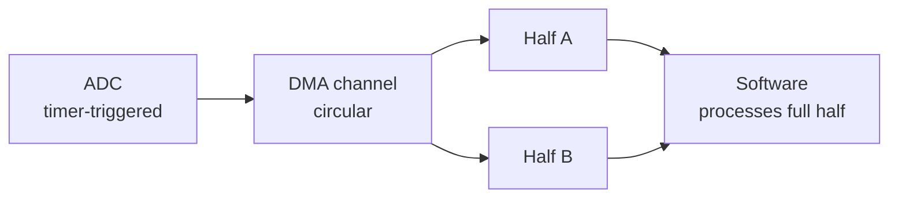

[The first entry](/blog/inside-a-microcontroller) described a microcontroller's peripherals and the registers through which firmware controls them, and it ended with the simplest firmware structure, the superloop, in which every event waits until the loop comes round to it. This entry is about the step between a peripheral having data and that data reaching the code that needs it. There are three ways to take that step:

- **Polling**: the program repeatedly reads a peripheral's status flag and acts when it is set.
- **Interrupts**: the peripheral signals the processor, which suspends the current program and runs a handler.
- **Direct memory access** (DMA): a separate hardware unit copies data between the peripheral and memory without the processor, and tells the program when a whole block is done.

The entry explains each mechanism and quantifies its latency and its cost in processor time, using the timing vocabulary of [Section 1.2 of the first entry](/blog/inside-a-microcontroller#12-real-time-events-deadlines-latency-and-jitter) (event, latency, jitter, deadline). It then treats the problem that interrupts create, data shared between the main program and the interrupt handlers that preempt it, and ends with a way to choose.

**Conventions.** As in the first entry: C11, a generic 32-bit Arm Cortex-M class microcontroller at 48 MHz, invented register names, and Python 3 with the standard library for calculations. Statements that depend on the Arm architecture (the interrupt controller, exception entry, the instruction that masks interrupts) are marked as such; other cores have equivalents with different details. CPU (central processing unit) and processor are used interchangeably.

## 1. Getting data out of a peripheral

### 1.1 Flags, data registers and overruns

A peripheral that produces data, such as an analog-to-digital converter (ADC) finishing a conversion or a serial receiver assembling a byte, typically places the value in a **data register** and sets a **status flag** that says "new data". Reading the data register usually clears the flag. The data register holds one value (or a few, if the peripheral has a small first-in, first-out (FIFO) hardware buffer). If the next value arrives before the software has read the current one, either the new value is lost or it overwrites the old one, and the peripheral sets an **overrun** flag.

That gives every peripheral input a hard deadline, set by the data rate. A universal asynchronous receiver-transmitter (UART, the serial port of the next entry) at 115 200 bit/s with ten bits per byte on the wire delivers $115\,200 / 10 = 11\,520$ bytes per second, one every 86.8 µs. With a one-byte data register, each byte must be read within 86.8 µs of its arrival, every time, or data is lost.

### 1.2 The three methods

The methods differ in who notices the event and who moves the data:

| Method | Who notices the event | Who moves the data | Processor involvement |
|---|---|---|---|
| Polling | Software, by reading a flag | Software | Every check and every item |
| Interrupt | Hardware, which runs a handler | Software, in the handler | Every item |
| DMA | Hardware | DMA controller | Once per block |

## 2. Polling

### 2.1 Busy-waiting and periodic polling

**Polling** means reading a status flag in software and acting when it is set. It takes two forms:

- **Busy-waiting**: the program loops on the flag and does nothing else until it is set, as in `while (!(UART->STATUS & RX_READY)) { }`. The reaction is as fast as the loop, a few cycles, but the processor is fully occupied for the whole wait.
- **Periodic polling**: the program checks the flag once per pass of a loop that also does other work, as in the superloop of [the first entry](/blog/inside-a-microcontroller#72-the-superloop).

### 2.2 Latency of periodic polling

If the loop takes a time $L$ per pass, an event is noticed at the next check after it occurs. The polling latency therefore lies between almost zero and $L$, and its jitter is about $L$. If events arrive at random times unrelated to the loop, the average latency is $L/2$.

The loop time $L$ is the sum of the execution times of everything else in the loop, which makes it variable and hard to bound. If any branch of the loop can take 2 ms (writing to a display, say), then $L$ can reach 2 ms, and the UART of Section 1.1, which needs service every 86.8 µs, will overrun. The fix in a polled design is to make every piece of work short and bounded, or to split long work into steps across several passes: a valid technique, but one that spreads the timing problem over the whole program.

### 2.3 When polling is the right choice

Polling is simple, has no hidden concurrency and is easy to reason about, and it is the right choice when:

- the event is expected within a few cycles anyway, such as waiting for a flash write or a Serial Peripheral Interface (SPI) transfer of a few bytes to finish, so that the overhead of an interrupt would exceed the wait;
- the loop period is short, bounded and known, and every polled event tolerates a latency of one loop period;
- the event is slow and non-urgent, such as a configuration switch read once per second.

## 3. Interrupts

### 3.1 The mechanism

An **interrupt** is a hardware signal from a peripheral to the processor that causes the processor to suspend the current program, run a function called an **interrupt service routine** (ISR, or interrupt handler), and then resume the program where it left off. The interrupted program is unaware of the interruption, except that it took longer.

On Arm Cortex-M cores, interrupts are one kind of **exception** (faults and system calls are others), and they are managed by the **Nested Vectored Interrupt Controller** (NVIC), which is part of the processor architecture rather than a vendor peripheral. The sequence is:



1. The peripheral sets its flag. If the interrupt for that flag is enabled in the peripheral and in the NVIC, the request becomes **pending**.
2. If the pending interrupt's priority is higher than that of the code currently running, the core accepts it. On Cortex-M, hardware saves eight registers (R0 to R3, R12, the link register, the program counter and the status register, 32 bytes; on cores with a floating-point unit, more when the interrupted code was using floating-point registers) on the stack, and reads the handler's address from the vector table described in [Section 4.1 of the first entry](/blog/inside-a-microcontroller#41-from-reset-to-main).
3. The ISR runs. It must read the data and clear the cause of the interrupt; if the flag stays set, the interrupt is taken again as soon as the ISR returns.
4. On return, hardware restores the saved registers and the interrupted code continues.

Because the Cortex-M hardware saves exactly the registers that the C calling convention lets a function overwrite, an ISR can be an ordinary C function with no special keyword or assembly wrapper.

### 3.2 Interrupt latency

The **interrupt latency** is the time from the event (the peripheral raising its request) to the first instruction of the ISR. It has several components:

- **Hardware entry time.** The core finishes or abandons the current instruction, saves the context and fetches the vector. Arm specifies 12 clock cycles for Cortex-M3 and Cortex-M4 cores when the memory has no wait states; slower memory adds cycles. At 48 MHz, 12 cycles are 250 ns.
- **Masked time.** While software has interrupts disabled (Section 4.3), a request waits. The worst case adds the longest such section anywhere in the program.
- **Higher-priority work.** If an interrupt of higher or equal priority is running or pending, the new one waits for it to finish.

Worst-case latency is the sum of the worst cases. Suppose the longest section with interrupts disabled is 10 µs and the only higher-priority ISR runs for at most 5 µs. Then the worst-case latency of the lower-priority interrupt is

$$
0.25\ \mu\text{s} + 10\ \mu\text{s} + 5\ \mu\text{s} = 15.25\ \mu\text{s},
$$

about sixty times the hardware entry time. This is the usual picture: the hardware is fast and deterministic, and software decides the worst case. (The bound assumes the higher-priority interrupt occurs at most once during the wait. If it can recur, each recurrence adds its execution time, the reasoning that the fourth entry formalizes as response-time analysis.) The best-case latency is the hardware entry time alone, so the jitter of the ISR's start can be as large as 15 µs.

### 3.3 Priorities and nesting

Each interrupt has a configurable **priority**. On Cortex-M, a lower number means a higher priority, and an interrupt of higher priority **preempts** a running ISR of lower priority: the lower one is suspended exactly as the main program was, and resumes afterwards. This **nesting** lets a short, urgent ISR (a motor-current measurement, say) run on time even while a long, less urgent ISR is active.

Priorities are a design decision. A reasonable rule is to give higher priority to the interrupts with shorter deadlines (time until the data would be overrun or the output would be late), the same principle as the deadline-based priority assignment of the fourth entry.

### 3.4 Rules for writing an ISR

An ISR delays everything of lower priority, including the whole main program, for as long as it runs. That leads to a set of rules:

- **Keep it short and bounded.** Do the minimum that must happen at interrupt time, typically reading the data into a buffer, clearing the flag, and setting a variable or signaling a task (a unit of an operating system's schedule, fourth entry). Move processing elsewhere.
- **Never wait.** No busy-waiting on another flag, no delays, and no calls that could block, such as taking a lock that the interrupted code may hold.
- **Avoid functions that are not reentrant.** Library functions such as `printf` and `malloc` may use internal state that the interrupted code was in the middle of changing.
- **Clear the cause.** Read the data register or write the flag-clearing bit, as the reference manual specifies, before returning.

### 3.5 The processor cost of interrupts

Every interrupt costs the entry time, the handler's own instructions and the return. If one interrupt costs $c$ cycles in total and occurs at a rate $r$ per second, the fraction of a processor of frequency $f_\text{CPU}$ that it consumes is

$$
U_\text{ISR} = \frac{r\,c}{f_\text{CPU}} .
$$

With $c = 100$ cycles (an assumed, typical size for a short receive handler, entry and exit included) at 48 MHz, a UART at 115 200 bit/s (11 520 bytes/s) costs 2.4% of the processor. The same handler for 100 000 items per second, a 1 Mbit/s UART or a 100 kHz ADC, costs 20.8%, and at 480 000 items per second it would consume the whole processor. Interrupt-per-item handling therefore stops scaling well before the hardware's limits; that is the problem DMA solves (Section 5).

## 4. Sharing data between interrupts and the main program

### 4.1 Race conditions

An ISR and the main program run **concurrently**: the ISR can start between any two instructions of the main program. When both access the same variable and at least one of them writes it, the result can depend on exactly where the interruption fell. Such a timing-dependent bug is a **race condition**.

Take a counter incremented by both. On a load-store core, `count++` compiles to three instructions: load `count` into a register, add one, store it. If the ISR runs between the load and the store and increments `count` itself, the main program then stores its stale value plus one, and the ISR's increment is lost. This is the same read-modify-write hazard that [Section 3.3 of the first entry](/blog/inside-a-microcontroller#33-read-modify-write-and-its-hazard) described for peripheral registers.

A second form is the **torn read**. On a 32-bit core, a 64-bit timestamp is read with two 32-bit loads. If an ISR updates the timestamp between them, the main program combines the low half of one value with the high half of another, and the result can be wrong by $2^{32}$ counts.

Race conditions are dangerous because they are rare: the window may be two instructions wide, so the bug may appear once in days of running, and never under a debugger.

### 4.2 Why volatile is not enough

A variable shared with an ISR must be `volatile` (or accessed through atomic operations, Section 4.4) so that the compiler re-reads it on every access instead of keeping a copy in a register. But `volatile` does nothing to make a read-modify-write indivisible, and nothing to make a 64-bit access a single operation. It solves the compiler's part of the problem, not the concurrency part.

### 4.3 Critical sections

A **critical section** is a stretch of code that must run without interference. On a single-core microcontroller, the direct way to make one is to disable interrupts around it. On Cortex-M the `CPSID i` instruction sets the PRIMASK register, which masks all interrupts of configurable priority, and `CPSIE i` clears it. Compilers expose these as intrinsic functions; the illustrative names below stand for whatever the toolchain provides. The safe pattern saves the previous state and restores it, so that the function also works when called with interrupts already disabled:

```c
uint32_t state = irq_save_and_disable();   /* illustrative: read PRIMASK, then CPSID i */
count++;                                   /* now indivisible with respect to ISRs     */
irq_restore(state);                        /* restore PRIMASK as it was                */
```

Every critical section adds its length to the worst-case latency of every interrupt (Section 3.2). Critical sections must therefore be a few instructions long, never contain loops of unknown length, and never call functions that might. Many cores also allow masking only interrupts below a chosen priority (on Armv7-M, the BASEPRI register), so that the most urgent interrupts are never delayed by critical sections that do not concern them.

### 4.4 A lock-free ring buffer

The common case, an ISR producing data items and the main program consuming them, needs no critical section at all if the data passes through a **single-producer, single-consumer ring buffer**. This is an array used as a queue, with a **head** index written only by the producer and a **tail** index written only by the consumer. Because each index has exactly one writer, there is no read-modify-write conflict, provided that each index is read and written in a single access and that the data is written before the index that publishes it.

C11 expresses both requirements portably with `<stdatomic.h>`. An atomic load or store of an `atomic_uint` is indivisible, and the memory orders `memory_order_release` (on the store that publishes an index) and `memory_order_acquire` (on the load that reads it) guarantee that the buffer contents written before the release are visible to the code after the acquire. On a single-core microcontroller, plain aligned 32-bit loads and stores are already indivisible, and these orders mainly stop the compiler from reordering the buffer write after the index update; on a multi-core processor they also insert the necessary hardware barriers.

```c
/* C11 single-producer, single-consumer ring buffer.
   Producer: an interrupt handler (here: a host thread standing in for it).
   Consumer: the main program. Size must be a power of two. */
#include <stdatomic.h>
#include <stdbool.h>
#include <stdint.h>
#include <stdio.h>
#include <pthread.h>

#define RB_SIZE 64u                       /* power of two */
#define RB_MASK (RB_SIZE - 1u)

typedef struct {
    uint16_t buf[RB_SIZE];
    atomic_uint head;                     /* written only by the producer */
    atomic_uint tail;                     /* written only by the consumer */
} ring_t;

/* Called from the producer (ISR). Returns false if the buffer is full. */
static bool rb_put(ring_t *r, uint16_t v) {
    unsigned h = atomic_load_explicit(&r->head, memory_order_relaxed);
    unsigned t = atomic_load_explicit(&r->tail, memory_order_acquire);
    if (h - t == RB_SIZE) return false;   /* full: caller counts an overrun */
    r->buf[h & RB_MASK] = v;
    atomic_store_explicit(&r->head, h + 1u, memory_order_release);
    return true;
}

/* Called from the consumer (main program). Returns false if empty. */
static bool rb_get(ring_t *r, uint16_t *v) {
    unsigned t = atomic_load_explicit(&r->tail, memory_order_relaxed);
    unsigned h = atomic_load_explicit(&r->head, memory_order_acquire);
    if (h == t) return false;             /* empty */
    *v = r->buf[t & RB_MASK];
    atomic_store_explicit(&r->tail, t + 1u, memory_order_release);
    return true;
}

/* ---- host test: one thread produces, main consumes ---- */
#define N_ITEMS 1000000u
static ring_t rb;
static unsigned long overruns;

static void *producer(void *arg) {
    (void)arg;
    for (unsigned i = 0; i < N_ITEMS; ) {
        if (rb_put(&rb, (uint16_t)i)) i++;   /* retry instead of dropping */
        else overruns++;
    }
    return NULL;
}

int main(void) {
    pthread_t th;
    pthread_create(&th, NULL, producer, NULL);
    unsigned received = 0, errors = 0;
    uint16_t v;
    while (received < N_ITEMS) {
        if (rb_get(&rb, &v)) {
            if (v != (uint16_t)received) errors++;
            received++;
        }
    }
    pthread_join(th, NULL);
    printf("received %u items, %u out of order\n", received, errors);
    printf("buffer was full %s\n", overruns ? "at least once" : "never");
    return 0;
}
```

The indices run freely and wrap at $2^{32}$; because unsigned arithmetic in C is modulo $2^{32}$ for a 32-bit `unsigned`, `h - t` is the number of stored items even after a wrap, and `h & RB_MASK` selects the slot, which is why the size must be a power of two that divides $2^{32}$. On a microcontroller, `rb_put` would be called from the receive ISR and `rb_get` from the main loop. To test the logic on a desktop, the program uses a thread of the Portable Operating System Interface (POSIX) as the producer, a harder test than an ISR because the two run in parallel on different cores. Compiled with `gcc -std=c11 -O2 -pthread` on a four-core x86-64 Linux host, three runs each printed:

```text
received 1000000 items, 0 out of order
buffer was full at least once
```

Every item arrived exactly once and in order, although the buffer filled many times. (A passing test does not prove the absence of races; the argument that each index has one writer and that publication follows the data does. The test checks that the code implements that argument.) In the ISR, a full buffer is an overrun: the producer cannot wait, so it drops the item and counts the event, and the buffer must be sized so that this never happens in normal operation. The required size is the number of items that arrive during the longest time the consumer can be kept away, which is again a worst-case timing question.

## 5. Direct memory access

### 5.1 What a DMA controller does

A **DMA controller** is a peripheral that can itself read and write memory and peripheral registers over the on-chip bus, which makes it a **bus master** like the CPU. Software configures a **channel** with:

- a source address and a destination address, for example the ADC's data register and an array in static RAM (SRAM);
- the size of each item (8, 16 or 32 bits) and whether each address increments after each item (the array address does; the peripheral register address does not);
- the number of items in the block;
- the **request** that triggers each item's transfer, usually the peripheral's "data ready" signal.

Then the hardware does the rest. Each time the peripheral has a new item, the DMA controller moves it, without any instruction executed by the CPU, and when the count is exhausted it raises a **transfer-complete** interrupt. Most controllers can also raise a **half-transfer** interrupt when half the block is done, and can run in **circular** mode, restarting at the beginning of the block automatically.

### 5.2 Double buffering

Circular mode with the half-transfer and transfer-complete interrupts gives **double buffering** (also called ping-pong buffering): the DMA fills one half of the buffer while the software processes the other.



Take the timer-triggered ADC of [Section 6.2 of the first entry](/blog/inside-a-microcontroller#62-the-on-chip-analog-to-digital-converter) sampling at 10 kHz into a 512-sample circular buffer. The half-transfer interrupt fires when samples 0 to 255 are complete, and the transfer-complete interrupt when samples 256 to 511 are; each half takes $256 / 10\ \text{kHz} = 25.6$ ms to fill. The CPU now takes $10\,000/256 = 39.1$ interrupts per second instead of 10 000, and the sample timing is set entirely by the timer, so software timing has no effect on it.

The price is a deadline and a delay. Processing of a half must finish within 25.6 ms, before the DMA comes back round to it, or data is overwritten. And a sample is not seen by software until its whole half is complete, which adds up to 25.6 ms of delay: fine for a data logger, possibly not for a control loop that needs the newest sample immediately.

Using the cost model of Section 3.5, with an assumed 300 cycles per DMA interrupt (it does more bookkeeping than a single-item ISR) and 256 items per block, the processor load for different data rates compares as follows:

```python
F_CPU = 48e6            # core clock, Hz
ISR_CYCLES = 100        # assumed cost of one interrupt, entry to exit
DMA_BLOCK = 256         # samples per DMA half-buffer
DMA_ISR_CYCLES = 300    # assumed cost of one DMA completion interrupt

def load_interrupt(rate_hz):
    return rate_hz * ISR_CYCLES / F_CPU

def load_dma(rate_hz):
    return (rate_hz / DMA_BLOCK) * DMA_ISR_CYCLES / F_CPU

print(f"{'items/s':>9} {'interrupt per item':>19} {'DMA, 256 per block':>19}")
for rate in (1_000, 11_520, 100_000, 480_000):
    print(f"{rate:>9,} {load_interrupt(rate):>18.2%} {load_dma(rate):>18.4%}")
```

```text
  items/s  interrupt per item  DMA, 256 per block
    1,000              0.21%            0.0024%
   11,520              2.40%            0.0281%
  100,000             20.83%            0.2441%
  480,000            100.00%            1.1719%
```

The figures count only the interrupt overhead of moving data; processing the data costs the same in both cases.

### 5.3 Costs and pitfalls of DMA

DMA is not free, and it brings its own failure modes:

- **Setup and bookkeeping.** Configuring a channel takes several register writes. For a transfer of a few bytes, polling or a single interrupt is cheaper.
- **Bus contention.** The DMA controller and the CPU share the bus. When both want the same memory or bus at once, one waits, so heavy DMA traffic can slow the CPU and make its execution times vary, which matters for the timing measurements of the fifth entry.
- **Cache coherence.** Larger cores such as the Cortex-M7 have a data cache. The DMA controller writes to memory, not to the cache, so the CPU may read stale cached data from a DMA receive buffer, and DMA may transmit stale memory that the CPU has written only to its cache. Software must invalidate or clean the cache lines of DMA buffers at the right moments, or place the buffers in memory that is not cached.
- **Ownership.** A buffer that the DMA controller is filling must not be read or modified by software until the controller has signaled that it is finished with it. Double buffering is a protocol for exactly this hand-over.
- **Unknown lengths.** DMA needs a count in advance. Data of unknown length, such as text lines on a serial port, needs extra hardware support (for example an idle-line detection interrupt) or a combination of DMA into a circular buffer with periodic checks of how far the DMA has written.

## 6. Choosing a method

The three methods trade latency, processor load and complexity:

| | Polling | Interrupt per item | DMA |
|---|---|---|---|
| Latency | Up to one loop period $L$ | Hardware entry time plus masked time and higher-priority work | Up to one block period, then an interrupt |
| Processor load | Continuous while waiting (busy-wait) or one check per pass | $r\,c / f_\text{CPU}$, grows with data rate | Per block, nearly independent of item rate |
| Timing of sampling | Software-dependent unless hardware-triggered | Hardware-triggered, start jitter from masked time | Hardware-triggered, no software jitter |
| Complexity | Lowest | Shared data, priorities, critical sections | Buffer ownership, cache, configuration |
| Suits | Short expected waits, slow non-urgent inputs | Sporadic events, moderate rates, low latency per item | Streams and large blocks |

Some typical decisions with the numbers of this entry:

- **A push-button.** Rare, slow and tolerant of tens of milliseconds of latency. Periodic polling from a timer tick, which also debounces it, is simplest.
- **A command line on a UART at 115 200 bit/s.** Bytes arrive irregularly, at most one every 86.8 µs. An interrupt per byte into a ring buffer costs 2.4% of the processor and never loses a byte if the worst-case latency stays well below 86.8 µs.
- **An audio or vibration stream at 100 kHz.** An interrupt per sample would take about a fifth of the processor; circular DMA with double buffering takes a fraction of a percent and keeps sample timing exact.
- **Reading 6 bytes from an SPI sensor once per millisecond.** At 8 MHz the transfer takes about 7 µs (the next entry computes such times). Starting it from a timer interrupt and busy-waiting for completion in the main program (or, under an operating system, in a task of the fourth entry) is often simpler and cheaper than setting up DMA; for many sensors or longer bursts, DMA wins.

Real designs mix all three: DMA for the streams, interrupts for sporadic and urgent events, and polling for the rest. Interrupts and DMA solve the problem of getting data to memory on time, but they leave the processing work in a single main loop, where long and short jobs still delay each other. Splitting that work into prioritized tasks is the job of the real-time operating system in the fourth entry.

## 7. Exercises

**Exercise 1.** A superloop takes between 0.3 ms and 1.8 ms per pass. A sensor sets a data-ready flag at random times and overwrites its data 1 ms later. Will periodic polling from the loop lose data? What is the polling latency's worst case and its jitter?

<details>
<summary>Answer</summary>

Yes. The worst-case latency is one longest pass, 1.8 ms, which exceeds the 1 ms that the data stays valid, so whenever the flag is set early in a long pass the sample is overwritten before it is read. The latency ranges from almost 0 to 1.8 ms, a jitter of about 1.8 ms. The fix is an interrupt, DMA, or shortening every path through the loop to well under 1 ms.

</details>

**Exercise 2.** An ISR of the lowest priority must start within 50 µs of its event. The core runs at 48 MHz with a 12-cycle entry. The longest critical section is 8 µs, and two higher-priority ISRs take at most 6 µs and 15 µs, each occurring at most once in any 50 µs. Is the requirement met?

<details>
<summary>Answer</summary>

Worst-case latency $= 0.25 + 8 + 6 + 15 = 29.25$ µs, which is below 50 µs, so yes, with a margin of about 21 µs.

</details>

**Exercise 3.** Why does the following ISR-shared code sometimes return a wrong time, and how can it be fixed without disabling interrupts? The ISR increments `ticks_high` when a 32-bit hardware counter overflows; the main program computes `((uint64_t)ticks_high << 32) | TIMER->COUNT`.

<details>
<summary>Answer</summary>

If the counter overflows between the read of `ticks_high` and the read of `TIMER->COUNT`, the high half is the old value and the low half is the new, small one, so the result jumps back by $2^{32}$ counts. A standard fix is to read `ticks_high`, then the counter, then `ticks_high` again, and repeat if the two high reads differ. This assumes that the overflow ISR has run before the second read of `ticks_high`, which is not guaranteed even with interrupts enabled: the interrupt may still be pending, during its entry time or because the reading code runs at the same or a higher priority. Robust code therefore also checks the timer's overflow flag, and adds one to the high half if the flag is set and the counter value is small.

</details>

**Exercise 4.** A DMA-driven ADC samples at 48 kHz into a circular buffer of 2 × 480 samples. How often does a half-buffer interrupt occur, what is the processing deadline for each half, and what is the extra delay before a sample is visible to software?

<details>
<summary>Answer</summary>

Each half holds 480 samples, filled in $480 / 48\ \text{kHz} = 10$ ms, so an interrupt arrives every 10 ms (100 per second). Each half must be processed within 10 ms, and a sample may wait up to 10 ms (until its half is complete) before software sees it.

</details>

## 8. Summary

| Question | Answer |
|---|---|
| Why does every peripheral input have a deadline? | Its data register holds one value; the next arrival overruns it. |
| What latency does periodic polling give? | Between zero and one loop period $L$, on average $L/2$ for random events. |
| What happens when an interrupt is taken? | Hardware saves context, fetches the vector and runs the ISR; on return it restores context. |
| What sets the worst-case interrupt latency? | Hardware entry time plus the longest masked section plus higher-priority ISRs. |
| What does an interrupt cost in processor time? | $r\,c/f_\text{CPU}$: rate times cycles per interrupt over clock frequency. |
| What is a race condition, and why is `volatile` not enough? | A result that depends on where an interrupt falls; `volatile` stops caching in registers but does not make updates indivisible. |
| How is data passed from an ISR safely? | Through a single-producer, single-consumer ring buffer with atomic indices, or a short critical section. |
| What does DMA change? | Hardware moves each item; the CPU is involved once per block, at the cost of buffer ownership rules and block delay. |

The next entry, [Serial Buses: UART, SPI, I2C and CAN](/blog/serial-buses-uart-spi-i2c-and-can), looks at the peripherals that move data between chips and between boards: how each bus frames, addresses and checks its data, and how long a transfer takes.

### References

- Arm Limited, *Armv7-M Architecture Reference Manual*, ARM DDI 0403E.e, 2021.
- J. Ganssle, *The Art of Designing Embedded Systems*, 2nd ed., Newnes, 2008.
- ISO/IEC 9899:2011, *Information technology – Programming languages – C*, International Organization for Standardization, 2011 (atomics: clause 7.17).
- E. A. Lee and S. A. Seshia, *Introduction to Embedded Systems: A Cyber-Physical Systems Approach*, 2nd ed., MIT Press, 2017.
- E. White, *Making Embedded Systems: Design Patterns for Great Software*, O'Reilly Media, 2011.
- J. Yiu, *The Definitive Guide to ARM Cortex-M3 and Cortex-M4 Processors*, 3rd ed., Newnes, 2014.
