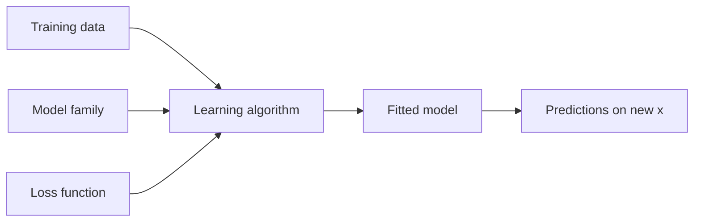

A spam filter, a model that predicts tomorrow's electricity demand, and a program that estimates a house's price from its floor area all do the same thing: they produce a prediction for a case they have never seen, using rules that were not written by hand but extracted from past cases whose answers are known. That is **supervised learning**, and it is the subject of this series. This first entry sets out the vocabulary and the mathematical framing that every later entry uses: what a learning problem consists of, what it means for a model to be good, and why the error a model makes on the data it was fitted to is not the number one actually cares about.

The series is written for readers who can program and who are comfortable with the following, none of which is re-derived here:

- **Calculus:** derivatives and partial derivatives, and the condition that a smooth function has zero derivative at a minimum.
- **Linear algebra:** vectors, matrices, the matrix product, the transpose and the inverse of a square matrix.
- **Probability:** a random variable, its expected value (mean) and variance, and the uniform and normal (Gaussian) distributions.

Code examples use Python 3 with numpy only; the outputs quoted in this series were produced with Python 3.13 and numpy 2.5.3. Every random data set is generated with numpy's `default_rng` and a fixed seed that is stated next to the code, so the numbers can be reproduced exactly with the same numpy version (other versions may produce different random streams and therefore slightly different digits). The seeds are not claimed to be typical; where a result varies noticeably from one seed to another, the text says by how much.

The series has four entries:

1. This entry: the learning problem, loss functions and risk.
2. [Gradient Descent and Its Variants](/blog/gradient-descent-and-its-variants): how the parameters of a model are found by iterative optimization, why the learning rate matters, and where stochastic variants fit in.
3. [Generalization, Overfitting, and Regularization](/blog/generalization-overfitting-and-regularization): why a model can fit its training data well and still predict poorly, and the standard ways of limiting that.
4. [Evaluating Models Honestly](/blog/evaluating-models-honestly): training, validation and test splits, cross-validation, data leakage, bias in the evaluation setup, and how to report results.

## 1. What Learning from Data Means

### 1.1 Examples, features and labels

The basic unit of data is an **example** (also called a sample, instance or observation): one case for which something is recorded. Each example has two parts.

- The **features** (or inputs) are the quantities available when a prediction has to be made: the floor area and age of a house, the words in an email. They are collected into a **feature vector** $\mathbf{x} = (x_1, x_2, \dots, x_d)$ with $d$ components, one per feature.
- The **label** (or target, or output) $y$ is the quantity to be predicted: the sale price, or whether the email is spam.

A **data set** of $n$ examples is written $\mathcal{D} = \{(\mathbf{x}_1, y_1), \dots, (\mathbf{x}_n, y_n)\}$, where the subscript $i$ in $(\mathbf{x}_i, y_i)$ numbers the examples. When a single feature is enough for an illustration, as in Section 5, the vector is replaced by a scalar $x$.

### 1.2 Supervised learning: regression and classification

In **supervised learning** the examples used for learning carry their labels, and the goal is a rule that predicts the label of a new example from its features alone. The rule is called a **predictor**: a function $f$ that maps a feature vector to a prediction $\hat{y} = f(\mathbf{x})$. The hat marks a predicted value, as opposed to the true label $y$.

Two kinds of task cover most of the field:

- In **regression** the label is a real number: a price, a temperature, a demand in megawatts.
- In **classification** the label is one of a finite set of **classes**: spam or not spam, one of ten digits. With two classes the task is **binary classification**, and this series codes the classes as $y \in \{0, 1\}$.

Learning without labels (clustering, density estimation, dimensionality reduction) is **unsupervised learning** and is outside the scope of this series, although the ideas of loss, risk and honest evaluation carry over.

### 1.3 Why not write the rule by hand?

For a few well-understood problems the rule can be derived from physics or from a specification, and then no learning is needed. Learning from data earns its place when the relation between features and label is too complicated, too poorly understood, or too changeable to write down, but examples of it are plentiful. The price paid is that the result is only as good as the examples and the way it is checked, which is why half of this series is about evaluation.

## 2. The Ingredients of a Learning Problem

A supervised learning problem is specified by three choices: the data, the family of candidate models, and the loss function that scores predictions. A **learning algorithm** takes the data and returns one model from the family.



### 2.1 Data and the i.i.d. assumption

Learning would be pointless if the examples available today said nothing about the cases met tomorrow. The standard assumption that connects the two is that every example, past or future, is drawn from the same joint probability distribution $P(\mathbf{x}, y)$, called the **data-generating distribution**, and that the draws are independent of each other. Examples drawn this way are **independent and identically distributed** (i.i.d.).

Two points about this assumption matter for the rest of the series:

- The distribution $P$ is unknown. If it were known there would be nothing to learn. All that is available is a finite sample from it.
- The assumption is often only approximately true. Data collected in one hospital, one year or one region may differ from the cases a model will meet later. When that happens, every guarantee that rests on the i.i.d. assumption weakens, and the fourth entry treats how such mismatches distort an evaluation.

The relation between $\mathbf{x}$ and $y$ is generally not a function: two houses with the same recorded features can sell for different prices. The distribution $P$ captures this by giving, for each $\mathbf{x}$, a whole conditional distribution of $y$.

### 2.2 Models and parameters

A **model** in this series is a family of predictors indexed by a vector of **parameters** $\mathbf{w}$; one particular setting of the parameters gives one predictor, written $f(\mathbf{x}; \mathbf{w})$. The set of all predictors the family can express is called the **hypothesis class**. Fitting (or **training**) the model means choosing $\mathbf{w}$ from data.

The simplest family, and the running example of the series, is the **linear model**:

$$
f(\mathbf{x}; \mathbf{w}) = w_0 + w_1 x_1 + w_2 x_2 + \dots + w_d x_d .
$$

The parameter $w_0$ is the **intercept** (or bias term; the word "bias" has other meanings in this series, so the term intercept is used here) and $w_1, \dots, w_d$ are the **weights** of the features. It is convenient to prepend a constant 1 to every feature vector, so that the prediction becomes a dot product. Stacking the $n$ augmented feature vectors as rows gives the **design matrix** $X$, an $n \times (d+1)$ matrix, and all $n$ predictions at once are the vector $X\mathbf{w}$.

"Linear" refers to the parameters, not the features. A polynomial $w_0 + w_1 x + w_2 x^2$ is a linear model in the features $x$ and $x^2$, and the third entry uses exactly this to build models of increasing flexibility.

The weights of a model are learned from data. Other choices, such as the degree of a polynomial or the strength of a penalty, are fixed before fitting and are called **hyperparameters**. How to choose them without fooling oneself is a recurring theme of the third and fourth entries.

### 2.3 Loss functions

A **loss function** $\ell(\hat{y}, y)$ assigns a non-negative number to a single prediction $\hat{y}$ when the true label is $y$: zero for a perfect prediction, larger for worse ones. The choice of loss defines what "a good prediction" means, so it should reflect the cost of mistakes in the application. The common choices are:

| Loss | Formula | Task | Notes |
|---|---|---|---|
| Squared loss | $(\hat{y} - y)^2$ | Regression | Smooth; penalizes large errors heavily |
| Absolute loss | $\lvert \hat{y} - y \rvert$ | Regression | Less sensitive to outliers; not differentiable at 0 |
| Zero-one loss | $0$ if $\hat{y} = y$, else $1$ | Classification | Counts mistakes; its average is the error rate |
| Cross-entropy (log) loss | $-\left[y \ln p + (1-y)\ln(1-p)\right]$ | Binary classification | Scores a predicted probability $p$ that $y = 1$ |

Two remarks complete the table.

The **zero-one loss** is what a classifier is usually judged by, since its average over a data set is the fraction of mistakes (one minus the **accuracy**). It is unsuitable for fitting, however: it is flat almost everywhere, so a small change of the parameters usually does not change it at all, and gradient-based methods (the subject of the second entry) get no signal from it.

The **cross-entropy loss** is used instead when the model outputs a probability. A classifier such as logistic regression computes a real-valued score $s = f(\mathbf{x}; \mathbf{w})$ and turns it into a probability with the **logistic (sigmoid) function** $p = \sigma(s) = 1/(1 + e^{-s})$, which maps any real number into the interval $(0, 1)$. The logarithm is natural, so the loss is measured in nats. A confident correct prediction costs little and a confident wrong one costs a lot: with $p = 0.9$, the loss is $-\ln 0.9 = 0.105$ if $y = 1$ and $-\ln 0.1 = 2.303$ if $y = 0$. A noncommittal $p = 0.5$ costs $\ln 2 = 0.693$ either way.

Averaged over a data set, the squared loss gives the **mean squared error** (MSE), $\frac{1}{n}\sum_i (\hat{y}_i - y_i)^2$. Some texts put a factor $\tfrac12$ in front to simplify derivatives; this series does not, so every MSE quoted here is the plain average of squared errors, in the squared units of the label.

## 3. Risk and Empirical Risk

### 3.1 Risk: expected loss on new data

The loss scores one prediction. What matters for a predictor $f$ is how it does on average over the cases it will meet, that is, over the data-generating distribution. That average is the **risk** (or expected loss, or **generalization error**):

$$
R(f) = \mathbb{E}_{(\mathbf{x}, y) \sim P}\left[\ell\big(f(\mathbf{x}), y\big)\right].
$$

The subscript says the expectation is over a fresh example drawn from $P$. For the zero-one loss, $R(f)$ is the probability that $f$ misclassifies a new example; for the squared loss it is the expected squared error on a new example.

Risk is the quantity that a learning system should make small, and it can never be computed directly, because $P$ is unknown.

### 3.2 The best possible predictor and irreducible error

Even the best predictor has nonzero risk when $y$ is not a function of $\mathbf{x}$. For the squared loss the best predictor can be written down. Fix a feature vector $\mathbf{x}$ and choose the prediction $c$ to minimize $\mathbb{E}[(c - y)^2 \mid \mathbf{x}]$. Expanding around the conditional mean $\mu(\mathbf{x}) = \mathbb{E}[y \mid \mathbf{x}]$,

$$
\mathbb{E}\left[(c - y)^2 \mid \mathbf{x}\right] = \big(c - \mu(\mathbf{x})\big)^2 + \operatorname{Var}(y \mid \mathbf{x}),
$$

because the cross term $2(c - \mu)\,\mathbb{E}[\mu - y \mid \mathbf{x}]$ is zero. The first term vanishes for $c = \mu(\mathbf{x})$, so the best predictor under squared loss is the **conditional mean** $f^*(\mathbf{x}) = \mathbb{E}[y \mid \mathbf{x}]$, and its risk is the average conditional variance $\mathbb{E}[\operatorname{Var}(y \mid \mathbf{x})]$. No model, however flexible and however much data it sees, can do better. This floor is the **irreducible error** (or noise level).

The minimizer depends on the loss. The same argument with the absolute loss gives the conditional **median** of $y$, and with the zero-one loss it gives the most probable class. A predictor that attains the lowest possible risk is called the **Bayes predictor**, and its risk the **Bayes risk**. The rest of the series compares fitted models against this floor whenever the data are synthetic and the floor is therefore known.

### 3.3 Empirical risk

Given $n$ examples, the natural estimate of the risk is the average loss over them, the **empirical risk**:

$$
\hat{R}_n(f) = \frac{1}{n}\sum_{i=1}^{n} \ell\big(f(\mathbf{x}_i), y_i\big).
$$

If $f$ is fixed in advance and the examples are i.i.d. draws from $P$, each term is an independent draw of the random variable $\ell(f(\mathbf{x}), y)$, whose mean is $R(f)$. The empirical risk is then an **unbiased** estimate of the risk (its expected value is $R(f)$), and by the law of large numbers it converges to $R(f)$ as $n$ grows. Its standard deviation shrinks in proportion to $1/\sqrt{n}$. The fourth entry turns this into confidence intervals for a reported error.

The condition "fixed in advance" is the crux of this entry, and Section 6 returns to it.

### 3.4 Empirical risk minimization

Since $R$ cannot be computed but $\hat{R}_n$ can, the obvious learning algorithm is to choose the parameters that minimize the empirical risk on the available data, called the **training set**:

$$
\hat{\mathbf{w}} = \arg\min_{\mathbf{w}} \; \hat{R}_n\big(f(\cdot\,; \mathbf{w})\big).
$$

This principle is **empirical risk minimization** (ERM). The empirical risk of the fitted model on its own training set is its **training error**. Most of the learning algorithms in use are ERM, sometimes with a penalty term added (the third entry), and the function being minimized is called the **objective** or **cost function**. For some models the minimizer has a closed form, as in Section 5; for most it is found iteratively, which is the subject of the second entry.

## 4. How the Loss Shapes the Answer

A small example shows that the loss is not a technicality. Take the five labels $y = 2, 3, 3, 4, 13$ and the simplest possible model, a constant prediction $\hat{y} = c$ that ignores the features. The value 13 plays the role of an outlier.

Under squared loss, the empirical risk $\frac{1}{5}\sum_i (c - y_i)^2$ has derivative $\frac{2}{5}\sum_i (c - y_i)$, which is zero at $c = \bar{y}$, the sample mean, here 5. Under absolute loss the minimizer is the sample median, 3: moving $c$ away from the median moves it away from more labels than towards. The two candidates score as follows.

| Constant $c$ | MSE | Mean absolute error |
|---|---|---|
| 3 (median) | $(1 + 0 + 0 + 1 + 100)/5 = 20.4$ | $(1 + 0 + 0 + 1 + 10)/5 = 2.4$ |
| 5 (mean) | $(9 + 4 + 4 + 1 + 64)/5 = 16.4$ | $(3 + 2 + 2 + 1 + 8)/5 = 3.2$ |

Each loss prefers its own minimizer, and the two disagree because of the single large label. The squared loss lets one outlier drag the prediction two units away from the four typical values; the absolute loss ignores how far the outlier is. Neither is "correct" in the abstract. If a large error really is much more costly than a small one, squared loss expresses that; if the large label is a data-entry mistake, absolute loss is more robust to it.

## 5. Worked Example: Least Squares on Synthetic Data

### 5.1 The data

Real data would hide the quantity of interest, the risk, because $P$ is unknown. Synthetic data reveal it. The example below draws $n = 20$ examples from a distribution chosen in advance:

$$
x \sim \text{Uniform}(0, 1), \qquad y = 1 + 2x + \varepsilon, \qquad \varepsilon \sim \mathcal{N}(0,\, 0.5^2),
$$

with the noise $\varepsilon$ independent of $x$. The conditional mean is $f^*(x) = 1 + 2x$, so by Section 3.2 the Bayes risk under squared loss is the noise variance, $\sigma^2 = 0.25$. Section 5.4 checks the fitted model against that floor.

### 5.2 Fitting by least squares

With the linear model $f(x; \mathbf{w}) = w_0 + w_1 x$ and squared loss, ERM minimizes the training MSE

$$
\hat{R}_n(\mathbf{w}) = \frac{1}{n}\lVert X\mathbf{w} - \mathbf{y} \rVert^2,
$$

where $\mathbf{y}$ is the vector of the $n$ labels and $\lVert \cdot \rVert$ is the Euclidean length. This is **least squares**. Its gradient, the vector of partial derivatives with respect to the parameters, is

$$
\nabla \hat{R}_n(\mathbf{w}) = \frac{2}{n} X^\top (X\mathbf{w} - \mathbf{y}),
$$

and setting it to zero gives the **normal equations** $X^\top X\,\mathbf{w} = X^\top \mathbf{y}$. When the columns of $X$ are linearly independent (here: the $x_i$ are not all equal), $X^\top X$ is invertible and the solution is unique. The objective is a convex quadratic, so this stationary point is the global minimum.

### 5.3 The code

```python
import numpy as np

rng = np.random.default_rng(seed=0)
n, sigma = 20, 0.5
x = rng.uniform(0.0, 1.0, size=n)
y = 1.0 + 2.0 * x + rng.normal(0.0, sigma, size=n)   # true line plus noise

X = np.column_stack([np.ones(n), x])                  # design matrix, n x 2
w = np.linalg.solve(X.T @ X, X.T @ y)                 # normal equations
train_mse = np.mean((X @ w - y) ** 2)

x_new = rng.uniform(0.0, 1.0, size=1_000_000)         # fresh data, same distribution
y_new = 1.0 + 2.0 * x_new + rng.normal(0.0, sigma, size=x_new.size)
new_mse = np.mean((w[0] + w[1] * x_new - y_new) ** 2)

print("w =", np.round(w, 3))
print("training MSE   =", round(train_mse, 4))
print("fresh-data MSE =", round(new_mse, 4))
```

With seed 0 it prints:

```text
w = [1.181 1.707]
training MSE   = 0.1124
fresh-data MSE = 0.2578
```

The code solves the normal equations with `np.linalg.solve` rather than forming the inverse, which is the numerically preferable habit; for badly conditioned problems a QR- or SVD-based solver such as `np.linalg.lstsq` is better still.

### 5.4 Reading the numbers

The fitted line is $\hat{y} = 1.181 + 1.707\,x$, not the true $1 + 2x$: twenty noisy points do not pin the line down exactly.

The risk of this particular fitted line can be computed exactly, because the distribution is known. Write the parameter errors as $a = \hat{w}_0 - 1 = 0.181$ and $b = \hat{w}_1 - 2 = -0.293$. The prediction error on a new example is $(a + b x) - \varepsilon$, and since $\varepsilon$ has mean zero and is independent of $x$,

$$
R(\hat{\mathbf{w}}) = \sigma^2 + \mathbb{E}\left[(a + b x)^2\right] = \sigma^2 + a^2 + ab + \frac{b^2}{3},
$$

using $\mathbb{E}[x] = \tfrac12$ and $\mathbb{E}[x^2] = \tfrac13$ for $x$ uniform on $[0, 1]$. With the unrounded parameters this gives $0.25 + 0.0084 = 0.2584$. The fresh-data MSE of 0.2578, an average over a million new examples, is an empirical estimate of this same number; the difference of 0.0006 is the sampling error of a finite average.

Three numbers now sit side by side:

| Quantity | Value | What it is |
|---|---|---|
| Training MSE | 0.1124 | Empirical risk on the 20 examples used for fitting |
| Bayes risk | 0.2500 | Lowest risk any predictor can have (the noise variance) |
| Risk of the fitted line | 0.2584 | Expected squared error on new examples |

The training error is far below the Bayes risk, which no predictor can genuinely beat. The fitted line has not discovered a way to predict better than the noise allows; it has adapted to the particular noise values in its 20 examples. Its real risk is above the floor by the **excess risk** of 0.0084, the price of estimating two parameters from 20 noisy points.

## 6. What Empirical Risk Does and Does Not Tell Us

Section 3.3 said the empirical risk is an unbiased estimate of the risk for a predictor fixed in advance. The fitted model in Section 5 was not fixed in advance: its parameters were chosen to make the loss on exactly those 20 examples as small as possible. The training error therefore measures, in part, how well the fitting procedure adapted to the noise in the sample, and it is biased downwards as an estimate of the risk. For least squares with $p$ parameters, when the model family contains the true conditional mean (as it does here) and the noise is independent with variance $\sigma^2$, the expected training MSE is $\sigma^2 (n - p)/n$, which is $0.25 \times 18/20 = 0.225$ here. The sample in Section 5 happened to fall well below even that average, which illustrates that the training error also varies from one sample to another.

The gap between risk and training error is the **generalization gap**. It is small for the two-parameter line, but it grows as a model becomes more flexible relative to the amount of data, and with enough flexibility the training error can reach zero while the risk is large. That failure is **overfitting**, and the third entry studies it directly.

The practical consequence is a rule that the rest of the series builds on:

> An error measured on data that influenced any choice about the model (its parameters, its hyperparameters, its features, or which model to keep) is an optimistic estimate of its error on new data. An honest estimate needs examples that played no part in those choices.

Such examples are **held-out** data, and organizing them correctly (into validation and test sets, or by cross-validation) is the subject of the fourth entry. Held-out data solve the problem only under the i.i.d. assumption of Section 2.1: an estimate from a held-out set says how the model will do on cases drawn from the same distribution, and nothing about cases from a different one.

## 7. Exercises

**Exercise 1.** A model outputs the probability $p = 0.8$ that an email is spam. Compute the cross-entropy loss (natural logarithm) if the email is spam and if it is not.

<details>
<summary>Answer</summary>

If spam ($y = 1$): $-\ln 0.8 = 0.223$. If not spam ($y = 0$): $-\ln 0.2 = 1.609$. The wrong outcome costs about seven times more because the model was fairly confident.

</details>

**Exercise 2.** For the labels $2, 3, 3, 4, 13$ of Section 4, show that the MSE of a constant $c$ equals the sample variance (with divisor $n$) plus $(c - \bar{y})^2$, and use this to recompute the MSE at $c = 3$ from the value at $c = 5$.

<details>
<summary>Answer</summary>

Writing $c - y_i = (c - \bar{y}) + (\bar{y} - y_i)$ and expanding, the cross term sums to zero because $\sum_i(\bar{y} - y_i) = 0$, so $\text{MSE}(c) = \frac{1}{n}\sum_i (y_i - \bar{y})^2 + (c - \bar{y})^2$. At $c = \bar{y} = 5$ the MSE is the variance, 16.4. At $c = 3$ it is $16.4 + 2^2 = 20.4$, as in the table.

</details>

**Exercise 3.** A classifier for a rare disease predicts "healthy" for everyone. In the population, 2 % of people have the disease. What is its risk under the zero-one loss? What does this suggest about judging classifiers by error rate alone?

<details>
<summary>Answer</summary>

It errs exactly on the 2 % who are ill, so $R = 0.02$ (98 % accuracy) while being useless for its purpose. A low error rate means little without comparing it with such a trivial baseline and without looking at errors on each class separately; the fourth entry returns to this.

</details>

**Exercise 4.** In Section 5.4, suppose the fit had been exact for the slope ($\hat{w}_1 = 2$) but the intercept had been off by 0.2. What would the risk be?

<details>
<summary>Answer</summary>

With $a = 0.2$ and $b = 0$, $R = 0.25 + 0.04 = 0.29$. An intercept error shifts every prediction by the same amount, so it adds its square to the risk directly.

</details>

## 8. Summary

| Question | Answer |
|---|---|
| What is supervised learning? | Learning a predictor $f$ that maps features $\mathbf{x}$ to a label $y$, from examples whose labels are known. |
| How do regression and classification differ? | Regression predicts a real number; classification predicts one of a finite set of classes. |
| What specifies a learning problem? | The data (assumed i.i.d. from an unknown distribution $P$), a model family with parameters $\mathbf{w}$, and a loss function. |
| What is risk? | The expected loss of a predictor on a new example drawn from $P$; also called generalization error. It cannot be computed directly. |
| What is the best possible predictor under squared loss? | The conditional mean $\mathbb{E}[y \mid \mathbf{x}]$; its risk, the irreducible error, is a floor no model can beat. |
| What is empirical risk minimization? | Choosing parameters that minimize the average loss on the training set. |
| Why is training error optimistic? | The parameters were chosen to make that very error small, so it reflects adaptation to the sample's noise as well as genuine predictive ability. |
| What gives an honest estimate of risk? | The average loss on held-out examples that influenced no choice about the model, under the i.i.d. assumption. |

Least squares had a closed-form minimizer. Most models do not, and their empirical risk has to be minimized step by step. The next entry, [Gradient Descent and Its Variants](/blog/gradient-descent-and-its-variants), develops that method on the same synthetic data set, and shows why the size of each step decides whether it converges at all.

### References

- T. Hastie, R. Tibshirani and J. Friedman, *The Elements of Statistical Learning: Data Mining, Inference, and Prediction*, 2nd edition, Springer, 2009.
- C. M. Bishop, *Pattern Recognition and Machine Learning*, Springer, 2006.
- S. Shalev-Shwartz and S. Ben-David, *Understanding Machine Learning: From Theory to Algorithms*, Cambridge University Press, 2014.
- V. N. Vapnik, *The Nature of Statistical Learning Theory*, Springer, 1995.
- G. James, D. Witten, T. Hastie and R. Tibshirani, *An Introduction to Statistical Learning*, Springer, 2013.
