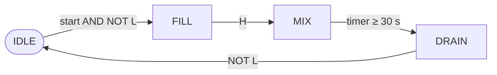

A bottling line, a water treatment plant and a car-body welding cell look very different, but the systems that run them answer the same two kinds of question. Some questions have yes-or-no answers: is a bottle under the filler, is the guard door closed, should the pump run? Others have numerical answers: how far should the steam valve open to hold the reactor at 80 °C? Industrial automation is the engineering of the machines and programs that answer both kinds of question, continuously and without a person in the loop.

This entry opens the series and sets out the vocabulary the later entries use. It concentrates on the first kind of question: **logic control**, where inputs and outputs are binary, and **sequential control**, where the right output also depends on what has happened before, and develops its tools from first principles.

The series assumes basic electrical engineering (voltage, current, a switch and a relay coil) and, for the fourth entry, the feedback ideas of the [Foundations of Control Systems](/series/foundations-of-control-systems) series, from its [introduction](/blog/introduction-to-control-systems) and its entry on [feedback and system behavior](/blog/feedback-and-system-behavior). No prior knowledge of digital logic or of programmable controllers is assumed. Code examples are written in Python 3 using only the standard library, so that the logic can be run and checked anywhere; the second entry translates the same ideas into the languages that industrial controllers actually run.

## 1. What Industrial Automation Controls

### 1.1 Processes, plants and field devices

The physical system being automated is the **process** or **plant**: a tank and its pipes, a conveyor, a press, a furnace. The plant interacts with the controller through **field devices**, which are mounted on the plant itself:

- **Sensors** report the plant's condition. Many give a binary answer: a **limit switch** closes when a moving part reaches a position, a **proximity sensor** switches when metal (inductive type) or most other materials, including non-metals (capacitive type), come near, a **level switch** changes state when liquid covers it, and a **push button** reports an operator's request. Others, such as temperature transmitters and flowmeters, report a continuous value.
- **Actuators** change the plant. Binary ones include a **solenoid valve** (open or closed), a **contactor** (a heavy-duty relay that switches a motor's supply on or off) and an indicator lamp. Continuous ones include a control valve whose opening can be set anywhere between 0 and 100 %, and a variable-speed drive.

The **controller**, a computer, reads the sensors, decides, and drives the actuators.

### 1.2 Discrete, continuous and batch processes

Processes are commonly divided into three kinds, and each leans on a different kind of control:

| Kind of process | What flows through it | Typical control |
|---|---|---|
| Discrete (manufacturing) | Countable items: parts, bottles, car bodies | Logic and sequences: is the part present, has the cylinder reached its end position? |
| Continuous | Material flowing without interruption: water, gas, electricity, paper | Feedback control of continuous variables: temperature, level, flow, pressure |
| Batch | A fixed quantity processed through a recipe of steps: a mix, a brew, a pharmaceutical lot | Sequences whose steps contain continuous control loops |

Real plants mix all three. A batch reactor follows a sequence (fill, heat, hold, cool, drain), and inside the "heat" and "hold" steps a feedback loop keeps the temperature at its **setpoint**, the desired value. This entry covers the logic and sequence layer; the [fourth entry](/blog/pid-control-of-process-variables) covers the feedback loops.

### 1.3 Binary signals and the fail-safe convention

A binary signal has two values, written 1 and 0, TRUE and FALSE, or ON and OFF. In industrial wiring the two values are usually voltages: 24 V direct current (DC) for 1 and 0 V for 0 is the most common convention in control cabinets, although 120 V and 230 V alternating-current (AC) signals are also used.

A contact can be **normally open** (NO: open, so passing no current, when not actuated) or **normally closed** (NC: closed when not actuated). The choice is not arbitrary. A stop button is wired normally closed, so the controller sees 1 while the button is released and 0 when it is pressed. If the wire breaks or a terminal comes loose, the controller also sees 0 and stops the machine. A broken wire on a normally open stop button would instead go unnoticed until someone pressed the button and nothing happened. Arranging signals so that the most likely failure (a lost signal) produces the safe action is the **fail-safe** principle, and it shapes the logic in the rest of this entry: a variable named `stop_ok` below is 1 when stopping is *not* requested.

Fail-safe wiring is good practice, not a safety function in the formal sense. Functions that protect people, such as emergency stops and guard interlocks, are designed to dedicated machinery-safety standards and are implemented in hardwired circuits or safety-rated controllers; ordinary control logic of the kind developed here must never be the only protection.

### 1.4 The series ahead

| Entry | Topic |
|---|---|
| 1. Logic and Sequential Control (this entry) | Boolean logic, memory, timers, counters and state machines |
| 2. [Programmable Logic Controllers](/blog/programmable-logic-controllers) | How a programmable logic controller (PLC) executes a program cyclically, its inputs and outputs, and the languages of IEC 61131-3 |
| 3. [Fieldbuses and Industrial Ethernet](/blog/fieldbuses-and-industrial-ethernet) | How controllers, sensors and actuators exchange data over networks with predictable timing |
| 4. [PID Control of Process Variables](/blog/pid-control-of-process-variables) | Feedback control of temperature, level, flow and pressure with proportional–integral–derivative (PID) controllers, and how to tune them |
| 5. [Networked Automation and Digital Twins](/blog/networked-automation-and-digital-twins) | Connecting plant systems to higher-level systems with the OPC Unified Architecture (OPC UA), and running models alongside the plant |

## 2. Boolean Algebra for Control

### 2.1 Variables and the three basic operations

A **Boolean variable** takes one of two values, 0 or 1. Three operations combine Boolean variables:

| Operation | Notation in this series | Result is 1 when | Relay equivalent |
|---|---|---|---|
| AND | $a \cdot b$ (or $ab$) | both $a$ and $b$ are 1 | two contacts in series |
| OR | $a + b$ | at least one of $a$, $b$ is 1 | two contacts in parallel |
| NOT | $\overline{a}$ | $a$ is 0 | a normally closed contact |

The relay column is why this algebra fits automation so naturally: before electronic controllers, machine logic was built from relays, where current reaches a coil only through a path of closed contacts. The ladder notation of the second entry descends directly from those relay drawings.

A **combinational** function is one whose output depends only on the present values of its inputs. It is completely described by a **truth table** that lists the output for every combination of inputs; $n$ inputs give $2^n$ rows.

### 2.2 The laws that make simplification possible

The operations obey a small set of identities. With $a$, $b$, $c$ Boolean variables:

| Name | AND form | OR form |
|---|---|---|
| Identity | $a \cdot 1 = a$ | $a + 0 = a$ |
| Null | $a \cdot 0 = 0$ | $a + 1 = 1$ |
| Complement | $a \cdot \overline{a} = 0$ | $a + \overline{a} = 1$ |
| Idempotence | $a \cdot a = a$ | $a + a = a$ |
| Distribution | $a(b + c) = ab + ac$ | $a + bc = (a + b)(a + c)$ |
| Absorption | $a(a + b) = a$ | $a + ab = a$ |
| De Morgan | $\overline{ab} = \overline{a} + \overline{b}$ | $\overline{a + b} = \overline{a}\,\overline{b}$ |

Commutativity and associativity hold for both AND and OR, as in ordinary algebra. Note the second distribution law, which has no counterpart in ordinary arithmetic. De Morgan's laws are the ones used most in practice: they turn "stop if any fault is present" into "run only if every fault is absent", which is how fail-safe logic is usually written:

$$
\text{run} = \overline{f_1 + f_2 + f_3} = \overline{f_1}\,\overline{f_2}\,\overline{f_3}.
$$

### 2.3 Sum-of-products form

Any truth table can be written as a **sum of products**: an OR of terms, each of which is an AND of variables or their complements. The most direct version takes one product term, called a **minterm**, for every row in which the output is 1. Minterms are numbered by reading the input row as a binary number, so with inputs $(a, b, c)$ the row $a = 1, b = 0, c = 1$ is minterm 5, and a function can be specified compactly as $F = \sum m(1, 2, 3, 5)$.

The minterm form is correct but usually far from minimal. Fewer terms mean fewer contacts in a relay panel, fewer instructions in a program and, more importantly, logic that a maintenance engineer can read and check. Simplification is therefore worth doing, and for up to four variables the Karnaugh map does it by eye.

### 2.4 Karnaugh maps

A **Karnaugh map** is a truth table arranged as a grid in which neighboring cells differ in exactly one variable. To achieve that, rows and columns are labeled in **Gray code** order (00, 01, 11, 10), in which successive codes differ in one bit, and the map wraps around: the left edge is adjacent to the right edge and the top to the bottom.

Two adjacent cells that are both 1 differ only in one variable, so that variable drops out of their combined term ($a b c + a b \overline{c} = ab$). The method follows:

1. Write the function's 1s into the map.
2. Cover every 1 with rectangular groups whose sizes are powers of two (1, 2, 4, 8 cells), as large as possible, overlapping where that helps. Groups may wrap around the edges.
3. Each group becomes one product term containing only the variables that are constant across the group.
4. Use as few groups as possible.

**A worked example: level-switch plausibility.** A tank has three level switches mounted at increasing heights: $L$ (low), $M$ (middle) and $H$ (high), each 1 when covered by liquid. Liquid cannot cover a higher switch without covering the lower ones, so a covered switch above an uncovered one means a switch or its wiring has failed. The fault signal is 1 in exactly the implausible states:

| $L$ | $M$ | $H$ | Fault |
|---|---|---|---|
| 0 | 0 | 0 | 0 |
| 0 | 0 | 1 | 1 |
| 0 | 1 | 0 | 1 |
| 0 | 1 | 1 | 1 |
| 1 | 0 | 0 | 0 |
| 1 | 0 | 1 | 1 |
| 1 | 1 | 0 | 0 |
| 1 | 1 | 1 | 0 |

Arranged as a Karnaugh map with $L$ selecting the row and $MH$ the column (in Gray-code order):

| $L \backslash MH$ | 00 | 01 | 11 | 10 |
|---|---|---|---|---|
| 0 | 0 | 1 | 1 | 1 |
| 1 | 0 | 1 | 0 | 0 |

Two groups cover all four 1s. The column $MH = 01$ (both rows) is $M = 0, H = 1$, giving $\overline{M}H$. The pair of cells in row $L = 0$ under $MH = 11$ and $10$ has $L = 0, M = 1$, giving $\overline{L}M$. Hence

$$
\text{Fault} = \overline{L}M + \overline{M}H,
$$

two terms instead of four minterms. A direct translation of the specification ("$M$ without $L$, or $H$ without $M$, or $H$ without $L$") would have a third term $\overline{L}H$; the map shows it is redundant, because whenever $H$ is on without $L$, one of the other two terms is already true. A short exhaustive check confirms the equivalence:

```python
from itertools import product

def fault_spec(l, m, h):
    # a switch higher up is covered while a lower one is not
    return (m and not l) or (h and not m) or (h and not l)

def fault_min(l, m, h):
    return (m and not l) or (h and not m)

print(all(fault_spec(*v) == fault_min(*v) for v in product((0, 1), repeat=3)))
```

It prints `True`. For three or four inputs an exhaustive check costs nothing, and it is worth running whenever logic has been simplified by hand.

### 2.5 Don't-care conditions

Some input combinations cannot occur, or their output does not matter. Such a combination is a **don't-care**, marked X in the map, and it may be included in a group or left out, whichever gives the simpler result.

Suppose the same tank needs a refill request $Y$ that is 1 whenever the level is below the middle switch. Over the four plausible states, $Y = 1$ for $LMH = 000$ and $100$, and $Y = 0$ for $110$ and $111$. Treating the four implausible states as don't-cares:

| $L \backslash MH$ | 00 | 01 | 11 | 10 |
|---|---|---|---|---|
| 0 | 1 | X | X | X |
| 1 | 1 | X | 0 | 0 |

Taking the don't-cares in column 01 into a group with column 00 gives the single literal $Y = \overline{M}$. Leaving them all at 0 gives $Y = \overline{M}\,\overline{H}$.

The smaller expression is not automatically the better design. With $Y = \overline{M}$, a failed middle switch in a full tank ($LMH = 101$) produces a refill request, and a pump started by it would overfill the tank. With $Y = \overline{M}\,\overline{H}$ the high switch still blocks the request. Don't-cares are a statement that a combination "cannot happen", and in automation the combinations that cannot happen are exactly the ones that sensor failures produce. Assign them deliberately, and prefer the assignment that fails safe.

## 3. Memory: Latches and Edges

### 3.1 Why combinational logic is not enough

A motor started by a momentary Start button and stopped by a momentary Stop button cannot be described by a truth table of the two buttons. With neither button pressed, the motor should run if it was started earlier and stay off if it was not. The output depends on the past, so the controller needs **memory**. Logic whose output depends on stored state as well as on present inputs is called **sequential logic**.

### 3.2 The seal-in circuit

The classic solution in relay logic feeds the output back to its own input. The motor contactor $K$ closes an auxiliary contact of its own in parallel with the Start button, so once energized it holds itself in:

$$
K^{+} = (\text{start} + K)\cdot \text{stop\_ok},
$$

where $K^{+}$ is the next value of $K$, `start` is 1 while the Start button is pressed, and `stop_ok` is 1 while the normally closed Stop button is released (Section 1.3). In relay notation, with `| |` a normally open contact, `|/|` a normally closed contact and `( )` a coil, the rung reads:

```text
  start      stop_ok        K
---| |----+----| |---------( )---
          |
    K     |
---| |----+
```

Pressing Start energizes $K$; the parallel contact $K$ then keeps it energized after Start is released; opening `stop_ok` breaks the path and $K$ drops out, and it stays out because its own contact has opened. A power failure also drops $K$ out, and it does not restart by itself when power returns: a property that machinery normally requires.

### 3.3 Set-dominant and reset-dominant latches

The seal-in circuit is one form of a **latch**, a one-bit memory with a set input $S$ and a reset input $R$. The question it must answer is what happens when both are active at once, and there are two answers:

$$
\text{set-dominant: } Q^{+} = S + \overline{R}\,Q, \qquad
\text{reset-dominant: } Q^{+} = \overline{R}\,(S + Q).
$$

| $S$ | $R$ | Set-dominant $Q^+$ | Reset-dominant $Q^+$ |
|---|---|---|---|
| 0 | 0 | $Q$ (hold) | $Q$ (hold) |
| 1 | 0 | 1 | 1 |
| 0 | 1 | 0 | 0 |
| 1 | 1 | 1 | 0 |

The seal-in rung is reset-dominant, with $S = \text{start}$ and $R = \overline{\text{stop\_ok}}$: holding Start down cannot override Stop. That is almost always the right choice for anything that moves. Set-dominant latches suit alarms, where an alarm condition that is still present must not be cleared by an acknowledgment.

### 3.4 Edge detection

Many actions should happen once per event rather than continuously while a signal is 1: counting a part, toggling a mode, starting a step. A **rising edge** of a signal $x$ is the moment it changes from 0 to 1. A controller that evaluates its logic repeatedly detects it by remembering the previous value $x_{\text{prev}}$:

$$
\text{rise} = x \cdot \overline{x_{\text{prev}}}, \qquad \text{fall} = \overline{x}\cdot x_{\text{prev}},
$$

after which $x_{\text{prev}}$ is updated to $x$. The edge signal is 1 for exactly one evaluation. This relies on the logic being evaluated repeatedly, at intervals, in a fixed order; the second entry shows that this is exactly how a programmable controller works, and why the order of statements within one evaluation matters.

## 4. Time: Timers and Counters

### 4.1 Three kinds of timer

Many control decisions depend on how long something has lasted. Three timer behaviors cover nearly all needs, and the international standard for controller languages, IEC 61131-3 (the second entry's subject; this series follows its third edition, IEC 61131-3:2013, which a fourth edition replaced in 2025), defines them as standard **function blocks**, reusable program elements with their own memory, under these names:

| Timer | Output $Q$ | Typical use |
|---|---|---|
| On-delay (TON) | Becomes 1 when the input has been 1 continuously for the preset time $PT$; returns to 0 as soon as the input is 0 | Ignore short events: a sensor must stay blocked for 3 s before a jam is declared |
| Off-delay (TOF) | Becomes 1 as soon as the input is 1; returns to 0 only after the input has been 0 continuously for $PT$ | Keep a cooling fan running for 2 min after a motor stops |
| Pulse (TP) | On a rising edge of the input, becomes 1 for exactly $PT$, whatever the input does meanwhile | Fire a solenoid for a fixed 200 ms |

Each timer also reports its **elapsed time**. The on-delay timer is the workhorse: a **debounce** filter, which ignores the rapid on-off chatter of a mechanical contact as it closes, is simply an on-delay of a few tens of milliseconds, and a "valve failed to open" alarm is an on-delay on the condition "valve commanded open AND open limit switch not reached".

### 4.2 Counters

A **counter** counts rising edges of its input. An up counter holds a current value $CV$, adds 1 on each rising edge of its count input, and sets its output $Q$ to 1 when $CV$ reaches a preset value $PV$; a reset input returns $CV$ to 0. A case packer that closes a box after 12 bottles uses exactly this: a proximity sensor at the box entry drives the count input, $PV = 12$, and $Q$ triggers the next step. The counter counts edges, not the duration of the sensor signal, which is why edge detection (Section 3.4) is built into it.

### 4.3 Timing resolution in a cyclic controller

A controller that evaluates its logic at regular intervals $T_c$ notices events only at those evaluations. Two delays follow. A condition that becomes true between evaluations is first seen at the next one, between 0 and $T_c$ later, and the timer starts there. The timer's expiry is likewise seen only at an evaluation: the first one at which at least $PT$ has elapsed, which is $\lceil PT/T_c \rceil$ periods after the start. Measured from the real event, the delay therefore lies in the interval

$$
\left\lceil \frac{PT}{T_c} \right\rceil T_c \;\le\; \text{delay} \;<\; \left\lceil \frac{PT}{T_c} \right\rceil T_c + T_c .
$$

With $PT = 100$ ms and $T_c = 10$ ms the delay is between 100 and 110 ms. With $T_c = 30$ ms it is between 120 and 150 ms, because 100 ms is not a multiple of 30 ms and the first evaluation at which 100 ms have elapsed is the fourth. For a fan run-on this does not matter; for measuring the speed of a part between two sensors it may. The second entry examines the timing of a cyclic controller in more detail.

## 5. Sequential Control as State Machines

### 5.1 States, transitions and actions

Latches and timers handle memory in small pieces. A process that moves through a series of phases, such as a machine cycle or a batch recipe, is described more clearly as a **finite-state machine**:

- a finite set of **states** (or **steps**), exactly one of which is active at any time;
- **transitions** between states, each guarded by a Boolean **transition condition** on inputs, timers and counters;
- **actions** that set outputs.

When the outputs depend only on the active state, the machine is a **Moore machine**; when they also depend directly on the inputs, it is a **Mealy machine**. Industrial sequences are usually written in the Moore style, because "in step FILL, the inlet valve is open" can be read and checked by someone standing in front of the plant.

### 5.2 A worked example: a mixing tank

A tank is filled through an inlet valve, its contents are stirred by an agitator for 30 s, and it is emptied through a drain valve. It has the low switch $L$ and high switch $H$ of Section 2.4, and an operator Start button. The sequence has four states:



| State | Inlet valve | Agitator | Drain valve |
|---|---|---|---|
| IDLE | 0 | 0 | 0 |
| FILL | 1 | 0 | 0 |
| MIX | 0 | 1 | 0 |
| DRAIN | 0 | 0 | 1 |

The condition $\overline{L}$ on the first transition is a **permissive**: the cycle may start only with an empty tank. The output table is the Moore form: one row per state.

The program below simulates the sequence and a simple tank model. It evaluates the logic every 0.5 s; the tank fills at 2 % of its height per second and drains at 4 % per second, the low switch sits at 10 % and the high switch at 80 %, and the tank starts at 5 %.

```python
DT = 0.5                           # evaluation period, s
FILL_RATE, DRAIN_RATE = 2.0, 4.0   # % of tank height per second
LOW_SW, HIGH_SW = 10.0, 80.0       # switch positions, % of tank height
MIX_TIME = 30.0                    # s

level, state, timer = 5.0, "IDLE", 0.0
for k in range(int(120 / DT) + 1):
    t = k * DT
    start = (t == 2.0)                     # operator presses Start once
    low, high = level >= LOW_SW, level >= HIGH_SW

    # transition logic: at most one transition per evaluation
    new = state
    if state == "IDLE" and start and not low:
        new = "FILL"
    elif state == "FILL" and high:
        new = "MIX"
    elif state == "MIX" and timer >= MIX_TIME:
        new = "DRAIN"
    elif state == "DRAIN" and not low:
        new = "IDLE"
    if new != state:
        print(f"t = {t:5.1f} s  {state:5s} -> {new:5s}  level = {level:4.1f} %")
        state, timer = new, 0.0

    # actions depend only on the active state (Moore outputs)
    fill_valve = state == "FILL"
    agitator = state == "MIX"
    drain_valve = state == "DRAIN"

    level += DT * (FILL_RATE * fill_valve - DRAIN_RATE * drain_valve)
    level = max(level, 0.0)
    timer += DT
```

Its output:

```text
t =   2.0 s  IDLE  -> FILL   level =  5.0 %
t =  39.5 s  FILL  -> MIX    level = 80.0 %
t =  69.5 s  MIX   -> DRAIN  level = 80.0 %
t =  87.5 s  DRAIN -> IDLE   level =  8.0 %
```

The numbers can be checked by hand. Filling from 5 % to 80 % at 2 %/s takes 37.5 s, so FILL ends at $2 + 37.5 = 39.5$ s. MIX lasts 30 s. Draining from 80 % at 4 %/s passes the low switch at 10 % after 17.5 s, at 87.0 s, but at that instant the level is exactly 10 % and the switch still reads covered; the change is seen at the next evaluation, 0.5 s later, by which time the level is 8 %. The general lesson is the one of Section 4.3: a condition evaluated every $T_c$ is detected up to $T_c$ late, so a threshold is overshot by up to (rate of change) × $T_c$, here $4 \times 0.5 = 2$ percentage points.

### 5.3 Structure of a sequence program

The simulation shows a structure that scales to real machines:

1. **Read inputs** once, into variables (`low`, `high`, `start`).
2. **Evaluate transitions** from the active state only, and change state at most once per evaluation.
3. **Compute outputs** from the state alone.
4. **Write outputs** to the actuators.

Keeping transitions and outputs in separate sections means that each output is assigned in exactly one place, which avoids the most common fault in hand-written sequential logic: two parts of a program setting the same output differently, so that the last one evaluated silently wins. Restricting the program to one transition per evaluation also guarantees that every state is active for at least one evaluation, so its actions are executed at least once.

A state can be stored as one variable holding the state's number or name, as above, or as one Boolean flag per state with exactly one flag set (a **one-hot** encoding, natural in relay and ladder logic). Both encode the same machine.

### 5.4 Interlocks, permissives and abnormal situations

A real sequence needs more than its normal path:

- An **interlock** is a condition that forces an output off whatever the sequence wants: the agitator must not run if the tank is below the low switch, because the blades would run dry. It is written into the output logic, $\text{agitator} = \text{MIX}\cdot L$, so that it applies in every state.
- A **permissive** is a condition required before a transition may fire, such as the empty-tank check above.
- A **step time-out** is an on-delay that runs while a state is active and raises an alarm if the state lasts longer than it physically should. In FILL, a time-out of, say, 1.5 times the expected 37.5 s would catch a blocked inlet or a failed high switch.
- A **stop** and a **hold** need defined behavior: which state the machine goes to, which outputs switch off, and how it resumes.

State machines can also be drawn and executed in standardized graphical form. The GRAFCET specification language (IEC 60848) describes sequential behavior with steps and transitions for specification documents, and the Sequential Function Chart language of IEC 61131-3, introduced in the second entry, makes the same structure directly executable on a controller.

## 6. Exercises

**Exercise 1.** Simplify $F(A, B, C, D) = \sum m(0, 2, 5, 7, 8, 10, 13, 15)$ with a Karnaugh map.

<details>
<summary>Answer</summary>

Minterms 0, 2, 8 and 10 have $B = 0, D = 0$: they are the four corners of the map, which form one group because the map wraps around in both directions. Minterms 5, 7, 13 and 15 have $B = 1, D = 1$: a square in the middle. Hence $F = \overline{B}\,\overline{D} + BD$, which is 1 when $B$ and $D$ are equal. An exhaustive check over all 16 input combinations in Python confirms it.

</details>

**Exercise 2.** A conveyor runs only if the guard is closed ($g = 1$), the motor overload relay has not tripped ($t = 0$) and either Auto mode is selected with a part waiting ($a = 1$, $p = 1$) or the Jog button is held ($j = 1$). Write the logic, then use De Morgan's law to express "the conveyor is blocked" in terms of the individual conditions.

<details>
<summary>Answer</summary>

$\text{run} = g\,\overline{t}\,(a p + j)$. Its complement is $\overline{\text{run}} = \overline{g} + t + \overline{a p + j} = \overline{g} + t + (\overline{a} + \overline{p})\,\overline{j}$: the conveyor is blocked if the guard is open, or the overload has tripped, or Jog is released while Auto is off or no part is waiting.

</details>

**Exercise 3.** In the seal-in rung of Section 3.2, the Start button sticks closed. What does the operator observe, and why is a reset-dominant latch the right choice here?

<details>
<summary>Answer</summary>

The motor runs whenever Stop is released. Pressing Stop stops it, because the rung is reset-dominant ($K^+ = (\text{start} + K)\cdot\text{stop\_ok}$ is 0 whenever `stop_ok` is 0), but releasing Stop restarts it at once, which is a clue to the fault. A set-dominant latch would keep the motor running even with Stop pressed.

</details>

**Exercise 4.** A sensor input is evaluated every 20 ms and the controller uses an on-delay of 50 ms to debounce it. What range of delays between the contact settling and the debounced signal becoming 1 should be expected?

<details>
<summary>Answer</summary>

By the formula of Section 4.3, $\lceil 50/20 \rceil = 3$: the settled contact is first seen 0 to 20 ms after it settles, and the on-delay is seen to expire three evaluations (60 ms) later, since after two (40 ms) it has not yet run for 50 ms. The total delay is therefore between 60 and 80 ms. A preset of 40 ms, a multiple of the evaluation period, would give 40 to 60 ms.

</details>

**Exercise 5.** Add a step time-out to the FILL state of Section 5.2 and an extra state FAULT. Which outputs should be on in FAULT, and how should the machine leave it?

<details>
<summary>Answer</summary>

Start an on-delay with the condition "state = FILL", preset to about 1.5 × 37.5 s ≈ 56 s, and add the transition FILL → FAULT when it expires. In FAULT all three actuators are off (the safe state for this tank) and an alarm output is on. The machine should leave FAULT only on an operator acknowledgment, and only to IDLE, so that the fault cannot be cleared automatically and the next cycle starts from the empty-tank permissive.

</details>

## 7. Summary

| Question | Answer |
|---|---|
| What does industrial automation control? | A plant, through field devices: sensors that report its condition and actuators that change it. |
| How do logic, sequential and continuous control differ? | Logic control maps present binary inputs to outputs; sequential control also uses stored state; continuous control computes numerical outputs from measured variables. |
| Why are stop buttons wired normally closed? | A broken wire then reads the same as a pressed button, so the most likely failure produces the safe action. |
| How is a logic function simplified? | With Boolean identities or, for up to four inputs, a Karnaugh map, grouping adjacent 1s in blocks of powers of two. |
| What is the risk with don't-cares? | Impossible combinations are exactly what failed sensors produce; assign them so the result fails safe. |
| How does a controller remember? | Latches (set- or reset-dominant), the seal-in circuit, and stored previous values for edge detection. |
| Which timers are standard? | On-delay (TON), off-delay (TOF) and pulse (TP), plus counters that count rising edges. |
| How is a sequence described? | As a finite-state machine: one active state, guarded transitions, outputs set by the state (Moore form). |
| What timing error does cyclic evaluation add? | Up to one evaluation period; a threshold is overshot by up to the rate of change times that period. |

All of this logic assumed a controller that repeatedly reads its inputs, evaluates a program and writes its outputs. The next entry, [Programmable Logic Controllers](/blog/programmable-logic-controllers), describes that controller: its scan cycle, its input and output hardware, and the five languages that IEC 61131-3:2013 defines for programming it, including the ladder and sequential-function-chart forms of the logic developed here.

### References

- M. M. Mano and M. D. Ciletti, *Digital Design*, 5th edition, Pearson, 2013.
- C. G. Cassandras and S. Lafortune, *Introduction to Discrete Event Systems*, 2nd edition, Springer, 2008.
- IEC 61131-3:2013, *Programmable Controllers – Part 3: Programming Languages*, International Electrotechnical Commission.
- IEC 60848, *GRAFCET Specification Language for Sequential Function Charts*, International Electrotechnical Commission.
- W. Bolton, *Programmable Logic Controllers*, 6th edition, Newnes, 2015.
- F. D. Petruzella, *Programmable Logic Controllers*, 5th edition, McGraw-Hill, 2016.
