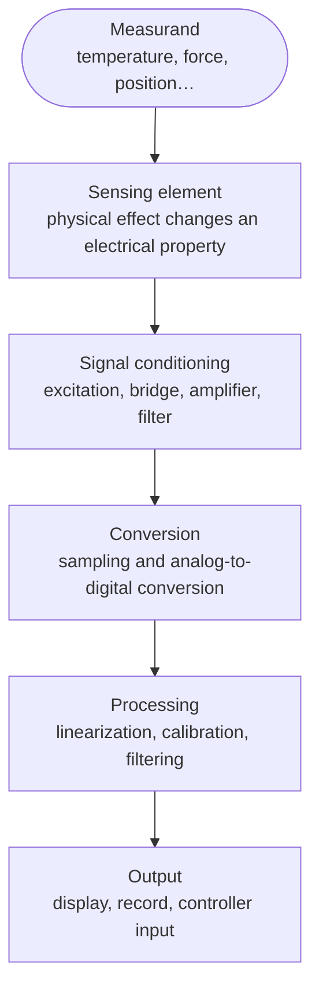

import Figure from '../../components/Figure.astro';
import SensorNonlinearity from '../../components/diagrams/SensorNonlinearity.astro';

A thermostat, a car's airbag controller, a factory robot and a water-quality monitor all depend on the same act: turning something in the physical world (a temperature, an acceleration, a position, a concentration) into a number that a computer can use. That act is **measurement**, and the device that starts it is a **sensor**. This entry sets out what a measurement is, how a sensor sits inside a larger measurement system, and the vocabulary used to describe how good a sensor is. Later entries in the series follow the signal through each stage of that system.

The entry works from the outside in, from the idea of measurement to the properties of one sensor and then to how its errors are estimated and reduced. It assumes only the prerequisites of the series; units are SI, and the terms follow the international vocabulary introduced in Section 1.2.

## 1. What a measurement is

### 1.1 Measurand, value and unit

The quantity one intends to measure is the **measurand**: the temperature of the water in a particular tank, say, not "temperature" in general. A **measurement** is the process of obtaining a value for the measurand, expressed as a number multiplied by a **unit**: 20.13 °C, 3.2 m/s².

Units are defined by the **International System of Units** (SI). Since the revision that took effect in 2019, all seven SI base units (the second, meter, kilogram, ampere, kelvin, mole and candela) are defined by fixing the numerical values of physical constants, such as the speed of light and the Boltzmann constant, rather than by physical artifacts. That matters for sensors because every trustworthy measurement must ultimately be comparable with those definitions, through a chain of calibrations called **traceability** (Section 6).

### 1.2 Every measurement is uncertain

No measurement gives the true value of the measurand exactly. The sensor responds to more than the measurand, the electronics add noise, the reference used to calibrate the sensor is itself imperfect, and the measurand may vary while it is being measured. A measured value is therefore incomplete without a statement of its **uncertainty**: a quantified measure of the doubt about the result, such as a standard deviation or the half-width of an interval within which the true value is believed to lie with stated probability. "20.13 °C" says less than "20.13 °C ± 0.11 °C at about 95% confidence".

The vocabulary in this entry follows the two documents that metrologists (specialists in measurement science) use internationally. Both are published by the Joint Committee for Guides in Metrology (JCGM): the *International Vocabulary of Metrology* (VIM, JCGM 200:2012) for terms, and the *Guide to the Expression of Uncertainty in Measurement* (GUM, JCGM 100:2008) for uncertainty.

## 2. The measurement chain

### 2.1 From measurand to number

A sensor rarely produces a usable number by itself. It is the first link in a **measurement chain**:

Later entries take up these stages in turn. The **sensing element** uses a physical effect, such as the change of a metal's resistance with temperature, to turn the measurand into an electrical quantity. **Signal conditioning** turns that quantity into a voltage of suitable size and bandwidth. **Conversion** samples the voltage and turns it into a digital number. **Processing** corrects the number for the known imperfections of the chain. Errors can enter at every stage, and the uncertainty of the final result reflects all of them.

### 2.2 Sensor, transducer, actuator

Three terms are often confused.

- A **transducer** converts energy or a signal from one physical form to another, in either direction.
- A **sensor** is a transducer used to obtain information about a measurand, converting it into a signal (almost always electrical).
- An **actuator** is a transducer used in the opposite direction, turning an electrical command into a physical effect such as motion or force.

The same physical principle can serve both roles. A piezoelectric crystal produces a voltage when squeezed (a sensor) and changes shape when a voltage is applied (an actuator).

### 2.3 Active and passive sensors

Sensors fall into two groups by where the energy of their output comes from.

- A **self-generating** (or active) sensor produces an electrical output from the measurand's own energy: a thermocouple produces a voltage from a temperature difference, a photodiode a current from light, a piezoelectric sensor a charge from force.
- A **modulating** (or passive) sensor changes an electrical property, such as resistance, capacitance or inductance, and needs an external **excitation** (a supplied voltage or current) to turn that change into a signal: a resistance thermometer, a strain gauge, a capacitive humidity sensor.

The words *active* and *passive* are used both ways round in the literature (Fraden's handbook, for one, calls a sensor that needs excitation *active*), so this series uses the unambiguous terms self-generating and modulating.

The distinction matters for design. A modulating sensor's output depends on its excitation, so excitation errors become measurement errors, and the excitation current itself may disturb the measurand, for example by heating a resistance thermometer.

## 3. Static characteristics

**Static characteristics** describe a sensor whose input has stopped changing and whose output has settled.

### 3.1 The transfer function

The **transfer function** (or characteristic curve) relates the sensor's output to its input. A platinum resistance thermometer is a good running example. Its resistance $R$ at temperature $T$ (in °C, for $0 \le T \le 850$ °C) follows the Callendar–Van Dusen equation:

$$
R(T) = R_0\left(1 + A\,T + B\,T^2\right),
$$

with $R_0$ the resistance at 0 °C and, for industrial platinum sensors, the coefficients $A = 3.9083 \times 10^{-3}\ ^\circ\text{C}^{-1}$ and $B = -5.775 \times 10^{-7}\ ^\circ\text{C}^{-2}$ standardized in IEC 60751. A **PT100** is such a sensor with $R_0 = 100\ \Omega$ (Pt for platinum, 100 for the resistance in ohms at 0 °C). At 100 °C its resistance is

$$
R(100) = 100\,(1 + 0.39083 - 0.005775) = 138.51\ \Omega .
$$

### 3.2 Range, span and sensitivity

- The **measuring range** is the set of input values over which the sensor is specified to work; the **span** is the difference between its limits. A sensor used from 0 to 100 °C has a span of 100 °C.
- **Sensitivity** is the change in output per change in input: the slope of the transfer function. For the PT100 between 0 and 100 °C, the average sensitivity is $(138.51 - 100)/100 = 0.385\ \Omega/^\circ\text{C}$. Because the curve bends, the local slope varies: $0.391\ \Omega/^\circ\text{C}$ at 0 °C and $0.379\ \Omega/^\circ\text{C}$ at 100 °C.
- **Offset** (or zero error) is the output when the input is zero, or the difference from the ideal output there.

### 3.3 Linearity

Electronics and software are simpler when output is proportional to input, so sensors are often described by how far they depart from a straight line. **Nonlinearity** is the largest deviation of the actual transfer function from a chosen reference line, expressed in units of the input or as a percentage of span. The reference line must be stated, because different choices give different numbers: the **endpoint line** through the two ends of the range, the best-fit line by least squares, or the line through zero.

For the PT100 over 0–100 °C, using the endpoint line, the largest deviation is $0.144\ \Omega$ at 50 °C, which corresponds to $0.144 / 0.385 = 0.375$ °C, or 0.375% of span. A system that treated the sensor as linear would therefore be wrong by up to 0.375 °C in the middle of its range, even with perfect electronics. Correcting that is part of processing (Section 2.1), using the known transfer function.

<Figure caption="Nonlinearity error of a PT100 between 0 and 100 °C, relative to the straight line through the end points. The error is zero at both ends and largest, 0.375 °C, at 50 °C.">
  <SensorNonlinearity />
</Figure>

### 3.4 Resolution, threshold and hysteresis

- **Resolution** is the smallest change in input that produces a detectable change in output. In a digital system it is often set by the converter (the [fourth entry](/blog/sampling-quantization-and-data-conversion) treats quantization), but noise usually limits it first.
- The **threshold** is the smallest input change, starting from zero, that produces a detectable output. The related **dead band** is the largest interval through which the input can be changed in both directions, at any operating point, without a detectable change in output; it is typically caused by friction or backlash.
- **Hysteresis** is the difference between outputs for the same input when it is approached from below and from above. It arises from friction, magnetic effects or material relaxation.

### 3.5 Repeatability, stability and drift

- **Repeatability** is the closeness of agreement between repeated measurements of the same measurand under the same conditions over a short time.
- **Stability** describes how well the sensor keeps its characteristics over time. Slow change in the output for a constant input is **drift**: zero drift shifts the offset, sensitivity drift changes the slope.

### 3.6 Selectivity and influence quantities

An ideal sensor responds only to its measurand. Real sensors also respond to **influence quantities**: other conditions such as ambient temperature, supply voltage, humidity or vibration. A strain gauge, for example, changes resistance with temperature as well as with strain. **Cross-sensitivity** quantifies the response to an influence quantity. Designs reduce it by compensation, for instance with a second, unstrained gauge in the same bridge, a technique the [signal-conditioning entry](/blog/signal-conditioning) returns to.

## 4. Dynamic characteristics

Static characteristics say nothing about how fast a sensor follows a changing input. **Dynamic characteristics** describe that, using the models of the [Foundations of Control Systems](/series/foundations-of-control-systems) series.

### 4.1 First-order sensors

Many sensors behave like a **first-order system**: their output approaches a new value exponentially after a step change in input. A thermometer probe placed in hot water must itself heat up, and its reading $y(t)$ rises towards the new temperature as

$$
y(t) = y_\infty\left(1 - e^{-t/\tau}\right),
$$

where $\tau$ is the **time constant**. After one time constant the reading has covered 63.2% of the step, after three 95.0% and after five 99.3%. A probe with $\tau = 4$ s must therefore be left for about 20 s before its reading is within 1% of a sudden change. The time constant depends on the installation as well as the sensor: the same probe responds faster in stirred water than in still air.

### 4.2 Second-order sensors

Sensors with mass and stiffness, such as accelerometers and pressure diaphragms, behave like a **second-order system**, characterized by a **natural frequency** $\omega_n$ and a **damping ratio** $\zeta$. They can oscillate and overshoot after a step, and they amplify inputs near their natural frequency. An accelerometer is therefore used well below its natural frequency, where its response is flat.

### 4.3 Bandwidth and response time

For practical use these models are summarized in a few numbers:

- the **bandwidth**: the range of input frequencies over which the output amplitude stays within a stated tolerance (commonly 3 dB, a factor of about 0.71) of its low-frequency value;
- the **response time**: the time taken to reach a stated fraction (often 90%) of a step change;
- the **rise time**: the time taken to go from 10% to 90% of the step.

A measurement system can be no faster than its slowest stage, and an analog filter added later (Section 2.1) can easily be slower than the sensor itself.

## 5. Errors and uncertainty

### 5.1 Systematic and random errors

The **measurement error** is the difference between a measured value and the true value. It has two components with different remedies.

- A **systematic error** stays the same, or changes predictably, when a measurement is repeated: an offset, a gain error, the PT100 nonlinearity of Section 3.3. Averaging does not remove it; calibration and correction do.
- A **random error** varies unpredictably between repeated measurements: electronic noise, small fluctuations of the measurand. Averaging $n$ independent readings reduces its effect by a factor of $\sqrt{n}$.

In the VIM's terms, closeness to the true value on average is **trueness** (small systematic error), closeness of repeated readings to each other is **precision** (small random error), and **accuracy** combines both. A sensor can be precise but not true: its readings cluster tightly around the wrong value.

### 5.2 Evaluating uncertainty

The true value is unknown, so the error cannot be computed directly. The GUM instead estimates a **standard uncertainty** $u$ (the standard deviation of a probability distribution describing what is known) for each contribution, in one of two ways:

- **Type A** evaluation uses statistics of repeated readings: for $n$ readings with standard deviation $s$, the standard uncertainty of their mean is $u = s/\sqrt{n}$.
- **Type B** evaluation uses other information: a calibration certificate, a datasheet limit, the resolution of a display. A value known only to lie within $\pm a$ with no preferred value inside is modeled by a uniform (rectangular) distribution, with $u = a/\sqrt{3}$.

For independent contributions, the **combined standard uncertainty** is the root sum of squares, and the **expanded uncertainty** $U$ multiplies it by a **coverage factor** $k$:

$$
u_c = \sqrt{u_1^2 + u_2^2 + \dots + u_n^2},
\qquad
U = k\,u_c .
$$

With $k = 2$, and an approximately Gaussian result, $U$ defines an interval containing the true value with about 95% probability.

### 5.3 A worked uncertainty budget

A water temperature is measured ten times with a calibrated digital thermometer.

| Contribution | Information | Evaluation | Standard uncertainty |
|---|---|---|---|
| Repeatability | Mean 20.13 °C, standard deviation $s = 0.05$ °C, $n = 10$ | Type A: $s/\sqrt{n}$ | 0.016 °C |
| Calibration | Certificate states ± 0.1 °C with $k = 2$ | Type B: $0.1/2$ | 0.050 °C |
| Display resolution | Last digit 0.01 °C, so ± 0.005 °C | Type B, rectangular: $0.005/\sqrt{3}$ | 0.003 °C |

The combined standard uncertainty is $\sqrt{0.016^2 + 0.050^2 + 0.003^2} = 0.053$ °C, and the expanded uncertainty with $k = 2$ is $U = 0.11$ °C. The result is reported as **20.13 °C ± 0.11 °C ($k = 2$)**.

The budget shows where effort pays. The calibration term dominates: taking a hundred readings instead of ten would barely change the result, while a better calibration would.

## 6. Calibration

**Calibration** establishes the relation between a sensor's indications and values given by a reference standard of known, smaller uncertainty, under stated conditions. The result is usually a correction or a calibration curve, together with the uncertainty of that relation.

The simplest correction is a **two-point calibration**, which corrects offset and gain. Suppose a thermometer reads 0.4 °C in an ice bath (0 °C) and 99.1 °C in a reference bath at 100 °C. The corrected value is then

$$
T = g\,(r - r_0), \qquad g = \frac{100 - 0}{99.1 - 0.4} = 1.0132,
$$

where $r$ is the raw reading and $r_0 = 0.4$ °C. A raw reading of 50.0 °C becomes $1.0132 \times 49.6 = 50.25$ °C. Two points remove offset and gain errors, but not nonlinearity; a sensor with a curved transfer function, like the PT100, needs more points or the known equation of its curve.

A calibration is meaningful only if the reference is itself calibrated against a better reference, and so on up to a national metrology institute that realizes the SI units. That unbroken chain, with the uncertainty stated at every step, is **metrological traceability**. Calibrations also age: drift (Section 3.5) means a sensor must be recalibrated at intervals chosen from its stability and the consequences of an undetected error. The [final entry](/blog/calibration-and-multisensor-fusion) of this series treats calibration in practice in more depth.

## 7. Choosing a sensor

The characteristics above turn sensor selection into a set of questions:

| Question | Characteristic to check |
|---|---|
| What values must be measured? | Measuring range, overload limit |
| How small a change must be detected? | Resolution, noise, threshold |
| How close to the true value must the result be? | Accuracy specification, calibration uncertainty |
| How fast does the measurand change? | Time constant, bandwidth, response time |
| What else varies in the environment? | Influence quantities, cross-sensitivity, operating conditions |
| How long must it keep working unattended? | Stability, drift, calibration interval |
| Will the sensor disturb what it measures? | Loading: mass, heat capacity, excitation power |
| What does the rest of the chain need? | Output type (self-generating or modulating), signal level, interface |

The last-but-one row deserves emphasis. A sensor takes energy from the measurand. A massive accelerometer changes the vibration of a light structure; a large thermometer cools a small sample; a PT100 with 1 mA of excitation dissipates $I^2 R = 0.14$ mW at 100 °C, which warms it slightly above the water it is measuring. These **loading** effects are systematic errors created by the act of measurement itself.

## 8. Summary

| Question | Answer |
|---|---|
| What is a measurement? | Obtaining a value, with a unit and an uncertainty, for a specific measurand. |
| What is the measurement chain? | Sensing element, signal conditioning, conversion, processing and output, each a possible source of error. |
| How do self-generating and modulating sensors differ? | Self-generating sensors draw output energy from the measurand; modulating sensors change a property and need excitation. |
| What are the main static characteristics? | Range, sensitivity, offset, linearity, resolution, hysteresis, repeatability, drift and cross-sensitivity. |
| How is a first-order sensor's speed described? | By its time constant: 63.2% of a step after $\tau$, 99.3% after $5\tau$. |
| How do systematic and random errors differ? | Systematic errors repeat and are removed by calibration; random errors vary and are reduced by averaging. |
| How is uncertainty combined and reported? | Standard uncertainties combined as a root sum of squares, multiplied by a coverage factor, usually $k = 2$. |
| What does calibration provide? | A traceable correction relating indications to reference values, with its own uncertainty. |

The [next entry](/blog/sensing-principles) turns to the sensing element itself: the physical effects (resistive, capacitive, inductive, piezoelectric, thermoelectric, optical and electrochemical) that convert a measurand into an electrical signal.

### References

- J. P. Bentley, *Principles of Measurement Systems*, 4th ed., Pearson, 2005.
- J. Fraden, *Handbook of Modern Sensors: Physics, Designs, and Applications*, 5th ed., Springer, 2016.
- IEC 60751:2022, *Industrial platinum resistance thermometers and platinum temperature sensors*, International Electrotechnical Commission, 2022. (The 2008 edition gives the same coefficients.)
- JCGM 100:2008, *Evaluation of measurement data – Guide to the expression of uncertainty in measurement* (GUM), Joint Committee for Guides in Metrology, 2008.
- JCGM 200:2012, *International vocabulary of metrology – Basic and general concepts and associated terms* (VIM), 3rd ed., Joint Committee for Guides in Metrology, 2012.
- P. Regtien and E. Dertien, *Sensors for Mechatronics*, 2nd ed., Elsevier, 2018.
