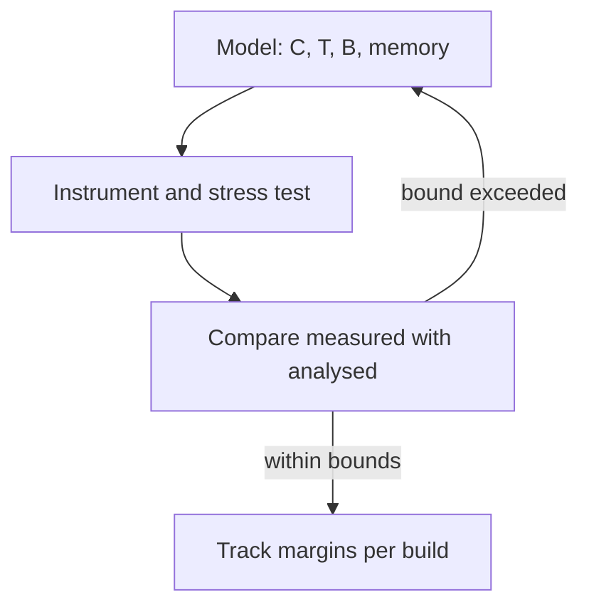

[The fourth entry](/blog/real-time-operating-systems-and-scheduling) ended with a calculation that every task of an example system meets its deadline, and with a warning: the calculation is only as good as its inputs. Response-time analysis takes each task's worst-case execution time $C_i$, its period $T_i$ and its blocking time $B_i$ as given, and it says nothing about memory. This final entry is about obtaining and checking those inputs on real hardware, and about checking the outcomes the analysis predicts.

It draws on the whole series. The timing terms (latency, response time, jitter as peak-to-peak spread) are those defined in [Section 1.2 of the first entry](/blog/inside-a-microcontroller#12-real-time-events-deadlines-latency-and-jitter); the timers and input capture of that entry are measuring instruments; the interrupt latency components of [the second entry](/blog/interrupts-polling-and-dma#32-interrupt-latency) are what a latency measurement must exercise; and the bus timings of [the third entry](/blog/serial-buses-uart-spi-i2c-and-can) can be measured in the same way as task timings.

**Conventions.** As before: C11, a generic 32-bit Arm Cortex-M class microcontroller at 48 MHz, illustrative register and function names, and Python 3 with the standard library. One experiment uses the real-time interface of POSIX, the Portable Operating System Interface (IEEE Std 1003.1-2017) on a desktop Linux system, and says so; its numbers describe that machine, not a microcontroller. Example numbers that are not the output of a program in this entry are labelled as assumed. Abbreviations follow the earlier entries: general-purpose input/output (GPIO), interrupt service routine (ISR), direct memory access (DMA), real-time operating system (RTOS), universal asynchronous receiver-transmitter (UART), Controller Area Network (CAN), static RAM (SRAM) and the GNU Compiler Collection (GCC).

## 1. What to Measure and Why

### 1.1 Measurement checks the inputs and the outcomes

A timing analysis has inputs (execution times, event rates, critical-section lengths, overheads) and outcomes (response times, latencies, processor load). Measurement serves both. It estimates the inputs, and it checks that the outcomes observed on the real system never exceed what the analysis predicts. If they do, the model is missing something: an interrupt nobody counted, a critical section longer than claimed, a task released more often than assumed.

| Quantity | Symbol or term | Used in | Typical measurement |
|---|---|---|---|
| Execution time of a job | $C_i$ (worst case) | Response-time analysis | GPIO pulse width, cycle counter |
| Response time of a job | $R_i$ | Comparison with analysis | Timestamps at release and completion |
| Interrupt latency | – | Second entry, Section 3.2 | Event signal and ISR pin on a logic analyser |
| Release jitter of a periodic task | Peak-to-peak spread | Control quality | Timestamps of releases |
| Critical-section length | $B_i$ (blocking) | Response-time analysis | Cycle counter around lock and unlock |
| Processor load | Measured counterpart of $U$ | Headroom | Idle counter, run-time statistics |
| Stack and heap use | High-water mark | Memory budget | Stack painting, allocator statistics |

### 1.2 Execution time is a distribution

A job does not take the same time every time it runs. Its execution time varies with:

- **the input data**, which selects different paths through the code (a filter that saturates, a message that needs retransmission, a rare error branch);
- **the hardware state**: flash wait states and prefetch buffers ([Section 2.3 of the first entry](/blog/inside-a-microcontroller#23-flash-and-sram)), caches on larger cores, and stalls when DMA uses the bus at the same moment ([Section 5.3 of the second entry](/blog/interrupts-polling-and-dma#53-costs-and-pitfalls-of-dma));
- **interference** from ISRs and higher-priority tasks, which lengthens the elapsed time between a job's start and end without being part of its own execution time.

Three values summarise the distribution of a job's own execution time: the **best-case execution time** (BCET), the true **worst-case execution time** (WCET), and the **high-water mark**, the largest value actually observed. The analysis needs the WCET. Measurement gives the high-water mark, which is never larger than the WCET and may be smaller. Much of this entry is about the gap between the two.

## 2. Instruments

### 2.1 GPIO pins and a logic analyser

The simplest and most widely used method is to drive a spare GPIO pin high when a piece of code starts and low when it ends, and to watch the pin with an oscilloscope or a **logic analyser** (an instrument that samples many digital signals at once and displays them on a common time axis). The pulse width is the elapsed time of the code; its period and spread show the release jitter; and several pins, one per task or ISR, show how they preempt each other.

Using a set and clear register ([Section 3.3 of the first entry](/blog/inside-a-microcontroller#33-read-modify-write-and-its-hazard)), each edge costs a single store instruction, a few cycles of about 20.8 ns each at 48 MHz, which is small enough for most measurements. The instrument's resolution is one sample period: a logic analyser sampling at 100 million samples per second resolves 10 ns, finer than one processor cycle here.

To measure **interrupt latency**, connect one analyser channel to the signal that causes the interrupt (an external pin, or a timer output that also triggers the interrupt) and a second to a pin that the ISR sets as its first action. The delay between the two edges is the latency plus the few cycles of the pin write. Repeating this while the rest of the system runs at full load, ideally with the event arriving at all possible moments relative to the other activity, reveals the masked times and higher-priority interference that [Section 3.2 of the second entry](/blog/interrupts-polling-and-dma#32-interrupt-latency) adds up. Kernel overheads are measured the same way: a pin cleared as the last action of one task and set as the first action of the task that replaces it brackets the context switch between them.

### 2.2 Timers and cycle counters

A pin and an analyser need a person to look at the trace. For automatic measurement over long runs, the firmware timestamps events itself, from a free-running hardware timer ([Section 5 of the first entry](/blog/inside-a-microcontroller#5-timers)) or from a **cycle counter**, a register that counts processor clock cycles. Armv7-M defines a cycle counter in its Data Watchpoint and Trace (DWT) unit, an optional feature that many Cortex-M3, M4 and M7 implementations include; Armv6-M cores such as the Cortex-M0 have no such counter. Where it exists, it gives cycle resolution with a single register read.

A 32-bit counter at 48 MHz wraps every 89.48 s. Elapsed times are computed by unsigned subtraction, which in C is modulo $2^{32}$ for `uint32_t`, so the result is correct across one wrap, the same arithmetic as the ring-buffer indices of [Section 4.4 of the second entry](/blog/interrupts-polling-and-dma#44-a-lock-free-ring-buffer):

```c
/* C11. Elapsed time from a free-running 32-bit cycle counter that wraps.
   Unsigned subtraction is modulo 2^32, so it gives the right answer across
   one wrap, as long as the interval is shorter than 2^32 cycles. */
#include <stdint.h>
#include <stdio.h>

#define F_CPU_HZ 48000000.0

static double elapsed_us(uint32_t start, uint32_t end) {
    uint32_t cycles = end - start;       /* correct even if end < start */
    return cycles / F_CPU_HZ * 1e6;
}

int main(void) {
    uint32_t start = 0xFFFFFF00u;        /* 256 cycles before the wrap */
    uint32_t end   = 0x00000E00u;        /* counter has wrapped        */
    printf("cycles = %u, time = %.2f us\n", (unsigned)(end - start),
           elapsed_us(start, end));
    printf("wrap period = %.2f s\n", 4294967296.0 / F_CPU_HZ);
    return 0;
}
```

```text
cycles = 3840, time = 80.00 us
wrap period = 89.48 s
```

On the target, the firmware keeps a high-water mark for each measured section, which costs two counter reads, a subtraction and a comparison:

```c
/* Fragment; cycle_count() stands for reading the cycle counter or a timer. */
static volatile uint32_t ctrl_max_cycles;      /* read later by a debugger */

void control_job(void) {
    uint32_t t0 = cycle_count();
    run_control_law();
    uint32_t dt = cycle_count() - t0;
    if (dt > ctrl_max_cycles) ctrl_max_cycles = dt;
}
```

Such a measurement includes any interrupts and preemptions that occurred inside the section. To isolate the job's own execution time, measure it with interrupts disabled in a test build, subtract the measured time of ISRs that ran inside it, or use the per-task run-time accounting that many RTOS kernels provide, which charges processor time to whichever task is running.

### 2.3 Software trace and the cost of printing

Firmware can also record events into a RAM buffer, as (timestamp, event identifier) pairs written into a ring buffer like that of the second entry, and send the buffer to a host later, when timing no longer matters. What it should not do is print while it is being timed. A 40-character log line on a UART at 115 200 baud occupies the line for $40 \times 86.8\ \mu\text{s} = 3.47$ ms, longer than the whole 1 ms job of the running example, and a blocking `printf` would add all of it to the job.

Many Cortex-M cores also offer optional debug trace hardware, such as an instrumentation trace macrocell that streams software events over a dedicated trace pin with low overhead; whether a particular chip has it, and how it is configured, is in its reference manual.

### 2.4 The probe effect

Instrumentation changes what it measures: it adds instructions, moves code to other flash addresses, and changes cache and prefetch behaviour. This **probe effect** is small for a pin toggle or a counter read but not zero. The usual remedy is to leave lightweight instrumentation in the production firmware, so that the measured system and the shipped system are the same, rather than adding it for tests and removing it afterwards.

## 3. Execution Time and Response Time

### 3.1 Measuring under realistic and adverse conditions

A measurement campaign for execution times runs the system long enough, and in enough situations, to drive each job down its slowest paths:

- all operating modes, including start-up, error handling and recovery;
- inputs at their extremes, including those that saturate filters or trigger retries;
- maximum load on everything else: all interrupts at their highest rates, DMA and buses busy, so that bus contention appears;
- long runs, recording for each job the high-water mark and, for diagnosis, a histogram or a few percentiles.

### 3.2 Why the observed maximum is not the worst case

A slow path that is taken rarely may simply not occur during the test. If a job takes its slowest path with probability $p$ each time it runs, independently, the probability that $n$ runs never take it is $(1 - p)^n$. (This Python fragment and the two later ones in this entry form one script.)

```python
import math

# 1. How likely is a test run to miss a rare slow path?
for p in (1e-3, 1e-4, 1e-5):
    for n in (10_000, 100_000):
        print(f"p = {p:g}, n = {n:>7,}: P(never seen) = {(1 - p) ** n:.2g}")
```

```text
p = 0.001, n =  10,000: P(never seen) = 4.5e-05
p = 0.001, n = 100,000: P(never seen) = 3.5e-44
p = 0.0001, n =  10,000: P(never seen) = 0.37
p = 0.0001, n = 100,000: P(never seen) = 4.5e-05
p = 1e-05, n =  10,000: P(never seen) = 0.9
p = 1e-05, n = 100,000: P(never seen) = 0.37
```

With $p = 10^{-4}$, a test of 10 000 jobs (40 s of a 4 ms task) misses the slow path more than a third of the time; with $p = 10^{-5}$, even 100 000 jobs miss it with the same probability. Real slow paths are worse than this model suggests, because they are often not random at all but triggered by a particular combination of inputs and states that a test may never produce.

There are three responses, often combined:

- **Coverage-driven testing.** Use code-coverage tools and deliberately constructed inputs to make sure every path, and in particular every loop at its maximum count, has been executed during timing tests.
- **Static WCET analysis.** Tools analyse the machine code, with a model of the processor's pipeline and memory timing, and compute a safe upper bound on the execution time without running it (Wilhelm and colleagues, 2008, survey the methods). The bound is guaranteed for the modelled hardware but may be pessimistic, and it requires loop bounds that the tool can determine or the user supplies.
- **Margins.** Use the high-water mark multiplied by a safety factor as $C_i$. The factor is an engineering judgement, not a guarantee, and it should be larger the less complete the testing and the more complex the hardware.

### 3.3 Feeding measurements back into the analysis

Suppose (an assumed example) that the measurement campaign for the running example of the fourth entry found high-water marks of 0.82, 1.64 and 2.71 ms for $\tau_1$, $\tau_2$ and $\tau_3$, against budgets of 1, 2 and 3 ms. With a margin factor of 1.2, the response-time analysis of [Section 2.4 of the fourth entry](/blog/real-time-operating-systems-and-scheduling#24-response-time-analysis) becomes (keeping the 0.5 ms blocking terms and, for brevity, leaving out the UART interrupt):

```python
# 2. Measured execution times with a safety margin, fed back into the
#    response-time analysis of the fourth entry (times in ms).
def response_time(i, tasks):
    c, t, d, b = tasks[i]
    r = c + b
    while True:
        nxt = c + b + sum(math.ceil(r / tj) * cj for cj, tj, _, _ in tasks[:i])
        if nxt == r or nxt > d:
            return nxt
        r = nxt

measured_max = {"tau1": 0.82, "tau2": 1.64, "tau3": 2.71}
margin = 1.2
names = ["tau1", "tau2", "tau3"]
periods = [4, 6, 12]
blocking = [0.5, 0.5, 0]
tasks = [(round(measured_max[n] * margin, 3), T, T, B)
         for n, T, B in zip(names, periods, blocking)]
for i, n in enumerate(names):
    r = response_time(i, tasks)
    print(f"{n}: C = {tasks[i][0]:.3f} ms, R = {r:.3f} ms, D = {tasks[i][2]} ms, "
          f"{'met' if r <= tasks[i][2] else 'MISSED'}")
```

```text
tau1: C = 0.984 ms, R = 1.484 ms, D = 4 ms, met
tau2: C = 1.968 ms, R = 3.452 ms, D = 6 ms, met
tau3: C = 3.252 ms, R = 10.140 ms, D = 12 ms, met
```

With the margin, $\tau_3$'s execution time of 3.25 ms exceeds its original 3 ms budget, yet the set remains schedulable, because the other two tasks came in under budget. The analysis, not the individual budgets, decides. The same loop is run whenever the code changes, so that a regression in execution time shows up as a shrinking margin before it shows up as a missed deadline in the field.

### 3.4 Checking response times end to end

Separately, timestamp each job's release and completion on the running system and record the largest response time of each task. Every measured response time must be below the computed $R_i$. A measured value above it is not bad luck; it proves that the model is wrong, for example that an ISR or a critical section is missing from it, or that a task's $C_i$ was underestimated. The discrepancy is found and the model corrected before the margin is trusted again.

## 4. Latency and Jitter

### 4.1 Release jitter of a periodic task: an experiment

[Section 1.4 of the fourth entry](/blog/real-time-operating-systems-and-scheduling#14-time-the-tick-and-periodic-tasks) recommended waiting for absolute release times. The following program measures, for 2000 releases of a 1 ms periodic loop, how late each wake-up is with absolute sleeping, and then how far a loop that uses relative sleeping falls behind the ideal grid:

```c
/* C11 + POSIX (IEEE Std 1003.1-2017). Measures how late a periodic task
   wakes up, with absolute and with relative sleeping. Build:
   gcc -std=c11 -O2 -Wall -o wakeup wakeup.c                               */
#define _POSIX_C_SOURCE 200809L
#include <stdint.h>
#include <stdio.h>
#include <stdlib.h>
#include <time.h>

#define PERIOD_NS 1000000L      /* 1 ms */
#define N         2000

static int64_t now_ns(void) {
    struct timespec ts;
    clock_gettime(CLOCK_MONOTONIC, &ts);
    return (int64_t)ts.tv_sec * 1000000000 + ts.tv_nsec;
}

static void to_timespec(int64_t ns, struct timespec *ts) {
    ts->tv_sec = (time_t)(ns / 1000000000);
    ts->tv_nsec = (long)(ns % 1000000000);
}

static int cmp(const void *a, const void *b) {
    int64_t x = *(const int64_t *)a, y = *(const int64_t *)b;
    return (x > y) - (x < y);
}

static void report(const char *name, int64_t *late, int n) {
    double sum = 0;
    for (int i = 0; i < n; i++) sum += (double)late[i];
    qsort(late, (size_t)n, sizeof late[0], cmp);
    printf("%s: min %.1f us, median %.1f us, 99th pct %.1f us, max %.1f us, "
           "jitter (max-min) %.1f us, mean %.1f us\n", name,
           late[0] / 1e3, late[n / 2] / 1e3, late[(n * 99) / 100] / 1e3,
           late[n - 1] / 1e3, (late[n - 1] - late[0]) / 1e3, sum / n / 1e3);
}

int main(void) {
    static int64_t late[N];
    struct timespec ts;

    /* 1. Absolute sleeping: release k is at start + k * PERIOD. */
    int64_t start = now_ns();
    for (int k = 1; k <= N; k++) {
        int64_t release = start + (int64_t)k * PERIOD_NS;
        to_timespec(release, &ts);
        clock_nanosleep(CLOCK_MONOTONIC, TIMER_ABSTIME, &ts, NULL);
        late[k - 1] = now_ns() - release;      /* wake-up latency */
    }
    report("absolute", late, N);

    /* 2. Relative sleeping: sleep PERIOD after each wake-up. */
    start = now_ns();
    to_timespec(PERIOD_NS, &ts);
    for (int k = 1; k <= N; k++) {
        clock_nanosleep(CLOCK_MONOTONIC, 0, &ts, NULL);
        late[k - 1] = now_ns() - (start + (int64_t)k * PERIOD_NS);
    }
    printf("relative: after %d periods the task is %.1f ms behind the grid\n",
           N, late[N - 1] / 1e6);
    return 0;
}
```

It was compiled with GCC 13 (`-std=c11 -O2`) and run three times in succession, as an ordinary process without real-time priority, on a four-core x86-64 Linux virtual machine under other load:

```text
absolute: min 75.0 us, median 104.7 us, 99th pct 3465.4 us, max 5452.4 us, jitter (max-min) 5377.3 us, mean 275.3 us
relative: after 2000 periods the task is 391.2 ms behind the grid
absolute: min 19.6 us, median 112.2 us, 99th pct 3138.5 us, max 9356.9 us, jitter (max-min) 9337.4 us, mean 246.1 us
relative: after 2000 periods the task is 403.9 ms behind the grid
absolute: min 72.4 us, median 106.4 us, 99th pct 3408.5 us, max 5394.1 us, jitter (max-min) 5321.7 us, mean 238.8 us
relative: after 2000 periods the task is 328.9 ms behind the grid
```

The results illustrate four points that hold far beyond this machine:

- **Absolute sleeping does not drift; relative sleeping does.** The relative loop fell between 328.9 and 403.9 ms behind the grid in 2000 periods, 0.16 to 0.20 ms per period, which is its own wake-up latency added to every cycle. The absolute loop's lateness does not accumulate.
- **The typical case says little about the worst.** The median lateness was close to 0.1 ms in every run, but the maxima were 5.4 to 9.4 ms, roughly fifty to eighty times the median of the same run and several whole periods, during which several releases came and went before the task woke.
- **The maximum is not reproducible.** The three runs gave three different maxima and 99th percentiles, and a longer run would probably have given a larger maximum still. This is Section 3.2's warning in practice.
- **The platform sets the floor.** A general-purpose operating system in a virtual machine, without real-time priority, makes no promise about wake-up latency, and the long tail shows it. On a microcontroller with an RTOS, the same measurement, taken with a timer's input capture, would show latencies bounded by the tick, the interrupt latency of the second entry and the higher-priority work counted in the fourth entry's analysis; on Linux, real-time scheduling classes and a kernel configured for low latency narrow the tail. In every case, the bound has to be established by analysis and checked by measurement on the actual platform.

### 4.2 Reporting latency and jitter

The experiment also shows how to report timing measurements. A single average is nearly useless. The minimum, median, a high percentile, the maximum and the number of samples together describe the distribution; the peak-to-peak jitter is the maximum minus the minimum, as defined in the first entry; and a histogram reveals structure such as two distinct clusters (often two different code paths or a periodic interference). For a soft requirement, a percentile may be the right figure of merit. For a hard deadline only the maximum counts, and only together with an argument, from analysis and coverage, that the true worst case has been bounded.

## 5. Processor Load

### 5.1 The idle counter

Processor load is the fraction of time the processor spends on anything other than idling. A simple way to measure it uses the idle task of [Section 1.2 of the fourth entry](/blog/real-time-operating-systems-and-scheduling#12-tasks-and-their-states): the idle task increments a counter in a loop, and once per second a timer-driven task reads and resets it. Calibrate by measuring the count $N_0$ in one second with nothing else running; under load, with count $N$, the load is

$$
\text{load} = 1 - \frac{N}{N_0} .
$$

With assumed counts of $N_0 = 4\,800\,000$ and $N = 1\,920\,000$ per second, the load is $1 - 0.4 = 60\,\%$:

```python
# 3. Processor load from an idle counter.
idle_unloaded, idle_loaded = 4_800_000, 1_920_000
print(f"load = {1 - idle_loaded / idle_unloaded:.1%}")
```

```text
load = 60.0%
```

A measured load below the analysed utilisation (0.857 in the worked design of [Section 4 of the fourth entry](/blog/real-time-operating-systems-and-scheduling#4-a-worked-design)) is expected, because the utilisation uses worst-case execution times and the average job takes less. The measured load is headroom information, not a schedulability test: a processor at 60 % average load can still miss deadlines if the worst cases coincide, and one at 85 % can meet them all, as the analysis showed. If the idle loop goes into a low-power mode, the counter method no longer works, and per-task run-time statistics from the kernel, accumulated from a fast timer at each context switch, take its place.

### 5.2 Bus load

The same idea applies to the buses of the third entry. A CAN bus analyser, or a CAN controller's own counters, gives the measured bus load and the rate of error frames, to be compared with the worst-case load computed from frame lengths. Error frames and retransmissions, which the computed load usually leaves out, are themselves a useful measurement: a rising error count is often the first sign of a wiring or termination fault.

## 6. Memory Use

### 6.1 Static memory from the build

The linker knows the size of every section described in [Section 3.4 of the first entry](/blog/inside-a-microcontroller#34-where-the-programs-data-lives), and the toolchain reports it, as a map file and through utilities such as GNU `size`, which prints the sizes of `text`, `data` and `bss`. Flash use is `text` plus `data` (the initial values); static SRAM use is `data` plus `bss`. With assumed sizes of 41 872 bytes of `text`, 1 228 of `data` and 6 144 of `bss`, the image needs 43 100 bytes of flash (16 % of 256 KiB) and 7 372 bytes of static SRAM (11 % of 64 KiB), to which the stacks and any heap must be added. Tracking these numbers on every build catches growth early.

### 6.2 Stack high-water marks by painting

Stack use is dynamic, and an overflow corrupts memory silently. **Stack painting** measures the peak: at start-up, fill each stack with a known pattern; after the system has run, find the deepest point at which the pattern has been overwritten. The part still holding the pattern was never used. Many RTOS kernels do this for every task stack and report the minimum free space. The following program demonstrates the method on an array that stands in for a 1 KiB task stack growing downward:

```c
/* C11. Stack painting, demonstrated on an array that stands in for a task's
   stack. On a target the array is the task stack itself (or the main stack
   between the linker symbols for its limits), and the stack grows downward
   from the high end, as on Arm Cortex-M. */
#include <stddef.h>
#include <stdint.h>
#include <stdio.h>
#include <string.h>

#define STACK_WORDS 256u                 /* 1 KiB stack */
#define PAINT       0xDEADBEEFu          /* pattern unlikely in real data */

static uint32_t stack[STACK_WORDS];

static void paint(void) {
    for (size_t i = 0; i < STACK_WORDS; i++) stack[i] = PAINT;
}

/* Count untouched words from the low end (the end the stack grows towards). */
static size_t unused_words(void) {
    size_t n = 0;
    while (n < STACK_WORDS && stack[n] == PAINT) n++;
    return n;
}

/* Host stand-in for a task's activity: writes `depth` words from the top. */
static void simulate_use(size_t depth) {
    for (size_t i = 0; i < depth; i++) stack[STACK_WORDS - 1 - i] = (uint32_t)i;
}

int main(void) {
    paint();
    simulate_use(70);                    /* an ordinary job                */
    simulate_use(181);                   /* a rare, deep call path         */
    simulate_use(40);
    size_t free_w = unused_words();
    size_t used = (STACK_WORDS - free_w) * sizeof stack[0];
    printf("high-water mark: %zu of %zu bytes used (%.0f %%), %zu bytes never touched\n",
           used, sizeof stack, 100.0 * used / sizeof stack, free_w * sizeof stack[0]);
    return 0;
}
```

```text
high-water mark: 724 of 1024 bytes used (71 %), 300 bytes never touched
```

The painting remembers the deep path (181 words, 724 bytes) even though later jobs used less. Like an execution-time high-water mark, it records only paths that actually ran, so a stack sized from it needs a margin, or a static bound. GCC's `-fstack-usage` option reports each function's own stack frame, and combining those figures along the deepest path of the call graph gives an upper bound, provided there is no recursion or call through a function pointer that the analysis cannot follow. Interrupts need stack space too. On Cortex-M the hardware pushes the interrupted context (32 bytes, more if floating-point state is saved) onto the stack in use when the interrupt arrives, and the handler then runs on the main stack. In the usual arrangement of Cortex-M kernels, where tasks run on their own stacks and handlers on the main stack, each task stack therefore needs room for one such frame, and the main stack must hold the deepest nesting of ISRs.

Detection complements measurement. A **guard region** at the end of each stack, protected by the memory protection unit present on many Cortex-M cores, turns an overflow into an immediate fault instead of silent corruption, and Armv8-M Mainline cores (such as the Cortex-M33) have stack-limit registers that do the same in hardware.

### 6.3 The heap

If the firmware uses dynamic allocation, the allocator's statistics (bytes in use, peak use, largest free block) are the measurements to watch. The largest free block matters as much as the total: after many allocations and frees of different sizes, the free memory can be split into pieces too small for a request even though their sum is large. This **fragmentation**, and the unbounded time some allocators take to search for a block, are why many real-time systems allocate only at start-up or use fixed-size block pools.

## 7. A Verification Workflow

The pieces fit into a cycle repeated whenever the firmware changes:



1. Model the system: tasks, ISRs, periods, deadlines, critical sections and memory budgets, as in the fourth entry.
2. Instrument the firmware lightly and permanently: pins for the logic analyser, high-water marks from a cycle counter, painted stacks, an idle counter.
3. Run the system under stress, covering all modes and paths, with every interrupt source at its maximum rate.
4. Compare: high-water marks against the assumed $C_i$ and $B_i$, measured response times against computed $R_i$, measured latencies against the second entry's sum, stack marks against stack sizes. Anything that exceeds its bound means the model is wrong; fix the model, not just the number.
5. Re-run the analysis with the measured values and margins, and track every margin on every build.

## 8. Exercises

**Exercise 1.** A cycle counter at 48 MHz reads `0xFFFFF000` at the start of a job and `0x00001000` at the end. How long did the job take? What happens if the job takes 100 s?

<details>
<summary>Answer</summary>

`0x00001000 - 0xFFFFF000` modulo $2^{32}$ is `0x2000` = 8192 cycles, $8192/48\ \text{MHz} = 170.7$ µs. A 100 s interval exceeds the 89.48 s wrap period, so the counter wraps more than once and the subtraction gives a wrong, smaller value; such intervals need a wider counter or a count of wraps.

</details>

**Exercise 2.** A job's slow path occurs with probability $10^{-6}$ per run, independently. How many runs are needed for a 99 % chance of seeing it at least once? At a 4 ms period, how long is that?

<details>
<summary>Answer</summary>

We need $(1 - 10^{-6})^n \le 0.01$, so $n \ge \ln 0.01 / \ln(1 - 10^{-6}) \approx 4.6 \times 10^6$ runs. At 250 runs per second that is about 18 400 s, roughly 5.1 hours, and this assumes the slow path is random, which real slow paths often are not.

</details>

**Exercise 3.** An idle counter reads 4 800 000 per second unloaded and 3 360 000 under load. What is the load? Does the result show that all deadlines are met?

<details>
<summary>Answer</summary>

$1 - 3.36/4.8 = 0.30$, a load of 30 %. It does not show that deadlines are met: it is an average, and deadlines depend on the worst-case coincidence of jobs, which only response-time analysis with valid worst-case inputs, checked by measured response times, can address.

</details>

**Exercise 4.** A measured response time of $\tau_2$ is 4.1 ms, while the analysis predicted $R_2 = 3.5$ ms. What does this mean, and what are likely causes?

<details>
<summary>Answer</summary>

The model is wrong, since a correct model gives an upper bound. Likely causes: an ISR not included in the analysis (or included with too low a rate or cost), a critical section longer than the assumed 0.5 ms, an execution time of $\tau_1$ or $\tau_2$ above its assumed $C$, or kernel overheads (tick, context switches) not folded into the $C_i$. Each candidate can be checked with the instruments of Section 2.

</details>

## 9. Summary

| Question | Answer |
|---|---|
| Why measure if the analysis already gives guarantees? | The analysis assumes its inputs ($C_i$, $T_i$, $B_i$, overheads); measurement estimates them and checks the outcomes. |
| What is the high-water mark? | The largest observed value, which is never above the true worst case and may be below it. |
| Which instruments measure timing? | GPIO pins with a logic analyser or oscilloscope, hardware timers and cycle counters, RAM trace buffers and debug trace hardware. |
| How is interrupt latency measured? | One channel on the triggering signal, another on a pin set first thing in the ISR, under full load. |
| Why is the observed maximum not enough? | Rare paths may never occur during a test; coverage, static WCET analysis and margins close the gap. |
| What should a timing report contain? | Minimum, median, a high percentile, maximum, number of samples, and the peak-to-peak jitter. |
| How is processor load measured? | With an idle counter ($1 - N/N_0$) or per-task run-time statistics; it is headroom, not a schedulability test. |
| How is stack use measured? | By painting stacks with a pattern and finding the deepest overwritten word, plus static bounds and guard regions. |

This entry completes the series. It began with the vocabulary of deadlines, latency and jitter and the parts of a microcontroller; moved data from peripherals to memory by polling, interrupts and DMA; carried it between chips and controllers over UART, SPI, I2C and CAN; organised the processing into prioritised tasks whose worst-case response times can be calculated; and ended by measuring the quantities that calculation depends on. The common thread is that in a real-time system timing is a design property: it is specified as deadlines, predicted by analysis from worst-case inputs, and confirmed by measurement on the real hardware.

### References

- R. Wilhelm, J. Engblom, A. Ermedahl, N. Holsti, S. Thesing, D. Whalley, G. Bernat, C. Ferdinand, R. Heckmann, T. Mitra, F. Mueller, I. Puaut, P. Puschner, J. Staschulat and P. Stenström, "The worst-case execution-time problem: Overview of methods and survey of tools", *ACM Transactions on Embedded Computing Systems*, 7(3), 2008.
- G. C. Buttazzo, *Hard Real-Time Computing Systems: Predictable Scheduling Algorithms and Applications*, 3rd edition, Springer, 2011.
- Arm Limited, *Armv7-M Architecture Reference Manual*, document ARM DDI 0403.
- J. Yiu, *The Definitive Guide to ARM Cortex-M3 and Cortex-M4 Processors*, 3rd edition, Newnes, 2014.
- IEEE Std 1003.1-2017, *IEEE Standard for Information Technology: Portable Operating System Interface (POSIX) Base Specifications*, Issue 7, IEEE, 2018.
- E. A. Lee and S. A. Seshia, *Introduction to Embedded Systems: A Cyber-Physical Systems Approach*, 2nd edition, MIT Press, 2017.
- E. White, *Making Embedded Systems: Design Patterns for Great Software*, O'Reilly Media, 2011.
