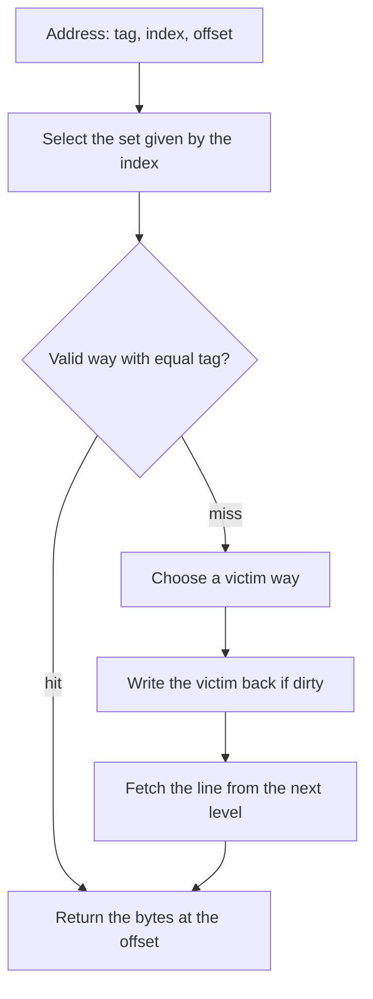

[The first entry](/blog/performance-models-and-scaling-laws) developed [the roofline bound](/blog/performance-models-and-scaling-laws#5-the-roofline-bound), $P \le \min(P_{\mathrm{peak}}, B\,I)$ of Williams, Waterman and Patterson (2009). It caps the attainable performance $P$ of a kernel by its peak arithmetic rate $P_{\mathrm{peak}}$ and by the product of the memory bandwidth $B$ and the arithmetic intensity $I$, the floating-point operations (FLOP) performed per byte moved. The insight [Compute-Bound or Memory-Bound?](/insights/compute-bound-or-memory-bound) showed that a kernel such as $y \leftarrow y + a x$ sits far below the ridge point $I^* = P_{\mathrm{peak}}/B$. Both treated $B$ and the bytes moved as given. This entry opens them up: where the bytes come from, why the same loop can move eight times as many of them when written in a different order, and how a program can be restructured so that each byte fetched is used many times.

The entry assumes the roofline bound and the measurement practice of the first entry, and a reading knowledge of C and Python. Every program runs on one core except the bandwidth test at the end. Each effect is measured on one machine or, where a timing shows that order matters but not why, counted exactly with a small cache simulator that the reader can run.

**Conventions.** The C programs are C11 compiled with the GNU Compiler Collection (GCC) 13.3 at the optimization level stated with each listing; the simulator and the matrix-multiply comparison use Python 3.13 and NumPy 2.5. The bandwidth test uses Open Multi-Processing (OpenMP) threads through `gcc -fopenmp`. The reference machine is a Kernel-based Virtual Machine (KVM) guest with four cores of an Intel Xeon processor reported at 2.1 GHz, with the 512-bit Advanced Vector Extensions (AVX-512), the cache sizes listed in Section 1.2 and 16 GiB of RAM, running Linux.

The machine is shared with other virtual machines, so its timings are noisy: each is the median of five or ten repetitions, describes this machine only, and supports only conclusions drawn from differences much larger than the run-to-run spread ([Section 6 of the first entry](/blog/performance-models-and-scaling-laws#6-measuring-performance-honestly)). Data are 8-byte doubles, C arrays are row-major and indices start at 0. Cache and memory sizes are in KiB and MiB (powers of two), bandwidths in gigabytes per second (GB/s, $10^9$ bytes per second) and arithmetic rates in giga floating-point operations per second (GFLOP/s, $10^9$ FLOP per second).

## 1. Why memory limits performance

### 1.1 The processor-memory gap

A modern core can start several arithmetic operations in every clock cycle of well under a nanosecond, while a read from main memory, built from **dynamic RAM** (DRAM), takes on the order of a hundred nanoseconds (Section 1.3). Processor speed grew faster than memory latency improved for decades; Wulf and McKee (1995) called the consequence the **memory wall**, the point at which fetching data, not computing on it, sets the speed of a program. Bandwidth has improved faster than latency (Patterson, 2004) but more slowly than peak arithmetic, so the ratio of the two, which McCalpin (1995) called **machine balance** and the roofline calls the ridge point $I^*$, has risen over time.

The **memory hierarchy** is the engineering answer. Between the registers and DRAM sit several levels of **cache**: small memories built from fast **static RAM** (SRAM), close to the core, that hold copies of recently used data. They are numbered outward from the core, level 1 (L1), level 2 (L2) and level 3 (L3). A small memory is fast because signals travel short distances, so a small fast level in front of a large slow one gives an average access time close to the small level's whenever most accesses find their data there (Hennessy and Patterson, 2017, Chapter 2). Caches are managed by hardware: a program reads an address, and the hardware decides where the copy comes from. The program cannot see the hierarchy, but its speed depends on it.

The $B$ of the roofline is the bandwidth of whichever level the data come from, and the bytes in $I$ are those that cross that level's boundary. On the reference machine one core completed about 90.6 GFLOP/s in the fused multiply-add microbenchmark of [Section 5.4 of the first entry](/blog/performance-models-and-scaling-laws#54-the-peak-arithmetic-rate) and sustained 13.4 GB/s from DRAM on the streaming triad of Section 6.3 below. The ridge point for one core is therefore about $90.6/13.4 = 6.8$ FLOP/byte, close to the 7.08 that the first entry found for four cores: a kernel that fetches every operand from DRAM needs about 54 operations per double before arithmetic can become the limit. Few loops do that much work per element. The ones that run fast do so because most of their operands come from a cache.

### 1.2 The levels on the reference machine

The operating system reports the cache sizes. `lscpu` gives the totals across the four cores and `getconf` the values for one core (trimmed output; `PAGESIZE` is used in Section 6):

```text
$ lscpu | grep -E 'Model name|^CPU\(s\)|L1d|L2|L3|Hypervisor'
CPU(s):                                  4
Model name:                              Intel(R) Xeon(R) Processor @ 2.10GHz
Hypervisor vendor:                       KVM
L1d cache:                               192 KiB (4 instances)
L2 cache:                                8 MiB (4 instances)
L3 cache:                                260 MiB (1 instance)
$ for v in LEVEL1_DCACHE_SIZE LEVEL1_DCACHE_ASSOC LEVEL1_DCACHE_LINESIZE \
>          LEVEL2_CACHE_SIZE LEVEL2_CACHE_ASSOC LEVEL3_CACHE_SIZE PAGESIZE; do
>   printf '%-24s %s\n' "$v" "$(getconf $v)"; done
LEVEL1_DCACHE_SIZE       49152
LEVEL1_DCACHE_ASSOC      12
LEVEL1_DCACHE_LINESIZE   64
LEVEL2_CACHE_SIZE        2097152
LEVEL2_CACHE_ASSOC       16
LEVEL3_CACHE_SIZE        272629760
PAGESIZE                 4096
```

| Level | Size | Organization (Section 2) | Shared by |
|---|---|---|---|
| Registers | 32 vector registers of 64 bytes (AVX-512) | Named by instructions | One core |
| L1 data cache | 48 KiB | 64-byte lines, 12-way, 64 sets | One core |
| L2 cache | 2 MiB | 64-byte lines, 16-way, 2048 sets | One core |
| L3 cache | 260 MiB as reported | 64-byte lines | All cores of the processor |
| Main memory (DRAM) | 16 GiB in this virtual machine | Pages of 4 KiB (Section 6.1) | Everything |

Each level is larger and slower than the one before it. The L3 figure is what the virtual processor reports; Section 1.3 shows that this virtual machine does not behave as if it had all of it.

### 1.3 Measuring latency by pointer chasing

The **latency** of a level is the time from issuing a load to having its value, when the data are in that level. **Pointer chasing** measures it: an array is filled with pointers that form one long cycle, and the loop follows them, `p = p->next`. The address of each load is the result of the previous one, so the processor cannot overlap them and the loop runs at one latency per step. Each element occupies its own 64-byte cache line (Section 2.1), and the order of the cycle is shuffled so that the hardware cannot guess the next address (Section 6.2). Varying the total size of the cycle, the **working set**, measures each level in turn.

```c
/* C11. Load-to-use latency by pointer chasing. Each element is one 64-byte
   cache line holding a pointer to the next element. The elements form one
   cycle; in "rand" mode the cycle visits the lines in a shuffled order, in
   "seq" mode in address order. Every load depends on the one
   before it, so the time per step is the latency of one access.
   Build: gcc -std=c11 -O2 -Wall -o latency latency.c
   Usage: ./latency rand|seq 4k|huge [min_KiB max_KiB]                        */
#define _GNU_SOURCE
#include <stdint.h>
#include <stdio.h>
#include <stdlib.h>
#include <string.h>
#include <sys/mman.h>
#include <time.h>

struct line { struct line *next; char pad[56]; };

static double now_s(void) {
    struct timespec ts;
    clock_gettime(CLOCK_MONOTONIC, &ts);
    return ts.tv_sec + ts.tv_nsec * 1e-9;
}

static uint64_t rng = 88172645463325252ull;     /* xorshift64, fixed seed */
static uint64_t next_rand(void) {
    rng ^= rng << 13; rng ^= rng >> 7; rng ^= rng << 17;
    return rng;
}

static int cmp(const void *a, const void *b) {
    double x = *(const double *)a, y = *(const double *)b;
    return (x > y) - (x < y);
}

int main(int argc, char **argv) {
    int seq = argc > 1 && strcmp(argv[1], "seq") == 0;
    int huge = argc > 2 && strcmp(argv[2], "huge") == 0;
    const size_t max_bytes = (size_t)1 << 30;    /* 1 GiB */
    struct line *buf = mmap(NULL, max_bytes, PROT_READ | PROT_WRITE,
                            MAP_PRIVATE | MAP_ANONYMOUS, -1, 0);
    if (buf == MAP_FAILED) return 1;
    madvise(buf, max_bytes, huge ? MADV_HUGEPAGE : MADV_NOHUGEPAGE);
    size_t *perm = malloc((max_bytes / 64) * sizeof *perm);

    printf("mode %s, pages %s\n", seq ? "seq" : "rand", huge ? "huge" : "4 KiB");
    printf("%12s %10s\n", "working set", "ns/load");
    size_t lo = argc > 3 ? strtoull(argv[3], NULL, 10) * 1024 : 4096;
    size_t hi = argc > 4 ? strtoull(argv[4], NULL, 10) * 1024 : max_bytes;
    for (size_t bytes = lo; bytes <= hi; bytes *= 2) {
        size_t n = bytes / sizeof(struct line);
        for (size_t i = 0; i < n; i++) perm[i] = i;
        if (!seq)                                /* shuffle the visit order */
            for (size_t i = n - 1; i > 0; i--) {
                size_t j = next_rand() % i;
                size_t t = perm[i]; perm[i] = perm[j]; perm[j] = t;
            }
        for (size_t i = 0; i < n; i++)           /* link perm[i] -> perm[i+1] */
            buf[perm[i]].next = &buf[perm[(i + 1) % n]];

        const long steps = 1L << 23;
        double t[5];
        struct line *p = &buf[perm[0]];
        for (long s = 0; s < (long)n; s++) p = p->next;      /* warm up */
        for (int r = 0; r < 5; r++) {
            double t0 = now_s();
            for (long s = 0; s < steps; s++) p = p->next;
            t[r] = (now_s() - t0) / steps * 1e9;
        }
        qsort(t, 5, sizeof t[0], cmp);
        if (p == NULL) puts("");                  /* keep the chase live */
        if (bytes < 1024 * 1024)
            printf("%8zu KiB %10.2f\n", bytes / 1024, t[2]);
        else
            printf("%8zu MiB %10.2f\n", bytes / (1024 * 1024), t[2]);
        fflush(stdout);
    }
    return 0;
}
```

Run in two parts, `./latency rand 4k 4 32768` and `./latency rand 4k 65536 1048576`, it printed (the median of five timings of $2^{23}$ steps for each size; the 8 KiB, 128 KiB, 512 KiB and 8 MiB rows are omitted, and `...` marks where the second run begins):

```text
mode rand, pages 4 KiB
 working set    ns/load
       4 KiB       1.59
      16 KiB       1.47
      32 KiB       1.50
      64 KiB       5.25
     256 KiB       4.98
       1 MiB       9.84
       2 MiB      45.53
       4 MiB      57.56
      16 MiB      68.96
      32 MiB     114.74
...
      64 MiB     182.63
     128 MiB     202.10
     256 MiB     222.16
     512 MiB     251.54
    1024 MiB     269.39
```

The output has plateaus and steps. Up to 32 KiB a load takes about 1.5 ns: the cycle fits in the 48 KiB L1. From 64 KiB to 512 KiB it takes about 5 ns, the L2 latency. At the 2 MiB size of L2 it jumps to 45 to 115 ns, and beyond 32 MiB it climbs from about 180 ns to 270 ns at 1 GiB, about 180 times the L1 latency.

The steps are not sharp: a working set equal to the L2 size already misses, because the cache also holds other data. The time beyond L2 also includes address translation, since each step lands on a random 4 KiB page (Section 6.1 separates the two). Finally, the step to DRAM-like latency appears between 32 and 64 MiB, far below the 260 MiB reported for L3. The L3 is shared with the cores of other virtual machines on the host; one plausible reading, which this measurement cannot confirm, is that this guest obtains only a few tens of MiB of it.

The virtual machine hides the actual clock frequency, so the times are not converted to cycles. Repeated runs moved individual rows by up to about 50% (the 1 MiB row gave 6.25 ns in another run), but not the plateaus and steps.

## 2. How a cache works

### 2.1 Lines, sets and tags

A cache does not store individual bytes. It stores **cache lines** (also called blocks), aligned chunks of memory of fixed size, 64 bytes on the reference machine. When a load misses, the whole line containing the requested byte is brought in. This granularity is the first reason that access order matters: a line fetched for one double also brings the seven doubles next to it, free of further cost if they are used soon.

To find a line quickly, the cache is divided into **sets**, and each line address may live in only one set. A cache of capacity $C$ bytes with line size $L$ bytes and **associativity** $k$ (the number of lines, or **ways**, per set) has

$$
N_{\mathrm{sets}} = \frac{C}{L\,k}
$$

sets; for the L1 data cache of the reference machine, $N_{\mathrm{sets}} = 49\,152/(64 \times 12) = 64$. An address is read as three fields. The low $\log_2 L = 6$ bits are the **offset** within the line, the next $\log_2 N_{\mathrm{sets}} = 6$ bits the **index** that selects the set, and the remaining bits the **tag**, stored with the line to tell apart the lines that share a set. Each line also carries a **valid bit** and, in a write-back cache, a **dirty bit** (Section 2.3). For the address `0x7ffd1234` the offset is `0x34` = 52 and the index is $(\mathtt{0x7ffd1234} \gg 6) \bmod 64 = 8$. Every address that differs from it by a multiple of $64 \times 64 = 4096$ bytes has the same index and competes for the same 12 ways.

A lookup selects the set by the index, compares the tag with the tags of all ways of that set in parallel, and either returns the data (a **hit**) or starts a **miss**:



A **direct-mapped** cache has one way per set ($k = 1$), so two lines with the same index evict each other even when the rest of the cache is empty. A **fully associative** cache has one set, so any line can go anywhere, but every lookup compares every stored tag, which is practical only for small structures. Real caches are **set-associative**, in between.

### 2.2 Replacement

When a line must be brought into a full set, one line there is evicted. The **least recently used** (LRU) policy evicts the line whose last access is oldest. Exact LRU over many ways is expensive, so hardware uses approximations whose details vendors rarely document; the exact LRU of the simulator in Section 3.3 is good enough for counting misses of regular loops but is not a model of any particular processor.

### 2.3 Writes

A **write-through** cache sends every store to the next level at once. A **write-back** cache updates only its own copy and marks the line dirty; the line is written to the next level when it is evicted. Write-back saves traffic when a line is written several times, and it is the usual choice for the data caches of current processors (Hennessy and Patterson, 2017, Appendix B).

A store that misses raises a second question. With **write-allocate**, the line is first read into the cache and then modified there; with **no-write-allocate**, the store bypasses the cache. Write-back caches normally write-allocate. A loop that only writes an array, such as `a[i] = 0`, therefore still reads every line of `a` before overwriting it, and moves twice the bytes its source code suggests. **Non-temporal** (streaming) store instructions avoid this read for data that will not be reused soon (Drepper, 2007).

### 2.4 Three kinds of misses

Misses have different causes, and the remedy depends on the cause. A classification due to M. D. Hill, presented by Hennessy and Patterson (2017, Appendix B), sorts them into three kinds:

- **Compulsory** (cold) misses are first accesses to a line. Even an infinite cache has them.
- **Capacity** misses occur because the cache cannot hold everything the program uses between two accesses to the same line: they are the misses that a fully associative LRU cache of the same size would also take. A smaller working set, as blocking gives in Section 4, removes them.
- **Conflict** misses are the rest, caused by too many lines competing for one set while other sets are underused. Changing the addresses, for example by padding arrays (Section 3.3), removes them.

A simulator can apply these definitions directly by running a fully associative LRU cache of the same capacity alongside the real one. On a multicore processor a fourth kind appears, **coherence** misses, when another core writes to a line this core holds; they are the subject of [the false-sharing section of the third entry](/blog/threads-and-shared-memory-parallelism#5-synchronization-cost-and-false-sharing).

## 3. Locality in loops

### 3.1 Spatial and temporal locality

Caches pay off because programs are not random. **Temporal locality** is the tendency to access the same data again soon: an accumulator, a row reused in an inner loop. **Spatial locality** is the tendency to access data near data accessed recently: consecutive array elements, the fields of one structure. A cache exploits the first by keeping recently used lines and the second by fetching whole lines.

Locality belongs to the access order, not to the data, and in numerical code it is decided mostly by loop order and array layout. The **stride** of an access pattern is the distance in memory between consecutive accesses: a stride of 8 bytes uses every byte of every line fetched, while a stride of 64 bytes or more uses one double per line and wastes the other seven.

### 3.2 Row order and column order

A C array `double a[n][n]` is stored in **row-major** order, element `a[i][j]` at byte offset $8\,(i\,n + j)$. Summing it with `j` in the inner loop has stride 8 bytes; with `i` in the inner loop the stride is a whole row, 32 KiB for $n = 4096$, so every access touches a different line and a different page. The following program measures both orders, with rows of exactly 4096 elements and with rows padded to a **leading dimension** (the distance in elements between the starts of consecutive rows) of 4104, and then sweeps a 256 MiB array with increasing strides:

```c
/* C11. Row-order and column-order traversal of an n x n array of doubles
   stored in row-major order, and a strided sweep over a large array.
   Build: gcc -std=c11 -O2 -Wall -o traverse traverse.c
   Prints the median of 5 repetitions of each measurement.                   */
#define _POSIX_C_SOURCE 200809L
#include <stdio.h>
#include <stdlib.h>
#include <time.h>

static double now_s(void) {
    struct timespec ts;
    clock_gettime(CLOCK_MONOTONIC, &ts);
    return ts.tv_sec + ts.tv_nsec * 1e-9;
}

static int cmp(const void *a, const void *b) {
    double x = *(const double *)a, y = *(const double *)b;
    return (x > y) - (x < y);
}

static double sum_rows(const double *a, size_t n, size_t ld) {
    double s = 0;
    for (size_t i = 0; i < n; i++)
        for (size_t j = 0; j < n; j++) s += a[i * ld + j];
    return s;
}

static double sum_cols(const double *a, size_t n, size_t ld) {
    double s = 0;
    for (size_t j = 0; j < n; j++)
        for (size_t i = 0; i < n; i++) s += a[i * ld + j];
    return s;
}

static double sum_stride(const double *a, size_t len, size_t stride) {
    double s = 0;
    for (size_t i = 0; i < len; i += stride) s += a[i];
    return s;
}

int main(void) {
    const size_t n = 4096;
    volatile double sink = 0;
    double t[5];
    /* ld is the leading dimension: the distance in elements between rows. */
    size_t lds[2] = {4096, 4104};
    for (int k = 0; k < 2; k++) {
        size_t ld = lds[k];
        double *a = malloc(n * ld * sizeof *a);
        for (size_t i = 0; i < n * ld; i++) a[i] = 1.0;
        for (int which = 0; which < 2; which++) {
            for (int r = 0; r < 5; r++) {
                double t0 = now_s();
                sink += which ? sum_cols(a, n, ld) : sum_rows(a, n, ld);
                t[r] = now_s() - t0;
            }
            qsort(t, 5, sizeof t[0], cmp);
            printf("n = %zu, row length ld = %zu, %s order: %7.1f ms, %5.2f ns/element\n",
                   n, ld, which ? "column" : "row   ", t[2] * 1e3, t[2] / (n * n) * 1e9);
        }
        free(a);
    }

    const size_t len = (size_t)1 << 25;            /* 256 MiB of doubles */
    double *b = malloc(len * sizeof *b);
    for (size_t i = 0; i < len; i++) b[i] = 1.0;
    for (size_t stride = 1; stride <= 64; stride *= 2) {
        for (int r = 0; r < 5; r++) {
            double t0 = now_s();
            sink += sum_stride(b, len, stride);
            t[r] = now_s() - t0;
        }
        qsort(t, 5, sizeof t[0], cmp);
        printf("stride %2zu doubles (%3zu bytes): %6.1f ms total, %5.2f ns per element read\n",
               stride, stride * 8, t[2] * 1e3, t[2] / (len / stride) * 1e9);
    }
    return sink == 0;
}
```

```text
n = 4096, row length ld = 4096, row    order:    18.0 ms,  1.07 ns/element
n = 4096, row length ld = 4096, column order:   202.9 ms, 12.10 ns/element
n = 4096, row length ld = 4104, row    order:    14.9 ms,  0.89 ns/element
n = 4096, row length ld = 4104, column order:   166.8 ms,  9.94 ns/element
stride  1 doubles (  8 bytes):   43.3 ms total,  1.29 ns per element read
stride  2 doubles ( 16 bytes):   29.6 ms total,  1.76 ns per element read
stride  4 doubles ( 32 bytes):   22.4 ms total,  2.67 ns per element read
stride  8 doubles ( 64 bytes):   17.6 ms total,  4.19 ns per element read
stride 16 doubles (128 bytes):   11.7 ms total,  5.56 ns per element read
stride 32 doubles (256 bytes):   10.9 ms total, 10.36 ns per element read
stride 64 doubles (512 bytes):    5.7 ms total, 10.95 ns per element read
```

The column order is 11 times slower than the row order on the same 128 MiB, with the same additions. The row order uses all eight doubles of each line it fetches. The column order uses one and moves on. When it returns for the next column, 4096 lines (256 KiB) later, the line has long been evicted from the 48 KiB L1. With rows of exactly 4096 doubles, a column also maps to only 4 of the 2048 L2 sets, so it is evicted from L2 as well (the mechanism of Section 3.3), and the array is fetched from beyond L2 up to eight times over. With padded rows the column fits in L2. In both cases each access lands on a different 4 KiB page, so address translation (Section 6.1) adds to the cost. Padding the rows made both orders somewhat faster in this run.

The row-order time is not a memory limit: at `-O2`, without permission to reorder floating-point additions, each addition into the one accumulator waits for the previous one. This chain also makes the stride-1 sweep slower in total than the stride-8 sweep, which reads every line once. From stride 8 on, each element read is in a different line, and the cost per read grows from 4.2 ns to about 11 ns as the stride lengthens. One reading is that the prefetching of Section 6.2 hides less latency as the gaps between lines grow: reading one line in eight (stride 64) took a third of the time of reading every line, not an eighth. Bryant and O'Hallaron (2016, Chapter 6) plot the same two variables, working-set size and stride, as a surface they call the memory mountain.

### 3.3 Counting misses with a simulator

Timings show that order matters, but not why. Hardware miss counters are often unavailable inside a virtual machine, so the following Python program counts misses in a model instead. It simulates one level of cache (set-associative, exact LRU, write-back and write-allocate), feeds every access also to a fully associative LRU cache of the same capacity, and classifies each miss by the definitions of Section 2.4. The functions `traversal` and `matmul` generate the addresses of the loops of this section and of Section 4.

```python
"""Python 3. A small set-associative cache with least-recently-used (LRU)
replacement, write-back and write-allocate, that counts misses and classifies
them as compulsory, capacity or conflict (Hill's three categories):

- compulsory: the first access ever to the line;
- capacity: also a miss in a fully associative LRU cache of the same size;
- conflict: every other miss (a fully associative cache would have hit).

Addresses are byte addresses; doubles are 8 bytes; arrays are row-major.
The model is deterministic: running it again gives the same counts.
"""
from collections import OrderedDict


class Cache:
    def __init__(self, size, line=64, ways=4):
        self.line, self.ways = line, ways
        self.nsets = size // (line * ways)
        self.sets = [OrderedDict() for _ in range(self.nsets)]  # tag -> dirty
        self.full = OrderedDict()            # fully associative shadow, same size
        self.capacity_lines = size // line
        self.seen = set()
        self.accesses = 0
        self.miss = {"compulsory": 0, "capacity": 0, "conflict": 0}
        self.writebacks = 0

    def access(self, addr, write=False):
        self.accesses += 1
        ln = addr // self.line
        # Shadow fully associative LRU cache, used only to classify misses.
        full_hit = ln in self.full
        if full_hit:
            self.full.move_to_end(ln)
        else:
            self.full[ln] = True
            if len(self.full) > self.capacity_lines:
                self.full.popitem(last=False)
        # The real set-associative cache.
        s = self.sets[ln % self.nsets]
        tag = ln // self.nsets
        if tag in s:
            s.move_to_end(tag)               # now most recently used
            s[tag] = s[tag] or write
            return
        if ln not in self.seen:
            kind = "compulsory"
        elif not full_hit:
            kind = "capacity"
        else:
            kind = "conflict"
        self.seen.add(ln)
        self.miss[kind] += 1
        if len(s) == self.ways:              # evict the least recently used
            _, dirty = s.popitem(last=False)
            self.writebacks += dirty
        s[tag] = write                       # write-allocate

    def report(self, label):
        m = self.miss
        total = sum(m.values())
        print(f"{label:<34} accesses {self.accesses:>7}  misses {total:>6}"
              f"  (compulsory {m['compulsory']:>5}, capacity {m['capacity']:>6},"
              f" conflict {m['conflict']:>6})  write-backs {self.writebacks:>5}")


def traversal(n, ld, order, size=4096, ways=4):
    """Sum an n x n array of doubles whose rows are ld elements apart."""
    c = Cache(size, 64, ways)
    if order == "row":
        for i in range(n):
            for j in range(n):
                c.access(8 * (i * ld + j))
    else:
        for j in range(n):
            for i in range(n):
                c.access(8 * (i * ld + j))
    return c


def matmul(n, ld, variant, size=4096, ways=4, b=16):
    """C += A B for n x n matrices of doubles, rows ld elements apart, stored
    one after another. Scalars held in registers are not memory accesses."""
    c = Cache(size, 64, ways)
    A, B, C = 0, 8 * n * ld, 16 * n * ld
    a = lambda i, k: A + 8 * (i * ld + k)
    bb = lambda k, j: B + 8 * (k * ld + j)
    cc = lambda i, j: C + 8 * (i * ld + j)
    if variant == "ijk":
        for i in range(n):
            for j in range(n):
                c.access(cc(i, j))                       # s = C[i][j]
                for k in range(n):
                    c.access(a(i, k)); c.access(bb(k, j))
                c.access(cc(i, j), write=True)           # C[i][j] = s
    elif variant == "ikj":
        for i in range(n):
            for k in range(n):
                c.access(a(i, k))                        # r = A[i][k]
                for j in range(n):
                    c.access(cc(i, j)); c.access(bb(k, j))
                    c.access(cc(i, j), write=True)
    else:                                                # blocked ikj
        for ii in range(0, n, b):
            for kk in range(0, n, b):
                for jj in range(0, n, b):
                    for i in range(ii, ii + b):
                        for k in range(kk, kk + b):
                            c.access(a(i, k))
                            for j in range(jj, jj + b):
                                c.access(cc(i, j)); c.access(bb(k, j))
                                c.access(cc(i, j), write=True)
    return c


if __name__ == "__main__":
    print("Traversal of an n x n array of doubles, 4 KiB cache, 64-byte lines, 4-way")
    for n, ld in ((64, 64), (64, 72), (128, 128)):
        for order in ("row", "column"):
            traversal(n, ld, order).report(f"n={n:<3} ld={ld:<3} {order} order")
    print()
    print("Matrix multiply, n = 64, 4 KiB cache, 64-byte lines, 4-way")
    for ld in (64, 72):
        for v, b in (("ijk", 0), ("ikj", 0), ("blocked", 8), ("blocked", 16)):
            label = f"ld={ld:<3} {v}" + (f" b={b}" if b else "")
            matmul(64, ld, v, b=b).report(label)
```

The simulated cache is deliberately small, 4 KiB with 64-byte lines and 4 ways (64 lines in 16 sets), so that small arrays show what large arrays show on a real L1 or L2. The traversal part of the output is:

```text
Traversal of an n x n array of doubles, 4 KiB cache, 64-byte lines, 4-way
n=64  ld=64  row order             accesses    4096  misses    512  (compulsory   512, capacity      0, conflict      0)  write-backs     0
n=64  ld=64  column order          accesses    4096  misses   4096  (compulsory   512, capacity      0, conflict   3584)  write-backs     0
n=64  ld=72  row order             accesses    4096  misses    512  (compulsory   512, capacity      0, conflict      0)  write-backs     0
n=64  ld=72  column order          accesses    4096  misses    512  (compulsory   512, capacity      0, conflict      0)  write-backs     0
n=128 ld=128 row order             accesses   16384  misses   2048  (compulsory  2048, capacity      0, conflict      0)  write-backs     0
n=128 ld=128 column order          accesses   16384  misses  16384  (compulsory  2048, capacity  14336, conflict      0)  write-backs     0
```

Every count can be derived by hand:

- **Row order.** A $64 \times 64$ array of doubles is 32 KiB, or 512 lines, each touched eight consecutive times: 512 misses, all compulsory.
- **Column order, rows of 64 elements.** A column touches 64 lines, exactly the capacity, so a fully associative cache would keep them for the next seven columns and take only the 512 compulsory misses. The real cache misses on every access. Element $(i, j)$ is in line $8i + \lfloor j/8 \rfloor$, whose set is the line number modulo 16; down a column the set index steps by 8 and takes only two values. Sixty-four lines compete for the 8 ways of two sets while 14 sets stay empty: 3584 conflict misses.
- **Column order, rows padded to 72 elements.** A row is now 9 lines, the set index steps by 9 modulo 16 and visits all 16 sets, four lines each. Eight unused doubles per row removed seven-eighths of the misses.
- **Column order, $128 \times 128$.** A column touches 128 lines, twice the capacity, so even a fully associative cache misses on every access: capacity misses, which padding cannot remove; only a different traversal can.

The real L1 has 4 KiB between addresses with the same index (Section 2.1), so a row length of a multiple of 4 KiB maps a whole column into one set, the same mechanism on a larger scale.

## 4. Blocking for reuse

### 4.1 Reuse in matrix multiplication

The product $C \leftarrow C + A B$ of two $n \times n$ matrices performs $2n^3$ FLOP on $3n^2$ elements. If each element crossed the memory interface once (read for $A$ and $B$, read and written for $C$), the intensity would be

$$
I = \frac{2n^3}{32\,n^2} = \frac{n}{16}\ \text{FLOP/byte},
$$

($n/12$ if the write of $C$ is not counted, as in [Section 5.2 of the first entry](/blog/performance-models-and-scaling-laws#52-intensity-of-three-kernels)), which for $n = 1024$ is 64 FLOP/byte, far above any ridge point: every element of $A$ and $B$ takes part in $n$ multiplications. Whether a program realizes this reuse depends on whether an element is still in a cache when it is needed again.

### 4.2 Loop order

The textbook loop computes each $C_{ij}$ as a dot product of row $i$ of $A$ with column $j$ of $B$, with $k$ innermost (the **ijk** order), so it reads $B$ down a column. Exchanging the two inner loops gives the **ikj** order, in which the inner loop multiplies $A_{ik}$, held in a register, by row $k$ of $B$ and adds the result into row $i$ of $C$: both are traversed along rows.

```c
static void mm_ijk(size_t n, const double *A, const double *B, double *C) {
    for (size_t i = 0; i < n; i++)
        for (size_t j = 0; j < n; j++) {
            double s = C[i * n + j];
            for (size_t k = 0; k < n; k++) s += A[i * n + k] * B[k * n + j];
            C[i * n + j] = s;
        }
}

static void mm_ikj(size_t n, const double *A, const double *B, double *C) {
    for (size_t i = 0; i < n; i++)
        for (size_t k = 0; k < n; k++) {
            double r = A[i * n + k];
            for (size_t j = 0; j < n; j++) C[i * n + j] += r * B[k * n + j];
        }
}
```

For large $n$, the column of $B$ in ijk touches $n$ lines; once they exceed the cache, every access to $B$ misses, one 64-byte line for 2 FLOP. That is worse than the 0.125 FLOP/byte that [the first entry](/blog/performance-models-and-scaling-laws#52-intensity-of-three-kernels) counted for a loop without reuse, which assumed that only the needed 8 bytes move. In ikj, $B$ and $C$ take at most one new line every eight iterations each, eight times fewer misses. But ikj still reads all of $B$ for every row of $C$, so when $B$ does not fit in the cache its intensity with respect to the next level stays near $2/8 = 0.25$ FLOP/byte, whatever $n$ is.

### 4.3 Tiling

**Blocking**, or **tiling**, restructures a loop nest so that it works on submatrices small enough to stay in the cache while they are reused. The outer three loops step over $b \times b$ tiles, and the inner three multiply one tile of $A$ by one tile of $B$ into one tile of $C$, here in ikj order:

```c
static void mm_blocked(size_t n, size_t b, const double *A, const double *B,
                       double *C) {
    for (size_t ii = 0; ii < n; ii += b)
        for (size_t kk = 0; kk < n; kk += b)
            for (size_t jj = 0; jj < n; jj += b)
                for (size_t i = ii; i < ii + b && i < n; i++)
                    for (size_t k = kk; k < kk + b && k < n; k++) {
                        double r = A[i * n + k];
                        for (size_t j = jj; j < jj + b && j < n; j++)
                            C[i * n + j] += r * B[k * n + j];
                    }
}
```

There are $(n/b)^3$ tile products. Each does $2b^3$ operations and, if its three tiles stay in the cache for its duration, loads $24b^2$ bytes from the next level and writes back $8b^2$ bytes of $C$, so the intensity with respect to the next level is

$$
I = \frac{2b^3}{24\,b^2 + 8\,b^2} = \frac{b}{16}\ \text{FLOP/byte},
$$

or $b/12$ without the write-backs. The figure depends on the order of the tile loops: with `kk` innermost instead, a $C$ tile stays in the cache for the whole sum over $k$, only $16b^2$ bytes move per tile product, and the intensity is $b/8$, as derived in [Section 5.2 of the first entry](/blog/performance-models-and-scaling-laws#52-intensity-of-three-kernels). Either way it grows in proportion to the tile size, which the cache limits: three tiles must fit in $M$ bytes, $24\,b^2 \le M$, so the traffic for the whole product is proportional to $n^3/\sqrt{M}$. Hong and Kung (1981) proved that this is optimal up to a constant factor. Any evaluation of the $n^3$ products of the standard algorithm with a fast memory of $M$ bytes moves on the order of $n^3/\sqrt{M}$ bytes between fast and slow memory (they counted words, which changes only the constant).

The condition "three tiles fit" ignores conflicts. Lam, Rothberg and Wolf (1991) showed that a tile can interfere with itself: its rows are $8n$ bytes apart, and for unlucky $n$ they map to few sets, so a tile that fits by capacity still thrashes. The miss rate of a blocked loop therefore varies strongly with the matrix dimension; they discussed choosing the tile size for the matrix at hand and copying tiles into contiguous storage as remedies.

### 4.4 Counting the misses

The matrix-multiply part of the simulator output, for $n = 64$ (three matrices of 512 lines) in the same cache, with rows of 64 elements and padded to 72:

```text
Matrix multiply, n = 64, 4 KiB cache, 64-byte lines, 4-way
ld=64  ijk                         accesses  532480  misses 271744  (compulsory  1536, capacity 270208, conflict      0)  write-backs  4088
ld=64  ikj                         accesses  790528  misses  33792  (compulsory  1536, capacity  32256, conflict      0)  write-backs   504
ld=64  blocked b=8                 accesses  819200  misses  38216  (compulsory  1536, capacity   7168, conflict  29512)  write-backs  4088
ld=64  blocked b=16                accesses  802816  misses  36864  (compulsory  1536, capacity   4608, conflict  30720)  write-backs  2040
ld=72  ijk                         accesses  532480  misses 172596  (compulsory  1536, capacity 171060, conflict      0)  write-backs  4095
ld=72  ikj                         accesses  790528  misses  33792  (compulsory  1536, capacity  32256, conflict      0)  write-backs   504
ld=72  blocked b=8                 accesses  819200  misses   8704  (compulsory  1536, capacity   7168, conflict      0)  write-backs  4071
ld=72  blocked b=16                accesses  802816  misses   6144  (compulsory  1536, capacity   4608, conflict      0)  write-backs  2032
```

The 1536 compulsory misses are the same in every case. The rest can be checked by hand.

- **ijk** misses on nearly every access to $B$: a column of 64 lines and a row of $A$ do not fit in 64 lines, so LRU evicts each line of $B$ just before it is needed again. The $64^3 = 262\,144$ accesses to $B$ account for most of the 271 744 misses.
- **ikj** takes exactly $64 \times 528 = 33\,792$ misses: for each row $i$, the 512 lines of $B$ and the 8 lines of row $i$ of each of $A$ and $C$. That is eight times fewer than ijk.
- **Blocked, padded, $b = 16$** takes exactly $64 \times 96 = 6144$ misses: 64 tile products, each loading three tiles of 32 lines. The three tiles do not fit together in 64 lines, but in ikj order only the $B$ tile must stay resident while rows of $A$ and $C$ stream past. That is 5.5 times fewer misses than ikj.
- **Blocked, unpadded.** With rows of 64 doubles, the rows of a tile fall into two or four sets, the self-interference of Lam, Rothberg and Wolf: about 30 000 conflict misses, so the blocked loop takes more misses than ikj (38 216 and 36 864 against 33 792). The tile size was right; the addresses were wrong.

The write-backs (dirty lines evicted during the run) of the blocked loops are close to one $C$ tile per tile product (lines still dirty at the end of the run are not counted), the $8b^2$ term above.

### 4.5 Measured on the reference machine

The three C kernels were timed in one program (`matmul.c`, compiled with `gcc -std=c11 -O3 -march=native`) that checks every result against the ikj product and reports the median of five repetitions; the output joins four runs:

```text
n = 1024, ijk             7402.3 ms,  0.29 GFLOP/s, max difference 0
n = 1000, ijk              938.4 ms,  2.13 GFLOP/s, max difference 0
n = 1024, ikj              337.5 ms,  6.36 GFLOP/s, max difference 0
n = 1024, blocked b=64     257.6 ms,  8.34 GFLOP/s, max difference 0
n = 2048, ikj             2913.7 ms,  5.90 GFLOP/s, max difference 0
n = 2048, blocked b=64    2032.1 ms,  8.45 GFLOP/s, max difference 0
```

Four results stand out.

- **Loop order alone gave a factor of 22** for $n = 1024$, with the same operations and compiler; GCC at `-O3` did not interchange the loops.
- **The power of two made ijk eight times slower** than at $n = 1000$, for 7% more work. With rows of 8192 bytes, a column of $B$ maps to one L1 set (Section 2.1) and to 16 of the 2048 sets of L2, whose index repeats every 128 KiB; those hold 256 lines, against 1024 in a column.
- **Blocking gained a further 31% to 43%** over ikj, which already streams rows that the prefetcher handles well. With $b = 64$ the three tiles (96 KiB) fit in L2 but not in L1, and the inner loop is probably limited by its instructions about as much as by memory. The gain grows at $n = 2048$, where one matrix (32 MiB) no longer stays in the caches.
- **These loops are far from the machine's capability.** A tuned library multiplies the same matrices seven times faster than the blocked loop.

The library in this comparison is the OpenBLAS implementation of the Basic Linear Algebra Subprograms (BLAS) bundled with NumPy, which NumPy's `a @ b` calls; here it was restricted to one thread with `OPENBLAS_NUM_THREADS=1`:

```text
n = 1024, NumPy a @ b:     34.8 ms,  61.69 GFLOP/s
n = 2048, NumPy a @ b:    305.4 ms,  56.25 GFLOP/s
```

It reached about two-thirds of the first entry's one-core microbenchmark rate. It blocks for the registers, the caches and the translation lookaside buffer (Section 6.1), packs tiles into contiguous buffers so that they cannot conflict, and keeps a block of $C$ in vector registers in a hand-written kernel (Goto and van de Geijn, 2008). Dense linear algebra belongs in such a library; this section's principles are for the loops no library provides, such as stencils.

## 5. Data layout

### 5.1 Alignment and padding inside structures

Loop order decides the order in which memory is visited; **data layout** decides what lies next to what. On x86-64 Linux each basic scalar type, such as `int` or `double`, has an **alignment** equal to its size. A structure is laid out in declaration order with **padding** bytes that align every member, plus padding at the end that aligns the next array element, so member order changes the size. A program that prints sizes and offsets (`layout.c`, compiled with `gcc -std=c11 -O3 -march=native`) shows it:

```c
struct padded  { char tag; double value; char flag; };   /* badly ordered */
struct ordered { double value; char tag; char flag; };   /* large first   */
```

```text
struct padded:  size 24, offsets tag 0, value 8, flag 16
struct ordered: size 16, offsets value 0, tag 8, flag 9
```

The first structure wastes 14 of its 24 bytes. Declaring members from largest to smallest alignment saves a third of the memory, and of the cache lines and bandwidth, for every array of them. At the scale of lines, an object that straddles two lines costs two misses, and `alignas(64)` or `aligned_alloc` keeps frequently used data in as few lines as possible.

### 5.2 Array of structures and structure of arrays

A set of particles, each with position, velocity, mass and charge, can be stored as an **array of structures** (AoS), one structure per particle, or as a **structure of arrays** (SoA), one array per field:

```c
struct particle { double x, y, z, vx, vy, vz, mass, charge; };  /* 64 bytes */
struct particles { double *x, *y, *z, *vx, *vy, *vz, *mass, *charge; };

static void move_aos(struct particle *p, size_t n, double dt) {
    for (size_t i = 0; i < n; i++) p[i].x += p[i].vx * dt;
}

static void move_soa(struct particles *p, size_t n, double dt) {
    double *restrict x = p->x;
    const double *restrict vx = p->vx;
    for (size_t i = 0; i < n; i++) x[i] += vx[i] * dt;
}
```

AoS suits code that uses all fields of a particle at once; SoA suits code that applies one operation to a few fields of every particle, as this update of $x$ does. Timed on $2^{24}$ particles (1 GiB in either layout):

```text
struct particle: size 64
AoS: x += vx*dt for 16777216 particles: 100.97 ms,  6.02 ns/particle
SoA: x += vx*dt for 16777216 particles:  20.56 ms,  1.23 ns/particle
```

The SoA loop is 4.9 times faster. In AoS each particle is one line: the loop reads all 1 GiB to use 16 bytes of each 64, and every line becomes dirty and is written back, about 2 GiB of traffic. SoA reads `x` and `vx` (256 MiB) and writes back `x` (128 MiB). The traffic ratio, $2048/384 = 5.3$, is close to the measured 4.9. Counted this way, both loops moved about 20 GB/s (21.3 and 19.6 GB/s), somewhat more than the 17.9 GB/s that the one-core triad of Section 6.3 moved. How much one core sustains depends on the mix of reads and writes, but both loops were limited by memory bandwidth, not by arithmetic.

Layout also decides how the compiler can use **vector instructions**, which apply one operation to several adjacent values. GCC's report (`-fopt-info-vec-optimized`) for the two loops is below. It was produced with GCC 13.3 and `-march=sapphirerapids` in place of `-march=native`, because the reference machine was no longer available when it was regenerated; the compiler's output does not depend on the host, and the report is the same for the other AVX-512 targets checked.

```text
layout.c:29:26: optimized: loop vectorized using 32 byte vectors
layout.c:35:26: optimized: loop vectorized using 32 byte vectors
layout.c:35:26: optimized:  loop versioned for vectorization because of possible aliasing
```

Both loops were vectorized, but not in the same way. The SoA loop (line 35) loads four consecutive `x` and four consecutive `vx` with one instruction each. In the AoS loop (line 29) the `x` values are 64 bytes apart, so the compiler loads whole structures and gathers the fields into vectors with permute instructions, extra work that unit-stride fields avoid. A vector load reads consecutive memory, so unit-stride fields are what vector units need, as [Section 2 of the fourth entry](/blog/data-parallelism-vector-units-and-gpus#2-vector-instructions-on-a-cpu) shows; here both loops were limited by bandwidth, so the difference did not matter. A hybrid, the **array of structures of arrays**, stores small groups of particles field by field.

### 5.3 Layout and threads

With threads, layout has one more consequence. Coherence is maintained per line, so two threads that write different variables in the same 64-byte line force it back and forth between their cores although they share no data. This **false sharing** has a layout remedy, padding or aligning per-thread data to separate lines; [Section 5 of the third entry](/blog/threads-and-shared-memory-parallelism#5-synchronization-cost-and-false-sharing) measures it.

## 6. Translation, prefetching and bandwidth

### 6.1 Virtual memory and address translation

Programs use **virtual addresses**, which the processor translates to physical addresses through page tables kept by the operating system, in **pages** of 4 KiB on the reference machine. To avoid walking the tables on every access, the processor caches recent translations in a **translation lookaside buffer** (TLB). A TLB miss triggers a **page walk**, several dependent memory accesses through the levels of the page table (Drepper, 2007).

The **reach** of a TLB is its number of entries times the page size. This virtual processor does not report its TLB sizes. An assumed 2048 entries would cover 8 MiB with 4 KiB pages; beyond that, a random pattern also misses in the TLB. **Huge pages** of 2 MiB (or 1 GiB where supported) multiply the reach by 512. Linux provides them as **transparent huge pages**, on the reference machine only for regions marked with `madvise(..., MADV_HUGEPAGE)`, as the latency program does when given the argument `huge`. The two random-order runs side by side (selected rows):

| Working set | Random order, 4 KiB pages (ns) | Random order, 2 MiB pages (ns) |
|---|---|---|
| 32 KiB | 1.50 | 1.48 |
| 256 KiB | 4.98 | 5.05 |
| 1 MiB | 9.84 | 6.51 |
| 2 MiB | 45.53 | 39.45 |
| 16 MiB | 68.96 | 64.49 |
| 32 MiB | 114.74 | 74.96 |
| 64 MiB | 182.63 | 148.36 |
| 256 MiB | 222.16 | 174.76 |
| 1024 MiB | 269.39 | 210.10 |

Within L1 and L2 the page size makes little difference beyond the run-to-run spread. From 32 MiB up, huge pages removed 34 to 59 ns per access, about a fifth to a third of the latency, so part of the climb from 64 MiB to 1 GiB is translation, not DRAM. Huge pages cost coarser allocation and help mainly large, irregularly accessed working sets such as hash tables, graphs and sparse matrices; unit-stride loops use each TLB entry for 4096 consecutive bytes and gain little.

### 6.2 Hardware prefetching

The pointer chase of Section 1.3 defeats the processor on purpose. Most loops are friendlier: **hardware prefetchers** watch the stream of misses, recognize sequential and constant-stride patterns, and request lines before the program asks for them (Drepper, 2007). The latency program with the cycle in address order (`./latency seq 4k 4 1048576`, selected rows) shows the effect:

```text
mode seq, pages 4 KiB
 working set    ns/load
      32 KiB       1.58
       1 MiB       1.66
       2 MiB       2.62
      32 MiB       3.71
     128 MiB       3.57
     256 MiB       6.52
    1024 MiB       7.52
```

Each step is still a dependent load, yet at 1 GiB the sequential chase takes 7.5 ns per step against 269 ns in random order, 36 times faster. The latency is still there, but the prefetcher overlaps it with useful work, which is possible only because the future addresses are predictable.

Unit-stride and small-stride loops therefore get prefetching for free; pointer-based structures (lists, trees, graphs) do not. Prefetchers generally do not cross 4 KiB page boundaries, so long strides lose their help. GCC's `__builtin_prefetch` lets software request lines whose addresses it knows, at the risk of wasting bandwidth if it guesses wrongly or too early.

### 6.3 Measuring sustainable bandwidth

The bandwidth that belongs in the roofline is the **sustainable bandwidth**, measured with simple loops over arrays much larger than the caches, not a specification's peak. McCalpin's STREAM benchmark (McCalpin, 1995) is the standard of this kind; one of its kernels is the **triad** $a_i = b_i + s\,c_i$. The following STREAM-style triad is not the official benchmark but works in the same way: arrays of 1 GiB, initialized with the same static schedule as the triad, and bytes counted as STREAM counts them.

```c
/* C11 + OpenMP. A STREAM-style triad, a[i] = b[i] + s * c[i], on arrays of
   2^27 doubles (1 GiB each), with 1, 2 and 4 threads. Bandwidth is counted
   as STREAM counts it, 24 bytes per element (two reads and one write); the
   write-allocate read of a[i] is not counted. Prints the median and the best
   of 10 repetitions.
   Build: gcc -std=c11 -O3 -march=native -fopenmp -Wall -o triad triad.c     */
#include <omp.h>
#include <stdio.h>
#include <stdlib.h>

static int cmp(const void *a, const void *b) {
    double x = *(const double *)a, y = *(const double *)b;
    return (x > y) - (x < y);
}

int main(void) {
    const long n = 1L << 27;
    double *a = malloc(n * sizeof *a), *b = malloc(n * sizeof *b);
    double *c = malloc(n * sizeof *c);
    const double s = 3.0;
    int counts[3] = {1, 2, 4};
    for (int k = 0; k < 3; k++) {
        int p = counts[k];
        omp_set_num_threads(p);
        /* Initialized with the triad's schedule. (Pages are placed at their first
           touch, in the 1-thread pass; this machine has one memory node, so
           placement does not matter.) */
        #pragma omp parallel for schedule(static)
        for (long i = 0; i < n; i++) { a[i] = 0.0; b[i] = 1.0; c[i] = 2.0; }
        double t[10];
        for (int r = 0; r < 10; r++) {
            double t0 = omp_get_wtime();
            #pragma omp parallel for schedule(static)
            for (long i = 0; i < n; i++) a[i] = b[i] + s * c[i];
            t[r] = omp_get_wtime() - t0;
        }
        qsort(t, 10, sizeof t[0], cmp);
        double bytes = 24.0 * n;
        printf("%d thread%s: median %6.1f ms = %5.1f GB/s, best %5.1f GB/s, a[7] = %g\n",
               p, p > 1 ? "s" : " ", (t[4] + t[5]) / 2 * 1e3,
               bytes / ((t[4] + t[5]) / 2) * 1e-9, bytes / t[0] * 1e-9, a[7]);
    }
    return 0;
}
```

```text
1 thread : median  241.0 ms =  13.4 GB/s, best  13.8 GB/s, a[7] = 7
2 threads: median  130.2 ms =  24.7 GB/s, best  26.5 GB/s, a[7] = 7
4 threads: median   70.6 ms =  45.6 GB/s, best  49.5 GB/s, a[7] = 7
```

The OpenMP directives divide the loop among threads ([the third entry](/blog/threads-and-shared-memory-parallelism) explains them). STREAM reports the best repetition; the median is shown as well because on a shared machine the best run may be a lucky one. With an intensity of $2/24 = 0.083$ FLOP/byte, the triad's roofline bound is 3.8 GFLOP/s even at 45.6 GB/s.

The 24 bytes per element understate the traffic. With write-allocate (Section 2.3) the line of `a` is read before it is written, so one core in fact moved $13.4 \times 32/24 = 17.9$ GB/s. [Section 5.3 of the first entry](/blog/performance-models-and-scaling-laws#53-measuring-the-memory-bandwidth) noted the same; its one-thread rates of 12.3 to 13.2 GB/s agree with those here.

### 6.4 What limits one core, and what limits many

One core reached 13.4 GB/s and four reached 45.6, 3.4 times as much. **Little's law** states that in a steady state the average number of requests in a system equals their arrival rate times the time each spends in it (Little, 1961). For memory, the bytes in flight equal bandwidth times latency. At 17.9 GB/s and about 150 ns (the huge-page figure at 64 MiB), that is $17.9 \times 10^9 \times 150 \times 10^{-9} \approx 2700$ bytes, about 42 lines, at all times. A core can track only a limited number of outstanding misses, so its bandwidth is bounded by that number divided by the latency; more cores bring more trackers.

The rise does not continue indefinitely. Memory controllers and channels are shared by all cores of a processor, so once enough cores stream, total bandwidth saturates and each core's share falls. Four threads did not reach that point on the server processor under this virtual machine, which is an inference from the near-linear scaling, not a measurement of where saturation lies. $B$ therefore depends on how many cores share it, a point [the third entry](/blog/threads-and-shared-memory-parallelism) returns to.

## 7. Exercises

**Exercise 1.** For the L1 cache of the reference machine (48 KiB, 64-byte lines, 12 ways), compute the set index of the addresses `0x10000` and `0x13040`. A loop repeatedly reads one double from each of 16 arrays whose starting addresses are 64 KiB apart. How many of the 16 lines can the L1 hold at once, and which kind of miss does the loop take?

<details>
<summary>Answer</summary>

There are 64 sets, so the index is $(\text{address} \gg 6) \bmod 64$. For `0x10000` = 65 536: $65\,536/64 = 1024$, and $1024 \bmod 64 = 0$, set 0. For `0x13040` = 77 888: $77\,888/64 = 1217$, and $1217 \bmod 64 = 1$, set 1. Addresses 64 KiB apart differ by a multiple of 4 KiB, so all 16 lines map to the same set, which holds 12: with LRU and a cyclic order, every access misses after the first round. They are conflict misses, since a fully associative cache of 768 lines would hold all 16. Padding each array start by a different multiple of 64 bytes removes them.

</details>

**Exercise 2.** Using the simulator's 4 KiB, 4-way cache, predict the number of misses for column-order traversal of a $32 \times 32$ array of doubles with rows of 32 elements, and classify them. Check the prediction with `traversal(32, 32, "column").report("")`.

<details>
<summary>Answer</summary>

The array is 8 KiB, 128 lines; a row is 256 bytes, 4 lines. Element $(i, j)$ is in line $4i + \lfloor j/8 \rfloor$, so a column touches 32 lines whose set indices $(4i + \lfloor j/8 \rfloor) \bmod 16$ take four values: 32 lines in $4 \times 4 = 16$ ways. A fully associative 64-line cache would hold the 32 lines of a column and serve the next seven columns, so it takes only the 128 compulsory misses; the real cache misses on every one of the 1024 accesses, with $1024 - 128 = 896$ conflict misses. The simulator prints `misses 1024 (compulsory 128, capacity 0, conflict 896)`.

</details>

**Exercise 3.** Choose a tile size $b$ for blocking a double-precision matrix multiply for the 2 MiB L2 cache of the reference machine, using the rule that three tiles must fit. What is the intensity with respect to L3 according to Section 4.3, and how does it compare with the one-core ridge point of Section 1.1?

<details>
<summary>Answer</summary>

$24\,b^2 \le 2\,097\,152$ gives $b \le 295$; $b = 256$ uses 1.5 MiB for three tiles and leaves room for other data. The intensity is $b/16 = 16$ FLOP/byte (about 21 without write-backs), well above the one-core ridge point of about 6.8 FLOP/byte, so traffic beyond L2 would no longer limit the multiply; the L1 and register levels then need their own blocking.

</details>

**Exercise 4.** A loop updates `p[i].vx += p[i].fx * dt` and `p[i].x += p[i].vx * dt` for particles stored as an array of 64-byte structures that also contain `fx` (assume one more field in place of `charge`), with $10^7$ particles that do not fit in any cache. Counting write-backs, estimate the bytes moved per particle in AoS and in SoA layout and the time each takes at 20 GB/s.

<details>
<summary>Answer</summary>

AoS: every line is read (64 bytes) and, being dirty, written back (64 bytes): 128 bytes per particle, 1.28 GB, about 64 ms. SoA: read `x`, `vx` and `fx` (24 bytes) and write back `x` and `vx` (16 bytes): 40 bytes per particle, 0.40 GB, about 20 ms. The ratio is 3.2, smaller than the 5.3 of Section 5.2 because this loop uses three fields of each structure, not two.

</details>

## 8. Summary

| Topic | Main result |
|---|---|
| The gap | One random load from beyond the caches took 180 to 270 ns on the reference machine, against 1.5 ns from L1; the one-core ridge point is about 6.8 FLOP/byte. |
| Hierarchy | Registers, L1 (48 KiB), L2 (2 MiB), a shared L3 and DRAM; each level larger and slower. Pointer chasing shows a plateau per level. |
| Cache organization | $N_{\mathrm{sets}} = C/(L\,k)$ sets; an address splits into tag, index and offset; LRU-like replacement; write-back with write-allocate. |
| Misses | Compulsory (first touch), capacity (too small even if fully associative), conflict (too many lines in one set); each has its own remedy. |
| Locality | Row-order traversal of a row-major array was 11 times faster than column order; strides of a line or more use one value per line fetched. |
| Blocking | Tiles of size $b$ raise the intensity of matrix multiply to $b/16$ to $b/8$ FLOP/byte, depending on the tile-loop order; traffic of order $n^3/\sqrt{M}$ is optimal (Hong and Kung). |
| Conflicts | Power-of-two leading dimensions map columns and tiles to few sets; padding removed 3584 of 4096 simulated misses, and ijk ran eight times slower at $n = 1024$ than at $n = 1000$. |
| Layout | Order structure members by size; SoA moved 5.3 times fewer bytes than AoS for a one-field update and ran 4.9 times faster. |
| Translation | The TLB caches page translations; huge pages cut random-access latency beyond the caches by about a fifth to a third. |
| Prefetching | Sequential access over 1 GiB ran 36 times faster than random access with the same dependent loads. |
| Bandwidth | A STREAM-style triad sustained 13.4 GB/s on one core (17.9 GB/s counting write-allocate) and 45.6 GB/s on four; bandwidth is shared by all cores. |

The memory hierarchy rewards programs that use data soon after it was fetched and together with its neighbors. Loop order, blocking and data layout arrange this. They change the bytes moved, the $I$ of the roofline, and with them the run time: on the reference machine, loop order alone gave a factor of 22 for matrix multiply and the particle layout a factor of 4.9. Apart from the bandwidth test, everything here ran on one core. [The third entry](/blog/threads-and-shared-memory-parallelism) puts several cores to work through threads that share this hierarchy, and with them come races, synchronization costs and the false sharing anticipated in Section 5.3.

### References

- R. E. Bryant and D. R. O'Hallaron, *Computer Systems: A Programmer's Perspective*, 3rd ed., Pearson, 2016.
- U. Drepper, "What every programmer should know about memory," Red Hat, 2007.
- K. Goto and R. A. van de Geijn, "Anatomy of high-performance matrix multiplication," *ACM Transactions on Mathematical Software*, vol. 34, no. 3, article 12, pp. 12:1–12:25, 2008.
- J. L. Hennessy and D. A. Patterson, *Computer Architecture: A Quantitative Approach*, 6th ed., Morgan Kaufmann, 2017.
- J.-W. Hong and H. T. Kung, "I/O complexity: The red-blue pebble game," in *Proceedings of the 13th Annual ACM Symposium on Theory of Computing*, pp. 326–333, 1981.
- M. S. Lam, E. E. Rothberg and M. E. Wolf, "The cache performance and optimizations of blocked algorithms," in *Proceedings of the Fourth International Conference on Architectural Support for Programming Languages and Operating Systems (ASPLOS IV)*, pp. 63–74, 1991.
- J. D. C. Little, "A proof for the queuing formula: L = λW," *Operations Research*, vol. 9, no. 3, pp. 383–387, 1961.
- J. D. McCalpin, "Memory bandwidth and machine balance in current high performance computers," *IEEE Computer Society Technical Committee on Computer Architecture (TCCA) Newsletter*, pp. 19–25, December 1995.
- D. A. Patterson, "Latency lags bandwidth," *Communications of the ACM*, vol. 47, no. 10, pp. 71–75, 2004.
- S. Williams, A. Waterman and D. Patterson, "Roofline: An insightful visual performance model for multicore architectures," *Communications of the ACM*, vol. 52, no. 4, pp. 65–76, 2009, doi: 10.1145/1498765.1498785.
- W. A. Wulf and S. A. McKee, "Hitting the memory wall: Implications of the obvious," *ACM SIGARCH Computer Architecture News*, vol. 23, no. 1, pp. 20–24, 1995.
