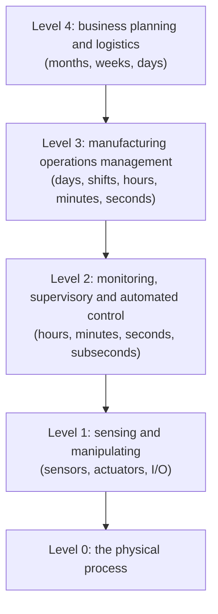
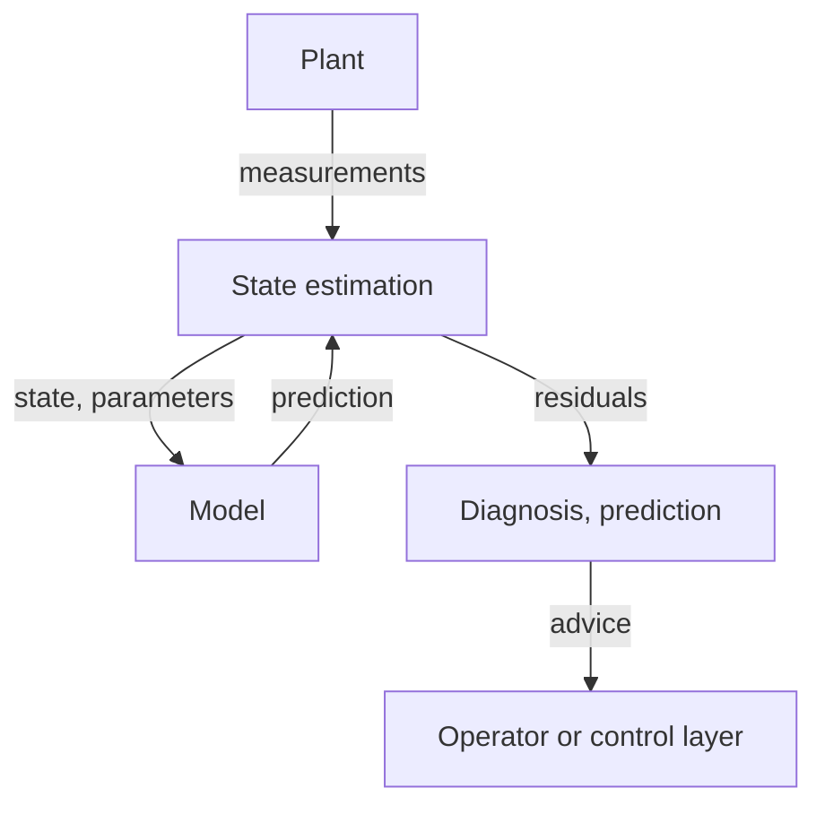

The previous entries built the control layer of a plant from the bottom up: logic and sequences in the [first entry](/blog/logic-and-sequential-control), the programmable logic controller (PLC) that executes them in the [second](/blog/programmable-logic-controllers), the networks that connect controllers to field devices in the [third](/blog/fieldbuses-and-industrial-ethernet), and the proportional–integral–derivative (PID) loops that hold process variables at their setpoints in the [fourth](/blog/pid-control-of-process-variables). That layer runs the plant. It does not decide what to produce, record which batch used which raw material, schedule maintenance or tell anyone how the plant performed last month. Those functions belong to systems above the control layer, and they need the control layer's data.

This final entry covers two subjects that meet at that boundary. The first is **networked automation**: the standard model of the levels of a manufacturing enterprise, and the OPC Unified Architecture (OPC UA), a standard widely used to expose controller data to higher-level systems with its meaning attached, together with the security architecture such connections require. The second is the **digital twin**: a model that runs alongside the plant, fed by its data. The term is used loosely, so the entry defines it carefully, separates it from things it is often confused with, and works through a small example in which a twin of a tank detects a leak that no single measurement shows. Python examples use Python 3 and its standard library.

## 1. The Levels of a Manufacturing Enterprise

### 1.1 The ISA-95 functional hierarchy

The standard **ANSI/ISA-95**, developed by the International Society of Automation (ISA) and approved by the American National Standards Institute (ANSI), and published internationally as **IEC 62264**, describes the integration of enterprise and control systems. Its functional hierarchy, which descends from the Purdue reference model, divides a manufacturing enterprise into levels by what each does and on what time scale:



| Level | Function | Typical systems |
|---|---|---|
| 4 | Business planning and logistics: orders, plant schedule, materials, shipping | **Enterprise resource planning** (ERP) |
| 3 | Manufacturing operations: dispatching work, recording production, quality, maintenance and inventory operations within the plant | **Manufacturing execution systems** (MES), historians, laboratory systems |
| 2 | Monitoring, supervisory and automated control: control logic, sequences and loops, operator displays, alarms, setpoints | PLCs and other controllers, **SCADA** (supervisory control and data acquisition), **distributed control systems** (DCS), human–machine interfaces (HMI) |
| 1 | Sensing and manipulating the process | Sensors, actuators, I/O modules, drives |
| 0 | The process itself | Tanks, machines, material |

The boundary between Levels 1 and 2 is drawn differently in different publications and plants: many diagrams in the Purdue tradition place controllers and their basic control loops at Level 1 and reserve Level 2 for supervisory systems, and a DCS spans both. The levels are therefore best read as a description of functions rather than of boxes. The most important boundary in the standard is between Levels 3 and 4, where ISA-95 defines the information exchanged between enterprise and manufacturing systems: production schedules downward, production performance upward, and the models of materials, equipment, personnel and process segments that both sides must share.

### 1.2 IT and OT

The levels also mark a cultural and technical divide. **Information technology** (IT), at Level 4 and largely at Level 3, uses general-purpose computers, changes frequently, and values confidentiality of data. **Operational technology** (OT), at Levels 0 to 2, consists of controllers and networks that run physical equipment, may stay unchanged for decades, and values availability and safety above all: a controller that is rebooted to install a patch stops a machine. Connecting the two worlds is the purpose of this entry's first half, and doing so without importing IT's threats into OT is the purpose of Section 4.

## 2. OPC UA

### 2.1 The problem it solves

Higher-level systems need data from many controllers made by different manufacturers, each with its own protocol. The original OPC specifications of the 1990s (OPC then stood for OLE for Process Control, OLE being a Microsoft object technology), now called **OPC Classic**, solved this on Windows computers using Microsoft's Component Object Model and its distributed form (COM/DCOM): a vendor's OPC server translated its controllers' protocol into standard interfaces for data access, alarms and history. That tied OPC to one operating system and made it awkward to secure and to route across networks.

**OPC Unified Architecture** (OPC UA), developed by the OPC Foundation and standardized as the **IEC 62541** series, replaces it with a platform-independent architecture. Its central idea goes beyond transport: it carries not only values but their **meaning**, through an **information model** that a client can explore at run time. A client connecting to an OPC UA server does not need to know in advance that a particular Modbus holding register (third entry, Section 3.1) holds a tank level in meters; it can browse the server and find an object called `MixingTank1` with a variable `Level` whose properties state its engineering unit and range.

The main parts of IEC 62541 used in this entry are Part 3 (address space model), Part 4 (services), Part 5 (information model), Part 6 (mappings to encodings and transports), Part 8 (data access) and Part 14 (PubSub), with the security model in Part 2.

### 2.2 The address space

An OPC UA server exposes an **address space**: a graph of **nodes** connected by **references**. Every node belongs to one of eight **node classes**:

| Node class | Represents |
|---|---|
| Object | A thing: a tank, a valve, a controller, a folder |
| Variable | A value, with attributes such as `Value`, `DataType` and `AccessLevel` |
| Method | A function that a client can call, such as starting a batch |
| ObjectType, VariableType | Type definitions from which objects and variables are instantiated |
| ReferenceType | The kinds of relation between nodes |
| DataType | Data type definitions, including structures and enumerations |
| View | A subset of the address space for a particular purpose |

Each node has a **NodeId**, which combines a **namespace index** with an identifier (numeric, string, globally unique identifier or opaque bytes) and is often written as text such as `ns=2;s=MixingTank1.Level`. Namespace 0 is reserved for the nodes defined by the OPC UA specification itself. References are typed: hierarchical references such as `Organizes`, `HasComponent` and `HasProperty` build the browsable tree, and `HasTypeDefinition` links an instance to its type. The mixing tank of the first entry, exposed by the PLC of the second, might appear as:

```text
Objects
└── MixingTank1                Object, HasTypeDefinition → TankType
    ├── Level                  Variable of AnalogItemType, Double
    │   ├── EngineeringUnits   Property: m (meter)
    │   └── EURange            Property: 0.0 .. 2.0
    ├── State                  Variable, enumeration IDLE, FILL, MIX, DRAIN
    ├── InletValve             Object, HasTypeDefinition → ValveType
    │   └── Open               Variable, Boolean
    └── StartBatch             Method
```

`AnalogItemType`, defined in Part 8, is a standard variable type for analog measurements; its `EURange` property gives the range in which the value is expected and `EngineeringUnits` its unit. A client that understands `AnalogItemType` can display and trend any analog value from any server correctly without being configured for it.

Each value is delivered as a **DataValue**, which carries the value together with a **StatusCode** (whether the value is good, uncertain or bad, and why) and timestamps from the source and from the server. The status matters as much as the value: a level whose 4–20 mA loop has failed (second entry, Section 3.3) should reach the MES as "bad", not as a plausible number.

### 2.3 Information models and companion specifications

Types are where OPC UA's value lies. If every vendor defines its own `TankType`, clients still need per-vendor knowledge. **Companion specifications**, developed jointly by the OPC Foundation and industry organizations, therefore define standard types for whole domains: devices in general (IEC 62541-100), IEC 61131-3 controllers (with PLCopen), and many classes of machines and instruments. A server that implements a companion specification exposes, for instance, a standard device identification with manufacturer, model and serial number at a known place, so that an asset-management system can read it from every compliant device alike.

### 2.4 Services and subscriptions

Clients interact with the address space through **services**: `Browse` to explore references, `Read` and `Write` for attributes, `Call` for methods, and services to create **subscriptions**.

Polling every value with `Read` would load the server and the network with mostly unchanged data. A subscription inverts the flow:

1. The client creates a **subscription** with a **publishing interval**, say 1000 ms.
2. Within it, the client creates **monitored items**, one per variable, each with a **sampling interval** (how often the server checks the value, say 100 ms), a **queue size**, and optionally a **filter**, such as an absolute **deadband** of 0.01 m: a change smaller than the deadband is not reported.
3. Once per publishing interval the server sends a notification containing only the values that changed (beyond their deadbands) since the last one.

A level that sits still costs nothing after the first notification. The intervals are requests: the server may revise them to what it can support, and it reports the values actually used. Sampling does not make OPC UA a control network: client–server OPC UA over TCP has the timing properties of standard switched Ethernet discussed in the third entry, which suits supervision and data collection at Level 2 and above, not millisecond control loops.

### 2.5 Transports and PubSub

The client–server model is mapped onto concrete protocols in Part 6. The most common is **UA Binary** encoding over the Transmission Control Protocol (TCP), with endpoint URLs beginning `opc.tcp://` and the registered port 4840; mappings over HTTPS and WebSockets also exist.

Client–server communication suits one client talking to one server. For one source and many consumers, or for controller-to-controller exchange, Part 14 defines **PubSub**: a **publisher** sends **network messages** containing **datasets** without knowing who receives them. PubSub can be **brokerless**, sending messages by User Datagram Protocol (UDP) multicast or directly in Ethernet frames, which together with the Time-Sensitive Networking (TSN) mechanisms of the [third entry](/blog/fieldbuses-and-industrial-ethernet#9-time-sensitive-networking) is intended for deterministic exchange at the control level; or **broker-based**, sending messages through a message broker such as one using MQTT, which suits distribution to cloud and enterprise systems.

### 2.6 MQTT

**MQTT** is a lightweight publish–subscribe protocol standardized by OASIS (version 3.1.1, also published as ISO/IEC 20922, and version 5.0). Clients connect to a **broker** over TCP (port 1883, or 8883 with Transport Layer Security, TLS), publish messages to hierarchical **topics** such as `site1/area2/tank1/level`, and subscribe to topics or topic patterns. Each message is delivered with one of three **quality of service** levels: at most once (0), at least once (1) or exactly once (2). MQTT itself says nothing about the content of a message, which is any sequence of bytes; meaning comes from conventions agreed between publisher and subscribers, or from carrying OPC UA PubSub messages as the payload. The contrast with OPC UA's self-describing address space is the main architectural difference between the two.

## 3. Choosing How to Connect

The protocols of this series serve different levels and timing needs:

| Need | Typical choice | Why |
|---|---|---|
| I/O and drives, cycle times of milliseconds | Fieldbus or real-time industrial Ethernet (third entry) | Determinism |
| Controller to HMI, SCADA, historian | OPC UA client–server, subscriptions | Self-describing data, status codes, security |
| Many consumers, enterprise and cloud distribution | MQTT, or OPC UA PubSub over a broker | Decoupling of publishers and consumers |
| Controller to controller, deterministic | OPC UA PubSub over TSN, or a real-time Ethernet protocol | Scheduled delivery |
| Business transactions between Levels 3 and 4 | Messages based on ISA-95 object models | Shared meaning of orders, materials, performance |

## 4. Security: Zones and Conduits

### 4.1 Why automation needs its own security model

Connecting controllers to enterprise networks exposes them to attacks that were irrelevant when they were isolated, and automation equipment has properties that make conventional IT practice hard to apply: devices run for decades, cannot be patched or rebooted at will, and an incorrect action has physical consequences. The **IEC 62443** series addresses the security of industrial automation and control systems for asset owners, system integrators and component manufacturers.

### 4.2 Zones and conduits

Its central architectural idea is to divide a system into **zones**, groups of assets that share security requirements, and **conduits**, the controlled communication paths between zones. Each zone is assigned a target **security level** from 1 to 4, according to the capability of the attacker it must resist, from casual or accidental violation up to sophisticated attacks with extensive resources. Traffic between zones passes only through conduits, where it can be restricted and inspected. A typical arrangement places the controllers and field networks of one production area in one zone, SCADA in another, and puts a **demilitarized zone** (DMZ) between the plant and the enterprise network, with servers such as a historian replica or an OPC UA aggregating server, so that no connection passes directly from the enterprise to a controller.

### 4.3 Security in OPC UA

OPC UA builds security into the protocol rather than relying on the network. Each application has an **application instance certificate** (an X.509 certificate), and client and server authenticate each other with these certificates when they open a **secure channel**. The channel runs in one of three **message security modes**: `None`, `Sign` (messages are signed, so tampering is detected) or `SignAndEncrypt` (also encrypted). On top of the secure channel, a **session** authenticates the user, anonymously, by user name and password, by certificate or by an issued token, and the server can grant access per node. A production system should not accept `None`, and certificates need management: trust lists, renewal and revocation are operational work that must be planned.

## 5. Digital Twins

### 5.1 A definition

A **digital twin** is a computational model of a specific physical asset or process that is connected to it by data, kept synchronized with its actual state at a stated rate and accuracy, and used for a stated purpose. Each part of the definition matters:

- **Specific**: a twin represents one particular tank, machine or line, with its own parameters and history, not a type of equipment in general.
- **Connected and synchronized**: the model is updated from measurements of the real asset, so its state follows the asset's state. How closely, and how often, is part of its specification.
- **Purposeful**: a twin is built to answer particular questions, and its fidelity is chosen for those questions. A twin for energy optimization and a twin for training operators of the same plant may share little.

The ISO 23247 series sets out a reference framework for digital twins in manufacturing. A widely cited classification by Kritzinger and colleagues distinguishes three levels of integration by the direction of automatic data flow:

| Term | Data from asset to model | Data from model to asset |
|---|---|---|
| Digital model | Manual | Manual |
| Digital shadow | Automatic | Manual |
| Digital twin | Automatic | Automatic |

Under this classification, many systems described as digital twins are digital shadows: the model follows the plant automatically, but its results reach the plant only through a person. For anything that affects a running process, that is often the right design, because the model's output then passes the same review as any other change.

### 5.2 What a digital twin is not

The term attracts loose use, so it helps to be explicit:

- **Not a 3D visualization.** A rendered model of a machine that displays live values is a display; without a model of behavior it cannot predict anything.
- **Not a database or a dashboard.** Stored and plotted measurements describe the past; a twin computes something the measurements do not contain, such as an unmeasured state, a future trajectory or the effect of a change.
- **Not a copy of reality.** Every model omits effects and has parameters that are only approximately known. The difference between a model's behavior and the real system's, the **reality gap**, is never zero, and a twin is useful only within the range in which that gap has been measured.
- **Not a replacement for the control system or for safety functions.** A twin may propose setpoints; the control layer, its interlocks and its independent safety functions remain responsible for the plant's behavior.
- **Not a single universal model.** A plant may have several twins of different fidelity for different purposes.

### 5.3 Kinds of model

The model inside a twin can be:

- **First-principles**: mass, energy and momentum balances, kinematics and dynamics, with physical parameters. These extrapolate reasonably beyond the data used to calibrate them, and their states have physical meaning.
- **Data-driven**: models fitted to measurements, from step-response models like those of the fourth entry to statistical and machine-learning models. They capture effects that are hard to model physically but are unreliable outside the conditions they were trained on.
- **Hybrid**: a first-principles structure with data-driven parts for poorly understood effects.
- **Discrete-event**: models of material flow, queues and resource use, for questions about throughput and scheduling rather than continuous dynamics.

Simulating continuous models numerically has its own pitfalls of step size, accuracy and stability; the site's [notes on numerical integration](/blog/numerical-integration-notes) discuss them.

### 5.4 Keeping the model synchronized

A model started with the plant's initial state and run with the plant's inputs drifts away from the plant, because its parameters are imperfect and unmeasured disturbances act on the plant. A twin therefore corrects its state with measurements, which is **state estimation**: predict with the model, then correct the prediction in proportion to the difference between measurement and prediction. This is the predict–update cycle described in the robotics series' entry on [sensing and state estimation](/blog/sensing-and-state-estimation), where the Kalman filter chooses the correction optimally under stated assumptions about noise. The difference between a measurement and the model's prediction, the **residual** (or innovation), is itself the most useful output of many twins: when the plant behaves as the model expects, the residual is small and random; when something changes that the model does not know about, it is not.

Slow changes, such as fouling of a heat exchanger or wear of a pump, are handled by **parameter estimation**, which adjusts model parameters over longer periods. The estimated parameters are then themselves condition indicators.



### 5.5 What twins are used for

- **Virtual commissioning.** The PLC program is tested against a simulation of the machine or plant before the equipment exists or before it is handed over. The program can run in a simulated controller (**software-in-the-loop**) or on the real controller connected to the simulation instead of the field I/O (**hardware-in-the-loop**). Sequence errors, interlock gaps and wrong I/O assignments are found at a desk instead of on site. Strictly, the simulation here is often a digital model in Kritzinger's sense, since the plant does not yet exist; it becomes the basis of a twin once connected.
- **Soft sensors.** A synchronized model estimates a quantity that is not measured, or is measured only occasionally in a laboratory, such as a composition from temperatures and flows.
- **Monitoring and fault detection.** Residuals between plant and model reveal faults that leave every individual measurement within its normal range, as the example below shows.
- **What-if studies and optimization.** A synchronized model started from the plant's present state can be run faster than real time to test a proposed change in setpoint, recipe or schedule before it is applied.
- **Operator training.** Operators practice start-ups, shutdowns and abnormal situations on a simulator connected to a copy of the real control system.

### 5.6 A worked example: detecting a leak

A tank of cross-sectional area $A = 2\ \text{m}^2$ has a measured inflow $q_\text{in}$ and drains through an outlet whose flow is proportional to the level, $q_\text{out} = k h$ with $k = 0.008\ \text{m}^2/\text{s}$ (a linearized outlet, chosen to keep the example short). Its level follows

$$
A\,\frac{dh}{dt} = q_\text{in} - k h - q_\text{leak},
$$

and at steady state without a leak, $h = q_\text{in}/k$: 1.25 m for an inflow of 0.010 m³/s and 1.75 m for 0.014 m³/s, with time constant $A/k = 250$ s. The level transmitter has a random error with standard deviation 5 mm.

The twin uses the same model, driven by the measured inflow, and corrects its level every second with a fixed gain $L = 0.05$ times the residual, a simple fixed-gain observer rather than a full Kalman filter. It averages the residual over the last 60 s and raises an alarm if the average exceeds 4 mm in magnitude. In the simulation, the inflow increases at $t = 300$ s, an event the twin knows about because it is measured, and a leak of $q_\text{leak} = 0.001$ m³/s, which no instrument measures, starts at $t = 900$ s. The program simulates the plant as well, which in practice would be the real tank:

```python
import random

A, K_OUT = 2.0, 0.008          # tank area (m^2), outflow coefficient (m^2/s): q_out = K_OUT * h
DT, L_GAIN = 1.0, 0.05         # time step (s), observer correction gain per step
NOISE = 0.005                  # level measurement noise, standard deviation (m)
WINDOW, LIMIT = 60, 0.004      # residual averaging window (samples) and alarm limit (m)

random.seed(7)
h_plant, h_twin = 1.25, 1.25   # both start at the steady state for q_in = 0.010 m^3/s
recent, alarm_at = [], None
for k in range(1800):
    t = k * DT
    q_in = 0.010 if t < 300 else 0.014              # measured inflow, m^3/s
    leak = 0.001 if t >= 900 else 0.0               # unmeasured leak from t = 900 s

    # the plant (in reality: the physical tank and its level transmitter)
    h_plant += DT * (q_in - K_OUT * h_plant - leak) / A
    y = h_plant + random.gauss(0.0, NOISE)

    # the twin: same model, driven by the measured inflow, corrected by the measurement
    h_pred = h_twin + DT * (q_in - K_OUT * h_twin) / A
    residual = y - h_pred
    h_twin = h_pred + L_GAIN * residual

    recent = (recent + [residual])[-WINDOW:]
    mean = sum(recent) / len(recent)
    if alarm_at is None and len(recent) == WINDOW and abs(mean) > LIMIT:
        alarm_at = t
    if t in (299, 899, 1799):
        print(f"t = {t:4.0f} s  level {h_plant:.3f} m  twin {h_twin:.3f} m  mean residual {1000 * mean:6.2f} mm")
print(f"leak alarm at t = {alarm_at:.0f} s")
```

```text
t =  299 s  level 1.250 m  twin 1.249 m  mean residual  -0.52 mm
t =  899 s  level 1.705 m  twin 1.706 m  mean residual   0.41 mm
t = 1799 s  level 1.627 m  twin 1.635 m  mean residual  -9.76 mm
leak alarm at t = 941 s
```

The alarm comes 41 s after the leak starts, while the level is still changing because of the earlier inflow step and is nowhere near any level alarm limit. The inflow step itself causes no alarm, because the twin is told about it. Running the same program with 40 different noise seeds gave alarms between 36 and 49 s after the leak, and none before it.

The size of the residual can be predicted. With the twin's state error $e_k = h_k - \hat h_k$, a per-step decay factor $a = 1 - k\,\Delta t/A = 0.996$ and a per-step leak effect $d = q_\text{leak}\Delta t/A = 0.5$ mm, the residual's mean settles where $r = a(1 - L)\,r - d$, so

$$
\bar r = -\frac{d}{1 - a(1 - L)} = -\frac{0.5\ \text{mm}}{1 - 0.996 \times 0.95} \approx -9.3\ \text{mm},
$$

consistent with the −9.76 mm averaged over the last minute of the run. The formula also shows a design trade-off. A larger correction gain $L$ keeps the twin closer to the noisy measurement but shrinks the residual that a fault produces, until the twin simply follows the fault; a smaller gain gives a larger fault signature but lets model errors accumulate. A Kalman filter makes this choice from stated noise models; either way, the twin's ability to detect faults depends on not correcting them away.

The example also shows the limits. Inverted, the formula turns the observed mean residual into an estimate of the flow that the model does not account for: a residual of −9.3 mm corresponds to about 0.001 m³/s leaving the tank. The twin cannot distinguish a leak from a drifting inflow meter or a partly opened drain valve, and if the outlet coefficient $k$ changed, for instance through fouling, the residual would show that too. Interpreting residuals needs knowledge of the plant, and validating the model, by checking its predictions against plant data over the operating range it will be used in, comes before trusting any of them.

### 5.7 Engineering a twin

A twin that is to be used for years needs the same discipline as any other part of an automation system:

- A written statement of its **purpose**, inputs, outputs and the questions it answers, from which its required fidelity follows.
- **Validation** against independent plant data across its intended operating range, with the range of validity recorded.
- **Data quality** handling: missing values, bad status codes (Section 2.2), time alignment of signals from different sources, and changes of instruments and their calibration.
- **Configuration management**: the plant changes through modifications and maintenance, and the model and its parameters must change with it, under version control.
- **Defined authority**: who acts on its outputs, and whether any output reaches the plant without a person in the loop.

## 6. Exercises

**Exercise 1.** Assign each function to its ISA-95 level: a PID loop holding a temperature; a weekly production plan; recording which raw-material lot was used in a batch; an operator display with alarms; a level switch.

<details>
<summary>Answer</summary>

The PID loop: Level 2 (automated control) in the ISA-95 functional model, although many Purdue-style diagrams draw basic control loops at Level 1. The weekly plan: Level 4. Lot recording (genealogy): Level 3. The operator display: Level 2. The level switch: a Level 1 device sensing the Level 0 process.

</details>

**Exercise 2.** A client subscribes to 500 level variables with a sampling interval of 100 ms, a publishing interval of 1 s and an absolute deadband of 0.01 m. Each level changes by about 0.002 m per second during filling and is constant otherwise. Roughly how many values per second does the server report while all tanks fill, compared with a client that reads all 500 values every 100 ms?

<details>
<summary>Answer</summary>

A filling level crosses the 0.01 m deadband about every 5 s, so each variable produces about 0.2 reports per second, 100 per second for all 500, delivered in one notification per second. Polling every 100 ms transfers 5 000 values per second, most of them unchanged. When the tanks are idle the subscription reports nothing, while polling still transfers 5 000 values per second.

</details>

**Exercise 3.** An engineer proposes letting the enterprise network's reporting server open OPC UA connections directly to each PLC. Using zones and conduits, what would you propose instead?

<details>
<summary>Answer</summary>

Place the PLCs in a control zone and the enterprise systems in their own zone, with a DMZ between the plant and the enterprise. An OPC UA aggregating server, or a historian, in the DMZ or in a supervisory zone collects data from the PLCs through a restricted conduit; the reporting server reads only from that server. No connection is opened from the enterprise zone into the control zone, and the OPC UA connections use `Sign` or `SignAndEncrypt` with managed certificates.

</details>

**Exercise 4.** In the leak example, what mean residual would a leak of 0.0005 m³/s produce with $L = 0.05$? With the same 4 mm limit, would it be detected? What correction gain would make its mean residual 8 mm?

<details>
<summary>Answer</summary>

$d = 0.0005/2 = 0.25$ mm per step, so $\bar r = -0.25/0.0538 \approx -4.6$ mm: just beyond the limit, so it would be detected, but with little margin and more slowly: running the program with this leak and the same 40 noise seeds gave alarms 62 to 102 s after the leak began, against 36 to 49 s for the larger leak. For $|\bar r| = 8$ mm, $1 - 0.996(1 - L) = 0.25/8 = 0.03125$, so $1 - L = 0.9726$ and $L \approx 0.027$. The smaller gain doubles the fault signature but also lets the twin drift further when the model is imperfect.

</details>

**Exercise 5.** A vendor describes a system as a "digital twin of the line": it shows a 3D model of the machines in which each one is colored by its current state, read live from the PLCs over OPC UA. Using the definitions of Section 5, what is it, and what would it need to become a digital twin?

<details>
<summary>Answer</summary>

It is a live visualization: data flows automatically from the asset, but there is no model of behavior, so it cannot estimate unmeasured states, predict, or test changes. It would need a behavioral model of the line (for instance a discrete-event model of material flow) synchronized with the live data, a defined purpose, and validation. Even then, by the classification in Section 5.1, it is a digital shadow unless its results flow back to the line automatically.

</details>

## 7. Summary

| Question | Answer |
|---|---|
| What does ISA-95 (IEC 62264) describe? | The functional levels of a manufacturing enterprise, from the process (Level 0) through control (1–2) and operations management (3) to business planning (4), and the information exchanged between Levels 3 and 4. |
| What does OPC UA add to data transport? | Meaning: a typed, browsable address space, standard information models and companion specifications, status codes and timestamps, and built-in security. |
| What are subscriptions for? | The server samples monitored items and reports only changes beyond a deadband, once per publishing interval, instead of being polled. |
| How do OPC UA PubSub and MQTT differ from client–server? | Publishers send to many consumers without knowing them, brokerless over UDP or Ethernet (with TSN for determinism) or through a broker. |
| What is the zones-and-conduits model? | IEC 62443's division of a system into zones of common security requirement, connected only through controlled conduits, typically with a DMZ between plant and enterprise. |
| What is a digital twin? | A purposeful model of a specific asset, synchronized with it by data at a stated rate and accuracy. |
| How is it kept synchronized? | By state estimation (predict with the model, correct with measurements) and slower parameter estimation. |
| What is it not? | Not a visualization, a dashboard, an exact copy of reality, or a replacement for control and safety functions. |
| How does a twin detect faults? | Through residuals between measurement and prediction, which stay small and random until something the model does not know about happens. |

The series has moved from single Boolean signals to plant-wide systems. A contact closes in the field; a PLC reads it into its input image and runs logic, sequences and PID loops on it; a fieldbus or industrial Ethernet network carries it with bounded delay; OPC UA exposes it, with its meaning and status, to the levels above; and a model fed by the same data can estimate what no instrument measures. Each layer depends on the timing, data quality and engineering discipline of the layers below it, which is why the series built them in that order.

### References

- IEC 62264-1, *Enterprise-Control System Integration – Part 1: Models and Terminology*, International Electrotechnical Commission (also published as ANSI/ISA-95.00.01).
- IEC 62541 (series), *OPC Unified Architecture*, International Electrotechnical Commission.
- IEC 62443 (series), *Security for Industrial Automation and Control Systems*, International Electrotechnical Commission.
- ISO/IEC 20922:2016, *Message Queuing Telemetry Transport (MQTT) v3.1.1*, International Organization for Standardization.
- ISO 23247 (series), *Automation Systems and Integration – Digital Twin Framework for Manufacturing*, International Organization for Standardization.
- W. Kritzinger, M. Karner, G. Traar, J. Henjes and W. Sihn, "Digital Twin in Manufacturing: A Categorical Literature Review and Classification", *IFAC-PapersOnLine*, 51(11), 2018.
- W. Mahnke, S.-H. Leitner and M. Damm, *OPC Unified Architecture*, Springer, 2009.
