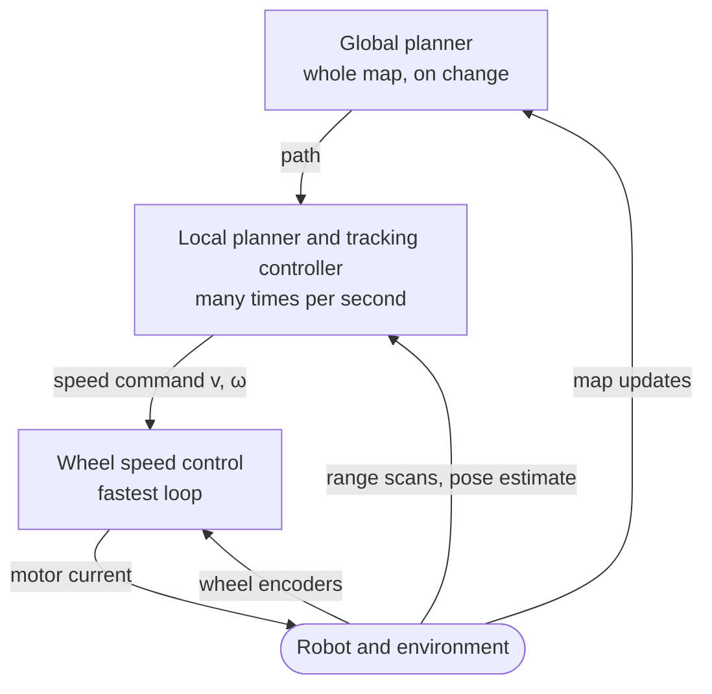

The [previous entry](/blog/trajectories-and-time-scaling) turned a geometric path into a trajectory, a motion with a timetable that respects velocity and acceleration limits. A plan of that kind is computed once, from a map, for a robot model that is never exact. Wheels slip, the drive responds late, the estimate of the robot's pose drifts, and people walk into corridors that the map shows empty. This final entry of [Motion Planning for Robots](/series/motion-planning) closes the loop between the plan and the moving robot: controllers that keep a mobile robot on its path or trajectory, and reactive methods that steer around obstacles the planner never saw.

The entry builds on all four earlier entries: the configuration space of the [first](/blog/configuration-space-and-the-planning-problem); the grid planners of the [second](/blog/graph-search-dijkstra-and-a-star) and the sampling-based planners of the [third](/blog/sampling-based-planning-prm-and-rrt), which Section 6 uses for replanning; and the timed references of the fourth, which trajectory tracking follows. The layered robot software of [What Is a Robot?](/blog/what-is-a-robot#53-layered-hybrid-architectures) frames the whole entry, and the idea of feedback comes from [Feedback and System Behavior](/blog/feedback-and-system-behavior). The examples simulate one small differential-drive robot and take its pose estimate as exact; Section 6.4 returns to that assumption.

**Conventions.** These hold for the whole entry. The robot moves in the plane $\mathcal{W} = \mathbb{R}^2$ with a world frame whose $x$ axis points right and $y$ axis up; its pose is $(x, y, \theta)$, with heading $\theta$ measured counterclockwise from the $x$ axis in radians. Its configuration space is $\mathcal{C} = \mathbb{R}^2 \times S^1$, the plane times a circle, as in the first entry. The inputs are the forward speed $v$ in m/s and the angular rate $\omega$ in rad/s, positive counterclockwise; the curvature of the motion is $\kappa = \omega / v$ in 1/m. The wheels have radius $r$ and are separated by $b$ (the track width). The robot frame has its $x$ axis along the heading and its $y$ axis to the robot's left, so a positive lateral error means "to the left". The look-ahead distance of pure pursuit is $L_d$. A reference path is $\sigma$ and a reference trajectory is $q_r(t) = (x_r(t), y_r(t), \theta_r(t))$ with reference speeds $v_r(t)$ and $\omega_r(t)$. The code is Python 3.13 with NumPy 2.5; every program is deterministic (no random numbers are drawn), and every quoted output comes from running it.

## 1. Planning and acting at different rates

A motion planner answers the question "which motion reaches the goal without collision?" for the world as the map describes it. Two further questions have to be answered while the robot moves. "How should the wheels turn now, so that the robot stays on the plan?" is the job of a **tracking controller**. "What should the robot do about an obstacle that the plan did not know about?" is the job of a **local planner** (or reactive layer), which looks only at the robot's surroundings as its sensors currently report them.

The three questions are answered at different rates, because they differ in scope. A **global planner** searches the whole map, with the methods of the second and third entries, and reruns when the goal or the map changes. A local planner considers a few meters and a second or two ahead, and reruns many times per second. A tracking controller turns the current pose error into a speed command, and the wheel controllers below it turn that command into motor currents. This is the loops-within-loops picture of [Section 4 of What Is a Robot?](/blog/what-is-a-robot#4-loops-within-loops): each layer treats the faster layer below it as an ideal actuator, which holds only when the rates are well separated.



*Figure: the layers of a mobile robot's navigation and control software. Each arrow down is a command, each arrow up is the information that layer closes its loop around; the higher the layer, the larger its scope and the lower its rate.*

In the terms of [Section 5 of What Is a Robot?](/blog/what-is-a-robot#5-organizing-the-software), the global planner is the deliberative layer and the local planner and tracking controller form the reactive layer. An executive between them decides when a plan has failed (the three-layer description of Gat's 1998 chapter). Sections 3 to 5 treat the reactive layer and Section 6 the executive's part. The split also lets the global planner use a coarse robot model, such as the disk of the [first entry's Section 3](/blog/configuration-space-and-the-planning-problem#3-obstacles-in-configuration-space): the layers below absorb the difference.

## 2. The differential-drive robot

### 2.1 The unicycle model

A **differential-drive** robot has two driven wheels on a common axle, each with its own motor, and passive casters that carry part of the weight. Equal wheel speeds move it straight, unequal speeds turn it about a point on the axle line, and opposite speeds turn it in place. Many robot vacuum cleaners and indoor research platforms are built this way.

Take the reference point midway between the wheels. If the wheels do not slip, that point moves along the heading with speed $v$, and the heading changes at rate $\omega$:

$$
\dot{x} = v \cos\theta, \qquad \dot{y} = v \sin\theta, \qquad \dot{\theta} = \omega .
$$

This is the **unicycle model**; textbooks on wheeled robots, such as those of Siciliano et al. and of Lynch and Park, derive it and the wheel relations of Section 2.3 in more generality. It is purely kinematic: $v$ and $\omega$ are assumed to be set directly, so mass, torque limits and tire forces do not appear. At around 0.5 m/s that is a reasonable first model, and Section 2.4 adds the one dynamic effect that matters for the examples, a lag in the drive.

### 2.2 The nonholonomic constraint

The model has three state variables and only two inputs, and the missing direction is sideways. The velocity of the reference point always lies along the heading, so its component across the heading is zero:

$$
\dot{x} \sin\theta - \dot{y} \cos\theta = 0 .
$$

A constraint on velocities that cannot be integrated into a constraint on positions is called **nonholonomic**, the term introduced in [Section 2.2 of What Is a Robot?](/blog/what-is-a-robot#22-degrees-of-freedom-and-mobility). This one cannot be integrated: the robot can reach every pose in $\mathcal{C}$, but only by maneuvering, as a car does when it parks.

Two consequences shape the rest of the entry. First, a path for a differential-drive robot need not be smooth, since the robot can stop and turn in place, but a path with a corner forces a stop, and the speed profile of the fourth entry has to provide one. Second, steering the robot to a fixed pose is hard. In 1983 Brockett gave a necessary condition for smooth feedback stabilization that this system fails, so no smooth feedback law that depends on the state alone can asymptotically stabilize it to a fixed pose. The tracking laws of Sections 3 and 4 avoid the difficulty by tracking a path or a moving reference with nonzero speed, which is what navigation needs in any case.

### 2.3 Wheel speeds

The commands a planner or controller produces are $(v, \omega)$, and the motors need wheel angular speeds. With right and left wheel speeds $\omega_R$ and $\omega_L$ in rad/s, the rim speeds are $r\,\omega_R$ and $r\,\omega_L$. The forward speed is their mean and the angular rate is their difference divided by the track width:

$$
v = \frac{r\,(\omega_R + \omega_L)}{2}, \qquad \omega = \frac{r\,(\omega_R - \omega_L)}{b},
$$

and inverting the pair gives

$$
\omega_R = \frac{v + \omega\, b/2}{r}, \qquad \omega_L = \frac{v - \omega\, b/2}{r} .
$$

The robot in this entry has $r = 0.05$ m and $b = 0.30$ m. The program `wheels.py` evaluates the inverse map for three commands:

```text
v = 0.5 m/s, omega = 0.0 rad/s -> right 10.00 rad/s, left 10.00 rad/s
v = 0.5 m/s, omega = 0.5 rad/s -> right 11.50 rad/s, left 8.50 rad/s
v = 0.0 m/s, omega = 1.0 rad/s -> right 3.00 rad/s, left -3.00 rad/s
```

The second line is the robot on a circle of radius $v/\omega = 1$ m. Because each wheel has a maximum speed, the reachable commands form a diamond in the $(v, \omega)$ plane: turning harder leaves less wheel speed for going forward. The dynamic window approach of Section 5.3 searches this plane directly.

### 2.4 The simulation model

The examples of Sections 3 and 4 share one simulation. The unicycle equations are integrated with a forward Euler step of 0.01 s; the controller runs every fifth step (20 Hz) and holds its command between updates. Both $v$ and $\omega$ follow their commands through a first-order lag with time constant 0.1 s, which stands for the wheel speed loops and the robot's inertia, and $|\omega| \le 1.5$ rad/s. Without the lag, the limit and the 20 Hz sampling, a tracking controller's gains could be raised without bound and the loop would stay stable; with them, aggressive gains overshoot, oscillate or go unstable. The sampling alone is enough. Take the linearized pure pursuit loop of Section 3.3 on a straight line, with each command held for 0.05 s and no lag or limit: the largest closed-loop pole has magnitude 0.833 at $L_d = 0.15$ m but 2.032 at $L_d = 0.02$ m, an unstable loop (program `zoh.py`).

The **reference path** runs along the $x$ axis from $(0, 0)$ to $(6, 0)$, turns left on a quarter circle of radius 1 m to $(7, 1)$ and continues straight up to $(7, 6)$, in meters. Its curvature jumps from 0 to 1 m$^{-1}$ and back, like a road of straights and circular bends. The robot starts at $(0, -0.5)$ m with heading 0, 0.5 m to the right of the path. The **cross-track error** $e$ is the signed distance to the nearest path point, positive to the left of the direction of travel. The listings of Sections 3 and 4 show the control laws only; the path construction, the error measurement and the simulation loop are omitted.

## 3. Pure pursuit

### 3.1 The geometry

**Pure pursuit** steers toward a point on the path a fixed distance ahead of the robot, the way a driver looks some distance down the road rather than at the lane marking beside the wheel. At each update the controller picks the **goal point**, the point on the path ahead of the robot at distance $L_d$ (the **look-ahead distance**) from it. It then computes the circular arc that starts at the robot, is tangent to the robot's heading and passes through the goal point, and commands the curvature of that arc. Coulter's 1992 technical report from Carnegie Mellon University documents an implementation of the method, derives the curvature formula and examines how its performance depends on the look-ahead distance.

The curvature follows from one equation. In the robot frame the robot is at the origin facing along $x$, and the goal point is at $(x_g, y_g)$ with $x_g^2 + y_g^2 = L_d^2$. A circle tangent to the $x$ axis at the origin has its center on the $y$ axis, at $(0, R)$ for radius $R$ (negative $R$ for a center on the right). The goal point lies on it when

$$
x_g^2 + (y_g - R)^2 = R^2 \quad\Longrightarrow\quad x_g^2 + y_g^2 = 2\, y_g R \quad\Longrightarrow\quad \kappa = \frac{1}{R} = \frac{2\, y_g}{L_d^2} .
$$

With $\alpha$ the bearing of the goal point in the robot frame, $y_g = L_d \sin\alpha$, which gives the usual form

$$
\kappa = \frac{2 \sin\alpha}{L_d}, \qquad \omega = v\,\kappa .
$$

As a worked example, take a goal point at $(0.5, 0.3)$ m in the robot frame. Then $L_d = \sqrt{0.5^2 + 0.3^2} = 0.5831$ m, $\alpha = \arctan(0.3/0.5) = 0.5404$ rad and $\kappa = 2 \times 0.3 / 0.34 = 1.7647$ m$^{-1}$, a circle of radius 0.567 m. At $v = 0.5$ m/s the command is $\omega = 0.8824$ rad/s; `wheels.py` prints the same four numbers.

### 3.2 Implementation

The path is stored as points 0.01 m apart. The controller starts its search at the path point nearest the robot and walks forward until it finds a point at least $L_d$ away, so the goal point always lies ahead along the path:

```python
def pure_pursuit(pose, path, i_near, Ld):
    """Return (omega, index of goal point) for the look-ahead distance Ld."""
    x, y, th = pose
    j = i_near
    while j < len(path) - 1 and np.hypot(path[j, 0] - x, path[j, 1] - y) < Ld:
        j += 1
    dx, dy = path[j, 0] - x, path[j, 1] - y
    alpha = np.arctan2(dy, dx) - th               # bearing in the robot frame
    kappa = 2.0 * np.sin(alpha) / np.hypot(dx, dy)  # curvature of the arc
    return V * kappa, j
```

The forward speed is constant, `V = 0.5` m/s, and $\omega$ is clipped to 1.5 rad/s. When the robot is farther than $L_d$ from the path, the loop stops at the nearest point, so the robot steers straight at the path; this is the simplest of several ways to handle that case.

### 3.3 The effect of the look-ahead distance

The program `pure_pursuit.py` runs the reference path with four look-ahead distances. For the first straight segment ($x < 5$ m) it reports the overshoot (the largest error to the left of the path after starting 0.5 m to its right) and the settling time (the last time the error exceeds 0.02 m). For the corner region ($x > 5$ m, $y < 2.5$ m) it reports the largest error inside and outside the bend. The last column is the root-mean-square (RMS) error after $t = 10$ s, which covers the bend and the final straight:

```text
L_d (m)  overshoot (m)  settle (s)  corner in (m)  corner out (m)  RMS t>10 s (m)
   0.15          0.258        4.92          0.004           0.004          0.0029
   0.30          0.059        2.59          0.008           0.008          0.0035
   0.60          0.026        4.03          0.031           0.034          0.0134
   1.20          0.023        8.19          0.150           0.112          0.0719
```

A long look-ahead distance gives smooth, slow convergence: with $L_d = 1.2$ m the robot takes 8.19 s to come within 0.02 m of the path, and it cuts the corner by 0.150 m. A short one follows the bend within 0.004 m but overcorrects the initial offset, overshooting by 0.258 m at $L_d = 0.15$ m. Here $L_d = 0.3$ m is the best compromise, with the shortest settling time and an error under 1 cm in the bend. The RMS column, which covers the bend and the final straight, follows the corner errors: it grows from 0.0035 m at $L_d = 0.3$ m to 0.0719 m at 1.2 m.

A linear model explains most of these numbers. Consider the straight segment, with the robot at small lateral error $e$ and small heading error $\theta$. The goal point is about $L_d$ ahead along the path, so in the robot frame $y_g \approx -e - L_d \theta$, and the curvature command is $\kappa \approx -2e/L_d^2 - 2\theta/L_d$. The lateral error changes as $\dot{e} = v \sin\theta \approx v\theta$, so $\ddot{e} = v\dot{\theta} = v^2 \kappa$. Substituting $\theta = \dot{e}/v$ gives

$$
\ddot{e} + \frac{2v}{L_d}\,\dot{e} + \frac{2v^2}{L_d^2}\, e = 0 ,
$$

a second-order system with natural frequency $\omega_n = \sqrt{2}\, v / L_d$ and damping ratio $\zeta = 1/\sqrt{2} \approx 0.707$, whatever the look-ahead distance. In this model $L_d$ changes only the speed of the response: the overshoot is $e^{-\pi\zeta/\sqrt{1-\zeta^2}} = e^{-\pi} = 4.3\%$ of the initial error, 0.022 m here, and the simulation gives 0.026 m at $L_d = 0.6$ m and 0.023 m at 1.2 m. At $L_d = 0.15$ m the 0.5 m initial error, more than three times $L_d$, drives $\omega$ to its 1.5 rad/s limit. The drive lag adds phase lag on top, since $\omega_n = 4.7$ rad/s is no longer small against the drive's bandwidth of $1/0.1 = 10$ rad/s and the 20 Hz update. The program `pure_pursuit.py` also reruns this case with each effect switched off. The overshoot is 0.018 m with neither, 0.029 m with the lag alone, 0.166 m with the limit alone and 0.258 m with both. The look-ahead distance therefore has a lower limit set by the robot's drive, here mostly by its turn-rate limit.

The bend shows the opposite limit. On a circle, a robot exactly on the path commands exactly the path's curvature, because the arc through the robot and the goal point is the path itself. Errors arise where the curvature changes: the goal point enters the bend while the robot is still on the straight, so the robot turns about $L_d$ early and cuts inside, by 0.008 m at $L_d = 0.3$ m and 0.150 m at 1.2 m.

### 3.4 What pure pursuit does not do

Pure pursuit tracks a path, not a trajectory: it needs a speed from elsewhere and cannot correct a robot that is on the path but behind schedule. Its single parameter couples smoothness and accuracy; making it proportional to speed, $L_d = k\,v$ with $k$ in seconds, keeps $\omega_n = \sqrt{2}/k$ constant as the speed changes. It passes every jump of the pose estimate straight into the command. In exchange its one parameter has a geometric meaning, curvature jumps need no special treatment and a robot far from the path heads back toward it.

## 4. Tracking a trajectory with feedback

### 4.1 Path tracking and trajectory tracking

A **trajectory tracking** controller follows a reference that moves in time: at instant $t$ the robot should be at $q_r(t)$, moving at $v_r(t)$ and turning at $\omega_r(t)$. The fourth entry produced such references by time scaling a path, $q(t) = \sigma(s(t))$ ([its Section 1](/blog/trajectories-and-time-scaling#1-paths-and-trajectories)). Following the timetable matters when the robot must arrive on time or coordinate with others, and it supplies a **feedforward** term: $v_r$ and $\omega_r$ would keep a perfect robot on the reference, so feedback only has to correct the error.

### 4.2 Errors in the robot frame

The error is most useful in the robot frame, because the robot can correct an error along its heading by changing $v$ and an error across its heading only by turning. Rotating the world-frame position difference by $-\theta$ gives

$$
\begin{bmatrix} e_x \\ e_y \end{bmatrix} =
\begin{bmatrix} \cos\theta & \sin\theta \\ -\sin\theta & \cos\theta \end{bmatrix}
\begin{bmatrix} x_r - x \\ y_r - y \end{bmatrix},
\qquad e_\theta = \theta_r - \theta ,
$$

where $e_x$ is how far the reference lies ahead of the robot, $e_y$ how far it lies to the robot's left, and $e_\theta$ the heading error, wrapped to $(-\pi, \pi]$. Differentiating, with the unicycle model for the robot and for the reference, gives the error dynamics

$$
\dot{e}_x = \omega\, e_y - v + v_r \cos e_\theta, \qquad
\dot{e}_y = -\omega\, e_x + v_r \sin e_\theta, \qquad
\dot{e}_\theta = \omega_r - \omega .
$$

The terms $\omega e_y$ and $-\omega e_x$ come from the rotation of the robot frame itself.

### 4.3 The Kanayama tracking law

In 1990 Kanayama, Kimura, Miyazaki and Noguchi proposed a tracking law that combines the feedforward speeds with feedback on the three errors:

$$
v = v_r \cos e_\theta + K_x\, e_x, \qquad
\omega = \omega_r + v_r \left( K_y\, e_y + K_\theta \sin e_\theta \right),
$$

with positive gains $K_x$ in 1/s, $K_y$ in 1/m$^2$ and $K_\theta$ in 1/m. The speed command speeds up when the reference is ahead and slows down when it is behind. The turn command adds to the reference's own turning a correction that steers toward the reference's lateral position and aligns the heading. Multiplying the lateral terms by $v_r$ makes the correction a curvature, so the turn rate commanded for a given error scales with speed. Kanayama et al. proved with a Lyapunov function that the zero error is stable for any positive gains when the reference moves forward ($v_r > 0$).

The linearized dynamics give a rule for choosing the gains. On a straight reference ($\omega_r = 0$) with small errors, with $\cos e_\theta \approx 1$ and $\sin e_\theta \approx e_\theta$, substituting the law into the error dynamics and dropping products of errors gives $\dot{e}_x \approx -K_x e_x$, $\dot{e}_y \approx v_r e_\theta$ and $\dot{e}_\theta \approx -v_r (K_y e_y + K_\theta e_\theta)$. The along-track error decays on its own with time constant $1/K_x$. Differentiating $\dot{e}_y$ once more, we obtain

$$
\ddot{e}_y + v_r K_\theta\, \dot{e}_y + v_r^2 K_y\, e_y = 0 ,
$$

with natural frequency $v_r \sqrt{K_y}$ and damping ratio $\zeta = K_\theta / (2\sqrt{K_y})$. The response is critically damped when $K_y = K_\theta^2/4$. With $v_r = 0.5$ m/s and $K_\theta = 4$ m$^{-1}$, that is $K_y = 4$ m$^{-2}$, giving a double pole at $-1$ s$^{-1}$; $K_y = 16$ and $64$ m$^{-2}$ give $\zeta = 0.5$ and $0.25$. The listing implements the law exactly as written:

```python
def kanayama(pose, ref, v_r, w_r, Kx, Ky, Kth):
    """Tracking law: errors in the robot frame, then (v, omega)."""
    x, y, th = pose
    xr, yr, thr = ref
    c, s = np.cos(th), np.sin(th)
    ex = c * (xr - x) + s * (yr - y)          # along the robot's heading
    ey = -s * (xr - x) + c * (yr - y)         # to the robot's left
    eth = np.arctan2(np.sin(thr - th), np.cos(thr - th))
    v = v_r * np.cos(eth) + Kx * ex
    w = w_r + v_r * (Ky * ey + Kth * np.sin(eth))
    return (v, w), (ex, ey, eth)
```

### 4.4 Behavior in simulation

The program `kanayama.py` uses the reference path of Section 2.4, traversed at $v_r = 0.5$ m/s from the origin at $t = 0$, so $\omega_r = 0$ on the straights and $\omega_r = 0.5$ rad/s on the bend, which the reference occupies from 12.0 s to 15.1 s. The robot starts at $(-0.5, -0.5)$ m with heading 0: 0.5 m behind the reference and 0.5 m to its right. The simulation is the one of Section 2.4, with the forward speed command also clipped to $0 \le v \le 1.0$ m/s. With $K_x = 1$ s$^{-1}$ and $K_\theta = 4$ m$^{-1}$, the program prints the errors for the three values of $K_y$ (the middle block, $K_y = 16$ m$^{-2}$, is omitted here):

```text
K_x = 1.0 1/s, K_theta = 4.0 1/m, K_y = 4.0 1/m^2
  t (s)   e_x (m)   e_y (m)   e_theta (rad)
    0.0     0.500     0.500       0.000
    1.0     0.261     0.242      -0.295
    2.0     0.071     0.136      -0.188
    3.0     0.017     0.069      -0.101
    4.0     0.004     0.033      -0.050
    6.0     0.000     0.007      -0.011
    8.0     0.000     0.002      -0.002
  t >= 11 s (corner at 12.0-15.1 s): max |e_x| = 0.0037 m, max |e_y| = 0.0098 m
...
K_x = 1.0 1/s, K_theta = 4.0 1/m, K_y = 64.0 1/m^2
  t (s)   e_x (m)   e_y (m)   e_theta (rad)
    0.0     0.500     0.500       0.000
    1.0     0.307     0.010      -0.394
    2.0     0.101    -0.001      -0.013
    3.0     0.032     0.000      -0.003
    4.0     0.010     0.000       0.000
    6.0     0.001     0.000      -0.002
    8.0     0.000     0.000       0.001
  t >= 11 s (corner at 12.0-15.1 s): max |e_x| = 0.0013 m, max |e_y| = 0.0054 m
```

Three observations follow. First, the along-track error disappears: the robot speeds up to the 1.0 m/s limit and catches the reference within about 4 s, where pure pursuit at constant speed would stay 0.5 m behind. Second, with the feedforward $\omega_r$ the robot begins turning when the reference does, and the largest lateral error from 11 s onward is under 1 cm for every gain set.

Third, the linear analysis describes the response only once the errors are small. With $K_y = 4$ m$^{-2}$ the lateral error falls by about half per second between 2 s and 4 s, consistent with a double pole at $-1$ s$^{-1}$. With $K_y = 64$ m$^{-2}$ the model predicts oscillation with $\zeta = 0.25$, but the turn rate limit dominates the first second, the lateral error is almost gone by $t = 1$ s, and the oscillation survives only as a heading error of a few milliradians. A gain choice made by linear analysis therefore has to be checked by simulation with the real limits.

### 4.5 Limits of trajectory tracking

A timed reference is a commitment the robot may be unable to keep. If the robot is blocked for 5 s, the reference moves 2.5 m ahead and the law demands a speed the robot cannot reach or should not use near people. Practical systems therefore slow the reference when the error grows, or recompute the time scaling from the robot's actual position. The law needs $v_r > 0$, so stopping at a pose needs a different controller in the last few centimeters, and by Brockett's result (Section 2.2) that controller cannot be a smooth function of the state alone. The model also ignores wheel slip and any drive dynamics beyond a first-order lag.

## 5. Reactive avoidance: potential fields and the dynamic window

### 5.1 What a reactive method is for

The global plan avoids the obstacles in the map. A **reactive** method avoids the obstacles in the latest sensor scan, such as a box left in an aisle or a person crossing. It computes a command from the current readings and the robot's state, without searching the map, so it can run at the sensor's rate. The price is a local view: both methods of this section can be led into situations they cannot escape on their own (Sections 5.2 and 5.3).

### 5.2 Potential fields

Khatib, in a 1986 paper, proposed treating the robot as a particle in an **artificial potential field**: the goal attracts it, obstacles repel it and the robot moves downhill on the sum. The field is evaluated from current obstacle distances at the control rate, for manipulators as well as mobile robots. For a point robot at position $p$ with goal $p_g$, a common attractive potential, in the form given by Choset et al., is quadratic near the goal and conic far from it:

$$
U_{\mathrm{att}}(p) =
\begin{cases}
\tfrac{1}{2} k_a \lVert p - p_g \rVert^2, & \lVert p - p_g \rVert \le d^*, \\[4pt]
k_a d^* \lVert p - p_g \rVert - \tfrac{1}{2} k_a {d^*}^2, & \text{otherwise},
\end{cases}
$$

so that the attractive force grows with distance up to $d^*$ and then stays at magnitude $k_a d^*$. Each obstacle adds the repulsive potential of Khatib's form,

$$
U_{\mathrm{rep}}(p) =
\begin{cases}
\tfrac{1}{2} k_r \left( \dfrac{1}{\rho(p)} - \dfrac{1}{\rho_0} \right)^2, & \rho(p) \le \rho_0, \\[4pt]
0, & \rho(p) > \rho_0,
\end{cases}
$$

where $\rho(p)$ is the distance from $p$ to the nearest point of the obstacle and $\rho_0$ the **influence distance** beyond which the obstacle has no effect. The repulsion grows without bound as the robot approaches the obstacle surface. Its gradient is $-k_r (1/\rho - 1/\rho_0)\, \nabla\rho / \rho^2$, with $\nabla\rho$ the unit vector from the nearest obstacle point to $p$. The program `potential_field.py` uses $k_a = 1$, $d^* = 2$ m, $k_r = 1$ and $\rho_0 = 1$ m, and moves the robot a fixed 0.01 m per iteration along the negative gradient:

```python
def descend(start, goal, obstacles, max_iter=4000):
    q = np.array(start, float)
    goal = np.array(goal, float)
    hist = [q.copy()]
    for k in range(max_iter):
        g = grad_att(q, goal) + grad_rep(q, obstacles)
        if np.linalg.norm(q - goal) < STEP:
            return "goal", k, q, np.linalg.norm(g), hist
        q = q - STEP * g / np.linalg.norm(g)
        hist.append(q.copy())
        if k >= 200 and np.linalg.norm(hist[-1] - hist[-201]) < 0.05:
            return "stuck", k, q, np.linalg.norm(g), hist
    return "max_iter", max_iter, q, np.linalg.norm(g), hist
```

The functions `grad_att` and `grad_rep` evaluate the two gradients above for disk obstacles and wall segments. The last test declares the robot stuck when 200 iterations, which could carry it 2 m, have moved it less than 0.05 m. The robot starts at $(0, 0)$ and the goal is at $(10, 0)$, in three scenes:

- (A) one disk of radius 0.5 m centered at $(5, 0.6)$, just off the straight line;
- (B) a U-shaped wall open toward the robot, with sides from $x = 4$ m to 6 m at $y = \pm 1.5$ m and its closed end at $x = 6$ m;
- (C) two disks of radius 0.4 m centered at $(5, \pm 0.8)$, which leave a gap of 0.8 m between their surfaces.

The program prints:

```text
A: one disk off the line: goal after 1024 steps, final (10.00, 0.00), distance to goal 0.00 m
B: U-shaped wall: stuck after 736 steps, final (5.41, 0.00), distance to goal 4.59 m
   last 200 steps stay within x in [5.38, 5.42], y in [0.00, 0.00]
C: gap of 0.8 m: stuck after 632 steps, final (4.37, 0.00), distance to goal 5.63 m
   last 200 steps stay within x in [4.34, 4.38], y in [0.00, 0.00]
```

In scene A the field does what it promises: the robot bends around the disk and reaches the goal. In scene B it drives into the U and stops 0.59 m short of the closed end, where the constant attractive force of magnitude $k_a d^* = 2$ is exactly balanced by the repulsion of the end wall (Exercise 4 computes the point). The program `ascii_maps.py` draws the run on a grid of 0.25 m cells, with `#` for the wall, `.` for the path and `X` for the final position:

```text
                #########
                        #
                        #
                        #
                        #
                        #
S.....................X #               G
                        #
                        #
                        #
                        #
                        #
                #########
```

The point $X$ is a **local minimum** of the total potential: every small move increases it, so a method that only descends cannot leave. Scene C fails in a different way. The gap of 0.8 m is wide enough for a point robot, but both disks are within the influence distance of the gap's center line. Their repulsions add, and the robot stops at $(4.37, 0)$, 0.63 m before the line through the two centers, where the two repulsions together balance the attraction.

These failures are not artifacts of the parameters. In a 1991 paper, Koren and Borenstein identified the inherent problems of potential-field methods for mobile robots: trap situations caused by local minima, no passage between closely spaced obstacles, and oscillations near obstacles and in narrow passages. Tuning $k_r$ and $\rho_0$ moves the traps without removing them: a smaller $\rho_0$ opens the gap of scene C but lets the robot approach every obstacle more closely, and no choice empties the U of scene B.

A field can be built without spurious minima. Rimon and Koditschek (1992) constructed **navigation functions**, potentials whose only minimum is the goal, so that the robot converges from almost every starting configuration, for worlds of spherical obstacles, and, through a change of coordinates, for worlds that can be mapped onto them. A navigation function, however, needs the whole free space in advance, which makes it a global planner in disguise rather than a reactive method. In practice potential fields survive as a local term: a repulsion that keeps a robot or arm away from nearby obstacles while something else supplies the route.

### 5.3 The dynamic window approach

The **dynamic window approach** (DWA), published by Fox, Burgard and Thrun in 1997, searches the robot's velocity commands rather than its positions. It was developed for synchro-drive robots, but its reasoning applies to any robot commanded by a forward speed and an angular rate. At each control period it restricts the search space in three steps:

- **Circular arcs.** Each candidate $(v, \omega)$ is assumed to be held for the prediction horizon, so it moves the robot along an arc of curvature $\omega/v$ (a straight line for $\omega = 0$). The search space is the $(v, \omega)$ plane, two dimensions, whatever the shape of the obstacles.
- **Admissible velocities.** A candidate is **admissible** if the robot, after executing it, can still brake to a stop before the first obstacle on its arc.
- **The dynamic window.** Only velocities reachable within one control period $\Delta t$ under the acceleration limits are considered: $v \in [v_0 - \dot{v}_{\max}\Delta t,\ v_0 + \dot{v}_{\max}\Delta t]$ and $\omega \in [\omega_0 - \dot{\omega}_{\max}\Delta t,\ \omega_0 + \dot{\omega}_{\max}\Delta t]$, intersected with the robot's speed limits, where $(v_0, \omega_0)$ is the current command.

Among the admissible candidates in the window, DWA picks the one with the highest weighted sum of three terms. A heading term rewards facing the goal, a clearance term rewards distance to the nearest obstacle on the arc and a velocity term rewards speed. The program `dwa.py` implements a simplified variant whose terms differ in detail from the original paper's. The robot is a disk of radius 0.2 m with a 0.05 m safety margin, and its limits are $v \in [0, 0.6]$ m/s, $|\omega| \le 1.5$ rad/s, $\dot{v}_{\max} = 0.5$ m/s$^2$ and $\dot{\omega}_{\max} = 2.0$ rad/s$^2$. The control period $\Delta t = 0.25$ s keeps the numbers readable and is slower than a real robot would use. The window is sampled every 0.025 m/s and 0.1 rad/s, and obstacles are points 0.05 m apart, as a range sensor returns them. The three terms are:

- heading: $1 - |\phi|/\pi$, where $\phi$ is the angle between the robot's heading and the direction to the goal after following the arc for 1 s;
- clearance: the arc length $s_{\mathrm{hit}}$ to the first contact, searched up to 3 m and divided by 3 m (so a free arc scores 1);
- speed: $v / v_{\max}$.

The objective is $G = 0.6 \cdot \text{heading} + 0.3 \cdot \text{clearance} + 0.1 \cdot \text{speed}$. The admissibility test allows for the robot holding the command for one period before it starts to brake, so a candidate is admissible when $v\,\Delta t + v^2/(2\dot{v}_{\max}) \le s_{\mathrm{hit}}$:

```python
def evaluate(pose, v, w, goal, obs):
    """(admissible, heading, clearance, speed) terms for one candidate."""
    s_hit = first_contact(pose, v, w, obs)
    ok = v * DT_CTRL + v**2 / (2 * A_V) <= s_hit  # one period at v, then braking, stops short
    end = arc(pose, v, w, T=T_PRED, dt=T_PRED)[-1]
    bearing = np.arctan2(goal[1] - end[1], goal[0] - end[0])
    err = np.arctan2(np.sin(bearing - end[2]), np.cos(bearing - end[2]))
    return ok, 1.0 - abs(err) / np.pi, min(s_hit, S_MAX) / S_MAX, v / V_MAX
```

The function `first_contact` samples the candidate's curve every 0.02 m and returns the arc length at which the robot's disk, with the margin, first touches an obstacle point; `arc` integrates the unicycle exactly for constant $(v, \omega)$.

As a worked example, put the robot at the origin heading along $x$ with current command $(v_0, \omega_0) = (0.4, 0)$, a goal at $(5, 0)$ m, and a wall 0.6 m long across the way at $x = 1.5$ m, from $y = -0.4$ m to $0.2$ m. The window is $v \in [0.4 - 0.125,\ 0.4 + 0.125] = [0.275, 0.525]$ m/s and $\omega \in [-0.5, 0.5]$ rad/s. The program `dwa_demo.py` prints the window, the three best candidates, four others for comparison, and the choice:

```text
window: v in [0.275, 0.525] m/s, omega in [-0.50, 0.50] rad/s
candidates 121, admissible 121
G = 0.6 heading + 0.3 clearance + 0.1 speed
   v      omega   heading  clearance  speed     G
  0.475  +0.20    0.933    1.000     0.792   0.939
  0.450  +0.20    0.933    1.000     0.750   0.935
  0.425  +0.20    0.933    1.000     0.708   0.931
  0.525  +0.20    0.933    0.453     0.875   0.783
  0.525  +0.00    1.000    0.420     0.875   0.814
  0.400  +0.00    1.000    0.420     0.667   0.793
  0.275  +0.50    0.836    1.000     0.458   0.848
chosen: v = 0.475 m/s, omega = +0.20 rad/s
```

Every candidate is admissible: the straight arc meets the wall only after $s_{\mathrm{hit}} = 1.26$ m as sampled (1.25 m analytically), and at 0.525 m/s the robot needs $0.525 \times 0.25 + 0.525^2/1.0 = 0.41$ m to stop. Driving straight scores best on heading but poorly on clearance ($1.26/3 = 0.420$), so $0.6 \times 1.000 + 0.3 \times 0.420 + 0.1 \times 0.875 = 0.814$ loses to a gentle left turn whose arc passes above the wall. The fourth row shows that speed and turning interact. At the same $\omega = 0.20$ rad/s but $v = 0.525$ m/s, the curvature falls from 0.42 to 0.38 m$^{-1}$, so the wider arc clips the wall's upper end after 1.36 m and the clearance drops to 0.453.

Admissibility starts to bind closer to the wall. With the robot at $(0.9, 0)$ m, heading along $x$ at $v_0 = 0.5$ m/s, the straight arc touches after $s_{\mathrm{hit}} = 1.5 - 0.9 - 0.25 = 0.35$ m, and the braking condition allows at most $v = 0.480$ m/s (Exercise 5). The program's 0.02 m sampling gives 0.36 m, which moves the bound to 0.488 m/s and changes nothing on the 0.025 m/s grid. The program reports:

```text
at x = 0.9 m, v0 = 0.5 m/s: window v in [0.375, 0.600], 55 inadmissible:
  v = 0.500: 11 values of omega, from -0.5 to +0.5
  v = 0.525: 11 values of omega, from -0.5 to +0.5
  v = 0.550: 11 values of omega, from -0.5 to +0.5
  v = 0.575: 11 values of omega, from -0.5 to +0.5
  v = 0.600: 11 values of omega, from -0.5 to +0.5
  s_hit of the straight arc as sampled: 0.36 m (at the origin: 1.26 m)
  chosen: v = 0.475 m/s, omega = +0.00 rad/s
```

Every speed of 0.5 m/s or more is excluded, whatever the turn, because each of those arcs meets the wall within the stopping distance. With the heading term worth twice the clearance term, the robot slows to 0.475 m/s but keeps facing the goal, leaving the turn for a later period at lower speed.

Run in closed loop from the origin at rest, the same planner reaches the goal past the wall, and fails in a U-shaped trap with sides from $x = 1.5$ m to 3 m at $y = \pm 0.8$ m and its closed end at $x = 3$ m:

```text
wall: goal at t = 11.50 s, final (4.91, 0.03), minimum clearance 0.054 m
U trap: timeout at t = 40.00 s, final (2.75, -0.06), minimum clearance 0.051 m
```

The program measures this clearance at the control instants only. Sampling each executed arc every 0.005 s, it then prints the closest approach along the whole path:

```text
wall: closest approach along the path 0.0499 m
U trap: closest approach along the path 0.0508 m
```

The wall run arrives within 0.1 m of the goal after 11.50 s; its path, drawn by `ascii_maps.py`, turns left above the wall and returns to the axis:

```text
       ....
     ...  ......
   ...#        ....
S...  #           ..X
      #
      #
```

The closest approach, 0.050 m along the path (0.054 m at the control instants), is set by the 0.05 m safety margin. The clearance term measures distance along the arc, not to the side, so DWA will graze an obstacle beside the chosen arc. In the U trap the robot drives in and brakes in front of the closed end, about 0.05 m from it, until the 40 s limit. It never collides, as admissibility guarantees, but it is as trapped as the potential field was: the heading term pulls it toward the goal, and nothing in its local view shows that the way out is behind it.

### 5.4 Comparing the two

Both methods are fast and independent of the map, and both see only locally. They differ in what they search and in what they guarantee.

| Property | Potential field | Dynamic window |
|---|---|---|
| Searches over | Positions (the gradient at one point) | Velocity commands in the reachable window |
| Robot model | A point, or a holonomic body | Unicycle with speed and acceleration limits |
| Collision guarantee | None beyond the steepness of the repulsion | Admissible commands can always brake in time, if the obstacles do not move |
| Typical failure | Local minima, closed gaps, oscillation | Traps for the same reason; grazing obstacles beside the arc; weight tuning |
| Cost per update | One gradient | One collision check per candidate arc (121 here) |

Neither is a navigation system alone: both need a global planner to supply a route out of the traps.

## 6. Replanning and layered navigation

### 6.1 Combining the layers

In a layered navigation system the reactive layer steers not toward the final goal, as in Section 5, but toward a point on the global path a few meters ahead, often with a term that rewards staying near the path. The point plays the role of the goal point of pure pursuit. The global path supplies the route the reactive method cannot see, and the reactive method absorbs small discrepancies between map and world. A global planner that knew of the U-shaped wall of Section 5.3 would have routed the path around it, and DWA following that path would never have entered it.

The arrangement works only when the global planner learns about obstacles that matter. Sensor scans therefore update a **cost map**, an occupancy grid of the kind introduced in the [second entry](/blog/graph-search-dijkstra-and-a-star#2-from-a-map-to-a-graph), in which cells near detected obstacles carry a high cost. The local planner reads the cells around the robot; the global planner replans on the whole grid.

### 6.2 Replanning when the map changes

Replanning from scratch after every map update wastes work, because a new obstacle usually changes only a small part of the search. D* Lite, introduced by Koenig and Likhachev in 2002 and described in [Section 5.4 of the second entry](/blog/graph-search-dijkstra-and-a-star#54-incremental-replanning-d-lite), keeps the previous search and repairs only the part that the changed edge costs affect. Because it searches backward from the goal, a change near the robot needs only a small repair. Navigation then becomes a cycle: plan with what is known, move, sense, repair.

In spaces of higher dimension, such as an arm working beside people, the sampling-based planners of the [third entry](/blog/sampling-based-planning-prm-and-rrt) take this role: a tree is regrown from the current configuration, or the invalidated parts of a roadmap are removed and the rest reused. Either way the replanning rate is limited by the planner's run time, so the fast reactive layer remains necessary between replans.

### 6.3 Recovery behaviors

Every layer can fail in a way it cannot detect alone: the local planner finds no admissible command, the robot makes no progress (as in the U trap), or the global planner finds no path because a door has closed. The executive layer watches for these conditions, with tests like the "stuck" test of Section 5.2, and runs **recovery behaviors**, roughly in order of increasing cost, for example:

- stop and wait for a few seconds, in case the obstacle is a person who will move;
- clear obstacles older than a few seconds from the cost map and sense again, in case they were transient or false;
- rotate in place, so that the sensors see what lies behind or beside the robot;
- back up along the path just traveled, which is known to be free;
- ask the global planner for a new path that avoids the region where progress failed;
- report failure to the task level or to a human operator.

The early behaviors are cheap and safe; the later ones discard information or hand control away. Recovery behaviors are heuristics with no guarantee, and a robot can cycle through them without escaping, but they make a system built from methods with known failure modes fail visibly, and often recover from the failure.

### 6.4 What remains hard

Four problems remain open in practice, and the methods of this series meet them only partly.

- **Moving obstacles.** DWA's admissibility guarantee and the global plans assume static obstacles. People move, and avoiding them requires predicting where they will be, which depends on how they react to the robot.
- **Uncertainty in the pose.** The controllers of Sections 3 and 4 take the estimate from [Sensing and State Estimation](/blog/sensing-and-state-estimation#72-localization-and-mapping) as truth, so its errors become tracking errors or misplaced obstacles.
- **Dynamics at speed.** On a fast or heavy vehicle the achieved arc differs from the commanded one, and the kinematic guarantees no longer hold.
- **Tuning and verification.** Gains, look-ahead distances, cost weights and thresholds interact and are usually found by trial. Showing that a tuned system is safe in every situation is much harder than showing that it works in the situations tested; the insight [Closing the Sim-to-Real Gap](/insights/closing-the-sim-to-real-gap) discusses the gap between simulated and real behavior.

## 7. Exercises

**Exercise 1.** The robot of Section 2.3 ($r = 0.05$ m, $b = 0.30$ m) is commanded $v = 0.3$ m/s and $\omega = -0.6$ rad/s. Compute the wheel speeds and the radius and direction of the turn.

<details>
<summary>Answer</summary>

$\omega_R = (0.3 - 0.6 \times 0.15)/0.05 = 0.21/0.05 = 4.2$ rad/s and $\omega_L = (0.3 + 0.09)/0.05 = 7.8$ rad/s. The left wheel runs faster, so the robot turns clockwise (to the right), on a circle of radius $|v/\omega| = 0.5$ m.

</details>

**Exercise 2.** A pure pursuit controller finds its goal point at $(1.0, -0.2)$ m in the robot frame. Compute $L_d$, the curvature and the angular rate at $v = 0.8$ m/s.

<details>
<summary>Answer</summary>

$L_d = \sqrt{1.0^2 + 0.2^2} = \sqrt{1.04} = 1.0198$ m. $\kappa = 2 y_g / L_d^2 = 2 \times (-0.2)/1.04 = -0.3846$ m$^{-1}$, a right turn of radius 2.6 m. $\omega = v\kappa = 0.8 \times (-0.3846) = -0.3077$ rad/s.

</details>

**Exercise 3.** A reference moves at $v_r = 0.4$ m/s. Choose $K_\theta$ and $K_y$ for the Kanayama law so that the linearized lateral error has a double pole at $-0.8$ s$^{-1}$.

<details>
<summary>Answer</summary>

The characteristic polynomial is $s^2 + v_r K_\theta s + v_r^2 K_y$, and a double pole at $-0.8$ s$^{-1}$ requires $s^2 + 1.6 s + 0.64$. Then $K_\theta = 1.6/0.4 = 4$ m$^{-1}$ and $K_y = 0.64/0.16 = 4$ m$^{-2}$, which satisfies $K_y = K_\theta^2/4$ as critical damping requires. The poles scale with $v_r$, so the same gains give slower correction at lower speed.

</details>

**Exercise 4.** In scene B of Section 5.2, the robot stops on the axis in front of the end wall at $x = 6$ m. Find the stopping point from the parameters $k_a = 1$, $d^* = 2$ m, $k_r = 1$ and $\rho_0 = 1$ m, and explain why the side walls play no part.

<details>
<summary>Answer</summary>

The robot is more than $d^* = 2$ m from the goal, so the attraction has the constant magnitude $k_a d^* = 2$. The repulsion of the end wall at distance $\rho$ has magnitude $(1/\rho - 1)/\rho^2$. Setting them equal gives $1/\rho - 1 = 2\rho^2$, that is $2\rho^3 + \rho - 1 = 0$, whose root is $\rho \approx 0.590$ m; the robot stops at $x = 6 - 0.59 = 5.41$ m, as the program found. The side walls are 1.5 m from the axis, beyond the influence distance of 1 m, so they exert no force; a small move off the axis is pulled back by the attraction, which makes the point a minimum rather than a saddle.

</details>

**Exercise 5.** In the second DWA decision of Section 5.3, $s_{\mathrm{hit}} = 0.35$ m for the straight arc, $\Delta t = 0.25$ s and $\dot{v}_{\max} = 0.5$ m/s$^2$. Find the largest admissible speed and check it against the program's output.

<details>
<summary>Answer</summary>

The condition $v\,\Delta t + v^2/(2\dot{v}_{\max}) \le s_{\mathrm{hit}}$ is $v^2 + 0.25 v - 0.35 \le 0$, whose positive root is $v = (-0.25 + \sqrt{0.0625 + 1.4})/2 = 0.480$ m/s. On the grid of 0.025 m/s, 0.475 m/s is admissible and 0.500 m/s is not, as the output shows. Without the term for the period before braking, the bound would be $\sqrt{2 \times 0.5 \times 0.35} = 0.592$ m/s, and a robot using it would not stop before the contact distance.

</details>

## 8. Summary

| Topic | Main result | Main limit |
|---|---|---|
| Layered navigation | Global planner on the map, local planner on current scans, tracking controller on the pose error, at increasing rates | Each layer assumes the one below behaves ideally |
| Differential drive | $\dot{x} = v\cos\theta$, $\dot{y} = v\sin\theta$, $\dot{\theta} = \omega$; $\omega_{R,L} = (v \pm \omega b/2)/r$ | No sideways motion; no smooth state feedback stabilizes a fixed pose |
| Pure pursuit | $\kappa = 2\sin\alpha / L_d$; linearized $\zeta = 0.707$, $\omega_n = \sqrt{2}\,v/L_d$ | Short $L_d$ overshoots against the turn-rate limit and drive lag; long $L_d$ cuts corners; no timing |
| Kanayama tracking | $v = v_r\cos e_\theta + K_x e_x$, $\omega = \omega_r + v_r(K_y e_y + K_\theta \sin e_\theta)$; critical damping at $K_y = K_\theta^2/4$ | Needs a timed reference with $v_r > 0$; saturation dominates large errors |
| Potential fields | Attraction to the goal plus Khatib's repulsion, followed downhill | Local minima and closed gaps; navigation functions need the whole map |
| Dynamic window | Search admissible $(v, \omega)$ reachable in one period; maximize weighted heading, clearance and speed | Local traps; weights interact; static obstacles assumed |
| Replanning and recovery | Cost map updates, incremental replanning (D* Lite), recovery behaviors in order of cost | Moving obstacles, pose uncertainty and verification remain hard |

The series set out to explain how a robot finds a collision-free motion and carries it out. The [first entry](/blog/configuration-space-and-the-planning-problem) stated the problem in configuration space; the [second](/blog/graph-search-dijkstra-and-a-star) and [third](/blog/sampling-based-planning-prm-and-rrt) searched that space with graphs and with random samples; the [fourth](/blog/trajectories-and-time-scaling) gave paths a timetable within velocity and acceleration limits. This entry followed such a plan on a differential-drive robot and avoided obstacles the plan did not know about, and its traps showed why a global planner and recovery behaviors remain necessary. Together the entries meet the objectives on the [series page](/series/motion-planning); the open problems of Section 6.4 are where the subject continues.

### References

- R. W. Brockett, "Asymptotic stability and feedback stabilization," in R. W. Brockett, R. S. Millman and H. J. Sussmann, Eds., *Differential Geometric Control Theory*, Birkhäuser, pp. 181–191, 1983.
- H. Choset, K. M. Lynch, S. Hutchinson, G. Kantor, W. Burgard, L. E. Kavraki and S. Thrun, *Principles of Robot Motion: Theory, Algorithms, and Implementations*, MIT Press, 2005.
- R. C. Coulter, *Implementation of the Pure Pursuit Path Tracking Algorithm*, Technical Report CMU-RI-TR-92-01, Robotics Institute, Carnegie Mellon University, 1992.
- D. Fox, W. Burgard and S. Thrun, "The dynamic window approach to collision avoidance," *IEEE Robotics & Automation Magazine*, vol. 4, no. 1, pp. 23–33, 1997.
- E. Gat, "On Three-Layer Architectures," in D. Kortenkamp, R. P. Bonasso and R. Murphy, Eds., *Artificial Intelligence and Mobile Robots*, AAAI Press/MIT Press, 1998.
- Y. Kanayama, Y. Kimura, F. Miyazaki and T. Noguchi, "A stable tracking control method for an autonomous mobile robot," in *Proceedings of the 1990 IEEE International Conference on Robotics and Automation*, pp. 384–389, 1990.
- O. Khatib, "Real-time obstacle avoidance for manipulators and mobile robots," *The International Journal of Robotics Research*, vol. 5, no. 1, pp. 90–98, 1986.
- S. Koenig and M. Likhachev, "D* Lite," in *Proceedings of the Eighteenth National Conference on Artificial Intelligence (AAAI-02)*, pp. 476–483, 2002.
- Y. Koren and J. Borenstein, "Potential field methods and their inherent limitations for mobile robot navigation," in *Proceedings of the 1991 IEEE International Conference on Robotics and Automation*, pp. 1398–1404, 1991.
- K. M. Lynch and F. C. Park, *Modern Robotics: Mechanics, Planning, and Control*, Cambridge University Press, 2017.
- E. Rimon and D. E. Koditschek, "Exact robot navigation using artificial potential functions," *IEEE Transactions on Robotics and Automation*, vol. 8, no. 5, pp. 501–518, 1992.
- B. Siciliano, L. Sciavicco, L. Villani and G. Oriolo, *Robotics: Modelling, Planning and Control*, Springer, 2009.
