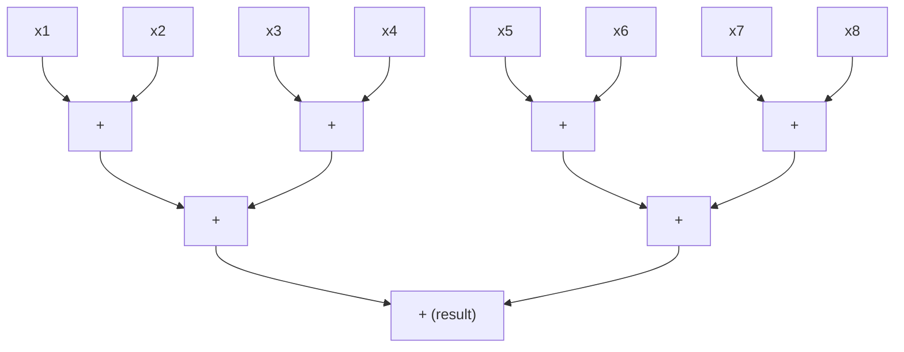

A parallel program is worth its complexity only if it is faster, and "faster" needs a number and a reference point. This first entry of [Parallel and High-Performance Computing](/series/parallel-and-high-performance-computing) sets up the measures and models that the rest of the series uses to judge every result. Run time, speedup and efficiency say how much faster a program is; the laws of Amdahl and Gustafson bound how far it scales; work and span describe how much parallelism an algorithm contains; and the roofline bound says whether arithmetic or memory traffic limits a kernel. It closes with rules for measuring performance, so that the numbers mean what they claim.

The roofline section develops the insight [Compute-Bound or Memory-Bound?](/insights/compute-bound-or-memory-bound) without repeating it, so reading the insight first helps. The entry assumes the reader can read C and Python, knows what a loop and an array access cost in sequential code and is comfortable with algebra and logarithms. No parallel programming experience is needed: the later entries introduce threads, vector units and message passing.

**Conventions.** These hold for the whole series. $T_1$ is the wall-clock run time of the best sequential program for a problem, and $T_p$ the run time on $p$ processors, where a processor is a core, a thread or a process as the context says. The **speedup** is $S(p) = T_1/T_p$ and the **efficiency** $E(p) = S(p)/p$. In Amdahl's law $f$ is the fraction of the sequential run time that cannot be parallelized; in Gustafson's law $f_s$ is the serial fraction of the run time measured on the parallel machine, and $S_s(p)$ is the scaled speedup. A computation has work $W$ (total operations) and span $D$ (longest chain of dependent operations). The roofline bound is $P \le \min(P_{\mathrm{peak}}, B\,I)$ with attainable performance $P$, peak arithmetic rate $P_{\mathrm{peak}}$, memory bandwidth $B$, arithmetic intensity $I$ and ridge point $I^* = P_{\mathrm{peak}}/B$. The fifth entry adds the message cost $t(m) = \alpha + \beta m$, with latency $\alpha$ in s and transfer time per byte $\beta$ in s/byte.

A floating-point operation (FLOP) is one addition or multiplication on double-precision numbers, which occupy 8 bytes. Rates are given in giga floating-point operations per second (GFLOP/s, $10^9$ FLOP per second) and gigabytes per second (GB/s, $10^9$ bytes per second), and data volumes in megabytes (MB, $10^6$ bytes), while cache and memory sizes use KiB, MiB and GiB (powers of two). Arrays in C are row-major. The code is C11 compiled with the GNU Compiler Collection (GCC) 13.3 and uses OpenMP for threads; the models are written in Python 3.13 with its standard library.

Every timing comes from one **reference machine**: a virtual machine under the Kernel-based Virtual Machine (KVM) hypervisor with four cores of an Intel Xeon processor that is reported at 2.1 GHz and supports the Advanced Vector Extensions 512 (AVX-512) instruction set. Each core has 48 KiB of level 1 (L1) data cache and 2 MiB of level 2 (L2) cache; the cores share a level 3 (L3) cache that the operating system reports as 260 MiB. Cache lines are 64 bytes, and the machine has 16 GiB of memory and runs Linux. It is shared with other virtual machines, so its timings are noisy; they describe this machine only, and figures for other hardware are labeled as assumed.

## 1. Measures of performance

### 1.1 Run time and throughput

The most direct measure of a program is its **run time**, the elapsed wall-clock time from start to finish, as a stopwatch would show it. It is distinct from the processor time that the operating system charges to the program, which sums the time of all its threads. A program that keeps four cores busy for 1 s has used 4 s of processor time, and its run time is still 1 s. Parallelism is meant to reduce run time, so run time is the quantity to measure.

**Throughput** is the work completed per unit time: FLOP per second for a numerical kernel, bytes per second for a copy, requests per second for a service. For a fixed amount of work it carries the same information as run time, but it is the form that can be compared with what the hardware can deliver, as the roofline bound of Section 5 does.

### 1.2 Speedup and efficiency

The speedup $S(p) = T_1/T_p$ says how many times faster the program runs on $p$ processors, and its value depends on the choice of $T_1$. The series always takes $T_1$ from the **best sequential program**: the fastest known sequential implementation, compiled with the same care as the parallel one. Dividing instead by the run time of the parallel program on one processor gives the **relative speedup**, which is larger whenever the parallel version carries overhead that a sequential program would not (thread creation, locking, extra arrays, a less efficient algorithm chosen because it parallelizes).

With assumed numbers: suppose the best sequential program takes 10.0 s, the parallel program takes 12.0 s on one core and 3.5 s on four. Then $S(4) = 10.0/3.5 = 2.86$, while the relative speedup is $12.0/3.5 = 3.43$. The efficiency is $E(4) = 2.86/4 = 0.71$: on average each core does useful work for 71% of the run.

### 1.3 Cost and overhead

The **cost** of a parallel run is $p\,T_p$, the processor time it occupies, in processor-seconds. With the numbers above the cost is $4 \times 3.5 = 14.0$ processor-seconds for a job that takes 10.0 s sequentially. The difference $T_o = p\,T_p - T_1$ is the **overhead**, here 4.0 processor-seconds: everything the parallel run does or waits for that the sequential run does not, such as idle time, synchronization, communication and redundant work. The three measures are tied together:

$$
E(p) = \frac{T_1}{p\,T_p} = \frac{T_1}{T_1 + T_o}.
$$

Efficiency stays near 1 only while the overhead is small compared with the useful work. A parallel algorithm is called **cost-optimal** when its cost grows at the same rate as $T_1$ as the problem grows, so that the efficiency stays bounded away from zero.

### 1.4 Superlinear speedup

One might expect $S(p) \le p$ always, and under a simple model it holds. One processor can imitate $p$ processors by running their operations in turn, which takes at most $p\,T_p$ if every operation costs the same in both settings; the best sequential program is at least as fast as this imitation, so $T_1 \le p\,T_p$. A **superlinear speedup**, $S(p) > p$, therefore means that one of the model's assumptions failed.

The usual cause is the memory hierarchy. On the reference machine each core has 2 MiB of L2 cache, so four cores together have 8 MiB. A computation that sweeps a 6 MiB working set many times does not fit in the L2 of one core, but each quarter of it, 1.5 MiB, fits in the L2 of the core that owns it. The parallel run then pays less per memory access than the sequential run, and the speedup can exceed $p$. The [second entry](/blog/memory-hierarchy-and-locality) explains why the cost of an access depends on where the data resides. Another cause is search: when $p$ workers explore a space in parallel, one may find the answer early and the others stop, so the parallel run does less work than the sequential one.

A measured superlinear result is real, but it is also a warning about the baseline: a sequential program that processed the data in cache-sized pieces, or interleaved the search, would often remove the advantage, and that program is then the best sequential program.

## 2. Amdahl's law and strong scaling

### 2.1 The serial fraction bounds the speedup

Keeping the problem fixed while $p$ grows is called **strong scaling**. In a 1967 paper at the Spring Joint Computer Conference of the American Federation of Information Processing Societies (AFIPS), G. M. Amdahl argued, in prose and without a formula, that the part of a computation that must run sequentially caps the benefit of any number of processors. The formula now called **Amdahl's law**, in the form that textbooks such as Hennessy and Patterson's give it, states his argument as a bound.

Split the sequential run time into a part $f\,T_1$ that cannot be parallelized (reading the input, a sequential setup step, a final combination) and a part $(1-f)\,T_1$ that divides perfectly among $p$ processors. With no overhead at all, the parallel run time is at least

$$
T_p \ge f\,T_1 + \frac{(1-f)\,T_1}{p},
$$

and dividing $T_1$ by it gives

$$
S(p) \le \frac{1}{f + (1-f)/p}, \qquad \lim_{p \to \infty} S(p) = \frac{1}{f}.
$$

The efficiency bound follows by dividing by $p$: $E(p) \le 1/(1 + f\,(p-1))$. It falls to one half at $p = 1 + 1/f$; for $f = 0.05$ that is $p = 21$, where $S(21) = 1/(0.05 + 0.95/21) = 10.5$. A program with 5% sequential time cannot use more than about 20 processors at even 50% efficiency, and no number of processors makes it more than 20 times faster.

The following program tabulates the bound for three serial fractions.

```python
# Python 3. Amdahl bound and a model with overhead that grows with p.
f_values = [0.01, 0.05, 0.10]
ps = [1, 2, 4, 8, 16, 64, 256, 1024]

def amdahl(f, p):
    return 1.0 / (f + (1.0 - f) / p)

print("Amdahl bound S(p) = 1/(f + (1-f)/p)")
print("p     " + "".join(f"  f={f:<5}" for f in f_values))
for p in ps:
    print(f"{p:<6}" + "".join(f"  {amdahl(f, p):7.2f}" for f in f_values))
print("limit " + "".join(f"  {1/f:7.2f}" for f in f_values))
```

```text
Amdahl bound S(p) = 1/(f + (1-f)/p)
p       f=0.01   f=0.05   f=0.1
1          1.00     1.00     1.00
2          1.98     1.90     1.82
4          3.88     3.48     3.08
8          7.48     5.93     4.71
16        13.91     9.14     6.40
64        39.26    15.42     8.77
256       72.11    18.62     9.66
1024      91.18    19.64     9.91
limit    100.00    20.00    10.00
```

For small $p$ the speedup is close to $p$ whatever $f$ is, which is why a program that scales well on four cores says little about 64. Once $p$ approaches $1/f$, each doubling of processors adds less, and beyond a few times $1/f$ the extra processors are almost wasted: going from 256 to 1024 processors at $f = 0.05$ raises the bound from 18.62 to 19.64.

### 2.2 Overheads that grow with the number of processors

Amdahl's bound assumes that the parallel part divides with no cost. Real parallel programs pay overheads that grow with $p$: a barrier at which all threads wait for the slowest, a reduction that combines $p$ partial results, messages exchanged between processes, contention for a shared memory bus. A simple way to model them is to add a term proportional to $p - 1$, with constant $c$ measured as a fraction of $T_1$:

$$
\frac{T_p}{T_1} = f + \frac{1-f}{p} + c\,(p-1).
$$

The second term falls with $p$ and the third rises, so the run time has a minimum. Setting the derivative with respect to $p$ to zero gives $(1-f)/p^2 = c$, so the best processor count is $p^* = \sqrt{(1-f)/c}$. The same program evaluates the model for $f = 0.05$ and $c = 0.001$, an overhead of 0.1% of the sequential run time per added processor:

```python
f, c = 0.05, 0.001
print(f"With overhead: T_p/T_1 = f + (1-f)/p + c(p-1), f={f}, c={c}")
for p in [1, 2, 4, 8, 16, 24, 31, 32, 48, 64, 128]:
    s = 1.0 / (f + (1 - f) / p + c * (p - 1))
    print(f"p={p:<4} S={s:6.2f}  E={s/p:5.2f}")
print(f"p* = sqrt((1-f)/c) = {((1-f)/c)**0.5:.1f}")
```

```text
With overhead: T_p/T_1 = f + (1-f)/p + c(p-1), f=0.05, c=0.001
p=1    S=  1.00  E= 1.00
p=2    S=  1.90  E= 0.95
p=4    S=  3.44  E= 0.86
p=8    S=  5.69  E= 0.71
p=16   S=  8.04  E= 0.50
p=24   S=  8.88  E= 0.37
p=31   S=  9.04  E= 0.29
p=32   S=  9.03  E= 0.28
p=48   S=  8.56  E= 0.18
p=64   S=  7.82  E= 0.12
p=128  S=  5.42  E= 0.04
p* = sqrt((1-f)/c) = 30.8
```

The speedup peaks at about 9.04 near $p^* = 30.8$ and then falls: with 128 processors the program is slower than with 8. Amdahl's bound without overhead would allow 12.55 at $p = 32$. Once overhead grows with $p$, adding processors can make a program slower. Overheads that grow more slowly, such as the $\log_2 p$ steps of a tree-shaped reduction, move the peak to larger $p$ but do not remove it. The [fifth entry](/blog/distributed-memory-and-message-passing) replaces $c\,(p-1)$ with a communication model built from measured message costs.

### 2.3 Estimating the serial fraction from measurements

The fraction $f$ is rarely known in advance. Karp and Flatt proposed computing it backward from a measured speedup. Solving Amdahl's formula for $f$ gives the **experimentally determined serial fraction**

$$
e = \frac{1/S(p) - 1/p}{1 - 1/p}.
$$

For a measured $S(4) = 3.2$, $e = (0.3125 - 0.25)/0.75 = 0.083$. The number is useful less for its value than for its trend. If $e$ stays constant as $p$ grows, the program behaves as Amdahl's model says and the serial part is the limit. If $e$ grows with $p$, the loss comes from overhead that grows with $p$, as in Section 2.2, and reducing that overhead (fewer synchronizations, cheaper communication) is the remedy.

### 2.4 What Amdahl's law leaves out

The law has three limits. It assumes that the parallel part divides evenly, so it says nothing about load imbalance, which the [third entry](/blog/threads-and-shared-memory-parallelism) treats. It ignores overhead unless a term is added. And $f$ belongs to one problem size: for most programs the sequential part grows more slowly than the parallel part as the problem grows, so a larger problem has a smaller $f$. That observation leads to the next law.

## 3. Gustafson's law and weak scaling

### 3.1 Scaling the problem with the machine

Amdahl's law asks how much faster a fixed problem runs on more processors. Users of large machines often ask instead how much larger a problem can be solved in the same time: a climate model run on a larger machine uses a finer grid, not the same grid faster. Growing the problem in proportion to $p$, so that the work per processor stays fixed, is called **weak scaling**. In 1988 J. L. Gustafson argued that this is the situation that matters for large parallel machines, and that under it the outlook is much better than Amdahl's law suggests.

Gustafson's starting point is the run on the parallel machine. Normalize its run time to 1 and let $f_s$ be the fraction of it spent in serial code, so $1 - f_s$ is spent in parallel code on $p$ processors. The same problem on one processor would take the serial time plus $p$ times the parallel time, $f_s + (1 - f_s)\,p$. The ratio is the **scaled speedup**

$$
S_s(p) = f_s + (1 - f_s)\,p = p - f_s\,(p - 1),
$$

which grows linearly in $p$ with slope $1 - f_s$. With $f_s = 0.05$, 1024 processors give $S_s = 972.85$, against Amdahl's limit of 20 for $f = 0.05$.

If $T(p, n)$ is the run time of a problem of size $n$ on $p$ processors and $n_1$ is the problem size given to one processor, the weak-scaling efficiency is $T(1, n_1)/T(p, p\,n_1)$: ideally the run time stays constant as problem and machine grow together.

### 3.2 Two laws, two questions

The two laws do not contradict each other; they describe different problems. Amdahl's $f$ is a fraction of the sequential run of a fixed problem, Gustafson's $f_s$ a fraction of the parallel run of a problem scaled to the machine. The scaled problem, run on one processor, takes $f_s + (1 - f_s)\,p$ in the normalized units, of which $f_s$ is serial. Its Amdahl fraction is therefore

$$
f = \frac{f_s}{f_s + (1 - f_s)\,p}.
$$

Substituting this $f$ into Amdahl's formula, we find $f + (1 - f)/p = 1/(f_s + (1 - f_s)\,p)$, so Amdahl's law applied to the scaled problem gives exactly Gustafson's scaled speedup. The program below checks this numerically:

```python
# Python 3. Gustafson scaled speedup, and its consistency with Amdahl's law.
fs = 0.05
print(f"Scaled speedup S_s(p) = f_s + (1 - f_s) p, f_s = {fs}")
for p in [1, 4, 16, 64, 256, 1024]:
    ss = fs + (1 - fs) * p
    # The scaled problem run on one processor: T_1 = f_s + (1 - f_s) p (units of T_p).
    # Its Amdahl serial fraction is therefore:
    f = fs / (fs + (1 - fs) * p)
    amdahl = 1 / (f + (1 - f) / p)
    print(f"p={p:<5} S_s={ss:8.2f}  equivalent f={f:.5f}  Amdahl with that f={amdahl:8.2f}")
```

```text
Scaled speedup S_s(p) = f_s + (1 - f_s) p, f_s = 0.05
p=1     S_s=    1.00  equivalent f=0.05000  Amdahl with that f=    1.00
p=4     S_s=    3.85  equivalent f=0.01299  Amdahl with that f=    3.85
p=16    S_s=   15.25  equivalent f=0.00328  Amdahl with that f=   15.25
p=64    S_s=   60.85  equivalent f=0.00082  Amdahl with that f=   60.85
p=256   S_s=  243.25  equivalent f=0.00021  Amdahl with that f=  243.25
p=1024  S_s=  972.85  equivalent f=0.00005  Amdahl with that f=  972.85
```

The scaled problem on 1024 processors has an Amdahl fraction of 0.00005, because its parallel part has grown 1024-fold while its serial part has not. Which law to apply depends on the question. A user who must process one fixed data set by a deadline faces strong scaling and Amdahl's bound. A user who will use extra processors to refine a model faces weak scaling, and the scaled speedup is the relevant figure.

### 3.3 Where weak scaling breaks down

Gustafson's law assumes that the serial time stays fixed while the parallel work grows with $p$. Two common situations break that assumption. First, the serial part may grow with the problem, as when a sequential step reads an input file that is $p$ times larger.

Second, the work may grow faster than the memory. Weak scaling usually fixes the memory per processor. For dense matrix factorization on an $n \times n$ matrix the memory grows as $n^2$ and the work as $n^3$. Holding $n^2/p$ fixed means $n \propto \sqrt{p}$, so the work grows as $p^{3/2}$ and, even with perfect parallelism, the run time per processor grows as $p^{3/2}/p = \sqrt{p}$. At 64 times the processors and 64 times the memory, the run takes 8 times as long. Communication also grows with $p$ in most programs, and [Section 6 of the fifth entry](/blog/distributed-memory-and-message-passing#6-predicting-scaling) adds it to predictions of strong and weak scaling.

## 4. Work, span and parallelism

### 4.1 The task dependence graph

Amdahl's law compresses a program into one number, $f$; a finer description records which operations depend on which. A **task dependence graph** is a directed acyclic graph (DAG) whose nodes are tasks, each a piece of sequential work, and whose edges say that one task needs the result of another before it can start. Two tasks with no path between them may run at the same time.

Two numbers summarize such a graph when every task takes one unit of time. The **work** $W$ is the number of tasks, which is the run time on one processor. The **span** $D$ (also called the depth or critical-path length) is the number of tasks on the longest path, which is the run time on an unlimited number of processors, since each task on that path must wait for the one before it. Two lower bounds follow at once for any schedule on $p$ processors:

$$
T_p \ge \frac{W}{p} \quad \text{(work law)}, \qquad T_p \ge D \quad \text{(span law)}.
$$

The ratio $W/D$ is the **parallelism** of the computation. By the span law $S(p) = W/T_p \le W/D$, so the parallelism is the largest speedup any number of processors can give; processors beyond about $W/D$ have nothing to do.

### 4.2 Greedy scheduling and Brent's bound

The lower bounds say what no schedule can beat. A **greedy scheduler** never leaves a processor idle while a task is ready: at each step it runs $\min(p, r)$ ready tasks, where $r$ is the number of ready tasks. Its run time obeys

$$
T_p \le \frac{W}{p} + D.
$$

The argument divides the steps into two kinds. In a *complete* step all $p$ processors run tasks; there can be at most $W/p$ such steps, since only $W$ tasks exist. In an *incomplete* step fewer than $p$ tasks are ready and all of them run. Every task that starts a longest remaining path is ready, so it runs and the span of the graph that remains shrinks by one; there are therefore at most $D$ incomplete steps. Adding the two counts gives the bound. Because $\max(W/p, D) \ge (W/p + D)/2$, a greedy schedule is never more than twice as long as the best possible one. This style of argument goes back to Graham's analysis of list scheduling. Brent proved the closely related bound $T_p \le (W - D)/p + D$ for a schedule that runs the graph level by level: if level $k$ contains $a_k$ independent tasks, it takes $\lceil a_k/p \rceil \le (a_k - 1)/p + 1$ steps, and summing over the $D$ levels gives the result.

The bound rests on a model: every task takes the same time, scheduling costs nothing, the processors are identical and any processor can run any ready task without first fetching its data. Real runtimes approach it when tasks are much longer than the scheduling cost, and the third entry shows what happens [when the work is uneven](/blog/threads-and-shared-memory-parallelism#6-load-balance-and-scheduling). The model also ignores memory traffic, which Section 5 adds.

### 4.3 Worked example: a tree reduction

A loop that adds $n$ numbers into one accumulator forms a chain: each addition needs the previous sum. Its work is $W = n - 1$ and its span is also $D = n - 1$, so its parallelism is 1, and no number of processors can speed it up in that form. Addition is associative in exact arithmetic, so the same sum can be computed as a tree: add pairs, then pairs of pairs, and so on. For $n = 8$ the tree has three levels.



Each "+" node is one addition; additions in the same row are independent. The tree still performs $W = n - 1 = 7$ additions, but its span is $D = \lceil \log_2 n \rceil = 3$. In general each level halves the number of values (an odd value out waits for the next level), so the span is $\lceil \log_2 n \rceil$ and the parallelism $(n - 1)/\lceil \log_2 n \rceil$. The program below counts the additions at each level, evaluates Brent's level-by-level schedule and compares it with the bounds:

```python
# Python 3. Work, span and Brent's schedule for a tree reduction of n numbers.
import math

def tree_levels(n):
    """Number of independent additions at each level of a pairwise tree."""
    levels, m = [], n
    while m > 1:
        levels.append(m // 2)
        m = (m + 1) // 2          # an odd element waits for the next level
    return levels

def level_time(n, p):
    # One addition = one time unit. Brent's schedule runs the tree level by
    # level; level k, with a_k independent additions, takes ceil(a_k / p) steps.
    return sum(math.ceil(a / p) for a in tree_levels(n))

print(f"{'n':>8} {'p':>4} {'W':>8} {'D':>3} {'W/D':>9} {'level T_p':>10} {'W/p+D':>9} {'lower max(W/p,D)':>17}")
for n in [8, 1000, 10**6]:
    W, D = n - 1, len(tree_levels(n))
    assert D == math.ceil(math.log2(n)) and sum(tree_levels(n)) == W
    for p in [1, 4, 64, 1024]:
        T = level_time(n, p)
        print(f"{n:>8} {p:>4} {W:>8} {D:>3} {W/D:>9.1f} {T:>10} {W/p + D:>9.1f} {max(W/p, D):>17.1f}")
```

```text
       n    p        W   D       W/D  level T_p     W/p+D  lower max(W/p,D)
       8    1        7   3       2.3          7      10.0               7.0
       8    4        7   3       2.3          3       4.8               3.0
       8   64        7   3       2.3          3       3.1               3.0
       8 1024        7   3       2.3          3       3.0               3.0
    1000    1      999  10      99.9        999    1009.0             999.0
    1000    4      999  10      99.9        253     259.8             249.8
    1000   64      999  10      99.9         21      25.6              15.6
    1000 1024      999  10      99.9         10      11.0              10.0
 1000000    1   999999  20   49999.9     999999 1000019.0          999999.0
 1000000    4   999999  20   49999.9     250006  250019.8          249999.8
 1000000   64   999999  20   49999.9      15638   15645.0           15625.0
 1000000 1024   999999  20   49999.9        991     996.6             976.6
```

The level-by-level times lie between the lower bound and $W/p + D$. For $n = 1000$ the parallelism is about 100, and the table shows what that means: 64 processors finish in 21 steps, while 1024 processors need 10, exactly the span, with most of them idle. For $n = 10^6$ the parallelism is about 50,000, and even 1024 processors stay within 2% of the work bound.

In practice $p$ is far smaller than $n$, and a better plan avoids the fine-grained tree. Each processor sums a contiguous block of $n/p$ numbers sequentially, then the $p$ partial sums are combined by a tree. For $n = 10^6$ and $p = 4$ that takes $249{,}999 + 2 = 250{,}001$ steps, slightly fewer than the level-by-level schedule, and only $p$ values ever move between processors. This is how the reduction operations of OpenMP and of message-passing libraries work, as the third and fifth entries show.

Floating-point addition is not associative, so the tree and the loop round differently and can differ in the last digits; the insight [Floating-Point Rounding in Long Simulations](/insights/floating-point-in-long-simulations) discusses when that matters. Section 6.3 shows such a difference in a real measurement.

## 5. The roofline bound

### 5.1 From operations to bytes

The work-span model counts operations and treats data as free. The roofline bound of Williams, Waterman and Patterson adds the cost of moving data. As the [insight](/insights/compute-bound-or-memory-bound) explains, a kernel can run no faster than $\min(P_{\mathrm{peak}}, B\,I)$, where the **arithmetic intensity** $I$ is the number of FLOP the kernel performs per byte it moves between main memory and the processor. The insight treats the update $y \leftarrow a\,x + y$, with $I = 2/24 \approx 0.083$ FLOP/byte. This section adds two kernels, shows that intensity depends on data reuse and measures both machine figures for the reference machine.

### 5.2 Intensity of three kernels

The **dot product** $s = \sum_i x_i y_i$ performs one multiplication and one addition per element and reads two doubles, 16 bytes, while writing nothing but one scalar. Its intensity is $I = 2/16 = 0.125$ FLOP/byte. Like the update of the insight it is limited by memory bandwidth on any current processor whenever the vectors are too large for the cache.

**Dense matrix multiplication** $C \leftarrow C + A B$ with $n \times n$ matrices performs $n^3$ multiply-add pairs, $2n^3$ FLOP. Its intensity is not fixed by the operation; it depends on how often each element crosses the memory interface.

- If every matrix element crosses once (all three matrices stay in cache), the traffic is $3n^2 \times 8$ bytes for reading $A$, $B$ and $C$, plus $8n^2$ for writing $C$ back. Ignoring the write, the intensity is $2n^3/(24 n^2) = n/12$ FLOP/byte, which grows with $n$; for $n = 2000$ it is about 167.
- If nothing is reused, as in a naive triple loop on matrices much larger than the cache, every multiply-add loads one element of $A$ and one of $B$ from memory, 16 bytes for 2 FLOP, and the intensity falls to $2/16 = 0.125$, the same as a dot product.
- Between these extremes, **blocking** divides $C$ into $b \times b$ blocks and computes each block from $b$-wide strips of $A$ and $B$ while the block stays in cache. Each block needs $2nb$ elements of $A$ and $B$, $16nb$ bytes, and there are $(n/b)^2$ blocks, so the traffic is about $16n^3/b$ bytes and the intensity about $2n^3/(16n^3/b) = b/8$ FLOP/byte.

Blocking turns a memory-bound kernel into a compute-bound one by choosing $b$ so that $b/8$ exceeds the ridge point while three $b \times b$ blocks, $24b^2$ bytes, still fit in a cache. The [second entry](/blog/memory-hierarchy-and-locality#4-blocking-for-reuse) treats this technique; the point here is that intensity belongs to the algorithm and its data movement, not to the mathematical operation alone.

These counts assume that a write moves 8 bytes per element. Under a **write-allocate** policy, which the reference machine's caches use for ordinary stores, a cache line is read before it is written, so writing an array that was not read costs 16 bytes per element unless non-temporal store instructions bypass the cache. The update of the insight reads $y$ anyway; the triad of the next section does not read the array it writes.

### 5.3 Measuring the memory bandwidth

The bandwidth $B$ is measured rather than taken from a data sheet, because the sustainable rate is lower than the nominal one and depends on how many cores issue requests. The usual instrument is the triad of McCalpin's STREAM benchmark, $a_i = b_i + s\,c_i$ on arrays much larger than every cache. The program below is a minimal version written for this entry, not the STREAM benchmark itself. It allocates three arrays of $4 \times 10^7$ doubles (320 MB each, 960 MB in total, well beyond the 260 MiB that the system reports for L3) and initializes them in parallel, so that each thread touches the pages it will use. It then times ten repetitions of the triad.

```c
/* C11 + OpenMP. A STREAM-style triad a[i] = b[i] + s*c[i] to estimate
   sustainable memory bandwidth. Bytes are counted as 24 per element
   (read b, read c, write a), the STREAM convention. */
#include <omp.h>
#include <stdio.h>
#include <stdlib.h>

#define N (40L * 1000 * 1000)    /* 320 MB per array, 960 MB in total */
#define REPS 10

static int cmp(const void *x, const void *y) {
    double a = *(const double *)x, b = *(const double *)y;
    return (a > b) - (a < b);
}

int main(void) {
    double *a = malloc(N * sizeof *a), *b = malloc(N * sizeof *b),
           *c = malloc(N * sizeof *c);
    if (!a || !b || !c) return 1;
    #pragma omp parallel for schedule(static)
    for (long i = 0; i < N; i++) { a[i] = 0.0; b[i] = 1.0; c[i] = 2.0; }

    const double s = 3.0;
    double t[REPS];
    for (int r = 0; r < REPS; r++) {
        double t0 = omp_get_wtime();
        #pragma omp parallel for schedule(static)
        for (long i = 0; i < N; i++) a[i] = b[i] + s * c[i];
        t[r] = omp_get_wtime() - t0;
    }
    qsort(t, REPS, sizeof t[0], cmp);
    double bytes = 24.0 * N;
    printf("threads=%d  N=%ld  check a[N-1]=%.1f\n", omp_get_max_threads(), N, a[N-1]);
    printf("time   min %.4f s  median %.4f s  max %.4f s\n",
           t[0], (t[REPS/2 - 1] + t[REPS/2]) / 2, t[REPS-1]);
    printf("rate   best %.1f GB/s  median %.1f GB/s\n",
           bytes / t[0] / 1e9, bytes / ((t[REPS/2 - 1] + t[REPS/2]) / 2) / 1e9);
    free(a); free(b); free(c);
    return 0;
}
```

Compiled with `gcc -std=c11 -O3 -march=native -fopenmp` and run with `OMP_NUM_THREADS=1` and then 4, with `OMP_PROC_BIND=close` to keep each thread on one core, it printed:

```text
threads=1  N=40000000  check a[N-1]=7.0
time   min 0.0729 s  median 0.0782 s  max 0.0804 s
rate   best 13.2 GB/s  median 12.3 GB/s
threads=4  N=40000000  check a[N-1]=7.0
time   min 0.0193 s  median 0.0204 s  max 0.0254 s
rate   best 49.7 GB/s  median 47.1 GB/s
```

Five further executions with four threads gave best rates between 47.6 and 51.6 GB/s and medians between 42.8 and 49.0 GB/s. Earlier trial runs, made while the shared host was evidently busier, gave medians as low as 17 GB/s, since a virtual machine shares its memory system with neighbors it cannot see. The entry therefore takes $B \approx 50$ GB/s as an **estimate for this virtual machine** under favorable conditions. With write-allocate the hardware moves about 32 bytes per element, not the 24 counted, so the physical traffic is about a third higher than the reported, useful rate.

One core alone reached about 13 GB/s, roughly a quarter of the four-core rate, so a memory-bound kernel gains from using all cores even when its arithmetic would fit on one. The second entry returns to what limits the bandwidth of one core.

### 5.4 The peak arithmetic rate

The theoretical peak is the product of the core count, the clock rate and the number of FLOP each core can complete per cycle. An AVX-512 register holds eight doubles, and a **fused multiply-add** (FMA) instruction computes $a \times b + c$ on all eight with one rounding, which counts as 16 FLOP. Intel's product specifications list one or two AVX-512 FMA units per core, depending on the Xeon model, and the virtual machine reports only a generic model name, so the count cannot be read from `lscpu`. Assuming two units (not a confirmed figure), each core completes 32 FLOP per cycle, and at the reported 2.1 GHz the theoretical peak is

$$
P_{\mathrm{peak}} = 4 \times 2.1 \times 10^9 \times 32 = 268.8\ \text{GFLOP/s}.
$$

A microbenchmark tests that figure. The program below keeps 12 independent FMA chains in registers, so that the FMA units are never waiting for a previous result, and counts the FLOP they complete:

```c
/* C11 + AVX-512 intrinsics + OpenMP. 12 independent chains of 512-bit fused
   multiply-adds per thread, kept in registers, so the throughput of the FMA
   units limits the loop, not their latency. One such FMA = 16 FLOP. */
#include <immintrin.h>
#include <omp.h>
#include <stdio.h>

#define ITERS 50000000L
#define F(a) a = _mm512_fmadd_pd(a, x, y)

int main(void) {
    double total = 0.0, t0 = omp_get_wtime();
    #pragma omp parallel reduction(+:total)
    {
        const __m512d x = _mm512_set1_pd(0.999999), y = _mm512_set1_pd(1e-7);
        __m512d a0 = _mm512_set1_pd(0), a1 = _mm512_set1_pd(1), a2 = _mm512_set1_pd(2),
                a3 = _mm512_set1_pd(3), a4 = _mm512_set1_pd(4), a5 = _mm512_set1_pd(5),
                a6 = _mm512_set1_pd(6), a7 = _mm512_set1_pd(7), a8 = _mm512_set1_pd(8),
                a9 = _mm512_set1_pd(9), a10 = _mm512_set1_pd(10), a11 = _mm512_set1_pd(11);
        for (long i = 0; i < ITERS; i++) {
            F(a0); F(a1); F(a2); F(a3); F(a4); F(a5);
            F(a6); F(a7); F(a8); F(a9); F(a10); F(a11);
        }
        __m512d s = _mm512_add_pd(_mm512_add_pd(_mm512_add_pd(a0, a1), _mm512_add_pd(a2, a3)),
                    _mm512_add_pd(_mm512_add_pd(a4, a5), _mm512_add_pd(a6, a7)));
        s = _mm512_add_pd(s, _mm512_add_pd(_mm512_add_pd(a8, a9), _mm512_add_pd(a10, a11)));
        total += _mm512_reduce_add_pd(s);   /* use the result */
    }
    double t = omp_get_wtime() - t0;
    double flops = (double)omp_get_max_threads() * ITERS * 12 * 16;
    printf("threads=%d  %.1f GFLOP/s  (%.1f FLOP per 2.1 GHz cycle per thread)\n",
           omp_get_max_threads(), flops / t / 1e9,
           flops / t / 2.1e9 / omp_get_max_threads());
    (void)total;
    return 0;
}
```

Compiled with `gcc -std=c11 -O2 -march=native -fopenmp` and run five times with one thread and five times with four:

```text
threads=1  88.8 GFLOP/s  (42.3 FLOP per 2.1 GHz cycle per thread)
threads=1  90.6 GFLOP/s  (43.1 FLOP per 2.1 GHz cycle per thread)
threads=1  88.4 GFLOP/s  (42.1 FLOP per 2.1 GHz cycle per thread)
threads=1  98.3 GFLOP/s  (46.8 FLOP per 2.1 GHz cycle per thread)
threads=1  91.9 GFLOP/s  (43.8 FLOP per 2.1 GHz cycle per thread)
threads=4  354.0 GFLOP/s  (42.1 FLOP per 2.1 GHz cycle per thread)
threads=4  366.8 GFLOP/s  (43.7 FLOP per 2.1 GHz cycle per thread)
threads=4  364.2 GFLOP/s  (43.4 FLOP per 2.1 GHz cycle per thread)
threads=4  347.2 GFLOP/s  (41.3 FLOP per 2.1 GHz cycle per thread)
threads=4  339.7 GFLOP/s  (40.4 FLOP per 2.1 GHz cycle per thread)
```

The measured rate, a median of 354.0 GFLOP/s with four threads, is above the "theoretical" 268.8 GFLOP/s, and the apparent 42 FLOP per 2.1 GHz cycle exceeds the 32 that two units can deliver. The likely explanation is that the cores did not run at 2.1 GHz: the guest operating system reports a fixed nominal frequency, while the physical processor can raise its clock when power and temperature allow. If each core completes 32 FLOP per cycle, the measured rates imply an average clock of $354.0/(4 \times 32) \approx 2.77$ GHz with four threads and $90.6/32 \approx 2.83$ GHz with one. With a single FMA unit the same rates would require an average clock of about 5.5 GHz, which is implausible for a server processor, so the measurement is consistent with two units, but it does not prove the count.

A peak computed from a nominal clock is therefore neither an upper bound nor a typical figure when the clock varies; on some processors, as Intel documents for its Xeon Scalable processors, heavy AVX-512 load lowers the clock instead. For the roofline of this machine the entry uses the measured $P_{\mathrm{peak}} \approx 354$ GFLOP/s, an estimate for this virtual machine, and keeps 268.8 GFLOP/s as the nominal figure.

### 5.5 The roofline of the reference machine

With $P_{\mathrm{peak}} = 354.0$ GFLOP/s and $B = 50$ GB/s, the ridge point is $I^* = 354.0/50 = 7.08$ FLOP/byte: a kernel needs about 7 FLOP per byte of memory traffic before arithmetic, rather than memory, limits it. The program below evaluates the bound for the kernels of Section 5.2:

```python
# Python 3. Roofline bounds P <= min(P_peak, B*I) for three kernels on the
# reference machine, using the figures measured in this entry (estimates).
P_peak = 354.0   # GFLOP/s, median of five 4-thread FMA microbenchmark runs
B = 50.0         # GB/s, best 4-thread triad rate, typical of several executions
print(f"ridge point I* = P_peak/B = {P_peak / B:.2f} FLOP/byte")
n = 2000
kernels = [
    ("axpy  y = a x + y", 2 / 24),
    ("dot   s = x . y", 2 / 16),
    ("matmul, no reuse (2 loads per FMA)", 2 / 16),
    ("matmul, 64x64 blocks (I ~ b/8)", 64 / 8),
    (f"matmul, ideal reuse n={n} (n/12)", n / 12),
]
for name, I in kernels:
    P = min(P_peak, B * I)
    kind = "memory" if B * I < P_peak else "compute"
    print(f"{name:<38} I = {I:7.3f}  bound = {P:6.1f} GFLOP/s ({kind})")
```

```text
ridge point I* = P_peak/B = 7.08 FLOP/byte
axpy  y = a x + y                      I =   0.083  bound =    4.2 GFLOP/s (memory)
dot   s = x . y                        I =   0.125  bound =    6.2 GFLOP/s (memory)
matmul, no reuse (2 loads per FMA)     I =   0.125  bound =    6.2 GFLOP/s (memory)
matmul, 64x64 blocks (I ~ b/8)         I =   8.000  bound =  354.0 GFLOP/s (compute)
matmul, ideal reuse n=2000 (n/12)      I = 166.667  bound =  354.0 GFLOP/s (compute)
```

On large vectors the update and the dot product can reach at most 1.2% and 1.8% of the arithmetic peak; only moving fewer bytes helps them. Matrix multiplication without reuse is equally starved, and the same operation with 64 by 64 blocks reaches the compute roof. Three such blocks occupy $24 \times 64^2 = 98{,}304$ bytes, 96 KiB, which exceeds the 48 KiB L1 cache but fits in the 2 MiB L2. For the blocked kernel the bytes that matter are therefore those between L2 and memory, while the traffic between L1 and L2 needs a bound of its own.

That remark marks the limits of a single roofline. It uses the bandwidth of main memory, while a kernel whose data fits in a cache sees that cache's higher bandwidth. Its $P_{\mathrm{peak}}$ requires vector FMA instructions in every cycle, and code that is not vectorized has a lower roof, as the [fourth entry](/blog/data-parallelism-vector-units-and-gpus#2-vector-instructions-on-a-cpu) shows. And on a shared virtual machine both figures move with the load of the host. The bound is a ceiling that shows which resource limits a kernel, not a prediction of its speed.

## 6. Measuring performance honestly

### 6.1 What can go wrong

Measurements of parallel programs are easy to get wrong in ways that flatter the result. The common failures are a clock that measures the wrong thing, a single run that happened to be fast or slow, a first run that paid one-time costs, a problem size chosen to fit in cache, an unstated compiler setting and a speedup computed against a weak baseline. Hoefler and Belli cataloged such failures in published parallel-computing results and proposed rules for reporting; the practices below follow the same principles.

### 6.2 Clock, warm-up and repetitions

Run time is wall-clock time, so the clock must be a wall clock that cannot jump. On systems that follow the Portable Operating System Interface (POSIX), `clock_gettime(CLOCK_MONOTONIC, ...)` reads a clock that only moves forward and is not adjusted when the system time is set, as the POSIX standard specifies; the OpenMP specification defines `omp_get_wtime()` to return elapsed wall-clock time in seconds. Two common mistakes are using `clock()`, which in C returns processor time and therefore adds up the time of all threads and hides any speedup, and using the real-time clock (`CLOCK_REALTIME` or `gettimeofday`), which can jump when the time of day is corrected. The interval timed should also be long compared with the clock's resolution and the cost of reading it.

The first execution of a piece of code often pays costs that later executions do not: page faults as memory is first touched, cold caches and translation buffers, and a processor clock that has not yet risen. A benchmark therefore runs the code a few times untimed (**warm-up**), then times many **repetitions** and reports a summary of their distribution. Timings on a busy machine have a long upper tail, since an interruption can only add time, so the **median** describes the typical run better than the mean, and the minimum and maximum or a pair of percentiles describe the spread. The minimum estimates what the hardware can do with no interference, the median what a user will see; a report says which it gives.

The following program applies these rules to the dot product of Section 5.2 on two vectors of $2^{20}$ doubles (8 MiB each):

```c
/* C11 + POSIX. Timing a dot product honestly: monotonic clock, one cold run,
   warm-up, repetitions, and the minimum, median and maximum. */
#define _POSIX_C_SOURCE 199309L
#include <stdio.h>
#include <stdlib.h>
#include <time.h>

#define N (1L << 20)          /* 2^20 doubles = 8 MiB per vector */
#define WARMUP 5
#define REPS 51

static double now(void) {
    struct timespec ts;
    clock_gettime(CLOCK_MONOTONIC, &ts);
    return ts.tv_sec + 1e-9 * ts.tv_nsec;
}

static double dot(const double *x, const double *y, long n) {
    double s = 0.0;
    for (long i = 0; i < n; i++) s += x[i] * y[i];
    return s;
}

static int cmp(const void *a, const void *b) {
    double u = *(const double *)a, v = *(const double *)b;
    return (u > v) - (u < v);
}

int main(void) {
    double *x = malloc(N * sizeof *x), *y = malloc(N * sizeof *y);
    if (!x || !y) return 1;
    for (long i = 0; i < N; i++) { x[i] = 1.0 / (i + 1); y[i] = 1.0; }

    volatile double sink;                 /* keeps the result alive */
    double t0 = now();
    sink = dot(x, y, N);
    double cold = now() - t0;             /* first call after initialization */

    for (int r = 0; r < WARMUP; r++) sink = dot(x, y, N);
    double t[REPS];
    for (int r = 0; r < REPS; r++) {
        t0 = now();
        sink = dot(x, y, N);
        t[r] = now() - t0;
    }
    qsort(t, REPS, sizeof t[0], cmp);
    printf("first %.3f ms | min %.3f  median %.3f  max %.3f ms | %.2f GFLOP/s | dot = %.17g\n",
           1e3 * cold, 1e3 * t[0], 1e3 * t[REPS / 2], 1e3 * t[REPS - 1],
           2.0 * N / t[REPS / 2] / 1e9, sink);
    (void)sink;
    free(x); free(y);
    return 0;
}
```

The result is stored into a `volatile` variable and printed, so that the compiler cannot remove a computation whose result is never used, a common way for a benchmark to measure nothing. Compiled with `gcc -std=c11 -O2` and executed five times in a row:

```text
first 2.017 ms | min 0.684  median 0.754  max 1.290 ms | 2.78 GFLOP/s | dot = 14.440159752936799
first 0.813 ms | min 0.766  median 0.828  max 1.209 ms | 2.53 GFLOP/s | dot = 14.440159752936799
first 1.603 ms | min 0.779  median 0.834  max 0.938 ms | 2.51 GFLOP/s | dot = 14.440159752936799
first 1.562 ms | min 0.758  median 0.801  max 1.294 ms | 2.62 GFLOP/s | dot = 14.440159752936799
first 0.743 ms | min 0.682  median 0.727  max 0.803 ms | 2.88 GFLOP/s | dot = 14.440159752936799
```

Within one execution the maximum is up to about 1.7 times the median, the long upper tail expected on a shared machine. The first call is sometimes the slowest by far (2.017 ms) and sometimes not (0.743 ms); here the initialization loop touched the vectors just before, so the cold-run penalty is small and erratic. In a program whose first call also touches fresh memory it would be large. And the median itself differs between executions, from 0.727 to 0.834 ms, about 15%. A claimed improvement smaller than that, measured from one execution of each version, cannot be told apart from the noise of this machine.

### 6.3 Problem size and compiler settings

The 16 MiB working set of this program is larger than the 2 MiB L2 of a core but smaller than the reported L3, so the dot product reads from L3. It reached about 2.5 to 2.9 GFLOP/s, well above the 1.6 GFLOP/s that one core's measured 13.2 GB/s from main memory would allow. A benchmark reports its problem size and, for memory-bound kernels, where that size falls relative to the caches; otherwise a reader cannot tell which roof applies.

Compiler options change results as much as code changes do. The same program built four ways and executed once each:

```text
-O0                            first 2.574 ms | min 2.663  median 3.448  max 4.642 ms | 0.61 GFLOP/s | dot = 14.440159752936799
-O2                            first 0.810 ms | min 0.769  median 0.800  max 1.581 ms | 2.62 GFLOP/s | dot = 14.440159752936799
-O3 -march=native              first 0.777 ms | min 0.767  median 0.811  max 1.012 ms | 2.59 GFLOP/s | dot = 14.440159752936799
-O3 -march=native -ffast-math  first 0.719 ms | min 0.609  median 0.667  max 0.774 ms | 3.14 GFLOP/s | dot = 14.440159752937785
```

(The script that runs the four builds prints the flags in the first column; the program prints the rest.) The unoptimized build is about four times slower, so a speedup computed against an `-O0` baseline is mostly a measure of the optimizer. Adding `-O3 -march=native` changed nothing measurable here: GCC vectorizes the multiplications, but without permission to reorder the additions it keeps them in one sequential chain, as in Section 4.3. The flag `-ffast-math` grants that permission, among others. The compiler then splits the sum into vector partial sums. In this single execution the median fell by about 17%, close to the 15% run-to-run spread of Section 6.2, so this run alone shows the direction of the change rather than its size. The result changed in its 14th significant digit because the additions ran in a different order. Whether such a change is acceptable is a numerical question, not a performance one.

Defaults hide behavior too. Under `-std=c11` GCC does not fuse a multiplication and an addition into an FMA unless asked: the triad of Section 5.3 compiles to separate multiply and add instructions with `-std=c11` and to FMA instructions with `-std=gnu11`. With `-march=native` on this machine GCC also prefers 256-bit vectors to 512-bit ones, so code that must use 512-bit FMA, like the microbenchmark, is safest written with intrinsics. The [fourth entry](/blog/data-parallelism-vector-units-and-gpus) returns to vector code generation.

### 6.4 A reporting checklist

A performance result should let a reader repeat it and judge it. The measurements in this series report the following items:

- the machine (processor, core count, memory, whether it is virtual or shared) and the software versions;
- the compiler and every flag, and the thread count and placement (`OMP_NUM_THREADS`, `OMP_PROC_BIND`);
- the problem size, with the working set compared with the cache sizes;
- the clock used, the number of warm-up runs and repetitions, and the statistic reported (median, minimum) with its spread;
- the baseline: $T_1$ from the best sequential program, built with the same flags, with its absolute run time stated;
- a check that the result is correct, so that a fast wrong answer is not counted as progress.

## 7. Exercises

**Exercise 1.** A program spends 2% of its sequential run time in code that cannot be parallelized. What speedup and efficiency does Amdahl's law allow on 32 processors, and what is the limit?

<details>
<summary>Answer</summary>

$S(32) \le 1/(0.02 + 0.98/32) = 1/0.050625 = 19.75$, so $E(32) \le 19.75/32 = 0.62$. The limit is $1/0.02 = 50$. Almost 40% of the processors' time is lost to a serial part of 2%.

</details>

**Exercise 2.** Measured speedups of a program are $S(2) = 1.9$, $S(4) = 3.4$ and $S(8) = 5.6$. Compute the Karp-Flatt serial fraction $e$ for each and say what the trend suggests.

<details>
<summary>Answer</summary>

$e = (1/S - 1/p)/(1 - 1/p)$ gives 0.0526 for $p = 2$, 0.0588 for $p = 4$ and 0.0612 for $p = 8$. The fraction grows with $p$, so some overhead grows with the processor count (synchronization, communication or imbalance), and reducing it would help more than shrinking the serial code.

</details>

**Exercise 3.** In a weak-scaling run on 64 processors, 10% of the parallel run time is serial. What is the scaled speedup? What serial fraction $f$ would Amdahl's law assign to the same, scaled problem?

<details>
<summary>Answer</summary>

$S_s(64) = 0.1 + 0.9 \times 64 = 57.7$. The scaled problem takes 57.7 time units on one processor, of which 0.1 is serial, so $f = 0.1/57.7 = 0.00173$; Amdahl's law with this $f$ and $p = 64$ gives the same 57.7.

</details>

**Exercise 4.** A computation has work $W = 10^6$ unit tasks and span $D = 10^3$. Bound its run time under a greedy scheduler on 100 and on 10,000 processors. Is the second machine worth using?

<details>
<summary>Answer</summary>

On 100 processors, $\max(10^4, 10^3) = 10^4 \le T_{100} \le 10^4 + 10^3 = 1.1 \times 10^4$, a speedup of at least 90.9. On 10,000 processors, $\max(100, 1000) = 1000 \le T_{10^4} \le 1100$, a speedup of at least 909 but at most 1000. The parallelism $W/D = 1000$ caps the speedup, so the 10,000 processors run at an efficiency of at most 10%. No machine can finish in fewer than $D = 1000$ steps, and 1000 processors already guarantee $T_{1000} \le 2000$, so ten times as many processors buy at most a factor of two.

</details>

**Exercise 5.** A sparse matrix-vector product in compressed sparse row form performs one multiply-add per stored nonzero and reads, for each nonzero, an 8-byte value and a 4-byte column index. Ignoring the vectors, what is its arithmetic intensity, and what does the roofline of Section 5.5 allow on the reference machine?

<details>
<summary>Answer</summary>

$I = 2/12 \approx 0.167$ FLOP/byte, far below the ridge point of 7.08. The bound is $50 \times 0.167 = 8.33$ GFLOP/s, about 2.4% of the measured 354 GFLOP/s. Reading the vectors adds traffic, so the true bound is lower still; storing indices more compactly helps this kernel more than faster arithmetic.

</details>

**Exercise 6.** A report states that a new OpenMP code reaches a speedup of 4.6 on four cores, comparing it with the same code run with one thread, both compiled without optimization flags. List what is wrong with the claim and what should be measured instead.

<details>
<summary>Answer</summary>

It is a relative speedup, inflated by any overhead present at one thread. Both builds are unoptimized, and Section 6.3 showed the optimizer changing the run time fourfold, so the baseline is far slower than a real sequential code. A result above $p$ is superlinear and needs an explanation (Section 1.4). The report should state $T_1$ from an optimized sequential program, the flags, the problem size relative to the caches and the median and spread of several repetitions.

</details>

## 8. Summary

| Concept | Result | Main limit |
|---|---|---|
| Speedup, efficiency | $S(p) = T_1/T_p$ with $T_1$ from the best sequential program; $E(p) = S(p)/p = T_1/(T_1 + T_o)$ | A weak baseline inflates both |
| Superlinear speedup | $S(p) > p$ only when per-operation cost or total work changes, typically through caches | Often a sign of a weak baseline |
| Amdahl's law (strong scaling) | $S(p) \le 1/(f + (1-f)/p) \to 1/f$; half efficiency at $p = 1 + 1/f$ | Ignores overhead; with overhead $c\,(p-1)$ the speedup peaks at $p^* = \sqrt{(1-f)/c}$ |
| Gustafson's law (weak scaling) | $S_s(p) = f_s + (1-f_s)\,p$; consistent with Amdahl for $f = f_s/(f_s + (1-f_s)\,p)$ | Fails when serial time or work per unit memory grows with the problem |
| Work and span | $\max(W/p, D) \le T_p \le W/p + D$ for a greedy schedule; parallelism $W/D$ | Unit tasks, free scheduling, no data movement |
| Tree reduction | $W = n - 1$, $D = \lceil \log_2 n \rceil$ | Changes the floating-point rounding order |
| Roofline | $P \le \min(P_{\mathrm{peak}}, B\,I)$; reference machine about 354 GFLOP/s, 50 GB/s, $I^* \approx 7$ FLOP/byte (estimates) | One bandwidth, a peak that assumes full vectorization, noisy figures |
| Honest measurement | Monotonic wall clock, warm-up, repetitions, median and spread, stated sizes and flags | Differences below the run-to-run spread (about 15% here) are not results |

The models of this entry share one conclusion: a parallel program's speed is bounded by something other than the processor count, whether the serial fraction, the span, the overheads or the bytes moved. On the reference machine the roofline put the ridge point near 7 FLOP per byte, and the ordinary vector kernels sit far below it, so for most of them the binding limit is memory. The next entry, [The Memory Hierarchy and Locality](/blog/memory-hierarchy-and-locality), opens up that limit: how caches work, why the order of a loop changes the number of bytes that reach memory and how blocking raises the intensity of matrix multiplication from 0.125 toward the compute roof.

### References

- G. M. Amdahl, "Validity of the single processor approach to achieving large scale computing capabilities," in *AFIPS Conference Proceedings, Spring Joint Computer Conference*, vol. 30, pp. 483–485, 1967.
- R. P. Brent, "The parallel evaluation of general arithmetic expressions," *Journal of the ACM*, vol. 21, no. 2, pp. 201–206, 1974.
- R. L. Graham, "Bounds for certain multiprocessing anomalies," *Bell System Technical Journal*, vol. 45, no. 9, pp. 1563–1581, 1966.
- J. L. Gustafson, "Reevaluating Amdahl's law," *Communications of the ACM*, vol. 31, no. 5, pp. 532–533, 1988, doi: 10.1145/42411.42415.
- J. L. Hennessy and D. A. Patterson, *Computer Architecture: A Quantitative Approach*, 6th ed., Morgan Kaufmann, 2017.
- T. Hoefler and R. Belli, "Scientific benchmarking of parallel computing systems: Twelve ways to tell the masses when reporting performance results," in *Proceedings of the International Conference for High Performance Computing, Networking, Storage and Analysis (SC15)*, pp. 73:1–73:12, 2015, doi: 10.1145/2807591.2807644.
- IEEE Std 1003.1-2017, *IEEE Standard for Information Technology: Portable Operating System Interface (POSIX) Base Specifications*, Issue 7, IEEE, 2018.
- A. H. Karp and H. P. Flatt, "Measuring parallel processor performance," *Communications of the ACM*, vol. 33, no. 5, pp. 539–543, 1990.
- J. D. McCalpin, "Memory bandwidth and machine balance in current high performance computers," *IEEE Computer Society Technical Committee on Computer Architecture (TCCA) Newsletter*, pp. 19–25, December 1995.
- OpenMP Architecture Review Board, *OpenMP Application Programming Interface*, version 5.2, 2021.
- S. Williams, A. Waterman and D. Patterson, "Roofline: An insightful visual performance model for multicore architectures," *Communications of the ACM*, vol. 52, no. 4, pp. 65–76, 2009, doi: 10.1145/1498765.1498785.
