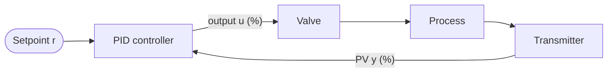

The first three entries of this series dealt with binary signals and with moving data between devices: the [first entry](/blog/logic-and-sequential-control) with logic and sequences, the [second](/blog/programmable-logic-controllers) with the controller that executes them and its 4–20 mA analog inputs and outputs, and the [third](/blog/fieldbuses-and-industrial-ethernet) with the networks that connect them. This entry turns to the other kind of question named at the start of the series: how far to open a valve so that a temperature, level, flow or pressure stays where it should. In process plants the answer is computed, in most loops, by a **proportional–integral–derivative** (PID) **controller**.

The entry builds on the five-entry [Foundations of Control Systems](/series/foundations-of-control-systems) series, whose [first entry](/blog/introduction-to-control-systems) introduced the feedback loop (plant, sensor, controller, actuator, reference, error) and showed in [Feedback and System Behavior](/blog/feedback-and-system-behavior) that proportional feedback alone leaves a steady-state offset. It starts with the vocabulary and the simple models used for process plants, then develops the PID law, its digital implementation and the practical problems that a textbook loop ignores, and then compares two tuning methods by simulation. It ends with the particular character of temperature, level, flow and pressure loops.

**Conventions.** Signals are expressed in percent of their span (0–100 %), as process control systems display them; process gains are therefore dimensionless (% of measurement span per % of controller output). Time is in seconds. The error is $e = r - y$, setpoint minus measurement. Python examples use Python 3 and its standard library.

## 1. Process control vocabulary

### 1.1 The loop

A process control loop has the same structure as any feedback loop, with names of its own:



- The **process variable** (PV), $y$, is the measured quantity: a temperature, level, flow or pressure, delivered by a **transmitter**, usually as a 4–20 mA signal (second entry, Section 3.3).
- The **setpoint** (SP), $r$, is the desired value of the PV.
- The **controller output** (CO), $u$, is the signal the controller sends to the final control element, usually a **control valve** with a positioner, sometimes a variable-speed pump or fan.
- The **manipulated variable** is what the output physically changes: the flow of steam, cooling water or product.
- **Disturbances** (or **loads**) are everything else that moves the PV: feed temperature, upstream pressure, demand from downstream.

Most process loops spend their lives holding a constant setpoint against disturbances, so **disturbance rejection** usually matters more than **setpoint tracking** (two of the requirements listed in the control series' [first entry](/blog/introduction-to-control-systems)).

### 1.2 Direct and reverse action

If increasing the output increases the PV, the process gain is positive; a heating valve raising a temperature is an example. The controller must then reduce its output when the PV rises, which is called **reverse action**, and with $e = r - y$ and a positive controller gain that is what the equations below do. If the process gain is negative, as with a cooling valve, the controller must be configured for **direct action**, which reverses the sign. Choosing the wrong action makes the loop run away to one limit, so it is the first thing to check when commissioning a loop.

## 2. Models of process dynamics

### 2.1 First order plus dead time

Process plants rarely have accurate physical models, and tuning is usually based on a simple model fitted to a test. The most common is the **first-order-plus-dead-time** (FOPDT) model,

$$
G(s) = \frac{Y(s)}{U(s)} = \frac{K\,e^{-\theta s}}{\tau s + 1},
$$

where $s$ is the Laplace variable (introduced with the transfer function in the control series' first entry), $K$ the **process gain**, $\tau$ the **time constant** and $\theta$ the **dead time**. In the time domain, a step of size $\Delta u$ in the output at time 0 produces no response at all until $t = \theta$, and then a first-order rise:

$$
y(t) = K\,\Delta u\left(1 - e^{-(t - \theta)/\tau}\right), \qquad t \ge \theta.
$$

Dead time is transport delay (the time for material to travel from the valve to the sensor) plus the approximate effect of several small lags in series. It is the main limit on how fast a loop can be: no controller can react to a disturbance before its effect becomes measurable. The ratio $\theta/\tau$ describes how difficult a process is to control; a process with a small ratio is called **lag-dominant**, one with a large ratio **delay-dominant**.

### 2.2 Integrating processes

A tank whose outflow is set by a pump, not by the level, has no natural equilibrium: if inflow and outflow differ, the level rises or falls without limit. Its model is **integrating**,

$$
G(s) = \frac{k' e^{-\theta s}}{s},
$$

where $k'$ is the rate of change of the PV per unit of output, in %/s per %. Many level loops and some pressure loops behave this way. An integrating process needs feedback to stay in range at all.

### 2.3 Identifying a model from a step test

The model parameters are usually found by a **step test**: with the controller in manual, the output is stepped by a few percent and the PV is recorded until it settles. The gain is the ratio of the PV's total change to the output step. One simple way to obtain $\tau$ and $\theta$ is to read the times $t_{28}$ and $t_{63}$ at which the response reaches 28.3 % and 63.2 % of its final change, measured from the step, and to compute

$$
\tau = 1.5\,(t_{63} - t_{28}), \qquad \theta = t_{63} - \tau .
$$

The two percentages are chosen because a first-order response reaches them at $\theta + \tau/3$ and $\theta + \tau$ after the step. For the process used throughout this entry, a heated vessel whose temperature, in percent of the transmitter span, rises by 15 % for a 10 % output step, so that $K = 1.5$, the recorded times are $t_{28} = 129.8$ s and $t_{63} = 329.9$ s. They give $\tau = 1.5 \times 200.1 = 300.1$ s and $\theta = 329.9 - 300.1 = 29.8$ s, which this entry rounds to $\tau = 300$ s and $\theta = 30$ s, a lag-dominant process with $\theta/\tau = 0.1$. (The times were generated from that model; a real test would add noise and disturbances, and should be repeated in both directions.)

## 3. The PID law

### 3.1 Three terms

The PID controller computes its output from the present error, its accumulated past, and its rate of change. In the **standard** form (also called the **ideal** form, or the **ISA** form after the International Society of Automation),

$$
u(t) = u_0 + K_c\left( e(t) + \frac{1}{T_i}\int_0^t e(\xi)\,d\xi + T_d\,\frac{de(t)}{dt} \right),
$$

where $K_c$ is the **controller gain**, $T_i$ the **integral time** (or reset time), $T_d$ the **derivative time** and $u_0$ a constant bias. Each term has a distinct role:

- The **proportional** term reacts to the present error. Alone, it leaves a steady-state offset whenever the output needed at the setpoint differs from $u_0$, as the control series showed for a first-order plant in [Feedback and System Behavior](/blog/feedback-and-system-behavior).
- The **integral** term keeps changing the output for as long as any error remains, so at steady state the error must be zero. This removes the offset. $T_i$ is the time in which the integral term, for a constant error, adds as much again as the proportional term.
- The **derivative** term reacts to the trend of the error and acts as a prediction of it $T_d$ seconds ahead. It adds damping and allows a higher gain on lag-dominant processes, but it amplifies measurement noise.

Most process loops use proportional–integral (PI) control; derivative action is mainly used on slow temperature loops.

### 3.2 Other forms and units

Three conventions coexist, and a tuning computed for one form gives wrong results in another:

| Form | Law | Conversion to the standard form |
|---|---|---|
| Standard (ISA) | $K_c\left(e + \frac{1}{T_i}\int e\,dt + T_d\,\dot e\right)$ | — |
| Parallel | $K_p e + K_i \int e\,dt + K_d\,\dot e$ | $K_p = K_c$, $K_i = K_c/T_i$, $K_d = K_c T_d$ |
| Series (interacting) | $K_c'\left(1 + \frac{1}{T_i' s}\right)\left(1 + T_d' s\right)$ | Identical to the standard form when $T_d' = 0$ |

Units differ too. Many controllers express the gain as a **proportional band** $PB = 100/K_c$ percent (the PV change, in percent of span, that moves the output through its full range), give $T_i$ in minutes rather than seconds, or specify integral action as a **reset rate** $1/T_i$ in repeats per minute. PID function blocks in programmable logic controllers (PLCs) and distributed control systems are supplied by the manufacturers rather than by IEC 61131-3, and their form, units and options are vendor-specific, so the documentation must be read before entering any numbers.

## 4. A digital PID controller

### 4.1 Discretization

A PLC or other digital controller runs the PID law every **sample time** $T_s$, inside a cyclic task of the kind described in the second entry. Replacing the integral by a sum and the derivative by a difference gives the **position form**:

$$
u_k = u_0 + K_c\left( e_k + \frac{T_s}{T_i}\sum_{j=0}^{k} e_j + \frac{T_d}{T_s}\,(e_k - e_{k-1}) \right).
$$

The **velocity form** computes the change of output instead,

$$
\Delta u_k = K_c\left( (e_k - e_{k-1}) + \frac{T_s}{T_i}\,e_k + \frac{T_d}{T_s}\,(e_k - 2e_{k-1} + e_{k-2}) \right),
\qquad u_k = u_{k-1} + \Delta u_k ,
$$

and suits actuators that are driven in increments. The sample time must be short compared with the loop's dynamics; for the vessel of Section 2.3, sampling once per second is ample against a dead time of 30 s, while a flow loop with a time constant of a few seconds needs a sample time well under a second. The sampling also adds, on average, half a sample of extra dead time.

### 4.2 Derivative kick and setpoint weighting

If the setpoint changes in a step, $e$ jumps and its derivative is momentarily infinite: the output receives a large spike, the **derivative kick**, which is hard on valves and serves no purpose. The usual cure is to differentiate the measurement instead of the error, using $-\,dy/dt$ in place of $de/dt$; when the setpoint is constant the two are equal.

A similar, milder effect comes from the proportional term. Many controllers therefore apply a **setpoint weight** $b$ between 0 and 1 to it, using $b\,r - y$ in the proportional term and the full error in the integral term. With $b = 0$ a setpoint change acts only through the integral term, which gives a smoother response without changing how disturbances are rejected.

### 4.3 Filtering the derivative

Differentiating noisy measurements amplifies the noise, increasingly so at high frequencies. The derivative term is therefore always filtered, normally with a first-order filter of time constant $T_d/N$:

$$
D(s) = -\,\frac{K_c T_d\, s}{1 + s\,T_d/N}\,Y(s),
$$

with $N$ typically of the order of 10. Additional filtering of the PV itself is common, but every filter adds lag to the loop, which reduces the gain it can tolerate.

### 4.4 Integrator windup

A valve cannot open more than 100 % or less than 0 %. If a large setpoint change or disturbance drives the output to a limit, the error persists for a long time, and the integral term keeps growing even though the output cannot follow. When the PV finally reaches the setpoint, the integral term is far too large, and the output stays at the limit until an opposite error has unwound it: the PV overshoots, sometimes severely. This is **integrator windup**.

Every practical PID implementation includes **anti-windup**. Two methods are common:

- **Conditional integration** (clamping): stop integrating while the output is saturated and the error would drive it further into saturation.
- **Back-calculation**: feed the difference between the computed and the actual (limited) output back into the integrator, so that it tracks the limit with a chosen time constant.

The simulation in Section 5.3 shows the effect.

### 4.5 Manual mode and bumpless transfer

Operators switch loops between **manual**, in which they set the output directly, and **automatic**. If the controller's internal state is not aligned with the current output at the moment of switching, the output jumps. **Bumpless transfer** prevents that. While the loop is in manual, the integral term (or, in the velocity form, the stored previous output) is continuously set so that the controller would produce the present manual output; switching to automatic then starts from where the valve already is. The same mechanism makes the output continuous when the setpoint source changes, such as in the cascade loops of Section 6.5.

## 5. Tuning

### 5.1 What a good tuning means

Tuning means choosing $K_c$, $T_i$ and $T_d$. There is no single best choice, because the requirements conflict: fast disturbance rejection needs high gain, while robustness against model errors, smooth valve movement and insensitivity to noise need low gain. The usual measures are the overshoot and settling time after a setpoint step, the peak deviation and the **integrated absolute error** (IAE), $\int |e|\,dt$, after a disturbance, and how much the process can change before the loop becomes oscillatory or unstable.

### 5.2 Two tuning rules

**Ziegler–Nichols reaction-curve rules.** In 1942 Ziegler and Nichols published tuning rules based on the step response of the process. Expressed in terms of the FOPDT parameters they are:

| Controller | $K_c$ | $T_i$ | $T_d$ |
|---|---|---|---|
| PI | $0.9\,\tau/(K\theta)$ | $3.33\,\theta$ | — |
| PID | $1.2\,\tau/(K\theta)$ | $2\,\theta$ | $0.5\,\theta$ |

The rules aim at a quarter-amplitude decay of oscillations after a disturbance, which is fast but poorly damped by today's standards.

**SIMC rules.** Skogestad's rules (2003), known as SIMC rules because they are a simplified form of internal model control (IMC) design, derive the controller from a chosen closed-loop time constant $\tau_c$, the single tuning parameter. For an FOPDT process the PI settings are

$$
K_c = \frac{1}{K}\,\frac{\tau}{\tau_c + \theta}, \qquad T_i = \min\bigl(\tau,\ 4(\tau_c + \theta)\bigr),
$$

and for an integrating process

$$
K_c = \frac{1}{k'}\,\frac{1}{\tau_c + \theta}, \qquad T_i = 4(\tau_c + \theta).
$$

The recommended default for tight control with good robustness is $\tau_c = \theta$; a larger $\tau_c$ gives slower, smoother and more robust control. The minimum in $T_i$ shortens the integral time for lag-dominant processes, which otherwise reject disturbances at the process input slowly. Related "lambda tuning" rules, widely used in process industries, set $T_i = \tau$ and choose a closed-loop time constant $\lambda$ in the same way.

For the vessel with $K = 1.5$, $\tau = 300$ s and $\theta = 30$ s:

| Rule | $K_c$ | $T_i$ |
|---|---|---|
| Ziegler–Nichols PI | $0.9 \times 300/(1.5 \times 30) = 6.00$ | $100$ s |
| SIMC PI, $\tau_c = \theta$ | $300/(1.5 \times 60) = 3.33$ | $\min(300, 240) = 240$ s |

### 5.3 Comparing the tunings by simulation

The program below simulates the vessel with a PI controller that has clamping anti-windup and output limits of 0 and 100 %, around an operating point at which the output is 50 %. The setpoint steps up by 10 % at $t = 10$ s; at $t = 1500$ s a load disturbance of −5 % of output enters at the process input (for example, a drop in steam pressure). Each tuning is then run again on a process whose dead time has grown to 45 s, to test robustness.

```python
import math

K, TAU, THETA = 1.5, 300.0, 30.0    # process model: gain (%/%), time constant (s), dead time (s)
TS = 1.0                            # controller sample time, s

def run(kc, ti, theta=THETA, sp_step=10.0, load=-5.0, anti_windup=True):
    """PI loop on a first-order-plus-dead-time process, all signals in % of span.
    Setpoint step at t = 10 s, load step at the process input at t = 1500 s."""
    a = math.exp(-TS / TAU)                  # exact discretization of the lag
    pipe = [0.0] * round(theta / TS)         # dead time: queue of past inputs
    y, integ, u0 = 0.0, 0.0, 50.0            # PV deviation, integral term, bias (%)
    log = []
    for k in range(3000):
        t = k * TS
        sp = sp_step if t >= 10 else 0.0
        e = sp - y
        u_raw = u0 + kc * e + integ
        u = min(max(u_raw, 0.0), 100.0)      # valve limits 0..100 %
        if not (anti_windup and u != u_raw and (u_raw - u) * e > 0):
            integ += kc * TS / ti * e        # integrate unless pushing further into a limit
        pipe.append(u - u0 + (load if t >= 1500 else 0.0))
        y = a * y + (1 - a) * K * pipe.pop(0)
        log.append((t, y, u))
    return log

def report(name, log, sp=10.0):
    step = [(t, y) for t, y, _ in log if 10 <= t < 1500]
    over = max(y for _, y in step) / sp - 1
    settle = max(t for t, y in step if abs(y - sp) > 0.02 * sp) - 10
    dip = min(y for t, y, _ in log if t >= 1500) - sp
    iae = sum(abs(sp - y) for t, y, _ in log if t >= 1500) * TS
    print(f"{name:22s} overshoot {over:6.1%}  settling {settle:4.0f} s  "
          f"load dip {dip:5.2f} %  load IAE {iae:4.0f} %·s")

zn = (0.9 * TAU / (K * THETA), THETA / 0.3)                  # Ziegler-Nichols reaction curve PI
simc = (TAU / (K * 2 * THETA), min(TAU, 4 * 2 * THETA))      # SIMC PI with tau_c = theta
print(f"ZN:   Kc = {zn[0]:.2f}, Ti = {zn[1]:.0f} s")
print(f"SIMC: Kc = {simc[0]:.2f}, Ti = {simc[1]:.0f} s")
report("ZN", run(*zn))
report("SIMC", run(*simc))
report("ZN, dead time 45 s", run(*zn, theta=45.0))
report("SIMC, dead time 45 s", run(*simc, theta=45.0))
```

```text
ZN:   Kc = 6.00, Ti = 100 s
SIMC: Kc = 3.33, Ti = 240 s
ZN                     overshoot  28.8%  settling  380 s  load dip -1.03 %  load IAE   97 %·s
SIMC                   overshoot   8.7%  settling  297 s  load dip -1.28 %  load IAE  359 %·s
ZN, dead time 45 s     overshoot  67.7%  settling 1489 s  load dip -8.13 %  load IAE 6170 %·s
SIMC, dead time 45 s   overshoot  31.5%  settling  449 s  load dip -1.55 %  load IAE  359 %·s
```

Settling is measured to within 2 % of the setpoint step. Three conclusions follow:

1. **On the nominal process, each tuning wins on one measure.** Ziegler–Nichols, with nearly twice the gain and less than half the integral time, rejects the load disturbance much better (IAE 97 against 359 %·s) but overshoots a setpoint step by 29 %. SIMC overshoots by 9 % and settles sooner. The ten-percent setpoint step with $K_c = 6$ also drives the output to its 100 % limit at first, which the anti-windup handles.
2. **Robustness differs sharply.** With the dead time 50 % longer than the model, the Ziegler–Nichols loop never settles: the reported "settling" of 1489 s is only the last sample before the disturbance, and the load IAE of 6170 %·s reflects a continuing oscillation. A separate run without output limits shows that this loop is unstable, its oscillation growing without bound; here it is held only by the valve limits. The SIMC loop overshoots more but remains well behaved, with the same load IAE as before.
3. **The tuning parameter matters more than the rule.** SIMC's disturbance rejection can be made faster by choosing a smaller $\tau_c$, at the cost of robustness; the rule makes that trade explicit, where the Ziegler–Nichols rules fix it.

Process models are never exact, and dead times and gains drift with throughput and equipment condition, so the robust choice is usually the right one for a loop that must run unattended for years.

### 5.4 Windup in numbers

The same function shows integrator windup. With SIMC tuning and a setpoint step of 30 % instead of 10 %, the proportional term alone asks for $3.33 \times 30 = 100$ % more output, so the valve saturates at 100 %:

```python
for aw in (False, True):
    log = run(*simc, sp_step=30.0, load=0.0, anti_windup=aw)
    peak = max(y for _, y, _ in log)
    at_limit = sum(1 for _, _, u in log if u == 100.0)
    print(f"anti-windup {aw!s:5s}: peak PV {peak:5.2f} %, output at 100 % for {at_limit} s")
```

```text
anti-windup False: peak PV 35.82 %, output at 100 % for 167 s
anti-windup True : peak PV 30.00 %, output at 100 % for 97 s
```

Without anti-windup the integral term keeps growing while the output is limited, and the valve stays fully open for 167 s instead of 97 s. The extra 70 s of full heating, arriving through the 30 s dead time, carries the PV to 35.8 %, an overshoot of 19 %. With clamping, the PV approaches 30 % from below without overshoot.

## 6. The four classic process variables

### 6.1 Flow

A flow loop measures flow with a flowmeter and manipulates a control valve in the same pipe. Its dynamics are fast (dominated by the valve actuator, with time constants of seconds; Section 6.6 discusses the valve) and its measurement is noisy, because turbulence makes the flow signal fluctuate. Flow loops are therefore run as PI loops, without derivative action, with modest gain and short integral time, so that the controller does not chase the noise.

### 6.2 Level

Level in a tank with pumped outflow is an integrating process (Section 2.2), and two different objectives occur. **Tight** level control holds the level close to its setpoint, for instance in a reactor or boiler drum where the level matters in its own right. **Averaging** level control uses the tank as a buffer: the level is allowed to move within its limits so that the outflow to the next unit changes as smoothly as possible. In SIMC terms the difference lies only in the choice of $\tau_c$. With $k' = 0.05$ %/s per % and $\theta = 5$ s, $\tau_c = \theta$ gives $K_c = 1/(0.05 \times 10) = 2.0$ and $T_i = 40$ s. An averaging choice of $\tau_c = 100$ s gives $K_c = 0.19$ and $T_i = 420$ s.

Integrating loops have one counterintuitive property. Neglecting dead time, a PI controller on the process $k'/s$ gives the closed-loop characteristic equation $s^2 + k' K_c\, s + k' K_c / T_i = 0$, a second-order system with

$$
\omega_n = \sqrt{\frac{k' K_c}{T_i}}, \qquad \zeta = \frac{1}{2}\sqrt{k' K_c T_i}.
$$

The damping grows with the *product* $K_c T_i$. Both SIMC settings above give $k' K_c T_i = 4$, hence $\zeta = 1$. A level loop that oscillates slowly therefore usually has too little gain or too short an integral time; reducing the gain, the instinctive response to oscillation, makes it worse.

### 6.3 Temperature

Temperature processes are slow and lag-dominant: heat must flow through walls, coils and the bulk of the material, which adds several lags in series, and the sensor in its protective thermowell adds another. Their measurements are usually smooth, so derivative action can be used, and it is in temperature loops that PID rather than PI pays off most. Temperature loops are also often nonlinear, since heating and cooling may have different gains, and the process gain changes with throughput.

### 6.4 Pressure

Pressure behaves like flow when the fluid is a liquid, since liquids are nearly incompressible and pressure changes propagate almost instantly. Gas pressure in a vessel is slower, governed by the vessel's volume acting as a capacitance, and depending on how flows in and out depend on the pressure, it can be self-regulating or close to integrating. Gas pressure loops can usually be tuned tightly because the measurement is clean and the dynamics simple.

### 6.5 Cascade and feedforward

Two structures extend a single loop:

- In **cascade control**, the output of a **primary** (outer) controller is the setpoint of a **secondary** (inner) controller. A vessel temperature controller, for instance, sets the setpoint of a steam-flow controller instead of moving the steam valve directly. The fast inner loop corrects supply disturbances, such as a change in steam pressure, before they reach the temperature, and it linearizes the valve. The inner loop must be considerably faster than the outer one, and it is tuned first.
- In **feedforward control**, a measured disturbance is used to adjust the output before the PV changes: a change in feed flow, for example, immediately changes the heating in proportion. Feedforward cannot correct for what it does not measure, so it is always combined with feedback.

### 6.6 The valve

The final control element is often the weakest part of a loop. A control valve's **inherent characteristic** relates flow to opening: **linear**, or **equal percentage**, in which each increment of opening increases the flow by the same fraction of its current value. Installed in a real pipe system, its effective gain also depends on the pressure drop available, so the process gain changes with the operating point; a tuning made at one load can be sluggish or oscillatory at another. Worse, a valve with excessive friction, **stiction**, does not move until the controller's output has changed by some amount, then jumps; together with integral action this produces a characteristic sustained oscillation that no tuning can remove. Before retuning an oscillating loop, it is worth putting it in manual: if the oscillation stops, the controller or valve is causing it; if not, it comes from elsewhere in the plant.

## 7. Exercises

**Exercise 1.** A flow loop has an identified model $K = 0.8$, $\tau = 20$ s and $\theta = 4$ s. Compute PI settings by Ziegler–Nichols and by SIMC with $\tau_c = \theta$, and say which you would commission.

<details>
<summary>Answer</summary>

Ziegler–Nichols: $K_c = 0.9 \times 20/(0.8 \times 4) = 5.63$, $T_i = 3.33 \times 4 = 13.3$ s. SIMC: $K_c = 20/(0.8 \times 8) = 3.13$, $T_i = \min(20, 32) = 20$ s. The SIMC setting has about half the gain, which suits a noisy flow measurement and leaves margin for model error; commission it, and increase the gain only if the response is too slow.

</details>

**Exercise 2.** A controller specifies its gain as a proportional band of 30 % and its integral action as 0.25 repeats per minute. Convert both to $K_c$ and $T_i$ in seconds.

<details>
<summary>Answer</summary>

$K_c = 100/30 = 3.33$, and $T_i = 1/0.25 = 4$ minutes $= 240$ s: the SIMC setting of Section 5.2 in other units.

</details>

**Exercise 3.** A step test gives a 12 % rise in PV for an 8 % output step, with $t_{28} = 46$ s and $t_{63} = 106$ s. Find the FOPDT model and the SIMC PI settings with $\tau_c = \theta$.

<details>
<summary>Answer</summary>

$K = 12/8 = 1.5$, $\tau = 1.5 \times (106 - 46) = 90$ s, $\theta = 106 - 90 = 16$ s. SIMC: $K_c = 90/(1.5 \times 32) = 1.88$, $T_i = \min(90, 128) = 90$ s.

</details>

**Exercise 4.** In the windup simulation of Section 5.4, why does the clamped controller still keep the output at 100 % for 97 s, and why does the PV then not overshoot at all?

<details>
<summary>Answer</summary>

The output is genuinely needed at its limit: the proportional term alone asks for more than 100 % until the error is small. Clamping only stops the integral term from growing during that time, so when the error has shrunk enough for the output to come off the limit, the integral term holds roughly the value it had when saturation began rather than a large accumulated excess. The output then falls smoothly as the PV approaches the setpoint. Without clamping, 97 s of integration at a large error must first be unwound by an error of opposite sign, which is the overshoot.

</details>

**Exercise 5.** A level loop on an integrating tank, with $k' = 0.05$ %/s per %, has $K_c = 0.5$ and $T_i = 40$ s and oscillates slowly. Neglecting dead time, compute its damping ratio and oscillation period. The engineer halves the gain to calm it. What happens, and what would be a better change?

<details>
<summary>Answer</summary>

$k' K_c T_i = 0.05 \times 0.5 \times 40 = 1$, so $\zeta = 0.5$, and $\omega_n = \sqrt{0.05 \times 0.5/40} = 0.025$ rad/s; the damped period is $2\pi/(\omega_n\sqrt{1 - \zeta^2}) \approx 290$ s. Halving the gain gives $k' K_c T_i = 0.5$ and $\zeta = 0.35$: less damping, more oscillation. Raising $K_c$ to 2 (the tight SIMC setting) or lengthening $T_i$ to 160 s each restores $k' K_c T_i = 4$ and $\zeta = 1$. If the oscillation persists in manual with the output fixed, look for its cause elsewhere; if it persists in automatic at any tuning, suspect valve stiction (Section 6.6).

</details>

## 8. Summary

| Question | Answer |
|---|---|
| What are PV, SP and CO? | The measured process variable, its setpoint, and the controller output to the valve, all usually in percent of span. |
| What model is used for tuning? | First order plus dead time, $K e^{-\theta s}/(\tau s + 1)$, or an integrating model $k' e^{-\theta s}/s$ for tanks with pumped outflow. |
| What does each PID term do? | P reacts to the present error, I removes steady-state offset, D anticipates the trend and adds damping. |
| Why do PID forms and units matter? | Standard, parallel and series forms, proportional band and minutes vs seconds give different numbers for the same controller. |
| What practical features does a real PID need? | Derivative on measurement with filtering, setpoint weighting, anti-windup and bumpless transfer. |
| How do Ziegler–Nichols and SIMC compare? | Ziegler–Nichols is aggressive and fragile; SIMC with $\tau_c = \theta$ is better damped and much more robust to model error. |
| How do the four classic loops differ? | Flow is fast and noisy (PI, low gain); level is integrating (tight or averaging); temperature is slow and lag-dominant (PID); pressure is fast for liquids and slower for gases. |
| What limits loops in practice? | Dead time, valve nonlinearity and stiction, and changes of the process with operating point. |

PID loops, logic and sequences together make up the control layer of a plant. The final entry, [Networked Automation and Digital Twins](/blog/networked-automation-and-digital-twins), looks at what sits above that layer: the standard model of plant system levels, how the OPC Unified Architecture (OPC UA) exposes controller data to the systems that use it, and what a digital twin, a model running alongside the plant, can and cannot do, including the virtual commissioning and model-based monitoring of loops like those tuned here.

### References

- K. J. Åström and T. Hägglund, *Advanced PID Control*, ISA, 2006.
- D. E. Seborg, T. F. Edgar, D. A. Mellichamp and F. J. Doyle III, *Process Dynamics and Control*, 4th ed., Wiley, 2016.
- F. G. Shinskey, *Process Control Systems: Application, Design, and Tuning*, 4th ed., McGraw-Hill, 1996.
- S. Skogestad, "Simple analytic rules for model reduction and PID controller tuning," *Journal of Process Control*, vol. 13, no. 4, pp. 291–309, 2003.
- J. G. Ziegler and N. B. Nichols, "Optimum settings for automatic controllers," *Transactions of the ASME*, vol. 64, pp. 759–768, 1942.
