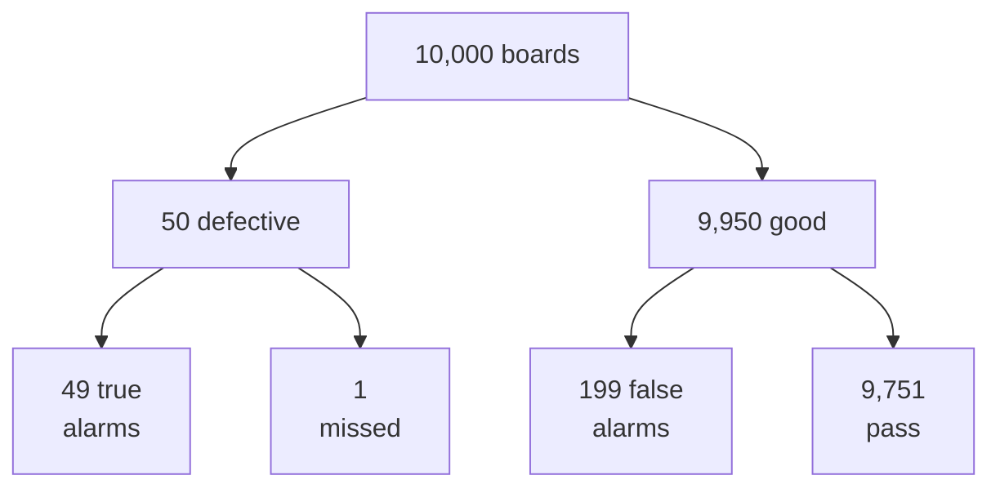
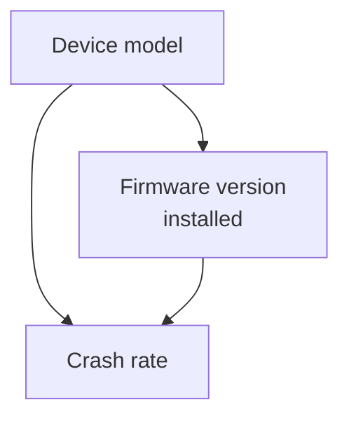

import Figure from '../../components/Figure.astro';
import CtStatNormalTails from '../../components/diagrams/CtStatNormalTails.astro';
import CtStatBayesPosterior from '../../components/diagrams/CtStatBayesPosterior.astro';

The [previous entry](/blog/scientific-reasoning-and-causation) showed how hypotheses are tested and how causes are found, but left two questions without a numerical answer. How strongly should a piece of evidence change a degree of belief? How large must an observed difference be before chance stops being a good explanation? This entry supplies the tools for both. It treats probability as the logic of uncertain reasoning, in the same way that the [sixth entry](/blog/sentential-logic) treated truth tables as the logic of certain reasoning.

The entry covers the meaning and rules of probability, the commonest errors in applying them, expected value and Bayes' theorem. It then turns to the statistics of samples: bias, sampling error, confidence intervals, significance tests and the paradox that pooled data can reverse a comparison. Only school algebra is assumed. The two listings use Python 3 (run with 3.13) and its standard library only (`fractions`, `itertools`, `math`, `random`, `statistics`), and their outputs are quoted as produced.

## 1. What a probability is

### 1.1 The scale

A **probability** $P(A)$ measures how strongly the setup or the evidence favors an event $A$, on a scale that runs from 0 (impossible) to 1 (certain). A 25% chance and $P(A) = 0.25$ are the same statement.

### 1.2 Three interpretations

Philosophers distinguish several accounts of what a probability statement asserts (Hacking, 2001). Three matter here, and the rules of Section 2 hold under each.

- Under the **classical** account, probabilities come from symmetry among equally possible cases: a request handed to a randomly chosen slot of an eight-slot round-robin scheduler lands in slot 3 with probability 1/8.
- Under the **frequency** account, a probability is the proportion of times an outcome occurs in a long run of trials: the share of resistors from a production line that fall outside tolerance, estimated from inspection records.
- Under the **subjective** or **Bayesian** account, a probability is a degree of belief, which the rules of probability keep coherent: an engineer's 0.7 that a fault lies in the power supply rather than the firmware.

Frequencies suit repeatable processes; degrees of belief are needed for one-off hypotheses, such as the cause of a particular outage, to which no long-run frequency applies.

### 1.3 Odds

Probabilities are sometimes stated as **odds**. Odds of $a$ to $b$ against an event mean that the chances of it not happening and of it happening are in the ratio $a : b$, so its probability is $b/(a+b)$. Odds of 4 to 1 against give $P = 1/5 = 0.2$, not 1/4. Odds in favor are the reverse ratio. The odds form returns in Bayes' theorem (Section 5.3), where it makes updating a matter of one multiplication.

## 2. The rules of probability

### 2.1 Complement and addition

For any event $A$, the probability that $A$ does not happen is

$$
P(\neg A) = 1 - P(A).
$$

For two events $A$ and $B$, the probability that at least one happens is given by the **addition rule**

$$
P(A \lor B) = P(A) + P(B) - P(A \land B).
$$

The last term removes the outcomes in which both happen, which the first two terms count twice. When $A$ and $B$ are **mutually exclusive** (they cannot both happen), $P(A \land B) = 0$ and the probabilities add.

A worked example shows why the correction matters. With two fair dice, the chance of at least one six is not $1/6 + 1/6 = 1/3$. Of the 36 equally likely pairs, 6 have a six on the first die and 6 on the second, but the pair (6, 6) is in both groups, so only 11 pairs qualify and the probability is $11/36 \approx 0.306$. The complement rule gives the same answer more quickly: the chance of no six is $(5/6)^2 = 25/36$, and $1 - 25/36 = 11/36$.

### 2.2 Conditional probability and the multiplication rule

The **conditional probability** of $A$ given $B$ is the probability of $A$ when $B$ is known to have happened:

$$
P(A \mid B) = \frac{P(A \land B)}{P(B)}, \qquad P(B) > 0.
$$

Rearranged, it gives the **multiplication rule** for the probability that both events happen:

$$
P(A \land B) = P(A \mid B)\, P(B).
$$

Events are **independent** when knowing that one happened does not change the probability of the other, $P(A \mid B) = P(A)$. Only then does the rule reduce to $P(A \land B) = P(A)\,P(B)$.

### 2.3 Independence in reliability engineering

Reliability calculations show both the power of the multiplication rule and the danger of assuming independence. Suppose a pump works through a one-year period with probability 0.95. A system that needs three such pumps working in series works with probability $0.95^3 = 0.857$ if their failures are independent. Two pumps in parallel, either of which suffices, fail together with probability $0.05^2 = 0.0025$, so the redundant pair works with probability 0.9975.

The redundancy figure is only as good as the independence assumption. If both pumps share a power supply, a filter or a maintenance error, their failures are correlated, $P(\text{second fails} \mid \text{first fails})$ is far larger than 0.05, and the true probability that both fail can be many times 0.0025. Such shared causes are called **common-cause** (or common-mode) failures, and reliability engineering spends much effort on them precisely because the special multiplication rule hides them.

### 2.4 Checking the rules by computation

The first listing checks the dice result by enumeration and simulates the three-door puzzle of Section 3.3. It also works a problem traditionally attributed to the Chevalier de Méré and discussed by Pascal and Fermat in their correspondence of 1654: is one six in 4 rolls of a die more likely than a double six in 24 rolls of two dice?

```python
from fractions import Fraction
from itertools import product
import random

# Two dice: count the outcomes with at least one six
outcomes = list(product(range(1, 7), repeat=2))
hits = sum(1 for a, b in outcomes if a == 6 or b == 6)
print("P(at least one six, two dice) =", Fraction(hits, len(outcomes)))

# The two bets of the Chevalier de Mere, by the complement rule
p_four = 1 - Fraction(5, 6) ** 4
p_24 = 1 - Fraction(35, 36) ** 24
print(f"one six in 4 rolls: {float(p_four):.4f}")
print(f"double six in 24 rolls: {float(p_24):.4f}")

# Three-door game: simulate staying and switching
random.seed(1)
trials, stay, switch = 100_000, 0, 0
for _ in range(trials):
    prize, pick = random.randrange(3), random.randrange(3)
    opened = next(d for d in range(3) if d != pick and d != prize)
    other = next(d for d in range(3) if d != pick and d != opened)
    stay += pick == prize
    switch += other == prize
print(f"win rate staying: {stay / trials:.3f}, switching: {switch / trials:.3f}")
```

```text
P(at least one six, two dice) = 11/36
one six in 4 rolls: 0.5177
double six in 24 rolls: 0.4914
win rate staying: 0.333, switching: 0.667
```

The tempting argument "each roll gives 1/6, so four rolls give 4/6" adds probabilities of events that are not mutually exclusive. The complement rule gives $1 - (5/6)^4 = 0.5177$ for the first bet and $1 - (35/36)^{24} = 0.4914$ for the second, so the first is favorable and the second is not, although the naive argument rates them equal ($4/6 = 24/36$).

## 3. Common errors with probability

### 3.1 The gambler's fallacy

The **gambler's fallacy** is the belief that independent trials balance out in the short run. Examples are the beliefs that a flaky test that has passed 30 times in a row is "due" to fail, or that a random bit generator that has produced eight ones is "due" for a zero. When trials are independent, the next outcome has the same probability whatever came before. The reasoning is sound only where outcomes depend on the past. A cutting tool that wears does become more likely to break with use, and a job scheduled once an hour becomes more likely to start in the next minute the longer it has been since the last run.

### 3.2 Multiplying probabilities that are not independent

The opposite error multiplies probabilities of events that are not independent, as the pump example of Section 2.3 showed. A safety case that rates the simultaneous failure of three sensors at $10^{-3} \times 10^{-3} \times 10^{-3} = 10^{-9}$ per hour is only as good as the assumption that nothing affects all three at once. If they share a supply rail, a firmware bug or a calibration procedure, the true figure is governed by that shared cause and can be larger by many orders of magnitude.

### 3.3 Conditioning on how information arises

In a well-known puzzle a prize is behind one of three doors. A contestant picks a door; the host, who knows where the prize is and always opens a door without it, opens one of the other two; the contestant may then switch. Many people judge the two remaining doors equally likely. They are not: the first pick is right with probability 1/3, and the host's action does not change that, because the host can always open an empty door. Switching therefore wins with probability 2/3, which the simulation in Section 2.4 confirms. The lesson is to condition on how the information was produced, not only on what it says.

### 3.4 Regression to the mean

When a quantity varies partly by chance, an unusually extreme measurement tends to be followed by one closer to the average, because the chance component that made it extreme is unlikely to recur at full strength. This is **regression to the mean**. It misleads whenever action is taken because a measurement was extreme: a production line retuned after its worst week, or a server rack moved to a new cooling zone after its hottest week, will usually look better next time even if the action had no effect. A fair evaluation compares with a control group selected in the same way (previous entry, Section 8).

## 4. Expected value

The **expected value** of a quantity $X$ that takes values $x_i$ with probabilities $p_i$ is the probability-weighted average

$$
E[X] = \sum_i p_i\, x_i .
$$

A maintenance planner must decide whether to stock a spare drive unit that costs 400 dollars. Without the spare, a failure of the installed unit stops a production line at a cost of 10,000 dollars, and the planner estimates the probability of such a failure within the year at 0.05. The expected cost of not stocking the spare is $0.05 \times 10\,000 = 500$ dollars, more than the 400 dollars the spare costs, so stocking it is the better policy on expected cost.

An expected value is a long-run average per decision, not a forecast of any single outcome: in a given year the line either stops or it does not, and the cost is 0 or 10,000 dollars, never 500. A gamble whose expected value is zero is called **fair**. The [eleventh entry](/blog/strategic-thinking-and-decisions) uses expected value to compare decisions and, among its limits, notes how utility replaces money when attitudes to risk matter.

## 5. Bayes' theorem

### 5.1 The theorem

Applying the multiplication rule both ways round, $P(H \land E) = P(H \mid E)\,P(E) = P(E \mid H)\,P(H)$, and dividing by $P(E)$ gives **Bayes' theorem**:

$$
P(H \mid E) = \frac{P(E \mid H)\, P(H)}{P(E)}, \qquad
P(E) = P(E \mid H)\,P(H) + P(E \mid \neg H)\,P(\neg H).
$$

Here $H$ is a hypothesis and $E$ the evidence. $P(H)$ is the **prior** probability of the hypothesis before the evidence, $P(E \mid H)$ the **likelihood** of the evidence if the hypothesis is true, and $P(H \mid E)$ the **posterior** probability after the evidence is taken into account.

### 5.2 Base rates

An automated optical inspection system checks solder joints. Suppose that 0.5% of boards from a process have a defect (the **base rate**), the system raises an alarm on 98% of defective boards (its **sensitivity**) and also on 2% of good boards (its **false-positive rate**). An alarm sounds on a board. How likely is it to be defective? With $D$ for "defective" and $A$ for "alarm",

$$
P(D \mid A) = \frac{0.98 \times 0.005}{0.98 \times 0.005 + 0.02 \times 0.995} = \frac{0.0049}{0.0248} = 0.198 .
$$

Despite a sensitivity of 98%, only about one alarm in five is a real defect. The result surprises most people because it is dominated by the base rate: good boards are so much more numerous that their 2% of false alarms outnumber the true alarms four to one. Ignoring the base rate, **base-rate neglect**, is one of the best-documented errors of intuitive judgment (Tversky and Kahneman, 1974).

The same calculation is easier to follow in **natural frequencies**, counts of cases out of a fixed total, which research has found people interpret more accurately than conditional probabilities (Gigerenzer and Hoffrage, 1995). Of 10,000 boards:



*Figure 1. The inspection example as natural frequencies for 10,000 boards. Compare the two alarm boxes: false alarms from the many good boards outnumber true alarms from the few defective ones.*

There are $49 + 199 = 248$ alarms, of which 49 are real: $49/248 = 0.198$, the same answer.

### 5.3 The odds form and repeated evidence

Dividing Bayes' theorem for $H$ by the same theorem for $\neg H$ removes $P(E)$ and gives the **odds form**:

$$
\frac{P(H \mid E)}{P(\neg H \mid E)} = \frac{P(H)}{P(\neg H)} \times \frac{P(E \mid H)}{P(E \mid \neg H)} .
$$

Posterior odds equal prior odds times the **likelihood ratio** (LR), which measures how much more probable the evidence is if the hypothesis is true than if it is false. For the inspection system $\text{LR} = 0.98/0.02 = 49$. The prior odds of a defect are $0.005/0.995$, so the posterior odds are $0.2462$, a probability of $0.2462/1.2462 = 0.198$ as before.

If a board that raised an alarm is inspected again by a second, independent method with the same characteristics and also raises an alarm, the odds are multiplied by 49 again ($\text{LR} = 49^2 = 2401$ in total) and the probability of a defect rises to 0.923. The word "independent" carries the weight here: rerunning the same camera on the same board would repeat the same false alarm, and its likelihood ratio would be close to 1.

<Figure caption="Figure 2. Posterior probability of a defect against the prior, from the odds form of Bayes' theorem, for likelihood ratios of 1, 49 and 2401. The dashed line marks the prior of 0.005 used in the text: one alarm raises it to 0.20 and two independent alarms to 0.92. Strong evidence moves a low prior a long way but not necessarily to near-certainty.">
  <CtStatBayesPosterior />
</Figure>

### 5.4 Bayesian confirmation

Bayes' theorem makes precise the notion of confirmation used in the previous entry (Howson and Urbach, 2006). Evidence $E$ **confirms** a hypothesis $H$ when $P(H \mid E) > P(H)$, **disconfirms** it when $P(H \mid E) < P(H)$, and is neutral when the two are equal. By the odds form, $E$ confirms $H$ exactly when the likelihood ratio exceeds 1, that is, when $E$ is more probable if $H$ is true than if it is false. A prediction that would probably come true even if $H$ were false has a likelihood ratio near 1 and confirms little; a risky, precise prediction has a large ratio and confirms a great deal. This is the reason, stated informally in the previous entry, why surprising predictions are the most valuable tests.

## 6. Samples and bias

### 6.1 Populations and samples

Statistics usually reasons from a **sample**, the cases examined, to a **population**, the whole set of cases of interest: all resistors from a production lot, all users of a service, all requests served in a week. A number computed from the sample, such as the proportion of defective resistors, is a **statistic**; the corresponding number for the population is a **parameter**, and the statistic is used to estimate it.

### 6.2 Random and biased samples

A **random sample** is drawn by a procedure that gives every member of the population the same chance of selection, such as numbering the parts of a lot and drawing numbers with a random generator. An inspector picking parts "at random" by hand is not such a procedure. When the procedure favors some members, the sample is **biased**, and its statistics can differ systematically from the parameters however large it is. Common sources of bias include the following.

- **Selection bias**: the sampling frame leaves out part of the population. Field-failure statistics drawn only from units returned under warranty miss failures in units that are out of warranty or that customers did not bother to return.
- **Non-response bias**: those who respond differ from those who do not. A user satisfaction survey answered by 5% of users mainly reflects the users who choose to answer surveys.
- **Convenience sampling**: examining what is easy to reach, such as the top layer of parts in a bin, which may come from the end of a production run.
- **Survivorship bias**: studying only the cases that survived some filter, such as the start-up companies still in business, and inferring what made them succeed.

A larger biased sample is not a better one; it estimates the wrong quantity more precisely.

## 7. Sampling error and confidence intervals

### 7.1 Sampling error

Even a perfectly random sample does not reproduce the population exactly: different random samples give different statistics. The resulting **sampling error** shrinks as the sample grows. For the mean of $n$ independent measurements with standard deviation $s$, the typical size of the sampling error is the **standard error**

$$
\text{SE} = \frac{s}{\sqrt{n}} ,
$$

so quadrupling the sample halves the error. For many statistics computed from large samples the sampling distribution is close to a **normal distribution**, the bell curve below. About 68.3% of its values lie within one standard deviation of the mean, 95.4% within two and 95% within 1.96 (Freedman, Pisani and Purves, 2007).

<Figure caption="Figure 3. The standard normal density, computed from φ(z) = exp(−z²/2)/√(2π). The central region between −1.96 and 1.96 contains 95% of the area; each shaded tail holds 2.5%. These are the cut-offs behind a 95% confidence interval and a two-sided test at the 5% level.">
  <CtStatNormalTails />
</Figure>

### 7.2 Confidence intervals

A 95% **confidence interval** for a population mean is, for large samples, the sample mean plus or minus $1.96\,\text{SE}$. The 95% describes the procedure, not the particular interval: if many random samples were drawn and an interval computed from each, about 95% of the intervals would contain the true mean. Any one computed interval either contains it or does not.

For a proportion $\hat p$ estimated from $n$ responses, the standard error is $\sqrt{\hat p(1-\hat p)/n}$, and the half-width $1.96\sqrt{\hat p(1-\hat p)/n}$ is the **margin of error** reported with surveys. At $\hat p = 0.5$, the worst case, $n = 1000$ gives a margin of 3.1 percentage points, and reducing it to 2 points needs $n = (1.96 \times 0.5/0.02)^2 = 2401$, about 2.4 times as many responses. The margin of error covers sampling error only; it says nothing about bias.

The second listing (its first part is used in Section 8.2) checks the coverage claim by simulation. It draws 20,000 random samples of 25 resistors from a population with mean 1000 Ω and standard deviation 5 Ω and counts how often the interval contains the true mean. It uses first the multiplier 1.96 and then 2.064, the value from Student's $t$ distribution for 24 degrees of freedom, which allows for $s$ being itself estimated from the sample.

```python
from math import comb, sqrt
from statistics import NormalDist, mean, stdev
import random

# Exact binomial test: 17 defects in 500 parts, null defect rate 2%
n, p0, k = 500, 0.02, 17
sd = sqrt(n * p0 * (1 - p0))
p_value = sum(comb(n, i) * p0**i * (1 - p0)**(n - i) for i in range(k, n + 1))
print(f"expected {n * p0:.0f}, sd {sd:.2f}, z {(k - n * p0) / sd:.2f}, one-sided p = {p_value:.4f}")

# Coverage of mean +/- c * s / sqrt(m) for samples of m = 25 resistors
random.seed(2)
true_mean, sigma, m, reps = 1000.0, 5.0, 25, 20_000
z = NormalDist().inv_cdf(0.975)   # 1.960
t24 = 2.064                       # Student's t, 24 degrees of freedom
hits_z = hits_t = 0
for _ in range(reps):
    x = [random.gauss(true_mean, sigma) for _ in range(m)]
    se = stdev(x) / sqrt(m)
    err = abs(mean(x) - true_mean)
    hits_z += err <= z * se
    hits_t += err <= t24 * se
print(f"coverage with z = {z:.3f}: {hits_z / reps:.3f}")
print(f"coverage with t = {t24}: {hits_t / reps:.3f}")
```

```text
expected 10, sd 3.13, z 2.24, one-sided p = 0.0257
coverage with z = 1.960: 0.936
coverage with t = 2.064: 0.948
```

With 25 measurements the 1.96 multiplier covers the true mean in 93.6% of samples, slightly short of the nominal 95%; the $t$ multiplier brings the coverage to 94.8%, within simulation error of 95%. For samples of a few hundred the difference between the two multipliers becomes negligible.

## 8. Significance tests

### 8.1 The logic of a test

A **significance test** asks whether data are consistent with a hypothesis that a particular effect is absent. It has the structure of the hypothetico-deductive method of the previous entry, with a probabilistic prediction.

1. State a **null hypothesis** $H_0$, usually "no effect" or "no difference", and an **alternative hypothesis** $H_1$.
2. Choose a **significance level** $\alpha$, the risk of wrongly rejecting $H_0$ that one is prepared to accept; 0.05 and 0.01 are conventional.
3. Compute the **p-value**: the probability, if $H_0$ were true, of a result at least as extreme as the one observed.
4. If $p \le \alpha$, reject $H_0$ and call the result **statistically significant**; otherwise, do not reject it.

### 8.2 A worked test

A supplier states that at most 2% of its connectors are defective. In a random sample of 500 connectors an inspector finds 17 defects. Under $H_0$ (defect rate 2%) the expected number is $500 \times 0.02 = 10$, with standard deviation $\sqrt{500 \times 0.02 \times 0.98} = 3.13$, so 17 lies 2.24 standard deviations above expectation. The alternative is one-sided ($H_1$: the rate exceeds 2%), so the p-value is the probability of 17 or more defects. The first part of the listing in Section 7.2 sums the exact binomial probabilities and gives $p = 0.0257$. At $\alpha = 0.05$ the claim is rejected; at $\alpha = 0.01$ it is not. The evidence is moderate, and a second sample would be a sensible next step before a contractual dispute.

### 8.3 Two kinds of error

A test can go wrong in two ways. A **Type I error** rejects a true null hypothesis; its probability is $\alpha$. A **Type II error** fails to reject a false one; its probability $\beta$ depends on how large the real effect is and on the sample size, and $1 - \beta$ is the test's **power**. Lowering $\alpha$ reduces Type I errors at the cost of more Type II errors for the same sample, and only more data reduces both. Failing to reject $H_0$ is therefore not evidence that there is no effect: a small study may have had little chance of detecting one.

### 8.4 Misreadings of p-values

The p-value is easy to misread, and the American Statistical Association (ASA) issued a statement in 2016 to correct the commonest errors (Wasserstein and Lazar, 2016).

- **It is not the probability that the null hypothesis is true.** It is a probability of data given $H_0$, not of $H_0$ given data; turning one into the other needs Bayes' theorem and a prior (Section 5).
- **Statistical significance is not practical significance.** With a large enough sample, a difference too small to matter becomes significant; the size of the effect, with its confidence interval, must be reported and judged separately.
- **Many tests produce false positives.** If 20 independent comparisons are made at $\alpha = 0.05$ and no real effect exists, the probability that at least one comes out significant is $1 - 0.95^{20} = 0.64$. Reporting only the significant comparisons, among many tried, makes chance look like discovery, which is one route to the replication failures described in the previous entry.

## 9. Correlation, confounding and Simpson's paradox

### 9.1 Correlation in probability terms

In probability terms, $A$ and $B$ are **positively correlated** when $P(A \mid B) > P(A \mid \neg B)$, negatively correlated when the inequality is reversed, and uncorrelated (independent) when the two are equal. Whether an observed difference between $P(A \mid B)$ and $P(A \mid \neg B)$ in a sample reflects a real correlation is itself a significance-testing question. Even a real correlation, as the previous entry showed, may come from a common cause rather than a causal link.

### 9.2 Simpson's paradox

A comparison can reverse when data from different groups are pooled. This is **Simpson's paradox**, named after E. H. Simpson's 1951 analysis of contingency tables (Simpson, 1951). Consider crash rates of two firmware versions over a month, on two device models.

| Device model | Version 1: crashes / devices | Rate | Version 2: crashes / devices | Rate |
|---|---|---|---|---|
| Model X (older) | 40 / 200 | 20% | 136 / 800 | 17% |
| Model Y (newer) | 40 / 800 | 5% | 8 / 200 | 4% |
| Both models | 80 / 1000 | 8% | 144 / 1000 | 14.4% |

Version 2 has the lower crash rate on each model, yet the higher rate overall. The reason is the confounder: version 2 was rolled out mainly to model X, which crashes more under any firmware. Pooling compares version 2 on mostly old devices with version 1 on mostly new ones.



*Figure 4. The device model is a confounder: it affects both which firmware version a device received and how often the device crashes.*

Which comparison is right depends on the causal structure, not on the numbers alone (Pearl, 2009). Here the device model influences both which version was installed and how often a device crashes, so the per-model comparison is the fair one, and version 2 is better. A well-known real case is the 1973 graduate admissions data of the University of California, Berkeley. There an aggregate difference in admission rates between men and women largely disappeared within departments, because women had applied more often to the departments that admitted a smaller share of all applicants (Bickel, Hammel and O'Connell, 1975).

### 9.3 Why randomized trials help

Simpson's paradox and the confounders of the previous entry have a common remedy when an experiment is possible. Randomly assigning firmware versions to devices would make the device model, and every other factor, independent of the version in expectation, so the pooled comparison would be fair. A significance test then answers the remaining question, whether the difference between the groups is larger than random assignment alone would produce. The controlled experiment and the significance test are two halves of one method: randomization rules out systematic differences, and the test rules out chance.

## 10. Exercises

**Exercise 1.** Two independent sensors each fail during a mission with probability 0.01. What is the probability that both fail, and that at least one fails? Why might the first figure be optimistic?

*Answer.* Both: $0.01^2 = 0.0001$. At least one: $1 - 0.99^2 = 0.0199$. If the sensors share a power supply, a mounting or an environment, their failures are correlated and the probability that both fail can be much larger than 0.0001.

**Exercise 2.** A vibration-monitoring rule flags 90% of bearings that have a developing fault and 5% of healthy bearings. In a plant, 2% of bearings have such a fault. What fraction of flagged bearings are faulty? Answer with natural frequencies.

*Answer.* Of 1000 bearings, 20 are faulty and 18 of them are flagged; 980 are healthy and 49 of them are flagged. So $18/(18 + 49) = 0.269$: about one flag in four is a real fault.

**Exercise 3.** In a random sample of 400 engineers, 60% prefer one tool. What is the 95% margin of error, and how large a sample would halve it?

*Answer.* $1.96\sqrt{0.6 \times 0.4/400} = 0.048$, about 4.8 percentage points. Halving it needs four times the sample, 1600 engineers (margin 2.4 points).

**Exercise 4.** A hardware random bit generator should output ones and zeros with equal probability. In 100 bits it produces 61 ones. Test the hypothesis of equal probability at $\alpha = 0.05$, two-sided.

*Answer.* Under $H_0$ the count has mean 50 and standard deviation $\sqrt{100 \times 0.5 \times 0.5} = 5$, so 61 is 2.2 standard deviations away. The exact binomial probability of 61 or more is 0.0176, and the two-sided p-value is twice that, 0.0352, below 0.05: reject $H_0$ at the 5% level (but not at 1%). A real acceptance test for a random generator would use far more bits and a battery of tests.

**Exercise 5.** A news report says that a hospital's survival rate for an operation is lower than another hospital's, and concludes that it is the worse hospital. What should be checked before accepting the conclusion?

*Answer.* Whether the hospitals treat comparable patients. If the first hospital receives more high-risk cases, it can have better survival in every risk group and still a lower overall rate (Simpson's paradox). The rates should be compared within risk groups, with attention to sample sizes and sampling error.

## 11. Summary

| Question | Answer |
|---|---|
| What are the basic rules? | $P(\neg A) = 1 - P(A)$; $P(A \lor B) = P(A) + P(B) - P(A \land B)$; $P(A \land B) = P(A \mid B)\,P(B)$. |
| When can probabilities be multiplied directly? | Only for independent events; shared causes break independence. |
| What is expected value? | The probability-weighted average outcome, the long-run average per trial. |
| What does Bayes' theorem do? | Turns $P(E \mid H)$ into $P(H \mid E)$; in odds form, posterior odds = prior odds × likelihood ratio. |
| Why do base rates matter? | With a rare condition, false positives from the many negatives can outnumber true positives. |
| What makes a sample informative? | Random selection, which removes selection bias; size, which reduces sampling error in proportion to $1/\sqrt{n}$. |
| What does a 95% confidence interval mean? | The procedure captures the true value in 95% of samples. |
| What does a p-value measure? | The probability of a result at least as extreme as observed if the null hypothesis were true, not the probability of the hypothesis. |
| What is Simpson's paradox? | A comparison that reverses when groups differing in a confounder are pooled. |

Probability extends logic to uncertain conclusions, and statistics applies it to reasoning from samples. Both answer factual questions: how likely an event is, how strongly evidence supports a hypothesis. The [next entry](/blog/reasoning-about-values) turns to questions that evidence alone cannot settle, about what is good, right or worth doing, and asks how arguments about values can be analyzed with the same care.

### References

- P. J. Bickel, E. A. Hammel and J. W. O'Connell, "Sex bias in graduate admissions: Data from Berkeley," *Science*, vol. 187, no. 4175, pp. 398–404, 1975.
- D. Freedman, R. Pisani and R. Purves, *Statistics*, 4th ed., W. W. Norton, 2007.
- G. Gigerenzer and U. Hoffrage, "How to improve Bayesian reasoning without instruction: Frequency formats," *Psychological Review*, vol. 102, no. 4, pp. 684–704, 1995.
- I. Hacking, *An Introduction to Probability and Inductive Logic*, Cambridge University Press, 2001.
- C. Howson and P. Urbach, *Scientific Reasoning: The Bayesian Approach*, 3rd ed., Open Court, 2006.
- J. Lau and J. Chan, *Critical Thinking Web*, Department of Philosophy, The University of Hong Kong, 2004–2026. https://philosophy.hku.hk/think/
- J. Pearl, *Causality: Models, Reasoning, and Inference*, 2nd ed., Cambridge University Press, 2009.
- E. H. Simpson, "The interpretation of interaction in contingency tables," *Journal of the Royal Statistical Society: Series B*, vol. 13, no. 2, pp. 238–241, 1951.
- A. Tversky and D. Kahneman, "Judgment under uncertainty: Heuristics and biases," *Science*, vol. 185, no. 4157, pp. 1124–1131, 1974.
- R. L. Wasserstein and N. A. Lazar, "The ASA's statement on p-values: Context, process, and purpose," *The American Statistician*, vol. 70, no. 2, pp. 129–133, 2016.
