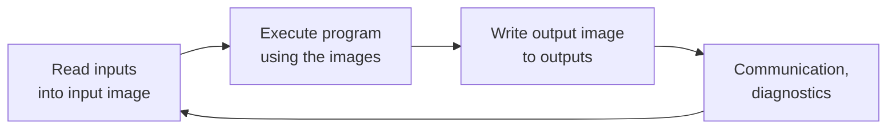
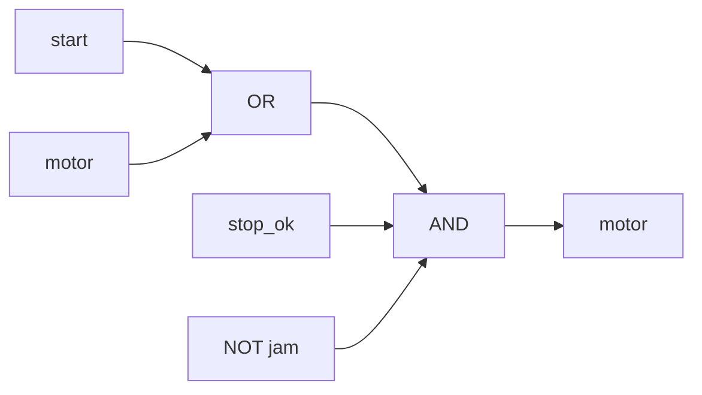

The [first entry](/blog/logic-and-sequential-control) developed the logic of automation, Boolean functions, latches, timers, counters and state machines, and evaluated it with Python on an ordinary computer. In a plant the same logic runs on a **programmable logic controller** (PLC): a ruggedized industrial computer with input and output circuits for field devices, a fixed pattern of program execution, and programming languages designed for control engineers rather than software developers.

This entry describes that controller from the outside in: its hardware, the **scan cycle** that determines when it sees its inputs and changes its outputs, the electrical form of those inputs and outputs, and then the software side, which is standardized by IEC 61131-3. The examples follow the third edition of that standard, **IEC 61131-3:2013**, which is the edition most current programming tools implement; where a detail differs between manufacturers it is labeled as vendor-specific. Python examples use Python 3 and its standard library only.

## 1. What a Programmable Logic Controller Is

### 1.1 From relay panels to programs

Before PLCs, machine logic was wired from relays, timers and counters in a cabinet, and changing a machine's sequence meant rewiring it. PLCs were introduced in the late 1960s, first in the automotive industry, to replace those panels with a program that could be changed without touching the wiring. That origin explains three features that remain today: the program is executed cyclically, as if every **rung** of a relay drawing (one horizontal path of contacts ending in a coil, as in the first entry's seal-in circuit) were being energized continuously; one of the main languages still looks like a relay drawing; and the controller is built to work in the cabinet the relays used to occupy, with the same supply voltages, temperatures and electrical noise.

### 1.2 Hardware

A PLC system consists of a few kinds of module, either as separate units on a rack or rail (a **modular** PLC) or combined in one housing (a **compact** PLC):

- the **power supply**, usually taking 24 V direct current (DC) or mains alternating current (AC);
- the **central processing unit** (CPU) module, which holds the processor, the program and data memory, and usually one or more communication ports;
- **input and output** (I/O) modules, which convert field signals into data and data into field signals (Section 3);
- **communication** modules for networks;
- optionally **remote I/O**: I/O modules placed out in the plant, close to the field devices, and connected to the CPU by a network rather than by individual wires. The [third entry](/blog/fieldbuses-and-industrial-ethernet) treats those networks.

The hardware requirements for programmable controllers, including operating conditions, power supply behavior and the electrical characteristics of digital inputs and outputs, are standardized in IEC 61131-2, a companion part to the programming standard used in this entry.

### 1.3 What distinguishes a PLC from a general-purpose computer

A PLC is a computer, but it is organized around a different priority: that a known program reads known inputs and updates known outputs within a known time, every time, for years. Several features follow:

- **Cyclic, deterministic execution.** The program does not wait for events in the usual sense; it is run again and again, and its execution time is monitored (Section 2.3).
- **Defined behavior at power-up and on faults.** What happens to variables and outputs after a power failure, a program stop or a hardware fault is specified and configurable (Section 6).
- **Online change.** On many controllers parts of the program can be modified while the machine runs, so a plant need not stop for a small correction (a vendor-specific capability whose extent varies).
- **I/O as a first-class resource.** Input and output data are mapped into the controller's memory and accessed like variables.

## 2. The Scan Cycle

### 2.1 Read, execute, write

The basic execution model of a PLC is a loop called the **scan cycle**:



1. **Read inputs.** The state of every input is copied into an area of memory called the **input image** (or process image of inputs).
2. **Execute the program.** The program runs from beginning to end. It reads inputs from the input image, not from the terminals, and writes outputs into the **output image**.
3. **Write outputs.** The output image is copied to the output modules, which switch the field devices.
4. **Housekeeping.** The controller services communication, runs self-diagnostics and starts the next cycle.

The time for one complete cycle is the **scan time**, typically a few milliseconds for a small machine program and longer for large ones. The images are the reason for the cycle's structure: during step 2 an input cannot change underneath the program. If a sensor changes state halfway through execution, every rung of the current scan still sees the old value, and every rung of the next scan sees the new one. A program in which two rungs saw different values of the same input in one scan would be very hard to reason about.

The cycle also explains the behavior that the first entry relied on. Edge detection (store the previous value, compare it with the present one) works because the program runs once per scan; the order of rungs matters because a variable written in one rung is seen by later rungs in the same scan and by earlier rungs only in the next scan.

### 2.2 Response time

How long after a field input changes does the output it controls change? The chain has four parts: the delay of the input circuit, which usually includes a filter against contact bounce and noise; the wait for the next input read; one scan of execution and output writing; and the switching delay of the output circuit. With input delay $t_\text{in}$, constant scan time $T_\text{scan}$ and output delay $t_\text{out}$, the response time $t_r$ lies within

$$
t_\text{in} + T_\text{scan} + t_\text{out} \;\lesssim\; t_r \;\le\; t_\text{in} + 2\,T_\text{scan} + t_\text{out}.
$$

The best case occurs when the filtered input change arrives just before an input read; the worst case when it arrives just after one and must wait almost a whole scan. The following program checks the bounds by simulating 100 000 input changes at random times, for an input filter of 3 ms, a scan time of 10 ms and a transistor output delay of 0.5 ms (illustrative values; actual figures come from the module and CPU datasheets):

```python
import random

T_SCAN = 10.0   # ms, constant scan time (read inputs, execute, write outputs)
T_IN = 3.0      # ms, input filter delay
T_OUT = 0.5     # ms, transistor output switching delay

def response(t_event):
    """Time from a field input change to the field output change."""
    seen = t_event + T_IN                       # change reaches the input module
    read = (seen // T_SCAN + 1) * T_SCAN        # next input read (scans start at k*T_SCAN)
    written = read + T_SCAN                     # outputs written at the end of that scan
    return written + T_OUT - t_event

random.seed(1)
samples = [response(random.uniform(0, 1000)) for _ in range(100_000)]
print(f"min {min(samples):.1f} ms, max {max(samples):.1f} ms, "
      f"mean {sum(samples) / len(samples):.1f} ms")
```

It prints `min 13.5 ms, max 23.5 ms, mean 18.5 ms`, matching the bounds $3 + 10 + 0.5 = 13.5$ ms and $3 + 20 + 0.5 = 23.5$ ms. The response time is not a single number but a range, and its width, one scan time, is a **jitter** that the application must tolerate. Remote I/O adds the network's own cycle to both ends of this chain, which is one reason the third entry cares so much about network timing.

A related consequence: an input pulse shorter than one scan time can fall entirely between two input reads and be missed. A pulse is guaranteed to be seen only if, after the input filter, it lasts longer than the longest interval between input reads. Fast events such as encoder pulses are therefore counted in hardware, by high-speed counter modules or interrupt inputs, rather than by the cyclic program (a vendor-specific facility on most controllers).

### 2.3 The watchdog

A program that enters an endless loop would freeze every output in its last state, which on a machine can be dangerous. PLCs therefore run a **watchdog**: a timer, restarted at each cycle, that stops the controller and puts it into a defined fault state if one cycle takes longer than a configured maximum. Loops inside a PLC program are permitted (Structured Text has `FOR` and `WHILE`), but a loop that waits for an input to change can never work, because the input image does not change during the scan; the program must instead remember where it is and check again in the next scan, as the state machines of the first entry do.

### 2.4 Tasks

Larger programs are not all equally urgent. IEC 61131-3 lets a program be divided among **tasks**, each with its own execution rule:

- a **cyclic** task runs its programs at a fixed interval (the `INTERVAL` attribute), such as every 10 ms for a fast motion interlock and every 100 ms for temperature loops;
- an **event** task runs once when a Boolean variable changes from FALSE to TRUE (the `SINGLE` attribute);
- a `PRIORITY` attribute decides which task runs first when several are ready; in the standard, 0 is the highest priority.

Whether a higher-priority task can interrupt a running lower-priority one (pre-emptive scheduling) or must wait for it to finish (non-pre-emptive) is left to the implementation, and so is the behavior of a "free-running" task that restarts as soon as it finishes. These are vendor-specific and must be checked for the controller in use.

## 3. Inputs and Outputs

### 3.1 Digital inputs

A digital input module converts a field voltage into a bit. The most common type in modern cabinets is 24 V DC. IEC 61131-2 defines the voltage and current ranges that count as ON and OFF for standard input types, so that sensors and modules from different manufacturers can be combined. Inputs are usually **optically isolated**: the field side and the logic side are coupled through light rather than a shared conductor, so that field wiring faults and noise do not reach the processor.

Electronic sensors with transistor outputs come in two polarities. A **PNP** (or "sourcing") sensor switches the positive supply to the input, and the input module sinks the current to 0 V; an **NPN** ("sinking") sensor switches the input to 0 V, and the module sources the current. A sensor and a module must be matched. PNP sensors with sinking inputs are the usual choice in European practice, while NPN wiring is common in parts of Asia; the terms "sinking" and "sourcing" are used inconsistently across manufacturers, so the module's wiring diagram is the reliable guide.

### 3.2 Digital outputs

Three output technologies are common:

| Output type | Switches | Strengths | Limitations |
|---|---|---|---|
| Relay | AC or DC, through a mechanical contact | Any voltage within the rating; galvanic isolation | Slow (milliseconds), limited number of operations, contact wear |
| Transistor | DC only | Fast (well under a millisecond), no wear | DC only; needs protection against inductive load spikes |
| Triac | AC only | No moving parts | AC only; small leakage current when off |

Inductive loads such as solenoid valves and contactor coils produce a voltage spike when switched off. Transistor modules generally include suppression for it, but relay outputs switching such loads need a suppressor (a diode for DC, a resistor–capacitor network for AC) at the load, or their contacts wear quickly.

### 3.3 Analog signals: the 4–20 mA current loop

Continuous measurements such as temperature, level, flow and pressure reach the PLC through **analog inputs**. Voltage signals (0–10 V) are used over short distances, but in process plants the standard is the **4–20 mA current loop**: the transmitter in the field controls the current in a two-wire loop, so that 4 mA represents the bottom of its range and 20 mA the top.

A current signal has three advantages over a voltage signal:

1. **Wire resistance does not matter.** The transmitter forces the current, so the resistance of a long cable changes the voltage drop around the loop but not the current, as long as the supply can provide enough voltage.
2. **Live zero.** The bottom of the range is 4 mA, not 0 mA. A broken wire gives 0 mA, which is clearly distinguishable from a measurement at the bottom of the range.
3. **Loop power.** A two-wire transmitter can draw its own operating power from the loop current, which must never fall below about 4 mA, so one pair of wires carries both power and signal.

At the receiver the current flows through a resistor, and the module measures the voltage across it; a 250 Ω resistor turns 4–20 mA into 1–5 V.

The live zero makes diagnostics possible. Recommendation NE 43 of NAMUR, an international association of users of automation technology in the process industries, standardizes the levels, and is widely followed: currents from 3.8 to 20.5 mA carry measurement information (slightly beyond 4–20 mA to allow for small under- and over-range), while a current at or below 3.6 mA or at or above 21 mA signals a transmitter or wiring failure. A PLC program should check this before using the value in a control loop.

### 3.4 Scaling analog values

An analog input module delivers an integer. How many counts represent 4 and 20 mA is **vendor-specific**; for example, several common controller families represent the nominal range by 0 to 27 648 counts, which leaves headroom above and below the nominal range for over- and under-range values. The program converts counts to milliamperes and milliamperes to engineering units by linear scaling:

$$
I = 4 + 16\,\frac{n}{n_\text{fs}} \ \text{mA}, \qquad
x = x_\text{lo} + \frac{I - 4}{16}\,(x_\text{hi} - x_\text{lo}),
$$

where $n$ is the count, $n_\text{fs}$ the count at 20 mA, and $x_\text{lo}$ and $x_\text{hi}$ are the measurement range limits that the transmitter has been configured for. For a pressure transmitter ranged 0–10 bar, a current of 12.8 mA means $x = 0 + (8.8/16)\times 10 = 5.5$ bar, and with $n_\text{fs} = 27\,648$ the module reports $n = 27\,648 \times 8.8/16 = 15\,206.4$, rounded to 15 206 counts. One count corresponds to $10/27\,648 \approx 0.000\,36$ bar, so the module's quantization (see [Sampling, Quantization and Data Conversion](/blog/sampling-quantization-and-data-conversion)) is far finer than the accuracy of a typical industrial transmitter.

```python
def ma_to_value(i_ma, lo, hi):
    """Linear 4-20 mA scaling to engineering units."""
    return lo + (i_ma - 4.0) / 16.0 * (hi - lo)

def signal_status(i_ma):
    """Signal ranges of NAMUR NE 43."""
    if i_ma <= 3.6 or i_ma >= 21.0:
        return "failure"
    if 3.8 <= i_ma <= 20.5:
        return "measurement"
    return "suspect (between the ranges)"

for i in (12.8, 3.9, 20.6, 2.0):
    print(f"{i:5.1f} mA -> {ma_to_value(i, 0.0, 10.0):6.3f} bar, {signal_status(i)}")
```

```text
 12.8 mA ->  5.500 bar, measurement
  3.9 mA -> -0.063 bar, measurement
 20.6 mA -> 10.375 bar, suspect (between the ranges)
  2.0 mA -> -1.250 bar, failure
```

The second line shows why the status check matters: 3.9 mA is a valid signal slightly below the range, and scaling gives a small negative pressure that the program should clamp to zero rather than pass on. The last line, a broken loop, would give a negative pressure of −1.25 bar if scaled blindly.

Analog outputs work the other way: the program writes a count, and the module drives a 4–20 mA current, typically to a control valve positioner or a drive's speed input. The [fourth entry](/blog/pid-control-of-process-variables) closes feedback loops through exactly these inputs and outputs.

## 4. The IEC 61131-3 Software Model

### 4.1 Why a standard

Until the 1990s each PLC manufacturer had its own programming languages. IEC 61131-3, first published in 1993, with a second edition in 2003 and the third edition in 2013, defines a common software model, common data types and five programming languages. It does not make programs portable between manufacturers' tools without effort, since each implements a subset with its own extensions, but it gives engineers one vocabulary and one set of semantics to learn.

### 4.2 Configuration, resource, task, program

The standard describes a control system as a hierarchy:

- a **configuration** is the whole software of one PLC system;
- it contains one or more **resources**, each roughly a processor able to run programs;
- each resource runs **tasks** (Section 2.4), which execute **programs**.

Code is organized into **program organization units** (POUs) of three kinds:

| POU | Has memory between calls? | Typical use |
|---|---|---|
| Function | No: the same inputs always give the same output | Arithmetic, scaling, comparisons |
| Function block | Yes: each **instance** keeps its own internal variables | Timers, counters, a motor or valve with its interlocks and alarms |
| Program | Yes | The top level, connected to I/O and assigned to a task |

The function block is the central idea. A timer is a function block, and a program that times three different things declares three instances of it, each with its own elapsed time. In the same way an engineer writes one `Motor` function block and declares an instance per motor, so that every motor in the plant behaves identically. The third edition added object-oriented features to function blocks (methods, interfaces and inheritance) and a `CLASS` construct, which some current tools support and others do not.

### 4.3 Variables and data types

Variables are declared in blocks that state their role: `VAR_INPUT`, `VAR_OUTPUT` and `VAR_IN_OUT` for a POU's interface, `VAR` for internal variables, and `VAR_GLOBAL` with `VAR_EXTERNAL` for variables shared between POUs. The qualifier `RETAIN` keeps a variable's value through a power failure (Section 6).

The elementary data types include `BOOL`; integers such as `INT` (16 bits) and `DINT` (32 bits) and their unsigned forms (`UINT`, `UDINT`); `REAL` and `LREAL` (32- and 64-bit floating point); `TIME` for durations, written as literals such as `T#3s` or `T#250ms`; and `STRING`. Users can define enumerations, structures and arrays.

A variable can be tied to a physical input or output by a **direct address**, such as `%IX0.0` (input, bit 0.0), `%QX0.1` (output bit) or `%IW64` (input word). The prefix letters `I`, `Q` and `M` (memory) and size letters `X` (bit), `B`, `W`, `D` and `L` are standardized; how the numbers map to slots, modules and channels is vendor-specific. Many tools today hide addresses behind symbolic I/O configuration.

### 4.4 Standard function blocks

The standard defines the building blocks of the first entry as function blocks with fixed names and interfaces:

| Function block | Inputs | Outputs | Behavior |
|---|---|---|---|
| `TON`, `TOF`, `TP` | `IN`, `PT` | `Q`, `ET` | On-delay, off-delay and pulse timers |
| `CTU` | `CU`, `R`, `PV` | `Q`, `CV` | Up counter: `CV` counts rising edges of `CU`, `Q` is `CV >= PV` |
| `CTD`, `CTUD` | (similar) | (similar) | Down counter, up–down counter |
| `R_TRIG`, `F_TRIG` | `CLK` | `Q` | Rising- and falling-edge detection |
| `SR`, `RS` | `S1`, `R` / `S`, `R1` | `Q1` | Set-dominant and reset-dominant latches |

The digit 1 in `S1` and `R1` marks the dominant input.

## 5. The Five Languages

IEC 61131-3:2013 defines two textual and two graphical languages, plus Sequential Function Chart, which structures programs written in the others. The same small task shows each one. A conveyor motor is started and stopped by buttons, as in the seal-in circuit of the first entry, and is stopped by a jam alarm when a photoelectric sensor at the conveyor's exit stays blocked for more than 3 s while the motor runs. The alarm stays on until the operator presses Reset.

### 5.1 Ladder Diagram (LD)

Ladder Diagram is the relay drawing turned into a language. Two vertical **power rails** run down the sides, and horizontal **rungs** between them contain **contacts** (`| |` normally open, `|/|` normally closed, here meaning "variable is TRUE" and "variable is FALSE") and **coils** (`( )`), which are assigned the result of the rung. Contacts and coils refer to variables, not to physical relays. Function blocks appear as boxes in the rung, and their outputs can be used as contacts elsewhere, as `jam_tmr.Q` is in the third rung below.

```text
      start     stop_ok     jam                  motor
 |----| |----+----| |-------|/|------------------( )----|
 |           |                                          |
 |    motor  |                                          |
 |----| |----+                                          |
 |                                                      |
 |    motor    exit_eye    +-------------+              |
 |----| |-------| |--------|IN   TON    Q|              |
 |                 T#3s ---|PT  jam_tmr  |              |
 |                         +-------------+              |
 |                                                      |
 | jam_tmr.Q      reset                         jam     |
 |----| |----+----|/|----------------------------( )----|
 |           |                                          |
 |    jam    |                                          |
 |----| |----+                                          |
```

Ladder is easy for electricians to read and to monitor online: the editor colors the conducting contacts, so a technician can see at a glance why a motor does not start. Its weakness is anything that is not Boolean: arithmetic, data handling and long sequences become cluttered.

### 5.2 Function Block Diagram (FBD)

Function Block Diagram draws the program as a network of boxes (functions and function block instances) connected by lines that carry values, like a signal-flow diagram. The motor logic becomes:



FBD suits continuous control and signal processing, where data flows from measurement through calculation to output; proportional–integral–derivative (PID) controllers, scaling and filters are naturally drawn this way.

### 5.3 Structured Text (ST)

Structured Text is a high-level textual language with a syntax descended from Pascal: assignments with `:=`, `IF`, `CASE`, `FOR`, `WHILE` and `REPEAT` statements, and comments between `(*` and `*)`. The whole conveyor function block reads:

```text
FUNCTION_BLOCK FB_Conveyor
VAR_INPUT
    start    : BOOL;   (* Start button, normally open *)
    stop_ok  : BOOL;   (* Stop button, normally closed: TRUE while released *)
    exit_eye : BOOL;   (* photoelectric sensor: TRUE while the beam is blocked *)
    reset    : BOOL;   (* alarm reset button *)
END_VAR
VAR_OUTPUT
    motor    : BOOL;
    jam      : BOOL;
END_VAR
VAR
    jam_tmr  : TON;
END_VAR

motor := (start OR motor) AND stop_ok AND NOT jam;
jam_tmr(IN := motor AND exit_eye, PT := T#3s);
jam := NOT reset AND (jam_tmr.Q OR jam);    (* reset-dominant latch *)
END_FUNCTION_BLOCK
```

Each line corresponds to one rung of the ladder version. A program declares an instance, `conveyor1 : FB_Conveyor;`, and calls it once per scan with its inputs connected. Structured Text is the natural choice for calculations, data handling and state machines. The mixing-tank sequence of the first entry translates directly into a `CASE` statement over an enumerated state, with transitions, timers and outputs in separate sections:

```text
TYPE TankState : (IDLE, FILL, MIX, DRAIN); END_TYPE

PROGRAM MixingTank
VAR
    start_pb    AT %IX0.0 : BOOL;   (* addresses: mapping is vendor-specific *)
    level_low   AT %IX0.1 : BOOL;
    level_high  AT %IX0.2 : BOOL;
    inlet_valve AT %QX0.0 : BOOL;
    agitator    AT %QX0.1 : BOOL;
    drain_valve AT %QX0.2 : BOOL;
    state       : TankState := IDLE;
    mix_tmr     : TON;
END_VAR

(* 1. Transitions: at most one per scan *)
CASE state OF
    IDLE:  IF start_pb AND NOT level_low THEN state := FILL; END_IF;
    FILL:  IF level_high THEN state := MIX; END_IF;
    MIX:   IF mix_tmr.Q THEN state := DRAIN; END_IF;
    DRAIN: IF NOT level_low THEN state := IDLE; END_IF;
END_CASE;

(* 2. Timers *)
mix_tmr(IN := (state = MIX), PT := T#30s);

(* 3. Outputs from the state (Moore form), with the dry-running interlock *)
inlet_valve := (state = FILL);
agitator    := (state = MIX) AND level_low;
drain_valve := (state = DRAIN);
END_PROGRAM
```

In the scan in which the state changes to MIX, the timer is called with `IN` TRUE and starts; in the scan after MIX ends, it is called with `IN` FALSE and resets, ready for the next batch.

### 5.4 Instruction List (IL)

Instruction List is a low-level textual language resembling assembly code, with an accumulator that holds the current result. The motor rung is:

```text
LD    start      (* load start into the current result *)
OR    motor
AND   stop_ok
ANDN  jam        (* AND NOT *)
ST    motor      (* store the current result *)
```

The third edition of IEC 61131-3 marks Instruction List as **deprecated**: it remains in the standard for existing programs but should not be used for new ones. It appears in older installations and in some compact controllers' own instruction sets.

### 5.5 Sequential Function Chart (SFC)

Sequential Function Chart is the standard's graphical form of the state machine. A chart consists of **steps** (boxes; the initial step has a double border), **transitions** (short bars between steps, each with a Boolean condition) and **actions** attached to steps. A step becomes active when the transition before it fires, and the transition fires when its preceding step is active and its condition is TRUE. Unlike the single-state machine of the first entry, a chart can split into **simultaneous branches** that run in parallel and later join, for example to heat and stir at the same time.

Each action has a **qualifier** that says how it relates to its step's activity:

| Qualifier | Meaning |
|---|---|
| N | Non-stored: active while the step is active (the Moore output) |
| S, R | Set (stored) and reset: stays active after the step ends, until reset |
| P | Pulse: executed once when the step becomes active |
| L | Time-limited: active for a given time while the step is active |
| D | Time-delayed: becomes active after a given time if the step is still active |

Transition conditions and actions are written in any of the other languages. The mixing-tank chart has the same four steps and four transitions as the diagram in [Section 5.2 of the first entry](/blog/logic-and-sequential-control#52-a-worked-example-a-mixing-tank), with N actions for the valves and agitator. SFC's advantage is that a chart can be watched online: the active steps are highlighted, so a stalled sequence shows directly which transition it is waiting for.

### 5.6 Choosing a language

| Language | Form | Best for |
|---|---|---|
| Ladder Diagram | Graphical | Discrete interlocks, logic that electricians maintain |
| Function Block Diagram | Graphical | Continuous control, signal flow, reusable blocks |
| Structured Text | Textual | Calculations, data handling, complex state machines |
| Instruction List | Textual (deprecated) | Existing programs only |
| Sequential Function Chart | Graphical structure | Sequences and batch phases |

Most projects mix them: SFC for the top-level sequence, Structured Text for calculations, Ladder or FBD for interlocks that the plant's maintenance staff need to read.

## 6. Writing Reliable PLC Programs

The standard defines the languages; good practice decides whether a program is safe to run and easy to maintain. A few rules matter most:

- **Assign each output in one place.** If two rungs write the same coil, the last one in the scan wins, and the first one silently does nothing (the first entry's Section 5.3 made the same point about sequences).
- **Define start-up behavior.** IEC 61131-3 distinguishes a **cold restart**, in which all variables take their initial values, from a **warm restart**, in which `RETAIN` variables keep the values they had before the power failure. Counters of produced parts are usually retained; a "motor running" latch should not be, or a machine could restart by itself when power returns.
- **Define stop and fault behavior of outputs.** Whether outputs go to 0, hold their last value or go to a configured substitute value when the CPU stops is set in the hardware configuration and is vendor-specific. The choice must suit each actuator: a cooling-water valve may need to stay open.
- **Check analog signals before use** (Section 3.3), and add time-outs to sequence steps.
- **Test on a simulation first.** Most programming tools can run the program against a simulated plant, a theme the [fifth entry](/blog/networked-automation-and-digital-twins) returns to as virtual commissioning.
- **Keep safety functions separate.** Emergency stops and guard interlocks are implemented by safety-rated hardware or a **safety PLC**, designed and validated under the functional-safety standard IEC 61508 and its machinery counterparts IEC 62061 and ISO 13849-1, not by ordinary program logic.

## 7. Exercises

**Exercise 1.** A PLC has an input filter of 6 ms, a constant scan time of 15 ms and relay outputs that take 10 ms to close. What are the best- and worst-case response times from a sensor change to the output contact closing?

<details>
<summary>Answer</summary>

Best case $6 + 15 + 10 = 31$ ms; worst case $6 + 2 \times 15 + 10 = 46$ ms. The relay output contributes as much as the input filter and the scan combined in the best case, which is why fast actuators are driven from transistor outputs.

</details>

**Exercise 2.** A level transmitter is ranged 0–4 m. The input module reports 22 118 counts with $n_\text{fs} = 27\,648$ at 20 mA. What are the current and the level? What should the program do if the module reported −4 000 counts?

<details>
<summary>Answer</summary>

$I = 4 + 16 \times 22\,118/27\,648 = 16.80$ mA, and the level is $(16.80 - 4)/16 \times 4 = 3.20$ m. A count of −4 000 corresponds to $4 - 16 \times 4\,000/27\,648 = 1.69$ mA, at or below the NE 43 failure limit of 3.6 mA, so the program should flag a wiring or transmitter fault and not use the value (in practice such a module may also report a wire-break status bit, whose form is vendor-specific).

</details>

**Exercise 3.** Why does this Structured Text loop freeze a PLC instead of waiting for the door to close: `WHILE NOT door_closed DO END_WHILE;`?

<details>
<summary>Answer</summary>

`door_closed` is read from the input image, which is updated only between scans. Inside the loop the value never changes, so the loop never ends, the scan never finishes and the watchdog trips. The correct approach is a state that waits: in each scan, check `door_closed` and change state when it becomes TRUE.

</details>

**Exercise 4.** In the `FB_Conveyor` block of Section 5.3, follow the scan in which the jam timer expires and the scan after it. When does the motor output switch off? How could the three statements be reordered so that it switches off one scan earlier?

<details>
<summary>Answer</summary>

In the scan in which the timer expires, the first statement computes `motor` with the value of `jam` from the previous scan, which is still FALSE, so `motor` stays TRUE; only then do the timer and the latch set `jam`. The output image written at the end of that scan still has the motor on, and it switches off at the end of the next scan, one scan time later. Ordering the statements as timer, latch, motor (the timer then uses the previous scan's `motor`, which is TRUE) sets `jam` and clears `motor` in the same scan. In that next scan the timer's input is FALSE, so `jam_tmr.Q` returns to FALSE and the latch holds the alarm. Statement order within a scan is part of a PLC program's timing.

</details>

**Exercise 5.** A 4–20 mA loop is powered from 24 V. The transmitter needs at least 12 V across its terminals to operate, and the receiver resistor is 250 Ω. What is the largest total cable resistance that still lets the transmitter signal a 21 mA failure current?

<details>
<summary>Answer</summary>

At 21 mA the receiver drops $0.021 \times 250 = 5.25$ V, leaving $24 - 12 - 5.25 = 6.75$ V for the cable, so $R_\text{cable} \le 6.75/0.021 \approx 321\ \Omega$ (for both conductors together).

</details>

## 8. Summary

| Question | Answer |
|---|---|
| What is a PLC? | A ruggedized computer with field I/O that runs a control program cyclically, with defined timing and fault behavior. |
| What happens in one scan? | Inputs are copied to the input image, the program runs on the images, the output image is written to the outputs, then communication and diagnostics. |
| What is the response time? | Between $t_\text{in} + T_\text{scan} + t_\text{out}$ and $t_\text{in} + 2T_\text{scan} + t_\text{out}$; the range is jitter of one scan. |
| Why 4–20 mA? | Current is unaffected by cable resistance, the live zero exposes broken wires, and the loop can power the transmitter. |
| How is an analog value scaled? | Counts to milliamperes (vendor-specific full scale), then linearly to engineering units, after checking the NE 43 failure ranges. |
| What does IEC 61131-3 standardize? | A software model (configuration, resource, task, POUs), data types, standard function blocks and five languages; this series uses the 2013 third edition. |
| Function or function block? | A function has no memory; a function block instance keeps its state between calls. |
| Which languages exist? | Ladder Diagram, Function Block Diagram, Structured Text, Instruction List (deprecated in 2013) and Sequential Function Chart. |

A single PLC with its own I/O wired back to the cabinet is only the simplest case. Once I/O is distributed around the plant, and controllers talk to drives, other controllers and operator stations, the timing analysis of Section 2.2 extends across a network. The next entry, [Fieldbuses and Industrial Ethernet](/blog/fieldbuses-and-industrial-ethernet), examines how those networks achieve the predictable timing that control needs.

### References

- IEC 61131-3:2013, *Programmable Controllers – Part 3: Programming Languages*, International Electrotechnical Commission.
- IEC 61131-2, *Programmable Controllers – Part 2: Equipment Requirements and Tests*, International Electrotechnical Commission.
- K.-H. John and M. Tiegelkamp, *IEC 61131-3: Programming Industrial Automation Systems*, 2nd edition, Springer, 2010.
- W. Bolton, *Programmable Logic Controllers*, 6th edition, Newnes, 2015.
- F. D. Petruzella, *Programmable Logic Controllers*, 5th edition, McGraw-Hill, 2016.
- NAMUR Recommendation NE 43, on the standardization of signal levels for failure information from transmitters with analog output, NAMUR.
- IEC 61508, *Functional Safety of Electrical/Electronic/Programmable Electronic Safety-Related Systems*, International Electrotechnical Commission.
