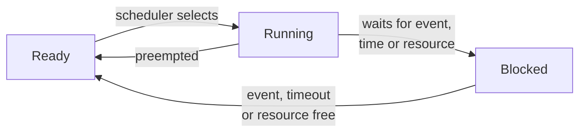

The previous entries built up the hardware side of an embedded system. [The first](/blog/inside-a-microcontroller) defined deadlines, response time and jitter, and showed why a superloop couples the timing of every job to every other. [The second](/blog/interrupts-polling-and-dma) moved urgent data handling into interrupt service routines (ISRs) and direct memory access (DMA). It also showed how to pass data safely from an ISR to the rest of the program. [The third](/blog/serial-buses-uart-spi-i2c-and-can) described the buses that carry data in and out, ending with the Controller Area Network (CAN), whose identifier-based arbitration is a priority scheduler for messages.

What remains is the processing itself: a control law computed every 4 ms, messages assembled every 6 ms, a log written every 12 ms, each with its own deadline. This entry shows how a real-time operating system (RTOS) organizes that work into prioritized tasks, and then develops the scheduling theory that answers the central question of real-time design before the system is built: will every task meet its deadline in the worst case?

**Conventions.** Times in the task examples are in milliseconds. Code is C11. The periodic-task example uses the real-time interface of the Portable Operating System Interface (POSIX), IEEE Std 1003.1-2017, so that it can be compiled on a desktop; the interfaces used here are unchanged in the current 2024 edition. Other RTOS concepts are described without any particular kernel's API, because names differ between kernels while the concepts do not. Calculations use Python 3 with the standard library. Priorities are described as "higher" and "lower" in meaning; kernels differ in whether a larger number means a higher priority (on the Cortex-M interrupt controller of the second entry it means a lower one).

## 1. From superloop to tasks

### 1.1 What a real-time operating system provides

A **real-time operating system** (RTOS) is a small software kernel that lets firmware be written as several independent **tasks** (also called threads), each a function with its own stack that runs as if it had the processor to itself. The kernel decides which task runs at each moment, and provides services for waiting, timing and communication between tasks. Widely used examples range from small kernels that occupy a few kibibytes of flash on a microcontroller to larger systems with networking and file systems; this entry is about what they have in common.

An RTOS differs from a general-purpose operating system in its goal. A desktop operating system tries to make the average case fast and to share the processor fairly. An RTOS tries to make the worst case **predictable**: a high-priority task becomes able to run within a bounded time of its event, regardless of what lower-priority tasks are doing, and every kernel service takes a bounded time.

### 1.2 Tasks and their states

Each task is described to the kernel by a **task control block** (TCB), which holds its priority, its state and its saved stack pointer, and each task has its own stack in static RAM (SRAM). Stacks are the main memory cost of an RTOS: ten tasks with 1 KiB stacks use 10 KiB, about 16% of the 64 KiB SRAM of [the first entry's example](/blog/inside-a-microcontroller#34-where-the-programs-data-lives), and an overflowing stack silently corrupts whatever lies next to it. The fifth entry shows how to measure how much of each stack is used.

At any moment a task is in one of a few states:



- **Running**: executing on the processor. On a single-core microcontroller exactly one task (or an ISR) runs at a time.
- **Ready**: able to run, but a task of higher priority is running.
- **Blocked**: waiting for something: a time to arrive, a message, a semaphore, a mutex. A blocked task uses no processor time, which is the key difference from the busy-waiting of [the second entry](/blog/interrupts-polling-and-dma#21-busy-waiting-and-periodic-polling).

Kernels usually add a **suspended** state (removed from scheduling by explicit request) and always have an **idle task** of the lowest priority, which runs when nothing else is ready and is the natural place to enter a low-power mode.

### 1.3 The context switch

Changing the running task is a **context switch**: the kernel saves the processor registers of the outgoing task on its stack, stores its stack pointer in its TCB, loads the incoming task's stack pointer and restores its registers. When the switch is caused by an interrupt (a timer, or an ISR that makes a higher-priority task ready), the kernel performs it on the way out of the interrupt, so the ISR returns into a different task from the one it interrupted. On Arm Cortex-M cores, kernels conventionally do this in the **PendSV** exception, a software-triggered exception that the architecture provides for the purpose and that kernels set to the lowest priority, so that the switch happens only after all other pending interrupts have been handled.

A context switch costs processor time that depends on the core, the kernel and whether floating-point registers must be saved. It is overhead that the scheduling analysis must include, usually by adding the cost of two switches (in and out) to each job's execution time, and it is one of the quantities measured in the fifth entry.

### 1.4 Time: the tick and periodic tasks

Most kernels keep time with a periodic **tick** interrupt from a hardware timer, for example every 1 ms ([Section 5.1 of the first entry](/blog/inside-a-microcontroller#51-counter-prescaler-and-reload) computed the settings for one). Timeouts and delays are counted in ticks, so their resolution is one tick: a request to wait "1 tick" may end anywhere from just after the call to one full tick later, depending on where in the tick period it was made. Some kernels can stop the tick while idle (**tickless** operation) to save power, reprogramming a timer for the next time-based event instead.

Most real-time work is **periodic**: sample, compute, output, every $T$ milliseconds. A periodic task must wait until an **absolute** time, the previous release plus $T$, not for a **relative** delay of $T$ after finishing its work. A relative delay adds the task's own execution time and any preemption to every period, so the task drifts later and later. The pattern below uses the POSIX function `clock_nanosleep` with `TIMER_ABSTIME`; every RTOS has an equivalent "delay until" service.

```c
/* Fragment: the body of a periodic task (POSIX, C11). */
struct timespec next;
clock_gettime(CLOCK_MONOTONIC, &next);          /* first release: now   */
for (;;) {
    do_periodic_work();                         /* sample, compute, act */
    next.tv_nsec += PERIOD_NS;                  /* next release time    */
    while (next.tv_nsec >= 1000000000L) {       /* normalize timespec   */
        next.tv_nsec -= 1000000000L;
        next.tv_sec  += 1;
    }
    clock_nanosleep(CLOCK_MONOTONIC, TIMER_ABSTIME, &next, NULL);
}
```

The releases then stay on the grid $0, T, 2T, \dots$ however long each job takes, as long as it finishes within its period. The fifth entry runs a complete version of this loop and measures how late each wake-up is.

### 1.5 Preemptive fixed-priority scheduling

The scheduling policy of almost every RTOS is **preemptive fixed-priority scheduling**: each task has a priority assigned by the designer, and at every moment the highest-priority ready task runs. When a higher-priority task becomes ready, for example because its period has come round or an ISR has given it data, it **preempts** the running task immediately (at the next context switch), and the preempted task resumes later where it stopped. ISRs, which the hardware runs, take precedence over all tasks.

This gives the designer one control, the priority order, and a clear guarantee: the timing of a task can be affected only by tasks of higher priority (and by ISRs, and by lower-priority tasks only through shared resources, Section 3). The rest of this entry is about choosing priorities and proving that the result meets every deadline.

## 2. Scheduling analysis

### 2.1 The periodic task model

Scheduling theory describes the workload as a set of tasks $\tau_1, \dots, \tau_n$, each characterized by three numbers:

- $C_i$, the **worst-case execution time** (WCET): the longest time a job of the task needs on the processor when it runs without interruption, including its share of kernel overhead;
- $T_i$, the **period**: the interval between releases (for a **sporadic** task, released by events rather than a clock, the minimum interval between releases);
- $D_i$, the **relative deadline**, as defined in [the first entry](/blog/inside-a-microcontroller#12-real-time-events-deadlines-latency-and-jitter), with $D_i \le T_i$ in this entry.

The classical results also assume that tasks do not suspend themselves in the middle of a job, that a job is released exactly at the start of its period, and, until Section 3, that tasks share no resources. The response time $R_i$ of a task is the longest response time of any of its jobs; the task set is **schedulable** if $R_i \le D_i$ for every task.

The **utilization** of a task is the fraction of the processor it needs, $C_i/T_i$, and of the set

$$
U = \sum_{i=1}^{n} \frac{C_i}{T_i} .
$$

$U \le 1$ is necessary on one processor: a set that needs more than all of the processor's time cannot be scheduled by any policy. It is not sufficient for fixed priorities, as Section 2.5 shows.

The running example of this entry has three tasks, with deadlines equal to periods:

| Task | Job | $C_i$ (ms) | $T_i = D_i$ (ms) | $C_i / T_i$ |
|---|---|---|---|---|
| $\tau_1$ | Control law: read samples, compute, update the pulse-width modulation (PWM) output | 1 | 4 | 0.250 |
| $\tau_2$ | Assemble and send CAN messages | 2 | 6 | 0.333 |
| $\tau_3$ | Write log records to flash | 3 | 12 | 0.250 |

Its utilization is $U = 0.833$.

### 2.2 Choosing priorities

**Rate-monotonic** (RM) priority assignment gives higher priority to tasks with shorter periods. Liu and Layland proved in 1973 that, for independent periodic tasks with deadlines equal to periods, RM is optimal among fixed-priority assignments: if any fixed priority order makes the set schedulable, RM does. When deadlines are shorter than periods, **deadline-monotonic** (DM) assignment, which orders tasks by relative deadline, is optimal in the same sense (Leung and Whitehead, 1982). In the running example RM and DM agree: $\tau_1$ highest, $\tau_3$ lowest.

The principle matches the advice in [Section 3.3 of the second entry](/blog/interrupts-polling-and-dma#33-priorities-and-nesting) for interrupt priorities, and it often conflicts with intuition. Priority expresses urgency (how soon the work must be done), not importance. A safety-critical task with a 100 ms deadline should normally have lower priority than a routine task with a 5 ms deadline; if both are schedulable, both meet their deadlines, and that is what matters.

### 2.3 The utilization bound

Liu and Layland also gave a simple sufficient test. Under RM priorities, a set of $n$ independent periodic tasks with deadlines equal to periods is schedulable if

$$
U \le n\left(2^{1/n} - 1\right).
$$

The bound is 1 for one task, 0.828 for two, 0.780 for three, and it decreases towards $\ln 2 = 0.693$ as $n$ grows. The test is quick but pessimistic: a set above the bound may still be schedulable. The running example, at $U = 0.833$ with $n = 3$, exceeds 0.780, so the test cannot decide, and an exact analysis is needed.

### 2.4 Response-time analysis

The exact test for fixed-priority scheduling computes each task's worst-case response time directly. It rests on the **critical instant**: a task's longest response time occurs when it is released at the same moment as every higher-priority task, so that it suffers the most possible preemption. In a window of length $R$, a higher-priority task $\tau_j$ is released at most $\lceil R/T_j \rceil$ times (the ceiling rounds up, counting a release that occurs just before the window closes), and each release takes up to $C_j$ of processor time. The response time of $\tau_i$ is therefore the smallest $R_i$ that satisfies

$$
R_i = C_i + B_i + \sum_{j \in hp(i)} \left\lceil \frac{R_i}{T_j} \right\rceil C_j ,
$$

where $hp(i)$ is the set of tasks of higher priority than $\tau_i$, and $B_i$ is the **blocking** time from lower-priority tasks, zero until Section 3. The equation is solved by iteration, starting from $R_i = C_i + B_i$ and substituting until the value stops changing (the task is schedulable) or exceeds $D_i$ (it is not). This is **response-time analysis** (RTA), due to Joseph and Pandya (1986) and extended by Audsley, Burns, Richardson, Tindell and Wellings (1993).

For $\tau_3$ in the running example ($C_3 = 3$, interfered with by $\tau_1$ and $\tau_2$):

| Iteration | $R$ | $\lceil R/4 \rceil \cdot 1$ | $\lceil R/6 \rceil \cdot 2$ | New $R$ |
|---|---|---|---|---|
| 1 | 3 | 1 | 2 | 6 |
| 2 | 6 | 2 | 2 | 7 |
| 3 | 7 | 2 | 4 | 9 |
| 4 | 9 | 3 | 4 | 10 |
| 5 | 10 | 3 | 4 | 10 |

The value settles at $R_3 = 10 \le 12$, so $\tau_3$ always meets its deadline, with 2 ms to spare. An adapted form of the equation, with a blocking term for a lower-priority frame already on the bus (a frame cannot be preempted once it has won arbitration), gives the worst-case response times of the CAN messages of the third entry. The adaptation needs care: Davis, Burns, Bril and Lukkien (2007) showed that the earlier, direct version could be optimistic, because of that non-preemption, and gave the corrected analysis. The same calculation in Python, for the running example (set A), for a variant in which $\tau_3$ needs 4 ms (set B), and for set A with blocking (used in Section 3.4):

```python
import math

def rm_bound(n):
    """Liu and Layland utilization bound for n tasks under rate-monotonic priorities."""
    return n * (2 ** (1 / n) - 1)

def response_times(tasks):
    """Tasks: list of dicts with C, T, D and optional B, highest priority first.
    Returns the worst-case response time of each task, or None if it exceeds D."""
    results = []
    for i, t in enumerate(tasks):
        higher = tasks[:i]
        r = t["C"] + t.get("B", 0)
        while True:
            interference = sum(math.ceil(r / h["T"]) * h["C"] for h in higher)
            r_next = t["C"] + t.get("B", 0) + interference
            if r_next == r or r_next > t["D"]:
                break
            r = r_next
        results.append(r_next if r_next <= t["D"] else None)
    return results

def report(name, tasks):
    u = sum(t["C"] / t["T"] for t in tasks)
    print(f"{name}: U = {u:.4f}, RM bound for n={len(tasks)}: {rm_bound(len(tasks)):.4f}")
    for t, r in zip(tasks, response_times(tasks)):
        verdict = f"R = {r}" if r is not None else "deadline missed"
        print(f"  {t['name']}: C={t['C']} T={t['T']} D={t['D']} B={t.get('B', 0)} -> {verdict}")

base = [dict(name="tau1", C=1, T=4, D=4),
        dict(name="tau2", C=2, T=6, D=6),
        dict(name="tau3", C=3, T=12, D=12)]
report("Set A", base)

heavier = [dict(t) for t in base]
heavier[2]["C"] = 4
report("Set B (tau3 needs 4 ms)", heavier)

blocking = [dict(t) for t in base]
blocking[0]["B"] = 0.5
blocking[1]["B"] = 0.5
report("Set A with a 0.5 ms critical section in tau3", blocking)
```

```text
Set A: U = 0.8333, RM bound for n=3: 0.7798
  tau1: C=1 T=4 D=4 B=0 -> R = 1
  tau2: C=2 T=6 D=6 B=0 -> R = 3
  tau3: C=3 T=12 D=12 B=0 -> R = 10
Set B (tau3 needs 4 ms): U = 0.9167, RM bound for n=3: 0.7798
  tau1: C=1 T=4 D=4 B=0 -> R = 1
  tau2: C=2 T=6 D=6 B=0 -> R = 3
  tau3: C=4 T=12 D=12 B=0 -> R = 11
Set A with a 0.5 ms critical section in tau3: U = 0.8333, RM bound for n=3: 0.7798
  tau1: C=1 T=4 D=4 B=0.5 -> R = 1.5
  tau2: C=2 T=6 D=6 B=0.5 -> R = 3.5
  tau3: C=3 T=12 D=12 B=0 -> R = 10
```

Set B, at a utilization of 0.917, is still schedulable, which shows how pessimistic the utilization bound can be.

The analysis can be checked against a simulation of the schedule. The program below steps through time in 1 ms units, releases every task at time 0 (the critical instant) and at each period, and always runs the ready job with the highest priority. (It treats a job still unfinished at its deadline as a miss and drops it, which is enough to detect misses.) It also supports earliest-deadline-first scheduling, used in Section 2.5.

```python
from math import lcm

def simulate(tasks, policy, horizon=None):
    """Unit-time simulation of preemptive scheduling, all tasks released at 0.
    tasks: list of (name, C, T) with D = T, listed highest priority first.
    policy: 'fp' (fixed priority, list order) or 'edf' (earliest deadline first).
    Returns the timeline string and the list of deadline misses."""
    horizon = horizon or lcm(*(T for _, _, T in tasks))
    jobs, timeline, misses = [], [], []
    for t in range(horizon):
        for prio, (name, C, T) in enumerate(tasks):
            if t % T == 0:
                jobs.append({"name": name, "left": C, "deadline": t + T, "prio": prio})
        for j in jobs:
            if j["left"] > 0 and j["deadline"] <= t:
                misses.append((j["name"], j["deadline"]))
                j["left"] = 0
        ready = [j for j in jobs if j["left"] > 0]
        if ready:
            key = (lambda j: j["prio"]) if policy == "fp" else (lambda j: (j["deadline"], j["prio"]))
            run = min(ready, key=key)
            run["left"] -= 1
            timeline.append(run["name"][-1])
        else:
            timeline.append(".")
    return "".join(timeline), misses

set_a = [("tau1", 1, 4), ("tau2", 2, 6), ("tau3", 3, 12)]
line, misses = simulate(set_a, "fp")
print("Set A, fixed priority:", line, "misses:", misses)

set_c = [("tau1", 2, 5), ("tau2", 4, 7)]
for policy in ("fp", "edf"):
    line, misses = simulate(set_c, policy)
    print(f"Set C, {policy:>3}:", line, "misses:", misses)
```

```text
Set A, fixed priority: 1223132213.. misses: []
Set C,  fp: 1122211222112.21122211222112221122. misses: [('tau2', 7)]
Set C, edf: 1122221122221121122211222211221122. misses: []
```

Each character of the timeline is one millisecond and names the task that ran (a dot is idle time). For set A, $\tau_3$ runs in the slots at 3, 5 and 9 ms, so its first job completes at 10 ms, exactly the response time the analysis predicted. The processor is idle for the last 2 ms of the 12 ms **hyperperiod** (the least common multiple of the periods, after which the pattern repeats).

### 2.5 Earliest deadline first

Fixed priorities are not the only option. **Earliest deadline first** (EDF) is a dynamic-priority policy: at every moment the ready job whose absolute deadline is nearest runs. Liu and Layland showed that for independent periodic tasks with deadlines equal to periods, EDF meets every deadline if and only if $U \le 1$, so it can use the whole processor.

Set C of the simulation, $\tau_1$ with $C = 2$, $T = 5$ and $\tau_2$ with $C = 4$, $T = 7$, has $U = 0.4 + 0.571 = 0.971$. Under RM, response-time analysis gives for $\tau_2$: $4 \to 4 + 2 = 6 \to 4 + 2 \times 2 = 8 > 7$, a miss, and the simulation shows $\tau_2$'s first job unfinished at 7 ms. Under EDF the same set meets every deadline over its 35 ms hyperperiod.

Despite this advantage, most RTOS kernels schedule by fixed priority. Fixed priorities are simpler to implement with low overhead and easier to reason about for designers and certification. They also fail more gracefully: in an overload, fixed priorities protect the highest-priority tasks and let the lowest ones miss, while under EDF an overload can cause a cascade of misses among tasks that would each have been fine. The analysis in the rest of the series uses fixed priorities.

## 3. Sharing resources between tasks

### 3.1 Mutual exclusion with a mutex

Tasks preempt each other at arbitrary points, so data shared between tasks raises the same race conditions as data shared with ISRs ([Section 4.1 of the second entry](/blog/interrupts-polling-and-dma#41-race-conditions)). Disabling interrupts would protect it, but it would also delay every interrupt and every task, including those that never touch the data. An RTOS offers a narrower tool, the **mutex** (mutual-exclusion lock): a task **locks** the mutex before using the shared resource and **unlocks** it afterwards, and a task that tries to lock a mutex already held is blocked until it is released. Only tasks that use the same mutex wait for each other. The code between lock and unlock is a critical section in the sense of the second entry, and it must be short for the same reason.

### 3.2 Semaphores, queues and deferred interrupt work

Other kernel objects handle the other ways tasks interact:

- A **semaphore** is a counter that tasks can decrement (waiting while it is zero) and increment. A **binary semaphore** used for signaling lets an ISR wake a task: the ISR does the minimum, as [Section 3.4 of the second entry](/blog/interrupts-polling-and-dma#34-rules-for-writing-an-isr) recommends, and gives the semaphore; a task blocked on it then does the processing at a task priority chosen by the designer. This **deferred interrupt processing** keeps ISRs short while keeping the processing analyzable as an ordinary task.
- A **message queue** passes data items between tasks or from an ISR to a task, with blocking when it is empty (for the receiver) or full (for the sender). It is the kernel's version of the ring buffer of the second entry.
- **Event flags** let a task wait for one or several conditions.

Kernel calls made from an ISR must use the variants that the kernel documents as safe there, which never block.

### 3.3 Priority inversion

Mutexes introduce a timing hazard. Suppose $\tau_1$ (high priority) and $\tau_3$ (low priority) share a mutex, and $\tau_2$ (medium priority) does not use it:

1. $\tau_3$ locks the mutex.
2. $\tau_1$ is released, preempts $\tau_3$ and tries to lock the mutex. It blocks, and $\tau_3$ resumes, as it should: $\tau_1$ has to wait until $\tau_3$ finishes its critical section.
3. $\tau_2$ is released. It has higher priority than $\tau_3$, so it preempts $\tau_3$ and runs to completion.
4. Only then does $\tau_3$ continue, finish its critical section and unlock the mutex, and $\tau_1$ runs.

In step 3, a medium-priority task with no connection to the mutex delays the high-priority task, for as long as $\tau_2$ (and any other medium-priority task) keeps running. This is **priority inversion**, and without countermeasures its duration is unbounded. A widely reported case occurred on the Mars Pathfinder lander in 1997, whose computer repeatedly reset itself because a high-priority task was kept waiting this way; the fix was to enable priority inheritance on the mutex concerned.

### 3.4 Priority inheritance and priority ceilings

Two protocols bound priority inversion (Sha, Rajkumar and Lehoczky, 1990):

- **Priority inheritance**: while a task holds a mutex that a higher-priority task is waiting for, it runs at the waiting task's priority. In the scenario above, $\tau_3$ inherits $\tau_1$'s priority in step 2, so $\tau_2$ cannot preempt it, and $\tau_1$ waits only for the remainder of $\tau_3$'s critical section.
- **Priority ceiling**: each mutex is given a **ceiling**, the priority of the highest-priority task that ever uses it. In the widely implemented **immediate ceiling** variant, a task that locks the mutex is raised to the ceiling at once. A task can then be blocked at most once per job, by a single critical section of a lower-priority task, and deadlock between tasks that use these mutexes is impossible.

With either protocol, the blocking term $B_i$ of the response-time equation is bounded. Under the ceiling protocols, $B_i$ is the longest critical section of any lower-priority task on a mutex whose ceiling is at least the priority of $\tau_i$. Note that this includes tasks of intermediate priority: in the scenario above, $\tau_2$ can also be delayed by $\tau_3$'s critical section, because while $\tau_3$ runs at $\tau_1$'s priority it cannot be preempted by $\tau_2$.

In the running example, let $\tau_1$ and $\tau_3$ share a buffer protected by a mutex with immediate ceiling, and let $\tau_3$ hold it for at most 0.5 ms. Then $B_1 = B_2 = 0.5$ ms and $B_3 = 0$ (no lower-priority task exists). The third block of the Python output above gives $R_1 = 1.5$, $R_2 = 3.5$ and $R_3 = 10$ ms: all deadlines still met.

### 3.5 Rules for shared resources

The theory leads to practical rules:

- Keep critical sections short and bounded; their length becomes another task's blocking time.
- Always use mutexes with priority inheritance or a ceiling for resources shared by tasks of different priorities; many kernels make inheritance the default for mutexes, but not for semaphores, which have no owner to raise.
- Never lock a mutex in an ISR. An ISR cannot block, and the kernel cannot raise an ISR's priority.
- When a task must hold several mutexes, always lock them in the same global order, which rules out the circular wait that causes **deadlock** (each of two tasks holding one mutex and waiting for the other's).

## 4. A worked design

The running example can be completed into the kind of check done on a real project. Suppose the three tasks run on the 48 MHz microcontroller of this series, which also receives a 115 200-baud stream on its universal asynchronous receiver-transmitter (UART) through a receive ISR costing 100 cycles per byte, the case analyzed in [Section 3.5 of the second entry](/blog/interrupts-polling-and-dma#35-the-processor-cost-of-interrupts). ISRs preempt all tasks, so the ISR enters the analysis as the highest-priority "task", with $C = 100/48\ \text{MHz} = 2.083$ µs and $T = 86.8$ µs (one byte time), a utilization of 2.4%. With the 0.5 ms blocking of Section 3.4 and all times in milliseconds held as exact fractions:

```python
from fractions import Fraction as F
import math

def rta(tasks):
    out = []
    for i, t in enumerate(tasks):
        r = t["C"] + t.get("B", 0)
        while True:
            nxt = t["C"] + t.get("B", 0) + sum(math.ceil(r / h["T"]) * h["C"] for h in tasks[:i])
            if nxt == r or nxt > t["D"]:
                break
            r = nxt
        out.append((t["name"], float(nxt), nxt <= t["D"]))
    return out

# UART ISR: 100 cycles at 48 MHz every 86.8 us (11520 bytes/s), in ms
isr = dict(name="uart_isr", C=F(100, 48_000_000) * 1000, T=F(1000, 11520), D=F(1000, 11520))
print("isr C ms", float(isr["C"]), "T ms", float(isr["T"]), "U", float(isr["C"] / isr["T"]))
tasks = [isr,
         dict(name="tau1", C=F(1), T=F(4), D=F(4), B=F(1, 2)),
         dict(name="tau2", C=F(2), T=F(6), D=F(6), B=F(1, 2)),
         dict(name="tau3", C=F(3), T=F(12), D=F(12))]
for row in rta(tasks):
    print(row)
print("U total", float(sum(t["C"] / t["T"] for t in tasks)))
```

```text
isr C ms 0.0020833333333333333 T ms 0.08680555555555555 U 0.024
('uart_isr', 0.0020833333333333333, True)
('tau1', 1.5375, True)
('tau2', 3.5875, True)
('tau3', 10.247916666666667, True)
U total 0.8573333333333333
```

The ISR adds about 0.04 ms to $\tau_1$, 0.09 ms to $\tau_2$ and 0.25 ms to $\tau_3$, whose worst-case response time is now 10.25 ms against a 12 ms deadline. Every deadline is met, with margins of 2.46, 2.41 and 1.75 ms.

These numbers are only as good as their inputs. Every $C_i$ is a worst-case execution time, which must come from somewhere; every $T_i$ assumes that events arrive no faster than stated; the blocking terms assume that critical sections are as short as claimed; and the model leaves out kernel overheads unless they are folded into the $C_i$. The analysis turns those assumptions into a guarantee, but it cannot check them. That is the job of measurement, the subject of the final entry.

## 5. Exercises

**Exercise 1.** Three tasks have $(C, T)$ of $(1, 5)$, $(2, 8)$ and $(2, 10)$ ms with deadlines equal to periods. Does the Liu and Layland bound prove the set schedulable under RM?

<details>
<summary>Answer</summary>

$U = 0.2 + 0.25 + 0.2 = 0.65$, which is below the bound of 0.780 for three tasks, so yes. (Response-time analysis agrees: $R_1 = 1$, $R_2 = 3$, $R_3 = 5$.)

</details>

**Exercise 2.** Compute the worst-case response time of $\tau_3$ in the set $(1, 4)$, $(2, 6)$, $(3, 13)$ ms under RM, by hand.

<details>
<summary>Answer</summary>

Starting at 3: $3 + 1 + 2 = 6$; $3 + 2 + 2 = 7$; $3 + 2 + 4 = 9$; $3 + 3 + 4 = 10$; $3 + 3 + 4 = 10$. So $R_3 = 10$ ms, within the 13 ms deadline. Changing $T_3$ does not change $R_3$, because only higher-priority tasks interfere.

</details>

**Exercise 3.** In the running example, $\tau_2$ (not $\tau_1$) shares a mutex with $\tau_3$, which holds it for at most 1 ms; the mutex uses the immediate ceiling protocol. What are $B_1$, $B_2$ and $B_3$, and is the set still schedulable?

<details>
<summary>Answer</summary>

The ceiling is $\tau_2$'s priority, so $\tau_1$ (higher than the ceiling) is never blocked: $B_1 = 0$. $B_2 = 1$ ms, and $B_3 = 0$. Then $R_1 = 1$; $R_2$: $3 \to 2 + 1 + 1 = 4 \to 2 + 1 + 1 = 4$, so $R_2 = 4 \le 6$; $R_3 = 10$ as before. Schedulable.

</details>

**Exercise 4.** A periodic task with $T = 10$ ms uses a relative delay of 10 ms after its work, which takes between 1 and 2 ms. After 100 periods, how far behind the ideal release grid can it be?

<details>
<summary>Answer</summary>

Each cycle lasts 10 ms plus the work, so between 11 and 12 ms (more if preempted). After 100 cycles the task has drifted by 100 to 200 ms; it effectively runs at a period of 11 to 12 ms. Waiting until an absolute release time removes the drift.

</details>

**Exercise 5.** Why does a deadline-monotonic priority order sometimes differ from a rate-monotonic one? Give a two-task example.

<details>
<summary>Answer</summary>

When deadlines are shorter than periods, the order by period and the order by deadline can disagree. For example $\tau_a$ with $T = 10$, $D = 3$ and $\tau_b$ with $T = 5$, $D = 5$: RM puts $\tau_b$ first (shorter period), DM puts $\tau_a$ first (shorter deadline). With $C_a = C_b = 2$, under RM $\tau_a$ can be delayed by $\tau_b$ until $R_a = 4 > 3$, while under DM $R_a = 2$ and $R_b = 4 \le 5$.

</details>

## 6. Summary

| Question | Answer |
|---|---|
| What does an RTOS provide? | Tasks with their own stacks, a scheduler, timing services, and synchronization and communication objects, with bounded worst-case timing. |
| What states can a task be in? | Running, ready or blocked (plus suspended); blocked tasks use no processor time. |
| How should a periodic task wait? | Until an absolute release time, not for a relative delay, which drifts. |
| What describes a task for analysis? | Worst-case execution time $C$, period $T$, relative deadline $D$ (and blocking $B$). |
| Which fixed priority order is optimal? | Rate-monotonic for $D = T$, deadline-monotonic for $D \le T$. |
| What does the utilization bound say? | Under RM, $U \le n(2^{1/n} - 1)$ guarantees schedulability; above it the test is inconclusive. |
| How is a response time computed? | Iterate $R_i = C_i + B_i + \sum_{hp(i)} \lceil R_i/T_j \rceil C_j$ until it settles or exceeds $D_i$. |
| When does EDF meet all deadlines? | For independent periodic tasks with $D = T$, if and only if $U \le 1$. |
| What is priority inversion, and how is it bounded? | A high-priority task waiting on a mutex is delayed by medium-priority work; priority inheritance or ceilings bound it to a critical section. |

The final entry, [Measuring Timing, Latency and Resource Use](/blog/measuring-timing-latency-and-resource-use), supplies what the analysis takes on trust: it shows how to measure execution times, latencies, jitter, processor load and stack use on real hardware, and how to compare the results with the response times calculated here.

### References

- N. Audsley, A. Burns, M. Richardson, K. Tindell and A. J. Wellings, "Applying new scheduling theory to static priority pre-emptive scheduling," *Software Engineering Journal*, vol. 8, no. 5, pp. 284–292, 1993.
- A. Burns and A. Wellings, *Real-Time Systems and Programming Languages*, 4th ed., Addison-Wesley, 2009.
- G. C. Buttazzo, *Hard Real-Time Computing Systems: Predictable Scheduling Algorithms and Applications*, 3rd ed., Springer, 2011.
- R. I. Davis, A. Burns, R. J. Bril and J. J. Lukkien, "Controller Area Network (CAN) schedulability analysis: Refuted, revisited and revised," *Real-Time Systems*, vol. 35, no. 3, pp. 239–272, 2007.
- IEEE Std 1003.1-2017, *IEEE Standard for Information Technology: Portable Operating System Interface (POSIX) Base Specifications*, Issue 7, IEEE, 2018.
- M. Joseph and P. Pandya, "Finding response times in a real-time system," *The Computer Journal*, vol. 29, no. 5, pp. 390–395, 1986.
- J. Y.-T. Leung and J. Whitehead, "On the complexity of fixed-priority scheduling of periodic, real-time tasks," *Performance Evaluation*, vol. 2, no. 4, pp. 237–250, 1982.
- C. L. Liu and J. W. Layland, "Scheduling algorithms for multiprogramming in a hard-real-time environment," *Journal of the ACM*, vol. 20, no. 1, pp. 46–61, 1973.
- L. Sha, R. Rajkumar and J. P. Lehoczky, "Priority inheritance protocols: An approach to real-time synchronization," *IEEE Transactions on Computers*, vol. 39, no. 9, pp. 1175–1185, 1990.
