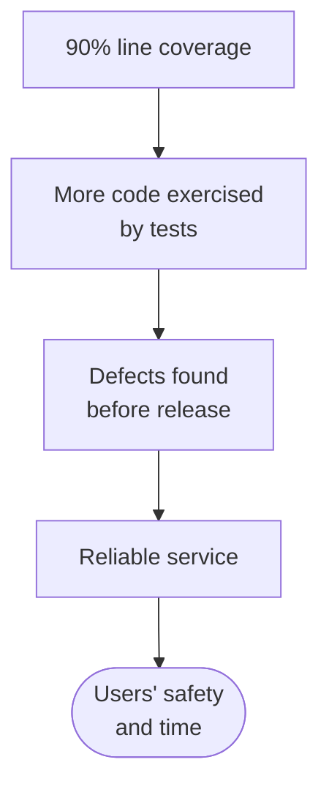
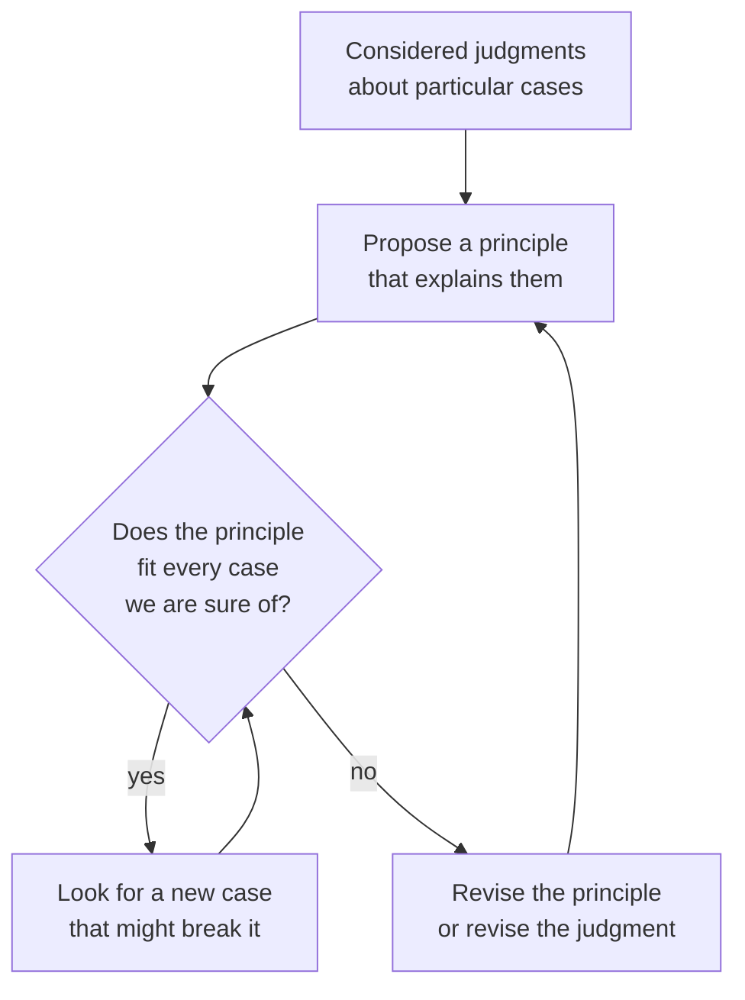

import Figure from '../../components/Figure.astro';
import CtValHohfeld from '../../components/diagrams/CtValHohfeld.astro';

The earlier entries of this series dealt with questions that evidence can settle, at least in principle. Whether a premise is true, whether a cause produces an effect, how probable a hypothesis is given the data: the [eighth](/blog/scientific-reasoning-and-causation) and [ninth](/blog/probability-and-statistical-reasoning) entries showed how observation and calculation answer such questions. Many of the questions that matter most in engineering and in life are of another kind. Should a product ship with a known defect? Is it fair to rank job applicants with a model trained on past hiring decisions? Is a cheaper design acceptable if it is slightly less safe? No measurement answers these by itself, because they ask what *ought* to be done, not only what *is* the case.

Such questions can still be reasoned about carefully. This entry applies the tools of the [third entry](/blog/arguments-and-their-structure) (premises, conclusions, hidden assumptions) to arguments whose conclusions are value judgments. It separates descriptive from normative claims and instrumental from intrinsic value, explains why facts alone do not yield a substantive "ought", and examines three views about the status of moral claims. It then presents the main methods of moral reasoning (consistency, reflective equilibrium and analogy), three ways of judging an action (by its consequences, by the rights it respects and by the character it shows) and a precise vocabulary for rights. The entry takes no side on contested moral questions; its aim is to show what a good argument about them looks like.

## 1. Values and value judgments

### 1.1 What a value is

Arguments about what to do appeal to standards: a safety margin, fairness between users, the elegance of a proof, the cost of a design. A standard of this kind is a **value**, and a claim that applies one is a **value judgment**: "the release was handled dishonestly", "this proof is elegant", "the new on-call rota is unfair to the night shift".

The same evaluative word can appeal to different standards. "This design is bad" may mean that it fails its purpose (it overheats under load), that it wrongs someone (it hides a known risk from the customer) or that it is clumsy (nobody can read the code). The three readings call for different support. The first is settled largely by testing; the second needs the moral reasoning of Sections 3 to 9; the third rests on the trained judgment of practitioners. The first question about any value argument is therefore which standard it appeals to. An argument that starts from one reading and ends with another, moving from "inefficient" to "irresponsible", say, trades on the kind of ambiguity the [second entry](/blog/meaning-clarity-and-definitions) (Section 6.1) warned against.

### 1.2 Descriptive and normative claims

A **descriptive claim** is made true or false by how the world is. A **normative claim** says what ought to be done or how something should be evaluated, and no inventory of facts settles it on its own; Section 3 explains why. A post-incident report shows how the two kinds mix in a single document:

| Claim in the report | Kind | What would settle it |
|---|---|---|
| The service was unavailable for 47 minutes. | Descriptive | Monitoring logs |
| The outage was caused by an expired certificate. | Descriptive (causal) | Investigation of the timeline |
| The on-call engineer was negligent. | Mixed | What the engineer did, plus an agreed standard of care |
| Certificate expiry should be monitored automatically. | Normative | Facts about cost and risk, plus a value premise |

The third row deserves attention. Words such as "negligent", "reckless", "safe" and "reliable" describe and evaluate at once; Williams called concepts of this kind **thick ethical concepts**. They make an argument look more factual than it is, because calling an engineer "negligent" brings in a standard of care that the speaker may never have stated. Splitting such a word into what it reports and what standard it applies is the first step of the procedure in Section 10, and the same test the second entry (Section 7.1) proposed for loaded language.

## 2. Instrumental and intrinsic value

### 2.1 Means and ends

An **end** is something sought; a **means** is a way of achieving an end. The same thing can be both. A team may want a high test-coverage figure because it wants more code exercised by tests. It wants that to catch defects before release, and it wants that for the sake of a reliable service and the people who depend on it.

Something has **instrumental value** when it is valuable as a means to something else. Something has **intrinsic value** when it is valuable for its own sake, whatever else it leads to. In the chain above every link but the last is plainly instrumental. A coverage figure is worth nothing in itself; if tests could be written that execute every line without checking anything, 100% coverage would be achieved and no defect would be caught. A measure that is valued only as a means stops being valuable once it is pursued in a way that breaks its link to the end, and value reasoning starts with keeping that link in view.

### 2.2 Instrumental value depends on facts

Because instrumental value is value *as a means*, a claim of instrumental value contains a causal claim, and that part can be checked with evidence. "Mandatory pair programming is valuable because it reduces defects" stands or falls with whether it does reduce defects, in this team, at an acceptable cost. The methods of the [eighth entry](/blog/scientific-reasoning-and-causation) apply in full to that premise.

Means also tend to outlive the conditions that made them useful. A rule that every pull request needs two approvals may have been adopted when the team was small and reviewers knew the whole code base. In a large team the same rule can turn into two quick approvals from people who know little of the code touched, and the rule then serves its end worse than one careful review would. Periodically asking of each rule and metric "what is this for, and does it still achieve that?" is the practical form of keeping the chain of Section 2.1 intact.

### 2.3 Testing for intrinsic value

Moore proposed a thought experiment for separating the two kinds of value, often called the **isolation test**: imagine the thing existing entirely by itself, with none of its usual effects, and ask whether its existence would still be good. A coverage figure fails at once, and so does a reliable service that nobody uses. Moore himself concluded, in *Principia Ethica*, that the things passing the test include the pleasures of human companionship and the enjoyment of beautiful objects.

Applied to the chain of Section 2.1, the test follows the links upward until it reaches something that passes, and there disagreement becomes hard to settle. People may agree that every link below "users' safety and time" is instrumental and still disagree about what, beyond those users' well-being, matters for its own sake. No experiment decides that disagreement, because there is no further end to check the answer against. Such questions are argued with the methods of Sections 6 and 7: consistency, judgments about cases and analogies.

## 3. From facts to values

### 3.1 The is-ought gap

Hume observed that writers on morality often pass from statements about what *is* the case to statements about what *ought* to be, without explaining how the second follows from the first (*A Treatise of Human Nature*, Book III). The point is now called the **is-ought gap**: no set of purely descriptive premises entails a substantive normative conclusion. In the terms of the [fourth entry](/blog/what-logic-studies), purely descriptive premises cannot validly yield a substantive "ought". Setting aside degenerate cases, such as inconsistent premises, which entail everything (fourth entry, Section 4.5), a valid argument cannot introduce in its conclusion a kind of claim that its premises do not contain.

Consider an argument heard in many teams:

1. Every team in the department skips code review for hotfixes.
2. Therefore it is acceptable for us to skip code review for hotfixes.

The premise may be true and the conclusion may even be true, but the conclusion does not follow. What is needed is a **bridging premise**, a general normative claim that connects the facts to the evaluation:

1. Every team in the department skips code review for hotfixes.
2. (Bridging premise) Any practice followed by every team in the department is acceptable.
3. Therefore it is acceptable for us to skip code review for hotfixes.

Now the argument is valid, and its weakness is visible. Premise 2 is false: every team could share a bad habit. Making the bridging premise explicit is often the most useful move in evaluating a value argument, because the controversial part of the argument tends to hide there.

### 3.2 Facts still matter

A safety engineer arguing that a pedestrian crossing needs a signal might reason:

1. (Normative) A road design ought not to expose pedestrians to a substantially higher risk of serious injury when an affordable change would remove that risk.
2. (Descriptive) At this crossing, vehicle speeds and sight lines expose pedestrians to a substantially higher risk of serious injury than at a signalized crossing.
3. (Descriptive) A signal is affordable within the current budget.
4. Therefore this crossing ought to be signalized.

The argument is valid, and two of its three premises are empirical. A critic who rejects the conclusion therefore has three targets, and only one of them is a value. In practice the attack usually comes at premise 2 (are the speeds as high as claimed?) or premise 3 (is the money available?), and those can be settled by measurement once both sides agree what measurement would count. The is-ought gap says that premise 1 cannot be dropped; it does not say that values do all the work.

### 3.3 Appeals to nature, tradition and popularity

Three common argument patterns cross the gap with the bridge left unstated. In each case the missing premise is a universal generalization, so a single clear counterexample defeats it.

| Pattern | Example | Hidden bridging premise | Counterexample |
|---|---|---|---|
| Appeal to nature | "Biologically inspired designs are better." | Whatever nature produced is good. | The vertebrate eye has a blind spot that a camera designer would never choose. |
| Appeal to tradition | "We have always stored passwords this way." | Long-established practice is acceptable. | Unsalted password hashes were once common practice and are now recognized as unsafe. |
| Appeal to popularity | "Every team skips review for hotfixes." | Whatever everyone does is acceptable. | The case of Section 3.1. |

The label **naturalistic fallacy** is sometimes used loosely for any argument that moves from facts to values. Strictly, Moore coined the term in *Principia Ethica* (1903) for a related but narrower error: defining "good" as identical to some natural property, such as "pleasant" or "more evolved". Either way, the remedy is the same: state the bridging premise and ask whether it is true.

## 4. Values and authority

In Plato's *Euthyphro*, Socrates meets a man who claims to know exactly what piety requires and asks him a question that has outlived its setting: is the pious loved by the gods because it is pious, or is it pious because the gods love it? Replace "the gods" by any authority, such as a standards body, a regulator or a company's code of conduct, and the question becomes: is a practice required because the authority requires it, or does the authority require it because it is right?

Engineering supplies a test case. A coding standard forbids dynamic memory allocation after start-up in flight software. If the rule is right merely *because* it is in the standard, then it would be just as right if the committee had written the opposite, which nobody believes. If the committee wrote it *because* allocation after start-up makes timing and memory use hard to predict, then the rule's authority comes from those reasons, and the reasons decide how to apply it. A team writing a ground-side log analyzer, where neither timing nor memory is critical, can ask whether the rule's reasons apply to it at all.

The second answer is the one almost everyone accepts on reflection, and it has a consequence. An authority's rules are compressed reasons. Following them is usually wise, because the authority has often seen cases the individual has not, but the rules bind most firmly where their reasons apply, and a case outside their intended range sends the reasoner back to the reasons.

## 5. Relativism, absolutism and contextualism

### 5.1 Disagreement is not relativism

**Moral relativism** holds that a moral judgment is true or false only by the standards of some group or framework, so that no framework's verdicts are more correct than another's. Its most common support is an argument from disagreement:

1. Societies and individuals disagree deeply about moral questions.
2. Therefore there is no fact of the matter about those questions beyond what each group accepts.

As it stands the argument is invalid, and the bridging premise it needs, "wherever people disagree, there is no fact of the matter", is false. Investigators disagreed for years about the causes of many engineering failures before evidence settled them, and the disagreement was never a sign that there was nothing to find. Disagreement shows that a question is hard, or that some parties are mistaken or misinformed. Whether moral questions have answers has to be argued on other grounds.

### 5.2 Relativism and tolerance

A common motive for relativism is respect for other ways of life. The reasoning runs from "there is no culture-independent moral truth" to "therefore no culture should interfere with another's practices". In *Morality: An Introduction to Ethics*, Williams called this combination **vulgar relativism** and showed that it defeats itself. The conclusion uses a non-relative "should": it states a duty of non-interference binding on every culture, which is exactly the kind of claim the premise denies.

Consider what the view implies in a concrete case. An engineering team inside a multinational firm learns that a supplier's plant, abroad, routinely disables machine guards to raise throughput. If rightness were only relative to local practice, the team would have no standing to object, and neither would anyone in the plant who disagreed with that practice, since on this view the local consensus fixes what is right. Most people who value tolerance do not accept that result. What they value is a substantive principle, roughly "do not impose on others without good reason, and listen before judging", and that principle is itself a moral claim that has to be defended on its merits, not one that relativism can supply.

### 5.3 Exceptionless rules and context

A moral rule can be held in two logical forms. Held as **moral absolutism**, it is an exceptionless universal: "for every situation, do not do $X$". Kant held the duty not to lie in this form; his short essay of 1797 argues that one may not lie even to a would-be murderer asking where a friend is hiding. Held as **moral contextualism**, the rule is a default whose verdict depends on features of the situation: "do not do $X$, unless conditions $C_1$, $C_2$, ... hold". Most practical rules in engineering are of the second kind. A responsible-disclosure policy might say to give a vendor time to patch before publishing a vulnerability, unless the vulnerability is already being exploited, in which case users need to know now.

Both forms differ from relativism in what the verdict depends on. On contextualism, whether an act is right is a function of the *situation*: its features fix the answer for anyone who judges it. On relativism it is a function of the *judge*: the same fully described situation can receive opposite verdicts, both correct, from two frameworks. "It depends on the situation" is therefore a claim that invites the question *which features, and why?* The engineer who answers "whether a patch exists and whether the flaw is being exploited" has given a testable list, not a relativist shrug.

## 6. Consistency and reflective equilibrium

### 6.1 Treat like cases alike

Moral judgments must at least be consistent, and the form of consistency that matters most in practice is **formal justice**: cases alike in every relevant respect receive the same verdict. Release decisions give a clear test. Suppose the release policy of Section 6.2 below blocks one team's release because of a failing test, and a week later another team ships with the same kind of failure because its lead is senior. Either there is a relevant difference between the two releases, which someone should be able to state, or one of the two decisions was wrong. Seniority is not a relevant difference to whether a test failure matters.

The principle is formal because it does not say *which* differences are relevant. Its force is procedural: anyone who treats two cases differently must name the difference, and a named difference can be examined. Many accusations of unfairness in organizations reduce to this request.

### 6.2 Reflective equilibrium

Rawls described a method for making moral beliefs consistent, which he called **reflective equilibrium**, in *A Theory of Justice*. One starts from **considered judgments**, confident verdicts about particular cases, and from **principles**, general rules that would explain those verdicts. Principles are tested against cases and cases against principles. Where they conflict, one revises whichever seems less secure: sometimes the principle, sometimes the judgment about the case.

A worked example from release engineering shows the method at work. Suppose a team holds the judgment that shipping a build known to fail its tests is irresponsible, and generalizes it as a principle:

> P1. Never release a build with a failing test.

Now consider a case. A critical vulnerability is being exploited in production; a patch is ready; the only failing test is one known to fail intermittently, in a module the patch does not touch, and it has failed on the main branch for weeks. Most engineers judge confidently that the patch should ship. The case conflicts with P1, and the judgment about the case seems more secure than the unqualified rule. So the principle is revised:

> P2. Never release a build with a failing test, unless the failure is demonstrably unrelated to the change and delaying the release would cause serious harm.

The process continues. Does P2 permit too much? A team under deadline pressure might call every inconvenient failure "unrelated". That suggests a further revision requiring an independent reviewer to confirm the claim. Each round makes the principle more precise and makes explicit the values behind it: avoiding harm to users, and not letting convenience dress itself up as necessity. The method does not guarantee a unique answer, and two people starting from different judgments may reach different equilibria. What it guarantees is that their disagreement becomes specific enough to discuss.

## 7. Analogical arguments about values

### 7.1 The form

A common way to argue about a disputed case is to compare it with a case on which everyone agrees. The general form of an **analogical argument** about values is:

1. (Evaluative premise) Case $X$ has evaluative property $V$ (it is wrong, permissible, admirable, valuable).
2. (Analogy premise) Case $Y$ resembles case $X$ in all respects relevant to $V$.
3. Therefore case $Y$ has property $V$.

The argument relies on the consistency principle of Section 6.1: if $X$ and $Y$ do not differ relevantly, they must be judged alike. It can be attacked at either premise. The analogy premise fails if there is a relevant difference (a **disanalogy**); the evaluative premise fails if the verdict on $X$ is less certain than it looked.

### 7.2 A worked example

A security researcher scans the network of a company, without permission, for servers running software with a known vulnerability, and reports the results to the company. A critic argues:

1. Walking through a parking lot trying every car door to see which are unlocked is wrong, even if you then tell the owners.
2. Scanning a company's servers for vulnerabilities without permission is relevantly like trying every car door.
3. Therefore the unauthorized scan is wrong.

A defender attacks premise 2 by listing differences and asking which are relevant. Trying a door handle is a physical act that could easily become entry and theft; the scan only queries services the company exposes publicly to anyone. The critic replies with similarities: both probe someone else's property for weaknesses without consent, and both produce a list of weaknesses that could be misused. The debate has become one about *which features make probing without consent wrong* (lack of consent, risk of damage, risk of misuse, intent), and each feature can now be argued about separately.

An analogy also cuts both ways. If the analogy premise is accepted, consistency requires the same verdict for both cases, but not which verdict. Someone confident that the scan is acceptable could run the argument in reverse and conclude that trying door handles is acceptable too. Which pair of judgments to accept depends on which evaluative premise has better independent support. A good analogical argument therefore needs an evaluative premise more credible than the denial of its conclusion, and a defense of the analogy that names the relevant similarities.

## 8. Consequences, rights and character

A product team must decide how long to keep the location history of users of a navigation app. The case can be examined in three ways, each corresponding to a family of moral theories, and comparing them shows what each one sees and what it misses.

### 8.1 Consequences and utility

Mill's principle of utility holds that actions are right "in proportion as they tend to promote happiness, wrong as they tend to produce the reverse of happiness". In this sense the **utility** of an option is the benefit it brings about minus the harm, summed over everyone it affects, and **utilitarianism** is the theory that the right option is the one with the greatest utility. Applying it means listing the affected parties, estimating each effect and adding. The table does this for three options in illustrative units; the numbers are invented for the example, and estimating them honestly is the hard part of any real analysis.

| Affected party and effect | A: keep nothing | B: keep 30 days, with consent | C: keep forever, sell to advertisers without consent |
|---|---:|---:|---:|
| Users: better route predictions | 0 | +30 | +40 |
| Users: privacy loss and risk of misuse | 0 | −10 | −60 |
| Company: revenue | 0 | +20 | +70 |
| Advertisers: targeting data | 0 | 0 | +20 |
| **Net utility** | 0 | +40 | +70 |

The bottom row is a sum of signed entries, and that is both the strength and the danger of the method. Nothing is left out silently: the privacy cost sits in the same table as the revenue, and an option is credited only with what remains after its harms are subtracted. But a large harm to one group can be outweighed by enough gains to others. Option C wins here by 30 units because the gains of the company and the advertisers exceed the users' loss; Exercise 5 shows how much that verdict depends on one estimate.

### 8.2 Rights as constraints

Many people judge that C is wrong whatever its total, because it sells users' data without their consent. Rights explain that judgment. Dworkin described individual rights as "trumps": a person has a right when a collective goal is not a sufficient reason for denying them what they wish to have or do. Applied to the company, a **right** marks out an individual interest that may not be sacrificed merely because the sum of benefits to others is larger.

Structurally, a right is not one more row of the table but a constraint on which columns are admissible. The users' right to decide whether their data is sold removes C; utility then chooses between A and B, and B wins. Rights therefore do not make consequences irrelevant; they limit the options among which consequences decide. What a right requires, and of whom, is the subject of Section 9.

### 8.3 Character and virtue

Utility and rights both evaluate options; virtue ethics evaluates agents. On Hursthouse's account, an action is right if it is what a virtuous person would characteristically do in the circumstances, and the **virtues** are the traits of character such a person has: honesty, justice, courage and the practical wisdom to apply them. The question it puts to the team is different: not "which option scores best?" but "what would an honest and conscientious engineer do here?" Such an engineer might notice that the consent screen drafted for option B is worded so that few users will understand what they agree to, and raise the point although no rule requires it and no table records it. Virtue concepts give guidance where the other two approaches run out: when the estimates are uncertain and the rules do not settle the case, which in practice is often.

## 9. Kinds of rights

### 9.1 Hohfeld's four positions

"Right" is used for several different relations, and arguments about rights often fail because the two sides mean different things. Hohfeld, writing about legal rights, distinguished, in a paper of 1913, four kinds of advantage that one party $A$ can hold against another party $B$. The analysis applies to moral rights too.

- $A$ has a **claim-right** against $B$ that $B$ do $X$ when $B$ has a **duty** to $A$ to do $X$. A customer who has paid for a support contract has a claim-right that the vendor respond to tickets.
- $A$ has a **privilege** (also called a **liberty**) against $B$ to do $X$ when $A$ has no duty to $B$ not to do $X$; then $B$ has a **no-right** against $A$ concerning $X$. Under a permissive open-source license, a user has a privilege, against the copyright holder, to modify the code.
- $A$ has a **power** over $B$ concerning $X$ when $A$ can change $B$'s rights or duties concerning $X$; then $B$ has a **liability**. A repository owner has the power to revoke a contributor's write access.
- $A$ has an **immunity** against $B$ concerning $X$ when $B$ has no power to change $A$'s position concerning $X$; then $B$ has a **disability**. A user who already holds a perpetual, irrevocable license to a software version has an immunity against the vendor's attempt to withdraw it.

<Figure caption="Hohfeld's eight positions. Each vertical line joins correlatives, one relation seen from A's side and from B's (a claim-right of A against B is a duty of B to A). Each dashed diagonal joins jural opposites, two positions of the same party, so that whoever holds one lacks the other (a privilege to do X is the absence of a duty not to do X).">
  <CtValHohfeld />
</Figure>

The first square concerns conduct: what each party may or must do. The second concerns the power to change the first: who can alter whose rights and duties. Privileges and claim-rights are independent. A device owner may have a privilege to install third-party software (no duty to the manufacturer not to) without any claim-right that the manufacturer refrain from making it hard, and disputes about device ownership often turn on that difference.

### 9.2 Rights as bundles

Most rights discussed in practice are **bundles** of these positions. Owning a software repository typically includes:

| Element of ownership | Hohfeldian position |
|---|---|
| The owner may change, archive or delete the code | Privilege (no duty to anyone not to) |
| Others may not push to it without permission | Claim-right of the owner; duty of others |
| The owner may grant or revoke write access | Power; others have a liability |
| A contributor cannot remove the owner's administrative access | Immunity of the owner; disability of the contributor |

Breaking a disputed right into its elements often dissolves a disagreement. Two people arguing about "the right to repair" may agree that owners have a privilege to open their devices and disagree only about whether manufacturers have a duty to supply parts and documentation, a claim-right question. Thomson's *The Realm of Rights* develops this style of analysis in detail.

## 10. A procedure, and its limits

The sections above combine into a procedure for evaluating an argument whose conclusion is a value judgment.

1. **Classify the claims** as descriptive or normative, and locate the disagreement: facts, values or both.
2. **Find the bridging premise** that links the facts to the normative conclusion, supplying it if it is missing.
3. **Test the bridge** against cases where it gives a verdict you are confident is wrong (Section 6.2).
4. **Check the facts**, especially causal claims hidden inside claims of instrumental value.
5. **Examine analogies** for relevant differences, and compare the support for each evaluative premise (Section 7).
6. **Weigh all three dimensions**: who is affected and how much, whose rights are at stake and of what kind, and what a person of good character would do.

The procedure cannot produce agreement between people whose considered judgments differ at the deepest level; it can only make the disagreement precise. Utility estimates are often guesses, and whoever already favors an option tends to seek and credit the evidence for it, the confirmation bias of the [twelfth entry, Section 6.3](/blog/fallacies-and-cognitive-biases). Reflective equilibrium can converge on beliefs that are consistent and still wrong, if the starting judgments share a prejudice. And no argument replaces listening to the people affected, who know facts about their own harms and interests. These limits are reasons to hold conclusions with appropriate confidence, not to stop reasoning.

## 11. Exercises

**Exercise 1.** Classify each claim as descriptive, normative or mixed, and for mixed claims separate what is reported from the standard applied. (a) "The new build system halved our compile times." (b) "Shipping without a rollback plan was reckless." (c) "The firmware should log every failed login." (d) "The patch is safe."

*Answer.* (a) Descriptive; benchmark it. (b) Mixed: it reports that there was no rollback plan and judges, by an unstated standard of care, that the risk taken was unjustified. (c) Normative; it needs facts about cost and benefit plus a value premise about security and privacy. (d) Mixed, though it sounds descriptive: "safe" means that the risks found by testing fall below some acceptable level, and the level is a value judgment that should be stated.

**Exercise 2.** Supply the bridging premise and evaluate it: "Users click 'accept' on the cookie banner without reading it, so collecting their data is acceptable."

*Answer.* The bridge is roughly "if users click 'accept', collecting their data is acceptable". It fails in cases where the click is not informed consent: users who do not know what they agree to, or who have no real alternative, have not consented in the sense that makes data collection acceptable. The argument also slides from a fact about behavior to a normative conclusion without examining what consent requires.

**Exercise 3.** Reflective equilibrium can revise a judgment as well as a principle. Describe a case in which P2 of Section 6.2 forbids a release that you at first judge should go ahead, and decide whether you would revise P2 or your judgment about the case. Give your reason.

*Answer.* One possibility: a customer demands a feature before a trade show, and the only failing test is an unrelated, long-standing one, but no serious harm follows from a delay. P2 forbids the release because the harm condition is not met. On reflection one may decide that the first judgment was driven by deadline pressure, not by a moral reason, and keep P2: here the judgment about the case is revised. Other answers are possible; what matters is a case, a verdict and a reasoned choice of what to revise.

**Exercise 4.** Using Hohfeld's terms, analyze "an employee's right to refuse unsafe work".

*Answer.* At least two elements. A privilege: the employee has no duty to the employer to perform the unsafe task. A claim-right, if the law provides it: the employer has a duty not to dismiss or penalize the employee for refusing. The second is what gives the first practical force; a privilege without the claim-right protects the employee from no consequences.

**Exercise 5.** In the table of Section 8.1, how large would the privacy harm of option C have to be (in the same units) for option B to have higher net utility, all other entries unchanged?

*Answer.* C's net is $40 + 70 + 20 - h$, where $h$ is the size of the privacy harm. B's net is 40. B wins when $130 - h < 40$, that is when $h > 90$. The answer illustrates how sensitive a utility comparison is to its hardest-to-estimate entry.

## 12. Summary

| Idea | Main point |
|---|---|
| Descriptive versus normative | Descriptive claims are settled by how the world is; normative claims are not settled by facts alone. Thick terms such as "negligent" mix the two and should be split. |
| Instrumental versus intrinsic value | A means is valuable only through its effects, which are an empirical matter; Moore's isolation test separates the two, and intrinsic value is argued by consistency and cases, not by experiment. |
| Is-ought gap | Purely descriptive premises do not validly yield a substantive normative conclusion; make the bridging premise explicit and test it. |
| Authority | The Euthyphro question shows that an authority's rules are compressed reasons, binding most firmly where their reasons apply. |
| Relativism | Disagreement does not establish relativism, and relativism cannot support tolerance; contextualism makes verdicts depend on the situation, relativism on the judge. |
| Reflective equilibrium | Adjust principles and judgments about cases against each other until they cohere. |
| Analogical arguments | Good only if the cases are relevantly alike and the verdict on the agreed case is secure; consistency fixes that both verdicts go together, not which. |
| Consequences, rights, character | Utility sums benefits and harms over all affected; rights limit which options utility may choose among; virtue asks what a person of good character would do. |
| Hohfeld | Claim-right, privilege, power and immunity, with correlatives duty, no-right, liability and disability. |

Value reasoning tells us what we are trying to achieve and what we may not do to achieve it. The [next entry](/blog/strategic-thinking-and-decisions) takes those goals and constraints as given and asks how to pursue them well: how to define and decompose a problem, how to analyze a situation, and how to choose among options when their outcomes are uncertain.

### References

- R. Dworkin, *Taking Rights Seriously*, Harvard University Press, 1977.
- W. N. Hohfeld, "Some fundamental legal conceptions as applied in judicial reasoning," *Yale Law Journal*, vol. 23, no. 1, pp. 16–59, 1913.
- D. Hume, *A Treatise of Human Nature*, 1739–1740.
- R. Hursthouse, *On Virtue Ethics*, Oxford University Press, 1999.
- I. Kant, "On a supposed right to lie from philanthropy," 1797.
- J. Y. F. Lau, *An Introduction to Critical Thinking and Creativity: Think More, Think Better*, Wiley, 2011.
- J. Y. F. Lau and J. Chan, *Critical Thinking Web*, Department of Philosophy, The University of Hong Kong, 2004–2026. https://philosophy.hku.hk/think/
- J. S. Mill, *Utilitarianism*, Parker, Son and Bourn, 1863.
- G. E. Moore, *Principia Ethica*, Cambridge University Press, 1903.
- J. Rawls, *A Theory of Justice*, Harvard University Press, 1971.
- J. J. Thomson, *The Realm of Rights*, Harvard University Press, 1990.
- B. Williams, *Morality: An Introduction to Ethics*, Harper & Row, 1972.
- B. Williams, *Ethics and the Limits of Philosophy*, Harvard University Press, 1985.
