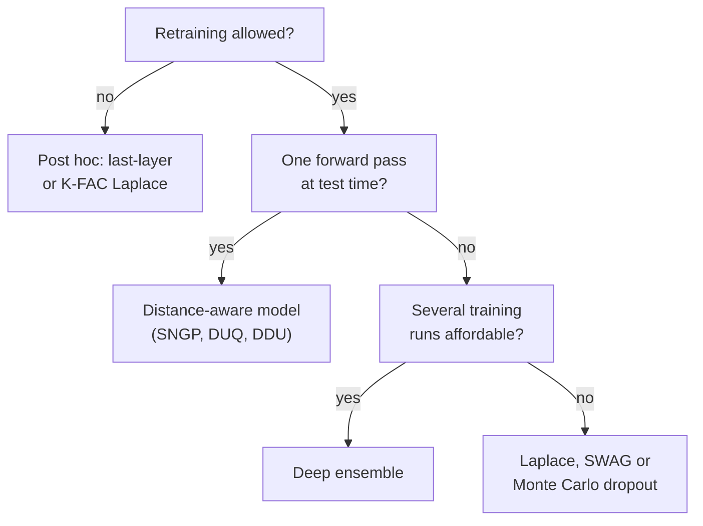

import Figure from '../../components/Figure.astro';
import BdlLastLayer from '../../components/diagrams/BdlLastLayer.astro';

The methods of this series were introduced on networks with a few dozen parameters, where a full covariance matrix fits in memory and a thousand forward passes take a second. A modern network has millions to billions of parameters and is trained on data sets too large to pass over more than a few times. This entry asks what each method of the earlier entries costs at that scale and which approximations bring the cost down. They are inference over only the last layer, structured curvature for the [Laplace approximation](/blog/laplace-approximations), single-forward-pass models that build uncertainty into the architecture, sparse [Gaussian processes](/blog/gaussian-processes-and-kernels) and, briefly, the link between Bayesian inference and compression.

The entry relies on the Laplace approximation and the generalized Gauss–Newton (GGN) matrix of the third entry, the variational inference (VI) of the [fourth](/blog/variational-inference-for-neural-networks), the [deep ensembles](/blog/deep-ensembles) of the fifth and the kernels of the sixth. It uses the series notation: parameters $\theta$, data $\mathcal{D}$ of $N$ examples, prior $p(\theta)$, test input $x^*$. Code uses Python 3.13 and NumPy 2.5.3 with the seeds given in each listing; memory figures assume 32-bit floating-point numbers (4 bytes each) and use binary prefixes (1 MiB is $2^{20}$ bytes).

## 1. Where the cost goes

### 1.1 Four sizes

Four numbers determine the cost of approximate inference for a network. The **parameter count** $P$ fixes the size of one weight vector and of anything stored per weight. The **data size** $N$ fixes the cost of one pass over the training set. The **number of samples** $M$ (posterior samples or Monte Carlo draws), or the number of members $J$ of an ensemble, multiplies the cost of every prediction. Finally the **output size** $C$, the number of classes or output dimensions, enters wherever a Jacobian or a per-output covariance is formed.

The dangerous terms are those that are quadratic or cubic in $P$. A full posterior covariance has $P^2$ entries. For $P = 10^7$, a modest network today, that is $10^{14}$ numbers or 400 terabytes (about 364 TiB), and inverting it costs on the order of $P^3 = 10^{21}$ floating-point operations. Everything in this entry is a way to avoid those terms: by restricting inference to a few parameters, by imposing structure on the covariance or by changing the model so that uncertainty comes from somewhere cheaper.

### 1.2 A cost table

The table compares the methods of the series by the memory they need beyond one trained network, the extra cost of training and the cost of a prediction. The entries are orders of growth, not measurements; constant factors depend on the implementation.

| Method | Extra memory | Extra training cost | Cost per prediction |
|---|---|---|---|
| Maximum a posteriori (MAP) estimate, the baseline | none | one training run | 1 forward pass |
| Full Laplace | $P^2$ | one pass over the data to build the curvature, $O(P^3)$ to factorize it | $M$ forward passes, or 1 linearized pass |
| Diagonal Laplace | $P$ | one pass over the data | $M$ forward passes |
| Kronecker-factored Laplace | $\sum_l (d_{\text{in},l}^2 + d_{\text{out},l}^2)$ | one pass, plus small eigendecompositions | $M$ forward passes |
| Last-layer Laplace or Bayesian linear regression | $K^2$ (regression), $K^2 C^2$ (full, $C$ outputs) | one pass to compute features, $O(K^3)$ | 1 forward pass plus $O(K^2)$ |
| Monte Carlo dropout | none | training with dropout | $M$ forward passes |
| Mean-field VI | $P$ (a variance per weight) | sampled weights at every step, usually more epochs | $M$ forward passes |
| Stochastic weight averaging Gaussian (SWAG) | $P$ to $(r + 2) P$ for rank $r$ | a few extra epochs of stochastic gradient descent | $M$ forward passes |
| Deep ensemble of $J$ members | $(J - 1) P$ | $J$ training runs | $J$ forward passes |
| Stochastic-gradient Markov chain Monte Carlo (MCMC) | $(M - 1) P$ for stored samples | a long sampling run | $M$ forward passes |
| Single-pass distance-aware model | $K^2$ for the output layer | spectral normalization during training | 1 forward pass |
| Exact Gaussian process (GP) | $N^2$ | $O(N^3)$ | $O(N)$ mean, $O(N^2)$ variance |
| Sparse variational GP, $N_u$ inducing points | $N_u^2$ | $O(B N_u^2 + N_u^3)$ per mini-batch of $B$ | $O(N_u^2)$ |

Here $l$ indexes layers with $d_{\text{in},l}$ inputs and $d_{\text{out},l}$ outputs, and $K$ is the width of the last hidden layer. SWAG (Maddox et al., 2019) fits a Gaussian to the iterates of stochastic gradient descent: a diagonal variance plus a low-rank term of rank $r$. Stochastic-gradient MCMC is the sampler of the [second entry](/blog/sampling-the-posterior-mcmc). The table already suggests the main design choice: either pay at training time (ensembles, VI, sampling) or at prediction time ($M$ forward passes), or find a structure that makes both cheap. The next sections describe the methods in the rows that are new in this entry.

## 2. Last-layer inference

### 2.1 The idea

A trained network can be split into two parts. The **feature extractor**, all layers up to the last hidden layer, maps an input $x$ to a feature vector $z = \phi(x) \in \mathbb{R}^K$, and a final linear layer maps $z$ to the output. **Last-layer inference** keeps the feature extractor at its trained values and treats only the last layer's weights $w$ as random. For regression with Gaussian noise the model is then

$$
y = w^\top \phi(x) + \varepsilon, \qquad \varepsilon \sim \mathcal{N}(0, \sigma^2), \qquad w \sim \mathcal{N}(0, \alpha^{-1} I),
$$

a Bayesian linear regression in $K$ features, where $\alpha = 1/s_0^2$ is the prior precision, the inverse of the prior variance $s_0^2$ used in the first entry, and $\sigma$ is the noise standard deviation. Everything about it is exact and cheap. Snoek et al. (2015) used it as a scalable replacement for a GP in Bayesian optimization, and Riquelme, Tucker and Snoek (2018) found it competitive with more elaborate methods for decision making in contextual bandits. Kristiadi, Hein and Hennig (2020) proved that for ReLU classifiers, a Gaussian over the last layer alone already prevents the confidence from tending to one far from the data, which a point estimate cannot avoid.

### 2.2 The posterior and the predictive

This is the Bayesian linear regression of the [first entry](/blog/bayesian-inference-for-neural-networks), with the learned features in place of its fixed Gaussian bumps. With the $N \times K$ feature matrix $\Phi$ whose rows are $\phi(x_n)^\top$ and the target vector $\mathbf{y}$, the posterior is $\mathcal{N}(m_N, S_N)$ and the predictive at $x^*$, with $z^* = \phi(x^*)$, is

$$
S_N^{-1} = \alpha I + \sigma^{-2} \Phi^\top \Phi, \qquad m_N = \sigma^{-2} S_N \Phi^\top \mathbf{y},
$$

$$
p(y^* \mid x^*, \mathcal{D}) = \mathcal{N}\big(y^*;\; m_N^\top z^*,\; \sigma^2 + z^{*\top} S_N z^*\big).
$$

What is new at scale is the cost. Forming $\Phi^\top \Phi$ costs $O(N K^2)$ in one pass over the data, factorizing the $K \times K$ precision costs $O(K^3)$, and each prediction then costs one forward pass and $O(K^2)$. For $K$ in the hundreds or low thousands this is negligible next to training, and beyond one forward pass per example none of it depends on the size of the feature extractor.

### 2.3 A worked example

The listing below uses 200 fixed random cosine features in place of a trained feature extractor. They are random Fourier features (Rahimi and Recht, 2007), whose inner products approximate the squared-exponential kernel of the sixth entry with lengthscale 1, so the example is also a cheap approximation to the GP of the sixth entry. The data are 40 noisy observations of $\sin(2x)$ in two clusters with a gap at $x = 0$. The code computes the posterior for five prior precisions, reports the log marginal likelihood of each and then predicts at four test inputs with $\alpha = 1$. In the code, `prec` is the posterior precision $S_N^{-1}$ and `m` is $m_N$.

```python
import numpy as np

rng = np.random.default_rng(3)
N, K, sigma = 40, 200, 0.1                 # data, features, noise sd

# Training inputs in two clusters, with a gap around x = 0.
x = np.r_[rng.uniform(-3, -1, N // 2), rng.uniform(1, 3, N // 2)]
y = np.sin(2 * x) + sigma * rng.normal(size=N)

# Fixed random features: the stand-in for a trained network body.
omega = rng.normal(0, 1.0, size=K)         # frequencies, lengthscale 1
phase = rng.uniform(0, 2 * np.pi, size=K)
def features(x):
    return np.sqrt(2 / K) * np.cos(np.outer(x, omega) + phase)

def fit(alpha):
    """Posterior N(m, prec^-1) over last-layer weights with prior N(0, I/alpha)."""
    Phi = features(x)
    prec = alpha * np.eye(K) + Phi.T @ Phi / sigma**2   # posterior precision
    L = np.linalg.cholesky(prec)
    m = np.linalg.solve(prec, Phi.T @ y) / sigma**2
    # log evidence log p(y | alpha, sigma), Bishop (2006), Section 3.5
    E = np.sum((y - Phi @ m) ** 2) / (2 * sigma**2) + alpha * m @ m / 2
    logev = (K * np.log(alpha) - N * np.log(2 * np.pi * sigma**2)) / 2 \
            - E - np.log(np.diag(L)).sum()
    return m, L, logev

for alpha in [0.01, 0.1, 1.0, 10.0, 100.0]:
    print(f"alpha = {alpha:6g}   log evidence = {fit(alpha)[2]:8.2f}")

m, L, _ = fit(1.0)
xs = np.array([-2.0, 0.0, 2.0, 6.0])
Phis = features(xs)
V = np.linalg.solve(L, Phis.T)             # z^T prec^-1 z = |L^-1 z|^2
sd = np.sqrt(sigma**2 + (V**2).sum(0))
for xi, mu, s in zip(xs, Phis @ m, sd):
    print(f"x* = {xi:4.1f}  mean = {mu:6.3f}  sd = {s:5.3f}  sin(2x*) = {np.sin(2*xi):6.3f}")
```

```text
alpha =   0.01   log evidence =     3.66
alpha =    0.1   log evidence =    11.28
alpha =      1   log evidence =    14.42
alpha =     10   log evidence =   -18.76
alpha =    100   log evidence =  -205.46
x* = -2.0  mean =  0.763  sd = 0.105  sin(2x*) =  0.757
x* =  0.0  mean =  0.291  sd = 0.226  sin(2x*) =  0.000
x* =  2.0  mean = -0.836  sd = 0.106  sin(2x*) = -0.757
x* =  6.0  mean = -0.099  sd = 0.975  sin(2x*) = -0.537
```

<Figure caption="Posterior predictive mean (solid) and ±2 standard deviations (shaded) of the last-layer model with α = 1, against the true function sin(2x) (dashed) and the 40 training points. Look at how the band stays near the noise level inside the clusters, widens in the gap and opens to the prior scale beyond the data.">
  <BdlLastLayer />
</Figure>

Inside the clusters the predictive standard deviation, 0.105 and 0.106, is barely above the noise level $\sigma = 0.1$: the data pin the function down. In the gap at $x = 0$ it doubles to 0.226, and the error of the mean there (0.291) is within two standard deviations. At $x = 6$, far from any data, it is 0.975, close to the prior standard deviation $\sqrt{\sigma^2 + \lVert z^* \rVert^2 / \alpha} \approx 1$, and the mean has fallen back toward zero. That is the behavior a predictive distribution should have, and it costs one $200 \times 200$ Cholesky factorization.

### 2.4 Choosing the prior by the evidence

The log marginal likelihood, used in the first entry to choose the prior scale and in the [previous entry](/blog/priors-symmetries-and-identifiability) to learn priors, is available in closed form, and on the grid above it peaks at $\alpha = 1$. A weak prior ($\alpha = 0.01$) spreads probability over many wiggly functions and pays for it; a strong prior ($\alpha = 100$) cannot reach the data and pays far more. Because the evidence is a smooth function of $\alpha$ and $\sigma$, both can be optimized by gradient ascent or by the fixed-point updates of MacKay (1992), with no validation set. In practice the same objective is often used to tune the prior precision of a last-layer Laplace approximation after training.

### 2.5 What last-layer inference cannot do

The features are fixed. If the feature extractor maps an unfamiliar input onto the same feature vector as a familiar one, no posterior over the last layer can tell them apart; Section 4 returns to this failure, called feature collapse. For classification the likelihood is not Gaussian and the posterior must be approximated, usually with a last-layer Laplace approximation. Its covariance over all $K C$ weights has $K^2 C^2$ entries; for $K = 2048$ features and $C = 1000$ classes that is about $4 \times 10^{12}$ numbers, so even the last layer needs the Kronecker structure of Section 3. Variational treatments of the last layer, such as that of Harrison, Willes and Snoek (2024), train the features and the last-layer posterior jointly at a cost close to ordinary training.

## 3. Scalable Laplace approximations

### 3.1 Structured curvature

The Laplace approximation of the [third entry](/blog/laplace-approximations) needs the precision matrix $H + \alpha I$, where $H$ is the GGN matrix of the negative log likelihood at the MAP estimate and $\alpha = 1/s_0^2$ is the prior precision, as in Section 2. That entry listed the structures that make it affordable: diagonal, Kronecker-factored, low-rank and restricted to a subset of the weights. This section looks at the two that matter most at scale in more detail.

The Kronecker-factored approximate curvature (K-FAC) of the [third entry](/blog/laplace-approximations) was introduced for optimization by Martens and Grosse (2015) and applied to the Laplace approximation by Ritter, Botev and Barber (2018). It treats layers as independent and approximates the block of a fully connected layer with weight matrix $W \in \mathbb{R}^{d_\text{out} \times d_\text{in}}$, with the weights stacked column by column into $\operatorname{vec}(W)$, as a Kronecker product (defined in the third entry, Section 2.3)

$$
H_W \approx A \otimes G, \qquad A = \mathbb{E}[a a^\top], \qquad G = \mathbb{E}[g g^\top],
$$

where $a \in \mathbb{R}^{d_\text{in}}$ is the input to the layer, $g \in \mathbb{R}^{d_\text{out}}$ is the gradient of the loss with respect to the layer's output and the expectations are averages over the training data. The approximation assumes that activations and output gradients are independent, which is not exact, but it keeps the dominant correlations within a layer. For a layer with 1024 inputs and 1024 outputs, the exact block would have $2^{40}$ entries (4 TiB); the two factors have $2 \times 2^{20}$ entries (8 MiB), twice the diagonal (4 MiB).

The second structure restricts inference to a **subnetwork**. In their work on subnetwork inference, Daxberger et al. (2021) chose a small subset of weights, for example those with the largest marginal variance under a diagonal approximation, kept a full covariance over them and fixed the rest at their MAP values. Last-layer inference is the special case where the subset is the last layer.

### 3.2 The Kronecker trick in code

A Kronecker factorization is useful only if the posterior can be used without ever forming $A \otimes G$. The identity that makes this possible is that if $A = Q_A D_A Q_A^\top$ and $G = Q_G D_G Q_G^\top$ are eigendecompositions, then $A \otimes G + \alpha I$ has eigenvectors $Q_A \otimes Q_G$ and eigenvalues $\lambda_{A,i} \lambda_{G,j} + \alpha$. With column stacking, multiplying $\operatorname{vec}(V)$ by $Q_A \otimes Q_G$ is the same as computing $Q_G V Q_A^\top$, so the rotations act on $d_\text{out} \times d_\text{in}$ matrices. Solving a linear system, sampling or computing a log determinant then needs only the two small eigendecompositions. The listing checks the solve against a dense computation for a $20 \times 30$ layer.

```python
import numpy as np

rng = np.random.default_rng(5)
d_in, d_out, B, alpha = 30, 20, 500, 1.0

# Kronecker factors from a batch of B examples: layer inputs a and
# gradients g of the loss with respect to the layer outputs.
a = rng.normal(size=(B, d_in)) @ rng.normal(size=(d_in, d_in)) / 5
g = rng.normal(size=(B, d_out)) @ rng.normal(size=(d_out, d_out)) / 5
A = a.T @ a / B                         # d_in x d_in
G = g.T @ g / B                         # d_out x d_out

# Full precision of vec(W), W is d_out x d_in stacked column by column.
prec = np.kron(A, G) + alpha * np.eye(d_out * d_in)
V = rng.normal(size=(d_out, d_in))      # a vector to multiply by prec^-1
direct = np.linalg.solve(prec, V.ravel(order="F"))

# Kronecker route: two small eigendecompositions, never forming prec.
lA, QA = np.linalg.eigh(A)
lG, QG = np.linalg.eigh(G)
X = QG.T @ V @ QA                       # rotate into the joint eigenbasis
X /= np.outer(lG, lA) + alpha           # divide by the eigenvalues of prec
kron = (QG @ X @ QA.T).ravel(order="F") # rotate back

print("max difference:", f"{np.abs(direct - kron).max():.1e}")
print("numbers stored: full", prec.size, " Kronecker", A.size + G.size)
```

```text
max difference: 4.9e-15
numbers stored: full 360000  Kronecker 1300
```

The two routes agree to rounding error, and the factors store 1300 numbers instead of 360 000. The dense solve costs $O((d_\text{in} d_\text{out})^3)$; the Kronecker route costs $O(d_\text{in}^3 + d_\text{out}^3)$ for the eigendecompositions and $O(d_\text{in} d_\text{out} (d_\text{in} + d_\text{out}))$ for the rotations.

### 3.3 Predicting and sampling at scale

With a structured covariance, predictions come either from sampling weights and running $M$ forward passes, or from the linearized predictive of the third entry, which replaces the network by its first-order expansion around the MAP estimate. Immer, Korzepa and Bauer (2021) showed that the linearized predictive often works better than sampling the network itself under a GGN-based Laplace approximation, because the GGN is the exact curvature of the linearized model. The comparison by Daxberger et al. (2021) of these choices, which recommended last-layer approximations with Kronecker-factored or full curvature as a default, was discussed in the third entry.

When even Kronecker factors are too coarse, the posterior of the linearized model can be sampled without storing a covariance at all. A sample from a Gaussian posterior of a linear model is the minimizer of a randomly perturbed least-squares objective, so drawing a sample costs about as much as one optimization run. Antorán et al. (2023) used this, with stochastic optimization in place of exact solves, to sample linearized Laplace posteriors of image classifiers that were too large for other covariance structures.

## 4. Single-forward-pass methods

### 4.1 Feature collapse and distance awareness

Every method so far pays at prediction time with $M$ forward passes, or restricts inference to a layer whose features are fixed. **Single-forward-pass methods** instead change the model so that one deterministic forward pass yields both a prediction and an uncertainty. The idea is to make the output layer **distance-aware**: its uncertainty grows with the distance between the feature vector of a test input and the feature vectors of the training data, as the predictive variance of a GP with a stationary kernel does.

Distance in feature space is only meaningful if the feature extractor preserves distances in input space. An unconstrained network need not: training for classification rewards mapping all inputs of a class to a compact region, and nothing prevents an input unlike any training input from being mapped into that region too. This is **feature collapse**, and it defeats every method that reads uncertainty off the features, including the last-layer model of Section 2. The remedy is to require the feature extractor to be **bi-Lipschitz**: for some constants $0 < L_1 \le L_2$,

$$
L_1 \lVert x - x' \rVert \le \lVert \phi(x) - \phi(x') \rVert \le L_2 \lVert x - x' \rVert,
$$

so that inputs far apart stay far apart (the lower bound, sensitivity) and nearby inputs stay nearby (the upper bound, smoothness).

### 4.2 Enforcing the bound

Two techniques are used. A residual block $x \mapsto x + r(x)$ whose branch $r$ has Lipschitz constant $c < 1$ satisfies both bounds, with $L_1 = 1 - c$ and $L_2 = 1 + c$, by the triangle inequality. **Spectral normalization** (Miyato et al., 2018) enforces $c < 1$ by dividing each weight matrix in the branch by an estimate of its largest singular value. The estimate is cheap: one step of power iteration per training step. The alternative is a two-sided gradient penalty that pushes the norm of the gradient of the output with respect to the input toward one, which van Amersfoort et al. (2020) used.

### 4.3 Output layers that measure distance

Several output layers turn preserved distances into uncertainty. Deterministic uncertainty quantification (DUQ) (van Amersfoort et al., 2020) compares the feature vector with one learned centroid per class through a squared-exponential kernel and reports low confidence when it is far from all centroids. The spectral-normalized neural Gaussian process (SNGP) (Liu et al., 2020) replaces the output layer with a GP approximated by random Fourier features, the construction of Section 2.3 applied to learned features. It computes the posterior covariance with a Laplace approximation accumulated during the final training epoch. Deep deterministic uncertainty (DDU) (Mukhoti et al., 2023) keeps an ordinary softmax head but fits a Gaussian density to the training features of each class after training; a low feature density signals epistemic uncertainty, and the entropy of the softmax signals aleatoric uncertainty.

These methods are fast at prediction time and, in the reported benchmarks, detect inputs far from the training data well. Their uncertainty is only as good as the distance in feature space: bi-Lipschitz bounds rule out total collapse, but they do not guarantee that the feature distance reflects the differences that matter for the task. They also approximate the posterior over a small part of the model only, so they say little about uncertainty that arises from the feature extractor's own parameters.

## 5. Scalable Gaussian processes

The exact GP of the sixth entry needs the $N \times N$ kernel matrix, $O(N^2)$ memory and $O(N^3)$ time. Two families of approximations bring this down.

**Inducing-point methods** summarize the function by its values $u$ at $N_u \ll N$ locations $Z$, the inducing points. The sparse variational GP of Titsias (2009) treats $Z$ as variational parameters and fits a Gaussian $q(u)$ by maximizing an evidence lower bound (ELBO), at $O(N N_u^2 + N_u^3)$ cost. Hensman, Fusi and Lawrence (2013) wrote the bound as a sum over data points, so that it can be optimized with mini-batches of size $B$ at $O(B N_u^2 + N_u^3)$ per step, which makes GPs usable on millions of examples. For $N = 10^6$, $N_u = 500$ and $B = 256$, a step costs about $1.9 \times 10^8$ operations against $10^{18}$ for one exact factorization. The quality of the approximation depends on whether $N_u$ inducing points can represent the function: a function with many fine features needs many of them.

**Low-rank and iterative methods** attack the linear algebra directly. The Nyström approximation (Williams and Seeger, 2001) and random features (Rahimi and Recht, 2007) replace the kernel by a rank-$N_u$ or rank-$K$ approximation, turning the GP into a Bayesian linear model like that of Section 2. Iterative solvers such as conjugate gradients compute the products and solves an exact GP needs using only matrix-vector products with the kernel matrix, which run fast on graphics processors; Gardner et al. (2018) built a GP library around this approach.

## 6. Compression and description length

A different view of scale asks how many bits a model needs, and it leads back to the ELBO of the fourth entry. Hinton and van Camp (1993) observed that a sender who wants to transmit the training targets to a receiver who already has the inputs can first send a set of weights and then the targets encoded with the model's predictions. If the weights are sampled from a distribution $q(\theta)$ and encoded with a code built from the prior $p(\theta)$, a scheme later called **bits-back coding** makes the expected total length, in nats,

$$
\mathrm{KL}\big(q(\theta) \,\Vert\, p(\theta)\big) + \mathbb{E}_{q}\big[-\log p(\mathcal{D} \mid \theta)\big],
$$

which is the negative ELBO. Minimizing the negative ELBO is therefore minimizing a description length, the principle of Rissanen (1978); Honkela and Valpola (2004) developed this connection. The Kullback–Leibler (KL) term has a direct reading: it is the number of nats needed to communicate the weights to the precision that the posterior uncertainty allows. A weight with a broad posterior needs few bits.

This reading has been used to compress networks. Louizos, Ullrich and Welling (2017) used sparsity-inducing priors and the posterior variances to prune units and to choose the number of bits stored per weight. Havasi, Peharz and Hernández-Lobato (2019) showed how to transmit a sample from $q(\theta)$ using about $\mathrm{KL}(q \Vert p)$ bits plus a small overhead, without the bits-back construction, by using randomness shared between sender and receiver, a technique now called relative entropy coding. As an example of scale, a variational posterior whose KL divergence from the prior is 2000 nats can be communicated in about $2000 / \log 2 \approx 2885$ bits, regardless of how many weights the network has.

## 7. Choosing a method

The cost table and the sections above suggest the decision sequence below. It reflects the comparisons cited in this entry, not a universal ranking; the [next entry](/blog/evaluating-and-using-uncertainty) explains how to check the result on the reader's own problem.



The post-hoc route is attractive because it leaves an existing training pipeline untouched. Train as usual, compute the curvature of the last layer or of the whole network with Kronecker factors in one extra pass and tune the prior precision on the evidence or on validation data. Ensembles remain the most reliable choice when several training runs are affordable, as the fifth entry discussed, and fitting a Laplace approximation around each member, which gives the mixture described in the fifth entry, adds only one curvature pass per member to the $J$ training runs.

## 8. Limits and failure modes

The approximations of this entry share a pattern: each buys its speed by ignoring part of the posterior, and the part it ignores determines where it fails.

- **Fixed features.** Last-layer and single-pass methods inherit every blind spot of the feature extractor. Spectral normalization reduces feature collapse but does not make feature distances meaningful for the task.
- **Independence assumptions.** Diagonal and Kronecker-factored curvature ignore correlations across layers, and K-FAC assumes that inputs and output gradients are independent; the resulting uncertainty depends strongly on the tuned prior precision.
- **Too few inducing points or features.** Sparse GPs and random-feature models smooth over structure they cannot represent, and they become overconfident in ways that look like good calibration on smooth test functions.
- **Cost moved, not removed.** $M$ forward passes at prediction time can cost more over a model's life than training did; a method that is cheap to fit can be expensive to deploy.
- **Comparisons are setting-dependent.** Rankings of scalable methods vary with architecture, data and metric; published comparisons cover a limited set of benchmarks.

## 9. Exercises

**Exercise 1.** A fully connected layer has 512 inputs and 2048 outputs. How much memory, in 32-bit numbers, does its exact GGN block need, and how much do the two Kronecker factors and the diagonal need?

<details>
<summary>Answer</summary>

The layer has $512 \times 2048 = 2^{20}$ weights. The exact block has $2^{40}$ entries, 4 TiB. The factors have $512^2 + 2048^2 = 4\,456\,448$ entries, 17 MiB. The diagonal has $2^{20}$ entries, 4 MiB.

</details>

**Exercise 2.** In the worked example the predictive standard deviation at $x^* = 6$ is 0.975. Explain from the predictive formula why it should be close to 1 with $\alpha = 1$ and $\sigma = 0.1$, and why it is slightly less.

<details>
<summary>Answer</summary>

Far from the data, the training features carry little information about $z^*$, so $S_N$ acts on $z^*$ almost like the prior covariance $\alpha^{-1} I$ and the variance is close to $\sigma^2 + \lVert z^* \rVert^2 / \alpha$. Each feature is $\sqrt{2/K}\cos(\cdot)$, so $\lVert z^* \rVert^2$ averages $2/K \cdot K \cdot 1/2 = 1$, giving $\sqrt{1.01} \approx 1.005$. For these features $\lVert z^* \rVert^2 = 1.003$ at $x^* = 6$, so the small shortfall comes from the data: the low-frequency features vary slowly enough to carry some information from the clusters out to $x = 6$, which removes a little of the prior variance.

</details>

**Exercise 3.** Why can the Kronecker route of Section 3.2 not be used directly when the prior precision differs from weight to weight within a layer?

<details>
<summary>Answer</summary>

The identity requires the added term to be a multiple of the identity, which shares every eigenvector with $A \otimes G$. A diagonal matrix with unequal entries does not, so $A \otimes G + D$ no longer has eigenvectors $Q_A \otimes Q_G$. Approximations exist, for example adding a damping term to each factor, but they change the posterior.

</details>

**Exercise 4.** A sparse variational GP with $N_u = 1000$ inducing points is trained with mini-batches of $B = 512$. What is the dominant term of the cost per step, and how does the cost change if $N_u$ is doubled?

<details>
<summary>Answer</summary>

$B N_u^2 = 5.12 \times 10^8$ and $N_u^3 = 10^9$, so the $N_u^3$ term dominates. Doubling $N_u$ multiplies $B N_u^2$ by 4 and $N_u^3$ by 8, so the step cost grows from about $1.5 \times 10^9$ to $1.0 \times 10^{10}$, a factor of about 6.6.

</details>

**Exercise 5.** In the bits-back view, what happens to the description length of a weight whose posterior $q$ equals its prior $p$, and what does that suggest for compression?

<details>
<summary>Answer</summary>

Its KL contribution is zero: it costs no bits, because the receiver can draw it from the prior with shared randomness. Such a weight carries no information from the data, so it can be pruned or replaced by a prior sample without changing the expected data cost, which is the basis of the pruning in Bayesian compression.

</details>

## 10. Summary

| Question | Answer |
|---|---|
| Which terms make Bayesian deep learning expensive? | Anything quadratic or cubic in the parameter count $P$, and $M$ forward passes per prediction. |
| What is last-layer inference? | Bayesian linear regression (or a Laplace approximation) over the last layer, with fixed features. |
| What did the worked example show? | Predictive sd 0.105 in the data, 0.226 in the gap, 0.975 far away, from one $200 \times 200$ factorization. |
| How is the prior chosen there? | By the closed-form evidence, which peaked at $\alpha = 1$ on the grid. |
| What does K-FAC store? | Two factors per layer, $d_\text{in}^2 + d_\text{out}^2$ numbers; 8 MiB instead of 4 TiB for a 1024-by-1024 layer. |
| How is it used without forming the product? | Through the eigendecompositions of the factors. |
| What do single-pass methods need? | A bi-Lipschitz feature extractor (residual blocks with spectral normalization) and a distance-aware output layer. |
| How do GPs scale? | Inducing points with mini-batches, $O(BN_u^2 + N_u^3)$ per step, or low-rank and iterative linear algebra. |
| How does compression relate? | The negative ELBO is a description length; the KL term is the cost of the weights in nats. |

Scaling comes down to deciding which part of the posterior to keep: the last layer, the correlations within each layer, a GP over learned features or a set of independently trained modes. Each choice is cheap where the earlier entries were expensive, and each can fail where the part it ignores matters. Whether a given approximation is good enough cannot be read from its derivation; it has to be measured. The [next entry](/blog/evaluating-and-using-uncertainty) turns to that measurement: calibration, proper scoring rules and selective prediction, and how predictive uncertainty is used in active learning and in large language models.

### References

- J. Antorán et al., "Sampling-based inference for large linear models, with application to linearised Laplace," in *Proceedings of the International Conference on Learning Representations (ICLR)*, 2023.
- C. M. Bishop, *Pattern Recognition and Machine Learning*, Springer, 2006.
- E. Daxberger, E. Nalisnick, J. U. Allingham, J. Antorán and J. M. Hernández-Lobato, "Bayesian deep learning via subnetwork inference," in *Proceedings of the 38th International Conference on Machine Learning (ICML)*, 2021.
- E. Daxberger, A. Kristiadi, A. Immer, R. Eschenhagen, M. Bauer and P. Hennig, "Laplace redux – effortless Bayesian deep learning," in *Advances in Neural Information Processing Systems 34*, 2021.
- J. R. Gardner, G. Pleiss, D. Bindel, K. Q. Weinberger and A. G. Wilson, "GPyTorch: Blackbox matrix-matrix Gaussian process inference with GPU acceleration," in *Advances in Neural Information Processing Systems 31*, 2018.
- J. Harrison, J. Willes and J. Snoek, "Variational Bayesian last layers," in *Proceedings of the International Conference on Learning Representations (ICLR)*, 2024.
- M. Havasi, R. Peharz and J. M. Hernández-Lobato, "Minimal random code learning: Getting bits back from compressed model parameters," in *Proceedings of the International Conference on Learning Representations (ICLR)*, 2019.
- J. Hensman, N. Fusi and N. D. Lawrence, "Gaussian processes for big data," in *Proceedings of the 29th Conference on Uncertainty in Artificial Intelligence (UAI)*, 2013.
- G. E. Hinton and D. van Camp, "Keeping the neural networks simple by minimizing the description length of the weights," in *Proceedings of the Sixth Annual Conference on Computational Learning Theory (COLT)*, 1993.
- A. Honkela and H. Valpola, "Variational learning and bits-back coding: An information-theoretic view to Bayesian learning," *IEEE Transactions on Neural Networks*, vol. 15, 2004.
- A. Immer, M. Korzepa and M. Bauer, "Improving predictions of Bayesian neural nets via local linearization," in *Proceedings of the 24th International Conference on Artificial Intelligence and Statistics (AISTATS)*, 2021.
- A. Kristiadi, M. Hein and P. Hennig, "Being Bayesian, even just a bit, fixes overconfidence in ReLU networks," in *Proceedings of the 37th International Conference on Machine Learning (ICML)*, 2020.
- J. Z. Liu et al., "Simple and principled uncertainty estimation with deterministic deep learning via distance awareness," in *Advances in Neural Information Processing Systems 33*, 2020.
- C. Louizos, K. Ullrich and M. Welling, "Bayesian compression for deep learning," in *Advances in Neural Information Processing Systems 30*, 2017.
- D. J. C. MacKay, "Bayesian interpolation," *Neural Computation*, vol. 4, no. 3, pp. 415–447, 1992.
- W. J. Maddox, T. Garipov, P. Izmailov, D. Vetrov and A. G. Wilson, "A simple baseline for Bayesian uncertainty in deep learning," in *Advances in Neural Information Processing Systems 32*, 2019.
- J. Martens and R. Grosse, "Optimizing neural networks with Kronecker-factored approximate curvature," in *Proceedings of the 32nd International Conference on Machine Learning (ICML)*, 2015.
- T. Miyato, T. Kataoka, M. Koyama and Y. Yoshida, "Spectral normalization for generative adversarial networks," in *Proceedings of the International Conference on Learning Representations (ICLR)*, 2018.
- J. Mukhoti, A. Kirsch, J. van Amersfoort, P. H. S. Torr and Y. Gal, "Deep deterministic uncertainty: A new simple baseline," in *Proceedings of the IEEE Conference on Computer Vision and Pattern Recognition (CVPR)*, 2023.
- A. Rahimi and B. Recht, "Random features for large-scale kernel machines," in *Advances in Neural Information Processing Systems 20*, 2007.
- C. Riquelme, G. Tucker and J. Snoek, "Deep Bayesian bandits showdown: An empirical comparison of Bayesian deep networks for Thompson sampling," in *Proceedings of the International Conference on Learning Representations (ICLR)*, 2018.
- J. Rissanen, "Modeling by shortest data description," *Automatica*, vol. 14, no. 5, pp. 465–471, 1978.
- H. Ritter, A. Botev and D. Barber, "A scalable Laplace approximation for neural networks," in *Proceedings of the International Conference on Learning Representations (ICLR)*, 2018.
- J. Snoek et al., "Scalable Bayesian optimization using deep neural networks," in *Proceedings of the 32nd International Conference on Machine Learning (ICML)*, 2015.
- M. Titsias, "Variational learning of inducing variables in sparse Gaussian processes," in *Proceedings of the 12th International Conference on Artificial Intelligence and Statistics (AISTATS)*, 2009.
- J. van Amersfoort, L. Smith, Y. W. Teh and Y. Gal, "Uncertainty estimation using a single deep deterministic neural network," in *Proceedings of the 37th International Conference on Machine Learning (ICML)*, 2020.
- C. K. I. Williams and M. Seeger, "Using the Nyström method to speed up kernel machines," in *Advances in Neural Information Processing Systems 13*, 2001.
