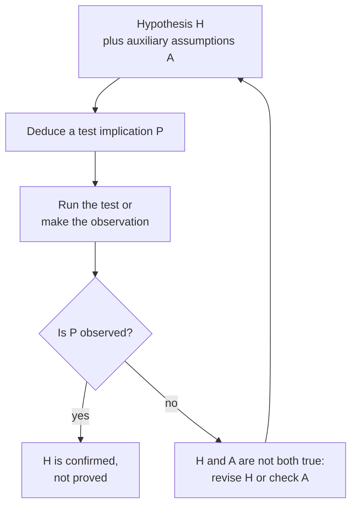
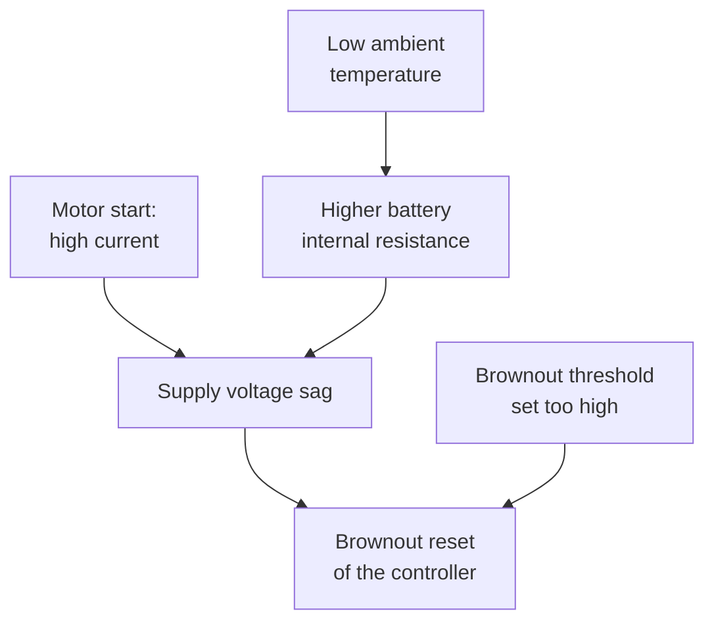
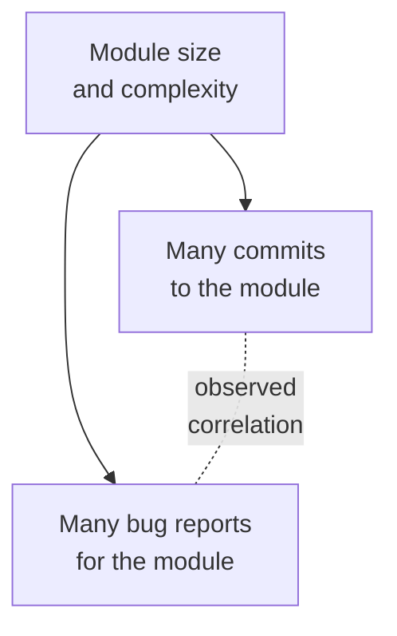

import Figure from '../../components/Figure.astro';
import CtSciFishbone from '../../components/diagrams/CtSciFishbone.astro';

The first seven entries of this series dealt mostly with deduction, where the truth of the premises guarantees the truth of the conclusion. Most of what engineers and scientists believe about the world is not established that way. It rests on evidence: measurements, experiments and observations that make a hypothesis more or less probable without ever proving it. This entry turns from deduction to that kind of reasoning. It uses the distinction between deductive validity and inductive strength from the [third entry](/blog/arguments-and-their-structure) and two argument forms from the [sixth entry](/blog/sentential-logic): modus tollens, which is valid, and affirming the consequent, which is not.

One engineering problem runs through the first half of the entry: a robot whose odometry reads short. It is used to show how a hypothesis is put to the test, what a test result does and does not establish, and how rival hypotheses are weighed. The second half asks what it means for one thing to cause another, how causes are found from patterns of cases, why an association can mislead and how a fair test is designed. Whether an observed difference is larger than chance is a statistical question, left to the [next entry](/blog/probability-and-statistical-reasoning).

## 1. A running case: odometry that reads short

A mobile robot estimates how far it has traveled by counting wheel revolutions and multiplying by the circumference implied by a configured wheel radius of 50.0 mm. On a 10 m test track it reports about 9.8 m. Something explains the 0.2 m, and the engineer's task is to find out what.

Two candidate explanations come to mind. According to $H_1$, the configured radius is wrong and the wheels measure 51.0 mm, so each revolution covers more ground than the software assumes. According to $H_2$, the wheels slip on the floor, so some revolutions move the robot less than a full circumference. Each is a **hypothesis**: a proposed explanation that is not yet known to be true and that can be checked against **data**, the records of observation and measurement. Neither hypothesis can be seen directly. The radius error and the slip are inferred from what they would make the odometry do, and that inference is the subject of Section 2.

The case is small, but it has the structure of most empirical questions: an observation to explain, several possible explanations and a decision needed before certainty is available.

## 2. Putting a hypothesis to the test

### 2.1 Test implications

A hypothesis is tested through its **test implications**, Hempel's term for the observable statements that should be true if the hypothesis is (Hempel, 1966). The pattern of reasoning is called the **hypothetico-deductive method**: deduce a test implication $P$ from the hypothesis $H$, then find out by observation or experiment whether $P$ holds. The deduction almost always needs **auxiliary hypotheses** $A$ as well, assumptions about instruments, setup and background conditions without which $H$ says nothing observable. Figure 1 shows the loop.

*Figure 1. The hypothetico-deductive loop. A passed test supports the hypothesis without proving it (Section 2.3); a failed test refutes the hypothesis only together with its auxiliary assumptions (Section 2.4).*

For the robot, $H_1$ implies something precise. If the true radius is 51.0 mm, the reported distance is the true distance times $50.0/51.0 = 0.980$. That is a shortfall of 1.96% wherever and however the robot drives. Over 5 m, 10 m and 20 m it amounts to 0.098 m, 0.196 m and 0.392 m. $H_2$ implies that the shortfall depends on the floor surface and grows with acceleration, since hard starts make wheels slip.

A hypothesis that implies nothing observable cannot be tested. Popper made this the mark of a scientific claim: a hypothesis is **falsifiable** when some possible observation would contradict it (Popper, 1959). "The robot's error comes from an influence that no instrument can detect" fails the criterion, because every outcome is compatible with it. Vagueness has the same effect. "The wheels are a bit off" becomes testable only when it is sharpened into a radius and a predicted shortfall.

### 2.2 Designing a test that discriminates

A good test is one whose outcome would differ under the rival hypotheses. Driving the robot once more down the same 10 m track is a poor test: both $H_1$ and $H_2$ predict a shortfall there. Driving it 5 m, 10 m and 20 m on carpet and on concrete, at low and at high acceleration, is a good one. Under $H_1$ the shortfall is the same 1.96% in all twelve runs; under $H_2$ it varies with surface and acceleration. A direct measurement of the wheel diameter with calipers is a further test of $H_1$ that does not rely on the odometry at all.

A prediction that every candidate makes cannot help to choose between them, however often it comes true.

### 2.3 Confirmation is not proof

Suppose the twelve runs all show a shortfall of about 2% and the calipers read 102 mm. $H_1$ has passed its tests. The inference "if $H_1$ then $P$; $P$; therefore $H_1$" is nevertheless affirming the consequent, which is invalid (sixth entry): some hypothesis not yet considered might also imply $P$. Perhaps a firmware update changed the encoder resolution by the same 2%, and the wheels happen to be slightly worn as well.

A passed test therefore **confirms** a hypothesis, raising its probability, without establishing it. How much it raises it depends on how likely the observation would have been if the hypothesis were false. The uniform 1.96% shortfall across surfaces would be a strange coincidence under $H_2$, so it confirms $H_1$ strongly; a single short run would have confirmed it hardly at all. The [next entry](/blog/probability-and-statistical-reasoning) gives this idea an exact form with Bayes' theorem.

### 2.4 What a failed test refutes

Now suppose the engineer sets the radius to 51.0 mm and the robot still reports 9.8 m. Modus tollens is valid, but what it refutes is the conjunction of the hypothesis and its auxiliary assumptions:

$$
\big((H \land A) \to P\big),\ \neg P \ \vdash\ \neg(H \land A).
$$

Perhaps $H_1$ is false. Or perhaps an auxiliary assumption failed: the new parameter was written to a file the controller does not read, or the controller was not restarted. Duhem made this point about physical theories, which never meet experiment one at a time (Duhem, 1954). Before abandoning $H_1$, the engineer checks that the new radius is in use, for example by reading it back from the running controller.

Blaming an auxiliary assumption is legitimate when the assumption can be checked independently, as the parameter can. Hempel calls a hypothesis **ad hoc** when it is introduced only to save another from a failed test and has no independent support (Hempel, 1966). "The parameter loaded but some unknown effect cancels it exactly" is of that kind. How long to keep a well-supported hypothesis after a failure is a judgment: the more independent evidence behind it, the more reasonable it is to suspect the setup first.

## 3. Weighing rival hypotheses

When evidence leaves several hypotheses standing, scientists choose among them by criteria that Thomas Kuhn listed as the standard characteristics of a good theory: accuracy, consistency, broad scope, simplicity and fruitfulness (Kuhn, 1977).

| Characteristic | Meaning | In the odometry case |
|---|---|---|
| Accuracy | Its consequences agree with the observations. | Both hypotheses fit one run; only $H_1$ fits a uniform 1.96% shortfall. |
| Consistency | It is free of internal contradiction and fits other accepted theories. | Both agree with elementary mechanics. |
| Scope | Its consequences reach beyond the observations it was built to explain. | $H_1$ also predicts the caliper reading and the error in turning angles. |
| Simplicity | It brings order to the data with few assumptions. | $H_1$ needs one wrong number; $H_2$ needs a model of slip. |
| Fruitfulness | It leads to new findings or new questions. | $H_1$ suggests checking how the rest of the fleet was configured. |

Kuhn stressed that each criterion is imprecise and that they can conflict: a simple hypothesis may fit the data less well than a complicated one. They guide judgment without replacing it. The familiar preference for the simpler of two hypotheses that fit equally well, **Occam's razor**, is a rule of this kind. It says which hypothesis to try first, not which one nature has chosen.

Consistency with accepted theories also sets the burden of proof: a report of a motor that delivers more mechanical energy than it draws is far more probably a measurement error than a discovery.

## 4. What it means to be a cause

### 4.1 Causes make a difference

Pearl characterizes causation by intervention: $X$ is a cause of $Y$ when setting $X$ to different values, by reaching into the system rather than by waiting to observe it, changes $Y$ or the probability distribution of $Y$ (Pearl, 2009). Raising the supply voltage of a microcontroller and watching its brownout resets stop is an intervention. Noticing that resets are rarer on days when the voltage happens to be higher is only an observation, and it may have other explanations, as Section 6 shows.

The definition covers particular claims ("raising this board's supply stopped its resets") and general ones ("undervoltage causes resets in this controller model"), and general claims may be probabilistic: undervoltage raises the probability of a reset without making one certain.

### 4.2 Conditions and sufficient sets

Effects rarely have a single cause. Mackie analyzed a typical cause as one condition in a set of conditions that together suffice for the effect (Mackie, 1965). In the conditional notation of the sixth entry, $C$ is **causally sufficient** for $E$ when adding $C$ to the circumstances guarantees $E$, the pattern $C \to E$, and **causally necessary** when removing $C$ from the circumstances prevents $E$, the pattern $E \to C$. Both are read as claims about interventions, not as truth-functional conditionals.

Consider an overload that trips a motor's thermal protection. The overload alone does not trip it if the motor is well cooled; a clogged cooling fan alone does not trip it at light load. Together with an ambient temperature above some level, they form a set of conditions sufficient for the trip. The set is not necessary, because a seized bearing could trip the protection by another route. Within the set, the overload cannot be removed without losing the effect. Mackie called such a cause an insufficient but non-redundant part of an unnecessary but sufficient condition (**INUS condition** for short).

Which condition in a sufficient set gets called "the cause" depends on what is taken as background. Mackie called the background the **causal field**. A condition that persists through the field, a **standing condition**, is usually treated as background; the change that occurs against it, the **trigger**, is usually called the cause. In a retry storm, a client library configured to retry failed requests immediately and without limit is the standing condition, and a brief network interruption that fails many requests at once is the trigger. The retries then overload the service, which fails more requests. The trigger is what changed that day; the standing condition is what turns a small fault into an outage, and bounded retries with backoff remove it.

### 4.3 Mechanisms

A causal claim is more credible, and more useful, when its **mechanism** is known: the chain of intermediate steps through which the cause produces the effect. "Robots run out of power sooner in cold warehouses" is a correlation until the steps are stated. At low temperature the reactions and ion transport inside a lithium-ion cell slow, so the cell's internal resistance rises. A high motor current then pulls the terminal voltage further down. The robot therefore reaches its cut-off voltage while charge is still left in the cell. Each step can be measured on its own, so a mechanism also makes a causal claim easier to test.

Figure 2 combines the ideas of this section for a controller that resets when a robot starts moving in the cold. Low temperature and a brownout threshold set too high are standing conditions; the motor start is the trigger; the effect needs all three.

*Figure 2. A causal network for brownout resets. Each arrow is a direct causal influence; the reset needs the voltage sag and the threshold together, and the sag has two causes of its own.*

## 5. Mill's methods for finding causes

In *A System of Logic*, Mill set out five canons for inferring causes by comparing cases (Mill, 1843; Copi et al., 2011). They are presented here in Mill's order, on a software problem: a test suite has started to fail intermittently in continuous integration (CI), the automated build-and-test system of a project, and each run records four candidate factors.

### 5.1 The method of agreement

When the cases that show the effect agree in only one candidate circumstance, that circumstance is probably the cause or part of it.

| Failing run | New runner image | Parallel workers | Library version 2.4 | Shuffled test order |
|---|---|---|---|---|
| 1 | yes | yes | yes | no |
| 2 | no | no | yes | yes |
| 3 | yes | no | yes | no |
| 4 | no | yes | yes | yes |

The four failing runs agree only in using version 2.4 of a library, which becomes the prime suspect.

### 5.2 The methods of difference and of agreement and difference

When a case with the effect and a case without it differ in only one candidate circumstance, that circumstance is probably the cause or an indispensable part of it. The engineer reruns run 1 ten times with every setting unchanged except the library, pinned back to version 2.3, and sees no failure. The evidence is only as strong as the failure rate allows. If run 1's configuration fails in half its runs, ten clean reruns would happen by chance with probability $0.5^{10} \approx 0.001$. If it fails in one run in twenty, they would happen with probability $0.95^{10} \approx 0.60$ and show almost nothing.

Mill's **joint method** applies both canons together: agreement among the cases with the effect narrows the candidates, and difference from the cases without it checks the one that survives. A controlled experiment (Section 8) arranges the comparison deliberately.

### 5.3 The method of residues

When known causes account for part of an effect, the remainder is attributed to the remaining antecedents. A sensor board draws 120 mA. The microcontroller, the radio and the sensors are known to draw 40, 45 and 10 mA, together 95 mA. The residual 25 mA is assigned to the parts not yet accounted for, and the engineer looks there first, for example at a status LED left on or a regulator in a fault state.

### 5.4 The method of concomitant variations

When an effect varies in step with a circumstance, the two are causally connected, one way or through a common cause. Suppose that with version 2.4 the failure rate climbs as the number of parallel workers rises from one to eight. That pattern points to a race condition that needs concurrency to show itself. Epidemiology knows the same idea as a dose-response relationship, the "biological gradient" among Hill's considerations for judging an association causal (Hill, 1965).

### 5.5 What the methods cannot do

In the CI case the table has four columns because someone chose them. A certificate that expires on a particular date, and that nobody logged, cannot appear in the table, and the methods will then blame the library or nothing. A failure that needs version 2.4 and parallel workers together, an INUS structure (Section 4.2), is split across two columns, so agreement singles out neither cleanly. And four runs can share an irrelevant factor by coincidence. The canons turn a well-chosen table into a hypothesis; Section 2 still has to test it.

## 6. When an association misleads

### 6.1 Ways to get an association without the causal link

An **association** between $A$ and $B$ means, informally, that $B$ is more frequent, or less frequent, among cases with $A$ than among cases without it; Section 9.1 of the next entry states it in terms of probability. An association is evidence of some causal structure, but not necessarily of $A \to B$. Drawn as causal graphs (Pearl, 2009), the alternatives are few, and each has its own check.

| Structure | Graph | Engineering example | Check |
|---|---|---|---|
| Common cause | $A \leftarrow Z \to B$ | Modules with many commits get many bug reports, because large, complex modules attract both (Figure 3). | Compare cases with similar $Z$. |
| Selection on a common effect | $A \to C \leftarrow B$, only cases with $C$ examined | Faults and customer dissatisfaction look linked among returned devices (Section 7.1). | Examine an unselected sample. |
| Arrow the other way | $B \to A$, or both ways | Services with many alerts have many incidents because incidents prompt new alerts; slow responses cause retries that slow responses further. | Establish which came first in each case. |
| A companion of $A$ | $A \leftarrow W \to B$, with $W$ always present with $A$ | A firmware update that also reboots the device seems to fix a fault that the reboot cleared. | Separate $A$ from $W$, for example by rebooting without updating. |
| No structure | none | Of 40 service metrics searched after an outage, one moved with it. | Repeat the comparison on data not used to find it; the next entry measures chance. |

A variable that influences both the supposed cause and the effect, such as $Z$ or $W$ above, is a **confounder**.

*Figure 3. A common cause. Size and complexity drive both commits and bug reports, so the two are correlated (dashed line) although neither affects the other.*

### 6.2 Positive evidence that an association is causal

Ruling out rivals is one half of the case for a causal claim; the other half is positive evidence. Hill proposed a list of considerations for judging whether an association observed in a population is causal (Hill, 1965). In engineering terms, the most useful are the following.

- **Temporality**: the supposed cause comes before the effect.
- **Strength**: a large association is harder to explain away by a modest confounder than a small one.
- **Consistency**: the association appears in different systems, sites and periods.
- **Gradient**: more of the cause brings more of the effect (Section 5.4).
- **Plausibility**: a known mechanism connects them (Section 4.3).
- **Experiment**: removing or adding the cause changes the effect, the test of Section 4.1 itself.

Hill wrote that none of his viewpoints, temporality included, gives indisputable proof or can be required as a *sine qua non*; they are weighed together.

## 7. Causal diagrams

### 7.1 Causal networks

A **causal network** is a directed graph in which an arrow from $X$ to $Y$ means that $X$ is a direct cause of $Y$; Figures 2 and 3 are examples. Three patterns of three variables recur in larger networks and govern which associations a network produces (Pearl, 2009):

| Pattern | Structure | What it implies |
|---|---|---|
| Chain | $X \to M \to Y$ | $X$ and $Y$ are associated; holding the mediator $M$ fixed removes the association. |
| Fork (common cause) | $X \leftarrow Z \to Y$ | $X$ and $Y$ are associated without any causal link between them; comparing cases with equal $Z$ removes the association. |
| Collider (common effect) | $X \to C \leftarrow Y$ | $X$ and $Y$ are independent, but selecting or conditioning on $C$ creates an association between them. |

The collider explains selection effects. If a device is returned when it has a hardware fault or when its owner is dissatisfied for another reason, then a returned device without a hardware fault must have been returned for the other reason. Among returned devices the two causes are therefore associated, even if they are unrelated across all devices sold.

When each node carries a probability distribution conditional on its parents (the nodes with arrows into it), the network becomes a **Bayesian network**, and Pearl's theory states when the effect of an intervention can be estimated from such a network and observational data alone.

### 7.2 Fishbone diagrams

A **fishbone diagram**, also called a cause-and-effect or Ishikawa diagram after the quality engineer Kaoru Ishikawa, organizes the candidate causes of a problem before any is tested. The problem sits at the head, the main bones are categories of cause and the small bones are specific candidates. Manufacturing teams often use the categories machine, method, material, people, measurement and environment.

<Figure caption="Figure 4. A fishbone diagram for a pick-and-place gripper that drops parts. Each bone is a category of possible cause and each short arrow a specific candidate; the diagram is a checklist of hypotheses, not a finding.">
  <CtSciFishbone />
</Figure>

A causal network records what is believed about how causes interact; a fishbone diagram records what has not yet been ruled out. It supplies the candidate list that Mill's methods cannot generate (Section 5.5), and each branch becomes a hypothesis to test as in Section 2.

## 8. Designing a fair test

### 8.1 Randomized comparison

A firmware team wants to know whether version 2 crashes less than version 1. Installing version 2 on the devices the team considers most stable would make stability influence both which firmware a device runs and how often it crashes: the team's judgment would become a confounder. A fair test assigns versions by a random draw. **Randomization** does not make the two groups identical, but it makes every other factor, including the ones nobody thought to record, equally likely to land in either group. Any systematic difference in crash rate between the groups can then come only from the firmware or from the luck of the draw, and the next entry shows how to judge the second.

In a software product this design is an **A/B test**: users or devices are assigned at random to the current version (A) or the candidate (B), and an outcome is compared. The unit that is randomized must match the comparison. Assigning version B on weekdays and version A at weekends would compare weekdays with weekends as much as A with B.

### 8.2 Blinding

People who know which group a unit is in can change the result without meaning to. In the keyboard trial of Exercise 4, employees who know they have the new keyboard may report less pain because they expect to, and an assessor who knows the assignment may read a borderline symptom differently. A **blind** design hides the assignment from the participants; a **double-blind** design also hides it from those who deliver the treatment and assess the outcome. In medicine the control group of a blind trial receives a **placebo**, an inert treatment indistinguishable from the real one, so that expectation is the same in both groups. Engineers do the same when reviewers rate two model outputs presented unlabeled and in random order.

### 8.3 When an experiment is impossible

Some causes cannot be assigned. A manufacturer cannot decide at random which customers will run its devices in salt spray or in dry offices, so it must compare devices whose environments the customers chose. In such an **observational study** every difference between the groups is a potential confounder. The study can compare like with like on the confounders it knows of and look for the positive evidence of Section 6.2, but its conclusions become persuasive only when several independent lines of evidence agree.

## 9. Mistakes and the published record

### 9.1 Recurring causal mistakes

The errors below are the ones this entry has met in passing; the [twelfth entry](/blog/fallacies-and-cognitive-biases) places them among the other fallacies and biases.

- **Assuming a single cause.** An outage or an accident usually has a standing condition and a trigger (Section 4.2), and fixing only the trigger leaves the next outage waiting.
- **Reading cause into sequence.** A server patched on Monday that crashes on Tuesday has a new suspect, not a proven culprit. The Latin name of this error, *post hoc ergo propter hoc*, means "after this, therefore because of this".
- **Treating an association as causal** without checking the rival structures of Section 6.1.
- **Getting the direction backward**, the reverse-direction structure in particular.
- **Overlooking regression to the mean.** An action taken because a measurement was unusually bad will usually be followed by a better measurement whether or not it worked; the next entry explains why.

### 9.2 Reading published evidence

A single published study is weaker evidence than it appears, for two documented reasons. First, many results do not replicate. When the Open Science Collaboration repeated 100 published psychology experiments, 36% of the replications gave statistically significant results, against 97% of the original studies (Open Science Collaboration, 2015). Second, studies that find an effect are published more readily than those that do not, so the published record overstates the evidence; this is **publication bias**. Rosenthal called the unpublished null results the "file drawer" (Rosenthal, 1979). Both point the same way: weigh a finding by its independent replications and by the design that produced it (Section 8), not by the confidence of its headline.

## 10. Exercises

**Exercise 1.** A nightly deployment job fails. An engineer hypothesizes that its access credential has expired and rotates it. The next run succeeds. What does the success show, and what rival explanation should be ruled out?

*Answer.* It confirms the hypothesis without proving it (affirming the consequent, Section 2.3). Rotating the credential may also have restarted the deployment agent or cleared a cached token, either of which could explain the success. The credential's recorded expiry time, or the error message of the failed run, tests the hypothesis independently.

**Exercise 2.** Three drifting sensor boards come from different batches and technicians but were all stored in one humid room. A fourth board, from one of the same batches but stored dry, does not drift. Which of Mill's methods apply, and what limits the conclusion?

*Answer.* Agreement (only humid storage is shared) and difference (the fourth board differs from its batch-mate chiefly in storage): the joint method points to humidity. Unrecorded factors and the small number of boards limit the conclusion; a controlled humidity test would settle it.

**Exercise 3.** Teams that write more unit tests report fewer production incidents. Give three explanations of the association besides "testing prevents incidents".

*Answer.* A common cause: experienced or well-resourced teams both write more tests and make fewer mistakes. Reverse direction: teams with fewer incidents have more time to write tests. Measurement or selection: teams that test more may also classify or report incidents differently. Chance is a fourth if few teams were compared.

**Exercise 4.** A company gives a new ergonomic keyboard to the employees who request it and finds that they later report less wrist pain than the others. Why is this not a fair test, and how would you design one?

*Answer.* The employees who requested the keyboard selected themselves and may differ in symptoms, motivation or other habits, and they knew they had it, so expectation can affect their reports. A fair test assigns the keyboard at random among volunteers, gives the control group a standard keyboard of similar appearance, and has the pain assessed by someone who does not know the assignments (Section 8).

## 11. Summary

| Question | Answer |
|---|---|
| How is a hypothesis tested? | By deducing test implications from it and its auxiliary assumptions and checking them, preferably where rival hypotheses disagree. |
| What does a passed test show? | It confirms the hypothesis, strongly if the result would be unlikely otherwise; it does not prove it. |
| What does a failed test show? | That the hypothesis and its auxiliary assumptions are not all true; the assumptions are checked before the hypothesis is rejected. |
| How are rival hypotheses weighed? | By accuracy, consistency, scope, simplicity and fruitfulness, applied with judgment. |
| What is a cause? | Something whose manipulation changes the effect; typically an INUS condition (part of a sufficient set), singled out as a trigger against standing conditions. |
| How are causes found? | Mill's methods of agreement, difference, the joint method, residues and concomitant variations, applied to a list of candidates. |
| Why can an association mislead? | Chance, reverse direction, feedback, common causes, selection and bundled causes all produce associations. |
| What makes a test fair? | Random assignment and, where people judge or respond, blinding. |

Scientific reasoning combines deduction, which derives test implications, with induction, which weighs what their success or failure says about a hypothesis. Left open is the quantitative step: how large a difference must be before chance becomes an unlikely explanation, and how much a piece of evidence should change a degree of belief. The [next entry](/blog/probability-and-statistical-reasoning) supplies the rules of probability, Bayes' theorem and the basic tools of statistical inference that answer those questions.

### References

- I. M. Copi, C. Cohen and K. McMahon, *Introduction to Logic*, 14th ed., Pearson, 2011.
- P. Duhem, *The Aim and Structure of Physical Theory*, trans. P. P. Wiener, Princeton University Press, 1954.
- C. G. Hempel, *Philosophy of Natural Science*, Prentice-Hall, 1966.
- A. B. Hill, "The environment and disease: association or causation?," *Proceedings of the Royal Society of Medicine*, vol. 58, no. 5, pp. 295–300, 1965.
- T. S. Kuhn, "Objectivity, value judgment, and theory choice," in *The Essential Tension: Selected Studies in Scientific Tradition and Change*, University of Chicago Press, 1977.
- J. Y. F. Lau and J. Chan, *Critical Thinking Web*, Department of Philosophy, The University of Hong Kong, 2004–2026. https://philosophy.hku.hk/think/
- J. L. Mackie, "Causes and conditions," *American Philosophical Quarterly*, vol. 2, no. 4, pp. 245–264, 1965.
- J. S. Mill, *A System of Logic, Ratiocinative and Inductive*, John W. Parker, 1843.
- Open Science Collaboration, "Estimating the reproducibility of psychological science," *Science*, vol. 349, no. 6251, art. aac4716, 2015.
- J. Pearl, *Causality: Models, Reasoning, and Inference*, 2nd ed., Cambridge University Press, 2009.
- K. R. Popper, *The Logic of Scientific Discovery*, Hutchinson, 1959.
- R. Rosenthal, "The file drawer problem and tolerance for null results," *Psychological Bulletin*, vol. 86, no. 3, pp. 638–641, 1979.
