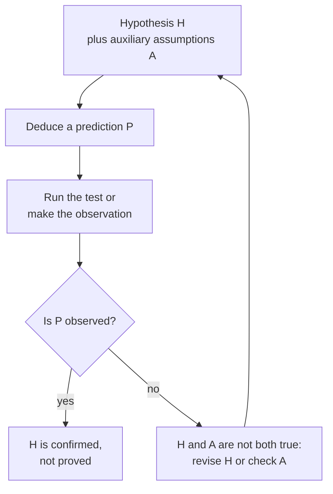
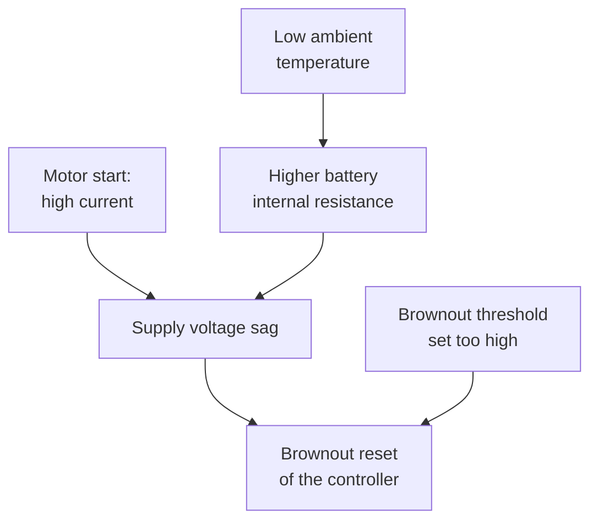
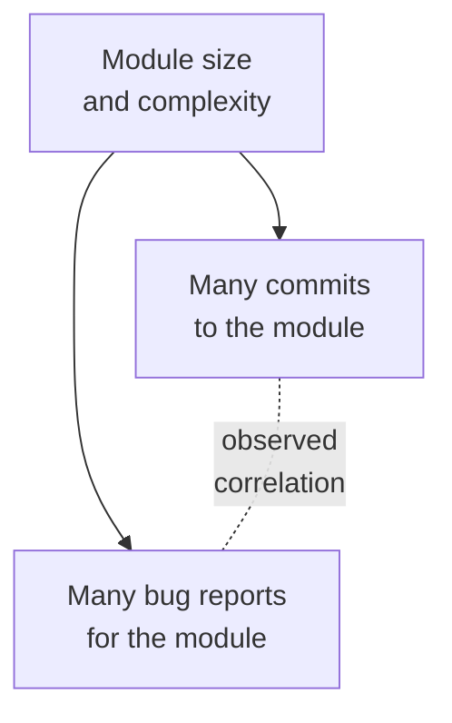

import Figure from '../../components/Figure.astro';
import CtSciFishbone from '../../components/diagrams/CtSciFishbone.astro';

The first seven entries of this series dealt mostly with deduction, where the truth of the premises guarantees the truth of the conclusion. Most of what engineers and scientists believe about the world is not established that way. It rests on evidence: measurements, experiments and observations that make a hypothesis more or less probable without ever proving it. This entry turns from deduction to that kind of reasoning. It uses the distinction between deductive validity and inductive strength from the [third entry](/blog/arguments-and-their-structure) and two argument forms from the [sixth entry](/blog/sentential-logic): modus tollens, which is valid, and affirming the consequent, which is not.

The entry covers how a hypothesis is tested and what a test result shows, how rival hypotheses are compared, what a causal claim says, how causes are found and how correlations mislead, causal diagrams, fair tests and the critical reading of research. Judging whether an observed difference exceeds chance is left to the [next entry](/blog/probability-and-statistical-reasoning).

## 1. Theories, evidence and prediction

### 1.1 The parts of an empirical inquiry

Any empirical inquiry, from particle physics to debugging a flaky test, involves four things. They are the part of the **world** under study, a **theory** or **hypothesis** about how it behaves, the **predictions and explanations** the theory yields and the **data** from observation and experiment against which the predictions are checked.

A prediction need not be about the future: a hypothesis about a crash can predict what an existing log file will show. What matters is that the prediction is derived independently of the data that test it.

### 1.2 Two common misunderstandings

The first misunderstanding is that, because nothing in science is proved with certainty, accepting a scientific claim is a matter of faith. Inductive support comes in degrees, and the evidence for some claims (that copper conducts electricity, that the Earth orbits the Sun) is overwhelming without being a deductive proof. Rational belief tracks the strength of the evidence; it does not wait for certainty.

The second comes from the everyday use of "theory" for a guess. In science a **theory** is an organized body of laws, principles and models about some domain, and a well-established theory such as electromagnetism is among the best-supported knowledge there is. Calling it "just a theory" trades on an ambiguity, a problem of meaning treated in the [second entry](/blog/meaning-clarity-and-definitions).

## 2. The hypothetico-deductive method

### 2.1 Four steps

The **hypothetico-deductive method** tests a hypothesis by deducing an observable consequence from it and checking whether that consequence occurs. It is not the only method used in science, but it is common to all empirical disciplines:

1. State the hypothesis $H$ to be tested.
2. Deduce a prediction $P$ from $H$, together with whatever background assumptions are needed.
3. Make the observation or run the experiment that shows whether $P$ is true.
4. If $P$ is true, $H$ is **confirmed**: the evidence supports it. If $P$ is false, $H$ is **disconfirmed**.

A worked example shows the steps. A mobile robot estimates how far it has traveled by counting wheel revolutions, using a configured wheel radius of 50.0 mm. After a 10 m test run its odometry reports about 9.8 m. Two hypotheses compete. According to $H_1$, the configured radius is wrong: the real wheels measure 51.0 mm, so every revolution covers more ground than the software assumes. According to $H_2$, the wheels slip on the floor.

The two hypotheses predict different things. Under $H_1$ the reported distance is the true distance multiplied by $50.0/51.0 = 0.980$, so the shortfall is 1.96% of the distance on every surface and at every speed: 0.098 m over 5 m, 0.196 m over 10 m and 0.392 m over 20 m. Under $H_2$ the shortfall depends on the floor and grows with acceleration. Runs over several distances, floors and speeds therefore discriminate between them, and measuring the wheels is an independent test of $H_1$.

### 2.2 A hypothesis must be testable

The method assumes that the hypothesis yields some prediction that could turn out false. A hypothesis that is compatible with every possible observation cannot be tested, so no evidence can count for or against it. Karl Popper made **falsifiability**, the possibility in principle of being refuted by observation, his criterion for a hypothesis to count as scientific (Popper, 1959).

The claim "the outage was caused by a fault that leaves no trace in any log, counter or measurement" is of this kind as stated: whatever is observed, it survives. It becomes testable once it is made specific. "A single-bit memory error caused the outage" predicts that the error-correcting memory controller recorded a corrected or uncorrected error in that time window, and that predicted record can be looked for.

### 2.3 Confirmation is not proof

Suppose the robot is reconfigured with a radius of 51.0 mm and the next run reports 10.0 m. The reasoning "if $H_1$ then $P$; $P$; therefore $H_1$" has the form of affirming the consequent, which is invalid (sixth entry). Something other than $H_1$ might also explain $P$: perhaps the original 9.8 m reading came from a single run on a dusty floor, and the floor has since been cleaned.

A passed test raises the probability of a hypothesis without establishing it, and by how much depends on how likely the prediction would have been if the hypothesis were false. A prediction that would have come true anyway confirms little; a precise, surprising one confirms a great deal. The [next entry](/blog/probability-and-statistical-reasoning) makes this idea exact with Bayes' theorem.

### 2.4 Failed predictions and auxiliary assumptions

Disconfirmation looks more decisive, since "if $H$ then $P$; not $P$; therefore not $H$" is modus tollens and is valid. But a hypothesis almost never yields a prediction on its own. The prediction follows from $H$ together with **auxiliary assumptions** $A$: that the instruments work, that the test setup is what it is believed to be, that no other factor interferes. The valid inference is then

$$
\big((H \land A) \to P\big),\ \neg P \ \vdash\ \neg(H \land A),
$$

which says only that $H$ and $A$ are not both true. This point is usually credited to Pierre Duhem (Duhem, 1954). If the robot with the corrected radius still reports 9.8 m, $H_1$ may yet be true: the new configuration may not have been loaded, which is a failure of an auxiliary assumption rather than of the hypothesis.

The history of astronomy contains both outcomes. In the 1840s the orbit of Uranus departed from the predictions of Newtonian gravitation. Rather than reject Newton's theory, Urbain Le Verrier questioned an auxiliary assumption, that the known planets were the only ones disturbing Uranus, and calculated where an unknown planet would have to be. Neptune was found close to the predicted position in 1846. When Le Verrier later tried the same move for the anomalous precession of Mercury's orbit, proposing an unseen inner planet, no such planet was found. That anomaly, about 43 arcseconds per century, was eventually explained by Einstein's general theory of relativity in 1915: this time the theory itself had to change.

### 2.5 When to give up a hypothesis

No rule says how many failed predictions a hypothesis may survive, but two guidelines help. First, an auxiliary assumption blamed for a failure should itself be tested independently, as the new planet was tested by looking for it; an assumption introduced only to rescue a hypothesis, with no independent test, is **ad hoc** and adds nothing. Second, the stronger the existing support for a hypothesis, the more reasonable it is to suspect the experiment first, though only checking the setup can show which is at fault.

## 3. Choosing between hypotheses

Several explanations usually fit the available data, and a choice must be made, at least provisionally. The criteria below are widely used in science and engineering (Hempel, 1966; Lau, 2011). None is decisive alone, and they can pull in different directions.

| Criterion | Question to ask | Robot odometry example |
|---|---|---|
| Fit with the data | Is the hypothesis consistent with all reliable observations? | Both $H_1$ and $H_2$ fit a single 10 m run. |
| Predictive power | How many testable predictions does it make, and how precise are they? | $H_1$ predicts an exact 1.96% shortfall on every surface; $H_2$ predicts only that some shortfall occurs. |
| Mechanism | Does it say how the cause produces the effect? | A larger radius means more ground covered per revolution. |
| Fruitfulness | Does it suggest new tests or reveal unexpected connections? | $H_1$ suggests checking the wheels of the rest of the fleet. |
| Simplicity | Does it make fewer assumptions or posit fewer entities? | $H_1$ needs one wrong number; $H_2$ needs a slip model. |
| Coherence | Is it internally consistent and compatible with well-established knowledge? | Both are compatible with mechanics. |

The preference for the simpler of two hypotheses that explain the data equally well is often called **Occam's razor**. It is a rule for choosing what to test and believe first, not a law of nature: the world is sometimes complicated, and the simpler hypothesis must still pass its tests.

Coherence has a practical consequence. A claim that contradicts well-established science, such as a device that delivers more energy than it takes in, is far more likely to be mistaken than to overturn that science. It needs independent replication and a stated mechanism before it deserves belief.

## 4. What a causal claim says

### 4.1 Singular and general causation

Causal claims come in two kinds. **Singular causation** is a relation between particular events: "the voltage spike at 14:02 reset the controller". **General causation** is a relation between types of events: "voltage spikes reset controllers of this model". General claims are usually probabilistic. "Smoking causes lung cancer" does not say that every smoker develops the disease; it says that smoking raises the chance of developing it, through a known mechanism.

### 4.2 Necessary, sufficient and contributing causes

A cause $C$ is **causally necessary** for an effect $E$ when $E$ would not have occurred without $C$. It is **causally sufficient** when $C$ alone is enough to bring about $E$. In the notation of the sixth entry, sufficiency is the pattern $C \to E$ and necessity the pattern $E \to C$, read as claims about how the world works rather than as truth-functional conditionals.

Most real causes are neither. Oxygen is necessary for a fire but not sufficient. A short circuit is not necessary, since fires have other origins, and not sufficient either, since it ignites nothing without fuel nearby. J. L. Mackie called such a cause an insufficient but non-redundant part of an unnecessary but sufficient condition (**INUS condition** for short) (Mackie, 1965). The short circuit, fuel and oxygen together form one of several possible sufficient sets, and within that set the short circuit cannot be removed without losing the effect. When people speak of "the cause", they usually mean one INUS condition singled out as unusual or controllable.

A factor that raises the probability of an effect without being necessary or sufficient is a **contributing cause** (or causally relevant factor). Code review lowers the rate of defects that reach production; it neither guarantees their absence nor is the only way to reduce them.

### 4.3 Triggering and standing causes

A **triggering cause** is an event that sets the effect in motion; a **standing cause** (or structural cause) is a persisting condition that produces the effect only in combination with a trigger. In a retry storm, a client library configured to retry failed requests immediately and without limit is the standing cause, and a brief network interruption that fails many requests at once is the trigger; the retries overload the service, which fails more requests. Fixing the trigger makes the outage rarer; fixing the standing cause (bounded retries with backoff) removes the mechanism that turns small faults into outages.

### 4.4 Causes act through mechanisms

A causal claim is better understood, and better supported, when its **mechanism** is known: the lower-level process through which the cause produces the effect. "Cold weather shortens the runtime of a battery-powered robot" becomes an explanation once the mechanism is stated. At low temperature the reactions and ion transport in the cell slow down and its internal resistance rises. A high motor current then pulls the terminal voltage down further, so the robot reaches its cut-off voltage with charge still in the cell. Each link suggests a test, such as measuring internal resistance at several temperatures.

The causal network below combines the ideas of this section. Low temperature and a brownout threshold set too high are standing causes; a motor start is the trigger; none of them alone resets the controller.

## 5. Mill's methods for finding causes

John Stuart Mill described five methods for identifying causes from patterns of cases in his *A System of Logic* (Mill, 1843; Copi, Cohen and McMahon, 2011). The running example is a test suite that has started failing intermittently in continuous integration (CI), the automated build-and-test system of a software project. Each run records four candidate factors.

### 5.1 The method of agreement

If every case in which the effect occurs shares exactly one candidate factor, that factor is probably the cause. Four failing runs give the following table.

| Failing run | New runner image | Parallel workers | Library version 2.4 | Shuffled test order |
|---|---|---|---|---|
| 1 | yes | yes | yes | no |
| 2 | no | no | yes | yes |
| 3 | yes | no | yes | no |
| 4 | no | yes | yes | yes |

Only the upgrade to version 2.4 of a library is common to all four, so by the method of agreement it is the prime suspect.

### 5.2 The method of difference

If a case in which the effect occurs and a case in which it does not differ in only one candidate factor, that factor is probably the cause, or an indispensable part of it. Rerunning run 1 ten times without a failure, identical except for the library pinned back to version 2.3, applies it. Controlled experiments (Section 8) create such pairs on purpose.

The **joint method of agreement and difference** combines the two: agreement narrows the candidates and difference checks the survivor.

### 5.3 The method of concomitant variation

If the size of the effect varies with the size of a factor, the factor is probably causally connected with the effect. Suppose that, with the library at version 2.4, the failure rate rises with the number of parallel workers, from no failures in 50 runs with one worker to many failures with eight. That pattern suggests a race condition that needs concurrency to appear. The same idea appears in epidemiology as a **dose-response relationship**, one of the considerations Austin Bradford Hill proposed for judging whether an association is causal (Hill, 1965).

### 5.4 The method of residues

If part of an effect is already explained by known causes, the remainder is attributed to the remaining factor. A circuit board draws 120 mA; the microcontroller, radio and sensors are known to draw 40, 45 and 10 mA, which account for 95 mA. The residual 25 mA is attributed to the components not yet accounted for. The discovery of Neptune (Section 2.4) also has this structure: the part of Uranus's motion not explained by the Sun and the known planets was attributed to an unknown body.

### 5.5 Limits of the methods

Mill's methods can only choose among the candidate factors someone thought to record. If the real cause of the CI failures is an expiring certificate and nobody logged the date, the methods find the wrong factor or none. They also assume that a single factor is the cause, whereas effects often need a combination of factors (an INUS condition) or have several independent causes. Finally, with few cases, a factor can be shared by all of them by chance. The methods generate well-founded hypotheses; they do not replace testing them.

## 6. From correlation to causation

### 6.1 Correlation

Two types of events are **correlated** when the occurrence of one makes the other more or less likely. A correlation between $A$ and $B$ is evidence that some causal connection exists, but not of which one. Before concluding that $A$ causes $B$, the following rival explanations need to be ruled out.

### 6.2 Rival explanations

- **Chance.** With few observations, or many variables searched for any association, accidental correlations are expected. Comparing with a control situation in which $A$ is absent is the basic remedy.
- **Reverse causation.** $B$ may cause $A$. Servers with more monitoring alerts configured have more incidents; it is likely that incidents led engineers to add alerts, rather than that alerts cause incidents.
- **Feedback.** $A$ and $B$ may cause each other: slow responses cause users to retry, and retries slow responses further.
- **Common cause.** A third factor $Z$ may cause both. Modules that receive many commits also receive many bug reports, but committing does not create bugs: large, complex modules attract both more changes and more defects. A variable that causes both the supposed cause and the effect is called a **confounder**.
- **Side effect.** The effect may come from something that accompanies $A$ rather than from $A$ itself. In medicine, believing that one is being treated can relieve symptoms through the **placebo effect**, so an improvement after a pill does not show that the pill's active ingredient worked.
- **Selection.** The way cases were selected may create the association, as when only devices returned under warranty are examined (Section 7.1).

In the common-cause pattern the observed correlation (dashed) runs between two variables that do not affect each other at all.

## 7. Causal diagrams

### 7.1 Causal networks

A **causal network** is a directed graph in which an arrow from $X$ to $Y$ means that $X$ is a direct cause of $Y$. The brownout diagram of Section 4.4 and the confounder diagram of Section 6.2 are small examples. Three patterns of three variables recur in larger networks and govern which correlations a network produces (Pearl, 2009):

| Pattern | Structure | What it implies |
|---|---|---|
| Chain | $X \to M \to Y$ | $X$ and $Y$ are correlated; holding the mediator $M$ fixed removes the correlation. |
| Fork (common cause) | $X \leftarrow Z \to Y$ | $X$ and $Y$ are correlated without any causal link between them; comparing cases with equal $Z$ removes the correlation. |
| Collider (common effect) | $X \to C \leftarrow Y$ | $X$ and $Y$ are independent, but selecting or conditioning on $C$ creates a correlation between them. |

The collider explains the selection effect of Section 6.2. If a device is returned when it has a hardware fault or when its owner is dissatisfied for another reason, then a returned device without a hardware fault must have been returned for the other reason. The two causes are therefore correlated among returned devices even if they are unrelated in the whole population.

When the arrows carry conditional probabilities, the network becomes a **Bayesian network**, from which the probability of any variable given observations of others can be computed. Pearl extended such networks into a theory of when a causal effect can be estimated from observational data.

### 7.2 Fishbone diagrams

A **fishbone diagram**, also called a cause-and-effect or Ishikawa diagram after the quality engineer Kaoru Ishikawa, is a tool for listing the possible causes of a problem in an organized way. The effect sits at the head; the main bones are categories of cause; smaller bones carry specific candidate causes. In manufacturing the categories are often machine, method, material, people, measurement and environment, though any set that suits the problem may be used.

<Figure caption="A fishbone diagram for a pick-and-place gripper that drops parts. Each bone is a category of possible cause and each short arrow a specific candidate; the diagram is a checklist of hypotheses, not a finding.">
  <CtSciFishbone />
</Figure>

A fishbone diagram supplies the list of candidates that the hypothetico-deductive method and Mill's methods presuppose. It does not show which candidate is the cause or how causes interact; each branch is a hypothesis to test, for example by logging the vacuum level during picks.

## 8. Fair tests of causal claims

### 8.1 The controlled experiment

The most direct test of whether $A$ causes $B$ makes the method of difference happen on purpose. In a **controlled experiment**, units (patients, devices, users, test runs) are divided into a **treatment group** that receives $A$ and a **control group** that does not, and $B$ is measured in both. If the groups differ systematically only in $A$, a difference in $B$ larger than chance can be attributed to $A$.

The crucial step is **randomization**: assigning units to the groups by a random process. Randomization does not make the groups identical, but it makes every other factor, including those nobody thought of, equally likely to fall in either group, so no confounder can differ between the groups systematically. Assignment by judgment ("give the new firmware to the devices that seem most stable") lets the judgment itself become a confounder.

### 8.2 Blinding and placebos

People change their behavior when they know which group they are in. In a **blind** trial the participants do not know their group, which is why a control group in a drug trial receives a **placebo**, an inert treatment that looks the same as the real one. In a **double-blind** trial the people who administer the treatment and assess the outcome do not know the assignments either, since their expectations can affect how they treat participants and how they judge borderline results.

### 8.3 A/B tests and observational studies

An **A/B test** in software is a randomized controlled experiment: users are assigned at random to the current version (A) or a variant (B), and an outcome such as completion rate is compared. The randomization must be by user, not by time of day or by region, or the comparison picks up whatever else differs between times and regions.

When assigning the cause would be unethical or impossible (nobody can be assigned to smoke for 20 years), **observational studies** compare groups that selected themselves, and every difference between the groups is a potential confounder. Careful observational research compares like with like on known confounders, looks for dose-response relationships, consistency across studies and a plausible mechanism (Hill, 1965), and draws its confidence from many independent lines of evidence rather than one comparison.

## 9. Causal fallacies and reading research

### 9.1 Common mistakes

The following errors recur in causal reasoning; the twelfth entry, [Fallacies and Cognitive Biases](/blog/fallacies-and-cognitive-biases), collects them with other fallacies.

- **Post hoc reasoning**: concluding that $A$ caused $B$ because $B$ followed $A$. A server was patched on Monday and crashed on Tuesday; without more evidence the patch is only one suspect among several.
- **Treating correlation as causation**: ignoring the rival explanations of Section 6.2.
- **Reversing the direction**: assuming $A$ causes $B$ without asking whether $B$ causes $A$.
- **Assuming a single cause**: looking for "the" cause of an accident or outage that had several, often a standing condition and a trigger.
- **Ignoring regression to the mean**: crediting an intervention for the return of an unusually extreme measurement towards its typical level, which would have happened anyway. The next entry explains why.

### 9.2 Reading research critically

Science corrects itself over time, but individual studies are fallible. A few habits help.

- **Prefer replicated results.** A finding reproduced by independent groups is far more reliable than a single study. A large project that repeated 100 published psychology experiments obtained statistically significant results in 36% of the replications, against 97% of the original studies (Open Science Collaboration, 2015).
- **Remember the unpublished studies.** Studies that find no effect are less often published, so the published record overstates the evidence for effects. This is called **publication bias**.
- **Check who paid.** Conflicts of interest do not make a result false, but they are a reason to look harder at its design.
- **Read past the headline.** Reports often turn an observational correlation into a causal claim the authors did not make. Ask whether the study was an experiment, how large it was and what was compared with what.
- **Respect the limits of expertise.** Expertise in one field does not carry over to another.

## 10. Exercises

**Exercise 1.** A nightly deployment job fails. An engineer hypothesizes that its access credential has expired and rotates it. The next run succeeds. What does the success show, and what rival explanation should be ruled out?

*Answer.* It confirms the hypothesis without proving it (affirming the consequent). Rotating the credential may also have restarted the deployment agent or cleared a cached token, either of which could explain the success. Checking the credential's recorded expiry time, or the job's error message, tests the hypothesis independently.

**Exercise 2.** Three sensor boards show calibration drift; all three were stored in the same humid room, and they come from three different production batches and were calibrated by three different technicians. A fourth board from one of the same batches, stored in a dry cabinet, shows no drift. Which of Mill's methods are used, what do they suggest, and what limits apply?

*Answer.* The drifting boards share only humid storage (agreement), and the fourth board differs from its batch-mate chiefly in storage (difference): the joint method points to humidity. Unrecorded factors (storage time, temperature) and the small number of boards limit the conclusion; a controlled humidity test would settle it.

**Exercise 3.** Teams that write more unit tests report fewer production incidents. Give three rival explanations of the correlation besides "testing prevents incidents".

*Answer.* A common cause: experienced or well-resourced teams both write more tests and make fewer mistakes. Reverse causation: teams that suffered fewer incidents had more time to write tests. Selection or measurement: teams that test more may also classify or report incidents differently. (Chance is a fourth, if the number of teams is small.)

**Exercise 4.** A company gives a new ergonomic keyboard to the employees who request it and finds that they later report less wrist pain than the others. Why is this not a fair test, and how would you design one?

*Answer.* Those who requested the keyboard selected themselves and may differ in motivation, symptoms or other habits, and they knew they had the new keyboard, so expectation may affect their reports. A fair test would assign the keyboard at random among volunteers, compare with a control group given a standard keyboard, and have the pain assessed by someone who does not know the assignments.

## 11. Summary

| Question | Answer |
|---|---|
| How is a hypothesis tested? | Deduce a prediction from it and its auxiliary assumptions, then check the prediction by observation or experiment. |
| What does a passed test show? | It confirms the hypothesis, more strongly if the prediction was precise and otherwise unlikely; it does not prove it. |
| What does a failed test show? | That the hypothesis and its auxiliary assumptions are not all true; the assumptions must be checked before the hypothesis is rejected. |
| How are rival hypotheses compared? | By fit with the data, predictive power, mechanism, fruitfulness, simplicity and coherence. |
| What kinds of cause are there? | Necessary, sufficient, contributing (INUS), triggering and standing; good causal claims state a mechanism. |
| How are causes found? | Mill's methods of agreement, difference, the joint method, concomitant variation and residues, applied to a list of candidates. |
| Why is correlation not causation? | Chance, reverse causation, feedback, common causes, side effects and selection can all produce a correlation. |
| What makes a test fair? | A control group, random assignment and, where people are involved, blinding. |

Scientific reasoning combines deduction, which derives predictions, with induction, which weighs what their success or failure says about a hypothesis. Left open is the quantitative step: how large a difference must be before chance becomes an unlikely explanation, and how much evidence should change a degree of belief. The [next entry](/blog/probability-and-statistical-reasoning) supplies the rules of probability, Bayes' theorem and the basic tools of statistical inference that answer those questions.

### References

- I. M. Copi, C. Cohen and K. McMahon, *Introduction to Logic*, 14th ed., Pearson, 2011.
- P. Duhem, *The Aim and Structure of Physical Theory*, trans. P. P. Wiener, Princeton University Press, 1954.
- C. G. Hempel, *Philosophy of Natural Science*, Prentice-Hall, 1966.
- A. B. Hill, "The environment and disease: association or causation?," *Proceedings of the Royal Society of Medicine*, vol. 58, no. 5, pp. 295–300, 1965.
- J. Lau, *An Introduction to Critical Thinking and Creativity: Think More, Think Better*, Wiley, 2011.
- J. Lau and J. Chan, *Critical Thinking Web*, Department of Philosophy, The University of Hong Kong, 2004–2026. https://philosophy.hku.hk/think/
- J. L. Mackie, "Causes and conditions," *American Philosophical Quarterly*, vol. 2, no. 4, pp. 245–264, 1965.
- J. S. Mill, *A System of Logic, Ratiocinative and Inductive*, John W. Parker, 1843.
- Open Science Collaboration, "Estimating the reproducibility of psychological science," *Science*, vol. 349, no. 6251, art. aac4716, 2015.
- J. Pearl, *Causality: Models, Reasoning, and Inference*, 2nd ed., Cambridge University Press, 2009.
- K. R. Popper, *The Logic of Scientific Discovery*, Hutchinson, 1959.
