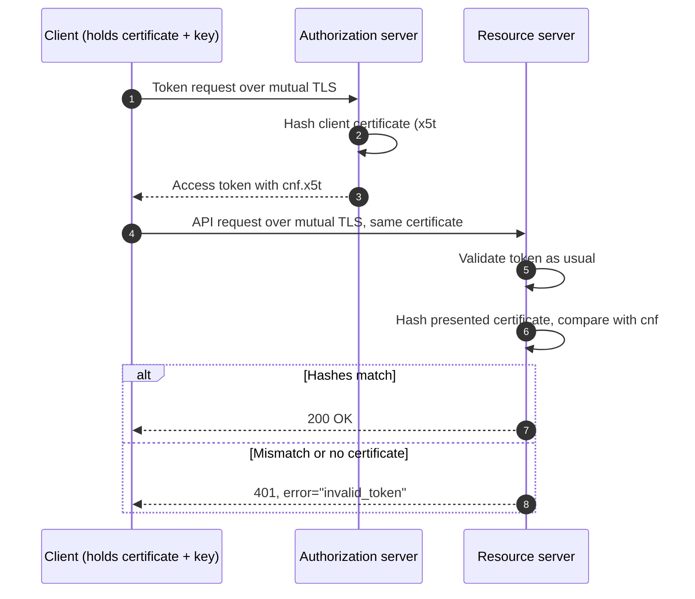

Every token in the [previous entry](/blog/oauth-grants-and-client-types) was a **bearer** token: presenting it is sufficient to use it. The [first entry](/blog/token-based-authentication#36-bearer-and-sender-constrained-tokens) compared such a token to cash, and the comparison is exact. A token copied from a log file, a misconfigured proxy, a compromised browser extension or a resource server that forwarded it carelessly works for whoever holds the copy, from wherever they are, until it expires.

Short lifetimes, careful storage and audience restriction reduce the damage, but none of them changes the underlying property. **Sender-constrained** tokens do. A sender-constrained token is bound to a cryptographic key that the legitimate client holds, and a resource server accepts it only together with proof that the presenter controls that key. A copy of the token without the key is useless.

This entry explains the general mechanism first, then the two standard ways of providing the proof: mutual TLS (RFC 8705) and Demonstrating Proof of Possession (DPoP, RFC 9449). It ends with what binding does and does not protect against, and how to choose between the two.

## 1. Proof of possession

### 1.1 The general pattern

All sender-constrained schemes follow the same three steps.

1. **Binding at issuance.** When the client requests a token, it proves possession of a key. The authorization server records a reference to the client's public key in the token, or in the server-side state an opaque token points to.
2. **Proof at use.** With every request to a resource server, the client proves possession of the same key: by completing a TLS handshake with it, or by signing a fresh statement about the request.
3. **Comparison at the resource server.** The resource server checks that the key used in the proof is the key named in the token, in addition to all the usual checks from the [first entry](/blog/token-based-authentication#65-validating-an-access-token).

The private key never leaves the client and is never sent with the token. Stealing the token alone gains the attacker nothing.

### 1.2 The confirmation claim

RFC 7800 defines the `cnf` (confirmation) claim, through which a JSON Web Token (JWT) names the key that must accompany it. Both standard mechanisms use it, with different members:

```json
{
  "iss": "https://id.example.com",
  "sub": "user-48213",
  "aud": "https://api.example.com/orders",
  "exp": 1791796200,
  "cnf": { "jkt": "0ZcOCORZNYy-DWpqq30jZyJGHTN0d2HglBV3uiguA4I" }
}
```

Here `jkt` is the **JSON Web Key (JWK) SHA-256 thumbprint** (RFC 7638) of a DPoP public key: a hash of the key's essential parameters in a canonical JSON form. For mutual TLS, the member is `x5t#S256`, the base64url-encoded SHA-256 hash of the client's certificate in its binary Distinguished Encoding Rules (DER) form. For opaque tokens, the authorization server returns the same `cnf` object from its introspection endpoint. The key, access token and hashes in this entry's examples are the sample values from RFC 9449, and they are consistent with one another. The `jkt` above is the thumbprint of the key in Section 3.2, and the `ath` there is the hash of the access token in Section 3.3.

Note that `cnf` names a hash, not the key itself. The resource server computes the same hash over the key presented in the proof and compares the two.

## 2. Mutual TLS

### 2.1 Client certificates in TLS

In ordinary HTTPS, only the server presents a certificate. TLS also allows the server to request one from the client; the client then proves possession of the corresponding private key by signing part of the handshake. This is **mutual TLS** (mTLS). Because the proof is part of the handshake, every request on that connection is implicitly accompanied by it.

RFC 8705 uses mTLS for two separate purposes in OAuth.

### 2.2 Client authentication

As the [previous entry](/blog/oauth-grants-and-client-types#13-client-authentication) described, a confidential client can authenticate to the token endpoint with its certificate instead of a secret:

- with `tls_client_auth`, the certificate is issued by a public key infrastructure the authorization server trusts, and the client is identified by a registered attribute of the certificate such as its subject name;
- with `self_signed_tls_client_auth`, the client registers its self-signed certificate (or its public key) directly, and no certificate authority is involved.

### 2.3 Certificate-bound access tokens

Independently of client authentication, the authorization server can bind the access token to the certificate the client used when obtaining it. The flow is:



An attacker who copies the token cannot complete a TLS handshake with the client's private key, so the resource server sees either no certificate or a different one, and rejects the request.

RFC 8705 also permits certificate-bound tokens for **public** clients: the client may present a self-signed certificate purely to bind its tokens, without that certificate authenticating it. The binding still prevents replay by anyone who lacks the key.

### 2.4 Operational realities

Mutual TLS is attractive because the proof is done by TLS libraries that are mature and fast, and nothing changes at the HTTP layer. Its difficulties are about infrastructure.

- **TLS termination.** Many deployments terminate TLS at a load balancer or gateway, so the application never sees the handshake. The terminating component must verify the client's possession of the key, then pass the certificate to the application in a header, and the application must accept that header **only** from the terminating component. RFC 9440 standardizes such a header (`Client-Cert`). A header that any client can set is a forgery vector, not a binding.
- **Certificate lifecycle.** Certificates must be issued, distributed, rotated before they expire and revoked when compromised. Rotating a certificate changes its hash, so tokens bound to the old certificate stop working; clients must obtain new tokens after rotation.
- **Endpoint aliases.** Some clients of an authorization server use mTLS and others do not. Because a server cannot easily request a client certificate on one connection and not another on the same host name, RFC 8705 lets the server publish separate `mtls_endpoint_aliases` in its metadata.
- **Browsers.** Browsers support client certificates only through clumsy selection dialogs and operating-system certificate stores. mTLS is practical for servers, back-end services and managed devices, not for ordinary web applications running in a browser.

## 3. DPoP

### 3.1 Proof at the application layer

Demonstrating Proof of Possession (DPoP, RFC 9449) moves the proof from the TLS layer to HTTP. The client generates an asymmetric key pair, keeps the private key, and for **every** request creates a short JWT, the **DPoP proof**, signed with that key and describing that request. The proof travels in a `DPoP` header alongside the request.

Because it works over any TLS connection, including one terminated at a proxy, DPoP suits clients for which mutual TLS is impractical: single-page applications, mobile applications and any deployment where certificates are a burden.

### 3.2 Anatomy of a proof

The proof's header carries the public key, so the receiver can verify the signature without any prior registration:

```json
{
  "typ": "dpop+jwt",
  "alg": "ES256",
  "jwk": {
    "kty": "EC",
    "crv": "P-256",
    "x": "l8tFrhx-34tV3hRICRDY9zCkDlpBhF42UQUfWVAWBFs",
    "y": "9VE4jf_Ok_o64zbTTlcuNJajHmt6v9TDVrU0CdvGRDA"
  }
}
```

Its payload describes one request:

```json
{
  "jti": "e1j3V_bKic8-LAEB",
  "htm": "GET",
  "htu": "https://api.example.com/orders",
  "iat": 1791795700,
  "ath": "fUHyO2r2Z3DZ53EsNrWBb0xWXoaNy59IiKCAqksmQEo"
}
```

| Claim | Meaning | Why it matters |
|---|---|---|
| `jti` | A unique identifier for this proof | The server can refuse a proof it has already seen |
| `htm` | The HTTP method | A proof for `GET` cannot be reused for `DELETE` |
| `htu` | The target URI (uniform resource identifier), without query or fragment | A proof for one endpoint cannot be used at another |
| `iat` | The creation time | Proofs are accepted only within a short window |
| `ath` | The base64url SHA-256 hash of the access token | Ties the proof to one specific token |
| `nonce` | A value supplied by the server, when it requires one | Prevents proofs from being prepared in advance (Section 3.5) |

The `ath` claim is present when the proof accompanies an access token at a resource server; proofs sent to the token endpoint omit it.

### 3.3 Obtaining a DPoP-bound token

The client includes a proof in its token request. The authorization server verifies the proof, computes the thumbprint of its `jwk`, and binds the token to it (HTTP/1.1 syntax, as throughout the series):

```http
POST /token HTTP/1.1
Host: id.example.com
Content-Type: application/x-www-form-urlencoded
DPoP: eyJ0eXAiOiJkcG9wK2p3dCIsImFsZyI6IkVTMjU2IiwiandrIjp7Li4ufX0.eyJqdGkiOi...

grant_type=authorization_code
&code=SplxlOBeZQQYbYS6WxSbIA
&redirect_uri=https%3A%2F%2Fprint.example%2Fcallback
&code_verifier=dBjftJeZ4CVP-mB92K27uhbUJU1p1r_wW1gFWFOEjXk
```

```http
HTTP/1.1 200 OK
Content-Type: application/json
Cache-Control: no-store

{
  "access_token": "Kz~8mXK1EalYznwH-LC-1fBAo.4Ljp~zsPE_NeO.gxU",
  "token_type": "DPoP",
  "expires_in": 600,
  "refresh_token": "Q..Zkm29lexi8VnWg2zPW1x-tgGad0Ibc3s3EwM_Ni4-g"
}
```

The `token_type` of `DPoP` tells the client that a bearer presentation will not work. For a public client, the authorization server binds the **refresh token** to the same key, which is one of the two options RFC 9700 offers for making public clients' refresh tokens safe (the other is rotation, as the previous entry noted). A client can also send a `dpop_jkt` parameter in the authorization request, binding the authorization code itself to the key before it is ever issued.

### 3.4 Presenting the token

At the resource server, the token moves from the `Bearer` scheme to the `DPoP` scheme, and a fresh proof (now with `ath`) accompanies it:

```http
GET /orders HTTP/1.1
Host: api.example.com
Authorization: DPoP Kz~8mXK1EalYznwH-LC-1fBAo.4Ljp~zsPE_NeO.gxU
DPoP: eyJ0eXAiOiJkcG9wK2p3dCIsImFsZyI6IkVTMjU2IiwiandrIjp7Li4ufX0.eyJqdGkiOi...
```

The resource server's checks extend the validation procedure from the first entry:

1. Validate the access token as usual (signature, `iss`, `aud`, `exp` and the rest) or introspect it.
2. Parse the proof; check `typ` is `dpop+jwt` and `alg` is an asymmetric algorithm on the server's allow-list.
3. Verify the proof's signature with the `jwk` in its header.
4. Check `htm` and `htu` against the actual request, and `iat` against the current time within a small window.
5. Check `ath` against the hash of the presented access token.
6. Check `jti` has not been seen within the acceptance window, and `nonce` if the server requires one.
7. Compute the thumbprint of the proof's `jwk` and compare it with the token's `cnf.jkt`.

A failure is reported with the `DPoP` authentication scheme:

```http
HTTP/1.1 401 Unauthorized
WWW-Authenticate: DPoP error="invalid_token", algs="ES256 PS256"
```

A resource server that accepts DPoP-bound tokens must also refuse them when presented with the `Bearer` scheme, or an attacker could strip the binding by changing the scheme.

### 3.5 Nonces and pre-generated proofs

Without a server-supplied value, a proof depends only on things the client knows in advance: the method, the URL, the token and the time. An attacker who can briefly run code where the key is usable (a cross-site scripting flaw in a browser application, for example) could generate proofs for future times and carry them away, using them after the flaw is fixed.

To prevent this, a server can require a **nonce**. It replies to a request that lacks one, or carries a stale one, with an error and a fresh value in the `DPoP-Nonce` header:

```http
HTTP/1.1 401 Unauthorized
WWW-Authenticate: DPoP error="use_dpop_nonce", error_description="Resource server requires nonce in DPoP proof"
DPoP-Nonce: eyJ7S_zG.eyJH0-Z.HX4w-7v
```

The client retries with the nonce in its proof. Since the server changes nonces periodically, proofs cannot be prepared beyond the current nonce's lifetime. Authorization servers signal the same requirement with a `use_dpop_nonce` error in a `400` response. Nonces cost a round trip when they change, which is why they are optional.

### 3.6 Protecting the private key

DPoP is only as strong as the client's protection of its private key. In a browser, the Web Cryptography API can generate a key marked **non-extractable**: script can ask the browser to sign with it, but cannot read the key's bytes. The key object can be kept in IndexedDB across page loads. On mobile platforms, keys can be generated in the device's hardware-backed keystore. In both cases the key cannot be copied off the device; malicious code can at most use it while it runs there.

## 4. What binding does and does not protect against

### 4.1 What it stops

| Leak | Bearer token | Sender-constrained token |
|---|---|---|
| Token written to a log, cache or analytics system | Usable by whoever reads it | Useless without the key |
| Token captured by a misbehaving proxy or intermediary | Usable | Useless without the key |
| Resource server forwards or leaks a received token | Usable at any server accepting that audience | Useless without the key |
| Refresh token stolen from a public client's storage | Usable to mint new access tokens | Useless without the key |
| Token exfiltrated by malware that cannot reach the key | Usable | Useless |

### 4.2 What it does not stop

- **Code running on the client.** Malware or an injected script that can *use* the key, even if it cannot read it, can make authenticated requests while it runs. Binding stops tokens from being carried *away*; it does not stop abuse *in place*. A DPoP nonce limits this to the period of compromise.
- **Stolen keys.** If the key is extractable and is stolen together with the token, the binding offers nothing. Key protection (non-extractable keys, hardware keystores, certificates in managed stores) is part of the design, not an afterthought.
- **Authorization flaws.** A bound token held by the legitimate client still grants whatever the token grants. Object-level authorization, scopes and audiences remain essential.
- **Session cookies.** Binding an OAuth token does nothing for the browser's session cookie with the application itself. The equivalent problem at the session layer was discussed in the [third entry](/blog/sessions-and-cookies#8-theft-after-authentication).

### 4.3 A note on Token Binding

An earlier attempt at the same goal, the Token Binding protocol (RFC 8471 to RFC 8473), bound tokens and cookies to keys negotiated in TLS. It required support in browsers, and browser support was withdrawn, so it is not a practical option today. DPoP was designed partly in response: it needs nothing from the browser beyond the Web Cryptography API that already exists.

## 5. Choosing between mutual TLS and DPoP

| Consideration | Mutual TLS | DPoP |
|---|---|---|
| Layer of the proof | TLS handshake | HTTP header, per request |
| Client platforms | Servers, back-end services, managed devices | Any, including browsers and mobile apps |
| Works through TLS-terminating proxies | Only if the proxy verifies and forwards the certificate | Yes, unchanged |
| Per-request cost | None after the handshake | One signature by the client, one verification and a replay check by the server |
| Replay window | None: the proof is the live connection | Bounded by `iat` window, `jti` tracking and optional nonces |
| Infrastructure | Certificate issuance, rotation and revocation | Key generation on the client; no certificates |
| Also authenticates the client | Yes, with `tls_client_auth` or `self_signed_tls_client_auth` | No; client authentication is separate |

In practice:

- **Back-end services and high-assurance APIs** (financial-grade profiles, for example) commonly use **mutual TLS**, both to authenticate clients and to bind their tokens, because the infrastructure exists and the binding is free per request.
- **Browser-based and mobile public clients** use **DPoP**, with non-extractable or hardware-backed keys, so that their access and refresh tokens cannot be replayed if they leak.
- **Browser applications behind a back end for front end (BFF)** may not need either for the browser itself, since tokens never reach it; the BFF can use mutual TLS or DPoP toward the APIs it calls.

## 6. Summary

| Question | Answer |
|---|---|
| What is wrong with bearer tokens? | Anyone who obtains a copy can use it, from anywhere, until it expires. |
| What does sender-constraining add? | The token names a key, and every use must prove possession of that key. |
| How does a token name its key? | The `cnf` claim: `x5t#S256` for a certificate hash, `jkt` for a JWK thumbprint; introspection returns the same. |
| How does mutual TLS prove possession? | The client's private key signs part of every TLS handshake; the resource server compares the certificate hash with the token. |
| How does DPoP prove possession? | The client signs a fresh JWT per request, covering the method, URI, time, a unique identifier and the token hash. |
| What do DPoP nonces add? | They stop proofs from being generated in advance by code that briefly gains use of the key. |
| What is not protected? | Abuse by code that can use the key in place, extractable keys stolen with the token, and authorization mistakes. |

The [final entry](/blog/service-to-service-authentication) of the series moves inside the system: how services authenticate to each other, how workloads obtain identities without long-lived secrets, and how a user's identity is carried safely across internal calls.

### References

- B. Campbell and M. Bishop, *Client-Cert HTTP Header Field*, RFC 9440, IETF, 2023.
- B. Campbell, J. Bradley, N. Sakimura and T. Lodderstedt, *OAuth 2.0 Mutual-TLS Client Authentication and Certificate-Bound Access Tokens*, RFC 8705, IETF, 2020.
- D. Fett, B. Campbell, J. Bradley, T. Lodderstedt, M. Jones and D. Waite, *OAuth 2.0 Demonstrating Proof of Possession (DPoP)*, RFC 9449, IETF, 2023.
- M. Jones, J. Bradley and H. Tschofenig, *Proof-of-Possession Key Semantics for JSON Web Tokens (JWTs)*, RFC 7800, IETF, 2016.
- M. Jones and N. Sakimura, *JSON Web Key (JWK) Thumbprint*, RFC 7638, IETF, 2015.
- T. Lodderstedt, J. Bradley, A. Labunets and D. Fett, *Best Current Practice for OAuth 2.0 Security*, RFC 9700, IETF, 2025.
- A. Popov, Ed., M. Nystroem, D. Balfanz and J. Hodges, *The Token Binding Protocol Version 1.0*, RFC 8471, IETF, 2018 (no longer supported by browsers; Section 4.3).
- A. Popov, Ed., M. Nystroem and D. Balfanz, *Transport Layer Security (TLS) Extension for Token Binding Protocol Negotiation*, RFC 8472, IETF, 2018.
- A. Popov, M. Nystroem, D. Balfanz, Ed., N. Harper and J. Hodges, *Token Binding over HTTP*, RFC 8473, IETF, 2018.
- J. Richer, Ed., *OAuth 2.0 Token Introspection*, RFC 7662, IETF, 2015.
- M. Watson, Ed., *Web Cryptography API*, W3C Recommendation, 2017.
