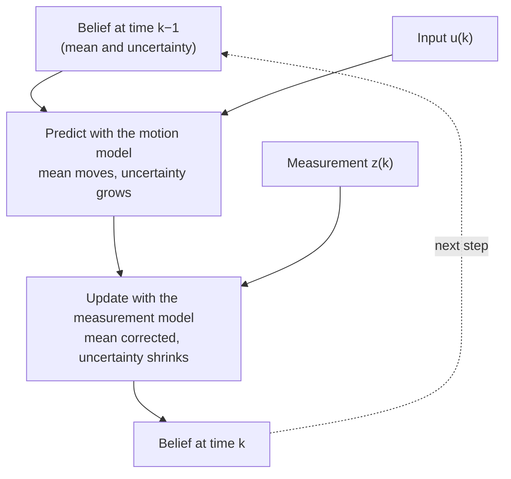

import Figure from '../../components/Figure.astro';
import GaussianFusion from '../../components/diagrams/GaussianFusion.astro';

The previous entries of this series assumed that the robot knows where it is. Forward kinematics turned known joint angles into a gripper position; coordinate transforms turned a lidar reading into world coordinates given the robot's pose. In practice none of these inputs is known exactly. Encoders measure the motor rather than the link, wheels slip, a lidar returns a noisy range, and a camera sees only what is in front of it. The first entry put it plainly: every decision a robot makes is made on an estimate.

This final entry explains what that estimate is and how it is computed. It starts with what the robot is trying to know (its **state**), then introduces the language of uncertainty needed to describe partial knowledge, then the single idea behind almost every estimator in robotics: *predict with a model, correct with a measurement*. A worked one-dimensional example makes the idea concrete before the general Kalman filter and its nonlinear successors are introduced. The entry ends with the engineering details that decide whether an estimator works on a real robot.

## 1. What the Robot Needs to Know

### 1.1 State

The **state** of a system is the smallest set of variables that, together with the inputs applied from now on, determines its future behaviour. The [primer on state-space models](/blog/state-space-models-primer) in the control systems series introduced the idea for mechanical systems; robotics uses it in the same sense. Typical states are:

- for an arm, the joint angles and joint velocities;
- for a wheeled robot in the plane, its **pose** $(x, y, \theta)$, the position in metres and heading in radians in a world frame, often together with its velocities;
- for a drone, its position, velocity and orientation in three dimensions;
- for a robot exploring a building, its pose together with the positions of landmarks or walls, the **map**.

Throughout this entry, positions are in metres, angles in radians, and time in seconds unless a quantity says otherwise.

### 1.2 Why the state is not measured directly

Sensors (the proprioceptive and exteroceptive sensors of the first entry) do not report the state. Each reports some function of it, imperfectly:

- **Indirectly.** A lidar measures the range to the nearest surface along a beam, which depends on the robot's pose *and* on where the walls are.
- **Noisily.** Repeated readings of the same quantity scatter around the true value.
- **With bias.** A gyroscope reports a small nonzero rotation rate even when it is still, and that offset drifts with temperature.
- **Late and at different rates.** An inertial measurement unit (IMU) may report hundreds of times per second, a camera tens of times, and a satellite positioning receiver once per second, each with its own delay.
- **Partially.** Some quantities cannot be determined from a given sensor at all. A single camera, for instance, cannot tell the absolute size of a scene without additional information; such quantities are **unobservable** from that sensor alone.

**State estimation** is the problem of computing the best available description of the state from all of this, continuously, as the robot moves.

## 2. The Language of Uncertainty

An estimate is useless without a statement of how good it is. A position of 10.4 m known to within a centimetre and one known to within a metre call for different actions. Probability theory supplies the vocabulary; only a few of its ideas are needed here.

- A **random variable** is a quantity whose value is uncertain, such as the robot's true position or the next sensor reading.
- A **probability density** $p(x)$ describes how that uncertainty is spread over possible values: the probability that the quantity lies in a small interval around $x$ is approximately $p(x)$ times the interval's width, and the density integrates to 1.
- The **mean** $\mu$ is the density's centre of mass, the single best guess in the sense of smallest average squared error.
- The **variance** $\sigma^2$ is the average squared deviation from the mean, and the **standard deviation** $\sigma$ its square root, in the same units as the quantity itself. A variance of $0.25\ \text{m}^2$ is a standard deviation of $0.5\ \text{m}$.
- For a state with several components, the **covariance matrix** $P$ collects the variance of each component on its diagonal and, off the diagonal, how errors in pairs of components move together. A robot that is unsure of its heading, for example, becomes unsure of its sideways position as it drives, and the two errors are linked: if the heading is off to the left, the position is too.
- The **Gaussian** (or normal) density, $\mathcal N(\mu, \sigma^2)$, is the familiar bell curve:

$$
p(x) = \frac{1}{\sqrt{2\pi\sigma^2}} \exp\!\left(-\frac{(x - \mu)^2}{2\sigma^2}\right).
$$

Gaussians matter here for two reasons. Many noise sources, being sums of many small independent effects, are approximately Gaussian. And a Gaussian is described completely by its mean and variance (or, in several dimensions, mean vector and covariance matrix), so an estimator that keeps its uncertainty Gaussian needs to store only those numbers.

The robot's knowledge of its state at any moment is a probability density over possible states, called its **belief**. State estimation updates the belief as time passes and measurements arrive.

## 3. Two Models and One Cycle

### 3.1 The motion model

A **motion model** predicts how the state changes from one time step to the next, given the commanded input $u_k$ (for example, wheel speeds):

$$
x_k = f(x_{k-1}, u_k) + w_k ,
$$

where $w_k$ is **process noise**, a random variable that stands for everything the model omits: wheel slip, uneven floors, motor imperfections. Using the motion model alone, integrating wheel or joint motion from a known start, is called **dead reckoning**. Its errors accumulate: each step adds the variance of $w_k$, so uncertainty grows without bound.

### 3.2 The measurement model

A **measurement model** predicts what a sensor would report if the state were $x_k$:

$$
z_k = h(x_k) + v_k ,
$$

where $v_k$ is **measurement noise**. For a range sensor pointed at a wall at a known position, $h$ is the distance from the robot to the wall; for a camera, $h$ projects known landmarks into the image using the transforms of the second entry.

### 3.3 Predict, then update

Every estimator in this entry alternates two steps:

The **prediction** moves the belief forward in time and makes it less certain, because the motion model is imperfect. The **update** compares what the sensor actually reported with what the predicted belief says it should have reported, and moves the belief towards consistency with the measurement, making it more certain. Write $\hat x_k^-$ and $P_k^-$ for the mean and covariance of the predicted belief (the minus sign marks "before the measurement"), and $\hat x_k$ and $P_k$ for those of the updated belief; the hat distinguishes an estimate from the true state $x_k$. The difference between the actual and the predicted measurement, $z_k - h(\hat x_k^-)$, is the **innovation**: the part of the measurement that the prediction did not already explain.

Formally, the update is **Bayes' rule**, which says how a belief should change in the light of evidence: the updated density is proportional to the predicted density multiplied by the likelihood of the measurement under each possible state. The algorithm that applies prediction and Bayes' rule in turn is called the **Bayes filter**. Every estimator below is a way of carrying it out with a particular representation of the belief.

## 4. A Worked Example in One Dimension

A robot moves along a corridor. Its belief about its position is Gaussian, with mean $\hat x^- = 10.0$ m and variance $P^- = 0.25\ \text{m}^2$ (standard deviation 0.5 m), obtained by dead reckoning. A range sensor, pointed at a wall at a known position, reports a measurement equivalent to $z = 10.6$ m, with measurement-noise variance $R = 0.09\ \text{m}^2$ (standard deviation 0.3 m).

When both the belief and the measurement noise are Gaussian, Bayes' rule gives another Gaussian, with mean and variance

$$
K = \frac{P^-}{P^- + R}, \qquad
\hat x = \hat x^- + K\,(z - \hat x^-), \qquad
P = (1 - K)\,P^- .
$$

The **gain** $K$, between 0 and 1, decides how far to move towards the measurement. It is large when the prediction is uncertain compared with the measurement and small when the measurement is the less reliable of the two. Here

$$
K = \frac{0.25}{0.25 + 0.09} = 0.735, \qquad
\hat x = 10.0 + 0.735 \times 0.6 = 10.44\ \text{m}, \qquad
P = 0.265 \times 0.25 = 0.066\ \text{m}^2 .
$$

The fused estimate lies between the two sources, closer to the more precise measurement, and its standard deviation, 0.26 m, is smaller than either source's (0.5 m and 0.3 m). Combining two independent pieces of information always helps, provided their uncertainties are stated honestly. The fused variance is also $P^- R / (P^- + R)$, symmetric in the two sources, which makes the point plainly.

<Figure caption="Fusing a prediction (solid line, 10.0 m, σ = 0.5 m) with a range measurement (dashed, 10.6 m, σ = 0.3 m). The fused estimate (coloured, 10.44 m, σ = 0.26 m) lies between them, nearer the more precise measurement, and is narrower than either.">
  <GaussianFusion />
</Figure>

If the robot now drives forward a commanded 1.0 m, with process-noise variance $Q = 0.04\ \text{m}^2$ for the move, the prediction step gives

$$
\hat x^- = 10.44 + 1.0 = 11.44\ \text{m}, \qquad P^- = 0.066 + 0.04 = 0.106\ \text{m}^2 .
$$

Uncertainty has grown again, and will keep growing (after ten such moves without a measurement its standard deviation would reach about 0.68 m) until the next measurement pulls it back down. This rise and fall is the rhythm of every estimator.

## 5. The Kalman Filter

### 5.1 The equations

Rudolf E. Kálmán (who published as R. E. Kalman) gave the general version of this calculation in 1960. For a state vector $\mathbf x$ with linear motion and measurement models,

$$
\mathbf x_k = A\,\mathbf x_{k-1} + B\,\mathbf u_k + \mathbf w_k, \qquad
\mathbf z_k = H\,\mathbf x_k + \mathbf v_k ,
$$

and Gaussian noises with covariances $Q$ and $R$, the **Kalman filter** maintains the mean $\hat{\mathbf x}$ and covariance $P$ of a Gaussian belief:

$$
\begin{aligned}
\text{predict:}\quad & \hat{\mathbf x}^- = A\,\hat{\mathbf x} + B\,\mathbf u, && P^- = A P A^{\mathsf T} + Q, \\
\text{update:}\quad & K = P^- H^{\mathsf T}\left(H P^- H^{\mathsf T} + R\right)^{-1}, && \\
& \hat{\mathbf x} = \hat{\mathbf x}^- + K\left(\mathbf z - H\,\hat{\mathbf x}^-\right), && P = (I - K H)\,P^- .
\end{aligned}
$$

The motion and measurement models above are **discrete-time** models, written for the instants $k = 0, 1, 2, \dots$ at which the filter runs. The matrix $A$ maps the state at one step to the next, so it is not the $A$ of the continuous-time form $\dot{\mathbf x} = A\mathbf x + B\mathbf u$ in the state-space primer: for a linear time-invariant system sampled every $\Delta t$ seconds, the discrete matrix is $e^{A\Delta t}$. The measurement matrix $H$ plays the role of the primer's output matrix $C$.

With one state, $A = H = 1$ and no input, these reduce exactly to the formulas of Section 4. The matrix $H P^- H^{\mathsf T} + R$ is the covariance of the innovation; the gain weighs it against the predicted uncertainty, component by component.

### 5.2 What it assumes

Under its assumptions (linear models, Gaussian noise, correctly known $Q$ and $R$) the Kalman filter is optimal: no other estimator has a smaller expected squared error. Each assumption can fail on a robot:

- the models are usually **nonlinear** (a heading angle enters through $\cos\theta$ and $\sin\theta$; a range is a square root);
- noise may be **non-Gaussian**, with occasional wild readings (a lidar beam reflected by glass);
- $Q$ and $R$ are rarely known and must be **tuned**.

The next section deals with the first two; Section 8 with the third.

## 6. Beyond Linear and Gaussian

### 6.1 The extended Kalman filter

The **extended Kalman filter** (EKF) handles nonlinear $f$ and $h$ by linearising them around the current estimate at every step: it replaces $A$ and $H$ with the Jacobians $\partial f / \partial \mathbf x$ and $\partial h / \partial \mathbf x$, the same derivative matrices that related joint and gripper velocities in the previous entry. It is cheap and widely used. It works well when the models are close to linear over the size of the uncertainty, and can diverge when they are not, for instance when heading uncertainty is large.

### 6.2 The unscented Kalman filter

The **unscented Kalman filter** (UKF), introduced by Julier and Uhlmann in 1997, avoids derivatives. It passes a small, deterministic set of sample points (sigma points), chosen to match the current mean and covariance, through the nonlinear models, and fits a Gaussian to the results. It usually captures nonlinear effects better than the EKF at a similar cost, and needs no Jacobians.

### 6.3 The particle filter

When the belief cannot reasonably be described by one Gaussian, for example when a robot in a building of identical corridors could be in one of several places, a **particle filter** represents it by many samples (particles), each a hypothesis of the state. Prediction moves every particle through the motion model with random noise; the update weights each particle by how well it explains the measurement and then resamples, keeping likely hypotheses and discarding unlikely ones. Particle filters can represent any belief shape, at a cost that grows with the number of particles needed, which grows quickly with the dimension of the state.

### 6.4 Choosing

| Estimator | Belief represented as | Handles | Cost | Typical use |
|---|---|---|---|---|
| Kalman filter | One Gaussian (mean, covariance) | Linear models, Gaussian noise | Very low | Linear tracking, sensor calibration |
| Extended Kalman filter | One Gaussian | Mildly nonlinear models | Low | Inertial navigation, vehicle odometry fusion |
| Unscented Kalman filter | One Gaussian, via sigma points | More strongly nonlinear models | Low to moderate | Attitude and pose estimation |
| Particle filter | Weighted samples | Any belief shape, including several hypotheses | High; grows with state dimension | Global localization in a known map |

## 7. Estimation on Real Robots

### 7.1 Fusing complementary sensors

Sensors are combined because their weaknesses differ. A classic case is estimating orientation from an IMU:

- integrating the **gyroscope**'s rotation rate gives smooth, responsive orientation, but its small bias accumulates into drift;
- the **accelerometer**, at rest, measures the direction of gravity, which gives an absolute but noisy and motion-disturbed reference for tilt.

A filter trusts the gyroscope over short times and the accelerometer over long times, removing drift without the noise. A Kalman filter does this with explicit noise models; a simpler **complementary filter** does it with fixed weights: it keeps the gyroscope's contribution to fast changes and the accelerometer's to slow ones (high-pass and low-pass filtering respectively). The same pattern recurs in mobile robots that fuse wheel odometry (smooth, drifting) with satellite positioning or landmark sightings (absolute, noisy, intermittent).

### 7.2 Localization, mapping and SLAM

**Localization** estimates the robot's pose in a map that is already known. **Mapping** builds a map from known poses. A robot entering an unknown building has neither, and must estimate both at once: **simultaneous localization and mapping** (SLAM). The state then includes the map itself (landmark positions, or an occupancy grid: a grid of cells over the floor plan, each holding the probability that it is occupied), and the correlations between robot and landmark errors become essential. When the robot recognises a place it has seen before (a **loop closure**), the correction propagates through the whole map. SLAM is a field in its own right; the survey by Durrant-Whyte and Bailey cited below is a standard starting point.

## 8. Engineering Details That Decide Success

The equations are short; most of the difficulty is in the details around them.

- **Frames.** Every estimate and measurement must be expressed in a known frame, using the transforms and frame tree of the second entry. A lidar range is predicted from the sensor's pose, not the robot base's.
- **Time.** Measurements arrive late and out of order. An estimator must use each one at the time it was taken, by keeping a short history of states, or by predicting forward from the measurement's time stamp.
- **Angles.** Innovations in angles must be wrapped into $(-\pi, \pi]$, or a heading error of $+179^\circ$ against $-179^\circ$ is treated as $358^\circ$ instead of $2^\circ$, the mistake described in the second entry.
- **Outliers.** A single wild measurement can pull a Kalman filter far off. Each innovation $\nu$ can be checked against its expected covariance $S = H P^- H^{\mathsf T} + R$ before use: the squared **Mahalanobis distance** $d^2 = \nu^{\mathsf T} S^{-1} \nu$, which measures the innovation in units of its own expected spread, is distributed as **chi-square** (the distribution of a sum of squared standard Gaussian variables, one per measurement dimension) when the models are right, and a measurement with an implausibly large $d^2$ is rejected (**gating**). In the corridor example, the innovation $0.6$ m gives $d^2 = 0.6^2 / 0.34 = 1.06$, well within the 99% bound of $6.63$ for one dimension; a reading of 12.0 m would give $d^2 = 11.8$ and be rejected.
- **Tuning.** $Q$ and $R$ encode how much the filter trusts its models and its sensors. Too small a $Q$ makes the filter overconfident and slow to follow real motion; too large makes it noisy. Sensor datasheets and recorded data guide $R$; $Q$ usually needs experiment. A useful check is whether the innovations actually have the covariance $S$ the filter predicts.
- **Initialisation.** The first belief must honestly reflect the initial uncertainty. Starting with a falsely small covariance makes the filter ignore the first, most informative measurements.

## 9. Summary

| Question | Answer |
|---|---|
| What is the state? | The smallest set of variables that, with future inputs, determines future behaviour, such as joint angles and velocities, or a pose. |
| Why can it not be measured directly? | Sensors report functions of the state, with noise, bias and delay, at different rates, and some quantities are unobservable from a given sensor. |
| How is uncertainty described? | By a probability density over states, the belief, often a Gaussian described by a mean and a covariance matrix. |
| What do all estimators do? | Predict with a motion model (uncertainty grows), then update with a measurement model (uncertainty shrinks): the Bayes filter. |
| How does a measurement update a Gaussian belief? | With gain $K = P^-/(P^- + R)$: the estimate moves towards the measurement by $K$ times the innovation, and the variance shrinks by the factor $1 - K$. |
| When is the Kalman filter optimal? | For linear models with Gaussian noise of known covariance. |
| What handles nonlinear or multi-modal problems? | The extended and unscented Kalman filters for nonlinear models; particle filters for beliefs with several hypotheses. |
| What usually decides whether an estimator works? | Frames, time stamps, angle wrapping, outlier gating, tuning of $Q$ and $R$, and honest initialisation. |

## 10. The Series in One Picture

This entry completes the series. The four entries describe a robot from the outside in.

- The **first** entry defined a robot as a closed loop of structure, actuation, sensing and computation, running at several rates, and organised by layered software.
- The **second** supplied the geometry: frames, rotations and transformations, and the frame tree that relates every part of the robot.
- The **third** used that geometry to connect joints and gripper, in both directions, and showed where the connection becomes singular.
- This **fourth** entry explained how the robot knows anything at all: by predicting with models and correcting with noisy sensors, keeping track of how uncertain it is.

Each later topic in robotics (motion planning, control of contact, learning from data) builds on these four: a robot must know its geometry, map between joint and task space, and act on estimates rather than certainties.

### References

- R. E. Kalman, "A New Approach to Linear Filtering and Prediction Problems", *Journal of Basic Engineering*, 1960.
- S. J. Julier and J. K. Uhlmann, "A New Extension of the Kalman Filter to Nonlinear Systems", *Proceedings of SPIE*, 1997.
- S. Thrun, W. Burgard and D. Fox, *Probabilistic Robotics*, MIT Press, 2005.
- H. Durrant-Whyte and T. Bailey, "Simultaneous Localization and Mapping: Part I", *IEEE Robotics & Automation Magazine*, 2006.
- Y. Bar-Shalom, X. R. Li and T. Kirubarajan, *Estimation with Applications to Tracking and Navigation*, Wiley, 2001.
