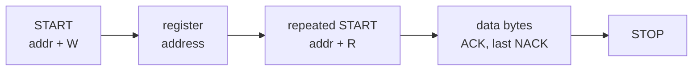

[The first entry](/blog/inside-a-microcontroller) introduced the microcontroller's peripherals, including the open-drain general-purpose I/O (GPIO) outputs and the clock tree, and [the second](/blog/interrupts-polling-and-dma) showed how data gets from a peripheral into memory by polling, interrupts or direct memory access (DMA). This entry looks at the peripherals whose job is communication: the serial links that connect a microcontroller to sensors, memories and displays on the same board, and to other controllers across a machine or a vehicle.

Four links cover most of embedded practice. The **UART** (universal asynchronous receiver-transmitter) is the simplest point-to-point link and the usual console of a development board. **SPI** (Serial Peripheral Interface) is a fast, simple bus for chips on one board. **I2C** (Inter-Integrated Circuit) connects many slow chips over two wires. **CAN** (Controller Area Network) connects controllers across a vehicle or a machine, with priorities and strong error handling. The entry first sets out what any serial link must define, then treats each of the four in that frame, with worked numbers, and ends with a comparison.

**Conventions.** Bit rates are in bits per second (bit/s), with the same SI prefixes as the rest of the series (1 kbit/s = 1000 bit/s). Logic levels are 3.3 V unless stated. Timing figures for I2C follow the NXP *I2C-bus specification and user manual* (UM10204, revision 7.0, 2021), and CAN follows ISO 11898-1:2015 (data link layer) and ISO 11898-2:2016 (high-speed physical layer). Revision 7.0 of the I2C specification replaced the terms "master" and "slave" with **controller** and **target**; this entry uses the new terms for I2C and the corresponding **controller** and **peripheral** for SPI. Calculations use Python 3 with the standard library.

## 1. Serial Communication Basics

### 1.1 Serial and parallel

A **parallel** link sends several bits at once over several wires; a **serial** link sends them one after another over a single data line (or a single differential pair). Serial links dominate because pins, wires and connectors cost more than time, and because at high speeds keeping many parallel wires in step is harder than running one line faster.

The **bit rate** is the number of bits sent per second, and the **bit time** $t_\text{bit} = 1/\text{bit rate}$ is the duration of one bit. The **baud rate** is the number of signal symbols per second; on all four links here a symbol carries one bit, so the two are equal, and UART settings are traditionally given in baud.

### 1.2 What a link must define

Every serial link has to answer the same questions, and the four links answer them differently:

| Question | Meaning |
|---|---|
| Physical layer | Voltages or currents for 0 and 1, single-ended or differential, connectors and cable lengths |
| Clocking | How the receiver knows when to sample each bit |
| Framing | Where a unit of data (a byte, a message) starts and ends |
| Topology and addressing | How many devices share the wires, and how a transfer reaches the right one |
| Duplex | Whether data can flow both ways at once (**full duplex**) or only one way at a time (**half duplex**) |
| Error handling | How corrupted data is detected, and what happens then |

Two of these need definitions. **Synchronous** links carry a clock signal on a separate wire, so the receiver samples data on the clock's edges. **Asynchronous** links have no clock wire: both ends agree on the bit rate in advance and the receiver times the bits with its own clock, resynchronising on edges in the data. A **single-ended** signal is a voltage measured against ground; a **differential** signal is the difference between two wires carrying opposite voltages, which rejects interference that affects both wires equally and therefore suits long cables.

## 2. UART

### 2.1 The frame

A **universal asynchronous receiver-transmitter** (UART) is the peripheral that sends and receives asynchronous serial data, one transmit line (TX) and one receive line (RX), crossed between the two devices so that each one's TX feeds the other's RX. It is point to point and full duplex.

The line idles at logic 1 (high). Each character is sent as a **frame**:

1. a **start bit**, a 0, whose falling edge tells the receiver that a frame begins;
2. five to nine **data bits**, least significant bit first (eight is by far the most common);
3. an optional **parity bit**, chosen so that the number of 1s is even (even parity) or odd (odd parity);
4. one or two **stop bits**, 1s, which return the line to idle and guarantee a falling edge at the next start bit.

The usual setting is written **8N1**: eight data bits, no parity, one stop bit, so ten bit times per byte. At 115 200 baud a byte takes $10/115\,200 = 86.8$ µs and the link carries 11 520 bytes per second, 80 % of its bit rate as payload; these are the numbers the second entry used.

### 2.2 How the receiver keeps time

Without a clock wire, the receiver must sample each bit near its centre using its own clock. A typical UART runs a counter at 16 times the bit rate (16× **oversampling**). On the falling edge of the start bit it counts 8 ticks to reach the middle of the start bit, checks that the line is still low (rejecting a short glitch), and then samples every 16 ticks, at the middle of each following bit.

This works only if the two ends' bit rates agree closely. The receiver resynchronises only at the start edge, so any rate mismatch accumulates across the frame. The last sample, the stop bit's centre, comes 9.5 bit times after the start edge in an 8N1 frame, and it must still fall inside the stop bit, so the accumulated timing error must stay below half a bit:

$$
9.5\,|\Delta| < 0.5 \quad\Rightarrow\quad |\Delta| < \frac{0.5}{9.5} = 5.26\,\%,
$$

where $\Delta$ is the relative difference between the transmitter's and the receiver's bit rates. The receiver can only find the start edge to within one oversampling tick, 1/16 of a bit, which leaves $(0.5 - 1/16)/9.5 = 4.6\,\%$; real receivers also need margin for edge distortion on the line. Since both ends contribute, a common working rule is to keep each end within about 2 % of the nominal rate.

The bit rate is derived from the peripheral clock by a divider, $\text{baud} = f_\text{clk} / (16\,D)$. With $f_\text{clk} = 48$ MHz and a target of 115 200 baud, $D = 48\,000\,000/(16 \times 115\,200) = 26.04$, rounded to 26, giving 115 385 baud, an error of +0.16 %, which is harmless. From a 16 MHz clock the ideal divisor is 8.68; rounding to 9 gives 111 111 baud, an error of −3.55 %, which uses up most of the budget alone and fails against a partner that errs the other way. That is why many UARTs have **fractional dividers**, and why clock choice (and the accuracy of an internal RC oscillator, [Section 4.2 of the first entry](/blog/inside-a-microcontroller#42-clock-sources)) matters for serial links.

### 2.3 Errors and flow control

A UART receiver reports four kinds of error:

- **Parity error**: the parity bit does not match. Parity detects any odd number of flipped bits in a character and misses any even number.
- **Framing error**: the stop bit was sampled as 0, a sign of a rate mismatch, noise, or a **break** (the line held low for longer than a frame, sometimes used deliberately as a signal).
- **Overrun error**: a new character arrived before the previous one was read, the deadline problem of [Section 1.1 of the second entry](/blog/interrupts-polling-and-dma#11-flags-data-registers-and-overruns).
- **Noise flag**: on many UARTs, the samples taken around the bit centre disagreed.

A UART does not retransmit anything. Detecting and recovering from errors in whole messages (with checksums, acknowledgements and timeouts) is left to the protocol that the application runs over it. Optional **flow control** lets a receiver ask the sender to pause, either with extra wires (RTS/CTS, "request to send" and "clear to send") or with special characters in the data stream.

### 2.4 Physical layers

A microcontroller's UART pins use logic levels, 0 and 3.3 V here, which suit connections of a few centimetres on one board. Longer links use a transceiver chip that converts to a standard physical layer:

- **RS-232** (standardised as TIA-232-F) uses single-ended bipolar voltages, with a logic 1 sent as a negative voltage and a logic 0 as a positive one, at levels of at least ±3 V at the receiver. It is point to point and suits a few metres of cable.
- **RS-485** (TIA-485-A) uses a differential pair and lets up to 32 standard unit loads share one pair, half duplex. Its noise immunity makes it the basis of many industrial fieldbuses over long cables, with the UART frame on top.

## 3. SPI

### 3.1 Signals and the shift-register exchange

The **Serial Peripheral Interface** (SPI) is a synchronous, full-duplex bus with one **controller** (the microcontroller) and one or more **peripherals** (sensors, memories, converters, displays). It has four signals:

| Signal | Also called | Direction | Purpose |
|---|---|---|---|
| SCLK | SCK | Controller to peripherals | Clock, generated only by the controller |
| COPI | MOSI, SDO (at the controller) | Controller to peripheral | Data out of the controller |
| CIPO | MISO, SDI (at the controller) | Peripheral to controller | Data out of the peripheral |
| CS | SS, chip select | Controller to one peripheral | Active low: selects the peripheral |

COPI and CIPO abbreviate "controller out, peripheral in" and "controller in, peripheral out"; the older names MOSI and MISO used "master" and "slave" for the same roles, and SDO and SDI (serial data out and in) name the pins from one device's point of view.

SPI is a pair of shift registers connected in a ring: on each clock cycle the controller shifts one bit out on COPI and one bit in on CIPO, and the peripheral does the reverse. Every transfer therefore exchanges data in both directions at once; to read, the controller sends dummy bytes to clock the peripheral's data out. A peripheral whose CS is high ignores the clock and releases CIPO, so that several peripherals can share SCLK, COPI and CIPO, each with its own CS line.

SPI was introduced by Motorola and has never been formally standardised. Bit order, word length, clock mode and the meaning of the bytes are set by each peripheral's datasheet, which is both its flexibility and its main source of bring-up problems.

### 3.2 Clock modes

Two settings define when data changes and when it is sampled. **CPOL** (clock polarity) is the level of SCLK when idle; **CPHA** (clock phase) chooses whether data is sampled on the first (leading) or second (trailing) clock edge of each bit. The four combinations are numbered as modes:

| Mode | CPOL | CPHA | Clock idles | Data sampled on |
|---|---|---|---|---|
| 0 | 0 | 0 | Low | Rising edge |
| 1 | 0 | 1 | Low | Falling edge |
| 2 | 1 | 0 | High | Falling edge |
| 3 | 1 | 1 | High | Rising edge |

The controller must be set to a mode that the peripheral supports; modes 0 and 3 are the most common. Getting the mode wrong typically produces data shifted by one bit, which looks like "almost right" values and is a classic bring-up error.

### 3.3 Transactions and timing

Many SPI sensors use a register protocol: the controller lowers CS, sends a command byte containing a register address and a read/write bit, then clocks data bytes in or out, and finally raises CS. Reading six bytes of acceleration data then takes one command byte and six data bytes, $7 \times 8 = 56$ clock cycles. At an 8 MHz clock that is 7 µs, plus small setup times around the CS edges, the figure used in [Section 6 of the second entry](/blog/interrupts-polling-and-dma#6-choosing-a-method).

SPI has no addressing (CS does the selecting), no acknowledgement and no error detection: a controller cannot tell from the bus alone whether a peripheral is present or whether a bit was corrupted. Peripherals that need integrity add a checksum to their data, and firmware usually reads an identification register at startup to check that the expected chip answers. Because the controller drives the clock and lines are actively driven, SPI runs at tens of megahertz on a board, faster than I2C, at the cost of more pins: three shared plus one CS per peripheral.

## 4. I2C

### 4.1 Two open-drain wires

**I2C** (Inter-Integrated Circuit) connects a controller to many targets over two wires: **SCL** (serial clock) and **SDA** (serial data). Both are **open-drain** lines, as described in [Section 6.1 of the first entry](/blog/inside-a-microcontroller#61-general-purpose-io): devices can pull a line low or release it, and a **pull-up resistor** returns it high. The line is therefore low if any device pulls it low, a "wired-AND". This allows several devices to drive the same wire without damage, enables acknowledgements and clock stretching, and lets several controllers share the bus.

Each target has a 7-bit **address**, fixed in the chip or partly selectable by pins. Of the 128 possible addresses, 16 are reserved by the specification, leaving 112 for targets. (A 10-bit addressing extension exists but is rarely used.)

### 4.2 The transaction

All transfers are started and stopped by the controller, and use two special conditions defined by changes on SDA while SCL is high (at all other times SDA may change only while SCL is low):

- **START**: SDA falls while SCL is high.
- **STOP**: SDA rises while SCL is high.

After a START the controller sends a byte made of the 7-bit address and a **read/write bit** (0 to write, 1 to read). Every byte, in either direction, is followed by a ninth clock in which the receiver pulls SDA low to **acknowledge** (ACK); leaving it high is a **not-acknowledge** (NACK). A NACK after the address means no target answered. When the controller reads, it NACKs the last byte to tell the target to stop sending.

Reading registers from a sensor uses a write followed by a read, joined by a **repeated START** (a START without a STOP before it, so that no other controller can take the bus in between):



Reading six bytes takes three bytes of addressing and six of data, each nine clocks long: $9 \times 9 = 81$ clock cycles. At 400 kHz that is 202.5 µs, about 29 times the 7 µs of the SPI transfer of Section 3.3, before counting the short setup and hold times around START and STOP.

### 4.3 Speed modes and timing limits

The specification defines several speed modes with matching electrical limits; the three in common use with a microcontroller are:

| Mode | Maximum clock | Maximum rise time $t_r$ | Maximum bus capacitance $C_b$ | Low-level output current at $V_{OL} = 0.4$ V |
|---|---|---|---|---|
| Standard-mode (Sm) | 100 kHz | 1000 ns | 400 pF | 3 mA |
| Fast-mode (Fm) | 400 kHz | 300 ns | 400 pF | 3 mA |
| Fast-mode Plus (Fm+) | 1 MHz | 120 ns | 550 pF | 20 mA |

There are also a High-speed mode (3.4 Mbit/s) and a unidirectional Ultra Fast-mode (5 Mbit/s), which use different electrical arrangements and are less common. The rise time matters because the bus is pulled high only by a resistor, so each rising edge is an RC charging curve, while falling edges are driven actively and are fast.

### 4.4 Sizing the pull-up resistors

The specification measures rise time between 30 % and 70 % of the supply voltage. An RC charge reaches a fraction $x$ of the supply after $t = -RC\ln(1-x)$, so the 30–70 % rise time is

$$
t_r = R_p C_b \ln\frac{0.7}{0.3} = 0.8473\,R_p C_b ,
$$

where $R_p$ is the pull-up resistance and $C_b$ the total capacitance of the bus (wiring plus every device's pins). This gives an upper limit on $R_p$. The lower limit comes from the output stage: a device must be able to pull the line down to $V_{OL} = 0.4$ V while sinking at most $I_{OL}$ from the pull-up, so $R_p \ge (V_{DD} - V_{OL})/I_{OL}$. Together:

$$
\frac{V_{DD} - V_{OL}}{I_{OL}} \;\le\; R_p \;\le\; \frac{t_r}{0.8473\,C_b} .
$$

For a 3.3 V Fast-mode bus with 200 pF of capacitance, the lower limit is $(3.3 - 0.4)/3\ \text{mA} = 967\ \Omega$ and the upper limit is $300\ \text{ns}/(0.8473 \times 200\ \text{pF}) = 1770\ \Omega$, so a 1.5 kΩ pull-up fits. The same bus in Standard-mode tolerates up to $5901\ \Omega$. A larger resistor saves power but slows edges; a smaller one speeds them but draws more current whenever a line is low.

### 4.5 Clock stretching, arbitration and error handling

A target that needs more time can hold SCL low after a byte, which pauses the controller: **clock stretching**. Because a stretched clock can last arbitrarily long, it makes I2C transfer times unbounded unless the target's datasheet bounds it, which matters for real-time analysis.

When two controllers start at once, each checks SDA as it sends; a controller that sends a 1 but sees a 0 has lost **arbitration** and backs off, while the winner continues undisturbed. CAN uses the same principle as its central mechanism (Section 5.3).

I2C's error handling is thin. The ACK bit shows that some device received a byte, not that it received it correctly; there is no checksum in the bus protocol, and corrupted data is detected only if the target adds a checksum of its own. A typical failure is a target that was reset or disturbed in the middle of a read and now holds SDA low, waiting for clocks that never come; the specification's remedy is for the controller to send up to nine clock pulses on SCL until the target releases SDA, then a STOP. Robust firmware therefore puts a timeout on every I2C transfer and includes this bus-clear sequence.

## 5. CAN

### 5.1 The physical layer

The **Controller Area Network** (CAN) was developed by Bosch for cars, where dozens of controllers (engine, brakes, airbags, body electronics) must share data over one cable in an electrically noisy environment, with guaranteed priorities and strong error detection. It is now also common in industrial machines, robots and medical equipment.

A high-speed CAN bus (ISO 11898-2) is a twisted pair, **CAN_H** and **CAN_L**, terminated at each end by a 120 Ω resistor (60 Ω in total, matching the cable's characteristic impedance to prevent reflections). Each node connects through a **transceiver** chip. The bus has two states:

- **Recessive** (logic 1): no node drives the bus, and both wires sit near 2.5 V, a differential voltage near 0 V.
- **Dominant** (logic 0): at least one node drives CAN_H up (nominally 3.5 V) and CAN_L down (nominally 1.5 V), a differential voltage of about 2 V.

If any node sends dominant, the bus is dominant: the same wired-AND as I2C, built with a differential pair. Classical CAN runs at up to 1 Mbit/s; 125, 250 and 500 kbit/s are common choices.

### 5.2 Messages instead of addresses

CAN frames are not addressed to a node. Each frame carries an **identifier** that names its content ("wheel speeds", "engine torque request"), and every node receives every frame and uses hardware **acceptance filters** to keep the ones it needs. A new node that needs wheel speeds just listens; no sender changes. The identifier is 11 bits in the base format (CAN 2.0A) or 29 bits in the extended format (CAN 2.0B).

### 5.3 Arbitration by identifier

Any node may start sending when the bus has been idle. If several start at once, they resolve the conflict bit by bit during the identifier, which is sent most significant bit first. Each node compares what it sends with what it reads back. A node sending recessive (1) that reads dominant (0) knows that another node has a lower identifier, stops sending and becomes a receiver. The node with the **lowest identifier** wins, and its frame continues without any delay or corruption: arbitration is **non-destructive**.

Consider three nodes starting at once with identifiers A = `0x65A`, B = `0x652` and C = `0x6A0`:

| | Bits 10–0 |
|---|---|
| A = `0x65A` | `1100 1011 010` |
| B = `0x652` | `1100 1010 010` |
| C = `0x6A0` | `1101 0100 000` |

All three agree on the first three bits. At bit 7 (the fourth bit sent) C sends a 1 while A and B send 0, so C drops out. At bit 3 (the eighth bit sent) A sends 1 while B sends 0, so A drops out, and B, the lowest identifier, sends its frame. A and C retry automatically when the bus is free.

The identifier is therefore also the message's **priority**. This turns CAN into a fixed-priority, non-preemptive scheduler for messages: once a frame has started, it cannot be interrupted, but the highest-priority pending frame always wins the next arbitration. The response-time analysis of the fourth entry applies to CAN messages with that non-preemption taken into account, a result worked out in detail by Davis, Burns, Bril and Lukkien (2007).

### 5.4 The frame

A classical data frame with an 11-bit identifier has these fields (0 is dominant, 1 recessive):

| Field | Bits | Purpose |
|---|---|---|
| Start of frame | 1 | Dominant; synchronises all nodes |
| Identifier | 11 | Content name and priority |
| RTR | 1 | Remote transmission request; 0 for a data frame |
| IDE, r0 | 2 | Identifier extension (0 = base format), reserved bit |
| DLC | 4 | Data length code: 0 to 8 bytes |
| Data | 0–64 | Payload |
| CRC | 15 | Cyclic redundancy check over all previous fields |
| CRC delimiter | 1 | Recessive |
| ACK slot, delimiter | 2 | Transmitter sends recessive; every receiver that got a correct frame overwrites the slot with dominant |
| End of frame | 7 | Recessive |

Between frames, at least three recessive bits of **interframe space** follow.

Because CAN is asynchronous, nodes resynchronise on recessive-to-dominant edges. To guarantee enough edges, the transmitter applies **bit stuffing**: after five consecutive bits of the same value, from the start of frame through the CRC, it inserts one bit of the opposite value, which receivers remove. Six equal bits in a row in that region are therefore an error, a property that error signalling exploits.

The CRC uses the generator polynomial $x^{15} + x^{14} + x^{10} + x^8 + x^7 + x^4 + x^3 + 1$ (hexadecimal `0x4599`), with the register starting at zero. The following Python builds the stuffed region of a few frames, computing the CRC and inserting stuff bits as the specification describes:

```python
def bits(value, width):
    return [(value >> i) & 1 for i in range(width - 1, -1, -1)]

def crc15(bitseq):
    """CAN CRC-15, generator polynomial 0x4599, register starting at zero."""
    crc = 0
    for b in bitseq:
        crcnxt = b ^ ((crc >> 14) & 1)
        crc = (crc << 1) & 0x7FFF
        if crcnxt:
            crc ^= 0x4599
    return crc

def stuff(bitseq):
    """Insert a complementary bit after five equal consecutive bits."""
    out, run, last = [], 0, None
    for b in bitseq:
        out.append(b)
        run = run + 1 if b == last else 1
        last = b
        if run == 5:
            out.append(1 - b)
            last, run = 1 - b, 1
    return out

def classical_frame(ident, data):
    # SOF, 11-bit identifier, RTR, IDE, r0, DLC (4 bits), data; 0 = dominant
    head = [0] + bits(ident, 11) + [0, 0, 0] + bits(len(data), 4)
    for byte in data:
        head += bits(byte, 8)
    crc = crc15(head)
    stuffed = stuff(head + bits(crc, 15))
    tail = [1] + [1, 1] + [1] * 7      # CRC delimiter, ACK slot + delimiter, EOF
    # (the ACK slot is sent recessive and overwritten dominant by receivers)
    return crc, len(head) + 15, len(stuffed), len(stuffed) + len(tail)

for ident, data in ((0x123, [0x01, 0x02]), (0x000, [0x00] * 8), (0x555, [0x55] * 8)):
    crc, raw, stuffed, total = classical_frame(ident, data)
    print(f"id 0x{ident:03X}, {len(data)} bytes: CRC 0x{crc:04X}, "
          f"stuffed region {raw} -> {stuffed} bits, frame {total} bits")
```

```text
id 0x123, 2 bytes: CRC 0x69FE, stuffed region 50 -> 54 bits, frame 64 bits
id 0x000, 8 bytes: CRC 0x145B, stuffed region 98 -> 114 bits, frame 124 bits
id 0x555, 8 bytes: CRC 0x1B04, stuffed region 98 -> 99 bits, frame 109 bits
```

(As a check on the CRC function, it returns `0x059E` for the ASCII string "123456789", the standard check value for this CRC.) The frame lengths exclude the interframe space. An 8-byte frame has 108 bits before stuffing, and the number of stuff bits depends on the data: 16 for all zeros, 1 for the alternating pattern of `0x55`.

### 5.5 Worst-case frame time and bus load

For timing analysis what matters is the worst case. In the stuffed region of $g + 8s$ bits, where $s$ is the number of data bytes and $g = 34$ for a base-format frame, the first stuff bit needs five equal bits and each further one can follow after four more (the stuff bit itself starts the next run), so there are at most $\lfloor (g + 8s - 1)/4 \rfloor$ stuff bits. Adding the 13 unstuffed bits (CRC delimiter, ACK, end of frame and interframe space) gives the worst-case transmission time

$$
C_m = \left(g + 8s + 13 + \left\lfloor \frac{g + 8s - 1}{4} \right\rfloor\right) t_\text{bit} .
$$

For $s = 8$: $34 + 64 + 13 = 111$ bits without stuffing, plus $\lfloor 97/4 \rfloor = 24$ stuff bits, 135 bits in all. At 500 kbit/s ($t_\text{bit} = 2$ µs) that is 270 µs. Only 64 of the 135 bits are payload, an efficiency of 47 % in the worst case.

The **bus load** is the fraction of time the bus is busy. Ten 8-byte messages, each sent every 10 ms, occupy at most $10 \times 270\ \mu\text{s} = 2.7$ ms in every 10 ms, a load of 27 %. Bus load is a first check; whether every message meets its deadline needs the response-time analysis mentioned in Section 5.3.

### 5.6 Error detection and fault confinement

CAN detects errors in five ways:

- **Bit monitoring**: a transmitter reads back each bit it sends (outside arbitration and the ACK slot) and flags a mismatch.
- **Stuff error**: six equal consecutive bits where stuffing applies.
- **CRC error**: the received CRC does not match the computed one.
- **Form error**: a fixed-format bit (a delimiter, end of frame) has the wrong value.
- **Acknowledgement error**: the transmitter sees no dominant bit in the ACK slot, meaning no other node received the frame correctly.

A node that detects an error sends an **error frame**, six dominant bits that deliberately violate the stuffing rule, so that every node discards the frame; the transmitter then resends it automatically. Corrupted data is thus never used, and recovery takes no application code, at the price of the time the error frame and the retransmission take.

To stop one faulty node from blocking the bus with endless error frames, each node keeps a **transmit error counter** (TEC) and a **receive error counter** (REC). A transmit error adds 8 to the TEC, a receive error usually adds 1 to the REC, and each successful frame subtracts 1. A node is **error-active** (normal) while both counters are at most 127, **error-passive** when either exceeds 127 (it may then signal errors only with recessive bits, which cannot disturb other nodes' traffic, and must wait longer before transmitting again), and **bus-off** when the TEC exceeds 255, at which point it disconnects itself from the bus until it has observed 128 occurrences of 11 consecutive recessive bits. A node with a broken transceiver therefore removes itself rather than taking the network down.

### 5.7 Bit rate and bus length

Arbitration and acknowledgement require every node to see each bit within the same bit time: a bit sent by a node at one end must travel to the far end, and the far node's dominant response must travel back, before the sample point. If the signal travels at about 5 ns per metre in the cable and the transceiver and controller delays amount to $t_\text{node}$ each way, the round trip $2(L \times 5\ \text{ns/m} + t_\text{node})$ must fit before the sample point. With a 1 µs bit (1 Mbit/s), a sample point at 75 % of the bit and an assumed $t_\text{node} = 175$ ns, $L \le (375 - 175)/5 = 40$ m. The figures here are illustrative assumptions, not values from the standard, but the conclusion holds generally: bit rate times bus length is roughly constant, so halving the bit rate roughly doubles the usable length.

### 5.8 CAN FD

**CAN FD** (flexible data rate), included in ISO 11898-1:2015, keeps classical CAN's arbitration and acknowledgement at the nominal bit rate but switches to a faster bit rate for the data phase, where only one node is transmitting and the round-trip limit of Section 5.7 does not apply. It allows up to 64 data bytes per frame and uses stronger CRCs (17 or 21 bits, depending on the length) with a count of stuff bits included. Classical CAN controllers do not understand CAN FD frames and signal errors on them, so the two can share a bus only with care.

## 6. Comparing the Buses

| | UART | SPI | I2C | CAN |
|---|---|---|---|---|
| Wires (plus ground) | 2 (TX, RX) | 3 + 1 CS per peripheral | 2 (SDA, SCL) | 2 (differential pair) |
| Clocking | Asynchronous | Synchronous, controller clock | Synchronous, controller clock | Asynchronous with resynchronisation |
| Topology | Point to point (multidrop with RS-485) | One controller, several peripherals | Multi-target, multi-controller | Multi-node broadcast |
| Addressing | None | Chip select line | 7-bit address | Message identifier (also priority) |
| Duplex | Full | Full | Half | Half |
| Typical speed | Up to about 1 Mbit/s | Tens of Mbit/s | 100 kHz, 400 kHz, 1 MHz | Up to 1 Mbit/s (faster data phase with CAN FD) |
| Error detection | Parity, framing | None in the bus | ACK only | CRC, stuffing, form and ACK checks, automatic retransmission |
| Typical use | Consoles, GPS modules, modems | Fast sensors, flash memory, displays, ADCs | Many slow sensors and configuration chips | Vehicles, machines, robots |

The choice usually follows from the devices: a sensor offers SPI, I2C or both, and a vehicle network is CAN. Where there is a choice, SPI for speed and simple timing on one board, I2C for many slow devices with few pins, and CAN for anything that leaves the board, needs priorities, or must keep working in the presence of electrical noise and faulty nodes.

## 7. Exercises

**Exercise 1.** A UART is clocked at 16 MHz with 16× oversampling and an integer divider. What is the actual rate and error for a target of 9600 baud? Is it acceptable?

<details>
<summary>Answer</summary>

$D = 16\,000\,000/(16 \times 9600) = 104.17$, rounded to 104, gives $16\,000\,000/(16 \times 104) = 9615$ baud, an error of +0.16 %. That is well within the roughly 2 % per end of Section 2.2.

</details>

**Exercise 2.** A Fast-mode I2C bus at 3.3 V has 400 pF of capacitance. Can any pull-up resistor meet the 300 ns rise time with 3 mA drivers? What could be done?

<details>
<summary>Answer</summary>

The upper limit is $300\ \text{ns}/(0.8473 \times 400\ \text{pF}) = 885\ \Omega$, but the lower limit is still $967\ \Omega$, so no resistor satisfies both. Options: run the bus in Standard-mode (upper limit $2950\ \Omega$ at 400 pF and 1000 ns), reduce the capacitance (shorter wiring, fewer devices, or a bus buffer that splits the bus), use Fast-mode Plus devices with their 20 mA drive, or use an active pull-up (a current source) instead of a resistor.

</details>

**Exercise 3.** An SPI peripheral samples on the falling edge, and its clock idles high. Which mode is it, and what happens if the controller uses mode 0?

<details>
<summary>Answer</summary>

Idle high is CPOL = 1; with an idle-high clock the first edge of a bit is a falling edge, so sampling on it is CPHA = 0: mode 2. In mode 0 the controller samples on rising edges while the peripheral changes its output on them, so the controller reads bits at the moment they change and the received values are typically shifted by one bit or unreliable.

</details>

**Exercise 4.** On a 250 kbit/s CAN bus, what is the worst-case transmission time of a base-format frame with 4 data bytes? What bus load do 20 such messages every 20 ms produce?

<details>
<summary>Answer</summary>

$g + 8s = 34 + 32 = 66$; stuff bits $\lfloor 65/4 \rfloor = 16$; total $66 + 13 + 16 = 95$ bits. At $t_\text{bit} = 4$ µs this is 380 µs. Twenty messages take $20 \times 380 = 7.6$ ms per 20 ms, a load of 38 %.

</details>

**Exercise 5.** Two CAN nodes start sending at once with identifiers `0x100` and `0x0FF`. Which wins, and at which bit sent does the other drop out?

<details>
<summary>Answer</summary>

In 11 bits, grouped as in Section 5.3, `0x100` is `0010 0000 000` and `0x0FF` is `0001 1111 111`. They agree on the first two bits; at the third bit sent (bit 8), `0x100` sends recessive 1 and `0x0FF` sends dominant 0, so `0x0FF`, the lower identifier, wins.

</details>

## 8. Summary

| Question | Answer |
|---|---|
| What must every serial link define? | Physical layer, clocking, framing, topology and addressing, duplex, and error handling. |
| How does a UART frame a byte? | Start bit, five to nine data bits least significant bit first, optional parity, one or two stop bits; 8N1 uses ten bit times. |
| How closely must UART rates match? | Within about 5 % in total in theory (0.5 bit over 9.5 bits), in practice about 2 % per end. |
| How does SPI work? | A controller-driven clock shifts data both ways through two shift registers; chip select picks the peripheral; four clock modes. |
| How does I2C share two wires? | Open-drain lines with pull-ups, START/STOP conditions, 7-bit addresses and an ACK after every byte. |
| What limits the I2C pull-up resistor? | Rise time $t_r = 0.8473\,R_p C_b$ above, and the driver's sink current below. |
| How does CAN decide who sends? | Bitwise arbitration on the identifier: dominant 0 wins, the lowest identifier sends, nothing is destroyed. |
| How long is a worst-case 8-byte CAN frame? | 135 bits including stuffing and interframe space: 270 µs at 500 kbit/s. |
| How does CAN handle errors? | Five detection mechanisms, error frames, automatic retransmission, and error counters that isolate faulty nodes. |

The next entry, [Real-Time Operating Systems and Scheduling](/blog/real-time-operating-systems-and-scheduling), turns from moving data to organising the processing: how a real-time operating system divides firmware into prioritised tasks, how tasks share data safely, and how to calculate whether every task, and by the same reasoning every CAN message, meets its deadline.

### References

- NXP Semiconductors, *UM10204: I2C-bus Specification and User Manual*, revision 7.0, 2021.
- ISO 11898-1:2015, *Road Vehicles: Controller Area Network (CAN), Part 1: Data Link Layer and Physical Signalling*, International Organization for Standardization.
- ISO 11898-2:2016, *Road Vehicles: Controller Area Network (CAN), Part 2: High-Speed Medium Access Unit*, International Organization for Standardization.
- Robert Bosch GmbH, *CAN Specification*, version 2.0, 1991.
- TIA-232-F, *Interface Between Data Terminal Equipment and Data Circuit-Terminating Equipment Employing Serial Binary Data Interchange*, Telecommunications Industry Association, 1997.
- TIA-485-A, *Electrical Characteristics of Generators and Receivers for Use in Balanced Digital Multipoint Systems*, Telecommunications Industry Association, 1998.
- R. I. Davis, A. Burns, R. J. Bril and J. J. Lukkien, "Controller Area Network (CAN) schedulability analysis: Refuted, revisited and revised", *Real-Time Systems*, 35(3), 2007.
- M. Di Natale, H. Zeng, P. Giusto and A. Ghosal, *Understanding and Using the Controller Area Network Communication Protocol*, Springer, 2012.
- P. Horowitz and W. Hill, *The Art of Electronics*, 3rd edition, Cambridge University Press, 2015.
