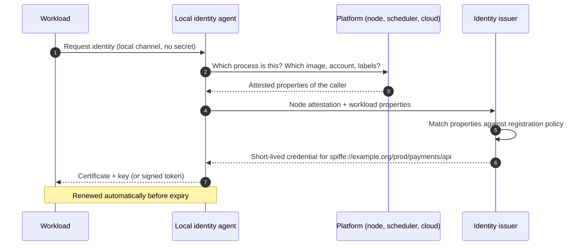
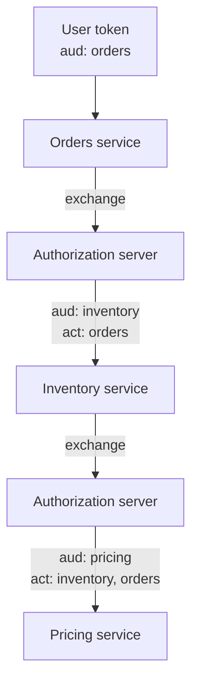

The earlier entries of this series followed a request from a user's browser or app to the first service that received it. In most real systems that is where the request's journey begins rather than ends. The first service calls an inventory service, which calls a pricing service, which publishes a message that a fulfilment worker consumes an hour later. Each of those hops is itself an access-control decision: *who is calling, and may they do this?*

Inside a system, those questions have two parts. One concerns the **workload**: which piece of software is making the call. The other concerns the **user**, if any, on whose behalf the call is made. This final entry treats both. It begins with why network location is not an answer, then shows how workloads obtain identities, how they prove them to each other, how calls between them are authorized, and how the user's identity can travel through a chain of services without being forged or misused.

## 1. The Network Is Not an Identity

### 1.1 The perimeter model and its failure

The traditional design trusts the internal network. A firewall separates outside from inside; once a request is inside, services accept it because of where it came from. The model fails in three ways that compound:

- **One compromise reaches everything.** An attacker who gains a foothold in any internal machine (a vulnerable dependency, a stolen laptop on the VPN, a misconfigured debug endpoint) can call every internal service as if it were legitimate.
- **Addresses are not identities.** In container platforms, addresses are reused within minutes; in shared networks, many workloads share an egress address; and address-based rules say nothing about *which* software is calling.
- **There is no inside any more.** Services run across several clouds, regions and providers, and call each other over networks that no single party controls.

NIST's *Zero Trust Architecture* (SP 800-207, 2020) summarises the alternative: no implicit trust is granted on the basis of network location, and every access is authenticated and authorized for the specific subject and resource. For calls between services, that means every workload needs an identity it can prove, and every service must check it.

### 1.2 Applying the access-control model inside

The reference monitor from the first entry applies unchanged. For an internal call, the subject is the calling workload (and possibly the user it acts for), the object is the called service's resource, and complete mediation requires that the called service check every call, not only those that arrive from outside.

## 2. Workload Identity

### 2.1 What a workload identity names

A workload identity names a piece of software by **what it is and where it is authorized to run**, not by the machine or address it happens to occupy. A useful identity has a stable, structured name, such as:

```text
spiffe://example.org/prod/payments/api
```

This is the form defined by SPIFFE (the Secure Production Identity Framework for Everyone), an open specification hosted by the Cloud Native Computing Foundation: a URI whose authority is a **trust domain** (an administrative boundary with its own signing keys) and whose path identifies the workload within it. Whatever naming scheme is used, the properties that matter are that names are assigned by a central authority, are meaningful to the people writing policy, and do not change when the workload moves.

### 2.2 The bootstrapping problem

To prove an identity, a workload needs a credential. To obtain a credential securely, it seems to need a credential already. This is sometimes called the **secret zero** problem, and how a design answers it largely determines its security.

The weak answer is to give the workload a long-lived secret at deployment: an API key in an environment variable, a password in a configuration file. Such secrets are copied into images, logs, crash dumps and source repositories, are rarely rotated, and identify whoever holds the copy.

The strong answer is **attestation**: the workload's identity is established from facts that the platform running it can vouch for, and no secret is provisioned in advance.



The platform's own evidence (the identity document a cloud provider signs for each virtual machine, the scheduler's record of which service account a container runs as, the kernel's knowledge of which process opened a local socket) replaces the provisioned secret. Container orchestrators provide a simpler variant of the same idea: they can mount into each workload a token, signed by the platform, that names its service account, is restricted to an audience and expires after a short time.

### 2.3 Short-lived credentials

Whatever the bootstrap, the credentials a workload receives should be **short-lived**: hours rather than months, renewed automatically. The reasoning is the same as for access tokens in the first entry. A credential that expires soon is worth little to a thief, and revocation becomes a matter of declining to renew. Two credential forms are common:

- an **X.509 certificate** and private key, carrying the identity in the certificate (SPIFFE calls this an X.509-SVID, with the SPIFFE ID in the subject alternative name), used for mutual TLS;
- a **signed token** (a JWT-SVID in SPIFFE terms) carrying the identity as its subject and restricted to an audience, used where TLS cannot carry the identity end to end.

### 2.4 Federation with external authorization servers

Workloads often need to call APIs that belong to someone else: a cloud provider's storage, a partner's service, an organisation's central authorization server. Rather than storing a long-lived key for each, a workload can present its platform-issued token to that party's token endpoint and receive an access token in return, using the JWT bearer grant or token exchange from the fifth entry. The receiving party is configured to trust the issuer of the workload's token and to map particular subjects to particular permissions. Continuous-integration pipelines commonly deploy to cloud environments this way, with no stored deployment keys.

## 3. Proving Identity Between Services

### 3.1 Mutual TLS

With certificates in hand, two services can authenticate each other with mutual TLS, as described in the previous entry: each presents its certificate, proves possession of its key in the handshake, and validates the other's certificate against the trust domain's authorities. The caller knows it reached the genuine payments service, and the payments service knows which workload is calling. The connection is encrypted as a side effect.

Doing this in every service's own code means handling certificate renewal, trust bundles and TLS configuration in every language the system uses. A **service mesh** moves it out of the application: a proxy beside each workload terminates and originates mutual TLS on its behalf, obtains and rotates its certificates, and exposes the authenticated peer identity to policy and, where needed, to the application. The application speaks plain HTTP to its local proxy.

The convenience comes with a precise limit. A mesh establishes **which workload** is on the other end of a connection. It says nothing about **which user**, if any, the call is for. That requires the mechanisms of Section 5.

### 3.2 Tokens between services

Where mutual TLS cannot reach end to end (across an organisational boundary, through intermediaries that terminate TLS, or over a message queue), a workload proves its identity with a signed token instead: a JWT-SVID, or an access token from an authorization server obtained with the client credentials grant. The receiving service validates it exactly as the first entry describes, with particular attention to the **audience**: a token a workload obtained for calling service A must not be accepted by service B. Tokens used this way are bearer tokens unless they are sender-constrained (the sixth entry); short lifetimes and narrow audiences matter all the more.

## 4. Authorizing Service Calls

Authentication tells the payments service that the caller is `spiffe://example.org/prod/orders/api`. Authorization decides whether that caller may make this call. The models from the fourth entry apply, usually in a simple form:

- an **allow-list per endpoint or operation**: the orders service may call `POST /payments`; the reporting service may call `GET /payments` but not `POST`; nothing else may call either;
- **deny by default**, so that a new service has no access until a policy grants it;
- **environment separation** encoded in identities, so that a staging workload can never call a production service, whatever its network path.

These policies can be enforced at the mesh proxy, in the application, or both. Proxy enforcement is uniform and cheap; application enforcement can see the parsed request and the user context. As with gateways in the first entry, coarse checks can live at the edge of each service, and object-level checks must live with the data.

## 5. Propagating the User's Identity

### 5.1 The confused deputy

When the orders service calls the payments service **on behalf of a user**, the payments service faces a question that workload identity cannot answer. Should it act with the orders service's authority, or with the user's?

If it acts with the caller's authority, the system invites the **confused deputy** problem, described by Norm Hardy in 1988: a program holding broad authority is tricked by a less-privileged party into using that authority on the party's behalf. The orders service may call `GET /payments/{id}` for any payment, because it legitimately needs to. If it passes through whatever payment identifier the user supplied without checking that the payment belongs to that user, the user can read any payment in the system through the orders service. Each service individually behaves as designed; the combination leaks.

The cure is that the downstream service must know **both** the calling workload and the user, and must authorize the call against the user's permissions as well as the workload's.

### 5.2 Ways to carry the user

| Approach | How the user reaches the next service | Risk |
|---|---|---|
| Trusted header | The edge gateway authenticates the user and adds `X-User-Id: user-48213` to internal calls | Any internal workload, or any attacker who reaches the network, can set the header. Safe only if the receiving service accepts it exclusively from authenticated gateway identities over mutual TLS, and even then it cannot express scopes, expiry or the chain of callers |
| Forward the original token | Each service passes the user's access token on to the next | The token's audience is the first service. Either every service accepts tokens for any audience, which defeats audience checks, or the token is issued for many audiences, which makes it valuable everywhere. A leak at any hop exposes the user to all of them |
| Token exchange per hop | Each service exchanges the token it received for a new one aimed at the next service (RFC 8693, fifth entry) | Requires a call to the authorization server per hop (often cached). Preserves audience restriction, can narrow scopes, and records the chain of actors |
| Internal transaction token | The edge exchanges the user's external token once for a short-lived, signed internal token that describes the user and the request, and services pass it along with their own workload authentication | Specified in IETF work in progress (Transaction Tokens). Avoids per-hop exchanges inside one trust domain; must never leave it |

### 5.3 Delegation chains

Token exchange can record **who acted for whom** in the `act` (actor) claim. When the orders service exchanges alice's token for one aimed at inventory, and inventory in turn exchanges that for one aimed at pricing, the final token can carry a nested chain:

```json
{
  "iss": "https://id.example.com",
  "sub": "user-48213",
  "aud": "spiffe://example.org/prod/pricing/api",
  "scope": "prices.read",
  "exp": 1791795900,
  "act": {
    "sub": "spiffe://example.org/prod/inventory/api",
    "act": {
      "sub": "spiffe://example.org/prod/orders/api"
    }
  }
}
```

The outermost `act` is the current actor (inventory); nested ones are earlier actors (orders). The subject remains the user. The pricing service can therefore authorize on three facts: the user's permissions, the scopes granted for this hop, and whether this chain of workloads is one it expects. Its audit log can record that alice's request reached it through orders and inventory, which is what an investigator will need.



The authorization server is the natural place to enforce **which** exchanges are allowed: orders may obtain inventory and payments tokens for users, inventory may obtain pricing tokens, and no other service may obtain tokens for the payments service. Scopes should **narrow** along the chain, never widen.

### 5.4 Asynchronous work

Messages on a queue and scheduled jobs break the assumptions of request-scoped tokens: the user's access token will usually have expired by the time a consumer processes a message, and there may be no user at all.

- For work triggered by a user, the message should record **who requested it and what was authorized at that time**, signed by the producing service, and the consumer should re-check current permissions before acting where the stakes justify it. Placing a user's long-lived refresh token in a queue to keep it usable is an anti-pattern: it turns the queue into a store of the most valuable credentials in the system.
- For work with no user (reconciliation, reporting, clean-up), the job acts under **its own workload identity** with permissions designed for that job. It should not borrow a privileged human account or a shared administrative credential.

## 6. Operational Practice

A few practices separate designs that remain secure from those that decay:

- **Inventory every workload identity** and the policies that grant it access; an identity no one can explain should be removed.
- **Remove static secrets** progressively. Each API key replaced by an attested, short-lived credential is one fewer secret to leak and rotate.
- **Automate rotation** of trust-domain signing keys and certificate authorities, with overlap so that rotation never causes an outage; untested rotation is the usual reason long-lived keys survive.
- **Log both identities** on every authorization decision: the workload that called and the user it acted for, with the delegation chain where there is one.
- **Fail closed.** If a workload cannot obtain or renew its identity, it should stop serving rather than fall back to an unauthenticated mode.

## 7. Summary

| Question | Answer |
|---|---|
| Why not trust the internal network? | Addresses are not identities, one foothold reaches everything, and modern systems have no single inside. |
| What is a workload identity? | A stable, centrally assigned name for a piece of software, independent of where it runs, such as a SPIFFE ID. |
| How does a workload obtain a credential without a pre-shared secret? | Through attestation: the platform vouches for the workload's properties, and an issuer grants a short-lived certificate or token. |
| How do services prove identity to each other? | Mutual TLS with short-lived certificates (often via a service mesh), or audience-restricted signed tokens where TLS cannot reach end to end. |
| What does a service mesh not establish? | Which user a call is for. |
| What is the confused deputy problem? | A service with broad authority used by a less-privileged party to act beyond that party's permissions. |
| How should user identity travel between services? | By exchanging tokens per hop with narrowing scopes and an `act` chain, or by an internal transaction token, not by trusted headers or forwarded tokens. |
| What about queued and scheduled work? | Record who requested it and re-check at execution; jobs without a user act under their own workload identity. |

## 8. The Series in One Picture

This entry completes the series. Taken together, the seven entries describe one decision, made repeatedly at every boundary of a system: *may this subject perform this action on this object?*

- The **first entry** set out the model: a reference monitor that mediates every request, and the separation of authentication, authorization and audit.
- The **second** showed how a principal proves who it is, and why only origin-bound public-key credentials resist phishing.
- The **third** showed how that proof is carried between requests in a browser, and the attacks aimed at the carrier.
- The **fourth** examined how permissions are represented and decided.
- The **fifth** showed how clients obtain delegated, scoped tokens under OAuth 2.0.
- The **sixth** bound those tokens to keys so that a copy is not enough.
- This **seventh** applied the same principles inside the system, between services and across chains of calls.

The recurring lessons are few. Authenticate every request at every boundary. Authorize against the specific object, as close to the data as possible. Prefer credentials that are short-lived, narrowly scoped, bound to a key and impossible to phish. And for every credential in the system, be able to say who holds it, where it may be used, and how it stops working.

### References

- NIST Special Publication 800-207, *Zero Trust Architecture*, 2020.
- N. Hardy, "The Confused Deputy (or why capabilities might have been invented)", *ACM SIGOPS Operating Systems Review*, 1988.
- SPIFFE specifications (SPIFFE ID, X.509-SVID, JWT-SVID, Workload API), Cloud Native Computing Foundation.
- RFC 8693 (OAuth 2.0 token exchange), RFC 7523 (JWT bearer grant and client authentication), RFC 8705 (OAuth 2.0 mutual TLS).
- In progress at the IETF: OAuth Transaction Tokens.
