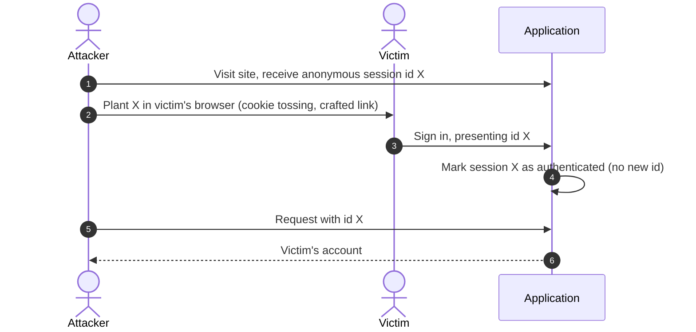
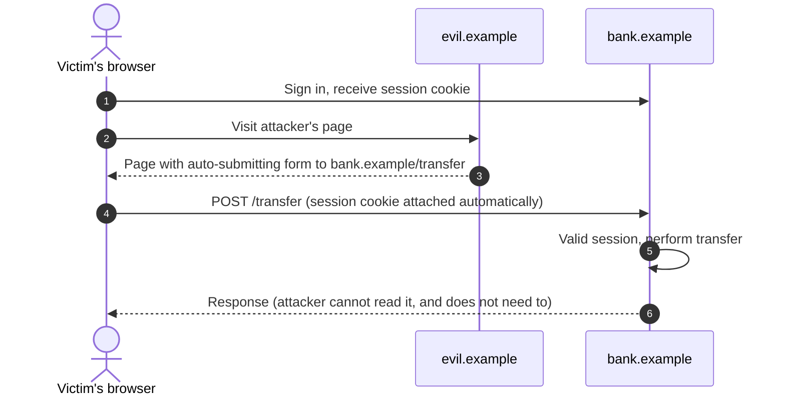

The previous entry ended at the moment of successful authentication: the user has proved control of an authenticator, perhaps a passkey, perhaps a password and a one-time code. That proof was expensive to obtain, and the user will now make many requests. The **session** is the mechanism that lets every one of those requests inherit the result of that single proof.

A session is therefore a credential in its own right, and often a more valuable one than the password: it is already past every factor, it is presented on every request, and it lives inside a browser that also runs code from other sites. This entry treats the session as one design problem with several parts: the identifier, the cookie that carries it, the browser rules that decide when the cookie is sent, the attacks that exploit those rules, and the lifecycle that ends the session.

## 1. What a Session Is

### 1.1 The session record and the session identifier

A session has two halves.

- The **session record**, held by the server, describes the authenticated state: the subject, when and how they authenticated (which factors, what assurance), when the session was created, when it was last used, and anything the application caches against it.
- The **session identifier** is a value given to the browser so that later requests can name the record. It carries no meaning itself; it is a reference, in the sense of the first entry of this series.

Anyone who presents the identifier is treated as the authenticated user. The identifier is a bearer credential, and everything in this entry follows from protecting it: keeping it unguessable, keeping it secret, controlling when the browser sends it, and limiting how long it is worth stealing.

### 1.2 Requirements for the identifier

| Requirement | Reason | Practice |
|---|---|---|
| Unpredictable | An attacker who can guess a live identifier owns that session without any credentials | At least 128 random bits from a cryptographically secure generator |
| Meaningless | Embedding a user ID, timestamp or counter leaks information and invites guessing | Pure randomness; all meaning lives in the server record |
| Unique to one session | Reuse links unrelated sessions | Fresh value for each new session and each privilege change |
| Not stored verbatim on the server | A leaked session table would otherwise hand over every live session | Store a hash of the identifier and look sessions up by hash |

The last row deserves emphasis. Session tables are copied into backups, logs and analytics more often than password tables are. If the server stores `SHA-256(session_id)` instead of the identifier, a leaked table lets an attacker enumerate sessions but not use them, at negligible cost to the server: one hash per request. A fast hash suffices here, unlike for passwords, because the identifier is already 128 random bits and cannot be guessed. For the same reason, the identifier itself should never be written to logs, error reports or analytics events.

### 1.3 Stateful and stateless sessions

Some frameworks avoid the server-side record by putting the session data into the cookie and signing it (sometimes also encrypting it). This is the *value* model from the first entry, with the same trade-off: no lookup per request, but no way to end one session early except by changing the signing key, which ends all of them, or by keeping a server-side list of revoked sessions, which reintroduces state. Applications that need "sign out everywhere", administrator-initiated termination or immediate effect when an account is disabled are better served by a server-side record.

## 2. Cookies: How the Identifier Travels

### 2.1 Setting and returning a cookie

The server sets a cookie with a `Set-Cookie` response header (RFC 6265); the browser stores it and attaches it to later requests whose URL matches the cookie's scope. In HTTP/1.1 syntax, as throughout the series:

```http
HTTP/1.1 303 See Other
Location: /account
Set-Cookie: __Host-sid=Vb9xQm4tR2kz8YpLw7nJcA; Path=/; Secure; HttpOnly; SameSite=Lax
```

```http
GET /account HTTP/1.1
Host: app.example.com
Cookie: __Host-sid=Vb9xQm4tR2kz8YpLw7nJcA
```

The browser returns only the name and value. It does not tell the server which attributes the cookie was set with, or who set it, which is why the server cannot distinguish a cookie it set from one planted by a sibling subdomain (Section 2.4).

### 2.2 The attributes

| Attribute | Effect | Recommendation for a session cookie |
|---|---|---|
| `Domain` | If absent, the cookie is *host-only*: sent only to the exact host that set it. If present, sent to that domain and all its subdomains | Omit it, unless sharing across subdomains is required |
| `Path` | Limits the URL paths the cookie is sent to | `/`; path scoping is not a security boundary between applications on one host |
| `Expires` / `Max-Age` | Without either, the cookie is a *session cookie* in the browser's sense and is discarded when the browser session ends (many browsers restore it after restart) | Omit for sign-in sessions unless the user chooses "stay signed in"; never rely on it for server-side expiry |
| `Secure` | Sent only over HTTPS | Always |
| `HttpOnly` | Not readable through `document.cookie` or other script APIs | Always for session cookies |
| `SameSite` | Controls whether the cookie is sent on requests initiated by other sites (Section 3) | `Lax` or `Strict` |

### 2.3 Cookie prefixes

Two name prefixes, honoured by current browsers, let the server rely on how a cookie was set:

- A cookie whose name begins with `__Secure-` is accepted only if it has the `Secure` attribute and was set over HTTPS.
- A cookie whose name begins with `__Host-` is accepted only if, in addition, it has `Path=/` and **no** `Domain` attribute. It is therefore host-only, and no subdomain can set or overwrite it.

The `__Host-` prefix is the strongest available guarantee that a session cookie belongs to exactly one host. It costs nothing when the application runs on a single host name.

### 2.4 Subdomains and cookie tossing

Cookie scope is looser than the browser's same-origin policy. A page on `blog.example.com` may set a cookie with `Domain=example.com`, and the browser will then send that cookie to `app.example.com` as well. This enables **cookie tossing**: an attacker who controls any subdomain (a forgotten marketing page, a user-content host, a dangling DNS record pointing at a deprovisioned cloud resource) can plant cookies that the main application receives. Planted session cookies enable session fixation (Section 4); planted values for other cookies can break anti-forgery schemes that rely on cookies (Section 5.3).

Defences are structural: use `__Host-` cookies for anything security-relevant, host user-supplied content on a separate registrable domain, and remove DNS records that point at resources no longer owned.

## 3. Sites, Origins and When Cookies Are Sent

### 3.1 Origin and site

Two notions of "the same place" govern browser security, and they differ.

- An **origin** is the triple *(scheme, host, port)*. `https://app.example.com` and `https://blog.example.com` are different origins. The same-origin policy, which controls whether a script may read another page's content or responses, uses origins.
- A **site** is the scheme plus the *registrable domain*: the domain one level below a public suffix such as `.com` or `.co.uk`, as listed in the Public Suffix List. `https://app.example.com` and `https://blog.example.com` are the **same site**, `https://example.com` and `https://example.org` are different sites, and `http://example.com` and `https://example.com` are different sites under the scheme-aware definition that browsers now use.

`SameSite` is about sites, not origins. A request from `blog.example.com` to `app.example.com` is a same-site request, and `SameSite` does nothing to stop it.

### 3.2 The SameSite modes

When a page on one site causes a request to another, the request is *cross-site*. `SameSite` decides whether the target's cookies go with it:

| Mode | Sent on same-site requests | Sent on cross-site top-level navigations using safe methods (following a link) | Sent on other cross-site requests (form `POST`, `fetch`, images, frames) |
|---|---|---|---|
| `Strict` | Yes | No | No |
| `Lax` | Yes | Yes | No |
| `None` (requires `Secure`) | Yes | Yes | Yes |

`Strict` is the safest and has a visible cost: a user who follows a link from an email or another site to the application arrives without the session cookie and appears signed out on that first page. `Lax` keeps that navigation working, and it is safe only if requests using `GET` and other safe methods do not change state. That requirement already appears in HTTP's own definition of safe methods (RFC 9110); `Lax` turns a violation of it into a vulnerability.

Browsers differ in what they do when `SameSite` is absent; some treat the cookie as `Lax`, others as `None`. A session cookie should always set the attribute explicitly.

## 4. Session Fixation

### 4.1 The attack

In a fixation attack, the attacker does not steal the victim's session identifier; the attacker **chooses** it in advance and gets the victim to authenticate with it.



The attack needs two things: a way to plant an identifier (a sibling subdomain setting a cookie, or an application that accepts the identifier in a URL parameter) and an application that keeps the same identifier across authentication.

### 4.2 The defence

The fix is simple and complete: **issue a new session identifier whenever the privilege level of the session changes**: at sign-in, at step-up to a stronger authentication, at a change of role, at sign-out. The old identifier is invalidated on the server, so whatever an attacker planted becomes worthless at the moment it would have become valuable. Accepting session identifiers only from cookies, never from URLs, and using `__Host-` cookies remove the planting routes as well.

## 5. Cross-Site Request Forgery

### 5.1 The attack

Cookies are *ambient* credentials: the browser attaches them automatically to matching requests, whichever page triggered the request. Cross-site request forgery (CSRF) exploits this. A page on the attacker's site causes the victim's browser to send a request to the application; the browser attaches the victim's session cookie; the application sees an authenticated request and acts on it.



The attacker never sees the cookie or the response. CSRF is an attack on *integrity*: it makes the victim perform an action, which is all the attacker needs.

### 5.2 SameSite as the first layer

With a session cookie set to `SameSite=Lax` or `Strict`, the cross-site `POST` above arrives without the cookie, and the attack fails. This one attribute removes most CSRF against modern browsers. It is not a complete defence on its own:

- it does nothing against requests from **same-site** pages, including a compromised or attacker-controlled subdomain;
- under `Lax`, any state-changing `GET` endpoint remains exploitable through a plain link;
- older or unusual clients may not enforce it.

### 5.3 Request-level defences

A second layer checks something that a cross-site page cannot supply:

- **Synchronizer token.** The server stores a random token in the session record and embeds it in each form or exposes it to the application's own scripts; state-changing requests must echo it in a form field or header. A cross-site page cannot read the token, because the same-origin policy prevents it from reading the application's pages.
- **Signed double-submit token.** When server-side state is undesirable, the server sets a cookie containing a token cryptographically bound to the session (for example an HMAC of the session identifier) and requires the same value in a header. Binding to the session matters: an unbound double-submit token can be defeated by an attacker who can toss a cookie of their own choosing.
- **Origin and fetch-metadata checks.** Browsers send an `Origin` header on every request whose method is not `GET` or `HEAD`, and on cross-origin requests made with CORS. Modern browsers also send `Sec-Fetch-Site` (`same-origin`, `same-site`, `cross-site` or `none`) on requests to HTTPS origins. A server can reject state-changing requests whose `Sec-Fetch-Site` is `cross-site`, or whose `Origin` is not its own, at very low cost.
- **Custom request headers for APIs.** Browsers enforce **Cross-Origin Resource Sharing** (CORS): before sending a cross-origin request that a plain HTML form could not produce, such as one with a custom header or a JSON body, the browser first asks the server for permission with a *preflight* `OPTIONS` request, and sends the real request only if the server allows that origin. A cross-site page can therefore send a simple form `POST`, but cannot add a custom header such as `X-Requested-With` unless the server's CORS policy admits it. An API that requires a custom header, or a JSON content type, on every state-changing request is protected against form-based forgery, provided its CORS policy does not admit arbitrary origins with credentials.

A robust configuration combines `SameSite` cookies, a fetch-metadata or `Origin` check, and a token for the most sensitive operations.

### 5.4 CSRF on the login form

Login forms need protection too, even though the user is not yet signed in. In *login CSRF*, the attacker submits the login form with the **attacker's own** credentials from the victim's browser. The victim is now signed in to the attacker's account without noticing, and anything they then enter (a card number, a search history, a document) is saved where the attacker can read it. A pre-session anti-forgery token or an `Origin` check on the login endpoint prevents this.

## 6. Cross-Site Scripting and the Limits of HttpOnly

`HttpOnly` stops scripts from **reading** the session cookie, so an injected script cannot exfiltrate it for use elsewhere. It does not stop the script from **using** the session: script running in the application's origin can issue requests with the cookie attached, read the responses (they are same-origin) and read any anti-forgery token on the page. Cross-site scripting (XSS) therefore defeats CSRF defences and turns the browser into the attacker's client for as long as the page is open.

The defences against XSS (contextual output encoding, safe templating, a strict Content Security Policy, avoiding dangerous APIs that insert HTML) are outside the scope of this entry. The design point is that session security assumes the application's own origin is not running hostile script. `HttpOnly` limits the damage of a failure; it does not prevent the failure.

## 7. Lifetime, Re-Authentication and Logout

### 7.1 Timeouts

A session should end on two clocks, both enforced on the server:

- an **idle timeout**, measured from the last request, which ends sessions on unattended devices;
- an **absolute timeout**, measured from authentication, which bounds the lifetime of any stolen identifier regardless of activity.

The right values depend on the risk. A banking application may use minutes of idle time and hours of absolute lifetime; a low-risk reading application may keep users signed in for weeks. "Remember me" should be a deliberate choice by the user, implemented as a separate, longer-lived credential that can be listed and revoked, not as an endless extension of the ordinary session.

### 7.2 Re-authentication for sensitive actions

The session record should store *when* and *how* the user authenticated. Before a sensitive action (changing the password or the registered authenticators, adding a payee, exporting data, deleting the account) the application compares that record with the action's requirement and, if needed, asks the user to authenticate again, possibly with a stronger factor (*step-up authentication*). This limits what a stolen session can do even while it is valid, and it is followed by a new session identifier (Section 4.2).

### 7.3 Logout

Logout must end the session **on the server**: delete or invalidate the record, so that a copy of the identifier held anywhere else becomes useless. Clearing the cookie in the browser is a courtesy, done by sending the same cookie name with the same attributes and `Max-Age=0`:

```http
HTTP/1.1 303 See Other
Location: /
Set-Cookie: __Host-sid=; Path=/; Secure; HttpOnly; SameSite=Lax; Max-Age=0
Clear-Site-Data: "cookies", "storage"
```

`Clear-Site-Data` asks the browser to remove the site's cookies and the origin's stored data, which also clears tokens or cached personal data that scripts may have saved.

Users and administrators also need to end sessions they cannot reach: a list of the account's active sessions with device and time information, a "sign out everywhere" action, and automatic termination of all sessions when the password or authenticators change or the account is disabled. All of these are straightforward with server-side session records and awkward without them.

When the application uses single sign-on, ending the application's session does not end the identity provider's session; the next visit may sign the user straight back in. Federated logout, mentioned in the first entry, is the protocol-level answer.

## 8. Theft After Authentication

Malware that runs on the user's device can copy cookies out of the browser's storage and replay them from another machine, bypassing every authenticator discussed in the previous entry. Several measures reduce the value of a stolen identifier:

- short absolute lifetimes and re-authentication for sensitive actions (Section 7);
- detecting sudden changes in client characteristics (network, location, user agent) and requiring re-authentication, accepting that such signals are noisy and should trigger step-up rather than silent rejection;
- binding the session to a key held by the device, so that a copied cookie is useless without the key. This is the session-layer counterpart of the sender-constrained tokens covered later in this series; browser proposals such as Device Bound Session Credentials aim to provide it for ordinary cookies.

## 9. A Reference Configuration

Putting the pieces together, a server-rendered application on a single host might adopt the following:

| Concern | Choice |
|---|---|
| Identifier | 128 random bits from a secure generator, encoded in base64url; hash stored server-side |
| Cookie | `__Host-sid`, `Path=/`, `Secure`, `HttpOnly`, `SameSite=Lax`, no `Domain`, no `Max-Age` |
| Transport | HTTPS only, with HTTP Strict Transport Security so the browser never attempts plain HTTP |
| Fixation | New identifier at sign-in, step-up, role change and sign-out; identifiers accepted only from the cookie |
| CSRF | No state change on safe methods; reject cross-site state-changing requests by `Sec-Fetch-Site` or `Origin`; synchronizer token on sensitive forms and on the login form |
| Lifetime | Server-enforced idle and absolute timeouts; separate revocable "remember me" credential |
| Sensitive actions | Re-authentication based on the stored authentication time and method |
| Logout | Server-side invalidation, cookie cleared, `Clear-Site-Data`; session list and "sign out everywhere" |
| Subdomains | User content and third-party services on a separate registrable domain; stale DNS records removed |

## 10. Summary

| Question | Answer |
|---|---|
| What is a session identifier? | A random bearer reference to a server-side record of an authentication event. |
| How is it protected at rest? | It is never logged and is stored on the server only as a hash. |
| Which cookie attributes matter? | `Secure`, `HttpOnly`, an explicit `SameSite`, no `Domain`, and the `__Host-` prefix. |
| How do site and origin differ? | An origin is scheme, host and port; a site is scheme plus registrable domain. `SameSite` protects against other sites, not against sibling subdomains. |
| How is fixation prevented? | By issuing a new identifier at every change of privilege. |
| How is CSRF prevented? | By `SameSite` cookies, safe methods that are actually safe, an `Origin` or fetch-metadata check, and anti-forgery tokens for sensitive actions and the login form. |
| What does HttpOnly not do? | It does not stop injected script from using the session. |
| How does a session end? | By server-enforced idle and absolute timeouts and by server-side invalidation at logout; clearing the cookie alone is not enough. |

The next entry moves from *who* the user is to *what* they may do: how authorization models represent policy, and how the choice between roles, attributes and relationships affects evaluation, auditing and change.

### The specifications

- Cookies: RFC 6265, *HTTP State Management Mechanism*, and its revision in progress at the IETF, which specifies `SameSite` and the cookie prefixes.
- HTTP semantics and safe methods: RFC 9110. Strict Transport Security: RFC 6797.
- Browser behaviour: the WHATWG Fetch standard (requests, `Origin`), the W3C Fetch Metadata Request Headers specification (`Sec-Fetch-Site`), and the W3C Clear Site Data specification.
- The Public Suffix List, maintained by the Mozilla community, which browsers use to determine registrable domains.
