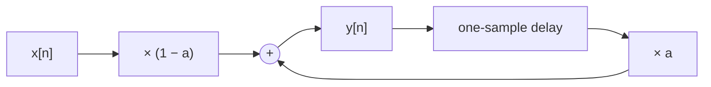

A measurement system that has passed its signal through an analogue-to-digital converter no longer holds a voltage. It holds a list of numbers, one per sampling instant, and everything that happens next (smoothing, removing interference, finding a frequency, computing a control command) is arithmetic on that list. **Digital signal processing** (DSP) is the discipline that says which arithmetic to do and what it will do to the signal. This entry builds its foundation: what a discrete-time signal is, how frequency works when time comes in steps, which properties make a system tractable, and the two equivalent ways of describing such a system, by a difference equation and by an impulse response.

The series assumes calculus, complex numbers (including Euler's formula $e^{j\theta} = \cos\theta + j\sin\theta$) and basic linear algebra. It also assumes the idea of sampling: how a continuous signal becomes a sequence of numbers, and why frequencies above half the sampling rate alias. The entry [Sampling, Quantization and Data Conversion](/blog/sampling-quantization-and-data-conversion) covers that, and this series starts where it stops, with the samples already in memory.

The series has five entries:

1. This entry: discrete-time signals, linear time-invariant systems, difference equations, impulse response and convolution.
2. [The z-transform, poles and stability](/blog/z-transform-poles-and-stability): the algebra that turns difference equations into transfer functions, and the pole positions that decide stability and shape the frequency response.
3. [Spectra: the DFT and the FFT](/blog/dft-and-fft): computing the frequency content of a finite record with the discrete Fourier transform (DFT), the fast Fourier transform (FFT) that makes it practical, and the leakage and windowing effects that come with a finite record.
4. [Designing FIR and IIR filters](/blog/designing-fir-and-iir-filters): turning a specification into the coefficients of finite and infinite impulse response (FIR and IIR) filters, two families defined in Section 4.1 below, and implementing them with the limited word length of real hardware.
5. [From signal processing to digital control](/blog/from-signal-processing-to-digital-control): discretizing a controller, choosing a sampling rate, and treating a control loop as a signal-processing system with feedback.

### Conventions used throughout the series

| Symbol | Meaning | Unit |
|---|---|---|
| $n$ | Sample index, an integer | none |
| $x[n]$, $y[n]$ | Input and output sequences of a system | unit of the signal |
| $h[n]$ | Impulse response | output unit per input unit |
| $T_s$, $f_s = 1/T_s$ | Sampling interval and sampling frequency | s, Hz |
| $f$ | Frequency of a continuous-time signal | Hz |
| $\Omega = 2\pi f$ | Angular frequency of a continuous-time signal | rad/s |
| $\omega = \Omega T_s = 2\pi f/f_s$ | Discrete-time (normalized) angular frequency | rad/sample |
| $j$ | Imaginary unit, $j^2 = -1$ | none |

Angles and phases are in radians unless a value is explicitly marked in degrees. Square brackets hold a discrete index, round brackets a continuous variable: $x(t)$ is a function of time, $x[n]$ a sequence. Code examples are written for Python 3 (run with 3.13) and NumPy (run with version 2.5), and use only long-established NumPy functions; every output quoted was produced by running the code shown.

## 1. Discrete-Time Signals

### 1.1 Sequences

A **discrete-time signal** is a sequence of numbers $x[n]$ indexed by an integer $n$. It is defined only at integer $n$: there is no $x[2.5]$. Most sequences in engineering come from sampling a continuous signal $x_a(t)$ every $T_s$ seconds, so that $x[n] = x_a(nT_s)$, but the theory does not need that origin. A sequence may also be computed (a test signal, the output of another system) or be a record of events that are naturally discrete (daily readings, the pixels along an image row).

Strictly, a **digital signal** is a discrete-time signal whose values are also quantized to a finite set, as an analogue-to-digital converter's output is. The theory of this series treats sample values as real (or complex) numbers of unlimited precision, which is accurate as long as the arithmetic has many more bits than the signal; the fourth entry returns to what finite word length changes.

A sequence can be written as a list, with an arrow or a stated starting index to mark $n = 0$. For example $x[n] = \{1, 2, 3\}$ starting at $n = 0$ means $x[0] = 1$, $x[1] = 2$, $x[2] = 3$ and $x[n] = 0$ for every other $n$. A sequence that is zero outside a finite range of $n$ is a **finite-length sequence**.

### 1.2 Elementary sequences

A handful of sequences serve as building blocks and test inputs.

- The **unit impulse** (or unit sample) is $\delta[n] = 1$ for $n = 0$ and $0$ otherwise. Unlike the continuous-time Dirac delta, it is an ordinary, well-defined sequence.
- The **unit step** is $u[n] = 1$ for $n \ge 0$ and $0$ for $n < 0$. It is the running sum of the impulse, $u[n] = \sum_{k=-\infty}^{n} \delta[k]$, and the impulse is the first difference of the step, $\delta[n] = u[n] - u[n-1]$.
- A **real exponential** is $x[n] = a^n u[n]$. It decays if $|a| < 1$, grows if $|a| > 1$, and alternates in sign at every sample if $a < 0$.
- A **sinusoid** is $x[n] = A\cos(\omega_0 n + \phi)$, with amplitude $A$, angular frequency $\omega_0$ in radians per sample and phase $\phi$.
- A **complex exponential** is $x[n] = e^{j\omega_0 n} = \cos(\omega_0 n) + j\sin(\omega_0 n)$. It is the most important sequence in the series, for the reason given in [Section 6](#6-response-to-sinusoids-a-first-look-at-frequency-response).

Any sequence can be written as a sum of scaled, shifted impulses:

$$
x[n] = \sum_{k=-\infty}^{\infty} x[k]\,\delta[n-k].
$$

This looks like a tautology, since each term $x[k]\,\delta[n-k]$ is zero except at $n = k$, where it equals $x[k]$. It is the key step in [Section 4](#4-impulse-response-and-convolution).

### 1.3 Frequency in discrete time

Sampling a continuous sinusoid $\cos(\Omega t)$ at $t = nT_s$ gives $\cos(\Omega T_s n)$, so the discrete-time angular frequency is

$$
\omega = \Omega T_s = 2\pi \frac{f}{f_s} \quad \text{rad/sample}.
$$

A 50 Hz signal sampled at 1 kHz has $\omega = 2\pi \times 50/1000 = 0.1\pi$ rad/sample: it advances a twentieth of a full turn per sample, so one cycle takes 20 samples. The normalization makes a filter design independent of the sampling rate: a filter that passes $\omega < 0.1\pi$ passes 50 Hz at 1 kHz and 5 kHz at 100 kHz.

Discrete-time frequency differs from continuous-time frequency in two ways.

**Frequencies that differ by $2\pi$ are identical.** Since $n$ is an integer, $e^{j(\omega_0 + 2\pi)n} = e^{j\omega_0 n}e^{j2\pi n} = e^{j\omega_0 n}$. Every distinct discrete-time sinusoid therefore has a frequency in an interval of length $2\pi$, conventionally $-\pi < \omega \le \pi$. This is aliasing seen from the sequence side: $\omega = \pi$ corresponds to $f = f_s/2$, the Nyquist frequency, and a continuous frequency above it produces the same sequence as one below. For real sinusoids, $\cos(\omega n)$ and $\cos(-\omega n)$ coincide as well, so the distinct real sinusoids have $0 \le \omega \le \pi$.

**The fastest oscillation is $\omega = \pi$.** In continuous time, raising the frequency always makes the signal oscillate faster. In discrete time, $\cos(\pi n) = (-1)^n$ alternates at every sample, and nothing oscillates faster: raising $\omega$ beyond $\pi$ makes the sequence oscillate *more slowly* again, until at $\omega = 2\pi$ it is constant. "Low frequency" in DSP means $\omega$ near $0$ (or near any multiple of $2\pi$), and "high frequency" means $\omega$ near $\pm\pi$.

A further surprise is that a discrete-time sinusoid need not be periodic. $\cos(\omega_0 n)$ repeats after $N$ samples only if $\omega_0 N$ is a whole multiple of $2\pi$, that is if $\omega_0/(2\pi)$ is a rational number $m/N$. The 50 Hz example, $\omega_0/(2\pi) = 1/20$, is periodic with period 20 samples. A sequence $\cos(n)$, with $\omega_0 = 1$ rad/sample, never repeats exactly, because $1/(2\pi)$ is irrational, although it still has a perfectly definite frequency.

## 2. Discrete-Time Systems

### 2.1 Systems as rules

A **discrete-time system** is a rule that maps an input sequence $x[n]$ to an output sequence $y[n]$, written $y = T\{x\}$. Four examples are used in the rest of this section.

| Name | Rule |
|---|---|
| Ideal delay by $n_d$ samples | $y[n] = x[n - n_d]$ |
| Three-point moving average | $y[n] = \tfrac13\bigl(x[n] + x[n-1] + x[n-2]\bigr)$ |
| Accumulator | $y[n] = \sum_{k=-\infty}^{n} x[k]$ |
| Squarer | $y[n] = x[n]^2$ |

The moving average smooths: each output is the mean of the latest three inputs. The accumulator is the discrete counterpart of an integrator. The squarer is a building block of power measurement.

### 2.2 The defining properties

Five properties classify systems. The first two together define the class this series is about.

**Linearity.** A system is linear if it obeys superposition: for any inputs $x_1$, $x_2$ and any constants $\alpha$, $\beta$,

$$
T\{\alpha x_1 + \beta x_2\} = \alpha\,T\{x_1\} + \beta\,T\{x_2\}.
$$

Scaling the input scales the output, and the response to a sum is the sum of the responses. The squarer fails: doubling the input quadruples the output.

**Time invariance.** A system is time-invariant if delaying the input delays the output by the same amount and changes nothing else: if $x[n]$ gives $y[n]$, then $x[n - n_0]$ gives $y[n - n_0]$ for every integer $n_0$. A system whose rule multiplies by a function of $n$, such as $y[n] = n\,x[n]$, is not time-invariant: a delayed input is multiplied by different values.

A system with both properties is a **linear time-invariant** (LTI) system. Most of DSP is about LTI systems, because, as [Section 4](#4-impulse-response-and-convolution) shows, one sequence describes such a system completely.

**Causality.** A system is causal if the output at time $n$ depends only on inputs at times $k \le n$. Every system that runs in real time must be causal. A centered moving average, $\tfrac13(x[n+1] + x[n] + x[n-1])$, is not; it can still be used on recorded data, or made causal by delaying its output by one sample, which is exactly the three-point moving average above.

**Memory.** A system is memoryless if $y[n]$ depends only on $x[n]$. The squarer is memoryless; the others are not.

**Stability.** A system is **bounded-input bounded-output** (BIBO) stable if every bounded input produces a bounded output: whenever $|x[n]| \le B_x < \infty$ for all $n$, there is a finite $B_y$ with $|y[n]| \le B_y$ for all $n$. The accumulator is not BIBO stable: the bounded input $u[n]$ produces $y[n] = (n + 1)$ for $n \ge 0$, which grows without limit.

| System | Linear | Time-invariant | Causal | Memoryless | BIBO stable |
|---|---|---|---|---|---|
| Delay ($n_d \ge 0$) | yes | yes | yes | no (unless $n_d = 0$) | yes |
| Three-point moving average | yes | yes | yes | no | yes |
| Accumulator | yes | yes | yes | no | no |
| Squarer | no | yes | yes | yes | yes |

## 3. Difference Equations

### 3.1 The general form

Most LTI systems used in practice are described by a **linear constant-coefficient difference equation**, which relates the current output to current and past inputs and to past outputs:

$$
y[n] + \sum_{k=1}^{N} a_k\,y[n-k] = \sum_{k=0}^{M} b_k\,x[n-k].
$$

This series always writes difference equations in this form, with the output terms on the left, the coefficient of $y[n]$ normalized to $a_0 = 1$, and the **feedforward coefficients** $b_k$ and **feedback coefficients** $a_k$ listed as two arrays $b = [b_0, \dots, b_M]$ and $a = [1, a_1, \dots, a_N]$. That is the convention of most DSP texts and numerical libraries; note the sign it implies when the equation is solved for the output:

$$
y[n] = \sum_{k=0}^{M} b_k\,x[n-k] - \sum_{k=1}^{N} a_k\,y[n-k].
$$

The largest delay of the output, $N$, is the **order** of the equation. Solved this way, the equation is an algorithm: each new output costs $M + 1 + N$ multiplications and needs the last $M$ inputs and the last $N$ outputs in memory.

A difference equation alone does not fix the output; like a differential equation, it needs initial conditions. Throughout this series a system starts **at rest**: the input is zero before some time, and so is the output. With that assumption, a constant-coefficient difference equation describes a causal LTI system.

### 3.2 Nonrecursive and recursive systems

If every $a_k$ with $k \ge 1$ is zero, the output is a weighted sum of current and past inputs only, and the system is **nonrecursive**. The three-point moving average is one, with $b = [\tfrac13, \tfrac13, \tfrac13]$ and $a = [1]$.

If some $a_k$ is nonzero, past outputs feed back into the computation and the system is **recursive**. The simplest useful example is the **exponential smoother**, the discrete counterpart of a first-order low-pass filter:

$$
y[n] = a\,y[n-1] + (1 - a)\,x[n], \qquad 0 < a < 1,
$$

which in the standard form has $b = [1 - a]$ and $a = [1, -a]$ (the feedback coefficient is $-a$ because of the sign convention above). Each output moves a fraction $1 - a$ of the way from the previous output towards the new input. The structure is easy to draw, because a difference equation is nothing more than delays, multiplications and additions:



### 3.3 A worked example: the exponential smoother

Take $a = 0.9$ and apply a unit step, $x[n] = u[n]$, to the smoother at rest. Iterating by hand: $y[0] = 0.1$, $y[1] = 0.9 \times 0.1 + 0.1 = 0.19$, $y[2] = 0.271$, and in general

$$
y[n] = 1 - a^{n+1}, \qquad n \ge 0,
$$

which is easily checked by substitution: $a(1 - a^{n}) + (1 - a) = 1 - a^{n+1}$. The output approaches 1, the input level, geometrically. It first reaches 95 % of the final value when $a^{n+1} \le 0.05$, that is when $n + 1 \ge \ln 0.05 / \ln 0.9 = 28.4$, so at $n = 28$.

The comparison with a continuous first-order system, whose step response is $1 - e^{-t/\tau}$, is direct. Matching $a^{n} = e^{-nT_s/\tau}$ gives an equivalent time constant

$$
\tau = -\frac{T_s}{\ln a},
$$

so with $f_s = 100$ Hz ($T_s = 10$ ms) and $a = 0.9$, $\tau = 0.01/0.1054 = 94.9$ ms. The fifth entry uses the same correspondence, $a = e^{-T_s/\tau}$, in the other direction, to turn a continuous plant into a discrete one.

## 4. Impulse Response and Convolution

### 4.1 The impulse response

The **impulse response** $h[n]$ of a system is its output when the input is the unit impulse $\delta[n]$ and the system starts at rest. For the three-point moving average, $h[n] = \{\tfrac13, \tfrac13, \tfrac13\}$ starting at $n = 0$. For the exponential smoother, iterating the equation with $x[n] = \delta[n]$ gives $h[0] = 1 - a$, $h[1] = a(1 - a)$, and in general

$$
h[n] = (1 - a)\,a^n\,u[n].
$$

The two examples differ in a way that names two families of systems:

- A **finite impulse response** (FIR) system has an impulse response that is zero after a finite number of samples. Every nonrecursive system is FIR, and its impulse response is simply its coefficient list: $h[n] = b_n$.
- An **infinite impulse response** (IIR) system has an impulse response that never becomes exactly zero. The exponential smoother is IIR: one nonzero input sample echoes through the feedback path forever, decaying by a factor $a$ each time.

### 4.2 The convolution sum

The impulse response is more than one test result. For an LTI system it determines the response to *every* input. The argument takes three steps.

1. Write the input as a sum of scaled, shifted impulses, as in Section 1.2: $x[n] = \sum_k x[k]\,\delta[n - k]$.
2. By time invariance, the response to $\delta[n - k]$ is $h[n - k]$.
3. By linearity, the response to the weighted sum is the same weighted sum of responses.

The result is the **convolution sum**:

$$
y[n] = \sum_{k=-\infty}^{\infty} x[k]\,h[n - k] = \sum_{k=-\infty}^{\infty} h[k]\,x[n - k],
$$

written compactly $y = x * h$. The second form follows from substituting $k \to n - k$, and reads naturally as an algorithm: the output is a weighted sum of the current and past inputs, with the impulse response as the weights. For a causal system $h[k] = 0$ for $k < 0$, so only current and past inputs appear.

The derivation used nothing but linearity and time invariance. That is the whole reason LTI systems are tractable: one sequence, measured or computed once, predicts the response to any input.

### 4.3 Convolution by hand and by computer

Let $x[n] = \{1, 2, 3\}$ and $h[n] = \{1, 0.5, 0.25\}$, both starting at $n = 0$. Each output sample is a sum of products $h[k]\,x[n - k]$:

| $n$ | Terms | $y[n]$ |
|---|---|---|
| 0 | $1 \times 1$ | 1 |
| 1 | $1 \times 2 + 0.5 \times 1$ | 2.5 |
| 2 | $1 \times 3 + 0.5 \times 2 + 0.25 \times 1$ | 4.25 |
| 3 | $0.5 \times 3 + 0.25 \times 2$ | 2 |
| 4 | $0.25 \times 3$ | 0.75 |

Two finite sequences of lengths $L$ and $M$ give a convolution of length $L + M - 1$, here $3 + 3 - 1 = 5$. The same numbers come out of a direct convolution and of running the difference equation one sample at a time, which the following script checks. It also runs the exponential smoother, which has no finite convolution form but is cheap to compute recursively.

```python
import numpy as np

def difference_equation(b, a, x):
    """y[n] = sum_k b[k] x[n-k] - sum_{k>=1} a[k] y[n-k], a[0] = 1, initial rest."""
    y = np.zeros(len(x))
    for n in range(len(x)):
        acc = sum(b[k] * x[n - k] for k in range(len(b)) if n - k >= 0)
        acc -= sum(a[k] * y[n - k] for k in range(1, len(a)) if n - k >= 0)
        y[n] = acc
    return y

x = np.array([1.0, 2.0, 3.0])
h = np.array([1.0, 0.5, 0.25])
print(np.convolve(x, h))                        # the convolution sum
print(difference_equation(h, [1.0], np.r_[x, 0.0, 0.0]))  # same system, sample by sample

a = 0.9
impulse = np.r_[1.0, np.zeros(9)]
print(difference_equation([1 - a], [1, -a], impulse)[:4])  # h[n] = (1 - a) a^n
step = difference_equation([1 - a], [1, -a], np.ones(30))
print(step[[0, 9, 27, 28]])                     # s[n] = 1 - a^(n+1)
```

Output:

```text
[1.   2.5  4.25 2.   0.75]
[1.   2.5  4.25 2.   0.75]
[0.1    0.09   0.081  0.0729]
[0.1        0.65132156 0.94766524 0.95289871]
```

The last line confirms the hand calculation of Section 3.3: the step response is 0.948 at $n = 27$ and 0.953 at $n = 28$, the first sample above 95 %.

### 4.4 Properties of convolution

Convolution is commutative ($x * h = h * x$), associative and distributive over addition. Translated into systems:

- **Cascade.** Two LTI systems in series, $h_1$ followed by $h_2$, form one LTI system with impulse response $h_1 * h_2$, and their order does not matter (in exact arithmetic; the fourth entry shows that with finite word length it can).
- **Parallel.** Two LTI systems fed by the same input, with their outputs added, form one system with impulse response $h_1 + h_2$.
- **Identity and delay.** Convolving with $\delta[n]$ leaves a sequence unchanged; convolving with $\delta[n - n_d]$ delays it by $n_d$ samples.

These rules let a complicated processing chain be reduced, on paper, to one impulse response.

## 5. Reading Properties from the Impulse Response

Because $h[n]$ describes an LTI system completely, every property of Section 2.2 can be read from it.

**Causality.** An LTI system is causal if and only if $h[n] = 0$ for $n < 0$, since only then does the convolution sum avoid future inputs.

**Stability.** An LTI system is BIBO stable if and only if its impulse response is **absolutely summable**:

$$
S = \sum_{n=-\infty}^{\infty} |h[n]| < \infty .
$$

Sufficiency is one line: if $|x[n]| \le B_x$, then $|y[n]| \le \sum_k |h[k]|\,|x[n-k]| \le B_x S$. Necessity takes one more: if $S$ is infinite, the bounded input $x[n] = \operatorname{sign}(h[-n])$ (taken as 0 where $h[-n] = 0$) gives $y[0] = \sum_k |h[k]| = S$, which is unbounded.

Consequences:

- Every FIR system is stable, since its sum is finite.
- The exponential smoother has $S = (1 - a)\sum_{n \ge 0} a^n = (1 - a)/(1 - a) = 1$ for $0 < a < 1$: stable. A feedback coefficient with $|a| \ge 1$ makes the recursion unstable for any nonzero input gain: with $|a| > 1$ the terms grow, and with $|a| = 1$ they never decay, so the sum diverges. (The smoother itself is a special case at $a = 1$: its gain $1 - a$ is zero and the output stays at zero. With a nonzero input gain $b_0$, the recursion $y[n] = y[n-1] + b_0\,x[n]$ is a scaled accumulator.)
- The accumulator has $h[n] = u[n]$ and $S = \infty$: unstable, as found directly in Section 2.2.

For an IIR system, adding up $|h[n]|$ is rarely the practical test. The second entry replaces it with a condition on the roots of a polynomial built from the feedback coefficients: the poles.

**Step response and gain at zero frequency.** The step response is the running sum of the impulse response, $s[n] = \sum_{k=0}^{n} h[k]$ for a causal system, and its final value is $\sum_k h[k]$, the **DC gain** (gain at zero frequency, the term coming from direct current). Both examples have a DC gain of exactly 1, which is why they are averaging filters: a constant input passes through unchanged.

## 6. Response to Sinusoids: a First Look at Frequency Response

### 6.1 Complex exponentials are eigenfunctions

Feed the complex exponential $x[n] = e^{j\omega n}$, which has been present for all time, into an LTI system. The convolution sum gives

$$
y[n] = \sum_k h[k]\,e^{j\omega(n - k)} = \underbrace{\left(\sum_k h[k]\,e^{-j\omega k}\right)}_{H(e^{j\omega})} e^{j\omega n}.
$$

The output is the *same* complex exponential, multiplied by a complex number that depends on $\omega$ but not on $n$. In linear-algebra terms, complex exponentials are eigenfunctions of every LTI system, and

$$
H(e^{j\omega}) = \sum_{k=-\infty}^{\infty} h[k]\,e^{-j\omega k}
$$

is the eigenvalue: the **frequency response**. Its magnitude $|H(e^{j\omega})|$ is the gain at frequency $\omega$ and its angle $\angle H(e^{j\omega})$ the phase shift. For a real impulse response and a real sinusoid, the same reasoning applied to the two complex exponentials in $\cos(\omega n) = \tfrac12(e^{j\omega n} + e^{-j\omega n})$ gives

$$
\cos(\omega n) \;\longrightarrow\; |H(e^{j\omega})|\cos\!\bigl(\omega n + \angle H(e^{j\omega})\bigr).
$$

A sinusoid comes out as a sinusoid of the same frequency, scaled and shifted. No new frequencies appear, which is the defining contrast with a nonlinear system such as the squarer: $\cos^2(\omega n) = \tfrac12 + \tfrac12\cos(2\omega n)$ contains zero frequency and twice the input frequency.

The notation $H(e^{j\omega})$, rather than $H(\omega)$, anticipates the second entry, where the frequency response turns out to be a special case of a function of a complex variable $z$, evaluated at $z = e^{j\omega}$. Since $e^{j\omega}$ repeats every $2\pi$, so does the frequency response, which is the system-side counterpart of the periodicity in Section 1.3.

### 6.2 Example: a moving average that removes mains interference

For the three-point moving average,

$$
H(e^{j\omega}) = \tfrac13\left(1 + e^{-j\omega} + e^{-j2\omega}\right) = \tfrac13\,e^{-j\omega}\left(e^{j\omega} + 1 + e^{-j\omega}\right) = \tfrac13\,(1 + 2\cos\omega)\,e^{-j\omega}.
$$

The gain is $|1 + 2\cos\omega|/3$: 1 at $\omega = 0$, falling to zero at $\omega = 2\pi/3$, where $\cos\omega = -\tfrac12$, and rising to $\tfrac13$ at $\omega = \pi$. Where $1 + 2\cos\omega > 0$ the phase is $-\omega$, a delay of exactly one sample at every frequency, which is what one expects of a symmetric average centered on $x[n-1]$.

The zero at $\omega = 2\pi/3$ has a practical use. If the sampling frequency is $f_s = 150$ Hz, then 50 Hz mains interference sits at $\omega = 2\pi \times 50/150 = 2\pi/3$, exactly on the zero: averaging three consecutive samples, which together span one full mains cycle, removes it completely while passing slow signals almost unchanged. The script below evaluates the gain at a few frequencies and filters a constant plus a 50 Hz cosine.

```python
import numpy as np

def freq_response(h, w):
    """H(e^{jw}) = sum_k h[k] e^{-jwk} for a finite impulse response h."""
    k = np.arange(len(h))
    return np.array([np.sum(h * np.exp(-1j * wi * k)) for wi in np.atleast_1d(w)])

fs = 150.0                                   # sampling frequency, Hz
h_ma = np.ones(3) / 3                        # three-point moving average
f = np.array([0.0, 10.0, 25.0, 50.0, 75.0])  # input frequencies, Hz
w = 2 * np.pi * f / fs                       # rad/sample
for fi, Hi in zip(f, freq_response(h_ma, w)):
    print(f"{fi:5.1f} Hz  |H| = {abs(Hi):.4f}")

n = np.arange(12)
x = 1.0 + np.cos(2 * np.pi * 50 / fs * n)    # constant plus 50 Hz interference
y = np.convolve(x, h_ma)[:12]
print(np.round(y, 6))
```

Output:

```text
  0.0 Hz  |H| = 1.0000
 10.0 Hz  |H| = 0.9424
 25.0 Hz  |H| = 0.6667
 50.0 Hz  |H| = 0.0000
 75.0 Hz  |H| = 0.3333
[0.666667 0.833333 1.       1.       1.       1.       1.       1.
 1.       1.       1.       1.      ]
```

After two samples of start-up transient (the filter is still filling with data, because the system started at rest), the output is exactly the constant 1: the 50 Hz component is gone. The same filter would leave a 60 Hz component almost untouched at this sampling rate, so the trick depends on choosing $f_s$ as a multiple of the interference frequency. A 10 Hz signal of interest is attenuated to 0.94 of its amplitude, which may or may not be acceptable; the fourth entry designs filters with a flatter passband.

### 6.3 Example: the exponential smoother

For the exponential smoother, the impulse response $(1 - a)a^n u[n]$ gives a geometric series:

$$
H(e^{j\omega}) = (1 - a)\sum_{n=0}^{\infty} \left(a e^{-j\omega}\right)^n = \frac{1 - a}{1 - a e^{-j\omega}}, \qquad |a| < 1.
$$

With $a = 0.9$ the gain is 1 at $\omega = 0$ and $(1 - a)/(1 + a) = 0.053$ at $\omega = \pi$, so the smoother passes slow variations and attenuates the fastest ones by a factor of 19. At $\omega = 0.1\pi$ (5 Hz at $f_s = 100$ Hz) the gain is already down to 0.32, with a phase lag of 62.6°. The series converges only for $|a| < 1$, the same condition as stability in Section 5. That is no coincidence: the frequency response of an unstable system does not exist as a convergent sum, and the second entry explains the connection in general.

## 7. Exercises

**Exercise 1.** A 120 Hz component is sampled at $f_s = 1$ kHz. What is its discrete-time angular frequency, and what is the period of the resulting sequence in samples?

<details>
<summary>Answer</summary>

$\omega = 2\pi \times 120/1000 = 0.24\pi$ rad/sample. Then $\omega/(2\pi) = 0.12 = 3/25$, so the sequence repeats every $N = 25$ samples, during which the continuous signal completes 3 cycles.

</details>

**Exercise 2.** Classify $y[n] = x[n] + 2$ and $y[n] = x[-n]$ as linear or not and time-invariant or not.

<details>
<summary>Answer</summary>

$y[n] = x[n] + 2$ is time-invariant but not linear: the zero input gives the output 2, whereas a linear system must map zero to zero. $y[n] = x[-n]$ is linear but not time-invariant: delaying the input by $n_0$ gives $x[-n - n_0]$, whereas delaying the output gives $y[n - n_0] = x[-n + n_0]$. It is also not causal, since $y[-3] = x[3]$.

</details>

**Exercise 3.** Compute the convolution of $x[n] = \{1, -1\}$ with $h[n] = \{1, 1, 1\}$, both starting at $n = 0$, and interpret the result.

<details>
<summary>Answer</summary>

$y[n] = \{1, 0, 0, -1\}$, length $2 + 3 - 1 = 4$. The input is the first difference of an impulse, so the output is the first difference of $h$: $h[n] - h[n-1]$, which is nonzero only at the two ends of the block of ones.

</details>

**Exercise 4.** Is the system with $h[n] = (1/n)\,u[n-1]$ BIBO stable? Is the one with $h[n] = (-0.5)^n u[n]$?

<details>
<summary>Answer</summary>

The first is not: $\sum_{n \ge 1} 1/n$ is the harmonic series, which diverges, even though $h[n]$ itself tends to zero. The second is: $\sum_n 0.5^n = 1/(1 - 0.5) = 2$, finite. Decay of $h[n]$ to zero is necessary for stability but not sufficient; it must decay fast enough to be summable.

</details>

**Exercise 5.** For the exponential smoother with $f_s = 1$ kHz, which coefficient $a$ gives an equivalent time constant of 20 ms, and how many samples does its step response take to first reach 95 %?

<details>
<summary>Answer</summary>

$a = e^{-T_s/\tau} = e^{-0.001/0.02} = e^{-0.05} = 0.9512$. The step response reaches 95 % when $a^{n+1} \le 0.05$, so $n + 1 \ge \ln 0.05/\ln a = 2.996/0.05 = 59.9$, and the first such sample is $n = 59$ (that is, after about $3\tau$, as for a continuous first-order system).

</details>

## 8. Summary

| Question | Answer |
|---|---|
| What is a discrete-time signal? | A sequence $x[n]$ defined at integer $n$, usually samples $x_a(nT_s)$ of a continuous signal. |
| How is discrete-time frequency measured? | In radians per sample, $\omega = 2\pi f/f_s$; frequencies $2\pi$ apart are identical, and $\omega = \pi$ (half the sampling rate) is the fastest oscillation. |
| What makes a system LTI? | Linearity (superposition) and time invariance (a delayed input gives an equally delayed output). |
| How is an LTI system usually specified? | By a linear constant-coefficient difference equation, $y[n] + \sum a_k y[n-k] = \sum b_k x[n-k]$, started at rest. |
| What is the impulse response, and why does it matter? | The response to $\delta[n]$; for an LTI system it gives the response to any input through the convolution sum $y = x * h$. |
| How do FIR and IIR systems differ? | FIR: finite impulse response, nonrecursive, always stable. IIR: feedback makes the impulse response infinite. |
| When is an LTI system BIBO stable? | Exactly when $\sum_n \lvert h[n] \rvert$ is finite. |
| What does an LTI system do to a sinusoid? | Scales it by $\lvert H(e^{j\omega}) \rvert$ and shifts it by $\angle H(e^{j\omega})$, with $H(e^{j\omega}) = \sum_k h[k]e^{-j\omega k}$; no new frequencies appear. |

The frequency responses in this entry were computed from the impulse response one example at a time, and the stability test required summing an infinite series. The next entry, [The z-Transform, Poles and Stability](/blog/z-transform-poles-and-stability), replaces both calculations with algebra: it turns a difference equation into a ratio of polynomials, reads stability from the roots of the denominator, and obtains the frequency response by evaluating that ratio on the unit circle.

### References

- A. V. Oppenheim and R. W. Schafer, *Discrete-Time Signal Processing*, 3rd edition, Pearson, 2010.
- A. V. Oppenheim, A. S. Willsky and S. H. Nawab, *Signals and Systems*, 2nd edition, Prentice Hall, 1997.
- J. G. Proakis and D. G. Manolakis, *Digital Signal Processing: Principles, Algorithms, and Applications*, 4th edition, Pearson Prentice Hall, 2007.
