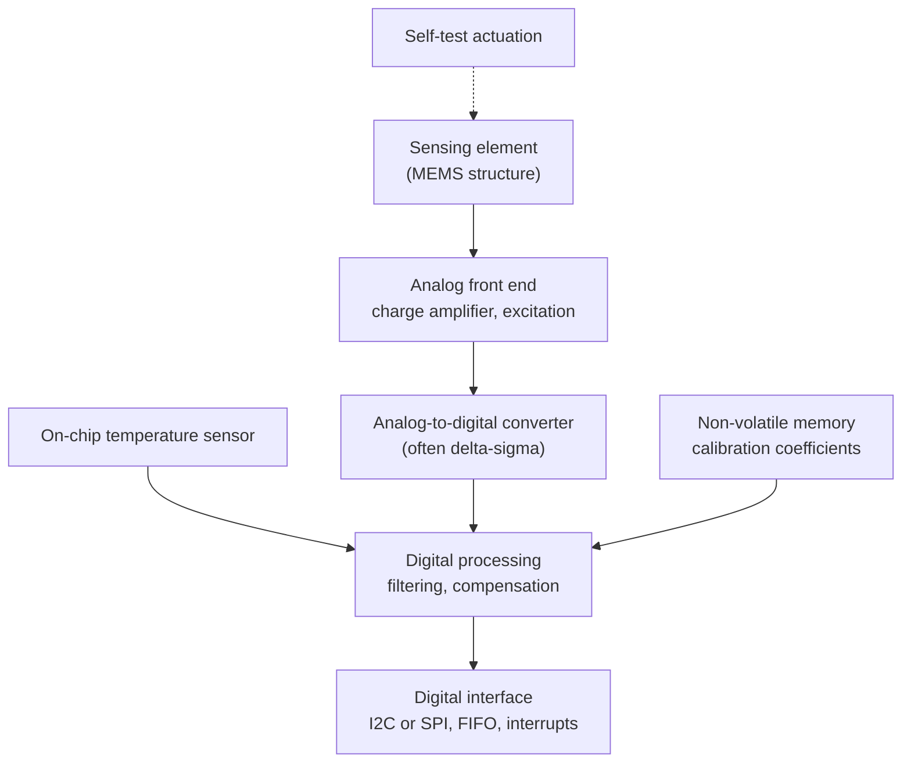

import Figure from '../../components/Figure.astro';
import MemsAccelerometer from '../../components/diagrams/MemsAccelerometer.astro';

The previous entries followed a signal through separate parts: a sensing element, conditioning electronics, a converter, each with its own noise and errors, connected by wires that pick up interference. Many sensors in use today no longer look like that. The accelerometer in a phone, the pressure sensor in a car's engine management, and the microphone in a laptop each contain the sensing element, the amplifier, the converter, a temperature sensor, calibration memory and a digital interface in one package a few millimeters across.

Two ideas make this possible, and this entry treats both:

- **Microelectromechanical systems** (MEMS) are mechanical structures, such as beams, membranes and suspended masses, made with the same fabrication methods as integrated circuits, with dimensions from about a micrometre to a millimeter.
- A **smart sensor** is a sensor that carries its own signal processing: at least conditioning and conversion, and usually also compensation, self-test and a digital interface, so that it delivers a calibrated number rather than a raw electrical signal.

The entry starts with silicon as a mechanical material and how microstructures are made, explains why small mechanical structures behave differently from large ones, works through the main MEMS sensors with numbers, and then turns to what the electronics on the chip do and what integration costs.

## 1. Silicon as a Mechanical Material

Integrated circuits are made of single-crystal silicon, and that crystal turns out to be an excellent mechanical material:

- Its **Young's modulus** (stiffness) is between about 130 and 190 GPa depending on the crystal direction, comparable to steel's 200 GPa, while its density is less than a third of steel's.
- At room temperature it deforms **elastically until it breaks**: it does not yield or creep as metals do, so a silicon spring returns exactly to its rest position, with practically no mechanical hysteresis. The price is brittleness: it fails by fracture when overloaded.
- Its electrical properties change with stress (the **piezoresistive effect**), so resistors made in the silicon itself can act as strain gauges, with gauge factors of the order of 100, against about 2 for the metal-foil gauges of the sensing-principles entry.

### 1.1 How microstructures are made

MEMS fabrication uses the integrated-circuit toolkit: **photolithography** transfers a pattern from a mask onto a light-sensitive layer, **deposition** adds thin films (silicon oxide, polycrystalline silicon, metals), and **etching** removes material where the pattern leaves it exposed. Two families of processes turn these steps into moving parts:

- **Bulk micromachining** etches into the silicon wafer itself. Some wet etchants, such as potassium hydroxide, attack different crystal planes at very different rates, and in the common wafer orientation they leave sidewalls inclined at 54.7°; this is how thin diaphragms for pressure sensors are formed. **Deep reactive-ion etching**, a plasma process, cuts nearly vertical trenches tens to hundreds of micrometres deep.
- **Surface micromachining** builds structures from thin films on top of the wafer. A **sacrificial layer** is deposited under the future moving part and dissolved at the end, which leaves a beam or plate suspended a few micrometres above the substrate.

The finished structures are sealed in a cavity, often under a controlled gas pressure or vacuum, because their motion depends on the gas around them and their gaps are small enough to be blocked by a particle of dust.

## 2. Why Small Is Different

Shrinking a mechanical structure does not merely make it smaller; it changes which physical effects dominate. Suppose every dimension of a spring-mass structure is scaled by a factor $s$:

- The **mass** scales with volume, as $s^3$.
- The **stiffness** of a beam spring scales as $s$ (for a cantilever, $k \propto E\,w t^3 / L^3$, and with every length multiplied by $s$ this is $s^4/s^3$).
- The **resonant frequency** $\omega_0 = \sqrt{k/m}$ therefore scales as $1/s$: a structure a thousand times smaller resonates a thousand times faster.

Small structures are therefore fast and nearly immune to their own inertia, but their tiny mass also makes them sensitive to the random impacts of gas molecules. Surface forces, such as electrostatic attraction, gas damping and stiction (surfaces sticking together), become important where they would be negligible at the scale of centimeters. MEMS design consists largely of working with these effects rather than against them.

## 3. MEMS Sensors

### 3.1 The accelerometer

A MEMS accelerometer is the second-order sensor of the first entry (Section 4.2), built in silicon: a mass, a spring and damping. A **proof mass** $m$ hangs on springs of total stiffness $k$ inside the case. When the case accelerates, the springs must deflect to push the mass along with it; for accelerations that change slowly compared with the resonant frequency, the deflection is

$$
x = \frac{m\,a}{k} = \frac{a}{\omega_0^2}.
$$

Sensitivity and bandwidth are tied together by $\omega_0$: a softer suspension gives more deflection per unit acceleration but a lower resonance, below which the sensor can follow the acceleration faithfully.

<Figure caption="A capacitive MEMS accelerometer in schematic form. The proof mass sits between two fixed electrodes. When the case accelerates, the mass lags behind and moves by x relative to the case, so one gap narrows to d − x and the other widens to d + x.">
  <MemsAccelerometer />
</Figure>

The deflection is measured capacitively, with the differential arrangement of the figure. Each gap forms a capacitor $C = \varepsilon_0 A / \text{gap}$, so

$$
C_2 - C_1 = \varepsilon_0 A\left(\frac{1}{d - x} - \frac{1}{d + x}\right) = \frac{2\,\varepsilon_0 A\,x}{d^2 - x^2} \approx \frac{2\,C_0\,x}{d},
$$

where $C_0 = \varepsilon_0 A / d$ is the capacitance at rest. Like the half bridge of the signal-conditioning entry, the differential arrangement doubles the signal, cancels the even-order (quadratic) part of the nonlinearity, leaving only a small cubic term of relative size $x^2/d^2$, and rejects changes that affect both sides equally.

The numbers show why such a sensor needs its electronics on the chip. Take a resonant frequency of 5 kHz, a rest capacitance of 100 fF spread over many interleaved comb fingers, and gaps of 2 µm:

- 1 g of acceleration (9.81 m/s²) deflects the mass by $9.81 / (2\pi \times 5000)^2 \approx 9.9$ nm.
- The capacitance difference is $2 \times 100\ \text{fF} \times 9.9\ \text{nm} / 2\ \mu\text{m} \approx 1$ fF per g.

One femtofarad is $10^{-15}$ F. A meter of shielded cable has a capacitance of the order of 100 pF, a hundred thousand times more. Measuring femtofarad changes through a cable would be hopeless; measuring them a few hundred micrometres away, with a charge amplifier (from the signal-conditioning entry) on the same chip, is routine.

**Thermomechanical noise.** The thermal noise of the noise entry has a mechanical counterpart. The gas damping that stops the mass from ringing also, through the same molecular impacts, shakes it randomly, and that motion is indistinguishable from an acceleration. Its noise density, expressed as an acceleration, is

$$
a_n = \sqrt{\frac{4 k_B T\,\omega_0}{m\,Q}},
$$

where $k_B$ is the Boltzmann constant and $Q$ the quality factor of the resonance (low $Q$ means strong damping). For a proof mass of 1 µg, $\omega_0 = 2\pi \times 5$ kHz and $Q = 1$, this is $7.2 \times 10^{-4}$ m/s² per √Hz, about 74 µg/√Hz (here g is the acceleration of gravity, not the gram). In a 100 Hz bandwidth that is about 0.74 mg RMS, which corresponds to a mass displacement of 7 picometres and a capacitance change of less than one attofarad ($10^{-18}$ F). The readout electronics must add less noise than that to reach the mechanical limit; in practice they often add more, and the two contributions combine by root sum of squares. A heavier proof mass lowers the mechanical noise, which is why accelerometers for navigation-grade work are larger than those in phones.

### 3.2 The gyroscope

A MEMS gyroscope measures rotation rate through the **Coriolis effect**: a mass moving with velocity $\mathbf{v}$ in a frame rotating at rate $\boldsymbol{\Omega}$ experiences an apparent acceleration $\mathbf{a}_c = 2\,\boldsymbol{\Omega} \times \mathbf{v}$, perpendicular to both. A MEMS gyroscope has no spinning wheel. Instead it drives a proof mass into vibration along one axis, the drive axis, and measures the small vibration that rotation induces along a perpendicular sense axis, with the same capacitive techniques as the accelerometer.

The Coriolis signal is small. A mass driven at 20 kHz with an amplitude of 10 µm reaches a peak velocity of $2\pi \times 20\,000 \times 10\ \mu\text{m} \approx 1.26$ m/s. A rotation of 1 °/s (0.0175 rad/s) then produces a Coriolis acceleration of $2 \times 0.0175 \times 1.26 \approx 0.044$ m/s², about 4.5 mg, alternating at the drive frequency. The gyroscope recovers it by synchronous demodulation against the drive signal, the technique of the signal-conditioning entry. Because the drive amplitude and the mechanical coupling between the two axes drift with temperature and time, gyroscopes have a slowly wandering offset, the **bias drift**, which is why the robotics series fused gyroscope rates with accelerometer and other measurements rather than integrating them alone.

### 3.3 Pressure sensors and microphones

A MEMS **pressure sensor** is a thin silicon diaphragm, formed by bulk micromachining, that bends under the difference between the pressures on its two sides. Four piezoresistors diffused into the diaphragm, placed where two are stretched and two compressed, form the full Wheatstone bridge of the signal-conditioning entry; their large gauge factor gives an output of millivolts per volt of excitation. Capacitive pressure sensors instead measure the diaphragm's distance from a fixed electrode, and consume less power. If the cavity behind the diaphragm is sealed under vacuum, the sensor measures absolute pressure; if it is vented, it measures pressure relative to the atmosphere.

A MEMS **microphone** is a capacitive pressure sensor optimized for the small, fast pressure fluctuations of sound: a thin, compliant diaphragm in front of a perforated rigid backplate, with a vent that equalizes slow changes of atmospheric pressure so that only the acoustic signal remains.

## 4. The Electronics on the Chip

A smart sensor wraps the sensing element in the measurement chain of this series, built as one integrated system. The sensing element and the electronics may share one die (**monolithic** integration), or, more commonly, a MEMS die and an application-specific integrated circuit (ASIC) are made in separate processes, each optimized for its job, and placed side by side in one package.

### 4.1 Front end and conversion

The front end converts the femtofarad changes of a capacitive structure into a voltage, using switched-capacitor charge amplifiers that apply a voltage step to the electrodes and measure the charge that flows. The converter is very often a delta-sigma design: the sensor's bandwidth is low compared with the speed of on-chip electronics, so oversampling and noise shaping (from the data-conversion entry) give high resolution cheaply, and the decimation filter doubles as the anti-aliasing and output filter.

### 4.2 Temperature measurement and compensation

Almost every property of a MEMS sensor changes with temperature: spring stiffness, gap widths, residual stresses from packaging, the gain and offset of the electronics. A smart sensor therefore measures its own temperature, usually with a circuit that exploits a basic property of transistors. When two bipolar transistors carry currents at densities in the ratio $N$, the difference between their base–emitter voltages is

$$
\Delta V_\text{BE} = \frac{k_B T}{q}\,\ln N,
$$

directly proportional to absolute temperature. With $N = 8$ it is 53.8 mV at 300 K and changes by 0.179 mV/K, a linear temperature sensor available on any chip without a separate sensing element.

The manufacturer characterizes each sensor, or each production batch, at several temperatures, fits a model of how its offset and sensitivity depend on temperature, and stores the model's coefficients in on-chip non-volatile memory. The digital processing block then applies the correction continuously:

$$
\hat a = \frac{a_\text{raw} - o(T)}{s(T)},
$$

where $o(T)$ and $s(T)$ are low-order polynomials in the measured temperature. This is the calibration of the first entry, performed once at the factory and stored in the device. What remains after it, the residual temperature error and the changes since the factory calibration (aging, and stresses introduced when the device is soldered to a circuit board), is what the datasheet specifies and what the user's own calibration must deal with.

### 4.3 Self-test and self-calibration

A MEMS structure can be moved by the same electrodes that sense it: a voltage applied across a gap pulls the plates together with an electrostatic force. **Self-test** uses this to apply a known force to the proof mass on command and checks that the output changes by the expected amount, which verifies that the mechanical structure is free and the signal path works. Self-test confirms function, not accuracy: the electrostatic force depends on the very gaps and voltages that may have drifted, so it is not a traceable reference.

**Self-calibration**, in the strict sense, requires a reference that the device cannot have drifted away from. Electronics can calibrate themselves against an internal voltage reference, and converters routinely do. For the physical quantity itself, the only references available to most sensors are natural ones: the 1 g of gravity for an accelerometer at rest, zero rotation rate for a gyroscope that is known to be stationary. Using such references in operation is a form of the calibration and fusion that [the next entry](/blog/calibration-and-multisensor-fusion) treats.

### 4.4 Digital interfaces

A smart sensor delivers numbers over a digital bus, usually I2C or SPI, the serial buses that the [Embedded and Real-Time Systems](/series/embedded-and-real-time-systems) series covers. A digital link is immune to the interference and ground-loop problems of the noise entry, since a few hundred millivolts of interference do not change a bit. The sensor typically offers a choice of **output data rate** and filter bandwidth, a **FIFO** buffer that stores samples until the host reads them, and interrupts that signal new data or events such as a detected motion.

Stored descriptions of the sensor itself have been standardized as well: the IEEE 1451 family of standards defines a **Transducer Electronic Data Sheet** (TEDS), a block of memory in the sensor that identifies it and holds its calibration, so that a measurement system can configure itself when a sensor is connected.

## 5. What Integration Costs

Integration solves the problems of the earlier entries (loading, long leads, interference, separate calibration of each stage) but brings its own:

- **The processing is hidden.** The digital filter's response, its delay, and the compensation model are fixed by the manufacturer and often only partly documented. A filter that delays the signal by several milliseconds matters in a control loop, and it must be known to align the readings of several sensors in time.
- **Self-heating and packaging stress.** The ASIC dissipates power next to the sensing element, so an integrated temperature sensor reads the chip, not the air around it. Mechanical stress from the package and from soldering shifts offsets, and can change again with humidity and age.
- **Fixed design choices.** Range, bandwidth and noise come in the combinations the manufacturer offers. A discrete design can be optimized for one application; an integrated one is optimized for a market.
- **Timing.** Each sensor samples on its own clock. Readings from several sensors, or from one sensor and the host's control loop, are not taken at the same instant unless the system synchronizes them, and [the next entry](/blog/calibration-and-multisensor-fusion) shows why that matters for fusion.

| | Discrete sensor and conditioning | Smart sensor |
|---|---|---|
| Signal between sensor and system | Analog, often small | Digital |
| Sensitivity to interference and lead effects | High; needs careful design | Low |
| Calibration | By the user, for the whole channel | Factory compensation stored in the sensor, plus user calibration of the residual |
| Transparency | Every stage is accessible | Internal processing is fixed and partly hidden |
| Freedom of design | Choose range, bandwidth, noise freely | Choose among the offered configurations |
| Size, power and cost at volume | Larger, higher | Smaller, lower |

## 6. Summary

| Question | Answer |
|---|---|
| What are MEMS? | Mechanical structures (beams, membranes, proof masses) made with integrated-circuit fabrication, micrometres to a millimeter in size. |
| What is a smart sensor? | A sensor that carries its own conditioning, conversion and usually compensation, self-test and a digital interface. |
| Why silicon? | Stiff as steel, light, elastic until fracture with no hysteresis, and piezoresistive. |
| How does scaling change mechanics? | Resonant frequency scales as $1/s$; surface forces and gas damping become important. |
| How does a MEMS accelerometer work? | A proof mass deflects by $a/\omega_0^2$; a differential capacitor gives $\Delta C \approx 2C_0x/d$, about 1 fF per g in the example. |
| What limits it fundamentally? | Thermomechanical noise, $\sqrt{4k_BT\omega_0/(mQ)}$: about 74 µg/√Hz for a 1 µg mass at 5 kHz and $Q = 1$. |
| How does a MEMS gyroscope work? | It vibrates a mass and senses the Coriolis acceleration $2\Omega v$ along a perpendicular axis. |
| What does the on-chip electronics do? | Charge amplification, delta-sigma conversion, temperature measurement and factory compensation, self-test, digital output. |
| What does integration cost? | Hidden processing and delay, self-heating and package stress, fixed design choices, and timing that must be synchronized across sensors. |

Factory compensation leaves residual errors, every sensor drifts, and no single sensor measures everything well. The [last entry](/blog/calibration-and-multisensor-fusion) of the series turns to what the user can do about that: calibration in practice, traceability, and combining several imperfect sensors into one better estimate.

### References

- S. D. Senturia, *Microsystem Design*, Kluwer Academic Publishers, 2001.
- V. Kaajakari, *Practical MEMS*, Small Gear Publishing, 2009.
- J. Fraden, *Handbook of Modern Sensors: Physics, Designs, and Applications*, 5th edition, Springer, 2016.
- T. B. Gabrielson, "Mechanical-thermal noise in micromachined acoustic and vibration sensors", *IEEE Transactions on Electron Devices*, vol. 40, no. 5, pp. 903–909, 1993.
