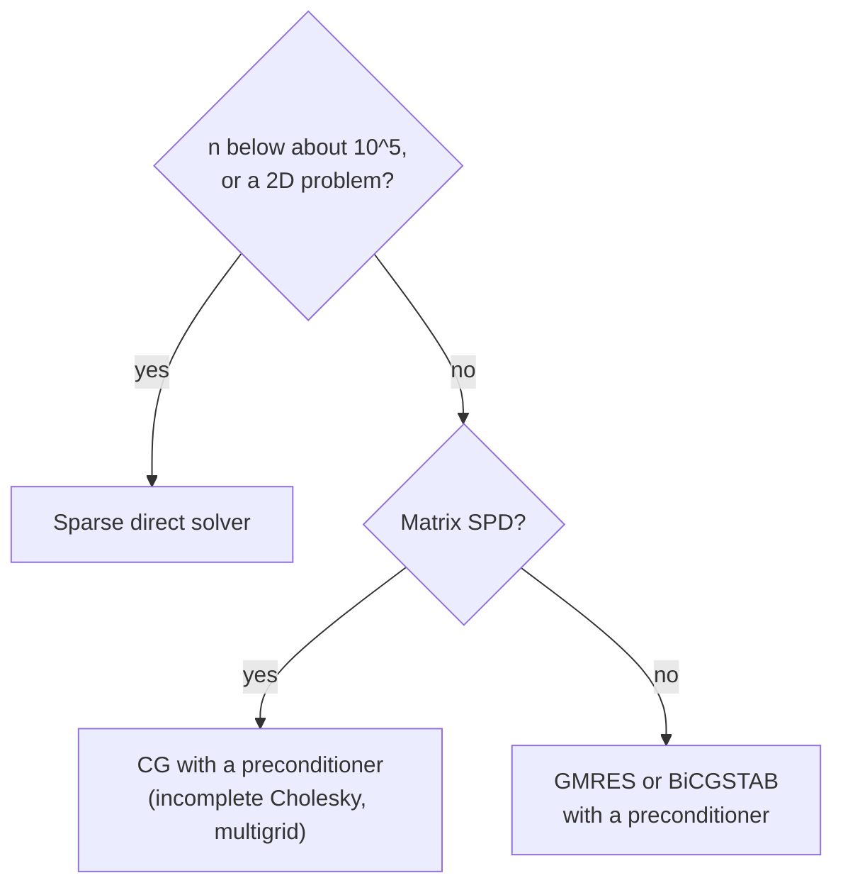

Every method in this series ends in a system of linear equations $A\mathbf{U} = \mathbf{b}$. [The first entry](/blog/from-differential-equations-to-discrete-problems) produced one from the one-dimensional Poisson equation and solved it with a single library call; [the second](/blog/finite-differences-for-heat-and-waves) needed one at every step of an implicit time-stepping scheme. In one dimension these systems are small and tridiagonal. In two and three dimensions they have from thousands to many millions of unknowns, and the library call that took a millisecond becomes impossible: a dense solver for a million unknowns would need 8 terabytes of memory just to store the matrix. Simulation at realistic resolution depends on exploiting the structure of these matrices.

This entry first describes that structure, then the two families of solvers. **Direct methods** factor the matrix and give the answer, up to rounding, in a predictable number of operations. **Iterative methods** improve an approximate solution step by step and stop when it is good enough. The comparison rests on operation counts and on measured iteration counts. The code uses Python 3 with numpy in double precision; small matrices are formed densely for clarity, and the larger experiments apply the matrix without storing it.

## 1. The Systems Discretization Produces

### 1.1 The five-point matrix

The model problem of this entry is the Poisson equation on the unit square,

$$
-\left(u_{xx} + u_{yy}\right) = f \quad \text{in } 0 \lt x, y \lt 1, \qquad u = 0 \text{ on the boundary},
$$

discretized on a grid with spacing $h = 1/N$ in both directions. Replacing each second derivative by the second difference of the first entry gives, at each interior grid point $(x_i, y_j)$,

$$
\frac{4U_{i,j} - U_{i+1,j} - U_{i-1,j} - U_{i,j+1} - U_{i,j-1}}{h^2} = f(x_i, y_j).
$$

This is the **five-point stencil**: each equation couples a point to its four neighbors. Numbering the $n = (N-1)^2$ interior unknowns row by row turns the equations into $A\mathbf{U} = \mathbf{b}$ with

$$
A = \frac{1}{h^2}\left(I \otimes T + T \otimes I\right),
\qquad
T = \begin{bmatrix} 2 & -1 & & \\ -1 & 2 & \ddots & \\ & \ddots & \ddots & -1 \\ & & -1 & 2 \end{bmatrix},
$$

where $T$ is the $(N-1)\times(N-1)$ tridiagonal matrix of the first entry and $\otimes$ is the **Kronecker product** ($P \otimes Q$ is the block matrix whose block $(i,j)$ is $p_{ij}Q$). Three properties of $A$ shape everything that follows.

- **Sparse.** Each row has at most five nonzero entries, out of $n$. A matrix in which almost all entries are zero, and whose zeros are worth exploiting, is called sparse. Only the nonzeros need to be stored.
- **Banded.** The nonzeros lie within a distance $N - 1$ of the diagonal (the neighbor in the next row of the grid is $N - 1$ positions away in the numbering). This distance is the **half-bandwidth** $b$.
- **Symmetric positive definite** (SPD): $A^{\mathsf T} = A$, and $\mathbf{v}^{\mathsf T}A\mathbf{v} \gt 0$ for every nonzero vector $\mathbf{v}$, equivalently all eigenvalues are positive. The minus sign convention of the first entry makes this so. Finite element discretizations of the same problem, in [the fourth entry](/blog/finite-element-method), are SPD as well.

The three-dimensional analog, the seven-point stencil, has seven nonzeros per row and half-bandwidth $(N-1)^2$.

### 1.2 How large is large

A modest three-dimensional grid with $N = 100$ has $99^3 \approx 970{,}000$ unknowns. Stored densely, $A$ would hold $n^2 \approx 9.4\times10^{11}$ numbers, 7.5 terabytes in double precision; its nonzeros number fewer than $7n$, about 54 megabytes. The question is therefore not only how many operations a solver needs, but whether it can work with the sparse matrix without filling in the zeros.

Operation counts are given in **flops** (floating-point operations: one addition, subtraction, multiplication or division each), counting only the leading term for large $n$.

## 2. Direct Methods

### 2.1 Gaussian elimination as a factorization

Gaussian elimination subtracts multiples of each row from the rows below it until the matrix is upper triangular, then solves by back substitution. Recording the multipliers turns this into a **factorization** $A = LU_{\!f}$, with $L$ lower triangular (ones on its diagonal, multipliers below) and $U_{\!f}$ upper triangular; the subscript distinguishes the factor from the solution vector $\mathbf{U}$. Solving $A\mathbf{U} = \mathbf{b}$ then means two triangular solves, $L\mathbf{z} = \mathbf{b}$ and $U_{\!f}\mathbf{U} = \mathbf{z}$.

For a dense $n\times n$ matrix the factorization costs about $\tfrac{2}{3}n^3$ flops and each pair of triangular solves about $2n^2$. Factoring once and reusing the factors is therefore cheap when the same matrix appears with many right-hand sides, as in implicit time stepping with a fixed step, where the same matrix is solved at every step.

For general matrices, elimination must reorder rows to avoid dividing by small pivots (**partial pivoting**, giving $PA = LU_{\!f}$ with a permutation matrix $P$); without it, rounding errors can grow catastrophically. For SPD matrices no pivoting is needed, which leads to Cholesky factorization (Section 2.3).

### 2.2 Banded and tridiagonal systems

Elimination on a banded matrix creates no nonzeros outside the band: $L$ and $U_{\!f}$ have the same half-bandwidth $b$ as $A$. The cost falls from $\tfrac{2}{3}n^3$ to roughly $2nb^2$ flops for LU (about $nb^2$ for Cholesky), and the storage to about $nb$ numbers.

The extreme case is a tridiagonal matrix ($b = 1$), the matrix of every one-dimensional problem in this series and of each implicit step in the second entry. Elimination without pivoting then reduces to a short recurrence, often called the **Thomas algorithm**, costing about $8n$ flops. It is stable without pivoting when the matrix is diagonally dominant or SPD, as here.

```python
import numpy as np

def thomas(a, b, c, d):
    """Solve a tridiagonal system: a = sub-, b = main, c = super-diagonal."""
    n = len(b)
    cp, dp = np.empty(n), np.empty(n)
    cp[0], dp[0] = c[0] / b[0], d[0] / b[0]
    for i in range(1, n):                       # forward elimination
        m = b[i] - a[i] * cp[i - 1]
        cp[i] = c[i] / m if i < n - 1 else 0.0
        dp[i] = (d[i] - a[i] * dp[i - 1]) / m
    x = np.empty(n)
    x[-1] = dp[-1]
    for i in range(n - 2, -1, -1):              # back substitution
        x[i] = dp[i] - cp[i] * x[i + 1]
    return x
```

(`a[0]` and `c[n-1]` are not used.) Section 3.2 uses this function to solve the first entry's Poisson problem with up to a million unknowns.

### 2.3 Cholesky factorization

An SPD matrix has a unique factorization $A = LL^{\mathsf T}$ with $L$ lower triangular and positive diagonal: the **Cholesky factorization**. It needs half the work of LU, about $\tfrac{1}{3}n^3$ flops dense or $nb^2$ banded, half the storage (only $L$), and no pivoting: for SPD matrices it is numerically stable as it stands. It also serves as a test: for a symmetric matrix, the factorization fails in exact arithmetic (a zero or negative number appears under a square root) exactly when the matrix is not positive definite, which catches sign errors in an assembly code.

### 2.4 Fill-in

The band is not empty, however, and elimination fills it. The script below forms the five-point matrix for three grid sizes, checks that it is SPD, computes its Cholesky factor with numpy, and counts nonzeros.

```python
import numpy as np

def poisson_2d(N):
    """Five-point matrix for -(u_xx + u_yy) on the unit square, (N-1)^2 unknowns."""
    m = N - 1
    T = 2 * np.eye(m) - np.eye(m, k=1) - np.eye(m, k=-1)
    return (np.kron(np.eye(m), T) + np.kron(T, np.eye(m))) * N**2

for N in (8, 16, 32):
    A = poisson_2d(N)
    n = A.shape[0]
    L = np.linalg.cholesky(A)
    nnz_A = np.count_nonzero(np.tril(A))
    nnz_L = np.count_nonzero(np.abs(L) > 1e-14 * np.abs(L).max())
    print(f"N = {N:2d}: n = {n:4d}, nonzeros in lower(A) = {nnz_A:5d}, "
          f"in L = {nnz_L:6d}, symmetric: {np.allclose(A, A.T)}, "
          f"min eigenvalue = {np.linalg.eigvalsh(A).min():.3f}")
```

```text
N =  8: n =   49, nonzeros in lower(A) =   133, in L =    349, symmetric: True, min eigenvalue = 19.487
N = 16: n =  225, nonzeros in lower(A) =   645, in L =   3389, symmetric: True, min eigenvalue = 19.676
N = 32: n =  961, nonzeros in lower(A) =  2821, in L =  29757, symmetric: True, min eigenvalue = 19.723
```

The smallest eigenvalue approaches $2\pi^2 \approx 19.74$, the smallest eigenvalue of the continuous operator, so the matrix is safely positive definite. But the factor $L$ has ten times as many nonzeros as the lower triangle of $A$ at $N = 32$, and its 29,757 nonzeros fill 98 % of the 30,256 positions in the lower band: the band is essentially full. This **fill-in** grows with the grid. For the two-dimensional problem with $N = 100$ ($n = 9{,}801$, $b = 99$), banded Cholesky needs about $nb^2 \approx 10^8$ flops and 8 megabytes, which is easy. For the three-dimensional problem with $N = 100$ ($n \approx 970{,}000$, $b = 9{,}801$) it needs about $9\times10^{13}$ flops and 76 gigabytes, which is not.

**Reordering** the unknowns can reduce fill-in greatly. **Nested dissection**, introduced by George in 1973 for regular meshes, repeatedly splits the grid by separator lines (or planes) and numbers the separators last; for the two-dimensional model problem it reduces the factorization cost to $O(n^{3/2})$ flops and the storage to $O(n\log n)$, and in three dimensions to $O(n^2)$ flops and $O(n^{4/3})$ storage. Sparse direct solvers combine such orderings with efficient dense kernels and are the method of choice for two-dimensional problems and moderate three-dimensional ones.

## 3. Conditioning and Rounding

### 3.1 The condition number

A direct solver is exact apart from rounding, but rounding errors in the data and in the arithmetic are amplified by the matrix itself. The **condition number** $\kappa(A) = \|A\|\,\|A^{-1}\|$ measures that amplification: a relative perturbation $\epsilon$ of $\mathbf{b}$ can change $\mathbf{U}$ by a relative amount up to $\kappa(A)\,\epsilon$. For an SPD matrix in the 2-norm, $\kappa(A) = \lambda_{\max}/\lambda_{\min}$. A good (backward stable) solver computes the exact solution of a slightly perturbed system, so its relative error is at most of the order of $\kappa(A)\,u_r$, with $u_r \approx 1.1\times10^{-16}$ the unit roundoff of the [first entry](/blog/from-differential-equations-to-discrete-problems#52-checking-the-orders-and-where-rounding-takes-over).

For the one-dimensional matrix $T/h^2$, the eigenvalues found in the second entry give $\kappa = \cot^2(\pi h/2) \approx 4/(\pi^2h^2)$, and the same value holds for the two-dimensional five-point matrix, since its extreme eigenvalues are twice those of $T/h^2$.

```python
import numpy as np

for N in (10, 20, 40, 80):
    n, h = N - 1, 1.0 / N
    A = (2 * np.eye(n) - np.eye(n, k=1) - np.eye(n, k=-1)) / h**2
    kappa = np.linalg.cond(A)
    print(f"N = {N:3d}: cond(A) = {kappa:8.1f}, "
          f"cot^2(pi h/2) = {1 / np.tan(np.pi * h / 2)**2:8.1f}, "
          f"4/(pi h)^2 = {4 / (np.pi * h)**2:8.1f}")
```

```text
N =  10: cond(A) =     39.9, cot^2(pi h/2) =     39.9, 4/(pi h)^2 =     40.5
N =  20: cond(A) =    161.4, cot^2(pi h/2) =    161.4, 4/(pi h)^2 =    162.1
N =  40: cond(A) =    647.8, cot^2(pi h/2) =    647.8, 4/(pi h)^2 =    648.5
N =  80: cond(A) =   2593.2, cot^2(pi h/2) =   2593.2, 4/(pi h)^2 =   2593.8
```

The condition number grows like $h^{-2}$: refining the grid makes the system harder, both for rounding (here) and for iterative methods (Sections 4 and 5).

### 3.2 Where rounding overtakes discretization

As $h$ falls, the discretization error of the first entry's Poisson problem falls like $h^2\pi^2/12$, while the possible rounding error grows like $\kappa u_r \propto h^{-2}u_r$. The two cross near $h \approx u_r^{1/4} \approx 10^{-4}$, ignoring constants. The script below, which continues from the `thomas` function of Section 2.2, solves the problem $-u'' = \pi^2\sin\pi x$, $u(0) = u(1) = 0$ (exact solution $\sin \pi x$) on grids up to $N = 10^6$; the equations are multiplied by $h^2$ so that the matrix is $\text{tridiag}(-1, 2, -1)$.

```python
# -u'' = pi^2 sin(pi x), u(0) = u(1) = 0, scaled by h^2 so A = tridiag(-1, 2, -1)
for N in (10**2, 10**3, 10**4, 10**5, 10**6):
    h = 1.0 / N
    x = np.linspace(0.0, 1.0, N + 1)[1:-1]
    n = N - 1
    U = thomas(-np.ones(n), 2 * np.ones(n), -np.ones(n),
               h**2 * np.pi**2 * np.sin(np.pi * x))
    print(f"N = {N:>7d}: max error = {np.max(np.abs(U - np.sin(np.pi * x))):.2e}")
```

```text
N =     100: max error = 8.23e-05
N =    1000: max error = 8.22e-07
N =   10000: max error = 8.23e-09
N =  100000: max error = 3.31e-10
N = 1000000: max error = 6.35e-07
```

Up to $N = 10^4$ the error falls by 100 per tenfold refinement, exactly second order, and agrees with the prediction $h^2\pi^2/12$. At $N = 10^5$ it should be $8.2\times10^{-11}$ but is four times larger, and at $N = 10^6$ it is back to the level of $N = 10^3$: rounding, in forming the right-hand side and in solving, now dominates. The observed $6.35\times10^{-7}$ is well below the worst-case bound $\kappa u_r \approx 4.5\times10^{-5}$, as is typical, but the trend is unmistakable. Refining a grid improves a result only while discretization error dominates. The ACRR note on [floating-point rounding in long simulations](/insights/floating-point-in-long-simulations) suggests comparing runs that differ only in rounding to check this; a refinement study that stops converging, as here, is another warning sign.

## 4. Stationary Iterative Methods

### 4.1 Why iterate

An **iterative method** starts from a guess $\mathbf{U}^{(0)}$ (often zero) and produces a sequence $\mathbf{U}^{(1)}, \mathbf{U}^{(2)}, \dots$ that converges to the solution. The superscript in parentheses counts iterations. Its attractions for sparse systems are that it touches $A$ only through products $A\mathbf{v}$, which cost about $5n$ flops for the five-point matrix, and that it needs storage only for $A$'s nonzeros and a few vectors: no fill-in at all. The product does not even require a stored matrix: it can be computed directly from the stencil ("matrix-free").

The quality of an iterate is judged by its **residual** $\mathbf{r}^{(m)} = \mathbf{b} - A\mathbf{U}^{(m)}$, which can be computed, unlike the error. A common stopping test is $\|\mathbf{r}^{(m)}\| \le \text{tol}\cdot\|\mathbf{b}\|$. A small residual does not guarantee a small error: the relative error can be up to $\kappa(A)$ times the relative residual. The difference between the iterate where the solver stops and the exact solution of the discrete system is the **iteration error** of the first entry's error taxonomy, and the tolerance should make it negligible compared with the discretization error.

### 4.2 Jacobi, Gauss–Seidel and SOR

Write $A = D - E - F$, with $D$ the diagonal of $A$, $-E$ its strictly lower and $-F$ its strictly upper triangular part.

- **Jacobi** solves each equation for its diagonal unknown using the old values of all others: $D\,\mathbf{U}^{(m+1)} = (E + F)\,\mathbf{U}^{(m)} + \mathbf{b}$. For the five-point stencil, each new value is the average of its four neighbors plus $h^2 f/4$.
- **Gauss–Seidel** uses each new value as soon as it is computed: $(D - E)\,\mathbf{U}^{(m+1)} = F\,\mathbf{U}^{(m)} + \mathbf{b}$. The result depends on the order in which unknowns are visited. In **red-black ordering**, the grid is colored like a chessboard; the red points (with $i + j$ even) depend only on black neighbors, so all red points are updated at once, then all black points. This vectorizes well and, for the model problem, converges at the same rate as row-by-row ordering.
- **Successive over-relaxation** (SOR) moves each Gauss–Seidel update further in the same direction by a factor $\omega$ between 1 and 2.

Each is a **stationary iteration** $\mathbf{U}^{(m+1)} = M\mathbf{U}^{(m)} + \mathbf{c}$ with a fixed iteration matrix $M$, and the error is multiplied by $M$ at each step. It converges for every starting guess exactly when the **spectral radius** $\rho(M)$, the largest eigenvalue modulus, is below 1, and the error then shrinks by roughly a factor $\rho(M)$ per iteration. For the model problem these radii are known in closed form:

| Method | Spectral radius | Iterations to reduce the error by a factor of $10^8$, for small $h$ |
|---|---|---|
| Jacobi | $\cos\pi h \approx 1 - \pi^2h^2/2$ | $\approx 3.7N^2$ |
| Gauss–Seidel | $\cos^2\pi h \approx 1 - \pi^2h^2$ | $\approx 1.9N^2$ |
| SOR, $\omega_{\text{opt}} = 2/(1 + \sin\pi h)$ | $\omega_{\text{opt}} - 1 \approx 1 - 2\pi h$ | $\approx 2.9N$ |

The iteration counts are $\ln(10^8)/(-\ln\rho)$. Each Jacobi iteration costs $O(n)$ flops, and with $N^2 \approx n$ iterations the total is $O(n^2)$, no better than banded Cholesky. SOR with the optimal $\omega$ needs only $O(N)$ iterations, but the optimal value is known in closed form only for model problems.

### 4.3 Smoothing and the idea of multigrid

The slow convergence has a clear cause. The Jacobi iteration matrix has the same sine eigenvectors as $A$, and its eigenvalue for the mode with phase angle $\xi$ per grid interval (the $\xi$ of the second entry's von Neumann analysis) is $\cos\xi$ in one dimension. Components with $\xi$ near $\pi/2$ are removed almost at once, but the smoothest component, $\xi = \pi h$, and the most oscillatory one, $\xi$ near $\pi$, are reduced by only about $\cos\pi h$ in magnitude per iteration. **Weighted Jacobi** moves only a fraction $\omega_J$ of the way to the Jacobi update; its eigenvalues are $1 - \omega_J(1 - \cos\xi)$, and with $\omega_J = 2/3$ every component with $\xi \ge \pi/2$ is reduced by at least a factor of 3 per iteration, while the smooth components are left almost untouched. After a few such iterations the error is smooth, and a smooth error can be represented accurately on a coarser grid, where it is no longer smooth relative to the grid and is reduced quickly again. **Multigrid** methods apply this recursively over a hierarchy of grids. For the model problem, a well-designed multigrid cycle reduces the error by a factor independent of $h$, so the total cost is $O(n)$, the best possible. Multigrid is a large subject of its own; the tutorial by Briggs, Henson and McCormick listed below is a standard introduction.

## 5. Conjugate Gradients

### 5.1 Solving by minimizing

For an SPD matrix, solving $A\mathbf{U} = \mathbf{b}$ is equivalent to minimizing the quadratic function

$$
\phi(\mathbf{V}) = \tfrac{1}{2}\mathbf{V}^{\mathsf T}A\mathbf{V} - \mathbf{b}^{\mathsf T}\mathbf{V},
$$

whose gradient is $A\mathbf{V} - \mathbf{b} = -\mathbf{r}$. (For the Poisson problem $\phi$ is a discrete energy, a connection [the fourth entry](/blog/finite-element-method) makes central.) Following the negative gradient (steepest descent) converges slowly when the level sets of $\phi$ are elongated, which is what a large $\kappa$ means. The **conjugate gradient** (CG) method of Hestenes and Stiefel instead chooses search directions $\mathbf{p}^{(m)}$ that are mutually **$A$-conjugate**, $\mathbf{p}^{(i)\mathsf T}A\,\mathbf{p}^{(j)} = 0$ for $i \ne j$, so that minimizing along a new direction never spoils the minimization along earlier ones. The result is that $\mathbf{U}^{(m)}$ minimizes the error in the **energy norm** $\|\mathbf{e}\|_A = \sqrt{\mathbf{e}^{\mathsf T}A\mathbf{e}}$ over all vectors in the **Krylov subspace** $\text{span}\{\mathbf{r}^{(0)}, A\mathbf{r}^{(0)}, \dots, A^{m-1}\mathbf{r}^{(0)}\}$, the best that any method built from $m$ matrix-vector products and that starting guess can do in this sense.

Each iteration costs one product with $A$, two inner products and three vector updates:

$$
\alpha_m = \frac{\mathbf{r}^{(m)\mathsf T}\mathbf{r}^{(m)}}{\mathbf{p}^{(m)\mathsf T}A\mathbf{p}^{(m)}},\quad
\mathbf{U}^{(m+1)} = \mathbf{U}^{(m)} + \alpha_m\mathbf{p}^{(m)},\quad
\mathbf{r}^{(m+1)} = \mathbf{r}^{(m)} - \alpha_m A\mathbf{p}^{(m)},\quad
\mathbf{p}^{(m+1)} = \mathbf{r}^{(m+1)} + \frac{\mathbf{r}^{(m+1)\mathsf T}\mathbf{r}^{(m+1)}}{\mathbf{r}^{(m)\mathsf T}\mathbf{r}^{(m)}}\,\mathbf{p}^{(m)},
$$

starting from $\mathbf{p}^{(0)} = \mathbf{r}^{(0)}$. In exact arithmetic CG terminates in at most $n$ iterations, but its practical value is that it gets close much sooner.

### 5.2 How fast

The standard bound is

$$
\|\mathbf{e}^{(m)}\|_A \le 2\left(\frac{\sqrt{\kappa} - 1}{\sqrt{\kappa} + 1}\right)^m \|\mathbf{e}^{(0)}\|_A ,
$$

so the number of iterations for a fixed reduction grows like $\sqrt{\kappa}$, not $\kappa$. For the model problem $\sqrt{\kappa} \approx 2N/\pi$, so CG needs $O(N)$ iterations, like optimal SOR but without a parameter to tune. The bound is often pessimistic, because CG adapts to the actual distribution of eigenvalues.

### 5.3 Preconditioning

A **preconditioner** is a matrix $M \approx A$ whose systems $M\mathbf{z} = \mathbf{r}$ are cheap to solve. Preconditioned CG applies CG, in effect, to $M^{-1}A$, and its convergence depends on $\kappa(M^{-1}A)$ instead of $\kappa(A)$. Common choices are the diagonal of $A$ (Jacobi preconditioning, useful when the diagonal varies strongly; for the model problem it is a constant multiple of the identity and changes nothing), **incomplete Cholesky** factorization (a Cholesky factorization that discards fill-in outside a chosen pattern), and one multigrid cycle, which for the model problem makes the iteration count independent of $h$. Preconditioning is where most of the engineering of an iterative solver lies.

CG requires an SPD matrix. For nonsymmetric systems, such as those from convection-dominated flow, Krylov methods such as GMRES (generalized minimal residual) and BiCGSTAB (biconjugate gradient stabilized) play the same role; they are outside the scope of this entry.

## 6. Measuring the Iteration Counts

The script below solves the five-point problem with $f = 1$ by each method on three grids, applying $A$ matrix-free on an array that includes the zero boundary values, and counts iterations until the relative residual falls below $10^{-8}$.

```python
import numpy as np

# -(u_xx + u_yy) = f on the unit square, u = 0 on the boundary, (N-1)^2 unknowns.
# The grid array includes the boundary, which stays zero; A is applied matrix-free.
def apply_A(U, N):
    V = np.zeros_like(U)
    V[1:-1, 1:-1] = N**2 * (4 * U[1:-1, 1:-1] - U[2:, 1:-1] - U[:-2, 1:-1]
                            - U[1:-1, 2:] - U[1:-1, :-2])
    return V

def problem(N):
    F = np.zeros((N + 1, N + 1))
    F[1:-1, 1:-1] = 1.0                            # uniform source f = 1
    inner = F > 0
    red = inner & (np.indices(F.shape).sum(axis=0) % 2 == 0)
    return F, inner, red

def relaxation(N, omega, ordering, tol=1e-8):
    F, inner, red = problem(N)
    U = np.zeros_like(F)
    norm_f = np.linalg.norm(F)
    # Jacobi updates every point from old values; red-black Gauss-Seidel
    # updates the "red" points (i + j even) first, then the "black" ones.
    sweeps = [inner] if ordering == "jacobi" else [red, inner & ~red]
    for k in range(1, 100000):
        for mask in sweeps:
            R = F - apply_A(U, N)                  # residual
            U[mask] += omega * R[mask] / (4 * N**2)  # diagonal of A is 4 N^2
        if np.linalg.norm(F - apply_A(U, N)) <= tol * norm_f:
            return k

def cg(N, tol=1e-8):
    F, _, _ = problem(N)
    U = np.zeros_like(F)
    R = F.copy(); P = R.copy(); rr = np.sum(R * R)
    for k in range(1, 100000):
        AP = apply_A(P, N)
        alpha = rr / np.sum(P * AP)
        U += alpha * P
        R -= alpha * AP
        rr_new = np.sum(R * R)
        if np.sqrt(rr_new) <= tol * np.linalg.norm(F):
            return k
        P = R + (rr_new / rr) * P
        rr = rr_new

print(f"{'N':>3} {'unknowns':>8} {'Jacobi':>7} {'G-S':>6} {'SOR':>5} {'CG':>4}")
for N in (16, 32, 64):
    w_opt = 2 / (1 + np.sin(np.pi / N))
    print(f"{N:3d} {(N-1)**2:8d} {relaxation(N, 1.0, 'jacobi'):7d} "
          f"{relaxation(N, 1.0, 'rb'):6d} {relaxation(N, w_opt, 'rb'):5d} {cg(N):4d}")
```

```text
  N unknowns  Jacobi    G-S   SOR   CG
 16      225     942    480    61   27
 32      961    3779   1926   125   58
 64     3969   15122   7705   257  118
```

(For brevity the relaxation code recomputes the full residual for each half-sweep, which is wasteful but gives exactly the Jacobi and red-black Gauss–Seidel updates.)

- **Jacobi** needs 942, 3,779 and 15,122 iterations: a factor of 4.0 per halving of $h$, against the predictions $\ln(10^8)/(-\ln\cos\pi h) = 949$, 3,816 and 15,283.
- **Gauss–Seidel** needs about half as many, as $\rho_{\text{GS}} = \rho_{\text{J}}^2$ predicts, and grows by the same factor of 4.
- **SOR** with the optimal $\omega$ grows by a factor of 2 per refinement, $O(N)$, though it needs more iterations than the prediction from its spectral radius (47, 94, 188): at the optimal $\omega$ every eigenvalue of its iteration matrix has the same modulus $\omega - 1$, and the eigenvalue $\omega - 1$ itself is double with only one eigenvector (the matrix is defective), so the error decays like $m\rho^m$ rather than $\rho^m$.
- **CG** needs 27, 58 and 118 iterations, also doubling per refinement, as $\sqrt{\kappa} \propto N$ predicts. Its bound from Section 5.2 promises at most about 97, 194 and 389 iterations to reduce the energy-norm error by $10^{-8}$; the actual counts are about a third of that.

On the finest grid, CG needs 128 times fewer iterations than Jacobi, at a comparable cost per iteration (one product with $A$ plus a few vector operations). Extrapolating the measured growth, a grid with $N = 1000$ would need about $4\times10^6$ Jacobi iterations and about 1,800 CG iterations.

## 7. Direct or Iterative?

With $n$ unknowns on the two-dimensional model problem, the counts above give the following total costs, to leading order:

| Method | Flops (2D model problem) | Extra storage | Comment |
|---|---|---|---|
| Banded Cholesky | $O(n^2)$ | $O(n^{3/2})$ | Simple; the band fills in |
| Sparse Cholesky, nested dissection | $O(n^{3/2})$ | $O(n\log n)$ | Robust; factor reusable for many right-hand sides |
| Jacobi, Gauss–Seidel | $O(n^2)$ | $O(n)$ | Too slow alone; good smoothers inside multigrid |
| SOR (optimal $\omega$), CG | $O(n^{3/2})$ | $O(n)$ | CG needs SPD; no parameter to tune |
| Preconditioned CG, multigrid | Down to $O(n)$ | $O(n)$ | Best for large problems; design effort in the preconditioner |

In practice the choice follows a few questions:



The threshold in the first box is a rough guide, not a rule: memory, the number of right-hand sides, and how often the matrix changes all move it. Direct solvers are predictable and insensitive to conditioning, and a factorization pays off when many right-hand sides share one matrix. Iterative solvers win on large three-dimensional problems, where fill-in makes factorization too expensive, and when only a modest accuracy is needed, for example a tolerance set just below the discretization error. That last point links solvers to [the fifth entry](/blog/verifying-and-validating-a-simulation): the iteration tolerance is part of a simulation's error budget and should be reported with it.

## 8. Exercises

**Exercise 1.** For the two-dimensional five-point problem with $N = 100$, compute the storage in megabytes (8 bytes per number) for the dense matrix, for its band, and for its nonzeros.

<details>
<summary>Answer</summary>

$n = 99^2 = 9{,}801$. Dense: $8n^2 \approx 768$ MB. Band (half-bandwidth 99, about $n(b+1)$ numbers for the lower half including the diagonal): $8 \times 9{,}801 \times 100 \approx 7.8$ MB. Nonzeros: fewer than $5n = 49{,}005$ numbers, about 0.4 MB (plus index arrays in a sparse format).

</details>

**Exercise 2.** Predict the number of Jacobi and CG iterations for $N = 128$ from the table in Section 6.

<details>
<summary>Answer</summary>

Jacobi grows by a factor of 4 per halving of $h$: about $4 \times 15{,}122 \approx 60{,}500$ (the formula $\ln(10^8)/(-\ln\cos(\pi/128))$ gives 61,152). CG grows by a factor of 2: about 236.

</details>

**Exercise 3.** Show that the first entry's tridiagonal matrix $T/h^2$ (with $N - 1$ unknowns) has condition number $\cot^2(\pi h/2)$, given that its eigenvalues are $\tfrac{4}{h^2}\sin^2(k\pi h/2)$, $k = 1, \dots, N-1$.

<details>
<summary>Answer</summary>

The matrix is SPD, so $\kappa = \lambda_{\max}/\lambda_{\min} = \sin^2\bigl((N-1)\pi h/2\bigr)/\sin^2(\pi h/2)$. Since $(N-1)\pi h/2 = \pi/2 - \pi h/2$, the numerator is $\cos^2(\pi h/2)$, giving $\cot^2(\pi h/2)$. For $N = 80$ this is 2,593.2, as computed in Section 3.1.

</details>

**Exercise 4.** Using the estimate of Section 3.2, at about what grid size would the Poisson computation stop improving in single precision ($u_r = 2^{-24} \approx 6\times10^{-8}$)?

<details>
<summary>Answer</summary>

The crossover estimate $h \approx u_r^{1/4} \approx 0.016$ suggests $N$ of the order of 100. Running the `thomas` function above in numpy `float32` (all arrays and arithmetic in single precision) on this problem, on the grids $N = 16, 32, \dots, 2048$, gives its smallest error, $1.7\times10^{-5}$, at $N = 256$; at $N = 1024$ the error has grown to $3.6\times10^{-4}$. In single precision, refinement stops paying off on grids that double precision handles with ease.

</details>

**Exercise 5.** Why does the Jacobi preconditioner leave CG unchanged for the five-point model problem, and when does it help?

<details>
<summary>Answer</summary>

The diagonal of the model matrix is $4/h^2$ everywhere, so $M = (4/h^2)I$ and $M^{-1}A$ is a scalar multiple of $A$, with the same condition number and the same CG iterates. Diagonal scaling helps when the diagonal varies strongly, for example with a conductivity that changes by orders of magnitude across the domain, or with mixed units among the unknowns.

</details>

## 9. Summary

| Question | Answer |
|---|---|
| What do discretizations produce? | Large, sparse, banded matrices, symmetric positive definite for the Poisson problem with the series' sign convention. |
| What do direct methods cost? | Dense LU $\tfrac{2}{3}n^3$ flops, Cholesky $\tfrac{1}{3}n^3$; banded about $nb^2$ for Cholesky; tridiagonal about $8n$. |
| What is fill-in? | Nonzeros created inside the band during factorization; it makes banded solvers costly in 3D and is reduced by reordering such as nested dissection. |
| What does the condition number do? | Bounds the amplification of rounding errors; $\kappa \approx 4/(\pi^2h^2)$ for the model problem, so refinement eventually stops paying off. |
| How fast are Jacobi and Gauss–Seidel? | Iterations grow like $N^2$ (measured: factor 4 per refinement); Gauss–Seidel needs half as many as Jacobi. |
| How fast is conjugate gradients? | Iterations grow like $\sqrt{\kappa} \propto N$ (measured: factor 2 per refinement), with no parameter to tune. |
| What does a preconditioner do? | Replaces $\kappa(A)$ by $\kappa(M^{-1}A)$; with multigrid the count can become independent of $h$. |
| Direct or iterative? | Sparse direct for small and 2D problems or many right-hand sides; preconditioned Krylov methods for large 3D problems. |

The matrices in this entry came from finite differences on a square grid. The next entry, [The Finite Element Method](/blog/finite-element-method), derives them in a different way, from an integral form of the equation on meshes that can follow any shape, and shows that the result is again a sparse SPD system of exactly this kind.

### References

- G. H. Golub and C. F. Van Loan, *Matrix Computations*, 4th edition, Johns Hopkins University Press, 2013.
- L. N. Trefethen and D. Bau, *Numerical Linear Algebra*, SIAM, 1997.
- Y. Saad, *Iterative Methods for Sparse Linear Systems*, 2nd edition, SIAM, 2003.
- T. A. Davis, *Direct Methods for Sparse Linear Systems*, SIAM, 2006.
- W. L. Briggs, V. E. Henson and S. F. McCormick, *A Multigrid Tutorial*, 2nd edition, SIAM, 2000.
- M. R. Hestenes and E. Stiefel, "Methods of conjugate gradients for solving linear systems", *Journal of Research of the National Bureau of Standards*, vol. 49, no. 6, pp. 409–436, 1952.
- A. George, "Nested dissection of a regular finite element mesh", *SIAM Journal on Numerical Analysis*, vol. 10, no. 2, pp. 345–363, 1973.
- N. J. Higham, *Accuracy and Stability of Numerical Algorithms*, 2nd edition, SIAM, 2002.
