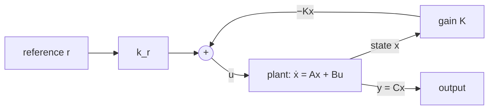

The [previous entry](/blog/stability-and-eigenvalues) showed that the eigenvalues of the system matrix $A$ decide how the free response of $\dot{x} = Ax$ behaves: how fast it decays, whether it oscillates, whether it grows. Those eigenvalues belong to the physical system. This final entry of the series shows how feedback from the measured state replaces $A$ with a new matrix whose eigenvalues the designer chooses, a method called **pole placement**, and then spends as much time on what the method assumes as on how it works.

The example is the mass-spring-damper of the [state-space primer](/blog/state-space-models-primer): $m = 1$ kg, $c = 0.5$ N·s/m, $k = 4$ N/m, with the force $u$ (in newtons) as input and the displacement $q$ (in metres) as output. In state-space form, with $x = [q \;\; \dot{q}]^\top$,

$$
A = \begin{bmatrix} 0 & 1 \\ -4 & -0.5 \end{bmatrix}, \qquad
B = \begin{bmatrix} 0 \\ 1 \end{bmatrix}, \qquad
C = \begin{bmatrix} 1 & 0 \end{bmatrix}, \qquad D = 0.
$$

The previous entry found its eigenvalues at $-0.25 \pm 1.984j$: natural frequency $\omega_n = 2$ rad/s and damping ratio $\zeta = 0.125$. Pushed by a constant force, it overshoots by about 67% and takes about 15 s to settle. The goal here is a controller that makes it settle within about 1.5 s with little overshoot. Time is in seconds, and the Python examples use Python 3 and numpy (run with numpy 2.5).

## The state-feedback law

The [second entry](/blog/feedback-and-system-behavior) fed back a single output through a gain, $u = k(r - x)$. With several state variables, the natural generalization is to let the input depend on all of them:

$$
u = -Kx + k_r\,r,
$$

where $K = [k_1 \;\; k_2]$ is a row of **feedback gains**, one per state, $r$ is the reference (the desired displacement), and $k_r$ is a scalar **reference gain** treated in a later section. The minus sign is a convention: positive gains then oppose the state, as a spring or damper would.



Substituting the law into $\dot{x} = Ax + Bu$ gives the closed-loop system

$$
\dot{x} = (A - BK)\,x + Bk_r\,r.
$$

With $r = 0$ its free response is governed by the matrix $A - BK$. Choosing $K$ therefore changes the matrix whose eigenvalues, by the previous entry, decide stability, decay rate and damping. For the example,

$$
A - BK = \begin{bmatrix} 0 & 1 \\ -4 - k_1 & -0.5 - k_2 \end{bmatrix},
\qquad
\det\bigl(sI - (A - BK)\bigr) = s^2 + (0.5 + k_2)\,s + (4 + k_1).
$$

The physical reading is direct. The gain $k_1$ on position acts like an extra spring and $k_2$ on velocity like an extra damper; the controller adds stiffness and damping that the hardware does not have.

## Can every eigenvalue be moved? Controllability

The example shows that $k_1$ and $k_2$ set the two coefficients of the characteristic polynomial independently, so any pair of closed-loop eigenvalues (real, or a complex-conjugate pair) can be reached. That is not true of every system. The [previous entry](/blog/stability-and-eigenvalues) gave an example with a mode the input cannot affect: no feedback can move that eigenvalue, because the input never reaches the mode.

The general condition is **controllability**, defined in the previous entry as the ability of the input to steer the state anywhere in finite time. For a linear time-invariant system with $n$ states and a single input it has a simple test. Form the **controllability matrix**

$$
\mathcal{C} = \begin{bmatrix} B & AB & A^2B & \cdots & A^{n-1}B \end{bmatrix}.
$$

The system is controllable if and only if $\mathcal{C}$ has rank $n$; for a single input $\mathcal{C}$ is square, so the test is $\det\mathcal{C} \neq 0$. The pole-placement theorem then states: **the eigenvalues of $A - BK$ can be placed at any set of locations (closed under complex conjugation) if and only if the system is controllable.**

For the example,

$$
AB = \begin{bmatrix} 1 \\ -0.5 \end{bmatrix}, \qquad
\mathcal{C} = \begin{bmatrix} 0 & 1 \\ 1 & -0.5 \end{bmatrix}, \qquad \det\mathcal{C} = -1 \neq 0,
$$

so the force can place both eigenvalues anywhere. The intuition behind the test: $B$ is the direction in which the input pushes the state directly, $AB$ the direction into which the dynamics carry that push an instant later, and so on. If these directions span the whole state space, the input can influence every mode.

## Choosing where the eigenvalues go

The theorem says where the eigenvalues *can* go, not where they *should*. A practical way to choose is to translate time-domain requirements into a second-order characteristic polynomial $s^2 + 2\zeta\omega_n s + \omega_n^2$ with the formulas of the [first entry](/blog/introduction-to-control-systems):

- Overshoot below about 5% needs a damping ratio of about $0.7$ or more, since $\exp(-\pi \cdot 0.7/\sqrt{1 - 0.49}) \approx 4.6\%$.
- A 2% settling time near 1.5 s needs $4/(\zeta\omega_n) \approx 1.5$, so with $\zeta = 0.7$, $\omega_n \approx 3.8$ rad/s. Take $\omega_n = 4$ rad/s, which gives $T_s \approx 1.43$ s.

The desired characteristic polynomial is therefore

$$
s^2 + 2(0.7)(4)\,s + 4^2 = s^2 + 5.6\,s + 16,
$$

with roots $-2.8 \pm 2.857j$. Matching coefficients with $s^2 + (0.5 + k_2)s + (4 + k_1)$:

$$
k_1 = 16 - 4 = 12 \text{ N/m}, \qquad k_2 = 5.6 - 0.5 = 5.1 \text{ N·s/m}.
$$

The controller adds a virtual spring of 12 N/m and a virtual damper of 5.1 N·s/m. Because the closed loop is exactly the standard second-order model with no zeros, the first entry's formulas apply exactly to it, not only as an approximation.

## Ackermann's formula

Matching coefficients by hand works for two states. For $n$ states the same calculation is packaged as **Ackermann's formula**. If $\varphi(s) = s^n + \alpha_1 s^{n-1} + \cdots + \alpha_n$ is the desired characteristic polynomial, then

$$
K = \begin{bmatrix} 0 & \cdots & 0 & 1 \end{bmatrix}\mathcal{C}^{-1}\varphi(A),
\qquad
\varphi(A) = A^n + \alpha_1 A^{n-1} + \cdots + \alpha_n I.
$$

The formula needs $\mathcal{C}^{-1}$, so it exists exactly when the system is controllable, as the theorem requires. It is short to implement:

```python
import numpy as np

def acker(A, B, poles):
    """State-feedback gain K placing the eigenvalues of A - B K (single input)."""
    n = A.shape[0]
    alpha = np.real(np.poly(poles))               # [1, a1, ..., an]
    ctrb = np.hstack([np.linalg.matrix_power(A, i) @ B for i in range(n)])
    phi = sum(a * np.linalg.matrix_power(A, n - i) for i, a in enumerate(alpha))
    last_row = np.zeros((1, n)); last_row[0, -1] = 1.0
    return last_row @ np.linalg.inv(ctrb) @ phi

A = np.array([[0.0, 1.0], [-4.0, -0.5]])
B = np.array([[0.0], [1.0]])

poles = np.roots([1.0, 5.6, 16.0])               # zeta = 0.7, wn = 4 rad/s
K = acker(A, B, poles)
print(K)                                         # [[12.   5.1]]
print(np.linalg.eigvals(A - B @ K))              # [-2.8+2.85657137j -2.8-2.85657137j]
```

This reproduces the hand calculation. Inverting $\mathcal{C}$ is numerically poor for larger or badly scaled systems, so numerical libraries use more robust algorithms for pole placement, but the result is the same gain when both succeed.

## Tracking a reference

Feedback alone moves the eigenvalues; it does not make the output go where the reference says. With $u = -Kx$ and $r = 1$ m, nothing in the loop knows about $r$. That is the job of $k_r$.

At steady state $\dot{x} = 0$, so $0 = (A - BK)\,x_{ss} + Bk_r r$, which gives $x_{ss} = -(A - BK)^{-1}Bk_r r$ and output $y_{ss} = Cx_{ss}$. Requiring $y_{ss} = r$ gives

$$
k_r = \frac{-1}{C\,(A - BK)^{-1}B}.
$$

For the example the calculation is easy to do by hand: at steady state the velocity is zero, so the second row of the closed-loop equation reads $0 = -16\,q_{ss} + k_r r$, and $q_{ss} = r$ requires $k_r = 16$ N/m. In words: the actual spring (4 N/m) plus the virtual one (12 N/m) push back with 16 N per metre, so the reference term must supply 16 N per metre of desired displacement.

A simulation of a 1 m step from rest confirms the design:

| Controller | Overshoot | 2% settling time | Largest force |
| --- | --- | --- | --- |
| Open loop, $u = 4$ N | 67.3% | 14.7 s | 4 N |
| State feedback, $\omega_n = 4$ rad/s | 4.6% | 1.49 s | 16 N |

(Settling times are from an explicit Euler simulation with a 0.1 ms step; the 4.6% overshoot matches the formula, and the 1.49 s settling time is close to the estimate of 1.43 s.)

### The weakness of a reference gain

The formula for $k_r$ uses the model. If the real spring is stiffer than the model says, the steady state is wrong. With a true stiffness of 5 N/m instead of 4, the steady-state equation becomes $0 = -(5 + 12)\,q_{ss} + 16\,r$, so $q_{ss} = 16/17 \approx 0.941$ m: an offset of 5.9%. This is the same behavior as the proportional loop of the [second entry](/blog/feedback-and-system-behavior), which settled short of its reference because it had nothing to hold the input at the required value. The cure is also the one that entry pointed to: an integrator.

### Integral action

Add a state that integrates the tracking error,

$$
\dot{x}_I = y - r = Cx - r,
$$

and feed it back too: $u = -Kx - k_I\,x_I$. In steady state $\dot{x}_I = 0$, which forces $y = r$ exactly, whatever the true stiffness, as long as the closed loop is stable. The augmented system has three states, $[q \;\; \dot{q} \;\; x_I]^\top$, with

$$
A_a = \begin{bmatrix} A & 0 \\ C & 0 \end{bmatrix}, \qquad
B_a = \begin{bmatrix} B \\ 0 \end{bmatrix},
$$

and the same pole-placement method applies to it (the augmented system is controllable here; it would not be if the plant had a zero at $s = 0$). Keeping the two eigenvalues already chosen and adding a third at $-4$ gives the desired polynomial $(s^2 + 5.6s + 16)(s + 4) = s^3 + 9.6s^2 + 38.4s + 64$. The closed-loop characteristic polynomial is $s^3 + (0.5 + k_2)s^2 + (4 + k_1)s + k_I$, so

$$
k_1 = 34.4 \text{ N/m}, \qquad k_2 = 9.1 \text{ N·s/m}, \qquad k_I = 64 \text{ N/(m·s)}.
$$

`acker(A_a, B_a, poles)` returns the same values. Simulated, with no reference gain at all, the integral design settles at $q = 1.000$ m both for the nominal stiffness and for a stiffness of 5 N/m, with a peak of 1.015 m and 1.006 m respectively. The price is a third state to implement and a slightly slower approach, because the integrator has to build up the force that the reference gain previously supplied at once.

## What the design assumes

Pole placement can put the eigenvalues anywhere. Every assumption behind that statement is a way the design can fail in practice, and they are worth listing explicitly.

### The model is right, and linear

The gains are computed from $A$ and $B$. A model error moves the closed-loop eigenvalues away from where they were placed, and the previous entry's sections on marginal stability and transient growth apply to the result. Integral action protects the steady state against constant errors but not the dynamics. If the model is a linearization (a pendulum, a robot arm), the design is valid only near the operating point, and the closed loop must keep the state there.

### The actuator can deliver what the gains demand

Faster eigenvalues need larger gains. For this plant, at the instant of a step from rest the state is zero and the force is $u(0) = k_r r$. With the damping ratio fixed, $k_r = \omega_n^2$ (in N/m, with $m = 1$ kg), so doubling the speed quadruples the force:

| $\omega_n$ (rad/s) | $K$ | $k_r$ | Force at the step for $r = 1$ m | Settling time |
| --- | --- | --- | --- | --- |
| 2 | $[0 \;\; 2.3]$ | 4 | 4 N | 2.9 s |
| 4 | $[12 \;\; 5.1]$ | 16 | 16 N | 1.4 s |
| 8 | $[60 \;\; 10.7]$ | 64 | 64 N | 0.71 s |

(Settling times here are the estimate $4/(\zeta\omega_n)$ with $\zeta = 0.7$.) A real actuator has a maximum force. When the controller asks for more, the actuator **saturates** and the loop is no longer linear: for the $\omega_n = 8$ design limited to 10 N, the simulated settling time grows from 0.75 s to 0.90 s. In this plant the effect is mild, but with integral action saturation causes **integrator windup**: the integrator keeps accumulating error while the actuator cannot respond, and the stored error later produces a large overshoot. Practical controllers limit or stop the integrator while the actuator saturates.

### Every state is measured, without noise

The law $u = -Kx$ needs the whole state. Here that means both position and velocity; often only some states are measured. The standard remedy is an **observer**: a simulation of the model that runs alongside the plant and is corrected by the measured output,

$$
\dot{\hat{x}} = A\hat{x} + Bu + L\,(y - C\hat{x}),
$$

where $\hat{x}$ is the estimate of the state and $L$ is the observer gain. The estimation error $e = x - \hat{x}$ obeys $\dot{e} = (A - LC)\,e$, so $L$ is chosen, by the same pole-placement method applied to $A^\top$ and $C^\top$, to make that error decay quickly. That works exactly when the system is **observable**, the property defined in the previous entry. For the example, measuring only position and placing both observer eigenvalues at $-10$ gives $L = [19.5 \;\; 86.25]^\top$. The **separation principle** states that, for a linear model with no uncertainty, the closed-loop eigenvalues of the combined controller and observer are those of $A - BK$ together with those of $A - LC$, so the two can be designed separately. When the measurements are noisy and their statistics are known, the Kalman filter, introduced in the robotics series entry on [sensing and state estimation](/blog/sensing-and-state-estimation), chooses $L$ to balance trusting the model against trusting the sensor.

Noise is the other side of the gain question. Every measured state is multiplied by its gain on the way to the actuator, so large gains turn sensor noise into actuator noise. The velocity gain of 10.7 N·s/m in the fastest design above multiplies any noise on a differentiated position signal.

### The controller runs in continuous time

A digital controller computes $u$ only at sampling instants and holds it in between. If the sampling period is small compared with the fastest closed-loop time constant, the continuous design works almost unchanged. If not, the sample-and-hold adds delay that erodes damping, and the design should be done directly on the discrete-time model $x[k+1] = A_d x[k] + B_d u[k]$ of the previous entry, where pole placement works in the same way with targets inside the unit circle.

### Placing poles is not the only choice

Pole placement asks the designer to choose eigenvalues and gives no direct handle on actuator effort or noise. The **linear-quadratic regulator** (LQR) instead chooses $K$ to minimize a weighted sum of state deviation and control effort, which makes the trade-off explicit; its gains come from a matrix Riccati equation that is beyond this series. Either way, the eigenvalues of the closed loop are the result to check.

## Exercises

1. For the example plant, find $K$ and $k_r$ that place the closed-loop eigenvalues at $-3$ and $-5$ (no overshoot). What force does the controller apply at the instant of a 1 m step from rest?

<details>
<summary>Answer</summary>

The desired polynomial is $(s + 3)(s + 5) = s^2 + 8s + 15$, so $k_2 = 8 - 0.5 = 7.5$ N·s/m and $k_1 = 15 - 4 = 11$ N/m. The total stiffness is $4 + 11 = 15$ N/m, so $k_r = 15$ N/m and $u(0) = 15$ N.

</details>

2. A system has $A = \begin{bmatrix} -1 & 0 \\ 0 & -2 \end{bmatrix}$ and $B = \begin{bmatrix} 1 \\ 0 \end{bmatrix}$. Is it controllable? Which eigenvalue can state feedback move?

<details>
<summary>Answer</summary>

$AB = [-1 \;\; 0]^\top$, so $\mathcal{C} = \begin{bmatrix} 1 & -1 \\ 0 & 0 \end{bmatrix}$ has rank 1: not controllable. The input reaches only the first state, so only the eigenvalue $-1$ can be moved; $-2$ stays where it is (which is acceptable, because it is stable: such a system is called stabilizable).

</details>

3. With the $\omega_n = 4$ design and the reference gain $k_r = 16$, what is the steady-state displacement if the true stiffness is 3 N/m instead of 4? Would the integral design have the same problem?

<details>
<summary>Answer</summary>

$q_{ss} = 16/(3 + 12)\,r = 1.067$ m, an overshoot of the target by 6.7% in steady state. The integral design settles at exactly $r$, provided the closed loop stays stable with the changed stiffness.

</details>

4. Verify the integral-action gains by expanding $\det(sI - (A_a - B_a K_a))$ with $K_a = [k_1 \;\; k_2 \;\; k_I]$, and confirm with `acker`.

<details>
<summary>Answer</summary>

The closed-loop matrix has rows $[0, 1, 0]$, $[-4 - k_1, -0.5 - k_2, -k_I]$, $[1, 0, 0]$. Its characteristic polynomial is $s^3 + (0.5 + k_2)s^2 + (4 + k_1)s + k_I$. Matching $s^3 + 9.6s^2 + 38.4s + 64$ gives $k_2 = 9.1$, $k_1 = 34.4$, $k_I = 64$. In numpy, build $A_a$ and $B_a$ with `np.block` and call `acker(Aa, Ba, np.roots([1, 9.6, 38.4, 64]))`.

</details>

## Summary

| Question | Answer |
| --- | --- |
| What does state feedback do? | $u = -Kx + k_r r$ replaces $A$ by $A - BK$, whose eigenvalues the designer chooses. |
| When can every eigenvalue be placed? | Exactly when the system is controllable: $\mathcal{C} = [B \; AB \; \cdots \; A^{n-1}B]$ has rank $n$. |
| How are the target eigenvalues chosen? | From requirements, e.g. $\zeta \approx 0.7$ for under 5% overshoot and $\omega_n$ from the settling time $4/(\zeta\omega_n)$. |
| How is $K$ computed? | By matching coefficients, or with Ackermann's formula $K = [0 \cdots 0\;1]\,\mathcal{C}^{-1}\varphi(A)$. |
| How is the output made to track $r$? | A reference gain $k_r = -1/(C(A - BK)^{-1}B)$, which relies on the model, or integral action, which does not. |
| What does the design assume? | An accurate linear model, an actuator that can deliver the force, full and noise-free state measurement, and fast enough sampling. |
| What if not every state is measured? | Use an observer with gain $L$ placing the eigenvalues of $A - LC$; this needs observability. |

## Where the series ends

The five entries of this series follow one line of thought. The [first](/blog/introduction-to-control-systems) set out the loop and the performance measures; the [second](/blog/feedback-and-system-behavior) showed what proportional feedback does to a first-order system; the [third](/blog/state-space-models-primer) introduced the state-space form; the [fourth](/blog/stability-and-eigenvalues) connected eigenvalues to stability and transient behavior; and this one used feedback to choose those eigenvalues. The recurring theme is the one stated at the end of the second entry: what feedback can achieve on paper is limited in practice by delay, saturation, noise and the accuracy of the model, and a good design states those limits alongside its gains.

### References

- K. J. Åström and R. M. Murray, *Feedback Systems: An Introduction for Scientists and Engineers*, 2nd edition, Princeton University Press, 2021.
- G. F. Franklin, J. D. Powell and A. Emami-Naeini, *Feedback Control of Dynamic Systems*, 8th edition, Pearson, 2019.
- K. Ogata, *Modern Control Engineering*, 5th edition, Prentice Hall, 2010.
- C.-T. Chen, *Linear System Theory and Design*, 4th edition, Oxford University Press, 2013.
- J. Ackermann, "Der Entwurf linearer Regelungssysteme im Zustandsraum", *Regelungstechnik und Prozessdatenverarbeitung*, vol. 20, pp. 297–300, 1972.
