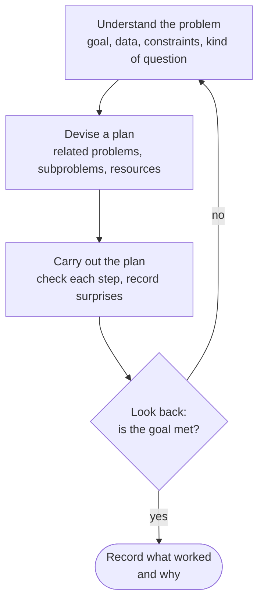
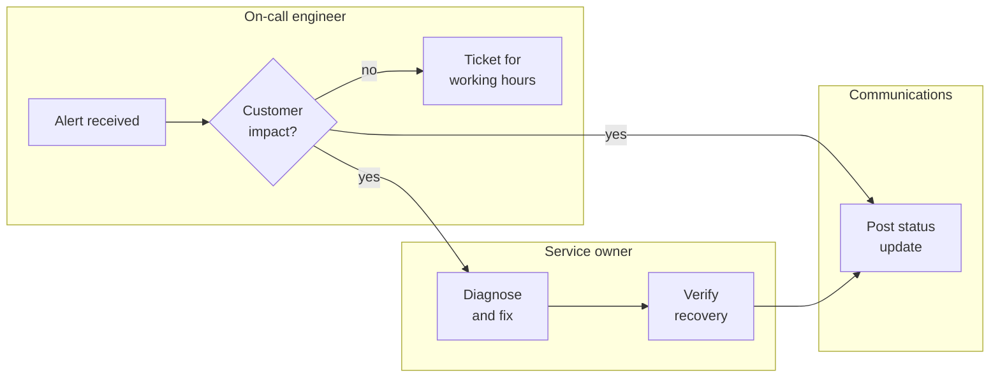
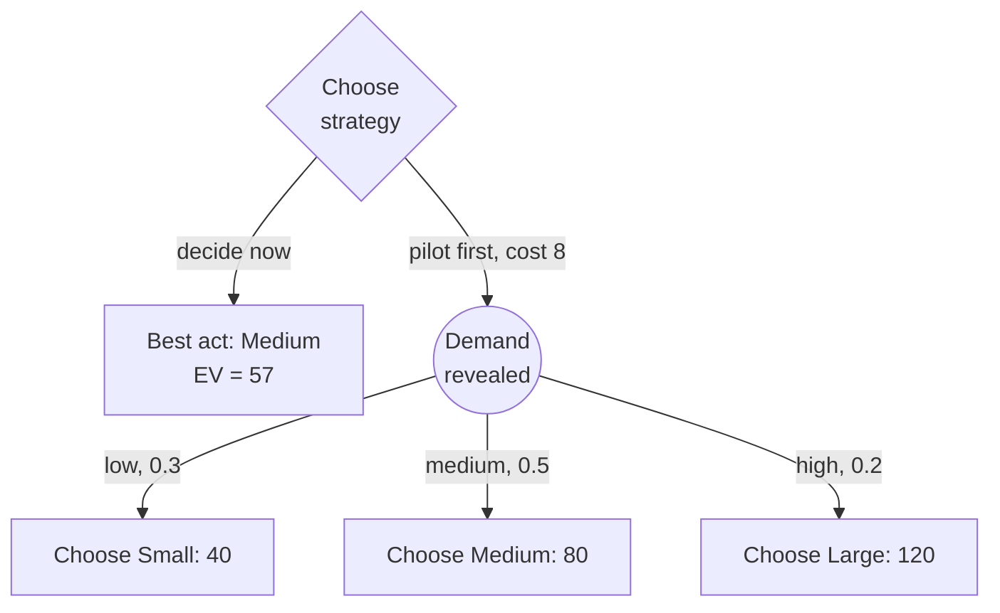

import Figure from '../../components/Figure.astro';
import CtStratSwot from '../../components/diagrams/CtStratSwot.astro';
import CtStratSensitivity from '../../components/diagrams/CtStratSensitivity.astro';

The [previous entry](/blog/reasoning-about-values) asked how to reason about what we ought to want and what we may not do to get it. This entry takes goals and constraints as given and asks how to pursue them well. **Strategic thinking** is the use of systematic methods to plan, solve problems and make decisions, as opposed to reacting to each situation as it comes. It draws on almost everything earlier in the series: clear definitions from the [second entry](/blog/meaning-clarity-and-definitions), causal reasoning from the [eighth](/blog/scientific-reasoning-and-causation), and probability and expected value from the [ninth](/blog/probability-and-statistical-reasoning).

The entry follows a decision from start to finish. Section 1 shows how to define a problem and classify the questions it contains. Section 2 presents a general problem-solving cycle and the use of decomposition and flowcharts. Section 3 introduces two tools for analyzing a situation: the analysis of strengths, weaknesses, opportunities and threats (SWOT) and the 7-S framework. Section 4 asks what makes a decision good, and Sections 5 to 7 build up methods for choosing: weighted criteria, rules for decisions under uncertainty, and expected value with sensitivity analysis and decision trees. All the numbers are illustrative and were computed with Python 3; money is in thousands of dollars.

## 1. Defining and classifying the problem

### 1.1 Framing the problem

Exam problems arrive well defined. Real ones rarely do, and the way a problem is stated steers the search for solutions. Suppose a team says "our continuous-integration (CI) pipeline is too slow". Stated that way, the obvious solutions are faster machines and more parallel jobs. Restated as "developers wait too long for feedback on their changes", the problem admits other solutions: running the fast tests first, testing only the modules a change touches, or giving feedback locally before a push. Restated again as "merges are delayed", it may turn out that the wait is for human review, not for the pipeline at all. Writing down two or three framings of a problem before choosing one is cheap and often decisive.

Three checks make a framing usable:

- **Is the goal specific?** "Faster CI" cannot be met or missed. "Median time from push to test result under 10 minutes for 90% of pushes" can, and it tells the team whether a proposed fix is enough.
- **Is the problem real?** Before investing in a fix, gather data: a log of pipeline durations over several weeks shows whether the slowdown is real, how large it is and when it occurs. The complaint may come from a few memorable bad days.
- **What are the constraints?** Budget, time, staff and what must not change (a regulated test suite, say) limit the set of acceptable solutions and should be stated at the start.

### 1.2 Three kinds of question

Most problems contain questions of three kinds, and each kind is answered by a different method.

- An **empirical question** asks about facts and causes in the world: "Does caching the dependency downloads shorten the pipeline?" It is answered by observation and experiment, the methods of the eighth and ninth entries.
- A **conceptual question** asks about meanings and logical relations: "Does a flaky test count as a failing test under our release policy?" It is answered by analyzing definitions and reasoning from them, as in the second entry.
- An **evaluative question** asks what is good, right or worth doing: "Should we accept a slower pipeline in exchange for broader test coverage?" It needs the methods of the tenth entry, and usually empirical premises as well.

Conceptual questions come first, because neither of the other kinds can be answered until its terms are clear: no experiment shows whether flaky tests block releases if nobody has decided what "failing" means. Empirical questions can usually be answered without settling evaluative ones, but not the reverse; an evaluative question about the pipeline needs facts about what each option costs and gains. Arguments stall when one kind of question is treated as another, for instance when a team runs benchmarks to settle what is in fact a disagreement about priorities.

## 2. Solving problems

### 2.1 A general problem-solving cycle

Pólya's *How to Solve It*, written about mathematical problems, divides problem solving into four phases: understand the problem, devise a plan, carry out the plan, and look back. The phases apply well beyond mathematics.

*Understanding* includes the framing and classification of Section 1. It also asks whether the problem, or one like it, has been solved before. *Devising a plan* includes estimating time and resources and writing the plan down when it has many steps. *Carrying it out* includes checking progress against the plan and recording deviations. *Looking back* is the phase most often skipped. A team that never reviews why a fix worked or failed learns only by accident; a short review after each significant problem (often called a retrospective or a post-incident review) turns experience into method.

### 2.2 Decomposition

Complex problems become tractable when broken into parts. A **system** can be decomposed into components and the interactions between them: a mobile robot into sensing, localization, planning, control and actuation, each with its own inputs and outputs. A **process** can be decomposed into steps that turn inputs into outputs: an order-fulfillment process into order intake, picking, packing and shipping. Each part can then be decomposed again until the parts are small enough to understand, measure and improve one at a time. Decomposition works when the parts interact through few, well-defined interfaces; when every part affects every other, analyzing one at a time can mislead, and the system has to be studied as a whole, as the [eighth entry](/blog/scientific-reasoning-and-causation) does for causal networks.

### 2.3 Flowcharts

A **flowchart** draws a process as boxes for steps, diamonds for decisions and arrows for the order between them. Flowcharts began as a way to describe computer programs, and the conventional symbols are standardized in ISO 5807. A flowchart serves two purposes: to analyze an existing process (where are the delays, the duplicated work, the steps without an owner?) and to define a new one before it is put in place.

A variant that is useful in planning divides the chart into columns, one for each party responsible, so that every step sits in the column of whoever performs it. Such a **swimlane** (or deployment) **flowchart** shows at a glance where work passes from one party to another, which is where delays and misunderstandings tend to arise.

Reading this incident-handling chart raises the questions a flowchart review should ask. What happens if the service owner cannot be reached? Who decides that recovery is complete? Is there a step after the final status update, such as the post-incident review of Section 2.1? A missing arrow on a flowchart is often a missing responsibility in the organization.

## 3. Analyzing a situation

### 3.1 SWOT analysis

A SWOT analysis lists the **strengths**, **weaknesses**, **opportunities** and **threats** of an organization, product, project or person with respect to a goal. Strengths and weaknesses are internal: features of the entity itself, which it can change. Opportunities and threats are external: features of its environment, which it must respond to but cannot control. The four lists are arranged in a two-by-two grid.

<Figure caption="A SWOT grid for a hypothetical five-person startup whose goal is to sell warehouse robots to mid-sized logistics firms. Read across a row to compare helpful and harmful factors of the same kind; read down a column to see how internal factors meet external ones.">
  <CtStratSwot />
</Figure>

The grid is only the start of the analysis. Its value comes from pairing cells. A strength that meets an opportunity suggests a move: the in-house navigation stack and the integrator looking for a partner suggest a partnership offer. A weakness that meets a threat marks a priority risk: with a large vendor entering the segment, depending on a single firmware engineer is a risk that should be reduced before anything else. Two errors are common. The first is misclassification, such as listing "the market is growing" as a strength; it is an opportunity, available to competitors too. The second is treating the grid as a finished product: four unranked lists say nothing about which factors matter most, and the analysis should end with a short list of decisions, not a longer list of observations.

### 3.2 The 7-S framework

The **7-S framework**, developed by Waterman, Peters and Phillips at the consulting firm McKinsey, checks whether an organization is aligned with what it is trying to do. It names seven interdependent elements:

- **Strategy**: the plan for reaching the goal, with its stages and timeline.
- **Structure**: who reports to whom and who is responsible for what.
- **Systems**: the procedures and tools through which work gets done, from budgeting to the CI pipeline.
- **Shared values**: the beliefs and priorities that the members hold in common.
- **Style**: how leaders behave and how decisions are made in practice.
- **Staff**: the people, their number and how they are recruited and developed.
- **Skills**: what the organization as a whole is good at.

The framework's main claim is that the elements must fit each other: a strategy of shipping safety-certified robots will fail if the systems have no test process for hardware, or if the style rewards speed over care. It applies on a smaller scale too. A student planning a thesis can ask the same seven questions about the plan, the supervision arrangements, the tools, the priorities, the working habits, the people available for help and the skills still to be learned.

## 4. What makes a decision good

### 4.1 Process and outcome

A good decision is not the same as a good outcome. An engineer who deploys an untested change on a Friday evening and has no incident made a poor decision with a lucky outcome; one who follows a careful release process and is hit by a hardware failure in the data center made a good decision with an unlucky outcome. Judging decisions by their outcomes, known as **outcome bias**, has been demonstrated experimentally: Baron and Hershey found that people rated the same medical decision as better when it happened to turn out well. Outcomes depend partly on chance. The only part of a decision under the decision maker's control is the process: what information was gathered, what options were considered and how they were compared. A better process makes good outcomes more likely over many decisions, which is the most anyone can promise.

### 4.2 Intuition, emotion and deliberation

Should one "trust one's gut" or deliberate? The evidence supports neither extreme. Damasio described patients with damage to frontal brain regions involved in emotion who could still reason about the options in a decision yet had great difficulty reaching decisions in daily life. Emotion appears to play a part in reaching a decision at all, not only in distorting it. On the other hand, intuitive judgments are often unreliable. Kahneman and Klein, starting from opposed research traditions, agreed on when intuition can be trusted: when the environment is regular enough to be predictable and the person has had long practice with quick, clear feedback. An experienced on-call engineer's sense that "this alert is noise" may meet both conditions; a manager's hunch about a market they have never worked in meets neither.

Feelings also carry information that belongs in a decision. If a team dreads working with a particular tool, that dread is a cost even if it does not appear in any benchmark. The methods below do not replace judgment; they lay out its inputs so that each can be examined.

## 5. Pros, cons and weighted criteria

### 5.1 Franklin's method

In a letter of 1772 to the chemist Joseph Priestley, Benjamin Franklin described a method he called "moral or prudential algebra". He listed the reasons for and against a course of action in two columns over several days, so that reasons occurring to him at different times would be in view together. He then struck out reasons of equal weight on opposite sides, one against one or two against three, until it was clear where the balance lay.

The method has three merits worth keeping. It spreads the deliberation over time, so the list is not limited to the reasons that happen to be salient in one sitting. It weights reasons instead of counting them: five minor advantages need not outweigh one serious disadvantage. And it leaves a written record, which can be reviewed later to see whether one's decisions show a consistent bias.

### 5.2 A weighted decision matrix

A **weighted decision matrix** makes Franklin's weighting explicit and extends it to more than two options. Each criterion receives a weight (the weights sum to 1), each option a score on each criterion, and the option's total is the weighted sum of its scores.

A team must choose a microcontroller board for a battery-powered sensor node. It scores three candidate boards from 1 (poor) to 5 (excellent) on five criteria:

| Criterion | Weight | Board A | Board B | Board C |
|---|---:|---:|---:|---:|
| Unit cost | 0.15 | 5 | 3 | 5 |
| Power draw | 0.30 | 2 | 5 | 4 |
| Toolchain maturity | 0.20 | 4 | 3 | 2 |
| Team familiarity | 0.15 | 5 | 2 | 3 |
| Supply risk | 0.20 | 3 | 4 | 4 |
| **Unweighted sum** | | 19 | 17 | 18 |
| **Weighted total** | | 3.50 | 3.65 | 3.60 |

Counting points favors board A; weighting favors board B, because the node runs on a battery and power draw carries the largest weight. The matrix has done its job: it shows that the decision turns on how much power draw matters compared with familiarity.

### 5.3 Sensitivity to the weights

The weights are judgments, so the result should be tested against reasonable changes in them. Move weight $d$ from power draw to team familiarity. Board A's total rises by $(5-2)d = 3d$ and board B's falls by $(5-2)d = 3d$, so the gap of 0.15 closes when $6d = 0.15$, that is at $d = 0.025$. A shift of two and a half percentage points reverses the choice. A result that fragile is not a finding; it says the boards are close on the stated criteria and that something else should decide, such as a prototype measurement of power draw or a criterion not yet listed. When a small change of weights does not change the winner, the matrix supports the decision; when it does, the matrix has located the judgment that must be made with care.

## 6. Decisions under uncertainty

### 6.1 The payoff table

Formal **decision theory** studies choices among mutually exclusive **acts** whose results depend on which **state** of the world obtains, a state the decision maker cannot control. The basic tool is the **payoff table**, which gives the result of each act in each state. Decision theory distinguishes **decisions under uncertainty**, where no probabilities are assigned to the states, from **decisions under risk**, where they are.

A team launching a new online service must choose how much server capacity to commit to for the first year: small, medium or large. First-year demand may turn out low, medium or high. The table gives the estimated profit in each case. Too little capacity loses customers when demand is high; too much wastes money when demand is low.

| Act | Low demand | Medium demand | High demand |
|---|---:|---:|---:|
| Small | 40 | 50 | 30 |
| Medium | 10 | 80 | 70 |
| Large | −30 | 60 | 120 |

No act **dominates** another, meaning that none is at least as good in every state and better in some. If one did, the dominated act could be dropped without further thought. Since none does, a decision rule is needed.

### 6.2 Rules that use no probabilities

Four classic rules apply when probabilities are not available.

- **Maximin** looks at each act's worst result and chooses the act whose worst is best. The worst results are 30, 10 and −30, so maximin chooses Small. It is the rule of a cautious decision maker, sensible when the worst case would be ruinous.
- **Maximax** looks at each act's best result and chooses the best of the bests: 50, 80 and 120, so Large. It is the rule of an optimist and ignores everything that could go wrong.
- **Minimax regret** works with the **regret** of an act in a state, the difference between the best payoff available in that state and the payoff of the act chosen: $r(a, s) = \max_{a'} v(a', s) - v(a, s)$, where $v(a, s)$ is the payoff of act $a$ in state $s$. The rule chooses the act whose largest regret is smallest.
- The **equal-likelihood rule** (also called Laplace's rule) treats all states as equally probable and chooses the act with the highest average payoff: $40$, $53.3$ and $50$, so Medium.

The column maxima are 40, 80 and 120, so the regret table is:

| Act | Low demand | Medium demand | High demand | Largest regret |
|---|---:|---:|---:|---:|
| Small | 0 | 30 | 90 | 90 |
| Medium | 30 | 0 | 50 | 50 |
| Large | 70 | 20 | 0 | 70 |

Minimax regret chooses Medium. The three main rules give three different answers from the same table, and none of them is "correct" independently of the decision maker's situation. Maximin suits a firm that would not survive a large loss; maximax suits almost nobody; minimax regret suits someone who wants to limit how far, in hindsight, the choice could fall short of the best available. Choosing the rule is itself a decision about attitude to risk and should be made explicitly. Each rule also has a known defect. Maximin and maximax look at one column per act and ignore the rest. Minimax regret can change its choice between two acts when a third, irrelevant act is added to the table, because the new act can change the column maxima.

## 7. Decisions under risk

### 7.1 Expected value

When probabilities can be assigned to the states, the standard rule is to choose the act with the highest **expected value** (introduced in the [ninth entry](/blog/probability-and-statistical-reasoning)):

$$
\mathrm{EV}(a) = \sum_{i} p_i \, v(a, s_i),
$$

where $p_i$ is the probability of state $s_i$. Suppose market research gives probabilities 0.3, 0.5 and 0.2 to low, medium and high demand. Then:

| Act | Calculation | Expected value |
|---|---|---:|
| Small | $0.3 \times 40 + 0.5 \times 50 + 0.2 \times 30$ | 43 |
| Medium | $0.3 \times 10 + 0.5 \times 80 + 0.2 \times 70$ | 57 |
| Large | $0.3 \times (-30) + 0.5 \times 60 + 0.2 \times 120$ | 45 |

Medium has the highest expected value. The expected value is not a payoff that will occur (no state gives 57); it is the average payoff per decision if many similar decisions were made with the same probabilities.

### 7.2 Sensitivity to the probabilities

Probabilities from market research are estimates, and the decision should be tested against them as the weights were in Section 5.3. Hold the probability of low demand at 0.3 and let the probability of high demand be $q$, so that medium demand has probability $0.7 - q$. The expected values become straight lines in $q$:

$$
\mathrm{EV}_\text{Small} = 47 - 20q, \qquad \mathrm{EV}_\text{Medium} = 59 - 10q, \qquad \mathrm{EV}_\text{Large} = 33 + 60q.
$$

Large overtakes Medium when $33 + 60q > 59 - 10q$, that is when $q > 26/70 \approx 0.37$.

<Figure caption="Expected payoff of each act as the probability q of high demand varies, with the probability of low demand fixed at 0.3. Medium is best to the left of q ≈ 0.37 and Large to the right; Small is never best on this range. The team's estimate, 0.2, lies well inside Medium's region.">
  <CtStratSensitivity />
</Figure>

The figure turns a single number into a statement the team can act on: the choice of Medium is safe unless the probability of high demand is nearly twice the estimate. If the team has reason to think it might be, better information about demand is worth seeking before committing.

### 7.3 Decision trees and the value of information

How much is better information worth? Suppose a pilot launch costing 8 would reveal the demand level before the capacity decision is made. With the pilot, the team would choose the best act in each state (Small if demand is low, Medium if medium, Large if high), so its expected payoff would be $0.3 \times 40 + 0.5 \times 80 + 0.2 \times 120 = 76$, less the cost of the pilot. A **decision tree** lays the two strategies side by side, with square-cornered decision points and rounded chance points:

The tree is evaluated from the leaves back to the root: the chance node is worth $76$, the pilot branch $76 - 8 = 68$, and the decide-now branch 57, so running the pilot is better. The difference $76 - 57 = 19$ is the **expected value of perfect information** (EVPI), the most it is worth paying for information that removes all uncertainty about the state. Any pilot costing more than 19 is not worth running, however informative. EVPI also equals the expected regret of the best act, here $0.3 \times 30 + 0.5 \times 0 + 0.2 \times 50 = 19$. Real pilots give imperfect information, and valuing them needs the Bayesian updating of the [ninth entry](/blog/probability-and-statistical-reasoning); EVPI is an upper bound on what any such information is worth.

### 7.4 Limits of expected value

Expected value is the right criterion under conditions that are easy to forget.

- **Attitude to risk.** Maximizing expected money ignores that a loss of 30 may matter more than a gain of 30, for instance when it would exhaust a small firm's cash. Von Neumann and Morgenstern showed that a decision maker whose preferences satisfy certain consistency axioms acts as if maximizing the expected value of a **utility function**, which can be concave to express risk aversion. Replacing payoffs by utilities keeps the method and changes the numbers.
- **Independence of acts and states.** The analysis assumes that the probabilities of the states do not depend on the act. That can fail: choosing Small capacity may cause outages that drive customers away, making low demand more likely. When the act influences the state, the probabilities must be conditional on the act.
- **One-off decisions.** The long-run interpretation of expected value is weakest for decisions made once, with large stakes. A small chance of catastrophe deserves attention that its contribution to an average does not show.
- **The table itself.** Every number in the table is an estimate, and the most dangerous error is a state that was never listed. The sensitivity analyses of Sections 5.3 and 7.2 test the numbers that are there; only careful problem definition (Section 1) and an honest SWOT (Section 3.1) help with the ones that are missing.

## 8. Exercises

**Exercise 1.** Classify each question as empirical, conceptual or evaluative. (a) Does enabling compression reduce the median response time of the API? (b) Under our service-level agreement, does a 5-minute outage during a maintenance window count as downtime? (c) Should engineers be paged at night for alerts that do not affect customers?

*Answer.* (a) Empirical; measure it. (b) Conceptual; it depends on how the agreement defines downtime and maintenance windows. (c) Evaluative, with empirical parts: how often such alerts occur and what they cost in sleep and in missed problems.

**Exercise 2.** A plant engineer must decide what to do with an aging pump for the next year. The costs (negative payoffs) are:

| Act | Pump survives the year | Pump fails |
|---|---:|---:|
| Overhaul now | −12 | −30 |
| Replace now | −25 | −25 |
| Run as is | 0 | −60 |

Which act does each of maximin, maximax and minimax regret choose? Which act has the highest expected value if the probability of failure is 0.4, and what is the expected value of perfect information?

*Answer.* Maximin: worst results −30, −25 and −60, so Replace. Maximax: best results −12, −25 and 0, so Run as is. Regrets (column maxima 0 and −25): Overhaul 12 and 5, Replace 25 and 0, Run as is 0 and 35; largest regrets 12, 25 and 35, so Overhaul. Expected values: Overhaul $0.6 \times (-12) + 0.4 \times (-30) = -19.2$, Replace $-25$, Run as is $0.4 \times (-60) = -24$, so Overhaul. With perfect information the engineer would run the pump if it will survive and replace it if it will fail: $0.6 \times 0 + 0.4 \times (-25) = -10$. EVPI is $-10 - (-19.2) = 9.2$.

**Exercise 3.** In the pump problem, for which probabilities of failure $q$ is running the pump as is better in expected value than overhauling it?

*Answer.* Run as is: $-60q$. Overhaul: $-12(1-q) - 30q = -12 - 18q$. Running is better when $-60q > -12 - 18q$, that is $q < 12/42 \approx 0.29$.

**Exercise 4.** In the board-selection matrix of Section 5.2, move 0.10 of weight from toolchain maturity to supply risk. Which board wins, and what does the result suggest?

*Answer.* The weights become 0.15, 0.30, 0.10, 0.15 and 0.30. Totals: A $3.40$, B $3.75$, C $3.80$, so C wins. Together with Section 5.3, the result shows that each of the three boards wins under some plausible weighting; the decision should rest on better data (measured power draw, actual supply lead times) more than on the matrix.

**Exercise 5.** A SWOT analysis for a university robotics team lists "the competition rules change next year", "our best programmer graduates in June" and "we have a well-equipped workshop". Place each item in the grid.

*Answer.* The rule change is external, so it is an opportunity or a threat depending on whether it favors the team's design; deciding which needs analysis, not assumption. The graduating programmer is an internal weakness for next year (the team can prepare by training others). The workshop is an internal strength.

**Exercise 6.** In the capacity problem, suppose market research instead gives probabilities 0.5, 0.3 and 0.2 to low, medium and high demand. Which act has the highest expected value, and what is the most the team should pay for a pilot that reveals demand exactly?

*Answer.* Expected values: Small $20 + 15 + 6 = 41$, Medium $5 + 24 + 14 = 43$, Large $-15 + 18 + 24 = 27$, so Medium, by a narrow margin. With perfect information: $0.5 \times 40 + 0.3 \times 80 + 0.2 \times 120 = 68$. EVPI is $68 - 43 = 25$, so the pilot is worth up to 25: more than before, because the decision is now closer.

## 9. Summary

| Topic | Main point |
|---|---|
| Problem definition | Try several framings, make the goal specific, check the problem is real and state the constraints. |
| Kinds of question | Conceptual questions come first; empirical questions need evidence; evaluative questions need values and facts. |
| Problem-solving cycle | Understand, plan, carry out, look back; the last phase is the one most often skipped. |
| SWOT and 7-S | SWOT separates internal from external factors and pays off when cells are paired; 7-S checks that strategy, structure, systems, shared values, style, staff and skills fit together. |
| Good decisions | Judge the process, not the outcome; trust intuition only where the environment is regular and feedback is quick. |
| Weighted criteria | Weight reasons rather than counting them, then test whether small changes of weight change the winner. |
| Uncertainty | Maximin, maximax, minimax regret and equal likelihood can disagree; the choice of rule expresses an attitude to risk. |
| Risk | Choose the highest expected value, test it against the probabilities, and use EVPI to bound what information is worth. |

Every method in this entry depends on judgments made under pressure, by people, and those judgments fail in recognizable ways: outcomes are mistaken for decisions, vivid cases crowd out base rates and the first framing of a problem goes unquestioned. The [next entry](/blog/fallacies-and-cognitive-biases) collects these failures, the fallacies of argument and the biases of judgment that the earlier entries met one at a time.

### References

- J. Baron and J. C. Hershey, "Outcome bias in decision evaluation," *Journal of Personality and Social Psychology*, vol. 54, no. 4, pp. 569–579, 1988.
- A. R. Damasio, *Descartes' Error: Emotion, Reason, and the Human Brain*, Putnam, 1994.
- B. Franklin, "Letter to Joseph Priestley," London, 19 September 1772.
- ISO 5807:1985, *Information processing – Documentation symbols and conventions for data, program and system flowcharts, program network charts and system resources charts*, International Organization for Standardization, 1985.
- D. Kahneman and G. Klein, "Conditions for intuitive expertise: A failure to disagree," *American Psychologist*, vol. 64, no. 6, pp. 515–526, 2009.
- J. Lau, *An Introduction to Critical Thinking and Creativity: Think More, Think Better*, Wiley, 2011.
- J. Lau and J. Chan, *Critical Thinking Web*, Department of Philosophy, The University of Hong Kong, 2004–2026. https://philosophy.hku.hk/think/
- M. Peterson, *An Introduction to Decision Theory*, Cambridge University Press, 2009.
- T. J. Peters and R. H. Waterman, *In Search of Excellence: Lessons from America's Best-Run Companies*, Harper & Row, 1982.
- G. Pólya, *How to Solve It*, Princeton University Press, 1945.
- J. von Neumann and O. Morgenstern, *Theory of Games and Economic Behavior*, Princeton University Press, 1944.
- R. H. Waterman, T. J. Peters and J. R. Phillips, "Structure is not organization," *Business Horizons*, vol. 23, no. 3, pp. 14–26, 1980.
