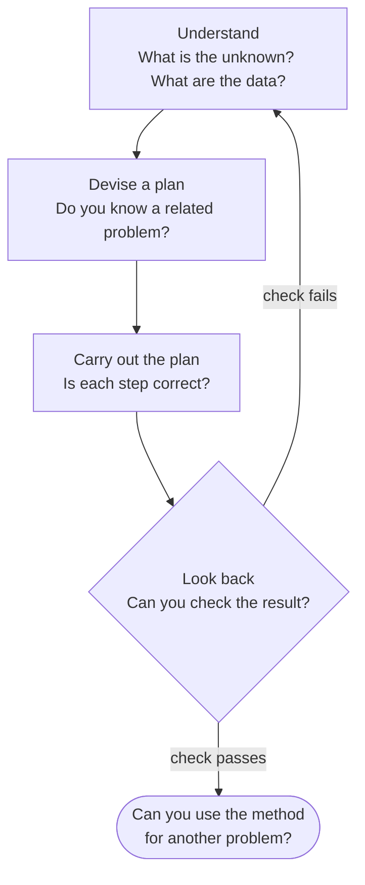
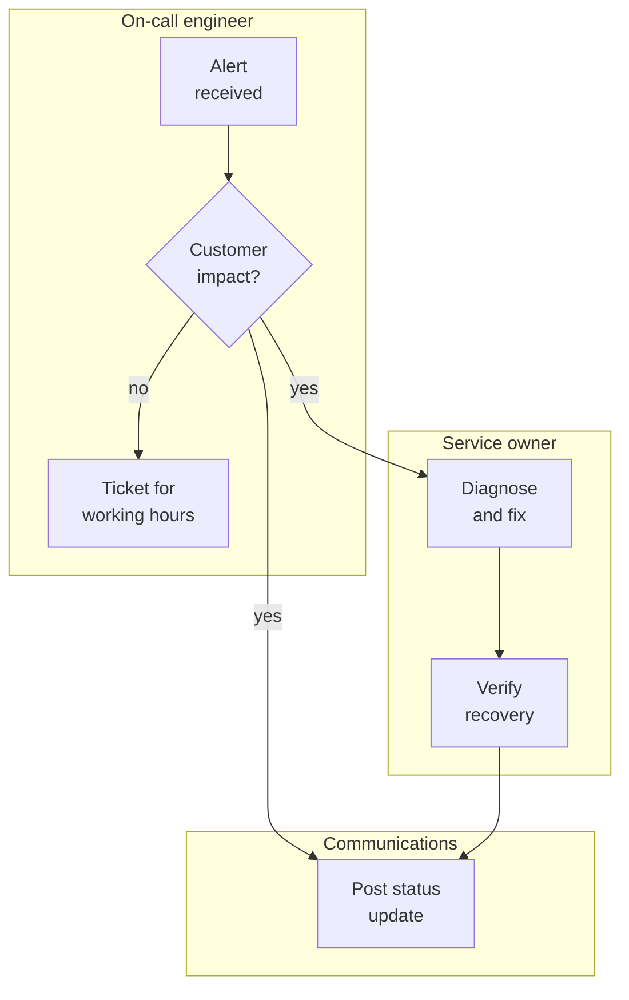
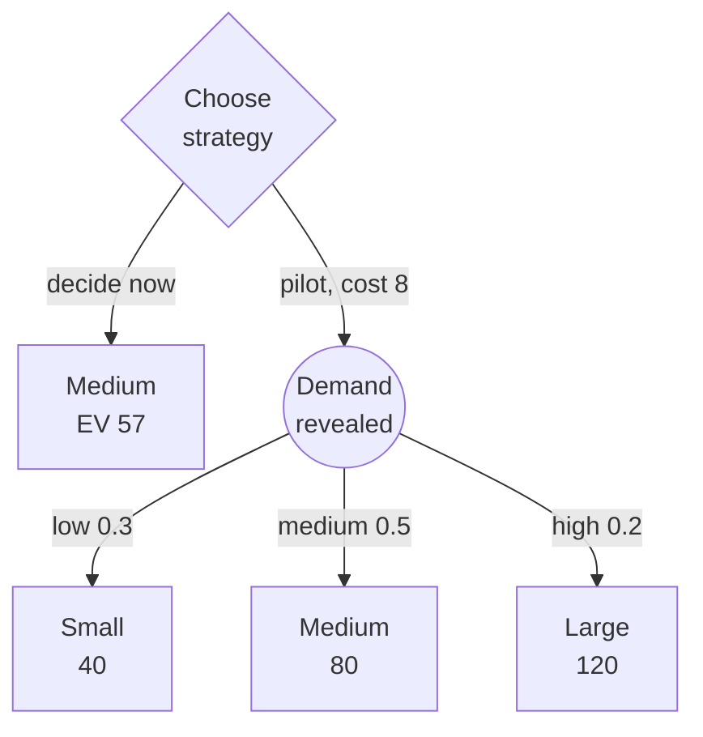

import Figure from '../../components/Figure.astro';
import CtStratSwot from '../../components/diagrams/CtStratSwot.astro';
import CtStratSensitivity from '../../components/diagrams/CtStratSensitivity.astro';

The [previous entry](/blog/reasoning-about-values) asked how to reason about what we ought to want and what we may not do to get it. This entry takes goals and constraints as given and asks how to pursue them well. In this entry, **strategic thinking** means working toward a goal by deliberate method: stating the problem precisely, surveying the situation and comparing options before committing to one, instead of reacting to each situation as it comes. It draws on almost everything earlier in the series: clear definitions from the [second entry](/blog/meaning-clarity-and-definitions), causal reasoning from the [eighth](/blog/scientific-reasoning-and-causation), and probability and expected value from the [ninth](/blog/probability-and-statistical-reasoning).

The entry follows a decision from start to finish. Section 1 shows how to define a problem and classify the questions it contains. Section 2 presents a general problem-solving cycle and the use of decomposition and flowcharts. Section 3 introduces two tools for analyzing a situation: the analysis of strengths, weaknesses, opportunities and threats (SWOT) and the 7-S framework. Section 4 asks what makes a decision good, and Sections 5 to 7 build up methods for choosing: weighted criteria, rules for decisions under uncertainty, and expected value with sensitivity analysis and decision trees. All the numbers are illustrative and were computed with Python 3; money is in thousands of dollars.

## 1. Defining and classifying the problem

### 1.1 From a complaint to a problem statement

Problems usually arrive as complaints. Suppose the developers on a team say: "the continuous-integration (CI) pipeline is too slow." A complaint names a symptom and often a favored remedy, here faster build machines. Turning it into a problem statement means asking what outcome the people complaining want, how much of it, and how anyone would know it had been achieved.

One technique is to restate the complaint at several levels of the means-end chain of the [tenth entry](/blog/reasoning-about-values) (Section 2.1). Each level opens a different set of solutions:

| Statement | Solutions it suggests |
|---|---|
| The pipeline takes too long | Faster machines, more parallel jobs, caching |
| Developers wait too long for feedback | Fastest tests first, testing only what a change touches, local checks before a push |
| Changes take too long to reach the main branch | Review queues and merge rules, not only the pipeline |
| Fixes reach users too slowly | The release process and deployment frequency |

Moving up the chain widens the search; moving down makes the goal measurable. A workable statement usually sits one or two levels above the original complaint and carries a number: "90% of pushes receive a test result within 10 minutes." The number does two jobs. It says when to stop, and it makes the complaint checkable against the pipeline's own logs. If last month's logs show that 85% of pushes already meet the target, the problem is a tail of slow runs, which calls for a different investigation from a pipeline that is slow across the board.

### 1.2 Sorting the questions inside a problem

Once stated, the CI problem breaks into questions, and they are not all of one kind. Here are three that a team might raise in its first meeting:

1. Does caching dependency downloads shorten the pipeline?
2. Does a test that fails intermittently count as "failing" under our release policy?
3. Should we accept a slower pipeline in exchange for broader test coverage?

The first is an **empirical question**: it concerns what happens in the world and is answered by measurement, with the care about causes and samples of the eighth and ninth entries. The second is a **conceptual question**: it concerns what a term in the policy means and is answered by reading, and if necessary amending, a definition, as in the [second entry](/blog/meaning-clarity-and-definitions). The third is an **evaluative question**: it asks what is worth doing and needs the methods of the tenth entry, together with answers to empirical questions about what each option costs and gains.

Sorting questions this way breaks a familiar kind of stalemate. Two engineers argue about whether flaky tests should block releases, and one proposes to settle it by measuring how often the flaky tests catch real defects. The measurement is worth having, but it cannot end the argument while the two disagree about question 2: one treats an intermittent failure as a failure, the other as noise. Once the team agrees on a definition (say, "a test that fails in two consecutive reruns"), what remains is partly empirical (how many real defects such failures catch) and partly evaluative (how much delay that is worth), and each part can go to the method that suits it.

## 2. Solving problems

### 2.1 Pólya's four phases

Pólya wrote *How to Solve It* for students of mathematics, but its four phases (understanding the problem, devising a plan, carrying out the plan and looking back) and the questions he attaches to each transfer to engineering with little change. The quoted questions below are Pólya's; the commentary applies them to the CI problem.

- **Understanding the problem.** "What is the unknown? What are the data? What is the condition?" For the CI problem the unknown is a change to the pipeline or the process, the data are the duration logs and the condition is the target of Section 1.1.
- **Devising a plan.** "Do you know a related problem?" and "Could you solve a part of the problem?" Slow pipelines are common, and other teams' remedies are the related problems. Solving a part might mean fixing the slowest stage first and measuring the gain.
- **Carrying out the plan.** "Can you see clearly that the step is correct?" Each change should be measured on its own, so that an improvement can be attributed to the change that produced it.
- **Looking back.** "Can you check the result?" and "Can you use the result, or the method, for some other problem?" Pólya stresses that this phase consolidates what has been learned. In engineering it takes the form of a written review after a project or an incident, which turns one team's solution into a related problem that the next team can start from.

### 2.2 Decomposition

A problem too large to grasp whole can often be split into parts that can be measured and improved one at a time. The CI pipeline splits naturally into stages. Suppose the logs give these median durations: checkout 1 minute, dependency installation 4, build 6, then two test shards running in parallel (9 and 5 minutes), then packaging 1. The pipeline takes $1 + 4 + 6 + \max(9, 5) + 1 = 21$ minutes.

The decomposition does more than list the parts; it shows how they combine, and that tells the team where effort pays. Halving the shorter test shard saves nothing, because the longer shard still sets the pace. Halving the longer shard saves 4 minutes, not 4.5, because the shorter one then becomes the slower of the two at 5 minutes. Caching dependencies so that installation falls from 4 minutes to half a minute saves 3.5 minutes outright. The same arithmetic of sequential stages adding and parallel stages taking the maximum applies to any pipeline, production line or approval process.

Decomposition works when the parts interact through few, well-defined interfaces. If speeding up the build made the tests slower (because a cache they share is evicted, say), the stages could no longer be improved one at a time, and the pipeline would have to be studied as a whole.

### 2.3 Flowcharts and swimlanes

A **flowchart** represents a procedure as a directed graph: boxes for actions, diamonds for decisions, rounded terminals for start and end, and arrows for the order in which control passes. ISO 5807 standardizes these symbols for data, program and system flowcharts, and the flowcharts in this series follow the same conventions.

When several people or teams share a procedure, the graph alone hides the most important fact: who performs each step. A **swimlane flowchart** (also called a deployment flowchart) adds it by drawing a band for each role and placing every step in the band of the role that performs it. The chart below describes how a team handles an alert from its monitoring system.

Every arrow that crosses from one band to another is a handover, and handovers are where incidents tend to go wrong: a message is not received, or each side believes the other is acting. Reading the chart band by band raises questions the procedure must answer. Who pages the service owner, and what happens if the owner does not respond? Who decides that recovery is complete before the status update is posted? Nothing follows the final update, so where does the written review of Section 2.1 begin? A missing arrow in a swimlane chart usually marks a missing responsibility.

## 3. Analyzing a situation

### 3.1 SWOT analysis

A SWOT analysis lists the **strengths**, **weaknesses**, **opportunities** and **threats** of an organization, product, project or person with respect to a goal. Strengths and weaknesses are internal: features of the entity itself, which it can change. Opportunities and threats are external: features of its environment, which it must respond to but cannot control. The four lists are arranged in a two-by-two grid.

<Figure caption="A SWOT grid for a hypothetical five-person startup whose goal is to sell warehouse robots to mid-sized logistics firms. Read across a row to compare helpful and harmful factors of the same kind; read down a column to see how internal factors meet external ones.">
  <CtStratSwot />
</Figure>

The grid is only the start of the analysis. Its value comes from pairing cells. A strength that meets an opportunity suggests a move: the in-house navigation stack and the integrator looking for a partner suggest a partnership offer. A weakness that meets a threat marks a priority risk: with a large vendor entering the segment, depending on a single firmware engineer is a risk that should be reduced before anything else. Two errors are common. The first is misclassification, such as listing "the market is growing" as a strength; it is an opportunity, available to competitors too. The second is treating the grid as a finished product: four unranked lists say nothing about which factors matter most, and the analysis should end with a short list of decisions, not a longer list of observations.

### 3.2 The 7-S framework

Waterman, Peters and Phillips proposed the **7-S framework** in a 1980 paper titled "Structure is not organization". Their argument, drawn from their work as consultants at McKinsey, was that redrawing reporting lines rarely changes how an organization performs, because structure is only one of seven interdependent factors, and a change to one of them fails if the others pull against it. Later presentations often divide the seven into three "hard" elements, which are written down and easy to change on paper, and four "soft" ones, which live in people and change slowly.

Applying the framework means asking, for a planned change, what each element must look like afterward and whether the others fit. The table does this for the startup of Section 3.1 if it adopts the goal of producing a certified safety case.

| Element | What it covers | Question for the safety-case goal |
|---|---|---|
| Strategy | The chosen route to the goal | Does certification come before new features this year? |
| Structure | Reporting lines and division of work | Who owns safety, and can they stop a release? |
| Systems | Procedures and tools | Does the release process include hardware tests and hazard reviews? |
| Shared values | The priorities members hold in practice | Is caution respected, or seen as slowness? |
| Style | How leaders behave and decide | Do the founders back an engineer who delays a demo over a safety issue? |
| Staff | Who is employed and how they develop | Is anyone trained in safety engineering? |
| Skills | What the organization as a whole can do | Can the team produce the evidence an assessor will expect? |

A plan that changes only the hard elements (a named owner, a new process) and leaves style and shared values untouched is the failure the original paper warned against.

## 4. What makes a decision good

### 4.1 Judging a decision by its outcome

Baron and Hershey gave subjects descriptions of decisions made under uncertainty, among them medical decisions, and varied only how they turned out. Subjects rated the same decision, made on the same information, as better when it had turned out well. This tendency is **outcome bias**, and it is a mistake whenever chance played a part, because the decision maker chose a process, not a result.

Separating the two needs a definition. Call a decision good if it used the information reasonably available, considered the realistic options and compared them by a sound method. By that definition an untested Friday-evening deployment that happened to cause no incident was a bad decision, and a careful release that was hit by a disk failure was a good one. Post-incident reviews that ask "what did we know, and what did we do with it?" rather than "who caused the outage?" apply the same distinction.

### 4.2 Intuition, emotion and deliberation

Kahneman and Klein came from research traditions with opposite attitudes to intuition: one cataloged its errors, the other studied experts such as firefighters who decide quickly and well. They agreed on two conditions under which intuitive judgment deserves trust. The environment must be regular enough to be predictable, and the person must have had long practice in it with timely feedback. An on-call engineer's sense, after years on one system, that "this alert pattern is noise" may meet both conditions. A first impression of a technology nobody on the team has used meets neither and should be treated as a hypothesis.

Deliberation does not mean leaving feeling out. Damasio described patients with damage to frontal brain regions involved in emotion who could still list and reason about the options in a decision yet had great difficulty reaching decisions in daily life; his interpretation is that emotional signals are part of how options are weighed. In practice, a team's reluctance to adopt a tool is an input to the decision, a cost that no benchmark shows. The methods of the next sections are ways of writing such inputs down so that each can be examined.

## 5. Pros, cons and weighted criteria

### 5.1 Franklin's prudential algebra

The weighted methods of this section have an ancestor in a letter Benjamin Franklin wrote to Joseph Priestley in 1772. Franklin's procedure was to "divide half a Sheet of Paper by a Line into two Columns", one for the reasons for a course of action and one for those against, and then to cancel reasons of equal weight across the columns (one against one, one against two, two against three) until the balance showed. He called it "moral or prudential algebra".

Cancellation is an equation in disguise. Striking out one reason for against two reasons against asserts that the first weighs as much as the other two together, so what survives the cancellation is the sign of a weighted sum. The weighted matrix below makes the weights explicit numbers, compares several options with each other instead of one option with doing nothing, and allows the sensitivity test of Section 5.3, which Franklin's method cannot express.

### 5.2 A weighted decision matrix

A **weighted decision matrix** makes Franklin's weighting explicit and extends it to more than two options. Each criterion receives a weight (the weights sum to 1), each option a score on each criterion, and the option's total is the weighted sum of its scores.

A team must choose a microcontroller board for a battery-powered sensor node. It scores three candidate boards from 1 (poor) to 5 (excellent) on five criteria:

| Criterion | Weight | Board A | Board B | Board C |
|---|---:|---:|---:|---:|
| Unit cost | 0.15 | 5 | 3 | 5 |
| Power draw | 0.30 | 2 | 5 | 4 |
| Toolchain maturity | 0.20 | 4 | 3 | 2 |
| Team familiarity | 0.15 | 5 | 2 | 3 |
| Supply risk | 0.20 | 3 | 4 | 4 |
| **Unweighted sum** | | 19 | 17 | 18 |
| **Weighted total** | | 3.50 | 3.65 | 3.60 |

Counting points favors board A; weighting favors board B, because the node runs on a battery and power draw carries the largest weight. The matrix has done its job: it shows that the decision turns on how much power draw matters compared with familiarity.

### 5.3 Sensitivity to the weights

The weights are judgments, so the result should be tested against reasonable changes in them. Move weight $d$ from power draw to team familiarity. Board A's total rises by $(5-2)d = 3d$ and board B's falls by $(5-2)d = 3d$, so the gap of 0.15 closes when $6d = 0.15$, that is at $d = 0.025$. A shift of two and a half percentage points reverses the choice (at exactly that shift all three boards tie at 3.575). A result that fragile is not a finding; it says the boards are close on the stated criteria and that something else should decide, such as a prototype measurement of power draw or a criterion not yet listed. When a small change of weights does not change the winner, the matrix supports the decision; when it does, the matrix has located the judgment that must be made with care.

## 6. Decisions under uncertainty

### 6.1 The payoff table

Formal **decision theory** studies choices among mutually exclusive **acts** whose results depend on which **state** of the world obtains, a state the decision maker cannot control. The basic tool is the **payoff table**, which gives the result of each act in each state. Decision theory distinguishes **decisions under uncertainty**, where the decision maker has no probabilities for the states, from **decisions under risk**, where they are.

A team launching a new online service must choose how much server capacity to commit to for the first year: small, medium or large. First-year demand may turn out low, medium or high. The table gives the estimated profit in each case. Too little capacity loses customers when demand is high; too much wastes money when demand is low.

| Act | Low demand | Medium demand | High demand |
|---|---:|---:|---:|
| Small | 40 | 50 | 30 |
| Medium | 10 | 80 | 70 |
| Large | −30 | 60 | 120 |

No act **dominates** another, meaning that none is at least as good in every state and better in some. If one did, the dominated act could be dropped without further thought. Since none does, a decision rule is needed.

### 6.2 Rules that use no probabilities

Four classic rules apply when probabilities are not available.

- **Maximin** looks at each act's worst result and chooses the act whose worst is best. The worst results are 30, 10 and −30, so maximin chooses Small. It is the rule of a cautious decision maker, sensible when the worst case would be ruinous.
- **Maximax** looks at each act's best result and chooses the best of the bests: 50, 80 and 120, so Large. It is the rule of an optimist and ignores everything that could go wrong.
- **Minimax regret** works with the **regret** of an act in a state, the difference between the best payoff available in that state and the payoff of the act chosen: $r(a, s) = \max_{a'} v(a', s) - v(a, s)$, where $v(a, s)$ is the payoff of act $a$ in state $s$. The rule chooses the act whose largest regret is smallest.
- The **equal-likelihood rule** (also called Laplace's rule) treats all states as equally probable and chooses the act with the highest average payoff: $40$, $53.3$ and $50$, so Medium.

The column maxima are 40, 80 and 120, so the regret table is:

| Act | Low demand | Medium demand | High demand | Largest regret |
|---|---:|---:|---:|---:|
| Small | 0 | 30 | 90 | 90 |
| Medium | 30 | 0 | 50 | 50 |
| Large | 70 | 20 | 0 | 70 |

Minimax regret chooses Medium. The three main rules give three different answers from the same table, and none of them is "correct" independently of the decision maker's situation. Maximin suits a firm that would not survive a large loss; maximax suits almost nobody; minimax regret suits someone who wants to limit how far, in hindsight, the choice could fall short of the best available. Choosing the rule is itself a decision about attitude to risk and should be made explicitly. Each rule also has a known defect. Maximin and maximax look at one payoff per act, its worst or its best, and ignore the rest of the row. Minimax regret can change its choice between two acts when a third, irrelevant act is added to the table, because the new act can change the column maxima.

## 7. Decisions under risk

### 7.1 Expected value

When probabilities can be assigned to the states, the standard rule is to choose the act with the highest **expected value** (introduced in the [ninth entry](/blog/probability-and-statistical-reasoning)):

$$
\mathrm{EV}(a) = \sum_{i} p_i \, v(a, s_i),
$$

where $p_i$ is the probability of state $s_i$. Suppose market research gives probabilities 0.3, 0.5 and 0.2 to low, medium and high demand. Then:

| Act | Calculation | Expected value |
|---|---|---:|
| Small | $0.3 \times 40 + 0.5 \times 50 + 0.2 \times 30$ | 43 |
| Medium | $0.3 \times 10 + 0.5 \times 80 + 0.2 \times 70$ | 57 |
| Large | $0.3 \times (-30) + 0.5 \times 60 + 0.2 \times 120$ | 45 |

Medium has the highest expected value. The expected value is not a payoff that will occur (no state gives 57); it is the average payoff per decision if many similar decisions were made with the same probabilities.

### 7.2 Sensitivity to the probabilities

Probabilities from market research are estimates, and the decision should be tested against them as the weights were in Section 5.3. Hold the probability of low demand at 0.3 and let the probability of high demand be $q$, so that medium demand has probability $0.7 - q$. The expected values become straight lines in $q$:

$$
\mathrm{EV}_\text{Small} = 47 - 20q, \qquad \mathrm{EV}_\text{Medium} = 59 - 10q, \qquad \mathrm{EV}_\text{Large} = 33 + 60q.
$$

Large overtakes Medium when $33 + 60q > 59 - 10q$, that is when $q > 26/70 \approx 0.37$.

<Figure caption="Expected payoff of each act as the probability q of high demand varies, with the probability of low demand fixed at 0.3. Medium is best to the left of q ≈ 0.37 and Large to the right; Small is never best on this range. The team's estimate, 0.2, lies well inside Medium's region.">
  <CtStratSensitivity />
</Figure>

The figure turns a single number into a statement the team can act on: the choice of Medium is safe unless the probability of high demand is nearly twice the estimate. If the team has reason to think it might be, better information about demand is worth seeking before committing.

### 7.3 Decision trees and the value of information

How much is better information worth? Suppose a pilot launch costing 8 would reveal the demand level before the capacity decision is made. With the pilot, the team would choose the best act in each state (Small if demand is low, Medium if medium, Large if high), so its expected payoff would be $0.3 \times 40 + 0.5 \times 80 + 0.2 \times 120 = 76$, less the cost of the pilot. A **decision tree** lays the two strategies side by side, with the decision drawn as a diamond (decision trees conventionally use a square) and the chance event as a circle:

The tree is evaluated from the leaves back to the root: the chance node is worth $76$, the pilot branch $76 - 8 = 68$, and the decide-now branch 57, so running the pilot is better. The difference $76 - 57 = 19$ is the **expected value of perfect information** (EVPI), the most it is worth paying for information that removes all uncertainty about the state. Any pilot costing more than 19 is not worth running, however informative. EVPI also equals the expected regret of the best act, here $0.3 \times 30 + 0.5 \times 0 + 0.2 \times 50 = 19$. Real pilots give imperfect information, and valuing them needs the Bayesian updating of the [ninth entry](/blog/probability-and-statistical-reasoning); EVPI is an upper bound on what any such information is worth.

### 7.4 Limits of expected value

Expected value is the right criterion under conditions that are easy to forget.

- **Attitude to risk.** Maximizing expected money ignores that a loss of 30 may matter more than a gain of 30, for instance when it would exhaust a small firm's cash. Von Neumann and Morgenstern showed that a decision maker whose preferences satisfy certain consistency axioms acts as if maximizing the expected value of a **utility function**, which can be concave to express risk aversion. Replacing payoffs by utilities keeps the method and changes the numbers.
- **Independence of acts and states.** The analysis assumes that the probabilities of the states do not depend on the act. That can fail: choosing Small capacity may cause outages that drive customers away, making low demand more likely. When the act influences the state, the probabilities must be conditional on the act.
- **One-off decisions.** The long-run interpretation of expected value is weakest for decisions made once, with large stakes. A small chance of catastrophe deserves attention that its contribution to an average does not show.
- **The table itself.** Every number in the table is an estimate, and the most dangerous error is a state that was never listed. The sensitivity analyses of Sections 5.3 and 7.2 test the numbers that are there; only careful problem definition (Section 1) and an honest SWOT (Section 3.1) help with the ones that are missing.

## 8. Exercises

**Exercise 1.** Classify each question as empirical, conceptual or evaluative. (a) Does enabling compression reduce the median response time of the API? (b) Under our service-level agreement, does a 5-minute outage during a maintenance window count as downtime? (c) Should engineers be paged at night for alerts that do not affect customers?

*Answer.* (a) Empirical; measure it. (b) Conceptual; it depends on how the agreement defines downtime and maintenance windows. (c) Evaluative, with empirical parts: how often such alerts occur and what they cost in sleep and in missed problems.

**Exercise 2.** A plant engineer must decide what to do with an aging pump for the next year. The costs (negative payoffs) are:

| Act | Pump survives the year | Pump fails |
|---|---:|---:|
| Overhaul now | −12 | −30 |
| Replace now | −25 | −25 |
| Run as is | 0 | −60 |

Which act does each of maximin, maximax and minimax regret choose? Which act has the highest expected value if the probability of failure is 0.4, and what is the expected value of perfect information?

*Answer.* Maximin: worst results −30, −25 and −60, so Replace. Maximax: best results −12, −25 and 0, so Run as is. Regrets (column maxima 0 and −25): Overhaul 12 and 5, Replace 25 and 0, Run as is 0 and 35; largest regrets 12, 25 and 35, so Overhaul. Expected values: Overhaul $0.6 \times (-12) + 0.4 \times (-30) = -19.2$, Replace $-25$, Run as is $0.4 \times (-60) = -24$, so Overhaul. With perfect information the engineer would run the pump if it will survive and replace it if it will fail: $0.6 \times 0 + 0.4 \times (-25) = -10$. EVPI is $-10 - (-19.2) = 9.2$.

**Exercise 3.** In the pump problem, for which probabilities of failure $q$ is running the pump as is better in expected value than overhauling it?

*Answer.* Run as is: $-60q$. Overhaul: $-12(1-q) - 30q = -12 - 18q$. Running is better when $-60q > -12 - 18q$, that is $q < 12/42 \approx 0.29$.

**Exercise 4.** In the board-selection matrix of Section 5.2, move 0.10 of weight from toolchain maturity to supply risk. Which board wins, and what does the result suggest?

*Answer.* The weights become 0.15, 0.30, 0.10, 0.15 and 0.30. Totals: A $3.40$, B $3.75$, C $3.80$, so C wins. Together with Section 5.3, the result shows that each of the three boards wins under some plausible weighting; the decision should rest on better data (measured power draw, actual supply lead times) more than on the matrix.

**Exercise 5.** A SWOT analysis for a university robotics team lists "the competition rules change next year", "our best programmer graduates in June" and "we have a well-equipped workshop". Place each item in the grid.

*Answer.* The rule change is external, so it is an opportunity or a threat depending on whether it favors the team's design; deciding which needs analysis, not assumption. The graduating programmer is an internal weakness for next year (the team can prepare by training others). The workshop is an internal strength.

**Exercise 6.** In the capacity problem, suppose market research instead gives probabilities 0.5, 0.3 and 0.2 to low, medium and high demand. Which act has the highest expected value, and what is the most the team should pay for a pilot that reveals demand exactly?

*Answer.* Expected values: Small $20 + 15 + 6 = 41$, Medium $5 + 24 + 14 = 43$, Large $-15 + 18 + 24 = 27$, so Medium, by a narrow margin. With perfect information: $0.5 \times 40 + 0.3 \times 80 + 0.2 \times 120 = 68$. EVPI is $68 - 43 = 25$, so the pilot is worth up to 25: more than before, because the decision is now closer.

## 9. Summary

| Topic | Main point |
|---|---|
| Problem definition | Restate the complaint at several levels of the means-end chain and attach a measurable target. |
| Kinds of question | Sort a problem's questions into empirical, conceptual and evaluative, and send each to the method that can answer it. |
| Pólya's phases | Understand, devise a plan, carry it out, look back, each with its own guiding questions. |
| SWOT and 7-S | SWOT separates internal from external factors and pays off when cells are paired; 7-S checks that strategy, structure, systems, shared values, style, staff and skills fit together. |
| Good decisions | Judge the process, not the outcome; trust intuition only where the environment is regular and feedback is quick. |
| Weighted criteria | Weight reasons rather than counting them, then test whether small changes of weight change the winner. |
| Uncertainty | Maximin, maximax, minimax regret and equal likelihood can disagree; the choice of rule expresses an attitude to risk. |
| Risk | Choose the highest expected value, test it against the probabilities, and use EVPI to bound what information is worth. |

Every method in this entry depends on judgments made under pressure, by people, and those judgments fail in recognizable ways: outcomes are mistaken for decisions, vivid cases crowd out base rates and the first framing of a problem goes unquestioned. The [next entry](/blog/fallacies-and-cognitive-biases) collects these failures, the fallacies of argument and the biases of judgment that the earlier entries met one at a time.

### References

- J. Baron and J. C. Hershey, "Outcome bias in decision evaluation," *Journal of Personality and Social Psychology*, vol. 54, no. 4, pp. 569–579, 1988.
- A. R. Damasio, *Descartes' Error: Emotion, Reason, and the Human Brain*, Putnam, 1994.
- B. Franklin, "Letter to Joseph Priestley," London, 19 September 1772.
- ISO 5807:1985, *Information processing – Documentation symbols and conventions for data, program and system flowcharts, program network charts and system resources charts*, International Organization for Standardization, 1985.
- D. Kahneman and G. Klein, "Conditions for intuitive expertise: A failure to disagree," *American Psychologist*, vol. 64, no. 6, pp. 515–526, 2009.
- J. Y. F. Lau, *An Introduction to Critical Thinking and Creativity: Think More, Think Better*, Wiley, 2011.
- J. Y. F. Lau and J. Chan, *Critical Thinking Web*, Department of Philosophy, The University of Hong Kong, 2004–2026. https://philosophy.hku.hk/think/
- M. Peterson, *An Introduction to Decision Theory*, Cambridge University Press, 2009.
- T. J. Peters and R. H. Waterman, *In Search of Excellence: Lessons from America's Best-Run Companies*, Harper & Row, 1982.
- G. Pólya, *How to Solve It*, Princeton University Press, 1945.
- J. von Neumann and O. Morgenstern, *Theory of Games and Economic Behavior*, Princeton University Press, 1944.
- R. H. Waterman, T. J. Peters and J. R. Phillips, "Structure is not organization," *Business Horizons*, vol. 23, no. 3, pp. 14–26, 1980.
