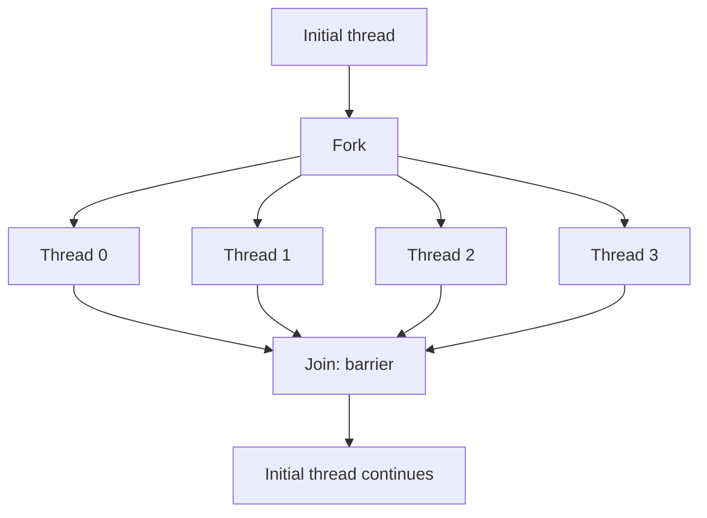

[The first entry](/blog/performance-models-and-scaling-laws) defined the measures this entry uses to judge every result: speedup $S(p) = T_1/T_p$ and efficiency $E(p) = S(p)/p$. It also derived the bound of [Amdahl's law](/blog/performance-models-and-scaling-laws#2-amdahls-law-and-strong-scaling) and the [work and span](/blog/performance-models-and-scaling-laws#4-work-span-and-parallelism) of a computation. [The second entry](/blog/memory-hierarchy-and-locality) showed that memory moves in [64-byte cache lines](/blog/memory-hierarchy-and-locality#2-how-a-cache-works) and that the [bandwidth](/blog/memory-hierarchy-and-locality#6-translation-prefetching-and-bandwidth) of main memory often limits a loop before its arithmetic does. Apart from a few four-core measurements of peak arithmetic rate and bandwidth, both entries treated one processor core. This entry puts several cores to work on one problem through threads that share one memory.

Sharing memory makes parallel code easy to start and easy to get wrong. One directive can make a loop run nearly four times faster on four cores, and the same directive on a slightly different loop can give a wrong result or a slower program without any warning. The entry first shows threads and OpenMP loops working as intended, then measures each way in which they fail: data races, writes that become visible out of order, the cost of synchronization and false sharing, and work divided unevenly among threads.

**Conventions.** The code is C11, compiled with the GNU Compiler Collection (GCC) 13.3 using `-std=c11 -O2 -fopenmp`, plus `-fno-tree-vectorize` where stated. OpenMP is the directive-based interface for shared-memory programming maintained by the OpenMP Architecture Review Board (ARB); this entry cites version 5.2 of its specification (November 2021), the version used throughout the series; a later version, 6.0, appeared in November 2024. GCC 13 reports `_OPENMP` as `201511`, which denotes version 4.5, and every construct used here exists in 4.5 with the meaning given in 5.2. Two programs use C11 atomics with the threads of the Portable Operating System Interface (POSIX). One short model is written in Python 3.13.

All measurements come from the series' reference machine, a virtual machine under the Linux Kernel-based Virtual Machine (KVM). It has four cores of an Intel Xeon processor reported at 2.1 GHz, with one hardware thread per core, and 16 GiB of memory. Each core has a 48 KiB level-1 (L1) data cache and a 2 MiB level-2 (L2) cache, and the cores share a level-3 (L3) cache that `lscpu` reports as 260 MiB. Threads are bound to cores with `OMP_PROC_BIND=close OMP_PLACES=cores`. Each time is the median of five or seven repetitions. The machine is shared with other jobs, so its timings are noisy: a difference of 10% between two runs is common, and speedups slightly above $p$ appear in some runs for that reason. The timings describe this machine only. Arithmetic rates are given in units of $10^9$ floating-point operations (FLOP) per second, written GFLOP/s, and bandwidths in gigabytes per second (GB/s), units of $10^9$ bytes per second.

## 1. Threads and shared memory

### 1.1 Processes and threads

A **process** is a running program with the resources the operating system gives it: an address space (the range of memory addresses it can use), open files and other handles. Processes do not see each other's memory unless they arrange it explicitly. A **thread** is one sequence of instructions being executed within a process; a process starts with one thread and can create more, all running in the same address space.

What the threads of one process share and what each has to itself follows from that:

| Shared by all threads of a process | Private to each thread |
|---|---|
| Global and static variables | Registers, including the program counter |
| The heap (memory from `malloc`) | The stack: local variables and return addresses |
| Program code, open files | Thread-local storage (`_Thread_local` in C11) |

A local variable is private only because other threads have no name for it. Its address lies in the shared address space, and a thread given a pointer to it can read and write it.

### 1.2 Cores and hardware threads

A **core** is the part of a processor that fetches and executes an instruction stream, with its own registers, execution units and private caches. Some cores interleave two or more instruction streams on the same execution units; each stream is then a **hardware thread**. The operating system schedules software threads onto hardware threads, and shares them out in time slices when there are more runnable software threads than hardware threads.

The reference machine has four cores and one hardware thread per core:

```text
$ lscpu
CPU(s):                                  4
Model name:                              Intel(R) Xeon(R) Processor @ 2.10GHz
Thread(s) per core:                      1
Core(s) per socket:                      4
Socket(s):                               1
L1d cache:                               192 KiB (4 instances)
L2 cache:                                8 MiB (4 instances)
L3 cache:                                260 MiB (1 instance)
...
```

The L1 and L2 totals are four instances of 48 KiB and 2 MiB. For loops that keep a core busy, the useful number of threads is one per core.

Each core keeps copies of recently used cache lines in its private caches, so when one core writes a line that another holds, the other must not go on reading a stale copy. A **cache-coherence protocol** ensures this: a line may be held by many cores for reading or by one core for writing, and a write invalidates the copies in the other cores (Hennessy and Patterson describe the snooping and directory protocols used in multicore processors). The unit of coherence is the whole cache line, a fact that returns in Sections 3 and 5.

### 1.3 The fork-join model

Most shared-memory programs for numerical work follow the **fork-join model**. One thread runs the sequential parts of the program. At the start of a parallel part it **forks** a team of threads, and each member of the team does its share of the work. At the end the team **joins**: every thread waits at a barrier until all have finished, and then the original thread continues alone.



In the terms of the first entry, a parallel part with work $W$ divided evenly among $p$ threads takes at least $W/p$ plus the cost of the fork and the join, and the sequential parts between parallel parts form the fraction $f$ of Amdahl's law.

### 1.4 Why shared memory is convenient and where it is dangerous

Shared memory is convenient because no data has to move by hand. A thread reads an array that another thread wrote with an ordinary load, and no data structure is copied or split up for the sake of parallelism. A sequential program can therefore be parallelized one loop at a time.

The same property is the danger. Any thread can write any variable, and nothing checks whether another thread is using it at the same moment. When two threads use one variable without coordination, the result depends on timing: it can be right in every test, wrong in production and different from run to run (Sections 3 and 4). A second danger concerns performance: coherence works one cache line at a time, so threads that write to the same line, even to different variables in it, slow each other down (Section 5).

## 2. Parallel loops with OpenMP

### 2.1 The OpenMP model

OpenMP adds parallelism to C, C++ and Fortran through three means: **directives** (in C, `#pragma omp` lines placed before a statement or block), a runtime library (functions such as `omp_get_thread_num`) and environment variables (such as `OMP_NUM_THREADS`). A compiler that does not enable OpenMP ignores the directives, so a program that does not call the runtime library still compiles to its sequential version.

The directive `#pragma omp parallel` forks a team, runs the following block in every thread and joins at its end; the block is a **parallel region**. Each thread gets its number, from 0 to the team size minus one, from `omp_get_thread_num()`.

### 2.2 Data-sharing clauses

Inside a parallel region every variable is **shared** (one copy for all threads) or **private** (one copy per thread). Variables declared before the region are shared by default and those declared inside are private. The clause `private(b)` gives each thread an uninitialized copy of `b`, `firstprivate(a)` a copy initialized with the value `a` had before the region, and `shared(c)` states the default. Changes to private copies are lost at the end of the region.

```c
/* C11 + OpenMP. Data-sharing clauses on a parallel region.
   Build: gcc -std=c11 -O2 -fopenmp -o clauses clauses.c                    */
#include <omp.h>
#include <stdio.h>

int main(void) {
    int a = 10, b = 10, c = 0;
    #pragma omp parallel num_threads(4) firstprivate(a) private(b) shared(c)
    {
        int me = omp_get_thread_num();   /* declared inside: private */
        a += me;                         /* own copy, initialized to 10 */
        b = 100 + me;                    /* own copy, uninitialized until here */
        #pragma omp atomic
        c += a;                          /* one shared c, updated atomically */
        printf("thread %d of %d: a = %d, b = %d\n", me, omp_get_num_threads(), a, b);
    }
    printf("after the region: a = %d, b = %d, c = %d\n", a, b, c);
    return 0;
}
```

```text
thread 0 of 4: a = 10, b = 100
thread 1 of 4: a = 11, b = 101
thread 3 of 4: a = 13, b = 103
thread 2 of 4: a = 12, b = 102
after the region: a = 10, b = 10, c = 46
```

The private copies of `a` start at 10 and end at 10 to 13, the original `a` and `b` are unchanged after the region, and the shared `c` is $10 + 11 + 12 + 13 = 46$. The order of the lines differs between runs (an earlier, unlogged run printed them in the order 0, 1, 2, 3), because nothing orders the threads with respect to each other. The `atomic` directive is needed because four threads update one shared variable; Section 3 shows what happens without it.

### 2.3 Worksharing loops

A **worksharing loop** directive, `#pragma omp for` inside a region, divides a loop's iterations among the team; `#pragma omp parallel for` creates the region and divides the loop in one directive:

```c
#pragma omp parallel for
for (long i = 0; i < n; i++) a[i] = b[i] + q * c[i];
```

The loop variable `i` is private automatically. The directive asserts that the iterations are independent: no iteration writes a location that another iteration reads or writes. The compiler does not check this, and a loop that violates it gives wrong results without any warning. The iteration count must be known when the loop starts, so that the runtime can divide the iterations; how it divides them is the loop's **schedule** (Section 6). Without a schedule clause GCC divides the iterations into $p$ contiguous blocks of nearly equal size, one per thread. Every worksharing loop ends with an implicit barrier, which the clause `nowait` removes.

The clause `reduction(+ : s)` gives each thread a private copy of `s` initialized to 0, the identity of `+`, and adds the copies into `s` at the end of the loop. The order of combination is unspecified, so a floating-point sum can differ between runs in its last digits (see the insight [Floating-Point Rounding in Long Simulations](/insights/floating-point-in-long-simulations)).

### 2.4 A compute-bound loop and a memory-bound loop

The program `loops.c` times two loops, first without OpenMP to obtain $T_1$, then with 1, 2 and 4 threads. One evaluates, by 200 multiply-add steps of Horner's rule, a polynomial of degree 199 at $2^{21}$ points; the other is the **triad** $a_i = b_i + q\,c_i$ of McCalpin's STREAM benchmark, on arrays of $2^{25}$ doubles (256 MiB each, far larger than any cache). Times are taken with `omp_get_wtime()`, which returns the elapsed wall-clock time in seconds since an arbitrary fixed point in the past:

```c
/* Excerpt of loops.c (C11 + OpenMP). Each loop also exists without the
   pragma, as the sequential reference. Times are medians of 7 runs.
   Build: gcc -std=c11 -O2 -fno-tree-vectorize -fopenmp -o loops loops.c */
#define DEG 200
static void poly_omp(const double *x, double *y, long n) {
    #pragma omp parallel for
    for (long i = 0; i < n; i++) {
        double s = 0.0, xi = x[i];
        for (int k = 0; k < DEG; k++) s = s * xi + 1.0;   /* 2 FLOP */
        y[i] = s;
    }
}

static void triad_omp(double *a, const double *b, const double *c, double q, long n) {
    #pragma omp parallel for
    for (long i = 0; i < n; i++) a[i] = b[i] + q * c[i];  /* 2 FLOP, 24 bytes */
}
```

```text
polynomial (compute-bound), 400 FLOP per element, I = 25.0 FLOP/byte
  sequential    0.6239 s    1.34 GFLOP/s
  1 thread(s)   0.6124 s    1.37 GFLOP/s  S = 1.02  E = 1.02
  2 thread(s)   0.3146 s    2.67 GFLOP/s  S = 1.98  E = 0.99
  4 thread(s)   0.1613 s    5.20 GFLOP/s  S = 3.87  E = 0.97
triad (memory-bound), 2 FLOP and 24 bytes per element, I = 0.083 FLOP/byte
  sequential    0.0737 s   10.93 GB/s
  1 thread(s)   0.0683 s   11.79 GB/s   S = 1.08  E = 1.08
  2 thread(s)   0.0344 s   23.42 GB/s   S = 2.14  E = 1.07
  4 thread(s)   0.0172 s   46.80 GB/s   S = 4.28  E = 1.07
```

The flag `-fno-tree-vectorize` keeps both versions of each loop in scalar instructions. In a first build without it, GCC vectorized the sequential polynomial loop but not the OpenMP one, and the one-thread OpenMP version took about twice as long as the sequential loop. Comparing them would have mixed the effect of threads with the effect of vector instructions, which are the subject of [the fourth entry](/blog/data-parallelism-vector-units-and-gpus).

The polynomial behaves as a compute-bound loop should. Its **arithmetic intensity**, the quantity of the roofline model of Williams, Waterman and Patterson that [Section 5 of the first entry](/blog/performance-models-and-scaling-laws#5-the-roofline-bound) develops, is 400 FLOP for 16 bytes of memory traffic, $I = 25$ FLOP/byte. Each core adds its own arithmetic throughput, so $P_{\mathrm{peak}}$ in the roofline bound $P \le \min(P_{\mathrm{peak}}, B\,I)$ grows in proportion to $p$, and the speedup on four threads is 3.87 ($E = 0.97$). The rate itself is far below what the hardware can do, because each element's evaluation is one chain of dependent operations and vector instructions are off.

The triad has $I = 2/24 \approx 0.083$ FLOP/byte. The 24 bytes per element follow the STREAM convention; with write-allocate ([Section 2.3 of the second entry](/blog/memory-hierarchy-and-locality#23-writes)) the physical traffic is 32 bytes. Either way, its roofline bound is $B\,I$, and the loop is expected to stop scaling once the threads together draw all the bandwidth the memory system can deliver. On this machine that did not happen. The rate rose from 11.8 GB/s on one thread to 46.8 GB/s on four, a speedup of 4.28 (above 4 because the sequential reference ran slower than the one-thread loop in this run). The second entry measured 45.6 GB/s on four cores and drew the same conclusion: these four cores are most likely a small part of a large server processor, and together they did not reach its memory system's limit.

What limits a single core is the number of cache-line transfers it can keep in flight, as [Section 6.4 of the second entry](/blog/memory-hierarchy-and-locality#64-what-limits-one-core-and-what-limits-many) showed with Little's law. Each added core brings its own outstanding requests, and the total grows until it reaches the bandwidth of the memory controllers. On a machine whose sustainable bandwidth is an assumed $B = 25$ GB/s, a triad that draws 11.8 GB/s per core could never run more than $25/11.8 \approx 2.1$ times faster than on one core, however many cores it used.

For the roofline, this means that $B$ is the bandwidth of the whole chip, reachable only with enough cores. A memory-bound loop scales until the threads saturate $B$ and then stops, at a thread count that depends on the machine; a compute-bound loop has no such shared limit.

## 3. Data races and how to remove them

### 3.1 What a data race is

The C standard defines the problem precisely, in subclause 5.1.2.4 of both C11 and its 2018 revision, ISO/IEC 9899:2018, which is cited here. Two expression evaluations **conflict** if one modifies a memory location and the other reads or modifies the same location. An execution contains a **data race** if it contains two conflicting actions in different threads, at least one of which is not atomic, and neither happens before the other (Section 4.4 defines "happens before"). Any such data race results in **undefined behavior**: the standard places no requirement on what the program does.

Undefined behavior is stronger than "one of the possible interleavings happens". The compiler optimizes each thread on the assumption that no other thread changes a non-atomic variable behind its back, so it may keep a variable in a register or hoist a load out of a loop. Section 4.2 shows a program that hangs for this reason.

The most common race is an unprotected update of a shared variable. The statement `count = count + 1` is three steps: load `count` into a register, add 1, store the register back. If two threads interleave those steps, one update is lost:

| Step | Thread 0 | Thread 1 | `count` in memory |
|---|---|---|---|
| 1 | load `count` (reads 7) | | 7 |
| 2 | | load `count` (reads 7) | 7 |
| 3 | add 1, store 8 | | 8 |
| 4 | | add 1, store 8 | 8 |

Two increments happened and `count` rose by one.

### 3.2 A racy counter

The program `race.c` counts the indices $i$ in $0 \le i \lt 10^7$ for which a multiplicative hash of $i$ has its top bit set, which is true for 4 999 998 of them. A hash is used so that the compiler cannot compute the count without running the loop. The first version increments a shared counter with no synchronization:

```c
/* Excerpt of race.c (C11 + OpenMP). DATA RACE: undefined behavior, run
   only to see what happens. volatile keeps each increment a separate load
   and store, as in an unoptimized build. */
static inline int hit(long i) {
    return (int)(((unsigned long long)i * 0x9E3779B97F4A7C15ull) >> 63);
}

static long racy(void) {
    volatile long count = 0;
    #pragma omp parallel for
    for (long i = 0; i < N; i++) if (hit(i)) count = count + 1;
    return count;
}
```

Run five times with one thread and five times with four:

```text
N = 10000000 iterations, expected total 4999998
racy       p = 1, totals:  4999998  4999998  4999998  4999998  4999998   median 0.010961 s
racy       p = 4, totals:  2657992  2665880  2628956  2608162  2616607   median 0.009347 s
```

With one thread the result is right. With four, about half the increments are lost and the total differs every time; earlier runs of the same program, whose output was not kept, gave totals as low as about 1.3 million. The racy version with four threads is also barely faster than with one (0.0093 against 0.0110 s), because every increment moves the counter's cache line from core to core.

Such a race can pass every test in which the threads happen not to overlap. GCC's ThreadSanitizer (`-fsanitize=thread`) instruments memory accesses and reports conflicting accesses not ordered by synchronization, on the paths a test executes; Section 4.2 shows a report.

### 3.3 Four ways to remove the race

Each of the following versions is correct. They differ in how often threads must coordinate.

```c
/* Excerpts of race.c. Each function returns the count of hits. */

/* 1. atomic: each increment is one indivisible read-modify-write. */
#pragma omp parallel for
for (long i = 0; i < N; i++)
    if (hit(i)) {
        #pragma omp atomic
        count++;
    }

/* 2. critical: a lock held around each increment. */
#pragma omp parallel for
for (long i = 0; i < N; i++)
    if (hit(i)) {
        #pragma omp critical
        count++;
    }

/* 3. reduction: a private copy per thread, combined once at the end. */
#pragma omp parallel for reduction(+ : count)
for (long i = 0; i < N; i++) if (hit(i)) count++;

/* 4. per-thread partial sums, written by hand. */
#pragma omp parallel
{
    long mine = 0;                        /* private: on this thread's stack */
    #pragma omp for
    for (long i = 0; i < N; i++) if (hit(i)) mine++;
    #pragma omp atomic
    count += mine;                        /* one shared update per thread */
}
```

```text
atomic     p = 1, totals:  4999998  4999998  4999998  4999998  4999998   median 0.028740 s
critical   p = 1, totals:  4999998  4999998  4999998  4999998  4999998   median 0.084008 s
reduction  p = 1, totals:  4999998  4999998  4999998  4999998  4999998   median 0.005202 s
partial    p = 1, totals:  4999998  4999998  4999998  4999998  4999998   median 0.004947 s
atomic     p = 4, totals:  4999998  4999998  4999998  4999998  4999998   median 0.263877 s
critical   p = 4, totals:  4999998  4999998  4999998  4999998  4999998   median 1.200808 s
reduction  p = 4, totals:  4999998  4999998  4999998  4999998  4999998   median 0.001181 s
partial    p = 4, totals:  4999998  4999998  4999998  4999998  4999998   median 0.001178 s
```

An **atomic operation** is one that other threads observe either completely or not at all. The `atomic` directive makes `count++` one indivisible read-modify-write, on x86-64 a `lock add` instruction. With four threads it took 0.264 s, about 53 ns per increment and nine times longer than with one thread, because every increment needs the counter's cache line exclusively in the writing core, so the line travels between cores on nearly every increment.

A **critical section** is a block that only one thread at a time may execute; `#pragma omp critical` implements it with a lock, whose acquisition and release are themselves atomic operations. With four threads it took 1.20 s, about 240 ns per increment and 14 times longer than with one thread. All unnamed `critical` constructs in a program share one lock; a name, as in `critical(histogram)`, gives a construct its own.

The reduction and the hand-written partial sums remove the contention instead of managing it. Each thread counts in a private variable, kept in a register, and the shared counter is updated four times instead of five million. Both took about 1.2 ms with four threads against about 5 ms with one (a factor slightly above four in this run, within the noise). The `reduction` clause states the intent and is the idiom to prefer; the hand-written form serves when the combination is not a built-in operator.

The general rule: synchronizing every update of a shared variable costs far more than the update, so fast correct programs let threads work on private data and combine results rarely.

## 4. Memory consistency

### 4.1 Sequential consistency

Removing data races raises a second question: when one thread writes two variables, in what order does another thread see the writes? The intuitive answer was formalized by Lamport in 1979. A multiprocessor is **sequentially consistent** if "the result of any execution is the same as if the operations of all the processors were executed in some sequential order, and the operations of each individual processor appear in this sequence in the order specified by its program." Under sequential consistency, a parallel program behaves like some interleaving of its threads' statements, each thread's statements in source order.

Common processors and optimizing compilers do not provide sequential consistency for ordinary loads and stores, because it would forbid optimizations that make single-threaded code fast. Adve and Gharachorloo's tutorial describes the relaxed models that hardware provides instead, and how languages restore sequential consistency for programs that follow their rules.

### 4.2 Why hardware and compilers reorder

Both reorder memory accesses because the reordering cannot be seen by the thread doing it.

- **Hardware.** Rather than stall on a store that misses in the cache, the core puts it into a **store buffer**, a small queue between the core and its cache, and continues; the store becomes visible to other cores later. A later load to a different address may meanwhile be served from the cache. Within the thread nothing changes, because a load from the address of a buffered store reads the store buffer.
- **Compilers.** A compiler may move, merge or remove loads and stores of non-atomic variables whenever the result for a single thread is unchanged, for example by keeping a variable in a register across a loop.

The compiler case appears in a program that waits for a flag set by another thread, written first with a plain `int` and therefore with a data race:

```c
/* C11 + POSIX threads. A reader waits for a writer's flag, with a plain int
   (a data race, so undefined behavior; built only to see what the compiler
   does) or with an _Atomic int and release/acquire.
   Build: gcc -std=c11 -O2 -pthread -o spin_plain spin.c
          gcc -std=c11 -O2 -pthread -DUSE_ATOMIC -o spin_atomic spin.c     */
#define _POSIX_C_SOURCE 199309L
#include <pthread.h>
#include <stdio.h>
#include <time.h>
#ifdef USE_ATOMIC
#include <stdatomic.h>
static _Atomic int ready;
#define PUBLISH()  atomic_store_explicit(&ready, 1, memory_order_release)
#define WAIT()     while (!atomic_load_explicit(&ready, memory_order_acquire)) { }
#else
static int ready;
#define PUBLISH()  (ready = 1)
#define WAIT()     while (!ready) { }
#endif

static int payload;

static void *writer(void *arg) {
    (void)arg;
    struct timespec ts = {0, 100000000};       /* 0.1 s */
    nanosleep(&ts, NULL);
    payload = 42;
    PUBLISH();
    return NULL;
}

int main(void) {
    pthread_t w;
    pthread_create(&w, NULL, writer, NULL);
    WAIT();
    printf("reader saw ready, payload = %d\n", payload);
    pthread_join(w, NULL);
    return 0;
}
```

```text
$ timeout 3 ./spin_plain; echo "exit status $?"
exit status 124
$ timeout 3 ./spin_atomic
reader saw ready, payload = 42
```

The plain version never finishes; `timeout` killed it after 3 s (status 124). In its machine code GCC loads `ready` once and, if it is 0, enters an instruction that jumps to itself (`1115: jmp 1115`): in a program without data races, no other thread may change `ready`, so testing it once is enough. ThreadSanitizer reports the race (output trimmed):

```text
WARNING: ThreadSanitizer: data race (pid=9168)
  Write of size 4 at 0x5605ff092014 by thread T1:
    #0 writer .../spin.c:28 (spin_tsan+0x1339)
  Previous read of size 4 at 0x5605ff092014 by main thread:
    #0 main .../spin.c:35 (spin_tsan+0x13be)
...
```

### 4.3 What x86 reorders: total store order

The x86-64 architecture provides a model close to sequential consistency called **total store order** (TSO), which Sewell and colleagues formalized as x86-TSO. Each hardware thread has a first-in first-out store buffer, from which the thread's own later loads read its pending stores (Section 4.2). Seen from other threads, the one reordering this allows is a load that completes before an earlier store of the same thread, to a different address, has left the buffer. Hence:

- loads are not reordered with loads, and stores are not reordered with stores or with earlier loads;
- a load can be reordered with an earlier store to a different location;
- locked instructions (`lock add`, `xchg`) and the `mfence` instruction drain the store buffer, and the locked instructions take effect in one order that all threads agree on.

The one permitted reordering can be observed with the **store-buffering** litmus test. A **litmus test** is a tiny two-thread program whose possible outcomes distinguish one memory model from another. Initially $x = y = 0$:

| Thread 0 | Thread 1 |
|---|---|
| `x = 1;` | `y = 1;` |
| `r0 = y;` | `r1 = x;` |

Under sequential consistency $r_0 = r_1 = 0$ is impossible, since whichever store comes first is seen by the other thread's load. Under TSO both stores can wait in store buffers while both loads read old values. `litmus.c` runs the test $10^6$ times, with the two threads pinned to two cores and meeting at a barrier before each trial. All variables are `_Atomic`, so there is no data race; the memory order of each access is what the test varies:

```c
/* Excerpt of litmus.c (C11 atomics + POSIX threads). One trial of the
   store-buffering test with relaxed accesses; thread 1 is symmetric. */
atomic_store_explicit(&x, 1, memory_order_relaxed);
r0[i] = atomic_load_explicit(&y, memory_order_relaxed);
```

```text
1000000 trials per test
SB relaxed                   r0,r1 = 0,0:  235183  0,1:  330402  1,0:  434310  1,1:     105
SB seq_cst                   r0,r1 = 0,0:       0  0,1:  338146  1,0:  420525  1,1:  241329
```

With relaxed accesses, the outcome forbidden by sequential consistency occurred in 235 183 of $10^6$ trials. With sequentially consistent accesses (`atomic_store` and `atomic_load`, whose default order is `memory_order_seq_cst`), it never occurred: GCC compiles such a store to `xchg`, which drains the store buffer before the load runs. Early versions of the program, whose output was not kept, passed the memory orders as run-time variables, which GCC treats as `memory_order_seq_cst`, and showed no reordering. The version shown fixes the orders at compile time, puts each variable in its own cache line and varies the threads' timing so that their accesses overlap. A litmus test that shows nothing proves nothing.

### 4.4 Message passing, release and acquire

In the flag program, one thread writes data and then sets a flag, and another waits for the flag and then reads the data. In this **message-passing** pattern the reader must never see the flag set and the data old. `litmus.c` also runs it as a litmus test (writer `data = 42; flag = 1;`, reader `r0 = flag; r1 = data;`) and counts the stale outcome $r_0 = 1, r_1 = 0$:

```text
MP relaxed                   r0,r1 = 0,0:  555781  0,1:  129806  1,0:       0  1,1:  314413
MP release/acquire           r0,r1 = 0,0:  554578  0,1:  125924  1,0:       0  1,1:  319498
```

The stale outcome did not occur, even with relaxed accesses, as TSO predicts: it reorders neither the writer's two stores nor the reader's two loads. That does not make the relaxed version correct. C11 allows a relaxed store to `flag` to become visible before the store to `data`, so a compiler may reorder them, and weaker hardware models, such as several of those Adve and Gharachorloo survey, reorder them in hardware.

A correct program states the ordering it needs, in C11 with **release** and **acquire** operations. A store with `memory_order_release` and a load with `memory_order_acquire` that reads the stored value **synchronize with** each other. The **happens-before** relation is, in simplified form, the smallest transitive relation containing program order within each thread (sequenced-before) and these synchronize-with pairs. Everything the writer did before its release store therefore happens before everything the reader does after its acquire load. In the flag program, `payload = 42` happens before the reader's `printf`, so the accesses to the plain `int payload` do not race and the reader must print 42. Unlocking a mutex likewise synchronizes with the next lock of it.

On x86-64, release and acquire cost nothing in the processor. In the compiled `litmus.c` the relaxed and release stores to `flag` are the same `movl` instruction, as are the relaxed and acquire loads; the difference is only that the compiler must not move other accesses across them. A sequentially consistent store costs a locked instruction, and it is what the store-buffering pattern needs, as in mutual-exclusion algorithms in which each thread sets its own flag and then reads the other's.

C11 restores the intuitive model for correctly synchronized code: a program that avoids all data races and synchronizes only with mutexes and sequentially consistent atomics behaves as if its threads' operations were interleaved. OpenMP makes earlier writes visible at the barriers that end `parallel` and worksharing regions and at entry to and exit from `critical`. An `atomic` construct without a memory-order clause is relaxed in OpenMP 5.2: its own update is indivisible, but it orders no other access, which suffices for the counters of Section 3 because their results are read after the loop's implicit barrier.

## 5. Synchronization cost and false sharing

### 5.1 The cost of barriers and locks

Synchronization makes threads exchange cache lines, which takes far longer than arithmetic. The program `sync.c` measures two costs built into the fork-join model, with four threads:

```text
barrier, 4 threads: 0.85 us each
empty parallel region, 4 threads: 2.081 us each
```

A barrier took 0.85 µs, about 1800 clock cycles at the reported 2.1 GHz, or about 2400 at the 2.8 GHz that the first entry's measurements suggest. An empty parallel region took about 2.1 µs, the time of roughly 2900 FLOP per thread at the polynomial loop's 1.37 GFLOP/s. A parallel region pays off only when each thread's share is much longer than a few microseconds; a parallel loop inside an inner loop that runs millions of times can be slower than sequential code. The contended increments of Section 3.3, at about 53 and 240 ns, are the same cost on a smaller scale.

### 5.2 A critical section as a serial fraction

A critical section runs on one thread at a time, so it acts like a serial part of the program, but how much it limits speedup is less obvious than it looks. In the loop of `sync.c`, each iteration does $A$ units of work outside a critical section and $C$ units inside it, as one dependent chain, so $f = C/(A + C)$ is the fraction of the sequential time spent in the critical section. The program compares the measured speedup with Amdahl's $1/(f + (1 - f)/p)$ and with $\min(p, 1/f)$:

```text
f = 0.00: T1 = 0.749 s;  p = 2: S = 2.02 [Amdahl 2.00, min(p,1/f) 2.00]  p = 4: S = 3.77 [Amdahl 4.00, min(p,1/f) 4.00]
f = 0.05: T1 = 0.703 s;  p = 2: S = 1.83 [Amdahl 1.90, min(p,1/f) 2.00]  p = 4: S = 3.25 [Amdahl 3.48, min(p,1/f) 4.00]
f = 0.20: T1 = 0.768 s;  p = 2: S = 1.89 [Amdahl 1.67, min(p,1/f) 2.00]  p = 4: S = 2.70 [Amdahl 2.50, min(p,1/f) 4.00]
f = 0.50: T1 = 0.746 s;  p = 2: S = 1.55 [Amdahl 1.33, min(p,1/f) 2.00]  p = 4: S = 1.53 [Amdahl 1.60, min(p,1/f) 2.00]
```

With $f = 0.2$ and two threads, the measured 1.89 exceeds Amdahl's bound of 1.67. That is not a contradiction. Amdahl's law assumes that the serial fraction runs while every other thread waits, as in a sequential phase between parallel regions; a critical section runs while the other threads do their parallel work and excludes only other executions of itself. The serialized time totals $f\,T_1$ and the parallel work needs at least $T_1/p$, so

$$
T_p \ge \max\!\left(\frac{T_1}{p},\ f\,T_1\right), \qquad S(p) \le \min\!\left(p,\ \frac{1}{f}\right).
$$

The same bound follows from the work-span view of [Section 4 of the first entry](/blog/performance-models-and-scaling-laws#4-work-span-and-parallelism): the critical sections run one at a time, as if they formed one chain (in `sync.c` they do, through `shared_sum`), so the span is at least $f\,T_1$ and the parallelism at most $1/f$.

The measurements stay below this bound, the more so the more threads compete: with $f = 0.5$, four threads (1.53) were no faster than two (1.55). Each lock handoff moves the lock's cache line and the protected data between cores, so the effective $f$ rises with contention. The remedies, from least to most restructuring, are keeping critical sections short, moving work out of them and accumulating privately (Section 3.3).

### 5.3 False sharing

Threads that write different variables in the same cache line also slow each other down. Coherence works on whole lines, so each write by one core invalidates the line in the others, and the line moves between cores as if the variables were shared. This is **false sharing**: the program shares nothing, but the hardware does.

In the program `falseshare.c` each of $p$ threads increments its own counter $2 \times 10^7$ times. The counters are either adjacent elements of an array, all four in one 64-byte line, or each padded to a line of its own:

```c
/* Excerpt of falseshare.c (C11 + OpenMP). No two threads touch the same
   counter, so there is no data race in either layout. */
static _Alignas(64) _Atomic long atomic_adj[P];         /* one line for all */
struct atomic_pad { _Alignas(64) _Atomic long v; };    /* sizeof == 64 */
static struct atomic_pad atomic_pad[P];                 /* one line each */

static __attribute__((noinline)) void bump_atomic(_Atomic long *c) {
    for (long i = 0; i < N; i++) atomic_fetch_add_explicit(c, 1, memory_order_relaxed);
}
/* in a parallel region: bump_atomic(&atomic_adj[omp_get_thread_num()]);
   or                    bump_atomic(&atomic_pad[omp_get_thread_num()].v); */
```

It times atomic increments, which a counter needs when another thread may read it meanwhile, and plain increments through a `volatile` pointer:

```text
20000000 increments per thread; ns per increment (median of 5)
     plain adjacent  plain padded  atomic adjacent  atomic padded
p = 1        0.33          0.32             6.21           5.82
p = 2        0.31          0.28            43.58           5.79
p = 4        0.47          0.33           122.56           5.81
```

With atomic increments the effect is large. One thread takes about 6 ns per increment in either layout, and with padding four threads still take 5.8 ns each. With adjacent counters the time rises to 43.6 ns with two threads and 122.6 ns with four, 21 times the padded time, although no thread ever reads another thread's counter.

With plain increments the effect was small on this machine: 0.47 against 0.33 ns per increment with four threads in this run, and no visible difference in some earlier runs whose output was not kept. A likely explanation, consistent with Section 4.3 but not verified here, is that plain stores wait in the store buffer, and a core that obtains the line writes many of them before losing it, whereas each atomic read-modify-write must own the line by itself. The penalty depends on how the writes are made and on the processor, and only a measurement settles it for a given program.

Three remedies follow from the cause; the second, a change of layout, is the one [Section 5.3 of the second entry](/blog/memory-hierarchy-and-locality#53-layout-and-threads) anticipated:

- accumulate in a local variable and write the shared location once at the end, as the partial sums of Section 3.3 did;
- give each thread's data its own cache line, with `_Alignas(64)` or explicit padding, at the cost of memory;
- arrange the data so that each thread writes a contiguous block much larger than a line, which a static schedule of a loop over an array does automatically; only the lines at the edges of the blocks are then shared, a negligible fraction of the whole.

## 6. Load balance and scheduling

### 6.1 Load imbalance

The time of a fork-join step is the time of its slowest thread: if thread $k$ spends $t_k$ on its share, $T_p = \max_k t_k$ plus overhead. **Load imbalance** is the difference between the maximum and the mean of the $t_k$. A loop whose iterations cost different amounts can be badly imbalanced even when every thread gets the same number of iterations.

A **triangular loop** is the standard example: iteration $i$ of an outer loop runs an inner loop of length $i$, as in the product of a triangular matrix and a vector. With $n$ rows and $p$ threads, a static block division gives thread $k$ the rows from $kn/p$ to $(k + 1)n/p$, whose work is proportional to $(k + 1)^2 - k^2 = 2k + 1$ out of a total of $p^2$. For $p = 4$ the shares are 1/16, 3/16, 5/16 and 7/16 of the work, and the speedup is at most $16/7 \approx 2.29$.

### 6.2 Schedules

The `schedule` clause of a worksharing loop says how iterations are assigned to threads. The OpenMP specification defines these kinds:

- **`static`** without a chunk size gives each thread at most one contiguous chunk of approximately equal size; with a chunk size $c$, it deals chunks of $c$ iterations to the threads round-robin. The assignment is fixed in advance and costs almost nothing at run time.
- **`dynamic`** with chunk size $c$ (default 1) hands out chunks on request: a thread that finishes a chunk takes the next unassigned one from a shared queue. It adapts to unequal iterations, at the price of one access to shared state per chunk.
- **`guided`** also hands out chunks on request, each proportional to the number of unassigned iterations divided by the number of threads, so chunks start large and shrink down to $c$ (default 1).
- **`runtime`** takes the kind and chunk size from the `OMP_SCHEDULE` environment variable or from `omp_set_schedule`, so one program can try several schedules.

### 6.3 A triangular loop under each schedule

The program `schedule.c` runs a triangular loop of $n = 20\,000$ rows, row $i$ being a chain of $i$ dependent multiply-adds, under five schedules with four threads. With the end-of-loop barrier removed by `nowait`, each thread records when it finishes, so the program can report how long the first thread to finish waited for the last:

```c
/* Excerpt of schedule.c (C11 + OpenMP).
   Build: gcc -std=c11 -O2 -fno-tree-vectorize -fopenmp -o schedule schedule.c */
static inline double row(long i) {             /* row i: i units of work */
    double s = 1e-9 * (double)i;
    for (long j = 0; j < i; j++) s = s * 0.9999999 + 1e-7;
    return s;
}
...
omp_set_schedule(omp_sched_dynamic, 100);      /* or one of the others */
#pragma omp parallel reduction(+ : total)
{
    #pragma omp for schedule(runtime) nowait
    for (long i = 0; i < NROWS; i++) total += row(i);
    finish[omp_get_thread_num()] = omp_get_wtime();
}
```

```text
sequential: 0.3711 s
static       0.1635 s  S = 2.27  first thread idle for 0.1410 s
static,1     0.0973 s  S = 3.81  first thread idle for 0.0119 s
dynamic,1    0.0916 s  S = 4.05  first thread idle for 0.0000 s
dynamic,100  0.0891 s  S = 4.17  first thread idle for 0.0027 s
guided       0.0912 s  S = 4.07  first thread idle for 0.0000 s
```

The static block schedule reached $S = 2.27$, against the bound of 2.29 from Section 6.1. Its details match the model too: thread 0's share of 1/16 is $0.3711/16 = 0.023$ s, after which it waited 0.141 s, and thread 3's share of 7/16 is 0.162 s against the measured 0.1635 s. A small Python model gives the shares for schedules fixed in advance:

```python
# Python 3. Work per thread of the triangular loop (row i costs i units)
# under schedule(static) and schedule(static,1), with n rows and p threads.
n, p = 20000, 4
W = n * (n - 1) // 2                      # total work, units
D = n - 1                                 # span: the longest row
for name, rows_of in [
    ("static",   lambda k: range(k * n // p, (k + 1) * n // p)),
    ("static,1", lambda k: range(k, n, p)),
]:
    work = [sum(rows_of(k)) for k in range(p)]
    share = ", ".join(f"{w / W:.4f}" for w in work)
    print(f"{name:9s} shares of W: {share}  bound S <= {W / max(work):.2f}")
print(f"W = {W}, D = {D}, parallelism W/D = {W / D:.0f}, "
      f"greedy bound T_p <= W/p + D = {W / p + D:.0f} units "
      f"(W/p alone = {W / p:.0f})")
```

```text
static    shares of W: 0.0625, 0.1875, 0.3125, 0.4375  bound S <= 2.29
static,1  shares of W: 0.2500, 0.2500, 0.2500, 0.2500  bound S <= 4.00
W = 199990000, D = 19999, parallelism W/D = 10000, greedy bound T_p <= W/p + D = 50017499 units (W/p alone = 49997500)
```

Round-robin dealing (`static,1`) gives every thread long and short rows alike, equal shares to four decimal places at no run-time cost, and reached $S = 3.81$. The dynamic and guided schedules balance the load as the loop runs and reached about four (values slightly above four are within the noise). Round-robin works here only because the cost pattern is regular; a loop whose expensive iterations are scattered unpredictably needs a dynamic or guided schedule.

### 6.4 The cost of a small chunk

A dynamic schedule pays for its balance with one contended access to a shared queue per chunk. When iterations are cheap and equal, only the cost remains, as the same program shows for the uniform loop `y[i] = 2 * x[i] + 1` over $2^{20}$ elements:

```text
uniform loop y[i] = 2 x[i] + 1, 1048576 iterations:
static       0.00027 s
dynamic,1    0.10946 s
dynamic,1000 0.00045 s
```

With chunks of one iteration the loop took 400 times longer than with the static schedule, about 100 ns per iteration, spent taking iterations from the queue and, as a side effect, writing neighboring elements of `y` from different threads into the same cache lines. With chunks of 1000 the overhead nearly vanished. A chunk should be large enough that one request, which costs each thread several hundred nanoseconds here when all four contend, is small against its work, and small enough that there are many more chunks than threads.

### 6.5 The work-span view

For the triangular loop, the work is $W = n(n - 1)/2 \approx 2.0 \times 10^8$ units and the span is the longest row, $D = n - 1$, because each row is a dependent chain and the rows are independent. The parallelism $W/D = n/2 = 10^4$ is far larger than $p = 4$, so the greedy bound $T_p \le W/p + D$ of [Section 4.2 of the first entry](/blog/performance-models-and-scaling-laws#42-greedy-scheduling-and-brents-bound) exceeds the ideal $W/p$ by only 0.04%.

The bound holds for a greedy scheduler, which never leaves a thread idle while work remains, and assumes that scheduling costs nothing. The static block schedule is not greedy: threads 0, 1 and 2 sit idle while thread 3 still has rows no one else may take. A dynamic schedule is greedy at the granularity of its chunks, which is why it approaches $W/p$, and the per-chunk cost of Section 6.4 is what the model leaves out. Load imbalance is not a lack of parallelism but a failure to use it, and the schedule is what decides whether it is used.

## 7. Exercises

**Exercise 1.** A loop spends a fraction $f = 0.1$ of its sequential time in one critical section, executed in every iteration. What do Amdahl's law and the bound of Section 5.2 give for $p = 8$? If every pass of the lock from one thread to another adds time equal to half the length of the critical section, what does the bound become?

<details>
<summary>Answer</summary>

Amdahl's formula gives $1/(0.1 + 0.9/8) = 4.71$, but it assumes that all threads wait during the serial part. The bound of Section 5.2 is $\min(8, 1/0.1) = 8$. With the handoff, the serialized time per iteration grows from 0.1 to 0.15 of the sequential iteration time, so the bound becomes $\min(8, 1/0.15) = 6.7$. Measured speedups are lower still, because threads also queue for the lock.

</details>

**Exercise 2.** The triangular loop of Section 6 runs on $p = 8$ threads with `schedule(static)`. What fraction of the work does the slowest thread get, and what are the speedup and efficiency bounds?

<details>
<summary>Answer</summary>

Thread $k$ gets a share $(2k + 1)/p^2$, so the slowest, $k = 7$, gets $15/64 \approx 0.234$. The speedup is at most $64/15 \approx 4.27$ and the efficiency at most $4.27/8 \approx 0.53$: almost half of the eight threads' time is spent waiting. `schedule(static,1)` or a dynamic schedule removes the imbalance.

</details>

**Exercise 3.** What is wrong with the following histogram loop, and what are three ways to correct it?

```c
#pragma omp parallel for
for (long i = 0; i < n; i++) hist[key[i]]++;    /* key[i] in 0..255 */
```

<details>
<summary>Answer</summary>

Two threads can increment the same bin at the same time: a data race, so the behavior is undefined, and in practice increments are lost. Three corrections:

1. `#pragma omp atomic` before the increment, correct but slow when many threads hit the same bins.
2. An array reduction, `reduction(+ : hist[:256])`, supported since OpenMP 4.5, which gives every thread a private histogram and adds them at the end.
3. Private histograms written by hand: a local `long mine[256]` per thread inside a parallel region, merged into `hist` once per thread with atomic additions or in a critical section.

Options (2) and (3) also avoid false sharing on the shared histogram.

</details>

**Exercise 4.** A programmer declares the flag of Section 4.2 as `volatile int ready` instead of `_Atomic int`. The loop then terminates on the reference machine. Is the program correct?

<details>
<summary>Answer</summary>

No. `volatile` makes the compiler perform every access, so the loop no longer collapses, but a `volatile` access is not atomic and creates no happens-before relation: the accesses to `ready` and `payload` still race, and the behavior is undefined. The compiler may also move the non-volatile store to `payload` after the volatile store to `ready`. The program appears to work because x86-64 does not reorder the two stores; with a weaker memory model it can print a stale `payload`. The correct form is a release store and an acquire load on an `_Atomic` flag.

</details>

**Exercise 5.** Four threads update per-thread statistics declared as `struct stats { double sum; long count; } s[4];`. How many of the four structures share a 64-byte cache line, and how can the declaration be changed so that none do?

<details>
<summary>Answer</summary>

Each structure is 16 bytes, so if the array starts at a line boundary all four share one line, and every update by one thread invalidates it in the other three cores. Declaring `struct stats { _Alignas(64) double sum; long count; };` makes each structure 64 bytes long and line-aligned, at the cost of 48 unused bytes each. Accumulating in local variables and writing `s[k]` once at the end avoids the problem without padding.

</details>

## 8. Summary

| Topic | Result |
|---|---|
| Threads | Threads of one process share globals, heap and code; each has its own registers and stack. Coherence keeps caches consistent one 64-byte line at a time. |
| OpenMP | `parallel` forks and joins a team; `for` divides a loop; `shared`, `private`, `firstprivate` and `reduction` say which data each thread sees. |
| Two loops on 4 threads | Compute-bound polynomial: $S = 3.87$. Memory-bound triad: $S = 4.28$ here, because four cores did not saturate this machine's bandwidth; on machines where they do, $B$ caps the speedup. |
| Data race | Two conflicting accesses in different threads, at least one not atomic, neither happening before the other: undefined behavior in C11. The racy counter lost about half its increments. |
| Removing a race | `atomic` and `critical` are correct but slow under contention (53 and 240 ns per increment here); a reduction or private partial sums are correct and fast. |
| Memory consistency | Hardware and compilers reorder; x86 TSO lets a load pass an earlier store (observed in 23.5% of trials). Release/acquire orders a message; `seq_cst` is needed for store-buffering patterns. |
| Synchronization cost | A barrier cost 0.85 µs and a parallel region 2.1 µs; a critical section of fraction $f$ limits speedup to $\min(p, 1/f)$, and contention lowers it further. |
| False sharing | Atomic per-thread counters in one line: 21 times slower than padded ones with four threads. Pad to 64 bytes or accumulate privately. |
| Scheduling | Static blocks on a triangular loop: $S = 2.27$ (bound 2.29); round-robin, dynamic and guided: about 4. Chunks of one cheap iteration made a uniform loop 400 times slower. |

Threads give a program several cores and one memory, and the measurements of this entry show both sides of that arrangement. Loops scaled nearly in proportion to the number of cores. Races, reorderings and contended cache lines undid that gain wherever threads shared data carelessly, and idle threads undid it wherever the work was divided unevenly. Inside each core there is a further level of parallelism that threads do not use: a single instruction can operate on several numbers at once. A graphics processor applies the same idea to thousands of lanes. [The fourth entry](/blog/data-parallelism-vector-units-and-gpus) turns to that data parallelism, starting with the vector instructions that this entry switched off.

### References

- S. V. Adve and K. Gharachorloo, "Shared memory consistency models: A tutorial," *Computer*, vol. 29, no. 12, pp. 66–76, 1996.
- J. L. Hennessy and D. A. Patterson, *Computer Architecture: A Quantitative Approach*, 6th ed., Morgan Kaufmann, 2017.
- ISO/IEC 9899:2018, *Information technology – Programming languages – C*, International Organization for Standardization, 2018.
- L. Lamport, "How to make a multiprocessor computer that correctly executes multiprocess programs," *IEEE Transactions on Computers*, vol. C-28, no. 9, pp. 690–691, 1979.
- J. D. C. Little, "A proof for the queuing formula: L = λW," *Operations Research*, vol. 9, no. 3, pp. 383–387, 1961.
- J. D. McCalpin, "Memory bandwidth and machine balance in current high performance computers," *IEEE Computer Society Technical Committee on Computer Architecture (TCCA) Newsletter*, pp. 19–25, December 1995.
- OpenMP Architecture Review Board, *OpenMP Application Programming Interface*, version 5.2, 2021.
- P. Sewell, S. Sarkar, S. Owens, F. Zappa Nardelli and M. O. Myreen, "x86-TSO: A rigorous and usable programmer's model for x86 multiprocessors," *Communications of the ACM*, vol. 53, no. 7, pp. 89–97, 2010.
- S. Williams, A. Waterman and D. Patterson, "Roofline: An insightful visual performance model for multicore architectures," *Communications of the ACM*, vol. 52, no. 4, pp. 65–76, 2009, doi: 10.1145/1498765.1498785.
